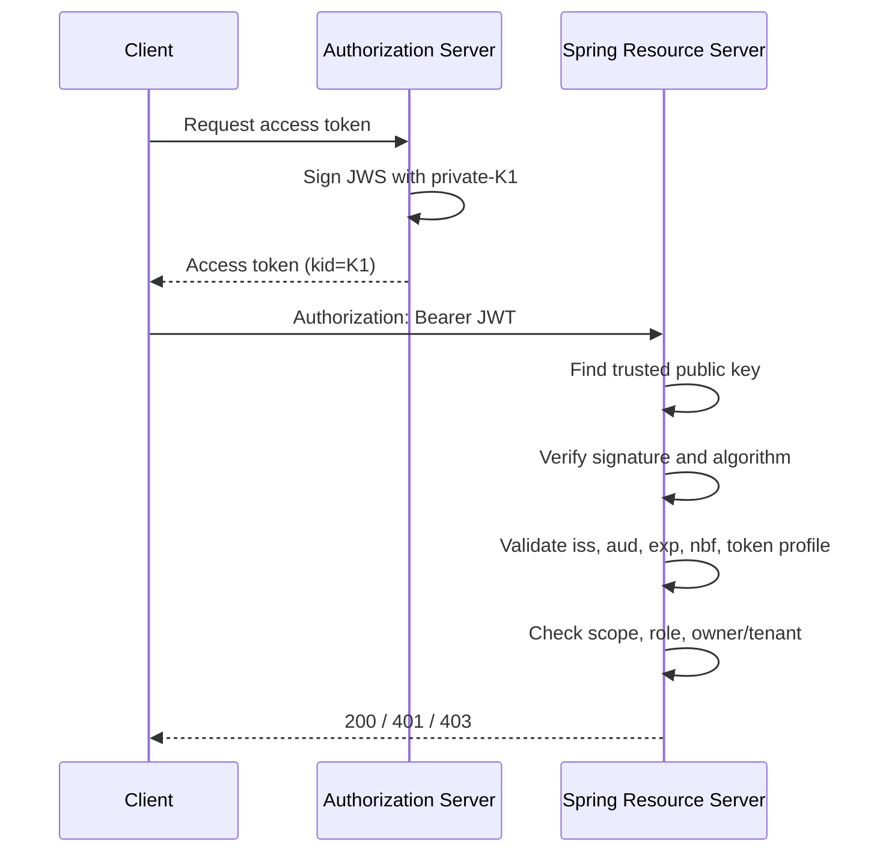
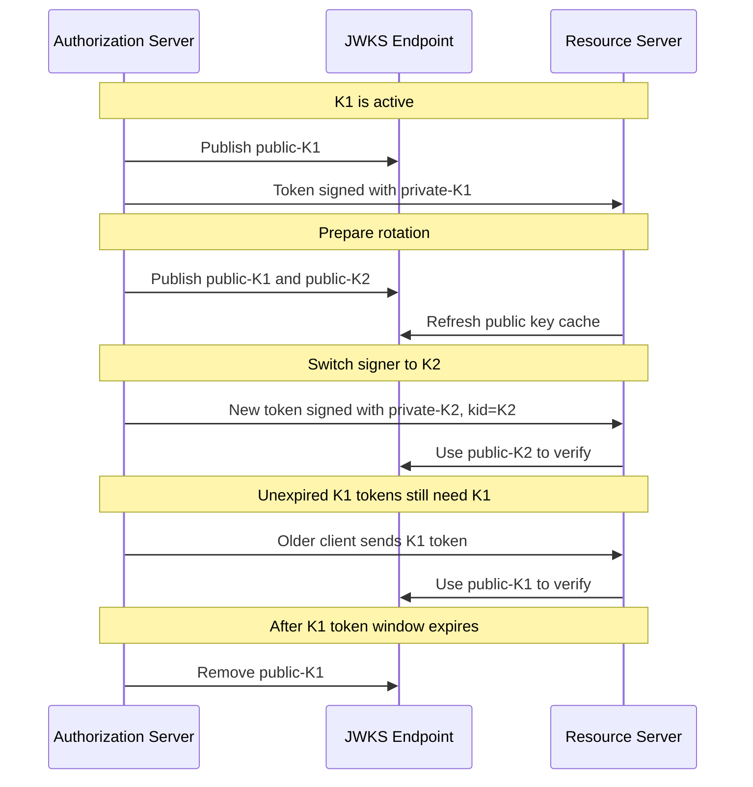

# Static Public Keys and Rotation Requirements

In **Spring Security OAuth 2.0 / OIDC Resource Server**, a JWT access token is typically signed by the Authorization Server with a **private signing key**. The Resource Server holds the corresponding **public key** to verify the JWS signature before trusting claims. The simplest configuration is providing **a single static public key**, from a verified PEM file or managed deployment configuration.

A static key fits small systems or tightly change-controlled environments, but runs into trouble when the Authorization Server must **rotate keys** (*signing key rotation*): new tokens are signed with K2 while older tokens signed with K1 are still unexpired. If the Resource Server knows only one public key at a time, it cannot accept both kinds of tokens simultaneously.

This lesson explains how to verify JWTs with a static public key, separate signature checks from issuer/audience validation, plan key changes around token lifetimes, transition to JWKS when multiple keys must be supported, and test key distribution/revocation in Spring Security.

> Lesson notation: **K1** and **K2** are two independent key pairs. The issuer holds `private-K1` and `private-K2`; the Resource Server is provisioned only with `public-K1` and `public-K2`. Domains and parameters are illustrative examples.

## 1. How does a public key participate in JWT verification?

A JWT access token protected with JWS Compact typically has three segments:

```text
BASE64URL(protected-header).BASE64URL(payload).BASE64URL(signature)
```

The protected header may contain:

```json
{
  "alg": "RS256",
  "typ": "at+jwt",
  "kid": "orders-signing-K1"
}
```

The payload may contain:

```json
{
  "iss": "https://login.example.test/realms/orders",
  "sub": "user-123",
  "aud": ["orders-api"],
  "scope": "orders:read",
  "iat": 1890000000,
  "exp": 1890003600
}
```

This is illustrative JSON only, not a validly signed token. In standard JWS Compact, the issuer signs the **ASCII bytes of the two encoded segments joined by a dot**:

```text
signingInput = ASCII(encodedHeader + "." + encodedPayload)
signature    = SIGN(privateKey, signingInput, approvedAlgorithm)
compactJws   = encodedHeader + "." + encodedPayload
               + "." + BASE64URL(signature)
```

The recipient uses the corresponding public key to verify the signature. If the payload is altered, the header is altered, or the token was signed with a different private key, verification must fail.



**A valid signature does not mean the token is permitted to call every API.** After cryptographic verification, the Resource Server must still confirm issuer, audience, lifetime, and accepted access token type, and then enforce authorization.

| Layer | Question | Common failure |
|---|---|---|
| **JWS signature** | Was the token signed by the private key matching the trusted public key, using an allowed algorithm? | Invalid signature, mismatched key/algorithm → typically `401`. |
| **JWT validation** | Is `iss` right, `aud` meant for this API, `exp`/`nbf` valid, and token profile right? | Validly signed token not issued for this API → typically `401`. |
| **Authorization** | Does the user/service have sufficient scope/role and resource permission? | Valid token lacking permission → typically `403`, or `404` depending on resource-protection policy. |

Base64URL **does not encrypt secrets**; decoding the header and payload alone never verifies a JWT. Nor does a public key “decrypt” or “unpack” data; it is used strictly to verify digital signatures.

## 2. What is a static public key?

There are several key distribution models for a Resource Server:

| Model | Public key source | Key update | Trade-off |
|---|---|---|---|
| **Single static key** | PEM file packaged in the application or mounted via protected config. | Replace file/build and reinitialize decoder/redeploy. | Easy initial operation; cannot accept K1 and K2 simultaneously if only one key exists. |
| **JWKS over trusted HTTPS** | JWK Set endpoint published by the issuer; decoder picks key by `kid`. | Publish K2 while keeping K1 for overlap; verifier refreshes/caches JWKS. | Flexible rotation; depends on JWKS/cache/network policy. |
| **Multiple statically distributed keys** | Verified local keyset distributed by pipeline. | Update keyset on every instance before signer rotates keys. | No runtime JWKS calls needed, but selection, trust, and rollout must be self-managed. |

**A public key is not a secret** and may be shared publicly. However, **the integrity and provenance of the public key are core security data**. If someone swaps the trusted public key for their own, they can mint forged tokens signed with their private key and trick the API into verifying them. Protect files, repositories, pipelines, and configuration edit permissions.

Conversely, **the private key belongs exclusively to the Authorization Server/HSM/KMS**. Never place it in a Resource Server for “convenient signature testing”, never commit private keys, and never use the issuer's private key as a test fixture.

### 2.1. Distinguishing two common RSA PEM formats

A public key file in **X.509 SubjectPublicKeyInfo (SPKI)** format looks like:

```pem
-----BEGIN PUBLIC KEY-----
<base64-SPKI-DER>
-----END PUBLIC KEY-----
```

`<base64-SPKI-DER>` is a placeholder. Another variant is:

```text
-----BEGIN RSA PUBLIC KEY-----
...
-----END RSA PUBLIC KEY-----
```

The second form is normally **PKCS#1 RSAPublicKey**, which differs from SPKI. Java parsers using `X509EncodedKeySpec` expect **SPKI**, so do not feed PKCS#1 PEM straight in without proper conversion.

When practicing in an isolated lab environment, you can generate a simulated issuer keypair and export its **public key**:

```bash
# Lab only: private key resides on the simulated issuer machine.
openssl genpkey -algorithm RSA -pkeyopt rsa_keygen_bits:3072 \
  -out issuer-private.pem

openssl pkey -in issuer-private.pem -pubout \
  -out issuer-public.pem

openssl pkey -pubin -in issuer-public.pem -text -noout
```

In real systems, obtain the public key solely from the issuer through a trusted channel; never generate a keypair on the API side and pretend it belongs to the token-issuing authority.

## 3. Building a Resource Server with a single static public key

Example runs on Java 17+, Spring Boot 3.x / Spring Security 6.x. Conventions:

- Issuer: `https://login.example.test/realms/orders`.
- Audience: `orders-api`.
- Signature: `RS256`.
- Public key PEM: `classpath:keys/orders-issuer-public.pem`.
- Read-orders scope: `orders:read`.

### 3.1. Maven dependencies

Use Spring Boot's BOM/parent to manage dependency versions:

```xml
<dependencies>
    <dependency>
        <groupId>org.springframework.boot</groupId>
        <artifactId>spring-boot-starter-web</artifactId>
    </dependency>
    <dependency>
        <groupId>org.springframework.boot</groupId>
        <artifactId>spring-boot-starter-security</artifactId>
    </dependency>
    <dependency>
        <groupId>org.springframework.boot</groupId>
        <artifactId>spring-boot-starter-oauth2-resource-server</artifactId>
    </dependency>
    <dependency>
        <groupId>org.springframework.boot</groupId>
        <artifactId>spring-boot-starter-test</artifactId>
        <scope>test</scope>
    </dependency>
    <dependency>
        <groupId>org.springframework.security</groupId>
        <artifactId>spring-security-test</artifactId>
        <scope>test</scope>
    </dependency>
</dependencies>
```

### 3.2. Key configuration and JWT contract

```yaml
security:
  jwt:
    issuer: https://login.example.test/realms/orders
    audience: orders-api
    public-key: classpath:keys/orders-issuer-public.pem
```

These are **custom properties** used with the `JwtDecoder` bean in the next section. The public key can also be mounted at runtime:

```yaml
security:
  jwt:
    issuer: https://login.example.test/realms/orders
    audience: orders-api
    public-key: file:/etc/orders/keys/issuer-public.pem
```

Mounting a file avoids rebuilding the image just to swap a public key; however, **changing the file contents after the application has initialized does not automatically make the decoder reload the new key**. An explicit restart/rebind or intentional refresh process is required.

### 3.3. Reading the RSA public key and declaring `JwtDecoder`

Create `StaticKeyJwtConfig.java`:

```java
package com.example.orders.security;

import java.io.InputStream;
import java.nio.charset.StandardCharsets;
import java.security.KeyFactory;
import java.security.interfaces.RSAPublicKey;
import java.security.spec.X509EncodedKeySpec;
import java.util.Base64;

import org.springframework.beans.factory.annotation.Value;
import org.springframework.context.annotation.Bean;
import org.springframework.context.annotation.Configuration;
import org.springframework.core.io.Resource;
import org.springframework.security.oauth2.core.DelegatingOAuth2TokenValidator;
import org.springframework.security.oauth2.core.OAuth2Error;
import org.springframework.security.oauth2.core.OAuth2TokenValidator;
import org.springframework.security.oauth2.core.OAuth2TokenValidatorResult;
import org.springframework.security.oauth2.jwt.Jwt;
import org.springframework.security.oauth2.jwt.JwtDecoder;
import org.springframework.security.oauth2.jwt.JwtValidators;
import org.springframework.security.oauth2.jwt.NimbusJwtDecoder;

@Configuration
public class StaticKeyJwtConfig {

    @Bean
    JwtDecoder jwtDecoder(
        @Value("${security.jwt.public-key}") Resource publicKeyResource,
        @Value("${security.jwt.issuer}") String trustedIssuer,
        @Value("${security.jwt.audience}") String expectedAudience
    ) throws Exception {
        RSAPublicKey publicKey = readPublicKey(publicKeyResource);

        // By default, this RSA builder trusts RS256 in Spring Security 6.x.
        NimbusJwtDecoder decoder =
            NimbusJwtDecoder.withPublicKey(publicKey).build();

        OAuth2TokenValidator<Jwt> audienceValidator = jwt ->
            jwt.getAudience().contains(expectedAudience)
                ? OAuth2TokenValidatorResult.success()
                : OAuth2TokenValidatorResult.failure(
                    new OAuth2Error("invalid_token", "Wrong audience", null));

        // Includes timestamp checks together with issuer check;
        // adds audience validation specifically for orders-api.
        decoder.setJwtValidator(
            new DelegatingOAuth2TokenValidator<>(
                JwtValidators.createDefaultWithIssuer(trustedIssuer),
                audienceValidator
            )
        );
        return decoder;
    }

    private static RSAPublicKey readPublicKey(Resource resource)
        throws Exception {
        String pem;
        try (InputStream in = resource.getInputStream()) {
            pem = new String(in.readAllBytes(), StandardCharsets.US_ASCII);
        }

        // This template is for X.509 SPKI PEM: BEGIN PUBLIC KEY.
        String encoded = pem
            .replace("-----BEGIN PUBLIC KEY-----", "")
            .replace("-----END PUBLIC KEY-----", "")
            .replaceAll("\\s", "");

        byte[] der = Base64.getDecoder().decode(encoded);
        KeyFactory factory = KeyFactory.getInstance("RSA");
        return (RSAPublicKey) factory.generatePublic(
            new X509EncodedKeySpec(der));
    }
}
```

**Security meaning of this configuration:**

1. `withPublicKey(publicKey)` uses a **server-managed** RSA public key rather than fetching keys from content sent by the client.
2. The decoder verifies the JWS signature; JWT validators additionally verify `iss`, `aud`, `exp`, `nbf`, and corresponding default constraints.
3. In Spring Security 6.x, standard `withPublicKey(...)` trusts `RS256` by default; when the issuer uses another algorithm, configure explicitly per policy and matching key type.
4. The example parser accepts one specific PEM format (SPKI). If your organization exports PKCS#1 or certificates, use an appropriate parser/converter rather than arbitrary `replace` calls to force one format into another.
5. If the file is missing, altered, unreadable, invalid Base64, or not an RSA public key, the application must **fail startup**. Never generate a “fallback” key or disable signature validation just to let the app boot.
6. A custom `JwtDecoder` bean replaces part of Spring Boot's auto-configuration; verify **all** validators required by the token contract. If using RFC 9068 JWT access tokens, also consider checking token type `at+jwt` and profile-required claims.

A public key may be committed (it contains no secret), but only after verifying its exact provenance and establishing a review/update process. Never store `issuer-private.pem` in `resources` or a Docker image.

### 3.4. Enabling JWT Resource Server and scope protection

```java
package com.example.orders.security;

import org.springframework.context.annotation.Bean;
import org.springframework.context.annotation.Configuration;
import org.springframework.http.HttpMethod;
import org.springframework.security.config.Customizer;
import org.springframework.security.config.annotation.web.builders.HttpSecurity;
import org.springframework.security.config.annotation.web.configurers.AbstractHttpConfigurer;
import org.springframework.security.config.http.SessionCreationPolicy;
import org.springframework.security.web.SecurityFilterChain;

@Configuration
class ApiSecurityConfig {

    @Bean
    SecurityFilterChain apiSecurity(HttpSecurity http) throws Exception {
        return http
            .csrf(AbstractHttpConfigurer::disable)
            .sessionManagement(session ->
                session.sessionCreationPolicy(SessionCreationPolicy.STATELESS))
            .authorizeHttpRequests(auth -> auth
                .requestMatchers(HttpMethod.GET, "/api/public/ping").permitAll()
                .requestMatchers(HttpMethod.GET, "/api/orders/**")
                    .hasAuthority("SCOPE_orders:read")
                .anyRequest().denyAll())
            .oauth2ResourceServer(oauth ->
                oauth.jwt(Customizer.withDefaults()))
            .build();
    }
}
```

For a stateless API using Bearer tokens in the `Authorization` header, the configuration above is a solid starting point. Do not copy CSRF disabling to applications authenticating via cookies/sessions without separate evaluation. The `SCOPE_orders:read` permission also needs to be paired with owner/tenant data checks in the service/repository.

### 3.5. Shorter configuration via Spring Boot property

Spring Boot can accept a static public key via property:

```yaml
spring:
  security:
    oauth2:
      resourceserver:
        jwt:
          public-key-location: classpath:keys/orders-issuer-public.pem
```

This is a shorter path when no custom decoder is needed. Still, **never assume declaring a public key enforces the entire access token contract**. Verify issuer, audience, expiration, algorithm, profile token type, and the Spring Boot/Security defaults of your active version. If the application **already defines a custom `@Bean JwtDecoder`**, this property may no longer be applied by auto-config the way you expect.

In this lesson, the decoder bean example makes the public key source and validators explicit. Choose **one decoder configuration strategy**, avoiding two competing `JwtDecoder` beans.

## 4. “Right key” does not replace other validators

With RSA, a valid public key for K1 verifies signatures created by private-K1. It does not answer the remaining questions:

| Check | Does the public key satisfy it automatically? | Actual requirement |
|---|---|---|
| JWT signed with the right RSA key and algorithm | **Yes**, if the decoder restricts algorithms properly. | Verify JWS signature. |
| `iss` belongs to a trusted issuer | **No**. | Validate issuer accurately. |
| `aud` contains `orders-api` | **No**. | Validate audience; reject tokens meant for another API/frontend. |
| `exp`, `nbf` are valid | **No**. | Check validity against clock and skew policy. |
| Token is an **access token** of the right profile | **No**. | Enforce token type/claims per contract (e.g., `at+jwt` for RFC 9068). |
| Scope/role granted for the action | **No**. | Map authorities and enforce route/method rules. |
| User/service owns the record | **No**. | Check owner, tenant, and business constraints. |
| Token revoked before `exp` | **No**. | Design revocation/introspection, short token TTL, or supplemental checks. |
| Private-K1 compromised | **No**. | Remove K1 from trust and handle K1-signed tokens. |

This explains two easily confused errors:

- A JWT with a valid K1 signature but `aud=payments-api` is rejected **because it is intended for another API**, not because the public key is wrong.
- A JWT with `scope=orders:read` in its JSON but an invalid K1 signature must not produce a principal/authority. Never let it through just because the payload is readable.

### 4.1. `kid` is only a key-selection hint

A JWS header often contains `kid` (*key identifier*) to select a key in a JWKS. Yet `kid` is not proof of trust: an attacker can put any `kid` into an unverified token.

With a static public key, the decoder already knows which key to check; `kid` cannot turn K1 into K2. With JWKS, the decoder looks up `kid` **within the key set bound to the configured trusted issuer**. Never fetch arbitrary URLs from unverified token headers `jku`/`x5u` to download public keys; doing so can trick the API into trusting attacker-controlled keys.

### 4.2. Algorithms must be allowlisted

If a verifier reads `alg` and automatically switches to whatever algorithm the token proposes, **algorithm confusion** becomes a risk. For instance, an RSA configuration carelessly accepting HMAC with the RSA public key bytes as the secret can create a severe vulnerability in a flawed implementation.

Reject `alg=none` for access tokens requiring signatures, and restrict `RS256`/`PS256`/`ES256` per issuer contract and matching key type. Never use “accept all algorithms” as a workaround to support rotation.

## 5. What problem does a single static key face when K1 rotates to K2?

Suppose:

- All `orders-api` instances trust `public-K1`.
- The Authorization Server signs access tokens with `private-K1`.
- Access tokens have a maximum lifetime of **30 minutes**.
- The organization wants to switch to keypair K2.

When the issuer begins signing with private-K2:

```text
Token K1 + Resource Server trusts public-K1  -> signature can be valid
Token K2 + Resource Server trusts public-K1  -> signature rejected
Token K1 + Resource Server trusts public-K2  -> signature rejected
Token K2 + Resource Server trusts public-K2  -> signature can be valid
```

**There is no point at which a decoder trusting strictly one public key can accept both K1 and K2 tokens.**

Suppose 10 API pods undergo a rolling update: 5 pods on K1, 5 pods on K2. A client still holding a K1 token succeeds when hitting an old pod, yet gets `401` when hitting a new pod. K2 tokens fail in the opposite direction. Increasing retries or enabling sticky sessions does not fix the underlying split trust: failover, autoscaling, and load balancing can route to any pod at any moment.

### 5.1. Cutover timing table

| Phase | Issuer signs with | API trusts only | Unexpired K1 tokens | New K2 tokens |
|---|---|---|---|---|
| Initial | K1 | public-K1 | Accepted | Not yet issued. |
| Switch issuer first | K2 | public-K1 | Accepted | **401**. |
| Switch API first | K1 | public-K2 | **401**. | None. |
| Full cutover to K2 | K2 | public-K2 | **401**, even if `exp` remains valid. | Accepted. |

Trying to switch both sides “simultaneously” still suffers distribution delays, caching, and clock skew. If the API must keep accepting **both unexpired old tokens and new tokens**, you must use a solution that trusts **multiple public keys** during the transition window.

### 5.2. Can a single-key hard cutover ever be acceptable?

Yes, but the trade-offs must be clearly communicated:

1. Stop issuing K1 tokens according to procedure.
2. Wait for the last K1 token to expire and clear the committed skew/usage window.
3. Cut over both signer and verifier to K2 within a controlled maintenance window.
4. Begin issuing K2 tokens and have clients re-acquire tokens.

In continuously running systems, waiting for K1 tokens to expire while halting new token issuance causes disruption. If the service cannot tolerate downtime, a hard cutover with a **single key** is unsuitable. Surface this limitation at design time rather than waiting until rotation day.

## 6. Using JWKS to accept both K1 and K2 during the overlap window

**JWKS — JSON Web Key Set** publishes a collection of public keys. For RSA, a public JWK contains `n` (modulus) and `e` (exponent), alongside a `kid` identifying the key:

```json
{
  "keys": [
    {
      "kty": "RSA",
      "kid": "orders-signing-K1",
      "use": "sig",
      "alg": "RS256",
      "n": "<public-modulus-K1-base64url>",
      "e": "AQAB"
    },
    {
      "kty": "RSA",
      "kid": "orders-signing-K2",
      "use": "sig",
      "alg": "RS256",
      "n": "<public-modulus-K2-base64url>",
      "e": "AQAB"
    }
  ]
}
```

The `<public-modulus-...>` strings are placeholders, not real keys. A public JWKS **must never contain private JWK fields** such as `d`, `p`, `q`, `dp`, `dq`, or `qi`.

The decoder picks a key from the **trusted** JWKS, typically using `kid`/`alg`/`kty`. If a token carries `kid=orders-signing-K2`, the decoder uses public-K2 to verify the signature; if an older token carries K1, public-K1 is still present.

### 6.1. Scheduled rotation step by step

| Phase | Which private key does the issuer sign with? | JWKS publishes | Operational condition |
|---|---|---|---|
| **A. Steady state** | K1 | public-K1 | APIs accept K1 tokens. |
| **B. Pre-publish** | **Still K1** | public-K1 **and** public-K2 | Gives API/JWKS caches time to learn K2. |
| **C. Switch signing** | **K2** | public-K1 and public-K2 | New K2 tokens are accepted; unexpired K1 tokens remain valid. |
| **D. Drain old tokens** | K2 | public-K1 and public-K2 | Wait for the last K1 token to expire and account for skew/cache. |
| **E. Retire K1** | K2 | public-K2 only | Verifiers refresh/remove K1 per policy. |



The crucial rule is: **publish K2 before signing K2 tokens; keep K1 after stopping K1 signing until K1 tokens are no longer usable, except in an emergency revocation**.

### 6.2. Calculating the overlap window

Do not blindly pick a fixed 5 minutes or 24 hours for every service. Consider:

- **Maximum TTL** of any K1 access token that could be issued. Different grants may have different TTLs.
- **Last timestamp the issuer signed with K1**, including any unsynchronized issuing nodes.
- **Clock skew** of JWT validators, issuing systems, and verifying systems.
- **JWKS cache TTL**, refresh intervals, CDN/proxy caches, and per-node caches.
- **Rollout propagation delay** across all Resource Server instances.
- Cases like future `nbf`, offline batch/job tokens, and policies where tokens remain usable until `exp`.

For example, if the last K1 token was issued at 10:00 with a max TTL of 30 minutes, plenty of valid K1 tokens still exist at 10:01. Even after 10:30, account for skew and cache/sync delays. Exactly when to remove K1 must be based on the token contract and actual system state.

### 6.3. Special notes on JWKS caching

Spring Security/Nimbus or HTTP proxies may cache the keyset. Observed behaviors include:

- K2 appears in the JWKS, yet some decoders still hold the older K1 snapshot.
- A new token carrying `kid=K2` may trigger a cache refresh in some implementations; **do not assume every version refreshes instantaneously**.
- If the same `kid` is reused for a different key pair, a decoder may pick the old public key and fail signature verification. Always assign a new `kid` to a new keypair.
- After removing K1 from the JWKS, some instances may **still retain K1 in cache**. Removing it at the issuer does not guarantee every Resource Server immediately stops trusting K1.
- If the JWKS endpoint suffers a network outage, tokens using cached keys may still verify in some setups, while tokens with a new `kid` cannot be verified and will be rejected. Never allow them through without verification.

Therefore, **rotation tests must cover the caching behavior of your actual Spring Security/Nimbus/proxy versions**, not merely inspect the JWKS JSON on the issuer.

## 7. Configuring JWKS in Spring Security

A typical configuration when the issuer supports discovery:

```yaml
spring:
  security:
    oauth2:
      resourceserver:
        jwt:
          issuer-uri: https://login.example.test/realms/orders
          audiences:
            - orders-api
```

Spring Security can use the trusted issuer's metadata to locate the JWKS endpoint; discovery and startup details depend on configuration and version. If you want to pin an organization-vetted JWKS endpoint:

```yaml
spring:
  security:
    oauth2:
      resourceserver:
        jwt:
          issuer-uri: https://login.example.test/realms/orders
          jwk-set-uri: https://login.example.test/realms/orders/protocol/openid-connect/certs
          audiences:
            - orders-api
```

These URLs are illustrative; obtain the exact `jwks_uri` from the issuer's metadata/specification. Combining `issuer-uri` and `jwk-set-uri` pins the key source while maintaining issuer validation in appropriate Spring Boot configurations, and can avoid startup discovery dependence.

Never allow request headers, query strings, or `jku` inside a JWT to change the trusted JWKS address. The JWKS endpoint must be accessed over HTTPS with valid certificates, governed metadata-change permissions, and a documented rotation process.

### 7.1. Declaring a JWKS decoder in Java

If you need a custom `JwtDecoder` bean:

```java
package com.example.orders.security;

import org.springframework.context.annotation.Bean;
import org.springframework.context.annotation.Configuration;
import org.springframework.security.oauth2.core.DelegatingOAuth2TokenValidator;
import org.springframework.security.oauth2.core.OAuth2Error;
import org.springframework.security.oauth2.core.OAuth2TokenValidator;
import org.springframework.security.oauth2.core.OAuth2TokenValidatorResult;
import org.springframework.security.oauth2.jwt.Jwt;
import org.springframework.security.oauth2.jwt.JwtDecoder;
import org.springframework.security.oauth2.jwt.JwtValidators;
import org.springframework.security.oauth2.jwt.NimbusJwtDecoder;

@Configuration
class JwksJwtConfig {
    private static final String ISSUER =
        "https://login.example.test/realms/orders";
    private static final String JWKS_URI =
        "https://login.example.test/realms/orders/protocol/openid-connect/certs";

    @Bean
    JwtDecoder jwtDecoder() {
        NimbusJwtDecoder decoder =
            NimbusJwtDecoder.withJwkSetUri(JWKS_URI).build();

        OAuth2TokenValidator<Jwt> audience = jwt ->
            jwt.getAudience().contains("orders-api")
                ? OAuth2TokenValidatorResult.success()
                : OAuth2TokenValidatorResult.failure(
                    new OAuth2Error("invalid_token", "Wrong audience", null));

        decoder.setJwtValidator(
            new DelegatingOAuth2TokenValidator<>(
                JwtValidators.createDefaultWithIssuer(ISSUER),
                audience
            )
        );
        return decoder;
    }
}
```

This example replaces the static-key bean from section 3. **Do not define both `StaticKeyJwtConfig` and `JwksJwtConfig` in the same application context** if both unconditionally declare a `JwtDecoder` bean. Choose one strategy per environment.

Verify default allowed algorithms against your Spring Security version; to use `PS256`/`ES256` or change key types, configure and test **strictly the approved algorithm**. Never enable all `alg` values just to make tokens work.

### 7.2. `kid`, `kty`, `alg`, and key selection

In a JWKS:

- `kid`: key ID to identify keys when multiple public keys exist. Must be unique during the overlap window.
- `kty`: key type, such as `RSA` or `EC`.
- `alg`: intended algorithm, such as `RS256`; merely metadata—the verifier must still enforce its own policy.
- `use=sig`: signing/verification usage; do not use encryption-only keys if policy forbids it.
- `n`, `e`: RSA public parameters.
- `key_ops` (if present): may declare `verify`.

**Key selection does not replace signature verification.** Even if `kid` matches a public key in the JWKS, the signature must still be cryptographically verified. Never accept a token just because `kid` or `iss` looks valid.

## 8. If you must keep static keys: designing a key-replacement process

Some organizations do not permit Resource Servers to fetch JWKS over the network. In that case, proactively design key lifecycle management:

1. **Generate the new key**: the issuer/HSM generates K2, keeping private-K2 outside the Resource Server.
2. **Distribute public-K2 via a verified channel**: e.g., signed artifact, authenticated internal channel, SHA-256 fingerprint of the SPKI DER confirmed by the issuer team per procedure.
3. **Distribute the keyset or key update**: allow only authorized pipelines/roles to update the trusted keys file.
4. **Update decoder/rollout**: intentionally reload the bean or restart pods; with a static single key, accept either a transition gap or a hard cutover.
5. **Verify across all instances**: confirm every app instance uses the right key version, with no mixed versions and no policy-free fallbacks.
6. **Retire K1**: based on old token state or an emergency response process.
7. **Keep an auditable change log**: who approved the new public key, effective date, algorithm, `kid`, fingerprint, and retirement schedule.

### 8.1. Multiple static keys can replace runtime JWKS

If you must avoid network calls while still supporting overlap, use a **static set of public keys** with explicit `kid`s and trust policies. One option is distributing a **verified local JWKS JSON**, using the JOSE library to select keys by `kid`/algorithm and verify signatures, and then running the same JWT validators as a standard setup.

However, a custom multi-key implementation is security-critical code. Never replace it with:

```java
// FLAWED ILLUSTRATIVE PSEUDOCODE — DO NOT USE IN PRODUCTION
try {
    return decoderK1.decode(token);
} catch (Exception error) {
    return anyDecoderThatAcceptsIt.decode(token);
}
```

A boundary-less fallback can turn an issuer/audience/algorithm failure into “try another key” and accept it. If implementing multi-key handling, you must:

- Bind the keyset to the **exact issuer and token profile**.
- Restrict allowed algorithms and key types.
- Select a unique key, handling unknown or ambiguous `kid`s per policy.
- Apply **all validators** to the token—never skip them in a fallback decoder branch.
- Maintain a mechanism to distribute the updated keyset and purge K1 from **every** pod.
- Thoroughly test behavior when trusted keysets are out of sync.

An **internal**, verified JWKS endpoint is sometimes easier to operate than building a custom selector. Whether the JWKS is exposed on the Internet is a network decision; what matters most is a trusted key source and overlap support.

### 8.2. Pinning and rotation

Two layers of “pinning” are easily confused:

- **Pinning the issuer/JWKS URL**: the Resource Server fetches public keys only from an approved source and trusted issuer/certificate. Signing keys inside the JWKS can rotate per policy.
- **Pinning a single public signing key**: the Resource Server trusts only that specific keypair. When the signer rotates keypairs, the public key must be updated in a coordinated rollout.

Pinning a single key is tight, yet imposes high rotation overhead. If zero downtime is required and the AS rotates frequently, evaluate switching to trusting **issuer + JWKS endpoint** or a statically distributed keyset with overlap. **TLS certificate pinning** for the JWKS endpoint is also distinct from pinning a JWT public signing key.

## 9. Scheduled rotation vs. emergency rotation

In **scheduled rotation**, K1 has not been compromised; it remains cryptographically safe to accept unexpired K1 tokens per contract. An overlap window can be maintained so clients do not have to re-fetch tokens abruptly.

In **emergency rotation due to private-K1 compromise**, anyone holding private-K1 can sign forged tokens with arbitrary claims. Keeping K1 in the JWKS just to avoid `401` errors preserves the forgery vector. The runbook should prioritize revoking trust in K1 and accepting that unexpired K1 tokens must be reissued.

### 9.1. Incident workflow for suspected private signing key compromise

1. Confirm scope: issuer, keypair, environment, where the private key was stored, and related logs/backups/CI.
2. Isolate the leak source and close unauthorized access to HSM/KMS/key store.
3. Generate K2 in a trusted key store with a new `kid` and approved algorithm.
4. Switch the AS to sign with K2 and update all Resource Servers to accept K2 as fast as possible.
5. **Remove public-K1 from trust** on verifiers per incident policy; address JWKS caches and applications still retaining K1.
6. Assess forged tokens or anomalous activity, and notify clients to refresh/re-authenticate once K1 tokens are invalidated.
7. Verify K1 tokens are rejected and K2 tokens are accepted across every pod/region.
8. Investigate root cause, harden private-key protection, update audit trails, and refine preventive runbooks.

A compromised private key destroys K1's ability to distinguish legitimate older tokens from newly forged ones. A JWT has no built-in way to detect that if relying solely on public-K1. Additional revocation mechanisms can help, yet cannot substitute for revoking trust in the compromised key.

### 9.2. JWKS caching during an emergency incident

Once the issuer removes K1 from the JWKS, **some decoders may still hold public-K1 in cache**. Depending on the library version, caches have their own TTL or refresh logic, so removing K1 from the endpoint cannot be treated as instant revocation.

The runbook must include actionable steps to:

- Invalidate caches or restart/recreate decoders across pods.
- Verify that API instances in every region/cluster have dropped K1.
- Prevent older pods from rolling back to K1 cache/keyset configuration.
- Test that K1 tokens are rejected after revocation completes.

Never disable JWT verification or temporarily open `permitAll` to hide rotation failures.

## 10. Testing signatures and key transitions

Layered testing reveals whether a token was rejected due to an **invalid signature**, **invalid claims**, or **insufficient permissions**.

### 10.1. Minimum test matrix

| Scenario | Decoder trusting only K1 | JWKS trusting K1+K2 | After K1 retirement |
|---|---|---|---|
| K1 token, valid signature/claims, unexpired | Accept | Accept | Reject |
| K2 token, valid signature/claims, unexpired | Reject | Accept | Accept |
| K1 token with modified payload, original signature | Reject | Reject | Reject |
| Token with `alg=none` or disallowed algorithm | Reject | Reject | Reject |
| Valid signature, different `iss` | Reject | Reject | Reject |
| Valid signature, `aud` is another API | Reject | Reject | Reject |
| Valid signature, `exp` in the past | Reject | Reject | Reject |
| Valid token, missing scope | Authentication succeeds, authorization denies | Same | Same |
| Valid token, sufficient scope, wrong owner | Business authorization denies | Same | Same |

“Accept” rows assume all unmentioned conditions are valid and API policy permits the request.

### 10.2. JUnit test proving one public key does not verify K2 tokens

Generate **test keypairs** in memory, sign with each pair's private key, and test a decoder trusting only public-K1:

```java
package com.example.orders.security;

import static org.junit.jupiter.api.Assertions.assertEquals;
import static org.junit.jupiter.api.Assertions.assertThrows;

import java.security.KeyPair;
import java.security.KeyPairGenerator;
import java.security.interfaces.RSAPrivateKey;
import java.security.interfaces.RSAPublicKey;
import java.time.Instant;
import java.util.List;

import com.nimbusds.jose.jwk.JWKSet;
import com.nimbusds.jose.jwk.RSAKey;
import com.nimbusds.jose.jwk.source.ImmutableJWKSet;
import org.junit.jupiter.api.Test;
import org.springframework.security.oauth2.jose.jws.SignatureAlgorithm;
import org.springframework.security.oauth2.jwt.Jwt;
import org.springframework.security.oauth2.jwt.JwtClaimsSet;
import org.springframework.security.oauth2.jwt.JwtDecoder;
import org.springframework.security.oauth2.jwt.JwtEncoderParameters;
import org.springframework.security.oauth2.jwt.JwtException;
import org.springframework.security.oauth2.jwt.JwsHeader;
import org.springframework.security.oauth2.jwt.NimbusJwtDecoder;
import org.springframework.security.oauth2.jwt.NimbusJwtEncoder;

class FixedPublicKeyDecoderTest {
    @Test
    void k1KeyDoesNotVerifySignatureCreatedByK2() throws Exception {
        KeyPair k1 = generateRsa();
        KeyPair k2 = generateRsa();

        String tokenK1 = sign(k1, "K1", "alice");
        String tokenK2 = sign(k2, "K2", "alice");

        JwtDecoder decoder = NimbusJwtDecoder
            .withPublicKey((RSAPublicKey) k1.getPublic())
            .build();

        Jwt valid = decoder.decode(tokenK1);
        assertEquals("alice", valid.getSubject());

        assertThrows(JwtException.class, () -> decoder.decode(tokenK2));
    }

    private static KeyPair generateRsa() throws Exception {
        KeyPairGenerator generator = KeyPairGenerator.getInstance("RSA");
        generator.initialize(2048); // Lab only, not recommended as a production default.
        return generator.generateKeyPair();
    }

    private static String sign(KeyPair keyPair, String kid, String subject) {
        RSAKey signingJwk = new RSAKey.Builder(
            (RSAPublicKey) keyPair.getPublic())
            .privateKey((RSAPrivateKey) keyPair.getPrivate())
            .keyID(kid)
            .build();

        NimbusJwtEncoder encoder = new NimbusJwtEncoder(
            new ImmutableJWKSet<>(new JWKSet(signingJwk)));

        Instant now = Instant.now();
        JwtClaimsSet claims = JwtClaimsSet.builder()
            .issuer("https://login.example.test/realms/orders")
            .subject(subject)
            .audience(List.of("orders-api"))
            .issuedAt(now)
            .expiresAt(now.plusSeconds(300))
            .claim("scope", "orders:read")
            .build();

        JwsHeader header = JwsHeader.with(SignatureAlgorithm.RS256)
            .keyId(kid)
            .build();

        return encoder.encode(
            JwtEncoderParameters.from(header, claims)).getTokenValue();
    }
}
```

This test focuses on **signing keys and verification keys**. It does not attach production-style issuer/audience validators; also test a decoder configured with `JwtValidators.createDefaultWithIssuer(...)` and an audience validator to ensure all critical claims are validated too.

Never use production private keys in tests. When running HTTP security tests with `spring-security-test`, note that MockMvc's `jwt()` creates a mock authentication and bypasses signature/JWKS verification, so **it is insufficient as proof of rotation**.

### 10.3. Integration tests for JWKS and caching

Use a local mock JWKS HTTP server and two keypairs K1/K2, then simulate:

1. JWKS contains only K1; K1 tokens succeed.
2. JWKS publishes K1+K2 while the signer still signs with K1.
3. K2 tokens appear with a new `kid`; decoder accepts K2 after refreshing, while K1 tokens still verify.
4. JWKS cache returns stale data or endpoint errors: observe K2 token handling, key lookup, and fail-closed behavior.
5. JWKS drops K1; confirm K1 tokens are rejected only **after the decoder actually evicts cached K1**.
6. Tokens with unknown `kid`, duplicate key IDs, disallowed algorithms, wrong `iss`/`aud`, expired timestamps, and invalid signatures are all rejected per contract.
7. In a multi-pod staging environment, verify consistent K1/K2 behavior before, during, and after rotation.

If tests do not account for caching and rollout, you may mistakenly conclude the system has already retired K1 or is ready for K2.

## 11. Changing algorithms at the same time as rotating keys

Rotating RSA keypairs K1 → K2 while keeping `RS256` is key rotation. Changing `RS256` to `PS256` or `ES256` simultaneously is an **algorithm migration**:

- With RSA → EC, the key type and parser/verifier also change.
- A JWK with `kty=RSA` cannot verify an ECDSA token.
- `alg` must be in the Resource Server's allowlist before processing tokens.
- Older API versions might not support the new algorithm.
- If there is an overlap period between old and new algorithms, declare it narrowly and test both accepted and rejected tokens of each type.

The sequence should be: **deploy verifiers supporting the new policy first → publish new keys → begin signing with the new algorithm → wait for old tokens to expire → remove old algorithms/keys**. Never enable every algorithm just to guarantee “zero disruption”.

## 12. Monitoring and troubleshooting rotation in operations

Indicators to observe without storing credentials:

| Symptom | Possible cause | What to check |
|---|---|---|
| `401` spike right as issuer switches to K2 | API lacks public-K2 or JWKS cache is stale. | New `kid`, current keyset, cache refresh, and per-pod versions. |
| Same token type succeeds on pod A but fails on pod B | Pods trust different keys. | Deployment, mounted public key, cache, and readiness. |
| K2 rejected while K1 still works | K2 not pre-published, TLS/JWKS failure, or algorithm/key type mismatch. | Trusted JWKS endpoint, `kid`, `alg`. |
| K1 tokens still accepted after retiring K1 | Local cache or static public key still present. | Cache invalidation, restart/rollout, and keyset version on all instances. |
| `403` spike while JWT decoding succeeds | Scope, role, ownership, or tenant issue. | Authorization rules; do not assume a key failure. |
| JWKS endpoint timeouts or TLS failures | Network, CA, proxy, or AS outage. | Network path and certificates; never disable TLS verification. |
| Valid signature, wrong `aud`/`iss` | Token profile or AS config changed. | Issuer/audience contract; never disable validators. |

**Never log raw JWTs**, `Authorization: Bearer`, private keys, or sensitive introspection responses. Log request IDs, status codes, normalized error categories, and per-pod/region metrics. Even the `kid` header read from an unverified token is client-controlled input; bound its length/characters when logging and never treat it as proof of token origin.

When no matching trusted key can be obtained to verify, **fail closed**: the request must not reach protected business logic. Exact HTTP codes for JWKS infrastructure errors may depend on the decoder and exception handler, yet network failures must never cause tokens to pass through.

## 13. Scheduled key rotation runbook

**Before starting**

- Confirm the Authorization Server owner and who is authorized to create/rotate private signing keys.
- Confirm the algorithm, new `kid`, maximum access token TTL, and clock skew.
- Confirm pod/API counts, JWKS caches/CDNs/proxies, and refresh/restart procedures.
- Prepare K1/K2 test tokens, issuer/audience tests, a 401 dashboard, and a rollback channel.
- Ensure private-K2 is stored in the **issuer's** HSM/KMS/secret store, never placed on the Resource Server.

**Execution**

1. Generate K2 and inspect public-K2/metadata.
2. Publish public-K2 **alongside** public-K1 via JWKS or distribute a static keyset supporting overlap.
3. Wait until verification systems can fetch and accept K2; check all pods/regions before switching the signer.
4. Switch the Authorization Server to sign with private-K2.
5. Verify new K2 tokens are accepted and unexpired K1 tokens remain accepted per policy.
6. Maintain overlap until the final K1 token expires, plus clock skew/cache/rollout margins.
7. Remove public-K1 from the trusted keyset per schedule; verify verifiers have actually dropped K1.
8. Record results, versions/key IDs, and expiration dates; dispose of/destroy private-K1 per key-management policy.

**If private-K1 is suspected of compromise:** shorten or skip the overlap period to avoid continuing to trust forged K1-signed tokens. You may have to force clients to re-acquire tokens and accept a brief controlled disruption.

## 14. Common misconceptions

| Misconception | Accurate understanding |
|---|---|
| “Public keys are secrets and must not go into JWKS.” | Public keys may be public; protect their **integrity and provenance**. |
| “Once the Resource Server has the public key, it automatically checks `aud`/`iss`.” | Signature verification and claim validation are independent steps that must be configured explicitly. |
| “Header `kid=K2` automatically makes the API accept K2.” | `kid` only identifies a key in the **trusted set**; the API must actually possess public-K2. |
| “I have a static key, so I can rotate with zero downtime.” | When K1 and K2 tokens coexist, a single-key decoder cannot accept both. |
| “Just rolling-deploy half the pods with K2.” | Tokens will succeed or fail depending on which pod handles them; every verifier needs overlap. |
| “Removing K1 from JWKS invalidates K1 immediately.” | Caches may still hold K1; invalidation/restart/sync procedures are required. |
| “Scheduled key rotation is how you log out users immediately.” | During scheduled rotation, K1 tokens usually remain accepted until expiration; revocation is a separate problem. |
| “If the signature is valid, scopes in the payload are definitely authorized.” | Scope, role, audience, and owner/tenant must be checked independently. |
| “When JWKS fails, skip verification to keep the API up.” | Never grant access for unverified tokens; fail closed. |
| “You can switch `RS256` to `HS256` just by editing the header.” | Algorithms must be allowlisted and matched to key type; prevent algorithm confusion. |

## 15. Choosing an architecture for real requirements

| Requirement | Approach to consider |
|---|---|
| Single issuer, rare key changes, maintenance window available | Static public key with explicit cutover/runbook; accept limitations. |
| Multi-pod API, non-trivial token TTL, zero downtime needed | JWKS or a public keyset supporting K1/K2 overlap. |
| Offline environment, no runtime JWKS access | Statically distributed keyset with verified provenance and multiple keys during transitions. |
| Multiple issuers | Bind **issuer → keys/JWKS → algorithm → token profile** without mixing trust domains. |
| Need rapid revocation of a compromised key | Emergency runbook, cache control, and trust-key replacement across all verifiers. |
| Migrating from RSA to EC/PSS | Dedicated algorithm migration plan, testing both key types and signed tokens. |

Mental model to keep in mind:

```text
Authorization Server
  ├─ private-K1 (retired from signing; old tokens may still be valid)
  └─ private-K2 (actively signing)
          │
          ▼
Trusted JWKS or keyset
  ├─ public-K1 (until end of overlap window)
  └─ public-K2 (for new tokens)
          │
          ▼
Spring Security JwtDecoder
  ├─ Algorithm, key source, kid, and signature verification
  ├─ JWT validation: iss, aud, exp, nbf, token profile
  └─ Authentication → scopes/roles → owner/tenant authorization
```

**Fundamental operational rule:** **publish public-K2 first → switch issuer signing to private-K2 → retain public-K1 for valid older tokens → remove K1 after the window closes and pod/cache state is verified**. If private-K1 is compromised, prioritize revoking K1 immediately per incident response plan, even if old tokens must be reissued.

### Technical references

- [RFC 7515 — JSON Web Signature (JWS)](https://www.rfc-editor.org/rfc/rfc7515.html): protected header, signatures, and `kid`.
- [RFC 7517 — JSON Web Key (JWK)](https://www.rfc-editor.org/rfc/rfc7517.html): public JWK structure and JWK Sets.
- [RFC 7518 — JSON Web Algorithms (JWA)](https://www.rfc-editor.org/rfc/rfc7518.html): `RS256`, `PS256`, `ES256`, and key formats.
- [RFC 7519 — JSON Web Token (JWT)](https://www.rfc-editor.org/rfc/rfc7519.html): issuer, audience, timestamps, and claims.
- [RFC 8725 — JWT Best Current Practices](https://www.rfc-editor.org/rfc/rfc8725.html): algorithms, trust boundaries, token-type confusion.
- [RFC 9068 — JWT Profile for OAuth 2.0 Access Tokens](https://www.rfc-editor.org/rfc/rfc9068.html): JWT access token requirements.
- [Spring Security Reference — OAuth 2.0 Resource Server JWT](https://docs.spring.io/spring-security/reference/servlet/oauth2/resource-server/jwt.html): `NimbusJwtDecoder`, JWKS, validation, and authorities.
- [Spring Boot Reference — Spring Security](https://docs.spring.io/spring-boot/reference/web/spring-security.html): JWT Resource Server auto-configuration.

A Resource Server using **a single static public key** can be completely secure when the key is provisioned from the right source, signatures and claims are thoroughly verified, and the application can tolerate its key-replacement procedure. But when continuous operation with coexisting old and new tokens is required, **supporting multiple public keys and a controlled overlap period is an essential part of JWT verification design**.
