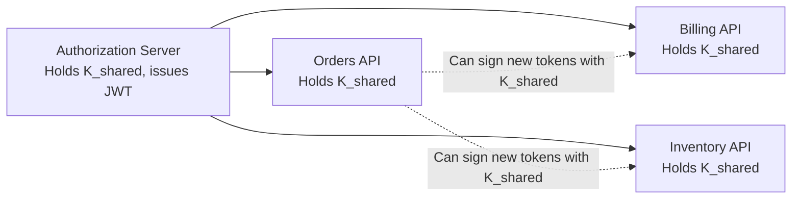
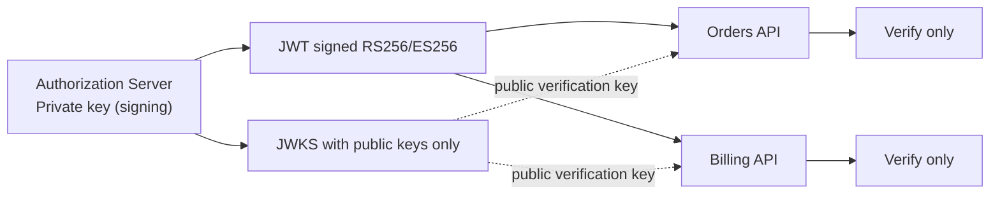

# Symmetric Keys and Trust Boundaries When the Verifier Also Holds the Signing Secret

In a **Spring Security OAuth 2.0 / OIDC Resource Server** system, JWTs are normally protected with a signature so the API can verify whether the token was tampered with and came from a trusted source. One technical option is using a **symmetric key** with an HMAC algorithm such as `HS256`. This approach is cryptographically simple: the issuer and the verifier use the **exact same secret**.

That very “shared key” property creates a **critical trust boundary**: **any component able to verify a JWT with an HMAC secret is also able to generate a valid MAC for a brand-new JWT**. If the Authorization Server distributes the signing secret to multiple Resource Servers, each Resource Server becomes capable of **self-issuing cryptographically valid tokens**. The fact that it is assigned a “verify-only” role is an operational convention, not a restriction enforced by HMAC itself.

This lesson explains why this happens, how to evaluate the blast radius when multiple APIs share a secret, how to configure HS256 in Spring Security, and the architectural options when you need to separate **signing** authority from **verification** authority.

> **Example scope:** The Authorization Server at `https://login.example.com` issues access tokens for the Orders API at `https://api.example.com`, with issuer `https://login.example.com`, audience `orders-api`, and scope `orders.read`. Addresses, secrets, and claims are illustrative only. Java examples use Spring Security 6.x on a Servlet Resource Server.

## 1. What is a symmetric key in JWT signing?

A JWT using JOSE/JWS can be protected by several algorithms. With HMAC, both sides hold a **shared secret key**:

```text
Authorization Server                             Orders API / Resource Server
       │                                                      │
       │ Holds secret K                                       │ Holds same secret K
       │                                                      │
       ├── MAC = HMAC-SHA256(K, signingInput)                 │
       │                                                      │
       └── JWT: header.payload.signature ────────────────────>│
                                                              │
                                                 Recompute MAC with K
                                                 Compare with signature
                                                 Check iss/aud/exp/scope
```

When creating a JWS Compact token with `HS256`:

```text
encodedHeader  = BASE64URL(UTF8(headerJSON))
encodedPayload = BASE64URL(UTF8(payloadJSON))
signingInput   = ASCII(encodedHeader + "." + encodedPayload)
mac            = HMAC-SHA256(secretKey, signingInput)

jwt = encodedHeader + "." + encodedPayload + "." + BASE64URL(mac)
```

The verifier must compute the corresponding MAC using the **exact same secret**, perform a safe comparison, and check all other token conditions. Hand-rolling raw JWT signature comparisons is discouraged; use a maintained JOSE/JWT library such as Spring Security + Nimbus.

### 1.1. `HS256`, `HS384`, and `HS512`

| JOSE `alg` | Mechanism | Minimum secret length per JWA | Key point |
|---|---|---:|---|
| `HS256` | HMAC with SHA-256 | **256 bits** (32 bytes) | Key must have sufficient entropy; both signer and verifier know it. |
| `HS384` | HMAC with SHA-384 | **384 bits** (48 bytes) | Both parties must agree on the algorithm. |
| `HS512` | HMAC with SHA-512 | **512 bits** (64 bytes) | Increasing MAC length does not separate signing from verification authority. |

Key length requirements in RFC 7518 apply to the HMAC SHA-2 family. **A long key is not automatically a strong key** if derived from a guessable password. Generate byte sequences using a cryptographic pseudorandom number generator (CSPRNG) and store them via a secret management mechanism; never use passwords, company names, or memorable phrases as HMAC secrets.

Example JOSE header:

```json
{
  "alg": "HS256",
  "typ": "at+jwt",
  "kid": "orders-hmac-2026-01"
}
```

Here:

- `alg=HS256` states that the JWT is protected with HMAC-SHA256.
- `typ=at+jwt` is an example token type when access tokens follow the RFC 9068 profile. Not every signed JWT in every system automatically follows RFC 9068.
- `kid` is only a **key-selection hint**, not proof of a trusted key source.

The payload might be:

```json
{
  "iss": "https://login.example.com",
  "sub": "user-42",
  "aud": ["orders-api"],
  "iat": 1999996400,
  "exp": 2000000000,
  "scope": "orders.read"
}
```

A signature/MAC does not **encrypt** claims. Anyone holding the JWS string can Base64URL-decode the payload to read it; the difference is that claims cannot be altered with a valid MAC **without secret K**.

## 2. Why can the verifier also sign?

### 2.1. The nature of HMAC

HMAC is a **Message Authentication Code** using a shared secret key. To verify a MAC, the Resource Server must know enough to recompute the expected MAC itself:

```text
MAC_expected = HMAC(K, header.payload)
MAC_received = signature sent in JWT

accept_signature = constant_time_equal(MAC_expected, MAC_received)
```

Yet if the Resource Server knows `K` and can compute `HMAC(K, message)` to verify, cryptographically it can equally pick a **different message** and compute `HMAC(K, new_message)`.

Specifically, any party holding the key can:

1. Construct a JWT header with `alg=HS256`.
2. Construct a payload with whatever `sub`, `aud`, `scope`, and `exp` it wants.
3. Compute the MAC using secret `K`.
4. Send the new JWT to any verifier that also trusts `K` and accepts those claims.

**There is no flag in HS256 that allows verification while forbidding signing.** You can restrict a service's privileges via IAM, operational policy, or execution environment, but if a process holds the HMAC key bytes and can run HMAC arbitrarily, that process possesses MAC-creation capability.

This **does not mean** every token crafted by a key-holding server is guaranteed to be accepted by every API: APIs still enforce `iss`, `aud`, `exp`, `scope`, token type, tenant rules, and additional checks. However, **a key holder can proactively fabricate claims that satisfy those checks** if there is no independent external constraint.

### 2.2. “Verifiable” does not prove “only the Authorization Server signed it”

Suppose the Authorization Server and the Orders API both hold the same secret `K`. The Orders API receives a JWT with a valid MAC. Verification allows concluding:

> The token was created or modified by **some party knowing `K`**, and its integrity checks out against `K`.

From this result alone, **you cannot prove that exclusively the Authorization Server authored the token**. The Orders API also knows `K`. If a Billing API also holds `K`, the Billing API has the exact same MAC-computation capability.

Therefore, do not present HS256 as an “asymmetric digital signature guaranteeing only the issuer issued it” when Resource Servers also hold the secret. Cryptographic proof binds only to the **set of parties holding the key**, not exclusively to a single signer.

### 2.3. HMAC lacks the non-repudiation of an issuer-only signature

In a symmetric model, both issuer and verifier can produce a MAC, so a JWT with a valid MAC cannot attribute authorship to a specific holder within the secret-sharing group. Even if an application logs “token issued by issuer”, that statement is only as trustworthy as key management, issuance workflows, and independent audit trails.

With **asymmetric signatures**, the issuer holds the **private key**, while Resource Servers hold only the **public key**. An entity holding only the public key can verify signatures but cannot create new signatures under a properly implemented algorithm. That provides a cleaner cryptographic boundary.

## 3. Comparing HS256 vs. RS256/ES256

| Criterion | HS256 (HMAC, symmetric) | RS256 / ES256 (asymmetric) |
|---|---|---|
| Signer uses | Secret `K` | Private key |
| Verifier uses | **Same secret `K`** | Public key |
| Can the verifier self-sign tokens? | **Yes**, if it knows and can invoke the HMAC secret | **No**, if it knows only the public key and uses a safe algorithm |
| Publishing verification material | Secret **must never** be published | Public key can be published via a trusted JWKS |
| Multiple Resource Servers | Must distribute the secret broadly or provision per-audience secrets | Can distribute the same public key to many RS instances without granting signing power |
| Risk if one RS is compromised | Secret leak allows forging tokens for any service trusting that key | Access tokens or API data may leak, but the public key alone **cannot** sign new JWTs |
| Rotation | Must synchronize the new secret to every key-holding party | Issuer rotates private key; RS fetches/updates public keys |
| Proof of origin | One of the parties holding the secret | The holder of the corresponding private key |
| Typical fit | Small trust domain, very few services permitted to hold the secret | Separate issuer and many Resource Servers / multiple organizations / multi-tenant |

RS256 or ES256 does not make a system secure automatically in every case. You still must verify issuer, audience, lifetime, algorithm, and scopes; public keys must come from a trusted source and private keys must be protected. The distinction here is that **you can grant an RS verification capability without granting signing capability**.

## 4. Trust boundaries: from one Resource Server to many

### 4.1. One issuer, one resource server, shared secret

A small internal system might let the Authorization Server and Orders API share `K_orders`. If both truly live inside the same trust boundary, protected, managed, and operated by the same team, HS256 **can** be a reasonable choice.

Still, you must accept that:

- The Orders API can create tokens that pass MAC verification under `K_orders`.
- JWT trustworthiness is no higher than the security of **both** key-holding environments.
- If the Orders API host is compromised and the secret is extracted, protecting the issuer alone does not stop an attacker from minting JWTs accepted by any verifier sharing that key.
- Access controls on secret configuration, memory/processes, backups, logs, and the secret manager are all part of the trust boundary.

This is an **architectural and risk-acceptance choice**, not a flaw in HMAC math or algorithm strength.

### 4.2. One issuer, multiple Resource Servers sharing one secret

Suppose three APIs all hold `K_shared`:



Normally, all three APIs compute the MAC to verify JWTs. But if the Orders API is compromised and the secret leaks:

1. The attacker learns `K_shared`.
2. They can craft a JWT with `iss=https://login.example.com`, `aud=billing-api`, `scope=billing.write`, and any desired claims.
3. They compute a valid HMAC for the forged JWT.
4. The Billing API, also trusting `K_shared`, cannot use the MAC to distinguish the forged token from an Authorization Server-signed token.
5. Without sufficiently strong independent controls, the attacker can pivot from an Orders API breach to forging credentials accepted by the Billing API.

**An important point to understand accurately:** checking `aud` remains mandatory at Resource Servers and catches tokens issued by the issuer for the wrong target. However, **an audience check does not defend against an attacker who already possesses the shared signing key**: that attacker can simply put the exact audience the Billing API expects into a freshly signed token.

### 4.3. Using a dedicated secret per audience

One way to shrink the blast radius is issuing distinct secrets:

```text
Authorization Server
  ├── K_orders     ↔ Orders API
  ├── K_billing    ↔ Billing API
  └── K_inventory  ↔ Inventory API
```

Then compromising `K_orders` at the Orders API **does not automatically** allow forging valid MACs under `K_billing` for the Billing API, provided the keys are independent and verifiers do not accidentally trust one another's keys.

This provides **isolation between Resource Servers**, yet **does not eliminate the trust boundary within each API**:

- The Orders API can still sign tokens for `orders-api` using `K_orders`.
- The Authorization Server must accurately select the key per audience/resource.
- You must manage multiple secrets, rotation, distribution, and multi-audience flows.
- For multi-audience tokens, explicitly define which key signs and which Resource Servers may verify; never mix multiple keys or allow arbitrary fallbacks.
- Never treat an unverified `kid` or `aud` as an absolute source of truth to pick a secret from an uncontrolled location.

When a system has multiple independent services, asymmetric signing is usually **far easier to bound cleanly** than managing a proliferation of shared secrets.

## 5. Common trust models

| Model | Who holds the signing key | Who holds verification material | Assessment |
|---|---|---|---|
| **HS256 same trust boundary** | Authorization Server + Resource Server | Same secret | Simple, but verifier has signing capability. |
| **HS256 shared across many APIs** | AS and every API sharing the secret | Same secret | Large blast radius if one API is compromised. |
| **HS256 one secret per API** | AS and the corresponding API | Dedicated secret | Reduces cross-API forgery, still does not separate verify from sign within one API. |
| **RS256/ES256 public key** | Only the issuer/entities holding the private key | Each API receives a trusted public key | Cryptographically separates signing from verification. |
| **Opaque access token + introspection** | AS issues tokens; RS needs no JWT signing key | RS uses authorized introspection credentials | No JWT signing key on RS; protect introspection and validate metadata. |

Do not equate “opaque token” with “no secrets on the Resource Server”: an introspection client secret is also a credential that must be protected. Still, an introspection credential **is not** an HMAC signing key capable of directly minting new access tokens—unless a flawed system design reuses them as the same secret.

### 5.1. When might HS256 be reasonable?

Conditions that make this model more acceptable:

- AS and RS belong to the same trust domain, operations team, and incident-response policy.
- Very few parties hold the secret and all are strictly inventoried.
- The secret is CSPRNG-generated with sufficient length, distributed and rotated via a secret manager.
- Tokens are short-lived, and `iss`/`aud`/scopes are strictly checked.
- The risk that **any secret holder can sign tokens** is explicitly accepted by the system architecture.

Conversely, for partner APIs, independently deployed teams, multi-tenant systems, or a strict boundary of “Authorization Server signs; Resource Server only verifies”, prefer **asymmetric signatures** or an appropriate token/introspection model.

## 6. What happens if a Resource Server is compromised?

A key threat-modeling question is: **“If code execution is achieved on a Resource Server, what can an attacker do beyond reading data that API holds?”**

With an HS256 secret loaded into the RS's memory or configuration:

- An attacker with sufficient access on the host can read the secret from environment variables, memory, config files, or the secret manager if permissions allow.
- With the key bytes, the attacker can compute HMACs for arbitrary payloads.
- They can forge `sub`, `scope`, `roles`, `aud`, expiration, and even the `iss` expected by any verifier sharing that secret.
- They can mint unexpired JWTs long after the initial breach, until the key is rotated/removed from all accepted key sets.
- Request logging may not suffice to distinguish issuer-signed JWTs from forged ones if both used the same secret.

With an RS holding only a **public key**, a compromise is still very serious: an attacker can inspect service data, intercept in-flight tokens, or alter API behavior. Yet the public key alone does not allow minting new issuer signatures accepted by other Resource Servers.

Consequently, post-incident remediation scope differs:

| Incident | HS256 shared secret | RS256/ES256 verifier with public key only |
|---|---|---|
| RS leaks request data | In-flight tokens can still be abused | Same |
| RS config/key material read | May leak a **signing-capable key** | Leaking the public key grants no new signing capability |
| Isolating other APIs | Must consider rotating the secret everywhere trusting that key | Public keys at other APIs are not the compromised signing secret |
| Forged tokens appear after breach | Hard to distinguish if HMAC-signed with the shared secret | Public key alone cannot sign valid new JWTs |

Relying solely on short `exp` values does not contain an HMAC secret leak: anyone holding the key can keep minting fresh JWTs with fresh `exp` values until verifiers stop trusting that key or genuinely independent controls exist.

## 7. Managing HMAC secrets properly

### 7.1. Generating random secrets with sufficient entropy

For HS256, use at least **32 random bytes**. You can use Java's `SecureRandom` in a controlled secret-provisioning task:

```java
import java.security.SecureRandom;
import java.util.Base64;

public class GenerateHmacSecret {
    public static void main(String[] args) {
        byte[] key = new byte[32];
        new SecureRandom().nextBytes(key);

        // Example only for running in a controlled secret-provisioning environment;
        // output is a real credential, never log or commit it.
        String encoded = Base64.getEncoder().encodeToString(key);
        System.out.println(encoded);
    }
}
```

**Never run key-generation snippets where output can be captured by CI systems, shared terminals, or public logs.** In real deployments, the key-provisioning system/secret manager should generate and store the secret directly, granting access only to authorized workloads.

Understand the two representation layers clearly:

- `key` is **random bytes** used as the HMAC key.
- `Base64(key)` is merely an **encoding for storage/transport in config**, not a security encryption layer.
- Do not use a memorable string as a Base64 value and pretend it is random.
- When reading configuration, **Base64-decode** back into bytes before constructing `SecretKey`.

### 7.2. Where to store it?

Avoid these storage practices:

- Hardcoding secrets in Java/YAML committed to Git.
- Pasting HMAC keys into support docs, issue trackers, or public chats.
- Printing secrets in startup logs or error messages.
- Shipping signing secrets to browsers, JavaScript bundles, or mobile apps.
- Reusing one secret for JWT signing, database passwords, OAuth client secrets, and other cryptographic uses.

Better options include a secret manager or vault, workload-identity-based secret injection, least-privilege read access for the required process, access auditing, rotation, and an exposure response plan.

**No secret becomes “verify-only” simply by naming the variable `JWT_VERIFY_SECRET`.** A role name in configuration does not alter the cryptographic capabilities of the key bytes.

### 7.3. `kid` and key rotation

For example, a header carries `kid=hmac-2026-01`. During rotation, you can introduce a new key `hmac-2026-02` and temporarily accept the old key for a defined grace period while already-issued tokens remain valid.

Points to clarify:

1. Retrieve keys exclusively from a **configured trusted key list**, never from an arbitrary URL/path supplied by the JWT.
2. Never reuse the same `kid` for two different secrets within an issuer domain.
3. The new key must be distributed to verifiers **before** or in sync with when the AS begins signing with it.
4. Once the grace window ends, remove the old key from all verifiers; if a secret leaks, incident response may demand **immediate revocation** without waiting for tokens to expire.
5. `NimbusJwtDecoder.withSecretKey(...)` configures **a single secret**; do not assume automatic `kid`-based rotation exists. If multiple keys are needed, design an appropriate resolver/decoder or JWK source and thoroughly test the verification contract.

When multiple Resource Servers share an HMAC secret, rotation is also a coordinated operation across **every key-holding environment**. That operational cost is easy to overlook if comparing signature lengths alone.

## 8. Configuring Spring Security Resource Server to verify HS256

### 8.1. Difference from standard issuer-uri configuration

For asymmetrically signed JWTs, a common configuration:

```yaml
spring:
  security:
    oauth2:
      resourceserver:
        jwt:
          issuer-uri: https://login.example.com
```

lets Spring Security discover metadata/JWKS and use the issuer's public key to verify JWTs, depending on provider capabilities.

**For HS256**, the Resource Server needs the **HMAC secret itself**. An issuer's public JWKS must never contain HMAC signing secrets. Therefore, you cannot rely on `issuer-uri` to discover a “public HMAC key”. Instead, deliver the secret to the Resource Server through a confidential channel and configure a symmetric decoder.

Suppose the application uses **Spring Boot 3.x, Spring Security 6.x, Servlet stack**, and access tokens have `alg=HS256`.

### 8.2. Gradle dependencies

```groovy
dependencies {
    implementation 'org.springframework.boot:spring-boot-starter-web'
    implementation 'org.springframework.boot:spring-boot-starter-security'
    implementation 'org.springframework.boot:spring-boot-starter-oauth2-resource-server'
}
```

The project needs the Spring Security OAuth2 Resource Server and JOSE/Nimbus libraries via the appropriate starter.

### 8.3. Initializing SecretKey from a secret manager/environment variable

Example using an `ORDERS_JWT_HMAC_KEY_B64` environment variable provisioned by the deployment environment. Its value is Base64 of at least 32 random bytes, **not a secret hardcoded in source**.

```java
package com.example.orders.security;

import java.util.Base64;
import java.util.List;

import javax.crypto.SecretKey;
import javax.crypto.spec.SecretKeySpec;

import org.springframework.context.annotation.Bean;
import org.springframework.context.annotation.Configuration;
import org.springframework.security.oauth2.core.DelegatingOAuth2TokenValidator;
import org.springframework.security.oauth2.core.OAuth2TokenValidator;
import org.springframework.security.oauth2.jwt.Jwt;
import org.springframework.security.oauth2.jwt.JwtClaimNames;
import org.springframework.security.oauth2.jwt.JwtClaimValidator;
import org.springframework.security.oauth2.jwt.JwtDecoder;
import org.springframework.security.oauth2.jwt.JwtValidators;
import org.springframework.security.oauth2.jwt.NimbusJwtDecoder;
import org.springframework.security.oauth2.jose.jws.MacAlgorithm;

@Configuration
public class HmacJwtDecoderConfiguration {

    private static final String ISSUER = "https://login.example.com";
    private static final String AUDIENCE = "orders-api";

    @Bean
    JwtDecoder jwtDecoder() {
        String encoded = System.getenv("ORDERS_JWT_HMAC_KEY_B64");
        if (encoded == null || encoded.isBlank()) {
            throw new IllegalStateException("JWT HMAC secret is missing");
        }

        // Real secret is provisioned from secret manager; environment variable
        // is used only to illustrate passing bytes into the application.
        byte[] rawKey = Base64.getDecoder().decode(encoded);
        if (rawKey.length < 32) {
            throw new IllegalStateException(
                "HS256 requires at least 256 bits of secret key"
            );
        }

        SecretKey secretKey = new SecretKeySpec(rawKey, "HmacSHA256");

        NimbusJwtDecoder decoder = NimbusJwtDecoder
            .withSecretKey(secretKey)
            .macAlgorithm(MacAlgorithm.HS256)
            .build();

        OAuth2TokenValidator<Jwt> issuerAndTime =
            JwtValidators.createDefaultWithIssuer(ISSUER);

        OAuth2TokenValidator<Jwt> audience =
            new JwtClaimValidator<List<String>>(
                JwtClaimNames.AUD,
                audiences -> audiences != null
                    && audiences.contains(AUDIENCE)
            );

        decoder.setJwtValidator(
            new DelegatingOAuth2TokenValidator<>(
                issuerAndTime,
                audience
            )
        );

        return decoder;
    }
}
```

**Meaning of each layer:**

- `withSecretKey(secretKey)` gives the decoder **the exact key material that can also sign HS256**. The Resource Server now belongs to the set of parties capable of creating MACs.
- `macAlgorithm(MacAlgorithm.HS256)` fixes the expected HMAC algorithm, preventing the token from choosing its own algorithm.
- `JwtValidators.createDefaultWithIssuer(ISSUER)` checks the issuer and default checks such as timestamps on matching Spring Security versions.
- `JwtClaimValidator<List<String>>` verifies `aud` contains `orders-api`; tokens for other issuers or target APIs must be rejected.
- `setJwtValidator(...)` sets the application's validator suite; extra token-contract rules such as `typ`, `client_id`, or tenant must be added where required.

This code uses **one static HS256 key** at a time. It does not implement multi-key rotation, token revocation, full RFC 9068 token-profile checks, or specific tenant validation. Those capabilities must be designed additionally per your system contract.

**Warning on combining configurations:** once you supply a custom `JwtDecoder` bean as above, do not assume Spring Boot will automatically merge `spring.security.oauth2.resourceserver.jwt.*` properties into the custom decoder. The example explicitly sets issuer and audience **inside the validator** so the verification boundary is clear.

### 8.4. SecurityFilterChain for Orders API endpoints

```java
package com.example.orders.security;

import org.springframework.context.annotation.Bean;
import org.springframework.context.annotation.Configuration;
import org.springframework.http.HttpMethod;
import org.springframework.security.config.Customizer;
import org.springframework.security.config.annotation.web.builders.HttpSecurity;
import org.springframework.security.config.http.SessionCreationPolicy;
import org.springframework.security.web.SecurityFilterChain;

@Configuration
public class OrdersApiSecurity {

    @Bean
    SecurityFilterChain apiChain(HttpSecurity http) throws Exception {
        return http
            .securityMatcher("/api/**")
            .authorizeHttpRequests(auth -> auth
                .requestMatchers(HttpMethod.GET, "/api/orders/**")
                    .hasAuthority("SCOPE_orders.read")
                .requestMatchers(HttpMethod.POST, "/api/orders/**")
                    .hasAuthority("SCOPE_orders.write")
                .anyRequest().authenticated()
            )
            .sessionManagement(session ->
                session.sessionCreationPolicy(SessionCreationPolicy.STATELESS)
            )
            .oauth2ResourceServer(oauth2 ->
                oauth2.jwt(Customizer.withDefaults())
            )
            .build();
    }
}
```

In the JWT Resource Server flow, Spring Security reads the Bearer token from the `Authorization` header, creates an unauthenticated `Authentication`, uses `JwtDecoder` to verify HMAC/claims, and converts scopes into authorities like `SCOPE_orders.read`. Only afterward are endpoint access rules evaluated.

The code above is a **dedicated chain for `/api/**`; URLs outside `/api/**` must have their own protection policy**. For APIs relying exclusively on bearer headers rather than cookies for authentication, stateless configuration is appropriate; evaluate CSRF policy based on the actual auth mechanisms in use.

### 8.5. Passing HS256 verification does not prove only the AS holds the key

After the decoder authenticates the token, a controller can receive `Jwt`:

```java
import java.util.Map;
import org.springframework.security.core.annotation.AuthenticationPrincipal;
import org.springframework.security.oauth2.jwt.Jwt;
import org.springframework.web.bind.annotation.GetMapping;
import org.springframework.web.bind.annotation.RestController;

@RestController
class CurrentSubjectController {

    @GetMapping("/api/me")
    Map<String, String> me(@AuthenticationPrincipal Jwt jwt) {
        return Map.of("subject", jwt.getSubject());
    }
}
```

At this point, Spring Security has verified that the JWT is valid **according to the shared secret and configured validators**. It has no independent cryptographic proof to distinguish among:

- A JWT created by the Authorization Server using `K`.
- A JWT self-created by another Resource Server holding `K`.
- A JWT created by an attacker who extracted `K`.

That is the trust boundary of symmetric keys; it cannot be eliminated by renaming classes or adding `hasAuthority(...)`.

## 9. An internal forgery example

Suppose the Authorization Server issues a valid token:

```json
{
  "iss": "https://login.example.com",
  "sub": "user-42",
  "aud": ["orders-api"],
  "scope": "orders.read",
  "exp": 2000000000
}
```

The Orders API verifies the MAC with `K_shared`.

If another service also knows `K_shared`, that service can construct a new payload, for example:

```json
{
  "iss": "https://login.example.com",
  "sub": "admin-1",
  "aud": ["orders-api"],
  "scope": "orders.read orders.write",
  "exp": 2000003600
}
```

and compute an HS256 MAC with `K_shared`. As far as HMAC verification is concerned, the second token is indistinguishable from the first: both carry a valid MAC created by a party knowing `K_shared`. If the Orders API only checks issuer, audience, timestamps, and scopes from the token, it can accept that self-minted token.

Measures such as per-order permission checks, client allowlists, tenant policies, user status lookups, or checking an issued-token registry can mitigate certain attack paths, **but they require an independent source of truth**. If a key holder can forge every claim those checks trust, claim checks alone cannot restore issuer exclusivity.

This example **is not a guide for attacking a live service**; it is a threat-modeling scenario showing the consequence of sharing the same HMAC signing secret across multiple verifiers.

## 10. When are issuer/audience/scope checks still useful?

Even though HS256 has a shared-key boundary, the Resource Server **must still validate the entire access token contract**.

| Check | Purpose | Limitation if the secret leaks |
|---|---|---|
| Signature/MAC | Detects JWT tampering by parties without the secret | Someone with the secret can compute valid MACs for new payloads. |
| `iss` | Accepts tokens only from the configured issuer | Someone with the secret can write a valid issuer themselves. |
| `aud` | Rejects tokens actually issued for another API | Someone with the secret can write the expected audience themselves. |
| `exp` / `nbf` | Accepts only tokens within their validity window | Someone with the secret can mint tokens with fresh expirations unless independent controls exist. |
| `scope` / roles | Restricts allowed functionality | Someone with the secret can assert any privilege scope. |
| Independent DB resource/tenant checks | Determines if the action on the actual object is allowed | Can reduce impact; effectiveness depends on data design and attributes that cannot be arbitrarily forged. |
| Checking token ID against an AS-managed registry | Restricts accepted tokens to ones the AS actually issued | Can detect forged tokens if the RS cannot alter registry data; trades off fully offline JWT verification. |

Never skip issuer/audience checks just because they do not solve a leaked secret. They remain essential to defend against valid tokens sent to the **wrong target**, wrong issuer, or with insufficient permissions under normal operation.

## 11. Algorithm confusion: a separate bug from symmetric-key nature

A well-known risk in the JWT ecosystem occurs when a verifying application trusts the algorithm self-declared by the token without prior restriction. For instance, a verifier expecting `RS256` tokens might be misimplemented to accept `HS256` and feed **the public RSA key bytes** as an HMAC secret.

Under such a flawed design, publicly accessible data (the public key) risks acting as the “secret” for HS256, opening the door to token forgery. That is an implementation/algorithm-confusion bug, **not an inherent property of RS256**.

Mandatory design principles:

1. **Pin allowed algorithms per issuer and API contract**, never blindly trusting `alg`.
2. If the API uses HS256, configure the decoder with `MacAlgorithm.HS256` and a sufficiently long secret.
3. If the API uses RS256, verify signatures with the right public key type, **never falling back to HMAC** just because a token claims it.
4. Reject `alg=none` when the contract requires signed access tokens.
5. Restrict `kid` lookups to trusted key sets; never fetch keys from a URL specified by an unverified header.
6. Never share key bytes across different algorithms or cryptographic purposes.

Spring Security/Nimbus provides separate APIs for public-key decoders and secret-key decoders. Leverage that separation to make algorithm policy explicit, avoiding homegrown “auto-detect JWT algorithm” logic.

## 12. Migrating from HS256 to RS256/ES256

When a system grows from a single service to multiple Resource Servers or multiple operating teams, consider replacing shared secrets with a model where **the issuer holds the private key and RS instances use public keys**.

### 12.1. Target architecture



When a Resource Server receives a JWT, it locates the trusted public key via issuer/JWKS and verifies the signature, **without holding the issuer's private key**. Compromising one Resource Server no longer yields signing capability to forge JWTs for another Resource Server from the verification key alone.

### 12.2. Migration steps to plan

1. **Generate a new key pair** in the Authorization Server's key management system. Restrict private-key access strictly to authorized signing processes/hardware; publish the public key via a trusted JWKS.
2. **Configure the issuer to sign JWTs with RS256/ES256**, setting the right `alg` and `kid` for the new key.
3. **Configure Resource Servers to trust the issuer/JWKS** and the agreed algorithm; verify `iss`, `aud`, lifetime, token type, and scopes.
4. **Plan a transition strategy for in-flight tokens:** if HS256 and the new algorithm must coexist temporarily, ensure each algorithm binds strictly to its own key source with a clear sunset date—never mix key material.
5. **Stop issuing HS256 tokens** and remove the shared secret from Resource Servers after the transition/revocation window.
6. **Verify the new rotation flow:** AS rotates its private key, and Resource Servers refresh public keys without ever learning signing secrets.

During migration, avoid “accept whatever algorithm the token suggests to prevent errors”. Multi-algorithm support must have explicit trust conditions and a retirement roadmap for old keys.

### 12.3. Common public-key Resource Server configuration

If the Authorization Server publishes standard metadata and JWKS:

```yaml
spring:
  security:
    oauth2:
      resourceserver:
        jwt:
          issuer-uri: https://login.example.com
          audiences:
            - orders-api
```

With an asymmetrically signing issuer and Spring Boot/Spring Security versions supporting these properties, this configuration can use metadata/JWKS to verify without handing a signing secret to the Orders API. Depending on your version, configure a custom audience validator if `audiences` is unsupported or the contract requires extra validators. Never confuse `issuer-uri` with a password or secret for the resource server.

If policy requires pinning one specific algorithm, configure `NimbusJwtDecoder` with the public key/JWK source and allowed algorithm set; never use `withSecretKey(...)` in a public-key-only model.

## 13. Scenarios and design decisions

### Scenario A — One internal application issuing and verifying tokens

An application has a JWT-issuing component and an API sharing infrastructure, trust boundary, and team. HS256 can reduce key-pair handling complexity.

Conditions: strong secret, protected in configuration, bounded usage scope, issuer/audience/time/scope validation; the organization explicitly accepts that verification hosts also hold signing capability.

### Scenario B — Three microservices sharing the same secret

Orders, Billing, and Inventory share the same secret in deployment configuration. Each service is an environment that can fail or be compromised independently.

Risk: one service leaking the secret enables **forging JWTs** accepted by the other services if all trust the same key. The right direction is usually moving to private/public keys, or at minimum isolating secrets per audience as an interim step toward a long-term plan.

### Scenario C — A partner given the secret to “verify only”

A partner receives the HS256 secret to verify JWTs issued by your organization.

Risk: the partner is technically capable of **signing new tokens** with that secret. A legal agreement saying “verify only” does not restrict cryptographic capability. For partners, provide a **public key/JWKS** or a scoped introspection mechanism instead.

### Scenario D — HS256 secret exposed in build logs

Unauthorized parties may extract the secret from logs, deployment clones, or environment variables dumped to disk. Shortening token `exp` is insufficient because anyone holding the secret can sign new JWTs.

You must revoke/rotate the secret and purge the old key from **every verifier**, audit affected tokens and resources, fix the leak source, and conduct appropriate auditing. If multiple APIs share the secret, incident response must cover all of them.

### Scenario E — Admin role claim present with a valid HS256 signature

A Resource Server can read `roles=["admin"]` from an HS256-signed JWT and grant access if policy permits. However, **the trustworthiness of that role claim is no higher than the trustworthiness of every party holding the signing secret**.

If an admin role is especially sensitive, consider adding independent permission checks in the service, separating signers from verifiers via asymmetric keys, and minimizing the set of humans/processes with key access.

## 14. Frequently asked questions

### “If the Resource Server only gets read-only access to the secret in a vault, not write access, is it verify-only?”

**Not cryptographically.** If the Resource Server can **read the secret bytes** or invoke an arbitrary HMAC service, it can compute a MAC for any data it chooses. Read-only vault permissions prevent modifying the stored secret, not using that secret to compute different MACs.

If an HSM/verification service exposes strictly a verify-only API with input-restricted policies and non-exportable keys, you can enforce a tighter operational boundary. Still, that is a **property of the service/HSM and permission model**, not a cryptographic sign/verify separation in HS256, and requires evaluating verify-API abuse, admin roles, logging, and allowed inputs.

### “Is HMAC HS256 weaker than RS256?”

You cannot call it “weak” just because it is symmetric. HMAC-SHA256 with a sufficiently strong random secret is solid cryptography for **integrity and shared-secret authentication**. Its major drawback in multi-Resource-Server architectures is **distributing the same secret to parties that only need to verify**, expanding the set of entities able to sign.

### “Does a JWT with a valid HMAC signature authenticate a user?”

Not by itself. A JWT still needs valid issuer, audience, lifetime, token type, claims, and permission scopes. In OAuth 2.0, an access token can be issued via `client_credentials` representing an application, **not necessarily** an end user. A valid HMAC is only one condition for trusting a token under the contract.

### “Should an HS256 secret be placed in a JWKS endpoint?”

**Never expose symmetric signing secrets publicly.** JWK defines the `oct` key type to represent symmetric keys in secure contexts, but publishing that secret in a **public** JWKS lets anyone who fetches it sign valid JWTs. Public JWKS endpoints are for distributing **public keys** of asymmetric algorithms, not HMAC secrets.

### “If tokens use `kid`, is the Resource Server restricted to verification only?”

No. `kid` is simply a key-selection identifier. If the selected key is an HMAC secret and the Resource Server knows that secret, it still possesses signing capability. `kid` creates no cryptographic separation of privileges.

### “How often should an HMAC secret be rotated?”

There is no single fixed schedule right for every system. Design rotation based on threat model, compliance requirements, token lifetimes, deployment coordination capacity, and leak detection. When evidence of secret exposure exists, rotate/revoke immediately rather than waiting for a scheduled cycle.

## 15. Security decision matrix

Before choosing an access-token signing algorithm, ask these questions:

| Question | If the answer is “Yes” | Preferred direction |
|---|---|---|
| Are Resource Servers operated by other teams or partners? | You do not want to grant signing capability to verifiers | Use RS256/ES256 or introspection. |
| Do multiple APIs need to verify tokens from the same issuer? | A shared secret expands the blast radius | Use public keys/JWKS with the private key kept at the issuer. |
| Is there only a small trust boundary with few key holders? | HS256 may suffice per threat model | Protect the key and configure verifiers explicitly. |
| Must “signing” be cryptographically separated from “verifying”? | HMAC cannot satisfy this requirement | Use asymmetric signatures. |
| Are access tokens sent to browsers/mobile apps? | An HMAC secret must never live on clients | Clients hold only the access token; signing keys stay in trusted infrastructure. |
| Is immediate revocation or AS-side token status checking required? | Self-verified JWTs alone may fall short | Consider opaque/introspection or a dedicated revocation mechanism. |
| Must claim data stay confidential from the token bearer? | Signed JWTs do not encrypt payloads | Minimize claims; use JWE/opaque tokens or supplemental APIs as needed. |

## 16. Takeaways when designing a Resource Server

- **HS256/HS384/HS512 use HMAC and a symmetric secret.** The verifier needs the exact same key material used by the signer.
- **Anyone holding the HMAC signing secret can sign JWTs with valid MACs.** The label “Resource Server” does not prevent this.
- **HMAC authenticates a holder of the secret, not exclusively the Authorization Server** when the secret is shared with multiple verifiers.
- **One Resource Server leaking a shared secret can compromise other verifiers trusting that secret.** Audience and scope checks remain necessary, yet they do not stop someone holding the secret from signing matching claims.
- **Per-API secrets reduce blast radius**; asymmetric signatures furthermore separate signing and verification via private/public keys.
- **Spring Security can verify HS256** via `NimbusJwtDecoder.withSecretKey(...).macAlgorithm(MacAlgorithm.HS256)`, paired with issuer, audience, lifetime, and permission validators.
- **Never expose HMAC secrets via JWKS, source code, or logs**; use a secret manager, CSPRNG, access control, rotation, and a key-compromise runbook.
- **HS256 does not encrypt claims**, and stolen bearer JWTs can still be abused within their validity window.

When reviewing an OAuth 2.0 Resource Server architecture, the highest-value question is: **“Who holds the secret used to verify JWTs, and if one holder is compromised, which other systems would accept tokens they sign?”** If the requirement is that only the Authorization Server may issue tokens while Resource Servers may only verify them, an **asymmetric signature** model provides the right cryptographic boundary.
