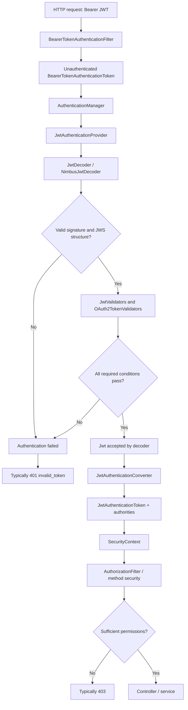

# JwtValidators and Configuring the Post-Signature Validation Chain

In **Spring Security OAuth 2.0 Resource Server**, a JWT with a valid signature may still **not be permitted at the API receiving the request**. The signature confirms the token was not altered and was signed with a trusted key; the Resource Server must still validate the **issuer (`iss`), lifetime (`exp`, `nbf`), audience (`aud`), and API-specific constraints**.

Spring Security provides `JwtValidators` along with the `OAuth2TokenValidator<Jwt>` mechanism to configure these conditions. Validators are normally composed with `DelegatingOAuth2TokenValidator` and executed inside `JwtDecoder` after JWT signature verification succeeds.

This lesson traces the **boundary between signature verification, claims validation, and authorization**, explains the default validators, shows how to add audience and custom claim checks, covers clock skew adjustment, highlights pitfalls when replacing default validators, and explains how outcomes surface at the Resource Server.

## 1. Why is a valid signature not enough?

Suppose an enterprise Authorization Server issues JWTs for multiple APIs: `orders-api` and `payments-api`. The token below is validly signed by the issuer's key, yet its audience is the Payments API:

```json
{
  "iss": "https://login.example.test/realms/shop",
  "sub": "user-123",
  "aud": ["payments-api"],
  "scope": "payments.read",
  "iat": 1794715200,
  "exp": 1794718800
}
```

If the Orders API checks only the signature, it may mistakenly trust a token that was **never issued for the Orders API**. Likewise, a token might have a valid signature yet be expired or carry an `nbf` in the future.

There are three separate verification layers:

| Layer | Question | Tool / policy |
|---|---|---|
| **JWS signature verification** | Was the JWT signed by a trusted key with an allowed algorithm, and left untampered? | `JwtDecoder` / underlying JWS processor, JWKS or trusted key |
| **JWT claim validation** | Does the token have the right issuer, valid timeframe, right audience, and meet API rules? | `OAuth2TokenValidator<Jwt>`, `JwtValidators`, `DelegatingOAuth2TokenValidator` |
| **Authorization** | Is the authenticated token subject allowed to call the endpoint and access this record? | `authorizeHttpRequests`, `hasAuthority`, method security, business policy |

**Never replace signature verification with a set of claim checks.** A token with plausible-looking `iss`, `aud`, and `exp` claims but an invalid signature must still be rejected. Conversely, a valid signature does not substitute for issuer/audience/lifetime checks.

## 2. Where validators sit in Servlet Resource Server

A request with the header:

```http
GET /api/orders/42 HTTP/1.1
Host: api.example.test
Authorization: Bearer <ACCESS_TOKEN>
```

typically passes through this logical flow:



This flow executes before the controller. Only when `JwtDecoder.decode(...)` successfully returns a `Jwt` does Spring Security turn claims into a principal and authorities. If the decoder throws an error due to signature or validator failure, the request **never produces a trusted `JwtAuthenticationToken`**.

Distinguish the two similar-looking names:

- `JwtDecoder` is the component **performing overall decoding and verification**.
- `JwtValidators` is a utility class **creating standard validators applied to the `Jwt` object after decoding/signature verification**.

In a typical application, you configure validators **on the decoder**, and Spring Security invokes the decoder inside `JwtAuthenticationProvider`. Controllers do not manually re-extract the JWT and re-run validators.

## 3. Core API: `OAuth2TokenValidator<Jwt>`

Spring Security models a token validation rule with a generic interface:

```java
public interface OAuth2TokenValidator<T extends OAuth2Token> {
    OAuth2TokenValidatorResult validate(T token);
}
```

The snippet above shows the conceptual interface signature. For JWTs, the parameterized type is `OAuth2TokenValidator<Jwt>`.

A validator:

1. Receives the `Jwt` object after the decoder has parsed and verified its signature.
2. Inspects the necessary claims/headers.
3. Returns `OAuth2TokenValidatorResult.success()` if the condition passes.
4. Returns `OAuth2TokenValidatorResult.failure(...)` containing one or more `OAuth2Error` objects if the condition fails.

Example validator accepting only the Orders API audience:

```java
OAuth2TokenValidator<Jwt> audienceValidator = jwt -> {
    if (jwt.getAudience().contains("orders-api")) {
        return OAuth2TokenValidatorResult.success();
    }

    return OAuth2TokenValidatorResult.failure(
        new OAuth2Error(
            "invalid_token",
            "Token is not intended for orders-api",
            null
        )
    );
};
```

Imports:

```java
import org.springframework.security.oauth2.core.OAuth2Error;
import org.springframework.security.oauth2.core.OAuth2TokenValidator;
import org.springframework.security.oauth2.core.OAuth2TokenValidatorResult;
import org.springframework.security.oauth2.jwt.Jwt;
```

**A validator is not a per-request permission checker.** Audience is a condition for a token to be valid **at this Resource Server**; permission for `GET /api/orders/42` still requires authority and ownership checks afterward.

### 3.1. What does `OAuth2TokenValidatorResult` represent?

The result is not a simple boolean. It can carry error details so the decoder can report why the token was rejected.

```text
validate(jwt)
    ├── success() → continue token processing
    └── failure(OAuth2Error) → decoder rejects token
```

Avoid throwing arbitrary business exceptions for wrong audience from a validator when the API supports `OAuth2TokenValidatorResult.failure(...)`. For validators checking predictable failure conditions, returning a failure result allows uniform decoder handling.

Validators should be **deterministic, side-effect-free, and thread-safe across concurrent requests**. Avoid logging tokens, mutating global state, or making uncontrolled external HTTP calls just to validate a simple claim.

## 4. `JwtValidators.createDefault()` and `createDefaultWithIssuer()`

`JwtValidators` provides factories for Spring Security's standard validator sets. Two common methods:

```java
OAuth2TokenValidator<Jwt> defaults =
    JwtValidators.createDefault();

OAuth2TokenValidator<Jwt> defaultsWithIssuer =
    JwtValidators.createDefaultWithIssuer(
        "https://login.example.test/realms/shop"
    );
```

| Method | Intent | Key point |
|---|---|---|
| `JwtValidators.createDefault()` | Builds default JWT checks for the active Spring Security version, notably timestamp checks | **Does not automatically know which specific issuer the API trusts** unless an issuer validator is configured separately. |
| `JwtValidators.createDefaultWithIssuer(issuer)` | Default checks **plus the expected issuer requirement** | Fits when a Resource Server trusts a single explicitly identified issuer. |
| `DelegatingOAuth2TokenValidator<>(...)` | Composes multiple validators into a single `OAuth2TokenValidator<Jwt>` | Used to add audience, tenant, or other claim checks while preserving standard validators. |

Do not assume the internal list inside `createDefault()` is immutable across every Spring Security release. Use the factory for default conditions and compose your own policies alongside it. In this lesson, **issuer, timestamps, and audience** are treated as core checks; audience must be configured explicitly when required by the API.

### 4.1. Why should default validators be preserved?

Suppose a developer builds a custom decoder and attaches only an audience validator:

```java
decoder.setJwtValidator(audienceValidator);
```

This call **replaces the existing validator** on the decoder. If the decoder previously checked `iss`, `exp`, and `nbf`, those checks can be lost because the application set a new validator that omits them.

The safer approach is composing with the default and issuer checks:

```java
OAuth2TokenValidator<Jwt> requiredValidators =
    new DelegatingOAuth2TokenValidator<>(
        JwtValidators.createDefaultWithIssuer(ISSUER),
        audienceValidator
    );

decoder.setJwtValidator(requiredValidators);
```

Thus, audience is an **additional requirement**, not a reason to drop pre-existing security checks.

## 5. DelegatingOAuth2TokenValidator: composing a validation chain

A Resource Server may require a token to satisfy:

- Issued by a trusted issuer.
- Within its valid timeframe.
- Carrying the API's audience.
- Carrying required claims or a valid tenant.

`DelegatingOAuth2TokenValidator<Jwt>` composes individual conditions into a single composite validator:

```java
OAuth2TokenValidator<Jwt> combined =
    new DelegatingOAuth2TokenValidator<>(
        JwtValidators.createDefaultWithIssuer(ISSUER),
        audienceValidator,
        requiredExpirationValidator,
        tenantValidator
    );
```

**Think of this as an AND combination for token acceptance**: the token succeeds only when no required validator returns a failure. Do not rely on validators running in a specific order as a data-transformation pipeline; they are not designed to depend on each other's side effects.

Example:

| JWT signature | Default/issuer | Audience | Tenant | Result |
|---|---|---|---|---|
| Valid | Pass | Pass | Pass | Decoder accepts JWT |
| Invalid | Cannot be reliably evaluated | — | — | Decoder rejects at signature verification |
| Valid | Expired token | Pass | Pass | Decoder rejects |
| Valid | Pass | Fail | Pass | Decoder rejects |
| Valid | Pass | Pass | Fail | Decoder rejects |
| Valid | Wrong issuer | Wrong audience | Pass | Decoder rejects; multiple validation errors may exist |

There does not have to be only one error. Depending on implementation, `DelegatingOAuth2TokenValidator` may aggregate errors across delegates. The system should not need to distinguish the “first error” to make access decisions.

### 5.1. The validator chain does not mutate claims

Validators **evaluate**; they are not for transforming claims. If an issuer emits `scope` as a string, the decoder may normalize data representation via a claim converter; producing `SCOPE_orders.read` belongs to the authorities converter, not the audience validator.

Separate three kinds of processing:

```text
JWT parse / claim conversion
          │
          ▼
JWT signature verification + validators
          │
          ▼
JwtAuthenticationConverter
          │
          ▼
Authorization
```

The exact placement of claim conversion inside the decoder depends on the implementation. Architecturally, **data format conversion, validity checking, and authority mapping** are three distinct responsibilities.

## 6. JWT claims to evaluate after signature verification

| Claim / attribute | Meaning | Rule typically needed at Resource Server |
|---|---|---|
| `iss` | Which issuer emitted the token | **Exact** match against the configured trusted issuer. |
| `exp` | Expiration timestamp | Token must not be used after expiration; reasonable clock skew may apply. |
| `nbf` | Not-before timestamp | Reject tokens used too early. |
| `iat` | Issued-at timestamp | Useful for token-age policies; does not imply the token is still valid. |
| `aud` | Which Resource Server/API may accept the token | Must contain the current API's identifier. |
| `sub` | Subject asserted by the issuer | Must be present and well-formed if required by API contract; do not assume it is a username/email. |
| `client_id` / `azp` | Involved OAuth application, per issuer profile | Check allowlist **if policy requires**, do not use in place of audience. |
| `jti` | JWT identifier | Can support monitoring/custom revocation; does not automatically prevent replay. |
| `scope` / `scp` | Permission scopes | Usually converted to `SCOPE_...` for authorization; not checked by default issuer/time/audience validators. |
| `typ` (JWT header) | Declared JWT type | May need checking for access-token profile / rejecting ID tokens; mechanism depends on decoder and version. |

Claims such as `exp`, `nbf`, and `iat` are JWT *registered claims* per RFC 7519; the JWT specification itself does not force every issuer to emit all of them. **An API contract can be stricter**, such as requiring every access token to carry `exp` and an audience.

### 6.1. Issuer: right AS, right realm/tenant

`JwtValidators.createDefaultWithIssuer(ISSUER)` constrains the `iss` value. Expected example:

```text
https://login.example.test/realms/shop
```

A token with:

```json
"iss": "https://login.example.test/realms/admin"
```

must be rejected, even though both issuers might share the same identity server. The path/realm is part of the issuer's identity; never ignore it or match by prefix.

**Never accept an arbitrary issuer from an unverified JWT and immediately trust its JWKS endpoint.** For multiple issuers, the Resource Server needs an allowlist of permitted issuers paired with matching decoders/validators.

### 6.2. Lifetime: `exp`, `nbf`, and clock skew

Time validation typically uses:

- `exp`: token expires after this timestamp.
- `nbf`: token must not be used before this timestamp.
- **Clock skew:** a small tolerance margin to handle clock drift between issuer and Resource Server.

Example token timestamps:

```json
{
  "nbf": 1899996000,
  "exp": 1900000000
}
```

JWT timestamps use NumericDate, anchored to UTC, independent of the user's display timezone.

If one server's clock runs a few seconds ahead of the AS, “not yet valid” or “expired” errors can occur near boundaries. Spring Security provides `JwtTimestampValidator` to check timestamps with configurable tolerance.

**Do not set clock skew excessively large** just to avoid NTP clock synchronization, because a large tolerance extends acceptance of expired tokens or lets tokens be used prematurely.

### 6.3. Audience: is the token meant for this API?

For example, the Orders API expects:

```text
expected audience = orders-api
```

A token with:

```json
"aud": ["orders-api", "inventory-api"]
```

can pass the Orders API's audience check. A token with only `aud=payments-api` does not.

**`aud` is the token's intended recipient**, distinct from the `client_id` of the OAuth application that requested the token. Never put the OAuth client ID as the expected audience just because OIDC ID tokens use `aud=client_id`: APIs require **access tokens intended for the Resource Server**, not client ID tokens.

### 6.4. Token type: avoiding confusion between ID tokens and access tokens

A JWT access token and an OIDC ID token can share the same issuer and JWKS. Therefore, beyond audience checks, a Resource Server may need a policy on **token type/purpose**, especially when the issuer uses the RFC 9068 JWT profile.

For the JWT access token profile, the `typ` header has specific rules such as `at+jwt`. Use type validation appropriate for the **profile and decoder version in use**; some `NimbusJwtDecoder` options handle type at the JOSE layer, while some profiles require an additional validator. Never disable type checking without an equivalent replacement.

### 6.5. Scope and data permissions are a separate step

A token with:

```json
{
  "aud": ["orders-api"],
  "scope": "orders.read",
  "sub": "user-123"
}
```

still does not prove `user-123` owns order 42. Audience is a token acceptance condition, scope is an operation-level capability, and ownership/tenant is business policy.

A request can **pass every JWT validator** and still be rejected afterward by `AuthorizationFilter` or method security.

## 7. Configuring Spring Boot with issuer and audience

A typical Spring Boot Resource Server application requires dependencies such as:

```xml
<dependencies>
    <dependency>
        <groupId>org.springframework.boot</groupId>
        <artifactId>spring-boot-starter-security</artifactId>
    </dependency>
    <dependency>
        <groupId>org.springframework.boot</groupId>
        <artifactId>spring-boot-starter-oauth2-resource-server</artifactId>
    </dependency>
</dependencies>
```

Configuration:

```yaml
spring:
  security:
    oauth2:
      resourceserver:
        jwt:
          issuer-uri: https://login.example.test/realms/shop
          audiences:
            - orders-api
```

In Spring Boot versions supporting `audiences`, this configuration instructs the Resource Server to validate the expected audience. `issuer-uri` supports issuer matching and loading public key info through supported discovery.

Benefits:

- No need to manually split JWTs and validate claims in controllers.
- Uses the framework-configured decoder and default validators.
- Issuer/time and audience checks run before building `Authentication`.

**Verify against your actual version.** Different Spring Boot/Spring Security versions may differ in auto-configuration and property names. In particular, if you declare a custom `@Bean JwtDecoder`, Spring Boot normally stops creating the default decoder, so adding `audiences` in YAML **may not automatically apply** to your custom bean. In that case, register the audience validator yourself.

### 7.1. Filter chain example showing the authorization boundary

```java
@Configuration
public class SecurityConfig {

    @Bean
    SecurityFilterChain securityFilterChain(HttpSecurity http) throws Exception {
        return http
            .authorizeHttpRequests(authorize -> authorize
                .requestMatchers("/public/**").permitAll()
                .requestMatchers(HttpMethod.GET, "/api/orders/**")
                    .hasAuthority("SCOPE_orders.read")
                .requestMatchers(HttpMethod.POST, "/api/orders/**")
                    .hasAuthority("SCOPE_orders.write")
                .anyRequest().authenticated()
            )
            .oauth2ResourceServer(oauth2 ->
                oauth2.jwt(Customizer.withDefaults()))
            .build();
    }
}
```

Imports:

```java
import org.springframework.context.annotation.Bean;
import org.springframework.context.annotation.Configuration;
import org.springframework.http.HttpMethod;
import org.springframework.security.config.Customizer;
import org.springframework.security.config.annotation.web.builders.HttpSecurity;
import org.springframework.security.web.SecurityFilterChain;
```

This illustrates the core of API protection; session, CSRF, CORS, and other filter policies must match how the application authenticates callers.

Spring Security normally maps `scope=orders.read` to `SCOPE_orders.read` via `JwtGrantedAuthoritiesConverter`. That happens after the JWT is accepted. **Never use `hasAuthority("SCOPE_orders.read")` as a substitute for audience validation**, because the two checks solve different problems.

## 8. Manually configuring a validator chain for `NimbusJwtDecoder`

When a specific policy is required, define a `JwtDecoder` bean and attach a composite validator covering:

1. Defaults + issuer.
2. Orders API audience.
3. Mandatory `exp`.
4. Valid tenant claim per contract.

Java and Spring Security example:

```java
@Configuration
public class JwtDecoderConfig {

    private static final String ISSUER =
        "https://login.example.test/realms/shop";

    private static final String AUDIENCE = "orders-api";

    private static final String TENANT = "shop";

    @Bean
    JwtDecoder jwtDecoder() {
        NimbusJwtDecoder decoder =
            NimbusJwtDecoder.withIssuerLocation(ISSUER).build();

        OAuth2TokenValidator<Jwt> issuerAndDefaults =
            JwtValidators.createDefaultWithIssuer(ISSUER);

        OAuth2TokenValidator<Jwt> audienceValidator = jwt -> {
            boolean accepted = jwt.getAudience().contains(AUDIENCE);
            return accepted
                ? OAuth2TokenValidatorResult.success()
                : invalid("Unexpected access-token audience");
        };

        OAuth2TokenValidator<Jwt> expirationRequired = jwt ->
            jwt.getExpiresAt() != null
                ? OAuth2TokenValidatorResult.success()
                : invalid("Missing required exp claim");

        OAuth2TokenValidator<Jwt> tenantValidator = jwt ->
            TENANT.equals(jwt.getClaimAsString("tenant_id"))
                ? OAuth2TokenValidatorResult.success()
                : invalid("Unexpected tenant");

        decoder.setJwtValidator(
            new DelegatingOAuth2TokenValidator<>(
                issuerAndDefaults,
                audienceValidator,
                expirationRequired,
                tenantValidator
            )
        );

        return decoder;
    }

    private static OAuth2TokenValidatorResult invalid(String reason) {
        return OAuth2TokenValidatorResult.failure(
            new OAuth2Error("invalid_token", reason, null)
        );
    }
}
```

Imports:

```java
import org.springframework.context.annotation.Bean;
import org.springframework.context.annotation.Configuration;
import org.springframework.security.oauth2.core.OAuth2Error;
import org.springframework.security.oauth2.core.OAuth2TokenValidator;
import org.springframework.security.oauth2.core.OAuth2TokenValidatorResult;
import org.springframework.security.oauth2.core.DelegatingOAuth2TokenValidator;
import org.springframework.security.oauth2.jwt.Jwt;
import org.springframework.security.oauth2.jwt.JwtDecoder;
import org.springframework.security.oauth2.jwt.JwtValidators;
import org.springframework.security.oauth2.jwt.NimbusJwtDecoder;
```

Example usable in a system issuing tokens containing:

```json
{
  "iss": "https://login.example.test/realms/shop",
  "aud": ["orders-api"],
  "tenant_id": "shop",
  "exp": 1900000000
}
```

**`tenant_id` is an illustrative claim, not a JWT registered claim present on every issuer.** Only include this validator if your AS genuinely emits that claim and the API explicitly defines which tenant is permitted.

### 8.1. What does each configuration line do?

- `withIssuerLocation(ISSUER)`: builds a decoder capable of discovering signing keys and metadata from the trusted issuer.
- `createDefaultWithIssuer(ISSUER)`: preserves default and issuer checks, avoiding losing time/issuer validation when adding custom logic.
- `jwt.getAudience().contains(AUDIENCE)`: confirms the token is meant for this Resource Server.
- `jwt.getExpiresAt() != null`: requires the **presence** of `exp`. The timestamp validator is what checks whether `exp` is still valid.
- `jwt.getClaimAsString("tenant_id")`: reads the custom claim and matches it against the tenant trusted by the Resource Server.
- `setJwtValidator(...)`: configures the **complete composite validator** executed by the decoder.

Checking that `exp` exists differs from validating its **timestamp value**: you need both if the contract mandates an expiration claim, because a time validator checks timestamps that are present without necessarily requiring `exp` across every JWT profile.

### 8.2. Never let the request decide expected audience/tenant

Trust-boundary mistake:

```java
// DO NOT determine expected audience from an unverified JWT:
String expectedAudience = rawUnverifiedJwt.getAudience().get(0);
```

Deriving the expected value from the very data being validated renders the check meaningless. Permitted audiences/tenants must come from server configuration, managed tenant metadata, or a trusted mapping.

For a multi-tenant Resource Server, you typically need **allowlisted issuers + audiences matching the issuer/tenant**, rather than trusting whatever `iss` or `aud` a token declares.

## 9. Customizing clock skew with `JwtTimestampValidator`

Two servers can drift by a few seconds. `JwtTimestampValidator` lets you set an intentional tolerance:

```java
JwtTimestampValidator timestamp =
    new JwtTimestampValidator(Duration.ofSeconds(45));
```

Imports:

```java
import java.time.Duration;
import org.springframework.security.oauth2.jwt.JwtTimestampValidator;
```

When you need to **replace** the default timestamp policy with an explicit tolerance, build a complete validator group containing timestamp, issuer, and all required constraints:

```java
OAuth2TokenValidator<Jwt> validators =
    new DelegatingOAuth2TokenValidator<>(
        new JwtTimestampValidator(Duration.ofSeconds(45)),
        new JwtIssuerValidator(ISSUER),
        audienceValidator,
        expirationRequired
    );

decoder.setJwtValidator(validators);
```

Additional import:

```java
import org.springframework.security.oauth2.jwt.JwtIssuerValidator;
```

Here, the application **explicitly constructs the validator list**, rather than inheriting all of `createDefaultWithIssuer()`. If your Spring Security version includes additional default validators or the profile requires other checks, include them in the explicit list. There is no point placing a second `JwtTimestampValidator` alongside the default group to “override” skew; both independent validators would run, and the stricter one can still reject the token.

### 9.1. Which direction does clock skew work in?

Example:

- Token has `nbf=10:00:00`.
- Resource Server's clock reads `09:59:35`.
- Allowed skew is 45 seconds.

The validator can accept requests near the time boundary per configuration even when the API's clock runs ahead/behind the issuer. Likewise, skew allows accepting a token very shortly past `exp` to compensate for clock drift.

**Skew is a technical tolerance, not a token-extension policy.** Synchronize clocks (NTP) and keep tolerance small per system requirements. Never expand it to hours just to mask configuration errors.

## 10. `JwtClaimValidator` and custom claims

Spring Security also provides `JwtClaimValidator<T>`, allowing you to apply a `Predicate<T>` to a specific claim. For example, if the AS guarantees `tenant_id` is a string:

```java
OAuth2TokenValidator<Jwt> tenantValidator =
    new JwtClaimValidator<String>(
        "tenant_id",
        "shop"::equals
    );
```

Import:

```java
import org.springframework.security.oauth2.jwt.JwtClaimValidator;
```

Meaning: when the validator runs, the `tenant_id` claim must satisfy the predicate. For custom claims with complex types or optional presence, a lambda checking `Jwt` directly gives clearer control over logic and error messages.

Example for an allowed-APIs list claim:

```java
OAuth2TokenValidator<Jwt> audienceValidator = jwt -> {
    List<String> audiences = jwt.getAudience();

    if (audiences != null && audiences.contains("orders-api")) {
        return OAuth2TokenValidatorResult.success();
    }

    return OAuth2TokenValidatorResult.failure(
        new OAuth2Error(
            "invalid_token",
            "Missing orders-api audience",
            null
        )
    );
};
```

Additional import: `java.util.List`.

**Never use a validator to “auto-fix” a wrong claim.** For instance, if the issuer actually emits audience `orders-api` while code expects `web-portal`, fix the audience configuration per contract rather than rewriting audiences from invalid to valid per request.

## 11. Checking token age via `iat` when a dedicated policy exists

An API might require that tokens were not issued too long ago, even if `exp` is still far away. For example, an admin endpoint might accept access tokens at most 10 minutes old per AS policy.

An illustrative validator can accept an injected `Clock` for easier time control:

```java
OAuth2TokenValidator<Jwt> maxAgeValidator = jwt -> {
    Instant issuedAt = jwt.getIssuedAt();

    if (issuedAt == null) {
        return OAuth2TokenValidatorResult.failure(
            new OAuth2Error("invalid_token", "Missing iat", null)
        );
    }

    Instant now = clock.instant();
    Duration age = Duration.between(issuedAt, now);

    boolean acceptable =
        !age.isNegative() &&
        age.compareTo(Duration.ofMinutes(10)) <= 0;

    return acceptable
        ? OAuth2TokenValidatorResult.success()
        : OAuth2TokenValidatorResult.failure(
            new OAuth2Error("invalid_token", "Token age is not allowed", null)
        );
};
```

The snippet above uses a `clock` variable supplied by configuration:

```java
import java.time.Clock;
import java.time.Duration;
import java.time.Instant;
```

This example illustrates only token-age logic and omits clock-skew handling. In real systems, define how to handle `iat` slightly in the future and its relationship with `exp`/clock skew. **Limiting token age via `iat` is an additional policy**, not a replacement for verifying signature, issuer, audience, or expiration.

Do not add such a validator merely because `iat` is present: it can cause unnecessary failures for flows designed with longer-lived tokens. The contract and resource sensitivity govern the condition.

## 12. What HTTP response does a validator failure cause?

Suppose a JWT is validly signed yet fails the audience check:

```json
{
  "iss": "https://login.example.test/realms/shop",
  "aud": ["payments-api"],
  "scope": "orders.read",
  "exp": 1900000000
}
```

Typical steps:

1. `BearerTokenAuthenticationFilter` receives the bearer token.
2. `JwtAuthenticationProvider` calls the decoder.
3. The JWS processor verifies the signature successfully.
4. The audience validator fails and returns `OAuth2TokenValidatorResult.failure(...)`.
5. `JwtDecoder` throws a validation error, such as `JwtValidationException`.
6. The provider converts it into an authentication failure; Spring Security returns the corresponding bearer error response, typically `401 Unauthorized` with `invalid_token`.

Example response:

```http
HTTP/1.1 401 Unauthorized
WWW-Authenticate: Bearer error="invalid_token"
```

Conversely, if every validator passes, yet the token carries only `scope=profile` while the endpoint needs `SCOPE_orders.read`, the request can pass authentication and then be denied by authorization:

```http
HTTP/1.1 403 Forbidden
WWW-Authenticate: Bearer error="insufficient_scope"
```

These examples show common responses; exact headers may vary depending on error details, `BearerTokenAuthenticationEntryPoint`, `BearerTokenAccessDeniedHandler`, and custom exception handling.

### 12.1. Scenario matrix

| Token / request | Signature | Validators | Authorization | Typical outcome |
|---|---|---|---|---|
| JWT with invalid signature | Invalid | Not treated as valid | Does not run as authenticated caller | `401` |
| JWT with valid signature, wrong issuer | Valid | `iss` fails | Does not run as authenticated caller | `401` |
| Expired JWT | Valid | Time check fails | Does not run as authenticated caller | `401` |
| Valid issuer, wrong audience | Valid | `aud` fails | Does not run as authenticated caller | `401` |
| JWT missing `exp` when API requires it | Valid | Presence validator fails | Does not run as authenticated caller | `401` |
| Valid claims, missing read scope | Valid | Pass | Lacks `SCOPE_orders.read` | `403` |
| Valid claims and scope, wrong record tenant | Valid | May pass | Service/method policy denies | `403` or `404` per design |
| Valid JWT with sufficient permissions | Valid | Pass | Pass | `200` if business logic succeeds |

**Do not turn every permission failure into a JWT validator error.** A caller with a valid token lacking a scope should be recognized as **authenticated but unauthorized**, rather than altering the decoder to reject any token lacking a single endpoint's scope—because the same token may be used across multiple endpoints with different scope requirements.

## 13. Common validator configuration mistakes

### Mistake A — Forgetting issuer/time checks when adding audience

```java
// INCOMPLETE if it accidentally replaces all default validators:
decoder.setJwtValidator(audienceValidator);
```

Fix:

```java
decoder.setJwtValidator(
    new DelegatingOAuth2TokenValidator<>(
        JwtValidators.createDefaultWithIssuer(ISSUER),
        audienceValidator
    )
);
```

### Mistake B — Wrong audience by confusing client_id

OAuth client `web-portal` calls `orders-api`. Token:

```json
{
  "aud": ["orders-api"],
  "client_id": "web-portal"
}
```

The Resource Server must check `aud=orders-api`, **not** set the expected audience to `web-portal` just because that is the calling application's name.

### Mistake C — Using roles/scopes as a system-wide token validity validator

If `scope=orders.read` is made a global decoder condition, a valid JWT holding only `orders.write` will be rejected even when calling a legitimate write endpoint.

**Right approach:** Put scope into a decoder validator only if it truly is a **Resource Server-wide** token-acceptance requirement; place most per-endpoint scope policies in authorization.

### Mistake D — Trusting the token's issuer and fetching arbitrary JWKS

An attacker can craft a JWT containing `iss=https://attacker.test` and sign it with their own key. If the API reads `iss`, fetches metadata/JWKS automatically, and immediately trusts the new issuer, the system risks accepting tokens from unauthorized entities.

**Right approach:** Start from a server-managed allowlist of trusted issuers or a verified tenant onboarding mechanism. Then select the matching decoder/validator.

### Mistake E — Using `iat` instead of `exp`

`iat` records when the token was issued, not when it expires. If the API requires time-bounded tokens, check `exp` and appropriate supplemental policies. Never rely on one claim to infer unrelated constraints.

### Mistake F — Using an overly wide clock skew

Large tolerances let expired tokens continue working longer than intended or let future tokens be used early. **Synchronize clocks and keep skew intentionally small.**

### Mistake G — Ignoring token type

An OIDC ID token and an access token may share the same issuer and JWKS. If the decoder checks only the signature and grants a principal, the API can accept the wrong token type. Enforce proper audience and type/profile policies.

### Mistake H — Wrapping the decoder and validating twice or swallowing errors

For example, a wrapper catching all `JwtException`s and fabricating an empty `Jwt` is extremely dangerous. If the decoder cannot verify a token, **it must fail**—never “fail open” and proceed to authorization as if an Authentication existed.

## 14. Technically testing a validator chain with a synthetic JWT

When building a custom validator, you can construct a `Jwt` object **in a unit test** to test claim-validation logic independently of JWT signing. The snippet below assumes an `audienceValidator` under test:

```java
Jwt jwt = Jwt.withTokenValue("test-token-not-signed")
    .header("alg", "RS256")
    .issuer("https://login.example.test/realms/shop")
    .audience(List.of("orders-api"))
    .issuedAt(Instant.now())
    .expiresAt(Instant.now().plusSeconds(300))
    .build();

OAuth2TokenValidatorResult result =
    audienceValidator.validate(jwt);

assertFalse(result.hasErrors());
```

**This is solely a unit test for the validator**; it does not prove a real signed JWT is accepted by `NimbusJwtDecoder`. Never treat a test-constructed `Jwt` object as authentication proof in production.

A real integration test must use test tokens signed with a test key passing through a real decoder, confirming signature, algorithm, issuer, audience, timestamps, and the filter chain behave as expected.

Scenarios worth simulating while learning:

| Scenario | Expectation |
|---|---|
| JWT with valid signature, issuer, time, audience, required claims | Decoder accepts |
| JWT with invalid signature | Decoder rejects before trusting claims |
| JWT from another issuer | Issuer validator rejects |
| Expired JWT | Time validator rejects |
| JWT before `nbf` | Time validator rejects per skew |
| JWT missing `exp` when API requires it | Presence validator rejects |
| JWT carrying only another API's audience | Audience validator rejects |
| Valid JWT lacking an endpoint's scope | Decoder may accept; authorization denies |
| JWT with wrong `tenant_id` | Tenant validator rejects if that policy applies API-wide |

Observation order matters: **signature → token validators → Authentication → authorization**. When results differ from expectations, inspect the right layer instead of rewriting the entire security config.

## 15. What validators do not solve on their own

Even with an accurate validator chain, the Resource Server still needs to manage other concerns:

**Revocation:** A validly signed, unexpired JWT may already have been revoked by the AS. Validators evaluate only data/logic available inside the decoder; detecting early revocation may require a denylist, external status checks, short token lifetimes, or introspection by design. Never treat `jti` as proof a token has not been revoked.

**Replay:** A Bearer access token can be used by anyone holding it. A valid signature and `aud` do not prove the current request came from the holder of the client's private key. If sender-constraining is required, apply DPoP/mTLS-bound tokens with matching checks.

**Resource-level permissions:** A token with `SCOPE_orders.read` does not automatically grant permission to read someone else's orders. Tenant/ownership checks in controllers/services or method security remain mandatory when business rules require them.

**Algorithms/signing keys:** Claim validators run after signature verification. Algorithm allowlisting, issuer-bound JWK selection, key management, and rotation belong to decoder/JWS configuration. Never replace them with payload checks.

**Personal data:** Signed claims only prove the issuer recorded those values. Do not treat an email, group, or role as verified for a specific business workflow unless the issuer contract guarantees those semantics.

## 16. Safe operations and error observability

When a user reports a token is “still valid” yet the API returns `401`, analyze:

1. Was the token properly extracted from the bearer header?
2. Does the decoder trust the right issuer/JWKS and signing algorithm?
3. Does the signature verify?
4. Which validator requires `exp`, `nbf`, `iss`, `aud`, `typ`, or mandatory claims?
5. Is there a custom decoder bean causing audience auto-configuration to be skipped?
6. Are multiple issuers/tenants using different audiences or keys?
7. Are clock skew and server clocks aligned?
8. Once the token passes authentication, is authorization denying due to scope or data permissions?

For JWTs, never log the raw `Authorization` header or raw token. Log minimal details such as:

```text
request_id=req-123
route=/api/orders/{id}
auth_result=FAILED
error_category=INVALID_AUDIENCE
configured_issuer=https://login.example.test/realms/shop
expected_audience=orders-api
```

When troubleshooting JWKS or `kid`, avoid exposing secrets and never trust header URLs suggested by unverified tokens. Upon encountering a new signing key, the decoder may need to fetch/refresh the JWKS; never skip signature verification due to network errors or key rotation.

Do not return overly detailed internal descriptions of validators, tenants, or security config to clients. HTTP responses can report `invalid_token`, while controlled internal logs capture enough cause for operations.

## 17. How should the JWT verification contract be documented?

A Resource Server can document:

```text
Trusted issuer:
  https://login.example.test/realms/shop

Trusted JWT signature verification:
  Keys from AS metadata/JWKS
  Allowed algorithms according to policy

Required JWT claims:
  iss = https://login.example.test/realms/shop
  aud contains orders-api
  exp must exist and be valid
  nbf validated when present
  tenant_id = shop (if defined by AS contract)

Claim-level checks:
  JwtValidators.createDefaultWithIssuer(issuer)
  + audience validator
  + expiration-required validator
  + tenant validator

Authorization after authentication:
  GET /api/orders/** → SCOPE_orders.read
  POST /api/orders/** → SCOPE_orders.write
  Record access → ownership/tenant policy
```

The contract should explicitly separate **JWT-wide** conditions enforced at the decoder from **request/resource-specific** conditions enforced at authorization. That avoids accidentally putting a single endpoint's policy into a global validator, or skipping issuer/audience checks just because a JWT has a valid signature.

## 18. References

- [Spring Security Reference — OAuth 2.0 Resource Server JWT](https://docs.spring.io/spring-security/reference/servlet/oauth2/resource-server/jwt.html): configuring issuer, `JwtDecoder`, and validators in Resource Server.
- [Spring Security API — JwtValidators](https://docs.spring.io/spring-security/site/docs/current/api/org/springframework/security/oauth2/jwt/JwtValidators.html): factories for default and issuer validators.
- [Spring Security API — DelegatingOAuth2TokenValidator](https://docs.spring.io/spring-security/site/docs/current/api/org/springframework/security/oauth2/core/DelegatingOAuth2TokenValidator.html): composing validators.
- [Spring Security API — JwtTimestampValidator](https://docs.spring.io/spring-security/site/docs/current/api/org/springframework/security/oauth2/jwt/JwtTimestampValidator.html): timestamp and clock skew checks.
- [RFC 7519 — JSON Web Token (JWT)](https://www.rfc-editor.org/rfc/rfc7519): registered claims such as `iss`, `aud`, `exp`, `nbf`, `iat`.
- [RFC 7515 — JSON Web Signature (JWS)](https://www.rfc-editor.org/rfc/rfc7515): JWT signatures and JWS structure.
- [RFC 9068 — JWT Profile for OAuth 2.0 Access Tokens](https://www.rfc-editor.org/rfc/rfc9068): requirements for the JWT access token profile, including audience and token type.

**Key takeaway:** After the signature is verified, `JwtValidators` and the `OAuth2TokenValidator<Jwt>` instances composed via `DelegatingOAuth2TokenValidator` determine whether the token is **fit for this specific Resource Server**. Only after the JWT is accepted does Spring Security build an `Authentication` and evaluate endpoint/resource access permissions.
