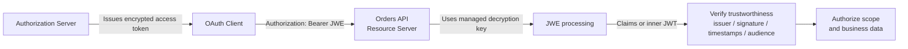
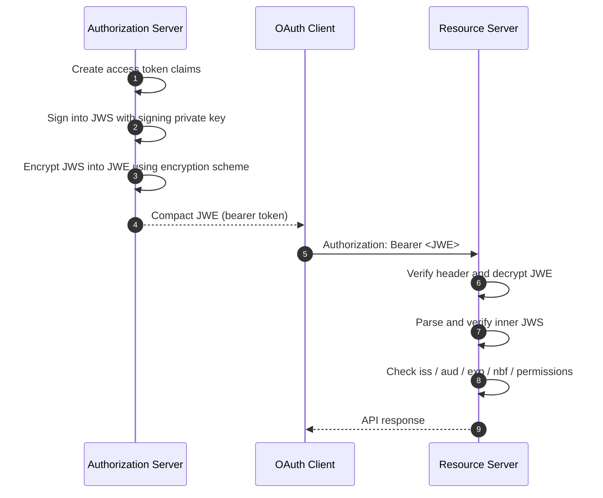
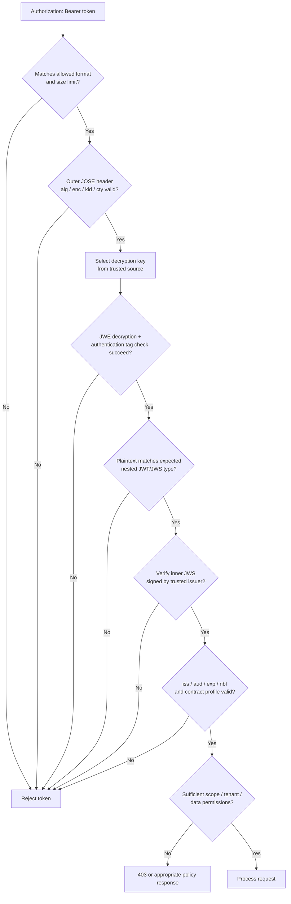
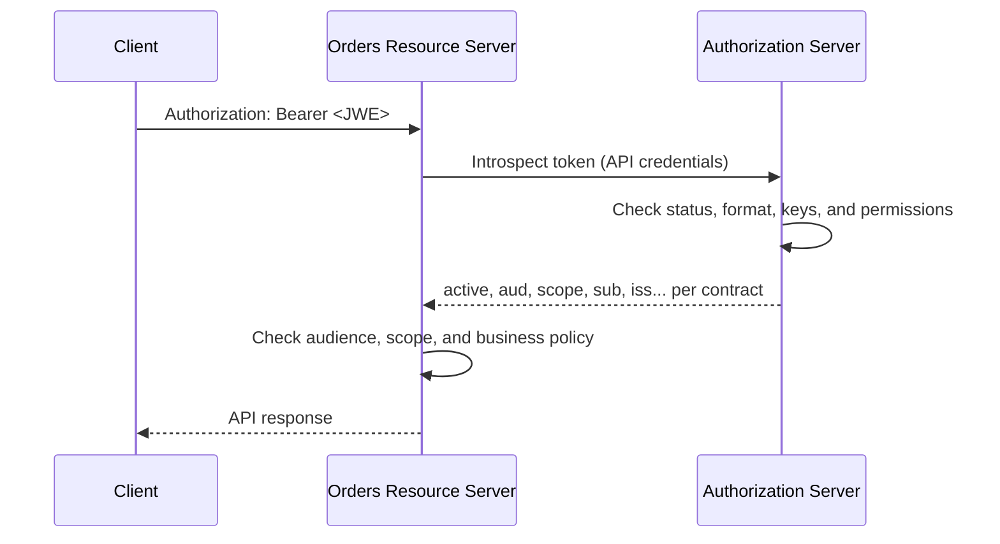

# JWE or Other Token Processors and the Need for Explicit Support Verification

When configuring **Spring Security OAuth 2.0/OIDC Resource Server** to accept JWT access tokens, developers commonly declare `issuer-uri` and enable `oauth2ResourceServer().jwt()`. That setup fits the common case: **digitally signed JWTs (JWS)**, where the Resource Server verifies the signature and claims per the Authorization Server's contract.

However, “JWT” does not automatically mean “a three-part string where the library only checks a signature”. A JWT can be **signed (JWS)**, **encrypted (JWE)**, or **nested** (e.g., signed first and then encrypted). An Authorization Server may also issue **opaque tokens** or custom-format tokens. Each kind requires a different processing strategy and distinct trust guarantees.

The central theme of this lesson is **explicitly verifying support**: before choosing `JwtDecoder`, you must know exactly which token type the system accepts, which cryptographic operations must run, which party owns which keys, how issuer/audience/claims are validated, and whether Spring Security provides a built-in path or requires dedicated custom components.

## 1. First, distinguish OAuth 2.0, JWT, JWS, and JWE

In OAuth 2.0, an **access token** is a credential a client presents to request access to a Resource Server. **The access token format is not required to be a JWT.** The Authorization Server and Resource Server agree on the format and verification method in a dedicated contract.

Terms that frequently appear:

| Term | Nature | Primary function | What it does not guarantee by itself |
|---|---|---|---|
| **Access token** | Credential issued under OAuth 2.0 | Access resources/APIs within granted permissions | Not necessarily a JWT; not valid for every API |
| **JWT** (JSON Web Token) | Representation of a claims set per RFC 7519 | Carries info such as `iss`, `sub`, `aud`, `exp` | The word “JWT” alone does not prove it is properly signed or encrypted |
| **JWS** (JSON Web Signature) | Payload protection via signature/MAC per RFC 7515 | Guarantees integrity and origin within a trusted key model | Does not hide payload contents from anyone reading the token |
| **JWE** (JSON Web Encryption) | Integrity-protected encryption per RFC 7516 | Protects content confidentiality from parties lacking the decryption key | Does not prove the sender is a trusted Authorization Server unless key design provides that guarantee |
| **Nested JWT** | A JWT wrapped inside another JOSE layer | Combines protections, typically sign-then-encrypt | Still requires checking signature, claims, audience, and algorithm config |
| **Opaque token** | Access token treated by the API as an uninterpretable string | Usually verified via token introspection | No built-in direct local token interpretation |
| **OIDC ID token** | Token conveying authentication outcome to an OIDC client | OIDC client verifies user identity | Does not substitute for a Resource Server's access token |

A particularly common point of confusion: **JWS/JWE are JOSE standards that protect data; JWT is the claims format protected by those standards**. A JWE can wrap a JWT, yet a JWE can also encrypt non-JWT content. Seeing a JWE object alone is never enough to conclude the inner plaintext can be trusted as an access token.

### 1.1. A signed JWT is not an encrypted JWT

Example of **JWS Compact Serialization**:

```text
BASE64URL(protected-header).
BASE64URL(payload).
BASE64URL(signature)

=> 3 parts separated by "."
```

The payload of a regular JWS can be **Base64URL-decoded and read** by anyone holding the token, even without the signature verification key. Thus, signing a JWT **does not hide** emails, roles, tenants, or sensitive claims.

Example of **JWE Compact Serialization**:

```text
BASE64URL(protected-header).
BASE64URL(encrypted-key).
BASE64URL(initialization-vector).
BASE64URL(ciphertext).
BASE64URL(authentication-tag)

=> 5 parts separated by "."
```

JWE hides ciphertext content from anyone lacking the decryption key. The `alg` and `enc` values in the protected header describe two parts of encryption:

- `alg`: the **key management/wrapping** algorithm, such as `RSA-OAEP-256`, `ECDH-ES`, or `dir` per contract.
- `enc`: the **authenticated content encryption** algorithm, such as `A256GCM`.

Never treat a JWE `alg` as if it were a JWS signing algorithm like `RS256`. They belong to two different protection steps.

**Note:** the three-part/five-part forms refer to *Compact Serialization*. JOSE also defines JSON Serialization and other protocol-specific wrappings. Dot counts are only useful for **preliminary syntactic routing**, not as proof that a token is safe or supported.

## 2. What problem does JWE solve in a Resource Server system?

Suppose a commerce system has:

- An Authorization Server issuing access tokens for APIs.
- An Orders API acting as a Resource Server receiving access tokens.
- Certain claims tied to organizational structure or sensitive details that must stay protected while the token travels across clients, proxies, gateways, and logs/telemetry.

JWS protects claims from tampering but does not conceal them. JWE can be chosen to encrypt information inside the access token so only parties holding the **matching decryption key** can read the inner claims.



Still, encrypting a token **does not replace** protecting bearer credentials. Anyone who steals the raw bearer token string can replay it to the API until it expires or is revoked by policy, even if they cannot read the ciphertext. Therefore, JWE does not eliminate the need for HTTPS, short lifetimes, keeping tokens out of logs, and access control.

### 2.1. Content confidentiality vs. issuer authenticity

Distinguish two questions:

1. **Confidentiality:** can outsiders read the claims?
2. **Issuer authenticity / integrity:** does the Resource Server have proof the token was issued by a trusted Authorization Server and not altered?

With a JWE encrypted using the **Resource Server's public key**, in principle **anyone who knows that public key can encrypt plaintext and send it to the Resource Server**. Having the Orders API successfully decrypt the JWE and verify its authentication tag proves only that the ciphertext wasn't corrupted under the encryption algorithm's guarantees—**it does not automatically prove the encryptor was the trusted IdP**.

Consequently, when a JWE access token requires strong issuer authentication, the standard pattern is **sign the JWT with the Authorization Server's key, then encrypt the result for the Resource Server** (*sign-then-encrypt*). Upon receipt, the Resource Server decrypts the outer JWE, verifies the inner JWS, and then checks claims and permissions.

A system using JWE without an inner signature can still build another trust contract—for instance, a symmetric key model held exclusively by authorized issuers, or verifying tokens via introspection. Yet **you must prove explicitly who can mint accepted credentials**, never infer it from decryption capability alone.

## 3. Three key token patterns

### 3.1. Pattern A: JWS access token

```text
Authorization Server
  -> signs JWS with signing key
  -> OAuth Client holds bearer token
  -> Resource Server verifies signature using trusted signing keys
  -> checks iss / aud / exp / nbf / scope
```

This is the case normally configured via `issuer-uri` and `oauth2ResourceServer().jwt()` in Spring Security.

Example **JWS protected header**:

```json
{
  "alg": "RS256",
  "typ": "at+jwt",
  "kid": "issuer-signing-key-1"
}
```

Illustrative payload:

```json
{
  "iss": "https://idp.example.com/realms/shop",
  "sub": "user-842",
  "aud": ["orders-api"],
  "exp": 1893459600,
  "iat": 1893456000,
  "scope": "orders.read"
}
```

This example is not a real signed token. The Resource Server must never consume `scope` or `sub` from a caller-decoded payload prior to verifying the signature and mandatory checks.

### 3.2. Pattern B: JWE containing only encrypted claims

```text
Authorization Server
  -> creates JWT Claims Set plaintext
  -> encrypts into JWE for Resource Server
  -> Resource Server decrypts
  -> must have an explicit issuer-authenticity mechanism
  -> validates claims and authorizes
```

A JWE carrying only a JWT Claims Set without an inner signature **differs in security guarantees** from a signed JWS. Especially if anyone holding the API's public key can encrypt a token the API accepts, the API has no proof the Authorization Server created the plaintext. Therefore, never design a JWT decoder that simply calls `decrypt()` and trusts all claims.

This pattern requires careful evaluation via cryptographic design and dedicated key management; without a strong reason, sign-then-encrypt or introspection generally provides a clearer authentication contract.

### 3.3. Pattern C: Nested JWT, sign-then-encrypt



Example **outer JWE protected header**:

```json
{
  "alg": "RSA-OAEP-256",
  "enc": "A256GCM",
  "cty": "JWT",
  "kid": "orders-encryption-key-2026"
}
```

Example **inner JWS protected header**:

```json
{
  "alg": "RS256",
  "typ": "at+jwt",
  "kid": "issuer-signing-key-2026"
}
```

The outer JWE provides **content confidentiality and ciphertext integrity**. The inner JWS provides **signature/issuer verification**. Only after both steps does the Resource Server use claims to make authorization decisions.

The outer header's `cty: "JWT"` is normally used to indicate that the inner content is a nested JWT. The contract must specify which `typ`/`cty` values are accepted. Having `cty` or `typ` match **is not enough** on its own to prove token structure or validity.

## 4. How much does Spring Security support by default?

On the Servlet stack, Spring Security Resource Server has two primary bearer-token authentication paths:

| Path | Key interface | Behavior |
|---|---|---|
| **JWT** | `JwtDecoder` | Processes JWTs via a decoder; standard config uses `NimbusJwtDecoder` to verify signed JWS tokens |
| **Opaque / introspection** | `OpaqueTokenIntrospector` | Sends tokens to an introspection endpoint or handles introspection per contract; does not need to parse internal token format |

Point to emphasize: **Spring Security's default issuer/JWKS JWT configuration is documented primarily for JWS-signed access tokens**. Do not assume that having `spring-security-oauth2-jose` or calling `NimbusJwtDecoder.withIssuerLocation(...)` means the Resource Server automatically decrypts JWEs.

The **Nimbus JOSE + JWT** library has JWE APIs, and Spring Security uses Nimbus for much of its JWT functionality. Yet **low-level library capability does not automatically become an enabled, key-provisioned, and tested JWE pipeline in Resource Server**. If an Authorization Server emits JWEs, the application must verify exact support in its active version, how the decoder is routed, and how post-decryption signature/claim verification works.

### 4.1. Default configuration for signed JWTs

Example Spring Boot Servlet Resource Server:

```groovy
// build.gradle — Spring Boot 3.x
dependencies {
    implementation 'org.springframework.boot:spring-boot-starter-web'
    implementation 'org.springframework.boot:spring-boot-starter-oauth2-resource-server'
}
```

```yaml
# application.yml
spring:
  security:
    oauth2:
      resourceserver:
        jwt:
          issuer-uri: https://idp.example.com/realms/shop
          audiences:
            - orders-api
```

```java
import org.springframework.context.annotation.Bean;
import org.springframework.context.annotation.Configuration;
import org.springframework.security.config.Customizer;
import org.springframework.security.config.annotation.web.builders.HttpSecurity;
import org.springframework.security.web.SecurityFilterChain;

@Configuration
public class SecurityConfig {

    @Bean
    SecurityFilterChain apiSecurity(HttpSecurity http) throws Exception {
        return http
            .authorizeHttpRequests(auth -> auth
                .requestMatchers("/public/health").permitAll()
                .requestMatchers("/api/orders/**")
                    .hasAuthority("SCOPE_orders.read")
                .anyRequest().authenticated())
            .oauth2ResourceServer(oauth2 ->
                oauth2.jwt(Customizer.withDefaults()))
            .build();
    }
}
```

With this configuration, Spring Boot/Spring Security uses issuer info, discovery, and JWKS to set up JWS verification per supported version/properties. This sample code itself does not add **JWE decryption** keys or **post-decryption inner JWS verification** logic.

In Spring Boot versions supporting `spring.security.oauth2.resourceserver.jwt.audiences`, audience configuration requires tokens issued for this API. When replacing `JwtDecoder` with a custom bean, the application must ensure audience and all essential contract validators remain enforced.

### 4.2. Why JWKS and decryption keys cannot be equated

A JWKS published by an IdP for a Resource Server to verify signed JWTs typically holds the IdP's **public verification keys**. For example:

```text
JWS:
  IdP signs with signing private key
  Resource Server verifies with IdP signing public key
```

In a sign-then-encrypt JWE for the Orders API:

```text
JWE outer:
  IdP encrypts with Orders API's public encryption key
  Orders API decrypts with its own private decryption key

JWS inner:
  IdP signs with IdP's signing private key
  Orders API verifies with IdP's signing public key
```

These are **two key pairs and two distinct responsibilities** in the asymmetric RSA example. Merely pointing `jwk-set-uri` at the IdP's JWKS does not give the Resource Server the private key to decrypt JWEs. Conversely, holding the Orders API's private decryption key does not prove the inner JWT was signed by the IdP.

JWE also supports other key-management algorithms (such as symmetric keys or ECDH); provisioning and trust depend on the algorithm and contract. Never apply an asymmetric RSA mental model blindly across all algorithms while ignoring their specific conditions.

## 5. When receiving a JWE, what must be verified?

If a Resource Server is permitted to accept nested JWE/JWS access tokens, the pipeline should be designed **from outside to inside**, with an explicit contract at each step:



Non-negotiable steps:

1. **Input limits:** reject oversized strings or unsupported formats. Never perform unbounded recursive parsing of nested layers; avoid arbitrary-depth processing paths.
2. **Define token profile:** which access token types does the API accept? What must outer `typ`, `cty`, inner `typ`, and algorithms be? Distinguish access tokens from ID tokens or other protocols' JWTs.
3. **Algorithm allowlist:** accept strictly approved `alg`/`enc` values for JWE, and allowed JWS `alg` values for the issuer. Never pick algorithms merely at the token's request.
4. **Trusted key selection:** `kid` only helps select a key within the **API-configured/managed key set**. Never fetch keys from arbitrary URLs supplied by unverified token headers `jku`/`x5u`.
5. **Safe decryption:** use a JWE implementation that verifies ciphertext/authentication tag integrity; reject if decryption or tag verification fails.
6. **Issuer verification:** for nested signed tokens, verify the inner JWS signature using the issuer's trusted signing keys. If using JWE-only, have an equivalent mechanism proving origin via key design and policy.
7. **Claim checks:** `iss`, `aud`, `exp`, `nbf`, and profile-mandatory claims. `scope`/`roles` must be mapped strictly per verified contract.
8. **Resource authorization:** the API still checks owner/tenant/business state; successful decryption does not grant access.

In particular, **never take newly decrypted inner plaintext and read `sub`, `scope`, or `roles` immediately before satisfying issuer-authenticity verification**.

### 5.1. Controlling JOSE headers

The JOSE protected header may contain:

| Header | Meaning | Recipient policy |
|---|---|---|
| `alg` (JWE) | Key management method | Match against allowed algorithm; key must match |
| `enc` | Content encryption algorithm | Accept only approved authenticated encryption algorithms |
| `kid` | Key identifier/selector | Select solely from API's trusted key ring |
| `cty` | Inner content type, often `JWT` for nested | Match profile, then verify actual plaintext |
| `typ` | Token/JOSE object type | Validate if required by profile; never treat as sole proof |
| `zip` | Requests plaintext compression in JWE | Support only intentionally; guard against decompression bombs |
| `crit` | Critical extensions that must be understood | Reject when containing unknown/unsupported values |
| `jku` / `x5u` (if present) | Key/certificate source hint | Never use token-dictated URLs to fetch trusted keys |

Older algorithms or improper encryption modes can carry known vulnerabilities. Never enable `RSA1_5`, `none`, weak algorithms, or “every algorithm Nimbus knows” for compatibility. For JWE, distinguish key-management algorithms from content-encryption algorithms. For JWS, allow only contract-approved signature algorithms.

### 5.2. Claim validation does not depend on encryption

Once the token is properly authenticated, the API must still answer:

| Claim | Question | Common mistake |
|---|---|---|
| `iss` | Who issued the token? | Accepting any issuer string under any signature |
| `aud` | Which API is the token meant for? | Using a Payments API token to call Orders API |
| `exp` | When does the token expire? | Trusting an expired token just because it decrypted |
| `nbf` | When does the token become valid? | Ignoring tokens not yet within their valid window |
| `sub` | Which subject does the token describe? | Treating every subject as a fully privileged user |
| `scope` / `scp` | Which permission scopes were granted? | Confusing scopes with access to all records |
| `client_id` / `azp` if present | Which application/authorized party is involved? | Treating client ID as proof of admin privilege |

JWE encryption **does not alter any of these requirements**. Clock skew may be configured within small bounds, yet never widened to legitimize improperly issued tokens.

## 6. Three implementation strategies when the Authorization Server issues JWEs

No single configuration fits every IdP. Choose a strategy based on your goals: does the API truly need to read claims locally, can it protect a private key, and must it check revocation status on every request?

| Strategy | How does the system verify? | Advantages | Trade-offs |
|---|---|---|---|
| **A. Update contract to use signed JWT (JWS)** | Standard `NimbusJwtDecoder`, issuer/JWKS, and claim validators | Direct Spring Security integration, minimal custom crypto | JWS payload is readable, so include only appropriate claims |
| **B. Use opaque token introspection for JWE tokens** | Resource Server sends token string to AS; AS authenticates/decrypts per contract and returns status | API does not hold decryption keys or process JWE itself | Depends on introspection endpoint, credentials, latency, and availability |
| **C. Add a custom JWE/nested JWT processor** | API decrypts with trusted keys/config, verifies inner JWS, validates claims | API verifies tokens locally while keeping payloads encrypted | Complexity in keys, crypto, versions, rotation, testing, and operations |

Depending on the system, the Authorization Server may also support different token formats per API/resource indicator. If the Orders API does not need JWE, you can request the AS issue a JWS with a narrow audience and minimal claims; if data is genuinely sensitive or must remain unreadable by clients, evaluate JWE or reducing token data.

### 6.1. Option A: standard signed JWT

If the AS issues JWS, using Resource Server's default `JwtDecoder` is the natural choice. It still requires verifying signing keys/issuer, audience, lifetime, and profile. For example:

```yaml
spring:
  security:
    oauth2:
      resourceserver:
        jwt:
          issuer-uri: https://idp.example.com/realms/shop
          audiences: orders-api
```

Do not write a JWE parser if the actual contract uses signed JWTs. Simply ensure the JWT carries no sensitive data the token holder should not read, because JWS payloads are normally unencrypted.

### 6.2. Option B: using token introspection, even when tokens look like JWE

Spring Security's opaque token support **does not require the credential to look “visibly opaque”**. It sends the token to an introspection endpoint without parsing it as a JWT itself. Thus, it works when tokens are JWE—or even JWS—whenever policy requires asking the Authorization Server about current validity.

Example:

```yaml
spring:
  security:
    oauth2:
      resourceserver:
        opaquetoken:
          introspection-uri: https://idp.example.com/oauth2/introspect
          client-id: orders-resource-server
          client-secret: YOUR_SECRET_FROM_SECURE_CONFIGURATION
```

The `client-secret` value above is a placeholder: use a secret manager or secure configuration, never commit real secrets.

```java
@Bean
SecurityFilterChain apiSecurity(HttpSecurity http) throws Exception {
    return http
        .authorizeHttpRequests(auth -> auth
            .requestMatchers("/api/orders/**")
                .hasAuthority("SCOPE_orders.read")
            .anyRequest().authenticated())
        .oauth2ResourceServer(oauth2 ->
            oauth2.opaqueToken(Customizer.withDefaults()))
        .build();
}
```



Introspection results can provide `active`, `scope`, `aud`, `sub`, and other IdP-specific attributes. **Do not treat `active: true` as permission to access every API**: if audience/issuer/tenant are mandatory business conditions, the API must receive trustworthy data to validate them. If the introspection endpoint omits needed attributes, update the IdP/API contract before permitting operations.

The benefit of this option is that the Resource Server avoids holding JWE private decryption keys. The trade-off is protecting introspection credentials, HTTPS, timeouts, and handling network outages. Caching can improve performance yet introduces a delay between token revocation and when the API sees it; choose cache lifetimes per risk policy.

### 6.3. Option C: custom JwtDecoder with a nested JWE/JWS processor

Spring Security lets applications supply a custom `JwtDecoder` bean to integrate into `oauth2ResourceServer().jwt()`. The essential requirement is that **the returned `Jwt` object must be the output after the processor fully verifies the token**, never mere Base64 decoding or JWE decryption alone.

A possible responsibility breakdown:

```text
BearerTokenAuthenticationFilter
    |
    v
JwtAuthenticationProvider
    |
    v
Custom JwtDecoder
    |
    +--> check format/input limits
    +--> JWE Decryption Processor
    |      - alg/enc/kid allowlist
    |      - trusted decryption key
    |      - authenticated decryption
    |
    +--> Inner JWS Signature Verifier
    |      - trusted issuer signing keys
    |      - allowed signing algorithms
    |
    +--> Claims/Profile Validator
           - iss, aud, exp, nbf, typ, tenant...
    |
    v
Verified Jwt -> JwtAuthenticationToken -> SecurityContext
```

Example **Spring Security integration point**, using an application interface to describe the processor to implement:

```java
import org.springframework.context.annotation.Bean;
import org.springframework.context.annotation.Configuration;
import org.springframework.security.oauth2.jwt.Jwt;
import org.springframework.security.oauth2.jwt.JwtDecoder;
import org.springframework.security.oauth2.jwt.JwtException;

interface VerifiedJweAccessTokenProcessor {
    // Return Jwt ONLY AFTER having:
    // 1. Validated profile/outer header and decrypted JWE with the right key;
    // 2. Verified the inner JWS signature with trusted signing keys;
    // 3. Validated issuer, audience, lifetime, and mandatory claims.
    // Any mismatch must throw JwtException (or a subclass).
    Jwt verifyAndDecode(String encryptedToken) throws JwtException;
}

@Configuration
class ResourceServerDecoderConfiguration {

    @Bean
    JwtDecoder jwtDecoder(VerifiedJweAccessTokenProcessor processor) {
        return processor::verifyAndDecode;
    }
}
```

This is a **pattern for separating responsibilities and wiring the bean**, not a complete runnable JWE implementation to copy-paste. The application must provide a real implementation of `VerifiedJweAccessTokenProcessor` with an explicit cryptographic policy. Without an implementation bean, the application will fail to start under this configuration.

A custom decoder can construct a `Jwt` object via `Jwt.withTokenValue(...).headers(...).claims(...).build()` **only after** the verified processor finishes all checks; never build a `Jwt` from unverified claims and treat it as a trusted Authentication.

If the flow cannot be faithfully represented as a verified JWT (e.g., a proprietary token format with different trust semantics), consider a **custom AuthenticationProvider/AuthenticationConverter** or opaque introspection instead of forcing arbitrary data into `Jwt` to pass through the JWT provider.

### 6.4. Which layers does Nimbus JOSE + JWT assist with?

Nimbus JOSE + JWT includes types such as:

```java
// Illustrative API class names from Nimbus JOSE + JWT:
com.nimbusds.jose.JWEObject
com.nimbusds.jose.crypto.RSADecrypter
com.nimbusds.jwt.SignedJWT
com.nimbusds.jwt.proc.DefaultJWTProcessor
```

Conceptual flow:

```text
parse outer JWE
  -> check protected header / key selection
  -> decrypt + verify authenticated ciphertext
  -> parse inner SignedJWT (if contract specifies nested JWT)
  -> verify inner JWS signature with trusted keys
  -> validate claims, audience, timestamps, token type
  -> convert verified claims into Spring Security Jwt
```

No single `JWEObject.parse(...).decrypt(...)` call suffices to prove an access token valid. Implement and verify every step; using a JOSE processor enforcing an explicit policy is safer than hand-rolling byte/string handling.

Additionally, Spring Security generally supports configuring `NimbusJwtDecoder` with a Nimbus JWT processor. **Verify explicitly whether a specific processor handles the expected JWE/nested token type**, has proper key selectors and validators—never conclude support solely from seeing “Nimbus” or “JWT” in a class name.

## 7. Spring Boot auto-configuration and declaring a custom decoder

For signed JWTs, Spring Boot normally auto-configures `JwtDecoder` when matching dependencies/properties exist and no bean of the same type is declared. If you provide your own `@Bean JwtDecoder` for JWE, **default auto-configuration will typically back off**.

Consequence: responsibility for enforcing critical validators must be re-examined. Never assume that after defining a custom decoder, Boot still automatically applies JWT properties such as:

```yaml
spring:
  security:
    oauth2:
      resourceserver:
        jwt:
          issuer-uri: https://idp.example.com/realms/shop
          audiences: orders-api
```

With a custom decoder, unless you actively check `iss` and `aud` inside your processor/validator, they may no longer be enforced as expected. Likewise, a decryption processor does not automatically check `exp` or `nbf` unless you attach that logic.

On the other hand, **declaring a decoder bean does not automatically turn on the JWT filter** if the developer declared a custom `SecurityFilterChain`. In a custom chain, make the choice explicit:

```java
.oauth2ResourceServer(oauth2 ->
    oauth2.jwt(jwt -> jwt.decoder(customJwtDecoder)))
```

or keep `jwt(Customizer.withDefaults())` when Spring Security should look up the `JwtDecoder` bean from the context. When using opaque tokens, the matching config is `opaqueToken()`. Never assume a single filter chain tries JWT and then falls back to opaque automatically.

### 7.1. Never allow “try every decoder until one works”

Suppose an API receives two credential types:

```text
JWS (signed JWT)  -> verified JWS decoder
JWE (nested JWT)  -> verified JWE+JWS processor
```

Routing based on format or trusted metadata per application configuration may be necessary. Still, **routing is not authentication**. Decide up front:

- Which token types/profiles are accepted per endpoint/client/audience?
- Which processor is allowed to handle which profile?
- If a token violates the standard, can it “fall back” to a weaker parser?
- If a token is rejected for wrong issuer/audience/algorithm, could the system accidentally retry another branch and accept it?

A design that “passes if any decoder accepts” risks **downgrade and cross-protocol confusion**, especially if one branch has weaker validators. It is far better to pin strategies strictly per route or token contract and reject decisively on mismatch.

## 8. Relationship with OIDC ID tokens

OIDC ID tokens are usually JWTs, can be signed, and in some contracts can be encrypted. Yet **ID tokens and access tokens have different intended recipients**.

For example:

| Token type | Typical audience | Consumer |
|---|---|---|
| ID token | OIDC client's `client_id`, e.g., `shop-web` | OIDC client processing authentication results |
| Access token | Resource Server, e.g., `orders-api` | API protecting orders |

If a browser sends an **encrypted JWE ID token** to the Orders API and the Orders API manages to decrypt it, the API must still reject it because the token **is not an access token issued for it**. Never treat successful decryption as a reason to skip token type/audience checks.

Likewise, a validly signed JWS ID token must never be accepted in place of an access token just because the same IdP issued both. If an application supports multiple JWT profiles, separate validation rules per profile to prevent token substitution.

### 8.1. “JWT” labels that easily cause confusion

When coordinating with the IdP or frontend team, ask specifically:

- “Is the IdP's access token in this environment a **signed JWT**, an **encrypted JWT**, or **opaque**?”
- “If it is JWE, is the plaintext a JWT Claims Set or a **nested signed JWT**?”
- “Does the token recipient need a **private decryption key**, and how is that key provisioned?”
- “Is the token content an **access token** issued for `orders-api` or an **ID token** issued for the web app?”

Those answers dictate how to configure the Resource Server; **you cannot simply glance at whether a token has three or five parts and assume support**.

## 9. Key lifecycle: signing, encryption, rotation, and revocation

A nested JWS/JWE system usually manages two distinct key groups:

| Key group | Who holds the secret part? | Who uses the public key? | What is needed during rotation? |
|---|---|---|---|
| **IdP signing key** | Authorization Server | Resource Server verifying inner JWS | JWKS allows old/new keys to coexist while tokens remain valid |
| **Resource Server decryption key** | Resource Server or KMS/HSM on its behalf | Authorization Server encrypting for recipient | API retains old decryption key for unexpired tokens; updates public key for new AS encryptions |

`kid` is a key-selection hint; **it is not a dynamic URL authorizing arbitrary key fetches**. The system must define independent provisioning sources and rotation cadences for signing keys and decryption keys.

Common operational pitfalls:

- **Public encryption key updated before all APIs have the new private key:** newly issued tokens cannot be decrypted.
- **Old private key deleted too early:** unexpired JWE bearer tokens issued before rotation fail processing.
- **New signing key not yet synced to Resource Servers:** valid inner JWS tokens are rejected.
- **Decryption private key leaked:** attackers can read captured JWEs (depending on key-exchange properties), requiring an incident plan and limits on token storage.
- **Signing key leaked:** attackers can forge JWS tokens under the affected key; JWE encryption does not mitigate this risk by itself.

Never store private decryption keys in Git/source code, never write them to logs/debug dumps, and avoid sending them via email/tickets. Use an appropriate secret manager, KMS, or HSM with least-privilege permissions and rotation procedures.

### 9.1. JWE does not replace TLS

JWE protects token contents at the application layer, yet a bearer token can still be **replayed** if someone steals the raw token string. HTTPS/TLS remains essential to protect transport and endpoints.

Similarly, encrypted tokens do not permit storing raw bearer strings in access logs, URL query parameters, exceptions, traces, or analytics. HTTP transport must still carry the `Authorization: Bearer ...` header per contract rather than placing tokens in URLs.

## 10. Behavior tests required when supporting a new format

When adding a new token processor, a “happy path decryption test” does not prove the Resource Server is trustworthy. Below are **contract scenarios that should be supported and verified in project testing**, especially for custom JWE:

| Scenario | Expected outcome |
|---|---|
| Nested JWE with right key, valid inner JWS signature, valid claims | Forward to authorization |
| JWE with tampered ciphertext or authentication tag | Reject authentication |
| JWE encrypted with a recipient key not belonging to the API | Reject authentication |
| JWE decrypts cleanly, yet inner JWS signed by untrusted issuer/key | Reject authentication |
| Outer `alg`/`enc` or inner `alg` outside allowlist | Reject authentication |
| Header `kid` points to a key absent from trusted key ring | Reject authentication |
| Header `jku`/`x5u` points to an attacker-controlled host | Never used to select trusted keys |
| JWE decrypts to arbitrary JSON rather than permitted JWT profile | Reject authentication |
| Valid nested JWE/JWS with `aud=payments-api` sent to Orders API | Reject token |
| Expired token or before `nbf` | Reject token per clock-skew policy |
| Valid token, insufficient scope | Deny authorization, typically 403 |
| Valid token and scope, subject is not owner / wrong tenant | Deny per business policy |
| Oversized JWE token or unbounded nesting | Reject per input/profile policy |
| IdP rotates signing key | Tokens signed with trusted keys continue verifying |
| API rotates decryption key | New/old tokens processed per published transition window |
| ID token sent in place of access token | Reject even if decryption/signature might verify |

This table is a **design and testing guide**, not results from a specific run or evaluation of an existing implementation.

### 10.1. HTTP errors should surface at the right layer

When the processor rejects a token due to bad format, decryption failure, signature failure, wrong issuer, or wrong audience, the Resource Server treats it as an **authentication error**; Bearer APIs typically return **401** with an appropriate challenge.

When the token authenticates cleanly yet lacks scope or resource permissions, that is an **authorization error**, typically **403** or another choice per resource-hiding policy.

Never return messages containing ciphertext, JWE plaintext, private keys, JOSE stack traces, or overly granular differences between decryption failures; client-facing messages should stay generic, while operational logs capture only controlled, necessary metadata.

## 11. Cases using token processors other than JWE

“Another token processor” does not mean solely a JWE decryption layer. Systems may use:

| Token format / contract | Possible handling approach | Explicit verification required |
|---|---|---|
| Standard signed JWT (JWS) | `NimbusJwtDecoder` | Signing algorithm/key, issuer, audience, lifetime, token profile |
| Encrypted JWT/JWE | Custom JWE processor or introspection | Decryption key, outer algorithm/header, issuer authenticity, claims |
| Nested JWT (JWE wrapping JWS) | Custom decoder/processor decrypting then verifying inner JWS | Both encryption and signature layers; token type and claims |
| Opaque access token | `OpaqueTokenIntrospector` | Endpoint/client auth, `active`, required audience/scope/claims |
| JWT signed with specialized allowed algorithm | `JwtDecoder` configured with JWS algorithm/key selector | Accept only approved algorithms/keys, issuer/audience |
| Provider-proprietary token | Introspection or custom authentication mechanism | Format spec, trusted origin, replay/expiry, permissions, and errors |
| OIDC client ID token | OIDC client validation, not an API access token | ID token audience/client and nonce/authentication semantics |

If a token format is not supported by the framework in the desired way, **never automatically weaken authentication requirements** just to “make the token pass”. Before writing a custom processor, obtain the issuance specification/contract, algorithms/keys, validation rules, subject identity semantics, audience, revocation state, and error strategy.

### 11.1. When is a custom AuthenticationProvider better than a custom JwtDecoder?

`JwtDecoder` models a function converting a JWT string into a verified `Jwt`. It fits when the processed token truly yields **trusted JWT claims** and you want to use `JwtAuthenticationProvider`/`JwtAuthenticationToken`.

If the token is a completely different format, requires specialized interactions, or cannot be represented as a JWT, forcing it into `JwtDecoder` can mislead maintainers. In that case:

1. Use introspection if the Authorization Server supports a suitable token-verification contract.
2. Or build a custom `AuthenticationProvider` and accompanying auth components to produce an `Authentication` with the true principal type.
3. Preserve HTTP authorization and business authorization in the Resource Server.

Either way, **never return an authenticated principal simply because a parser succeeded in reading data**. Complete both origin proof and matching usage-right checks.

## 12. Real-world scenario: Orders API receiving JWE tokens

Suppose:

```text
Trusted issuer:
  https://idp.example.com/realms/shop

Resource Server:
  Orders API, required audience = orders-api

Token issued by IdP:
  outer = JWE (RSA-OAEP-256, A256GCM)
  inner = JWS (RS256, typ=at+jwt)
  claims = iss, sub, aud, exp, nbf, scope
```

Client sends:

```http
GET /api/orders/ord-123 HTTP/1.1
Host: orders.example.com
Authorization: Bearer <COMPACT_JWE_ACCESS_TOKEN>
```

The Resource Server executes in order:

1. Reads the bearer token from the standard header.
2. Verifies the request hits an endpoint/mode permitted to accept nested JWE/JWS.
3. Rejects tokens exceeding size limits or carrying outer JOSE headers/algorithms outside the contract.
4. Selects the Orders API's decryption key from a protected key ring, decrypts the JWE, and verifies the authentication tag.
5. Confirms the plaintext is a **signed JWT** matching the profile, not arbitrary JSON.
6. Uses the IdP's trusted signing key to verify the inner JWS.
7. Checks issuer, audience, lifetime, and mandatory claims.
8. Maps scopes to authorities, e.g., `orders.read` to `SCOPE_orders.read`.
9. Loads order `ord-123` and checks owner/tenant/state per policy.
10. Only after all conditions pass, returns the permitted data.

If the Orders API does not want or cannot hold a private decryption key, switching to **introspection** is a practical option: send the raw JWE string to the IdP over an authenticated channel, receive trusted metadata from the IdP, and apply authorization locally. In that case, the Orders API skips steps 3–6 locally, yet must still understand the introspection contract and enforce the checks it owns.

### 12.1. Same issuer, different resource: never reuse blindly

```text
Token A:
  iss = trusted issuer
  aud = orders-api

Token B:
  iss = trusted issuer
  aud = payments-api
```

Even if Token B also decrypts cleanly and has a validly signed inner JWS, the Orders API must reject it if it accepts only `aud=orders-api`. Encryption/signing keys and audience are distinct boundaries; a cryptographically protected token is not valid for every API.

If the Orders API needs to call a downstream Payments API, obtain a token with the proper audience from the Authorization Server via token exchange or client credentials per contract, rather than forwarding the Orders API's incoming token by default.

## 13. Implementation pitfalls to avoid

| Pitfall | Consequence | Fix |
|---|---|---|
| Assuming Spring Boot auto-recognizes JWEs just because `issuer-uri` is set | Decoder fails to process tokens properly at auth time | Explicitly verify token format/processor support |
| Assuming Nimbus on the classpath means Spring Resource Server enables JWE decryption | Missing decryption keys and validation | Design/register a dedicated processor, key management, and validators |
| Decrypting JWE and immediately trusting `sub`/`roles` | Spoofable if issuing authority is unproven | Verify inner JWS or an equivalent issuer-authentication mechanism |
| Using the IdP's public signing JWKS as the decryption private key | Confuses key direction and purpose | Separate signing verification keys from recipient decryption keys |
| Letting the token supply a JWKS URL or key | External control of trust source / SSRF | Allowlist issuers, key rings, and fixed key sources |
| Enabling all `alg`/`enc` values for compatibility | Downgrades / weak algorithms accepted | Allowlist per contract and library version |
| Skipping `aud` because JWE decrypted cleanly | Token replayed against the wrong Resource Server | Check audience on authenticated claims |
| Accepting an encrypted ID token as an access token | Token substitution between OIDC client and API | Distinguish token type and audience |
| Logging decrypted plaintext or raw bearer JWE | Leaks claims or credentials | Avoid logging; observe minimal metadata only |
| Deleting old decryption keys immediately upon rotation | Unexpired tokens cannot be decrypted | Maintain a safe key-transition overlap window |
| Automatically falling back to a weaker parser | Invalid tokens accepted by the weaker branch | Pin routes/profiles and reject decisively |
| Treating JWE as replay protection | Stolen bearer tokens can still be replayed | Enforce HTTPS, short TTLs, minimal token storage, sender constraints if needed |
| Checking only token validity and exposing all objects | Bypasses ownership/tenant checks | Enforce business authorization after authentication |

## 14. Documenting the token-support contract

Before writing JWE-handling code, the API and IdP teams should agree on at least:

| Contract element | Specific example choice |
|---|---|
| Token type | OAuth 2.0 access token, **not** OIDC ID token |
| Serialization | JWE Compact Serialization |
| Plaintext | Nested JWS JWT access token |
| Outer `alg` | `RSA-OAEP-256` only |
| Outer `enc` | `A256GCM` only |
| Inner signing `alg` | `RS256` only |
| Issuer | `https://idp.example.com/realms/shop` |
| Audience | `orders-api` |
| Time validation | `exp`, `nbf`, bounded clock-skew policy |
| Mandatory claims | Per agreed JWT access token profile |
| Scope/authorization | `orders.read`, `orders.write`, and owner/tenant rules |
| Recipient encryption key | Public key at IdP, private key at Orders API/KMS |
| Issuer signing key | Private key at IdP; public key from trusted JWKS |
| Key rotation | Publish, transition, retain old keys through matching expiry |
| Failure behavior | Reject malformed/mismatched-sig/wrong-audience tokens; HTTP errors per bearer semantics |
| Logging | Never store bearer tokens, decryption keys, or sensitive plaintext |
| Revocation | Short TTL or introspection/denylist per system requirements |

This is an example contract, **not a statement that those exact algorithms are mandatory for every product**. Algorithms, key sizes, provisioning strategy, and lifetimes must follow your system's standards and security policy.

### Questions to answer before choosing an architecture

1. Is the actually issued token **JWS, JWE, nested JWT, or opaque**?
2. Which processors does **your exact Spring Security version** support out of the box? Is a custom decoder/provider needed?
3. Does the Resource Server need to read claims locally, or can introspection supply enough information?
4. Who holds the **private decryption key** and who holds the **private signing key**? Are KMS/HSM/rotation in place?
5. What proof guarantees the token was **issued by a trusted issuer**, especially if JWE has no inner JWS?
6. What audience, token type, scopes, lifetimes, and tenant rules does the API enforce?
7. If accepting multiple token formats, how is processing routed to avoid falling back to a weaker path?
8. How does the system handle revoked tokens, expired tokens, and IdP/key-service outages?

## 15. Conclusion: supporting a format means supporting its entire authentication contract

Keep this decision chain in mind:

```text
Access token from client
    |
    +--> JWS?
    |      -> Verify signature + issuer/audience/time/profile
    |
    +--> JWE?
    |      -> Explicit decryption processor/keys present?
    |      -> Decrypt and authenticate issuing authority
    |      -> If nested: verify inner JWS
    |      -> Check issuer/audience/time/profile
    |
    +--> Opaque/other format?
           -> Introspection or authentication mechanism per contract
    |
    v
Trusted Authentication
    |
    v
Spring Security authorization + business ownership/tenant policy
```

**`NimbusJwtDecoder` in its standard JWT configuration is a starting point for signed JWTs, not a promise that every encrypted JWT works automatically.** When access tokens are JWEs or a specialized format, you must explicitly verify and configure **processing support, key sources, algorithms, issuer authenticity, audience, and token lifecycle**. Successful decryption is only one step; a trust decision is complete only after verifying the entire contract and enforcing authorization at the Resource Server.

## References

- [RFC 7515 — JSON Web Signature (JWS)](https://www.rfc-editor.org/rfc/rfc7515): signature/MAC representation and verification.
- [RFC 7516 — JSON Web Encryption (JWE)](https://www.rfc-editor.org/rfc/rfc7516): content protection, headers, and serialization.
- [RFC 7518 — JSON Web Algorithms (JWA)](https://www.rfc-editor.org/rfc/rfc7518): JOSE algorithms and parameters.
- [RFC 7519 — JSON Web Token (JWT)](https://www.rfc-editor.org/rfc/rfc7519): claims, Nested JWTs, and token semantics.
- [RFC 8725 — JSON Web Token Best Current Practices](https://www.rfc-editor.org/rfc/rfc8725): algorithm verification, cross-JWT confusion, and application-specific validation requirements.
- [RFC 9068 — JWT Profile for OAuth 2.0 Access Tokens](https://www.rfc-editor.org/rfc/rfc9068): JWT access token contract and distinguishing token types.
- [RFC 7662 — OAuth 2.0 Token Introspection](https://www.rfc-editor.org/rfc/rfc7662): checking token status and metadata via the Authorization Server.
- [Spring Security — OAuth 2.0 Resource Server JWT (Servlet)](https://docs.spring.io/spring-security/reference/servlet/oauth2/resource-server/jwt.html): configuring JWT decoder/JWKS and validators.
- [Spring Security — OAuth 2.0 Resource Server Opaque Token](https://docs.spring.io/spring-security/reference/servlet/oauth2/resource-server/opaque-token.html): introspection, including when tokens are formatted as JWTs.
- [Spring Security — OAuth 2.0 Servlet](https://docs.spring.io/spring-security/reference/servlet/oauth2/): JWT and opaque token processing paths.
