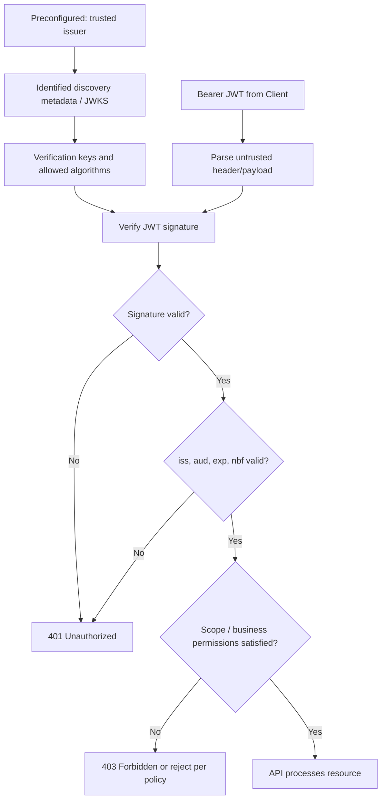

# Issuer as the Publisher Identifier and Part of the Trust Anchor

## 1. Why Must a Resource Server Care About the Issuer?

Suppose an e-commerce system has an `orders-api`, an identity server `https://id.example.com/realms/shop`, and multiple Client applications. A request is sent to the API:

```http
GET /api/orders/42 HTTP/1.1
Host: orders.example.com
Authorization: Bearer <access-token>
Accept: application/json
```

The Client can supply a JWT encoded in the three-part format `header.payload.signature`. The payload contains claims such as `sub`, `scope`, and `exp`. However, before trusting these claims, the API must answer a foundational question:

**Who is the party authorized by the system to issue tokens that the API will accept?**

In a JWT, the **`iss` (issuer)** claim represents the identifier of the issuing party. For example:

```json
{
  "iss": "https://id.example.com/realms/shop",
  "sub": "user-417",
  "aud": ["orders-api"],
  "exp": 1893456000,
  "scope": "orders.read"
}
```

The `iss` value here is only an example. In a real system, it must match the issuer identifier published by the Authorization Server and **pre-configured as trusted** on the Resource Server.

If the API accepts tokens from any issuer simply because the JWT has a valid signature under a key it just found on the network, an unauthorized party can stand up its own Authorization Server, issue tokens, and grant itself access. Conversely, if the API enforces the right issuer but skips signature verification, an attacker only needs to write the expected `iss` value into the payload.

Therefore, **the issuer is part of the *trust anchor* in Resource Server configuration**, alongside the trusted key source, allowed algorithms, audience, and token verification policy. The `iss` string by itself is not a cryptographic key, not a signature, and not sufficient to authenticate a JWT.

### Learning Outcomes

After this lesson, you will be able to:

- Explain accurately the `iss` claim and its relationship with the Authorization Server/OpenID Provider.
- Distinguish between **issuer identifier**, **discovery metadata URL**, and **JWKS URI**.
- Describe how a Resource Server goes from a trusted issuer to the key used to verify a JWT.
- Understand why signature, issuer, audience, and expiration must be verified **together**.
- Configure `issuer-uri` in Spring Security Resource Server and know when `jwk-set-uri` should also be specified.
- Recognize the risk of using an unverified `iss` to automatically trust an issuer or select an arbitrary key.
- Distinguish between a single-issuer setup and multiple issuers in a multi-organization API.

## 2. What Is an Issuer in JWT and OAuth 2.0/OIDC?

### 2.1. The `iss` Claim Is an Identifier, Not an Arbitrary API Call URL

`iss` is a **registered JWT claim name** according to JWT (RFC 7519). This claim identifies the principal that issued the JWT; its value is a case-sensitive `StringOrURI` string. By the JWT format, `iss` is not strictly required to be a URL, but in modern OAuth 2.0/OIDC deployments, the issuer is typically an explicitly configured HTTPS URL.

For example:

```text
https://id.example.com/realms/shop
```

This can be an **issuer identifier**. It is not synonymous with:

```text
https://id.example.com/realms/shop/oauth2/token
https://id.example.com/realms/shop/authorize
https://id.example.com/realms/shop/keys
```

Those latter addresses, if present, serve functions such as issuing tokens, requesting authorization, or publishing keys; they **do not automatically substitute for** the issuer identifier.

It is important to distinguish the identifiers:

| Component | What does it state? | Example |
|---|---|---|
| `iss` / issuer identifier | Which party the token claims issued it; must be verified | `https://id.example.com/realms/shop` |
| `sub` | The subject the token refers to | `user-417` |
| `aud` | Which recipient/resource the token was issued for | `orders-api` |
| `client_id` | The Client issued the token if the profile provides this claim | `shop-web` |
| `scope` or `scp` | Granted OAuth permissions | `orders.read` |
| `jwks_uri` | Where the key set is published according to trusted metadata | `https://id.example.com/realms/shop/keys` |

**One issuer can issue tokens for many Clients, many users, and many Resource Servers.** An issuer is not a user ID, tenant ID, scope, or audience.

### 2.2. Issuer in OpenID Connect

In OpenID Connect (OIDC), the **OpenID Provider (OP)** is the component that authenticates identity and issues ID tokens to an OIDC Client. The ID token must carry the `iss` claim so the Client can verify it came from the selected provider.

The same provider can operate as an OAuth Authorization Server, issuing **access tokens** for Resource Servers. In a JWT access token architecture, the API typically verifies `iss` according to the access token profile and the Authorization Server's contract.

Avoid confusing them:

- **ID token:** intended for the OIDC Client, containing information about the user's authentication event.
- **Access token:** intended for the Resource Server, used to access the API according to granted permissions.
- Both can contain `iss` and both can be JWTs, but **an ID token cannot be used in place of an access token** merely because the issuer is the same.

For example, an ID token with `aud=web-client` does not become a valid access token for `orders-api` simply because the API sees the expected `iss`.

### 2.3. Comparing Issuer Values Must Follow the Exact Contract

If the Resource Server trusts:

```text
https://id.example.com/realms/shop
```

then the following strings may be treated as **different** under exact matching:

```text
https://id.example.com/realms/shop/
http://id.example.com/realms/shop
https://ID.example.com/realms/shop
https://id.example.com/realms/other
```

Although some URL rules treat certain addresses as equivalent at the network layer, issuer comparison at the token layer must follow the conventions of the protocol and validator in use. **Do not strip trailing `/` characters, change `http` to `https`, alter paths, or normalize the issuer by guesswork just to make a token accepted.**

If you encounter an `Invalid issuer` error, determine the real issuer from metadata/the publisher's contract and fix the configuration to match. Avoid loosening the validator simply because of an unexplained string mismatch.

## 3. Why Is the Issuer Part of the Trust Anchor?

### 3.1. Token Authenticity Is a Chain of Checks

When a Resource Server accepts a JWT, it requires at minimum the following conditions:

1. **Trusted issuer:** the API is preconfigured to allow a specific issuer to issue tokens.
2. **Verification key from a trusted source:** the token is verified using a key managed by the allowed issuer or configured by the system per contract.
3. **Accepted signing algorithm:** do not arbitrarily trust an `alg` sent by the Client.
4. **Valid signature:** the header/payload has not been tampered with relative to the trusted signing key.
5. **Correct issuer claim:** `iss` in the verified token matches the expected issuer.
6. **Token still valid:** satisfies `exp`, `nbf`, and time policies.
7. **Correct Resource Server:** `aud` matches the API.
8. **Sufficient permissions:** scope/authority and resource-level authorization rules satisfy the request.

Some factors are not represented in every token, or live in system policy/metadata. Therefore, **the issuer is the starting point of the trust decision**, not the entire decision.



The diagram above illustrates the logical process; libraries may optimize, cache keys, and evaluate certain conditions in a different order. **The API should only use claims for authorization after the token has gone through the required authentication process.**

### 3.2. Why Must You Not Check Only `iss`?

An attacker can craft a JWT payload themselves:

```json
{
  "iss": "https://id.example.com/realms/shop",
  "sub": "admin",
  "aud": ["orders-api"],
  "scope": "orders.read orders.write"
}
```

Such JSON strings are trivial to create and Base64URL-encode. **Reading `iss` in an unverified payload only tells you where the token *claims* to come from.** It does not prove the token was actually signed by that issuer.

Only when the signature/MAC has been verified with an appropriate key from a trusted source, along with the validators, does the API have a basis to trust the required claims.

### 3.3. Why Must You Not Check Only the Signature?

A JWT with a valid signature under issuer B's public key when the API is only allowed to trust issuer A must still be rejected. Similarly, a token signed by issuer A to call `billing-api` cannot be used at `orders-api` if the audience does not match.

For example:

```text
Token 1:
  iss = https://id.example.com/realms/shop
  aud = orders-api
  signature = valid under trusted issuer key

Token 2:
  iss = https://id.example.com/realms/partner
  aud = orders-api
  signature = valid under partner key

Token 3:
  iss = https://id.example.com/realms/shop
  aud = billing-api
  signature = valid under trusted issuer key
```

If `orders-api` policy trusts only issuer `/realms/shop` and audience `orders-api`:

- Token 1 can proceed to the authorization check.
- Token 2 must be rejected if the partner issuer is not in the trusted set.
- Token 3 must be rejected because of the wrong audience.

**A valid signature is meaningful only in the context of “signed by which key, which authorized party owns the key, and who was the token issued for”.**

## 4. Discovery: From Issuer Identifier to Metadata and JWKS

### 4.1. What Does Discovery Solve?

Knowing that the trusted issuer is:

```text
https://id.example.com/realms/shop
```

the Resource Server needs to know how to find the **verification keys**. Instead of copying public keys into code and updating them manually whenever the publisher rotates keys, the system can use **discovery metadata** published by the Authorization Server or OpenID Provider.

Metadata typically includes fields such as:

- `issuer`: the issuer identifier, which must match the trusted value expected by the Client/API.
- `jwks_uri`: the endpoint publishing the JWK set.
- `authorization_endpoint`: the endpoint for Clients to perform authorization steps.
- `token_endpoint`: the endpoint Clients use to obtain tokens.
- Other supported parameters regarding algorithms, scopes, grant types, and server capabilities.

A Resource Server API verifying JWTs primarily needs the issuer identifier, key source, and token validation policy. **It does not need to run Authorization Code or Client Credentials itself just to validate an already-issued access token.**

### 4.2. OIDC Discovery and OAuth Authorization Server Metadata

There are two common families of discovery standards:

| Metadata source | Role | Example or note |
|---|---|---|
| **OpenID Connect Discovery** | Publishes OpenID Provider configuration | Commonly uses `.well-known/openid-configuration` per OIDC rules |
| **OAuth 2.0 Authorization Server Metadata (RFC 8414)** | Publishes Authorization Server configuration | Uses `.well-known/oauth-authorization-server` per RFC 8414 rules |
| **JWKS endpoint** | Publishes the public JWK set for verification | URL published via `jwks_uri` or trusted configuration |

For an issuer without a path, common address patterns are:

```text
Issuer:
  https://auth.example.com

OIDC discovery:
  https://auth.example.com/.well-known/openid-configuration

OAuth AS metadata:
  https://auth.example.com/.well-known/oauth-authorization-server
```

For an issuer with a path, **the path construction rules for metadata can differ between OIDC Discovery and RFC 8414**. Illustrative example:

```text
Issuer:
  https://auth.example.com/realms/shop

OIDC discovery (common form appended to the issuer path):
  https://auth.example.com/realms/shop/.well-known/openid-configuration

OAuth AS metadata per RFC 8414 (well-known inserted before the issuer path):
  https://auth.example.com/.well-known/oauth-authorization-server/realms/shop
```

Servers may publish specific compatible discovery endpoints; Spring Security also has mechanisms to look up metadata from supported locations depending on the version. **Do not guess a discovery URL based solely on endpoint naming**: use the metadata published by the provider, check the `issuer` response field, and choose the standard/interface supported by your environment.

### 4.3. OIDC Metadata Example

An **illustrative**, abbreviated JSON response:

```json
{
  "issuer": "https://id.example.com/realms/shop",
  "authorization_endpoint": "https://id.example.com/realms/shop/authorize",
  "token_endpoint": "https://id.example.com/realms/shop/token",
  "jwks_uri": "https://id.example.com/realms/shop/keys",
  "response_types_supported": ["code"],
  "id_token_signing_alg_values_supported": ["RS256"]
}
```

The addresses and values above are not the configuration of any specific provider. `id_token_signing_alg_values_supported` refers to the **ID token** signing algorithms published in OIDC and **does not automatically replace** the algorithm policy that the Resource Server uses when verifying **access tokens**. For access tokens, rely on the token profile and API configuration.

When using discovery safely:

1. The API or library starts from a **preconfigured trusted issuer**, not from an arbitrary URL inside a token.
2. Query metadata over HTTPS and verify the TLS connection.
3. Verify the metadata `issuer` according to the protocol/client rules so it is consistent with the expected issuer.
4. Use `jwks_uri` and relevant supported information according to the library's policy.
5. Only accept JWT signatures/claims that satisfy the validator set and trusted keys.

### 4.4. JWKS and Its Relationship with `kid`

Metadata may point to a JWKS endpoint such as:

```text
https://id.example.com/realms/shop/keys
```

The public JWK Set response may contain:

```json
{
  "keys": [
    {
      "kty": "RSA",
      "kid": "key-2026-11",
      "use": "sig",
      "alg": "RS256",
      "n": "<public-modulus-base64url>",
      "e": "AQAB"
    }
  ]
}
```

The `n` and `e` values above are placeholders only and do not form a real public key. `kid` helps select a key from the trusted key set; `kty` and `use` describe the key type/intended use.

When a JWT has a JOSE header:

```json
{
  "alg": "RS256",
  "typ": "at+jwt",
  "kid": "key-2026-11"
}
```

the Resource Server can use `kid` as a hint to choose the corresponding key, then verify the algorithm and signature. **A `kid` supplied by a token does not establish trust in a key on its own; the JWKS must come from a preconfigured trusted source.**

A JWT header can carry key-related fields such as `jku` or `jwk`. The Resource Server **should not automatically trust a new URL/key just because the token asks for it**, otherwise it risks accepting tokens self-signed by an attacker or making network requests to unintended addresses.

### 4.5. TLS and Issuer Are Two Different Trust Layers

An HTTPS issuer URL allows the Resource Server to fetch metadata/keys over a channel authenticated by TLS. However:

- TLS authenticates the server/transport channel under the certificate model trusted by the system.
- Issuer configuration defines **which publisher the application authorizes**.
- The JWT signature authenticates token data against the **trusted signing key**.
- Audience/scope/business permissions define **what** the token can be used for.

A valid HTTPS endpoint does not mean your organization authorized that endpoint to issue tokens for the API. **The trust anchor begins with the decision to configure the appropriate issuer and keys**, and does not appear automatically simply because a URL uses HTTPS.

## 5. What Does Spring Security Resource Server Do with `issuer-uri`?

### 5.1. Minimal Configuration

For a Spring Boot application using Gradle:

```groovy
dependencies {
    implementation 'org.springframework.boot:spring-boot-starter-web'
    implementation 'org.springframework.boot:spring-boot-starter-security'
    implementation 'org.springframework.boot:spring-boot-starter-oauth2-resource-server'
}
```

In `src/main/resources/application.yml`:

```yaml
spring:
  security:
    oauth2:
      resourceserver:
        jwt:
          issuer-uri: https://id.example.com/realms/shop
```

This is an example of configuring Spring Boot OAuth 2.0 Resource Server using **JWT access tokens**. The issuer address must be replaced with the real value approved by the system.

When operating in issuer discovery mode, Spring Security can locate the issuer configuration and corresponding JWK source, use trusted keys to verify the JWT signature, and apply basic validators for issuer/time. Details of when metadata/JWKS are fetched depend on the version and how the `JwtDecoder` is created; do not assume every version requires network connectivity at one fixed moment.

What `issuer-uri` **does not do automatically**:

- Does not turn the application into an Authorization Server.
- Does not log users in or issue access tokens.
- Does not guarantee the JWT was issued for the API's business audience if audience validation has not been configured.
- Does not resolve owner/tenant/role on individual resources.
- Does not turn an OIDC ID token into an access token for calling the API.
- Does not replace the requirement to configure algorithms/keys appropriate to the actual token profile.

### 5.2. Enabling Resource Server and Endpoint Authorization

Example of an application using modern Spring Security:

```java
package com.example.orders;

import org.springframework.context.annotation.Bean;
import org.springframework.context.annotation.Configuration;
import org.springframework.http.HttpMethod;
import org.springframework.security.config.Customizer;
import org.springframework.security.config.annotation.web.builders.HttpSecurity;
import org.springframework.security.config.http.SessionCreationPolicy;
import org.springframework.security.web.SecurityFilterChain;

@Configuration
public class SecurityConfig {

    @Bean
    SecurityFilterChain apiSecurity(HttpSecurity http) throws Exception {
        return http
            .csrf(csrf -> csrf.disable())
            .sessionManagement(s -> s
                .sessionCreationPolicy(SessionCreationPolicy.STATELESS))
            .authorizeHttpRequests(auth -> auth
                .requestMatchers("/api/public/**").permitAll()
                .requestMatchers(HttpMethod.GET, "/api/orders/**")
                    .hasAuthority("SCOPE_orders.read")
                .requestMatchers(HttpMethod.POST, "/api/orders/**")
                    .hasAuthority("SCOPE_orders.write")
                .anyRequest().denyAll()
            )
            .oauth2ResourceServer(oauth2 ->
                oauth2.jwt(Customizer.withDefaults()))
            .build();
    }
}
```

In the configuration above, Spring Security processes the Bearer JWT, builds an `Authentication` when the token is valid, and checks `SCOPE_orders.read` or `SCOPE_orders.write` on the corresponding endpoints.

Normally, a JWT's `scope` or `scp` claim is mapped to authorities prefixed with `SCOPE_`. For issuers using a different claim format, a custom converter must be configured.

`csrf.disable()` is only an example for a REST API not using cookies for authentication, where the Bearer token is explicitly sent by the Client in a header. If browser cookies/sessions are used, CSRF must be evaluated based on the actual architecture.

### 5.3. Configuring Issuer Together with a Pre-Specified JWKS URI

Some systems need tighter control over how metadata/JWKS are contacted or want to reduce reliance on discovery at startup. Spring Boot supports configuring both `issuer-uri` and `jwk-set-uri` in compatible versions:

```yaml
spring:
  security:
    oauth2:
      resourceserver:
        jwt:
          issuer-uri: https://id.example.com/realms/shop
          jwk-set-uri: https://id.example.com/realms/shop/keys
```

Role of each property:

- `issuer-uri`: preserves the expected issuer identity to validate the `iss` claim.
- `jwk-set-uri`: specifies the public key source accepted by the API.

Configuring both properties can bypass looking up `jwks_uri` via issuer metadata during decoder creation, depending on the version, while still keeping issuer validation. When the API needs to verify tokens, the JWKS endpoint must still be reachable or have an appropriate key cache.

**Note:** If you configure only `jwk-set-uri` without otherwise setting up an issuer validator, do not assume `iss` is being checked. Distinguish between “knowing where to fetch keys” and “trusting only a specific issuer”.

### 5.4. Adding an Audience Validator

The `orders-api` Resource Server must reject tokens intended for `billing-api`, even from the same issuer and signing key. For example, a decoder can be created with issuer/time and `aud` validation:

```java
package com.example.orders;

import org.springframework.context.annotation.Bean;
import org.springframework.context.annotation.Configuration;
import org.springframework.security.oauth2.core.DelegatingOAuth2TokenValidator;
import org.springframework.security.oauth2.core.OAuth2Error;
import org.springframework.security.oauth2.core.OAuth2TokenValidator;
import org.springframework.security.oauth2.core.OAuth2TokenValidatorResult;
import org.springframework.security.oauth2.jwt.Jwt;
import org.springframework.security.oauth2.jwt.JwtDecoder;
import org.springframework.security.oauth2.jwt.JwtDecoders;
import org.springframework.security.oauth2.jwt.JwtValidators;
import org.springframework.security.oauth2.jwt.NimbusJwtDecoder;

@Configuration
public class JwtValidationConfig {

    @Bean
    JwtDecoder jwtDecoder() {
        String expectedIssuer =
            "https://id.example.com/realms/shop";
        String expectedAudience = "orders-api";

        NimbusJwtDecoder decoder =
            (NimbusJwtDecoder) JwtDecoders.fromIssuerLocation(expectedIssuer);

        OAuth2TokenValidator<Jwt> audienceValidator = jwt ->
            jwt.getAudience().contains(expectedAudience)
                ? OAuth2TokenValidatorResult.success()
                : OAuth2TokenValidatorResult.failure(
                    new OAuth2Error(
                        "invalid_token", "Invalid audience", null));

        decoder.setJwtValidator(
            new DelegatingOAuth2TokenValidator<>(
                JwtValidators.createDefaultWithIssuer(expectedIssuer),
                audienceValidator
            ));

        return decoder;
    }
}
```

This snippet illustrates Spring Security versions supporting the APIs used. It replaces the auto-configured `JwtDecoder` with an application-declared bean while retaining the default validators via `JwtValidators.createDefaultWithIssuer(...)`.

If using a fixed `jwk-set-uri` instead of discovery in code, you can construct the decoder using the corresponding JWK Set URI API and **still** configure issuer/audience validators; do not accidentally drop a validator when customizing the decoder.

Depending on the Spring Boot/Spring Security version, there may be a property to configure audiences directly. Choose the approach matching your project's version, while keeping the principle unchanged: **issuer and audience must be validated independently**.

### 5.5. Reading the Issuer After the Token Has Been Verified

A Controller can receive the JWT principal:

```java
package com.example.orders;

import java.util.Map;
import org.springframework.security.core.annotation.AuthenticationPrincipal;
import org.springframework.security.oauth2.jwt.Jwt;
import org.springframework.web.bind.annotation.GetMapping;
import org.springframework.web.bind.annotation.RestController;

@RestController
public class ProfileController {

    @GetMapping("/api/profile")
    public Map<String, Object> profile(
            @AuthenticationPrincipal Jwt jwt) {

        return Map.of(
            "subject", jwt.getSubject(),
            "issuer", jwt.getIssuer().toString(),
            "audience", jwt.getAudience()
        );
    }
}
```

This example assumes issuer/subject exist according to the token contract. For the endpoint to execute with the `SecurityConfig` in section 5.2, an additional matcher for `/api/profile` with appropriate scope/authority requirements must be declared; leaving `anyRequest().denyAll()` untouched causes the request to be denied before reaching the Controller.

**Only use `Jwt` from the SecurityContext after Spring Security's authentication step** to rely on issuer/subject. Do not trust an issuer string sent separately by the Client via a header such as `X-Issuer`, or a JWT payload that was merely Base64URL-decoded without verification.

## 6. Mistakes Related to Discovery and the Trust Anchor

### 6.1. Taking `iss` from an Unverified Token and Automatically Trusting That Issuer

For example, an API tries to do the following:

```text
1. Client sends JWT.
2. API Base64URL-decodes the payload and reads iss.
3. API fetches metadata from the iss URL.
4. API downloads the JWKS published by that URL.
5. API verifies the signature and accepts the token.
```

If the API **does not check whether that issuer is in the trusted set**, an attacker can:

1. Stand up their own HTTPS server.
2. Publish metadata and JWKS with their own public key.
3. Self-sign a JWT with `scope=orders.read`, `sub=admin`.
4. Send the JWT to the API.

If the API arbitrarily trusts new issuers, the signature can pass under the key owned by the attacker themselves, and the request is mistakenly authorized.

**Rule:** The issuer identifier must be **allowlisted/preconfigured as trusted**. An unverified `iss` can be used as a **hint to look up an existing configuration**, not to automatically **expand the set of trusted issuers**.

### 6.2. Trusting `jku` or `jwk` Requested by the JWT Header

A JOSE header can carry parameters specifying keys or key URLs. If the decoder automatically accepts out-of-band keys based on `jku`/`jwk`, an attacker can inject a key they control into verification.

The Resource Server should select keys from the JWKS/keystore belonging to a trusted issuer, restrict allowed algorithms, and enforce safe header-processing policies. `kid` is only a hint to locate a key within the trusted set, not permission to pick a new key source.

### 6.3. Sharing an Issuer Without Validating Audience

An Authorization Server may issue tokens for `orders-api`, `inventory-api`, and `billing-api`. All tokens share `iss`, but have different `aud` values.

If `orders-api` verifies only signature and issuer, it may mistakenly accept a token issued for `inventory-api`.

**Remediation:** Enforce `aud` matching the Resource Server's identifier, while also checking scopes and business permissions. This is especially critical if multiple APIs share an issuer and public keys.

### 6.4. Using an OIDC Client's ID Token to Call a Resource Server

An ID token may contain:

```json
{
  "iss": "https://id.example.com/realms/shop",
  "sub": "user-417",
  "aud": "shop-web"
}
```

If `orders-api` trusts that issuer without checking audience/token purpose, the API risks accepting a token type not meant for it.

**Remediation:** The Client must send an **access token** intended for the API. If the system uses a JWT access token profile with `typ=at+jwt` or other token-type constraints, the Resource Server should enforce that policy. Do not treat signature and issuer alone as sufficient to distinguish an ID token from an access token.

### 6.5. Casually Bypassing Issuer Errors Across Environments

For example, staging uses:

```text
https://id-staging.example.com/realms/shop
```

while production uses:

```text
https://id.example.com/realms/shop
```

If the production API also accepts staging tokens merely for testing convenience, production access could be granted by an environment with weaker key/identity governance.

Maintain per-environment issuer allowlists according to operational requirements, keep issuers/keys/audiences separated, and do not arbitrarily expand the trusted set.

## 7. When Multiple Issuers Exist: More Complex Trust Boundaries

### 7.1. One API Can Trust Multiple Authorization Servers

In a multi-enterprise system, `reports-api` may receive tokens from:

```text
https://login.company-a.example
https://login.company-b.example
```

Or in a multi-realm architecture:

```text
https://auth.example.com/realms/tenant-a
https://auth.example.com/realms/tenant-b
```

In this case, the Resource Server must know the **allowed issuer set** in advance and have a mechanism to validate JWTs per corresponding issuer.

| What to enforce | Why is it needed? |
|---|---|
| Issuer allowlist | Prevents Clients from introducing an unknown issuer into the system |
| Per-issuer JWKS/keys | Prevents verifying issuer A's token with issuer B's key or an arbitrary source |
| API-appropriate audience | Prevents using tokens issued for another API |
| Per-issuer claim mapping | `sub`, `scope`, `roles`, `tenant` may have different structures |
| Per-issuer subject key | Avoids user ID collisions across issuers |
| Tenant/permission policy | A token from issuer A does not automatically have access to tenant B's data |

### 7.2. User Identifiers Should Be Scoped to the Issuer

Suppose both issuer A and issuer B issue tokens with:

```text
sub = 123
```

Two identical `sub` strings **do not necessarily represent the same user**. When mapping external identities to an internal system, use the pair:

```text
(issuer, subject)
```

For example:

```text
(https://login.company-a.example, 123)
(https://login.company-b.example, 123)
```

are two distinct external identities, unless the system explicitly links accounts through a verified mechanism.

This is especially important when storing resource owners, tenant data, or audit logs. Storing only `sub=123` can cause collisions when multiple issuers are accepted.

### 7.3. Safely Selecting a Validator by Issuer

Spring Security has a mechanism to resolve an `AuthenticationManager` by issuer, such as `JwtIssuerAuthenticationManagerResolver` in Servlet configurations supporting multiple issuers. The idea:

```text
Incoming JWT
   |
   +-- read iss as routing hint (not trusted yet)
   |
   +-- iss in configured trusted set?
   |       no  -> reject
   |       yes -> select issuer-specific AuthenticationManager
   |
   +-- verify JWT with keys/validators for that issuer
   |
   +-- enforce audience, time, scope, tenant and resource permissions
```

For certain Spring Security versions, the resolver can be configured from a list of trusted issuers via an API corresponding to `fromTrustedIssuers`. Exact syntax/initialization varies by version; what is mandatory in every design is that **the resolver only selects among pre-approved issuers**, and then the decoder still verifies the signature and issuer claim.

Do not treat every `iss` URL from incoming JWTs as a trusted issuer merely because the JWT contains that field.

### 7.4. An Issuer Is Not a Default Tenant ID

One issuer can serve thousands of tenants; conversely, a system may use a separate issuer per tenant. If an API requires tenant isolation, the contract must be explicitly defined:

- Is the tenant mapped from a trusted issuer?
- Or does the AS issue a verified `tenant_id` claim?
- When a user belongs to multiple tenants, which current tenant does the token represent?
- How does the API match the token's tenant against the tenant in data?

**Do not assume `iss` is the tenant ID** without a concrete data convention and authorization policy.

## 8. Discovery, JWKS Caching, and Key Rotation

### 8.1. Signing Keys Can Change While the Issuer Stays the Same

An Authorization Server may rotate private keys periodically or during incident response. A sound configuration keeps the issuer identifier stable while allowing multiple public keys during the transition window.

For example:

```text
Issuer: https://id.example.com/realms/shop

Old JWT: kid=key-2026-10
New JWT: kid=key-2026-11

JWKS during transition:
  - key-2026-10 (old public key)
  - key-2026-11 (new public key)
```

The Resource Server can cache the JWKS and refresh according to cache policy or upon encountering a new `kid`. This ensures unexpired tokens signed with the old key can still be verified during the allowed window.

### 8.2. Why Must Key Caching Have Bounds and Trusted Sources?

Caching helps reduce network requests and lower latency. However, the API still needs to:

- Restrict JWKS sources to trusted issuers.
- Ensure a mechanism to refresh when keys rotate.
- Define behavior if the JWKS endpoint becomes unreachable.
- Not continue using revoked keys beyond security policy.
- Not accept keys from token headers or new Client-specified issuers.

When JWKS temporarily loses connectivity, token verification can still succeed if the decoder has a matching **cached trusted key** that remains acceptable. For new tokens using an uncached `kid`, verification may fail until the new key is fetched.

### 8.3. What If a Key Is Compromised?

Changing `iss` alone does not solve a compromised private key. If an attacker holds a private key still trusted by the Resource Server, they can craft tokens with valid signatures under that key.

Response typically requires:

1. Stopping use of / revoking the compromised key.
2. Updating the JWKS or trusted key configuration.
3. Ensuring APIs no longer accept the old key contrary to policy.
4. Checking token lifetimes, revocation capabilities, and impact on processed requests.
5. Reviewing logs/audits per operational procedures.

The issuer identifies the publisher; **signing keys and verification policy determine token authenticity**, so protecting keys is inseparable from issuer configuration.

## 9. Failure Modes and Diagnostics

### 9.1. Wrong Issuer

A request arrives with a JWT signed by another issuer while the API trusts only the configured issuer:

```http
GET /api/orders/42 HTTP/1.1
Authorization: Bearer <jwt-from-other-issuer>
```

If the JWT fails signature/issuer verification, the result is typically:

```http
HTTP/1.1 401 Unauthorized
WWW-Authenticate: Bearer error="invalid_token"
```

Header details may vary depending on Spring Security, decoder, and exception handling configuration. **`401` is the typical response for an unaccepted token**.

### 9.2. Wrong Audience Despite Correct Issuer

A valid JWT from the right issuer:

```json
{
  "iss": "https://id.example.com/realms/shop",
  "aud": ["billing-api"],
  "scope": "orders.read"
}
```

must be rejected by `orders-api` **if the audience validator requires `orders-api`**. Having the right issuer and a scope named `orders.read` does not automatically grant the token access to every API.

### 9.3. Valid Token but Insufficient Scope

If issuer, signature, expiration, and audience are all valid, but the token only has `scope=orders.list` while `GET /api/orders/**` requires `SCOPE_orders.read`, the response is typically:

```http
HTTP/1.1 403 Forbidden
WWW-Authenticate: Bearer error="insufficient_scope"
```

In this case, the issue lies in **authorization**, not the issuer. Changing the issuer validator to force the token through is the wrong direction.

### 9.4. Metadata Discovery or JWKS Failures

Possible issues include:

- Non-existent issuer URL or wrong path.
- Metadata returning an `issuer` different from configuration.
- Invalid TLS connection to discovery/JWKS.
- Metadata missing an appropriate `jwks_uri`.
- Unreachable JWKS endpoint or missing the `kid` requested by the token.
- Algorithm/key type unsupported or disallowed by the decoder.

Depending on configuration and framework version, these failures may surface at **startup**, **decoder initialization**, or **when a request needs JWT verification**. Do not confuse network/discovery failures with a user lacking `403` permissions.

### 9.5. Quick Lookup Table

| Symptom | Check first | How to handle |
|---|---|---|
| JWT has `iss` differing from `issuer-uri` | `iss` claim and actual issuer from metadata | Match configuration to the exact issuer; do not remove the validator |
| JWT has right issuer but wrong `aud` | Token audience and API | Configure token issuance / audience validator accurately |
| `401` after signing key rotation | `kid`, JWKS cache, and new public key | Check key rotation, metadata/JWKS, and trust configuration |
| App fails to start due to issuer | Metadata endpoint/TLS and Spring Security version | Verify discovery endpoint or proactively configure JWKS |
| Valid token but `403` | `scope`, `SCOPE_` mapping, business permissions | Fix authorization rules/scopes; do not relax issuer |
| Staging token works in production | Trusted issuers/keys per environment | Audit and separate trust boundaries |
| ID token still passes API | Audience, token type, and access token profile | Require access tokens intended for the API |
| System accepts unknown issuer | How decoder/JWKS is selected from `iss` | Use only an issuer allowlist and trusted keys |
| Two users from different issuers treated as one | Storing `sub` without `iss` | Identify by the `(iss, sub)` pair |

## 10. Hands-On: Confirming Issuer and Token at the Resource Server

The following examples are **illustrative commands to run in a project and environment with a real issuer**. They are not pre-executed results.

### 10.1. Prepare Two Endpoints

With `SecurityConfig` in section 5.2, a Controller can provide:

```java
package com.example.orders;

import java.util.Map;
import org.springframework.security.core.annotation.AuthenticationPrincipal;
import org.springframework.security.oauth2.jwt.Jwt;
import org.springframework.web.bind.annotation.GetMapping;
import org.springframework.web.bind.annotation.RestController;

@RestController
public class DemoController {

    @GetMapping("/api/public/ping")
    public Map<String, String> ping() {
        return Map.of("status", "ok");
    }

    @GetMapping("/api/orders/me")
    public Map<String, String> privateInfo(
            @AuthenticationPrincipal Jwt jwt) {
        return Map.of("subject", jwt.getSubject());
    }
}
```

This is a simple demo of public vs. token-protected requests; in a real application, the orders API must verify ownership/tenant when accessing business records.

### 10.2. Without a Token

```bash
curl -i http://localhost:8080/api/public/ping
curl -i http://localhost:8080/api/orders/me
```

Expected results:

- `GET /api/public/ping` returns `200 OK`.
- `GET /api/orders/me` returns `401 Unauthorized` due to missing Bearer token.

### 10.3. Invalid Token

```bash
curl -i \
  -H 'Authorization: Bearer invalid.jwt.token' \
  http://localhost:8080/api/orders/me
```

The API must reject invalid tokens, typically `401`. This exercises the authentication failure path and does not prove discovery/JWKS correctness in all cases.

### 10.4. Valid Token from the Right Issuer

Suppose `ACCESS_TOKEN` is a real access token issued by the trusted issuer, with matching audience, unexpired, and containing `orders.read`:

```bash
curl -i \
  -H "Authorization: Bearer $ACCESS_TOKEN" \
  http://localhost:8080/api/orders/me
```

Expected result is `200 OK` with a body containing the token's subject. Do not use an ID token in place of an access token.

### 10.5. Token Issued by Another Issuer

If you have a real token from an issuer not in the trusted configuration, try:

```bash
curl -i \
  -H "Authorization: Bearer $OTHER_ISSUER_ACCESS_TOKEN" \
  http://localhost:8080/api/orders/me
```

The expected result is rejection, typically `401`. For a meaningful test, the other issuer's token must be validly issued by its own server; simply editing `iss` in the JWT payload breaks the signature and does not clearly isolate the cause.

### 10.6. Inspecting Metadata with curl

If the provider supports an OIDC Discovery endpoint at the location corresponding to the issuer, you can inspect the metadata:

```bash
curl -i \
  'https://id.example.com/realms/shop/.well-known/openid-configuration'
```

Inspect the `issuer` and `jwks_uri` fields in the response, but **do not log sensitive internal details or keys**. The endpoint above is an illustrative URL; in a real environment, use the discovery URL confirmed by the provider.

When confirming the issuer, do not just inspect the JWT's `iss` string with a payload decoder and consider the signature verified. Token authentication belongs to `JwtDecoder` with trusted keys and validators.

### 10.7. Expected Results Matrix

| Case | Token | Main condition | Result |
|---|---|---|---|
| Public request | None | `permitAll()` | `200` |
| Protected request | None | Unauthenticated | `401` |
| Protected request | Malformed/bad-signature token | JWT verification fails | `401` |
| Protected request | Token from unknown issuer | Not in trust configuration | `401` |
| Protected request | Right issuer, wrong audience | Audience validator rejects | `401` |
| Protected request | Right issuer/audience, expired | Expiration validator rejects | `401` |
| Protected request | Right issuer/audience, missing scope | Lacks `SCOPE_orders.read` | `403` |
| Protected request | Valid token with sufficient scope | Endpoint checks pass | `200` if Controller succeeds |

Actual HTTP statuses can also be affected by multiple filter chains, custom handlers, and application logic. Real JWT testing requires a real Authorization Server/JWKS; it cannot be substituted by hand-crafted payload strings.

## 11. Opaque Tokens and the Role of the Issuer

Not every access token is a JWT. An Authorization Server can issue an **opaque token**, i.e., a string that the Resource Server cannot decode locally to read `iss`.

With opaque tokens, the Resource Server typically validates tokens via a preconfigured trusted **introspection endpoint**:

```yaml
spring:
  security:
    oauth2:
      resourceserver:
        opaque-token:
          introspection-uri: https://id.example.com/oauth2/introspect
          client-id: resource-api
          client-secret: PLACEHOLDER_SECRET
```

`PLACEHOLDER_SECRET` is a placeholder string only; real deployments must load credentials from environment variables or a secret manager and never commit secrets into the repository.

In this case, the trust anchor is expressed through **the trusted introspection endpoint, how the Resource Server authenticates to that endpoint, and the response validation policy**. If the introspection response contains an issuer/identity claim, the API interprets it according to the provider contract, rather than inherently having a JWT payload containing `iss` to read locally.

Since this lesson focuses on `issuer-uri` and discovery with JWTs, keep them distinct: **configuring a JWT decoder via issuer differs from configuring opaque-token introspection**. Do not assume both authentication modes are enabled by a single `issuer-uri` property.

## 12. Self-Check Questions

**Question 1.** Why does a matching `iss` not by itself prove an access token is valid?

**Answer:** `iss` is just a string in the payload. A sender can fabricate that string. The Resource Server must verify the signature with a trusted key along with validators before relying on claims.

**Question 2.** Are the issuer identifier, `jwks_uri`, and `token_endpoint` the same URL?

**Answer:** Not necessarily. The issuer is the publisher's identifier; `jwks_uri` is the verification key-set URL; `token_endpoint` is where Clients request tokens. Discovery metadata links these values according to the relevant standard.

**Question 3.** A JWT has a valid signature issued by a trusted issuer, but `aud=billing-api`. Should `orders-api` accept the token?

**Answer:** No, if `orders-api` requires its own audience. Right issuer and signature are not enough; the token must be intended for that specific Resource Server.

**Question 4.** Can an API take any `iss` from a JWT and download JWKS from that issuer to verify it?

**Answer:** No. The API should only use issuers in its preconfigured trusted set. An unverified `iss` may act as a hint to choose a pre-allowed configuration, never to create new trust dynamically.

**Question 5.** Why might you use `(iss, sub)` to store external identities?

**Answer:** `sub` can collide between two issuers. The `(issuer, subject)` pair distinguishes principals from different publishers.

**Question 6.** If the issuer is configured properly but the signing key changes, what does the Resource Server need to handle?

**Answer:** It must fetch/update the public key from the trusted JWKS source or corresponding configuration, ensuring `kid` and algorithms are permitted. Do not disable signature verification just to let new tokens through.

**Question 7.** Why can an OIDC ID token generally not be used to call an API even when its `iss` matches the access token?

**Answer:** An ID token serves the OIDC Client and typically has the Client's audience. A Resource Server needs an access token issued for the API that satisfies rules on audience, token type, and scopes/permissions.

## 13. Key Takeaways

**The issuer is the identifier of the token publisher that the application chooses to trust.** It tells the Resource Server *which party has authority to issue tokens*, and serves as the starting point for setting up discovery metadata and the verification key source in common JWT configurations.

However, **the issuer is not the entire trust anchor**. A request should only be accepted when the full chain holds: **issuer in the allowed set → trustworthy verification keys and algorithms → valid signature → `iss`, `aud`, and expiration satisfied → matching scopes and resource permissions**.

With Spring Security OAuth 2.0 Resource Server, `issuer-uri` is a way to declare an important trust boundary. When needed, you can further control the `jwk-set-uri` source, audience, and issuer selection mechanism. These layers of protection help the API accept the right tokens from the right Authorization Server and prevent a JWT from another party or intended for another resource from being misused.
