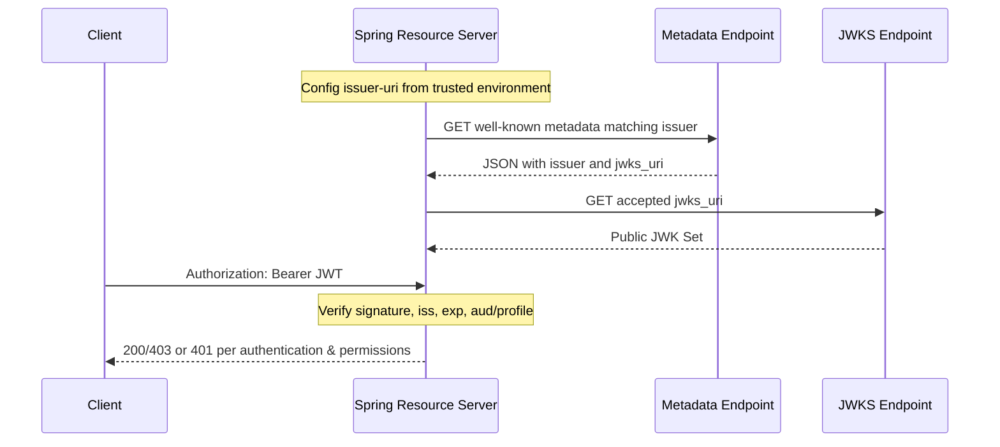

# OIDC Provider Configuration and OAuth Authorization Server Metadata

## 1. The Problem: How Does a Resource Server Know and Trust the Authorization Server?

When a Spring Security API runs as an **OAuth 2.0 Resource Server**, the API receives access tokens from clients. If the access token is a signed JWT, the Resource Server needs to know at minimum: **which issuer** issued the token, **which verification key** to use, and which conditions must hold before allowing the request.

In a simple deployment, you might configure:

```yaml
spring:
  security:
    oauth2:
      resourceserver:
        jwt:
          issuer-uri: https://identity.example.com/realms/shop
```

The `issuer-uri` value is the **issuer identifier** trusted by the Resource Server. Spring Security can use this identifier to locate metadata documents through the **discovery** mechanism. The metadata specifies endpoint addresses, especially `jwks_uri` to fetch the **JSON Web Key Set (JWKS)**, from which the Resource Server verifies JWT signatures.

Two types of metadata documents are commonly mentioned:

1. **OpenID Connect Provider Configuration**, defined by **OpenID Connect Discovery 1.0**.
2. **OAuth 2.0 Authorization Server Metadata**, defined by **RFC 8414**.

They share many similar fields and can both be published by the same identity provider, yet **they are not one document with two names**. The two standards differ in scope, URL construction rules, and several metadata fields. Understanding the differences helps prevent issuer mismatch errors, incorrect `/.well-known/` URLs, and failures where the Resource Server cannot download the JWKS.

## 2. Distinguishing Issuer, Authorization Server, OpenID Provider, and Resource Server

| Concept | Responsibility | Relationship with metadata |
|---|---|---|
| **Authorization Server (AS)** | Issues OAuth 2.0 access tokens, possibly refresh tokens; operates authorization endpoints | May publish **OAuth Authorization Server Metadata** per RFC 8414 |
| **OpenID Provider (OP)** | Authorization Server supporting OpenID Connect to authenticate users | Publishes **OIDC Provider Configuration** for OIDC discovery |
| **OAuth 2.0 Client** | Runs flows to obtain tokens and call APIs | Can use metadata to find authorization/token endpoints and OIDC configuration |
| **OIDC Relying Party (RP)** | OIDC Client relying on ID tokens to verify login outcomes | Uses OIDC metadata to verify OP characteristics and endpoints |
| **Resource Server (RS)** | API receiving access tokens, validating them, and enforcing permissions | For JWTs, primarily cares about `issuer`, `jwks_uri`, and the access token contract |
| **Issuer identifier** | Protocol URL identifying the organization/unit issuing tokens | Appears as `issuer` in metadata and typically `iss` in JWTs |

E-commerce system example:

```text
                       Authorization Server / OpenID Provider
                          issuer: https://identity.example.com/realms/shop
                           |                      |
                           | issues tokens        | publishes metadata
                           v                      v
Web Client --------> Bearer access token     /.well-known/... JSON
    |
    | Authorization: Bearer <access_token>
    v
Orders Resource Server  ---- discovery / JWKS ----> identity.example.com
    |
    | verify signature, issuer, expiration, audience, permissions
    v
Protected orders API
```

A Resource Server **does not necessarily need OIDC login**. An OAuth 2.0 Authorization Server can issue access tokens for an API without supporting OIDC/ID tokens. In that case, RFC 8414 may be the appropriate discovery mechanism, while `openid-configuration` may not exist at all.

### An Issuer Is Not Synonymous with an Endpoint URL

Suppose:

```text
issuer: https://identity.example.com/realms/shop
token endpoint: https://identity.example.com/realms/shop/protocol/openid-connect/token
JWKS endpoint: https://identity.example.com/realms/shop/protocol/openid-connect/certs
```

The three URLs serve **three different purposes**. Do not set `issuer-uri` to the token endpoint or the JWKS endpoint. The API needs to keep the published issuer identifier intact, and then use metadata to look up the appropriate endpoint URLs.

## 3. What Is OIDC Provider Configuration?

**OpenID Connect Discovery 1.0** describes how an OIDC Client discovers configuration information for an **OpenID Provider (OP)**. This document is commonly called the *OpenID Provider Configuration Response*, published as JSON over HTTPS at a well-known URL.

Example issuer:

```text
https://identity.example.com/realms/shop
```

The OIDC discovery endpoint is typically:

```text
https://identity.example.com/realms/shop/.well-known/openid-configuration
```

Illustrative JSON example:

```json
{
  "issuer": "https://identity.example.com/realms/shop",
  "authorization_endpoint": "https://identity.example.com/realms/shop/protocol/openid-connect/auth",
  "token_endpoint": "https://identity.example.com/realms/shop/protocol/openid-connect/token",
  "userinfo_endpoint": "https://identity.example.com/realms/shop/protocol/openid-connect/userinfo",
  "jwks_uri": "https://identity.example.com/realms/shop/protocol/openid-connect/certs",
  "end_session_endpoint": "https://identity.example.com/realms/shop/protocol/openid-connect/logout",
  "response_types_supported": ["code", "id_token", "code id_token"],
  "subject_types_supported": ["public", "pairwise"],
  "id_token_signing_alg_values_supported": ["RS256"],
  "scopes_supported": ["openid", "profile", "email", "orders.read"],
  "grant_types_supported": ["authorization_code", "refresh_token"],
  "code_challenge_methods_supported": ["S256"]
}
```

This is a **structural example**, not a configuration guaranteed by any specific OP. The URIs, flows, scopes, and optional fields published by each provider can differ; some example fields only appear when the corresponding feature is supported.

### Fields to Recognize in OIDC Metadata

| Field | Meaning | Who usually uses it? |
|---|---|---|
| `issuer` | Canonical identifier of the OP/issuer | OIDC Client, and Resource Server when checking `iss` |
| `authorization_endpoint` | Endpoint starting the authorization flow with the user | OAuth/OIDC Client |
| `token_endpoint` | Endpoint exchanging authorization codes, refresh tokens, and supported grants | OAuth/OIDC Client |
| `userinfo_endpoint` | Endpoint fetching claims about the user using an appropriate OIDC access token | OIDC Client |
| `jwks_uri` | Where the JWK Set is published, typically containing public keys for signature verification | OIDC Client and JWT Resource Server |
| `response_types_supported` | Response types supported by the OP | OIDC Client |
| `subject_types_supported` | Subject identifier types of the OP | OIDC Client |
| `id_token_signing_alg_values_supported` | Signing algorithms published by the OP for **ID tokens** | OIDC Client |
| `scopes_supported` | Scopes published by the OP | Client, discovery/tooling |
| `grant_types_supported` | OAuth grants advertised by the provider | Client |
| `code_challenge_methods_supported` | Advertised PKCE methods, such as `S256` | Client |
| `end_session_endpoint` | Logout endpoint if the corresponding extension is present | OIDC Client/RP |

Note carefully: `id_token_signing_alg_values_supported` lists signing algorithms for **ID tokens**, not a guarantee that every **JWT access token** is signed using that exact list. Access tokens must be verified according to the **contract between the issuer and Resource Server**, along with the JWT algorithms the API is configured to trust.

### OIDC Metadata Is Not an ID Token

The well-known JSON document only describes the **OP's configuration**, fetched before or during authentication. It contains no proof of a specific user's login. An **ID token**, by contrast, is a JWT issued by the OP to an **OIDC Client/Relying Party**, usually with `aud=client_id`.

The Resource Server uses metadata only to establish trust and load keys; it **must not accept an ID token as an access token** simply because the ID token also uses a key from the same JWKS.

## 4. What Is OAuth 2.0 Authorization Server Metadata Under RFC 8414?

**RFC 8414 — OAuth 2.0 Authorization Server Metadata** standardizes metadata publication for an **Authorization Server**, including pure OAuth 2.0 systems that do not support OIDC.

Default well-known suffix name:

```text
oauth-authorization-server
```

Example issuer at the origin root:

```text
issuer:
  https://identity.example.com

OAuth metadata:
  https://identity.example.com/.well-known/oauth-authorization-server
```

Illustrative JSON example:

```json
{
  "issuer": "https://identity.example.com",
  "authorization_endpoint": "https://identity.example.com/oauth2/authorize",
  "token_endpoint": "https://identity.example.com/oauth2/token",
  "jwks_uri": "https://identity.example.com/oauth2/jwks",
  "response_types_supported": ["code"],
  "grant_types_supported": ["authorization_code", "refresh_token", "client_credentials"],
  "token_endpoint_auth_methods_supported": ["client_secret_basic", "private_key_jwt"],
  "code_challenge_methods_supported": ["S256"],
  "revocation_endpoint": "https://identity.example.com/oauth2/revoke",
  "introspection_endpoint": "https://identity.example.com/oauth2/introspect"
}
```

Fields such as `introspection_endpoint`, `revocation_endpoint`, or the grant list **depend on the capabilities and configuration** of the Authorization Server. Not every metadata document publishes them or makes them available to all clients.

### Some Fields Often Relevant to a Resource Server

| Field | Meaning | Relationship to API authentication |
|---|---|---|
| `issuer` | Authorization Server identifier | JWT `iss` must match the issuer trusted by the API |
| `jwks_uri` | Published JWKS URL if supported by the server | Used for JWT signature validation |
| `introspection_endpoint` | Token introspection endpoint, if supported | Useful when access tokens are opaque or metadata from AS is needed |
| `token_endpoint` | Endpoint where clients request or refresh access tokens | A typical Resource Server API **does not** exchange tokens here |
| `revocation_endpoint` | Token revocation endpoint depending on implementation capabilities | Does not automatically make a JWT Resource Server aware of immediate revocation |
| `authorization_endpoint` | Endpoint for interactive user authorization | Primarily for clients, not for API Bearer request handling |

**Do not assume access tokens are JWTs simply because metadata includes `jwks_uri`.** An Authorization Server may have a JWKS to sign ID tokens, client assertions, JWT access tokens, or other artifacts while still issuing **opaque access tokens**. The access token format must be confirmed from the AS's issuing contract.

## 5. Comparing the Two Metadata Standards

| Criterion | OIDC Provider Configuration | OAuth Authorization Server Metadata |
|---|---|---|
| Standard | OpenID Connect Discovery 1.0 | RFC 8414 |
| Publishing entity | OpenID Provider | OAuth 2.0 Authorization Server |
| Primary purpose | For OIDC Clients to discover login/OP info | For OAuth Clients and related components to discover AS capabilities |
| Well-known suffix | `openid-configuration` | `oauth-authorization-server` by default |
| Path when issuer has a path | By OIDC convention, usually **appends suffix to end of issuer** | By RFC 8414, **inserts suffix after host and before issuer path** |
| Examples of specific fields | `userinfo_endpoint`, `subject_types_supported`, `id_token_signing_alg_values_supported` | OAuth grant metadata, token endpoint authentication, introspection... |
| `issuer` | Must correspond to OP issuer | Must correspond to AS issuer |
| `jwks_uri` | Publishes JWK source when needed for signature verification | Publishes JWK source if supported |
| Requires AS to issue ID tokens? | This is OIDC OP discovery | **No** |
| Can Spring JWT Resource Server use it? | Can be one of the discovery sources | Can be one of the discovery sources |

A provider acting as both AS and OP may publish **both**. Contents may overlap or differ in extensions. Do not write a client parser that only works if the two JSON documents are identical. Also, do not blindly swap suffix names when an endpoint returns 404 without checking which standard the provider supports.

## 6. Well-Known URL Construction Rules: When the Issuer Has a Path

This is the most error-prone part. Consider a hypothetical issuer:

```text
https://id.example.com/tenants/acme
```

**OIDC Discovery** typically appends the well-known path **at the end of the issuer**:

```text
https://id.example.com/tenants/acme/.well-known/openid-configuration
```

**OAuth Authorization Server Metadata per RFC 8414** inserts the well-known suffix **immediately after the host**, before the issuer's path component:

```text
https://id.example.com/.well-known/oauth-authorization-server/tenants/acme
```

Side by side:

| Issuer identifier | OIDC Provider Configuration | RFC 8414 OAuth Metadata |
|---|---|---|
| `https://id.example.com` | `https://id.example.com/.well-known/openid-configuration` | `https://id.example.com/.well-known/oauth-authorization-server` |
| `https://id.example.com/tenant-a` | `https://id.example.com/tenant-a/.well-known/openid-configuration` | `https://id.example.com/.well-known/oauth-authorization-server/tenant-a` |
| `https://id.example.com/realms/demo` | `https://id.example.com/realms/demo/.well-known/openid-configuration` | `https://id.example.com/.well-known/oauth-authorization-server/realms/demo` |

### Why Do Some Libraries Also Try Other URLs?

Versions and discovery implementations may additionally support a **compatibility variant** of OIDC well-known, such as placing:

```text
https://id.example.com/.well-known/openid-configuration/tenants/acme
```

Do not confuse this compatibility variant with the standard OIDC URL convention shown above. When configuring Spring Security Resource Server with `issuer-uri`, the framework may probe known well-known endpoints according to the version's capabilities. **Probe order and fallback are implementation details subject to change**; rely on the actual Spring Security version in use and the endpoints published by the issuer.

For framework-independent designs, construct URLs according to **the standard the metadata endpoint claims to support**, validate `issuer` inside the JSON, and do not assume that any path returning JSON is automatically valid.

### Trailing Slash and Path Normalization

An issuer identifier is usually an HTTPS URL without a query or fragment. The string:

```text
https://id.example.com/realms/demo
```

and:

```text
https://id.example.com/realms/demo/
```

can differ during issuer comparison. Likewise, changing path casing, adding an `/oauth2` segment, substituting an internal hostname, or changing `http` to `https` can cause `iss` and metadata `issuer` to **mismatch**.

**Recommended practice:** configure the exact canonical issuer string published by the Authorization Server; do not “fix” discrepancies by skipping issuer validation. If a system behind a reverse proxy publishes the wrong URL, fix the public issuer/forwarded headers/trust proxy configuration at the AS first.

## 7. Metadata Response and JWKS Response Are Two Different Documents

A common mistake is fetching the metadata JSON and mistaking it for the key set used to verify JWTs.

**Metadata** contains the endpoint:

```json
{
  "issuer": "https://id.example.com/realms/demo",
  "jwks_uri": "https://id.example.com/realms/demo/protocol/openid-connect/certs"
}
```

**JWKS** contains the JWK set, with an example structure:

```json
{
  "keys": [
    {
      "kty": "RSA",
      "use": "sig",
      "kid": "signing-key-2026-11",
      "alg": "RS256",
      "n": "PUBLIC_MODULUS_BASE64URL_PLACEHOLDER",
      "e": "AQAB"
    }
  ]
}
```

The modulus strings in the example JSON are placeholders only, **not a real public key**. The private key used to sign access tokens is **never** published in the issuer's JWKS.

Relationship with the JOSE header:

```text
JWS header:
  { "alg": "RS256", "kid": "signing-key-2026-11", "typ": "at+jwt" }

      |
      v

Metadata of trusted issuer:
  "jwks_uri": "https://.../certs"

      |
      v

Published JWKS:
  key[kid="signing-key-2026-11", kty="RSA", use="sig", ...]

      |
      v

Resource Server verifies signature using matching public key
      |
      v

Continue checking iss, aud, exp, nbf, token profile, scope...
```

`kid` only helps **select a candidate key**; it does not prove the issuer is trustworthy. `alg` in the JWT must be in the list of algorithms permitted by the Resource Server. `typ` can help identify a token profile such as `at+jwt`, but does not by itself grant API access.

### How Does Key Rotation Relate to Discovery?

An Authorization Server can periodically rotate signing keys and update JWKS:

1. Publish the new public key in JWKS with a distinct `kid`.
2. Switch to signing new access tokens with the corresponding private key.
3. The Resource Server refreshes JWKS/cache when needed per decoder mechanism.
4. Preserve the ability to verify older tokens during a transition period aligned with token lifetime.
5. Remove the old key per policy after corresponding tokens expire.

Typically **the issuer URL and metadata endpoint do not need to change** on every key rotation; the new JWKS content is updated. Do not hardcode a single `kid` or disable signature verification upon a cache miss.

## 8. From Issuer Discovery to JWT Validation in Spring Security

For a Servlet Resource Server with JWT access tokens, Spring Security uses these components:

- `BearerTokenAuthenticationFilter`: reads the HTTP Bearer credential.
- `BearerTokenResolver`: extracts the access token; does not directly perform issuer discovery.
- `JwtAuthenticationProvider`: passes the token to `JwtDecoder`.
- `NimbusJwtDecoder`: verifies the JWT using keys/algorithms and validators.
- `JwtAuthenticationConverter`: converts the verified JWT into an `Authentication` and authorities.
- `AuthorizationFilter` / authorization rules: decides whether the request has sufficient permissions.

When only `issuer-uri` is configured, the application uses the issuer to support **public key discovery** and validate the JWT `iss`. A typical flow:



The diagram shows the **logical dependencies**. When metadata/JWKS requests execute and how caching or lazy initialization work **depend on version and configuration**; do not assume every discovery call always runs before the first API request, nor that metadata is re-downloaded on every Bearer request.

### 8.1. Basic Configuration with `issuer-uri`

```yaml
spring:
  security:
    oauth2:
      resourceserver:
        jwt:
          issuer-uri: https://identity.example.com/realms/shop
```

With appropriate Spring Boot dependencies, such as `spring-boot-starter-security` and `spring-boot-starter-oauth2-resource-server`, the Resource Server can use issuer discovery/JWKS. Servlet security chain configuration:

```java
import org.springframework.context.annotation.Bean;
import org.springframework.context.annotation.Configuration;
import org.springframework.http.HttpMethod;
import org.springframework.security.config.Customizer;
import org.springframework.security.config.annotation.web.builders.HttpSecurity;
import org.springframework.security.web.SecurityFilterChain;

@Configuration
public class ApiSecurityConfig {

    @Bean
    SecurityFilterChain apiSecurity(HttpSecurity http) throws Exception {
        return http
                .authorizeHttpRequests(auth -> auth
                        .requestMatchers(HttpMethod.GET, "/api/orders/**")
                        .hasAuthority("SCOPE_orders.read")
                        .anyRequest().authenticated())
                .oauth2ResourceServer(oauth2 ->
                        oauth2.jwt(Customizer.withDefaults()))
                .build();
    }
}
```

Meaning:

- The API uses Resource Server authentication for Bearer JWT access tokens.
- The issuer is the trust anchor in configuration; never take an arbitrary issuer from a client's JWT and automatically trust it.
- Endpoint authorization still checks `SCOPE_orders.read`, corresponding to the scope/claim mapped by default conventions.
- **Discovery does not automatically set up audience validation for every API** and has no knowledge of object-level permissions. The access-token contract must be configured separately depending on the issuer and framework version.

### 8.2. How Does `issuer-uri` Differ from `jwk-set-uri`?

Two common configurations:

**Declaring only the issuer:**

```yaml
spring:
  security:
    oauth2:
      resourceserver:
        jwt:
          issuer-uri: https://identity.example.com/realms/shop
```

The framework uses the issuer to fetch discovery details, including the JWKS URI, and validates JWTs as configured.

**Declaring issuer and JWKS URI explicitly:**

```yaml
spring:
  security:
    oauth2:
      resourceserver:
        jwt:
          issuer-uri: https://identity.example.com/realms/shop
          jwk-set-uri: https://identity.example.com/realms/shop/protocol/openid-connect/certs
```

In Spring Boot/Spring Security versions supporting both properties, configuring the JWKS URI tells the Resource Server the key address directly and can **skip the well-known metadata discovery step**, while `issuer-uri` continues to serve as the condition validating `iss`. The JWKS endpoint must still be reachable to fetch or refresh keys according to the decoder mechanism.

**Setting only `jwk-set-uri`** can suffice to verify signatures, but **do not assume the decoder automatically knows the trusted issuer**. In that case, declare a corresponding issuer validator. Separating the ability to **find keys** from the requirement to **verify who issued the token** is an easy configuration mistake to overlook.

When should you declare `jwk-set-uri` directly?

- The metadata endpoint is unreachable from the Resource Server's network, while an internal JWKS endpoint is managed and trusted.
- The deployment environment wants tight control over endpoint URLs.
- You need to avoid discovery dependency during a specific initialization phase under the version in use.

Do not point `jwk-set-uri` to an arbitrary endpoint just to “make the signature pass”; it must still be a key source **bound to a trusted issuer**.

### 8.3. Example Using `JwtDecoder` with Issuer and Audience

When the API must require `aud` to contain `orders-api`, you can declare a decoder and validators:

```java
import org.springframework.context.annotation.Bean;
import org.springframework.context.annotation.Configuration;
import org.springframework.security.oauth2.core.DelegatingOAuth2TokenValidator;
import org.springframework.security.oauth2.core.OAuth2Error;
import org.springframework.security.oauth2.core.OAuth2TokenValidator;
import org.springframework.security.oauth2.core.OAuth2TokenValidatorResult;
import org.springframework.security.oauth2.jwt.Jwt;
import org.springframework.security.oauth2.jwt.JwtDecoder;
import org.springframework.security.oauth2.jwt.JwtValidators;
import org.springframework.security.oauth2.jwt.NimbusJwtDecoder;

@Configuration
public class JwtValidationConfig {

    private static final String ISSUER =
            "https://identity.example.com/realms/shop";

    @Bean
    JwtDecoder jwtDecoder() {
        NimbusJwtDecoder decoder =
                NimbusJwtDecoder.withIssuerLocation(ISSUER).build();

        OAuth2TokenValidator<Jwt> defaultAndIssuer =
                JwtValidators.createDefaultWithIssuer(ISSUER);

        OAuth2TokenValidator<Jwt> expectedAudience = jwt ->
                jwt.getAudience().contains("orders-api")
                    ? OAuth2TokenValidatorResult.success()
                    : OAuth2TokenValidatorResult.failure(
                            new OAuth2Error(
                                    "invalid_token",
                                    "Token is not intended for orders-api",
                                    null));

        decoder.setJwtValidator(
                new DelegatingOAuth2TokenValidator<>(
                        defaultAndIssuer, expectedAudience));

        return decoder;
    }
}
```

How to read this:

1. `withIssuerLocation` uses the **trusted issuer** to locate configuration/keys via the library's mechanism.
2. `createDefaultWithIssuer` preserves issuer checks and default JWT expiration/timestamp conditions.
3. The audience validator allows only access tokens issued for `orders-api` to proceed.
4. `setJwtValidator` replaces the validator set attached to the decoder, so all mandatory checks must be retained rather than adding one custom validator and dropping issuer/time checks.
5. If the Authorization Server applies the **RFC 9068 JWT Access Token Profile**, the API also needs appropriate token-type/profile validation in addition to audience. Do not treat an OIDC ID token as an access token merely because it shares the issuer and is signed by the same JWKS.

The Java snippet is a standalone example configuration; when integrating, combine it with your project's appropriate security chain. Some Spring Boot versions support configuring audience via properties, though enforcing profile/token-type contracts still needs separate consideration.

## 9. What Metadata Does Not Automatically Solve for the Resource Server

Even with automatic JWKS discovery, the API must still define an **access-token acceptance contract**:

| Condition | Does metadata help? | What must the Resource Server still do? |
|---|---|---|
| Right issuer | Has `issuer` field to cross-check | Validate JWT `iss` or equivalent trust information |
| Right public key | May publish `jwks_uri` | Select appropriate key type and verify signature |
| Right algorithm | May list algorithm-related metadata | Use the API's **trusted algorithm allow-list**, never blindly trust the JWT's `alg` value |
| Right access token, not mistaking an ID token | Metadata does not define how every provider distinguishes tokens | Check `typ=at+jwt` if following RFC 9068, or provider-specific profile |
| Right audience | Metadata does not know which audience this API expects | Check matching `aud`/resource |
| Valid lifetime | Cannot be decided from metadata | Check `exp`, `nbf`, and clock skew policy |
| Right scope | Metadata may list supported scopes | Enforce authorities and API authorization |
| Right tenant/record | Unaware of business resources | Check object-level permissions in service/domain |
| Whether token was revoked | Not by default | Choose revocation/introspection/short TTL strategy per requirements |

For example:

```text
Metadata issuer = https://identity.example.com/realms/shop
JWT signature   = valid under JWKS
JWT iss         = https://identity.example.com/realms/shop
JWT aud         = web-client
```

This may be an **ID token intended for an OIDC Client**, so `orders-api` must reject it for wrong audience/purpose. Metadata discovery helps verify **who can sign tokens**; it does not mean **every token signed by that issuer can call the API**.

### Discovery Is Not an OAuth Login Flow

A Resource Server that only accepts bearer tokens does not redirect users to `authorization_endpoint`. Likewise, it normally does not call `token_endpoint` to obtain new tokens for incoming requests. That is the job of an **OAuth Client / OIDC Relying Party**.

A backend can act as both an OIDC Client using `oauth2Login()` and a Resource Server using `oauth2ResourceServer()`. Both roles can read the same OP's metadata, yet serve distinct purposes: **login and ID tokens** on the Client side; **access tokens protecting the API** on the Resource Server side.

## 10. OAuth-Only Issuer and Opaque Access Tokens

If an Authorization Server does not implement OIDC, `/.well-known/openid-configuration` might not exist, while RFC 8414 metadata can still be published:

```text
Issuer:
  https://auth.example.com/tenant-a

RFC 8414 metadata:
  https://auth.example.com/.well-known/oauth-authorization-server/tenant-a
```

If the AS issues **JWT access tokens**, the Resource Server can use `jwks_uri` in the OAuth metadata if compatible with the framework's discovery mechanism.

If the AS issues **opaque access tokens**, the API cannot self-verify by fetching JWKS and decoding the string. In that case, the API typically needs **OAuth 2.0 Token Introspection**:

```yaml
spring:
  security:
    oauth2:
      resourceserver:
        opaquetoken:
          introspection-uri: https://auth.example.com/oauth2/introspect
          client-id: orders-api
          client-secret: ${INTROSPECTION_CLIENT_SECRET}
```

The Resource Server can learn the introspection address from the AS's metadata, but standard Spring Boot opaque-token configuration requires **introspection URI and credentials** per application environment. Do not assume the framework will always pull `introspection_endpoint` from metadata when only JWT `issuer-uri` is set.

When introspection returns `active=true`, the Resource Server still needs to verify **that the token is meant for the API** (audience/resource if provided by the contract), scopes, and object permissions. `active=true` does not mean “this token is usable on every Resource Server”.

## 11. HTTP Discovery: Probing Endpoints and Reading Responses

In an environment with server access, you can use `curl` to inspect metadata. The following examples illustrate commands only; `example.com` is a placeholder domain, not a live endpoint.

**OIDC Provider Configuration:**

```bash
curl --fail-with-body --show-error --silent \
  https://identity.example.com/realms/shop/.well-known/openid-configuration
```

**OAuth Authorization Server Metadata for an issuer with a path:**

```bash
curl --fail-with-body --show-error --silent \
  https://identity.example.com/.well-known/oauth-authorization-server/realms/shop
```

**JWKS published by metadata:**

```bash
curl --fail-with-body --show-error --silent \
  https://identity.example.com/realms/shop/protocol/openid-connect/certs
```

From the response, check:

1. Did HTTP succeed over TLS/certificate trust?
2. Does the metadata JSON have an `issuer` matching the **issuer configured on the Resource Server**?
3. Is there a `jwks_uri` matching the format and network accessible to the Resource Server?
4. Does the JWKS contain public JWKs matching the expected key type/algorithm?
5. Does metadata actually describe issuer and endpoints rather than being confused with `/.well-known/jwks.json`?
6. Does the client's access token have the right `iss`, `aud`, lifetime, and profile?

Do not adopt newly discovered endpoints through blind probing and modify the trust root automatically. Confirm that endpoints belong to the exact issuer the organization registered as trusted.

### HTTP Headers, Caching, and Content

Metadata and JWKS are typically JSON over HTTPS; JWKS can be cached with an appropriate TTL. Design cache lifetimes to balance performance, key rotation, and availability.

- Avoid manually querying metadata/JWKS on **every request** if the framework already manages a decoder/cache.
- Do not rely on an absolute assumption that JWKS never changes.
- When a new `kid` appears, allow key refresh according to the library's policy.
- Never log or publish private keys. Public JWKS contains public verification keys; shared HMAC secrets must never be published there.
- Avoid writing real JWT access tokens into logs during debugging; public metadata does not mean bearer credentials are public data.

## 12. Common Configuration Mistakes

### 12.1. `issuer-uri` Pointing to the Well-Known URL

Wrong semantics:

```yaml
spring:
  security:
    oauth2:
      resourceserver:
        jwt:
          issuer-uri: https://identity.example.com/realms/shop/.well-known/openid-configuration
```

`issuer-uri` should be the **issuer identifier**, typically:

```yaml
issuer-uri: https://identity.example.com/realms/shop
```

The framework determines the well-known endpoint automatically during discovery. Passing the full well-known URL as the issuer can construct malformed discovery paths and cause `iss` mismatches.

### 12.2. Constructing RFC 8414 URLs Using OIDC Rules When the Issuer Has a Path

If the issuer is `https://id.example.com/realms/demo`, the canonical RFC 8414 URL is:

```text
https://id.example.com/.well-known/oauth-authorization-server/realms/demo
```

Do not mistakenly build:

```text
https://id.example.com/realms/demo/.well-known/oauth-authorization-server
```

unless the provider explicitly publishes a dedicated compatibility endpoint. Appending the suffix at the end of the issuer is the **OIDC Provider Configuration** convention, not RFC 8414's default path rule.

### 12.3. Metadata Issuer Differs from JWT `iss`

Example metadata:

```json
{"issuer":"https://id.example.com/realms/shop"}
```

JWT:

```json
{"iss":"http://id-internal:8080/realms/shop"}
```

This is a public issuer/proxy architecture error. The API must reject tokens with the wrong `iss` per contract. Do not solve it by disabling issuer validation; fix token issuance configuration and the AS's published URL behind the reverse proxy.

### 12.4. Metadata Has `jwks_uri` but the API Cannot Reach It

A common failure is that public metadata loads fine, yet `jwks_uri` points to an address reachable only from another network, with invalid TLS, or blocked by a firewall. The Resource Server cannot verify signatures without keys.

The fix is to correct the published URL, routing, certificate trust, DNS, or supply an explicit trusted `jwk-set-uri` for that environment. Never switch to skipping signature checks.

### 12.5. Confusing ID Token with Access Token

An OIDC Client's ID token may be signed with a key from the same JWKS. If the API checks only signature/issuer without audience, a JWT issued for `web-client` can be misused as an access token for `orders-api`.

The solution is to identify the right **access-token profile** and audience/token-type validators per the AS contract. RFC 9068 `typ=at+jwt` is helpful when the provider actually issues tokens under this profile; do not assume every AS does.

### 12.6. Confusing ID Token Signing Algorithms with Access Token Signing Algorithms

OIDC metadata contains `id_token_signing_alg_values_supported`, whereas the Resource Server verifies **access tokens**. If access tokens per contract use PS256 or ES256, the API must configure the appropriate algorithm. Do not infer the access-token algorithm solely from the ID-token algorithms list without an explicit contract.

### 12.7. Issuer Works Locally but Fails After Deployment

In a local environment, issuer host/port may differ from staging/production. If tokens are issued with `iss=https://id.example.com` while the containerized service configures `http://identity:8080`, even a valid signature will not save you from an issuer mismatch.

Use a stable, consistent issuer identifier. Configure network routing so the Resource Server **can reach required endpoints** while keeping trust identity tied to the canonical issuer URL.

### 12.8. Discovery Endpoint Returns JSON Missing Required Fields

A handwritten JSON file might return 200 yet lack `issuer` or `jwks_uri` when the JWT Resource Server needs keys. The library may throw a discovery or decoder initialization error. Do not treat HTTP 200 as sufficient; the document must satisfy the applicable standard and consumer requirements.

### 12.9. JWKS Rotated Keys, but Cache Has Not Updated

New tokens use a new `kid`, while the JWKS cache still holds only the old `kid`. The decoder can refresh automatically depending on its mechanism and configuration; persistent failures require checking the JWKS endpoint, cache policy, proxy caching, and when the AS rotates keys. Never fix it by allowing `alg=none` or accepting arbitrary keys.

## 13. Discovery and Trust Boundaries

Metadata serves **configuration discovery**, yet itself sits on a trust boundary: the Resource Server may be downloading JSON over the network to decide where to go next.

Key implementation principles:

1. **Issuer comes from trusted configuration**, never from an arbitrary client-supplied `iss` string automatically trusted on the fly.
2. **HTTPS and TLS certificate verification** are part of authenticating the transport channel to metadata/JWKS.
3. **Verify that metadata `issuer` matches the expected issuer.** Do not trust a URL merely because the server returns JSON.
4. **JWKS must belong to the issuer's trusted source.** Never automatically follow `jku`, `x5u`, or key paths declared inside an unverified JWT header.
5. **Restrict accepted JWS algorithms.** `alg` inside the JWT selects from an allowed list; it does not establish a new trust policy.
6. **Never automatically expand trust to an unknown issuer** when tokens from a familiar issuer fail.
7. **Check audience and token purpose** after cryptographic verification. Metadata/JWKS do not make every JWT from that issuer a valid API access token.
8. **Guard against SSRF and unintended redirects.** If the application writes a custom discovery resolver, metadata/JWKS download URLs must be restricted to allowed sources; never build URLs freely from request parameters.
9. **Have a policy for when the issuer or JWKS is temporarily unreachable.** Never “fail open” by bypassing authentication.
10. **Protect tokens in logs and traces.** Metadata is usually public, but a Bearer access token is a secret credential.

### Multi-Issuer Design

If an API accepts multiple trusted issuers (e.g., one AS per tenant), define a clear mapping:

```text
trusted issuer A -> metadata A -> JWKS A -> validators A
trusted issuer B -> metadata B -> JWKS B -> validators B
unlisted issuer  -> reject
```

Spring Security provides mechanisms to select an `AuthenticationManager` per request/tenant on the Servlet stack. If reading an unverified `iss` claim for **routing**, select only from an allowlisted set of issuers, and then still verify the signature and `iss` against that selected issuer. Never treat an unverified `iss` as proof of origin.

## 14. Mental Checklist When Configuring Issuer Discovery

When designing a Resource Server, confirm in order:

1. **What is the access token's issuer URL?** Obtain it from the AS configuration/contract; do not use the token endpoint or JWKS endpoint as the issuer.
2. **Which metadata standard does the AS support?** OIDC Provider Configuration, OAuth Authorization Server Metadata, or both?
3. **Does the issuer have a path?** Construct OIDC and RFC 8414 URLs with their respective rules.
4. **Does the metadata response have a matching `issuer`?** Check scheme, host, port, path, and trailing slash.
5. **Does `jwks_uri` exist and is it reachable from the Resource Server?** If needed, configure a trusted JWKS URI directly.
6. **Which token format does the API accept?** JWT access token or opaque token; does the JWT follow RFC 9068 or a custom profile?
7. **Which JWS algorithms are allowed?** Do not use `id_token_signing_alg_values_supported` as the sole source for access token algorithms.
8. **What is the API's audience?** Check matching `aud` or resource binding; reject tokens meant for other clients/APIs.
9. **Does the token carry the right authorities?** Scopes/roles from a verified token are only the step before business authorization.
10. **How will metadata/JWKS/revocation failures be handled?** Log causes safely, stay fail-closed, and plan for key rotation.

These are design and configuration questions, not the output of a test run.

## 15. Summary Diagram

```text
                  ISSUER URI (configured as trusted)
                    https://id.example.com/tenant
                               |
                 +-------------+-------------+
                 |                           |
                 v                           v
       OIDC Provider Metadata         OAuth AS Metadata (RFC 8414)
       .../tenant/.well-known/        /.well-known/oauth-authorization-
          openid-configuration          server/tenant
                 |                           |
                 +-------------+-------------+
                               |
                               v
                   JSON containing issuer, jwks_uri
                               |
                               v
                     JWKS / public keys
                               |
                               v
                     Verify JWS signature
                               |
                               v
                  Check iss, exp, aud,
                    token profile, and scope
                               |
                               v
                  Resource Server authorization
                               |
                               v
                      Protected API
```

**Key takeaway:** Both OIDC Provider Configuration and OAuth Authorization Server Metadata help an integrating component **discover an issuer's configuration**. For a Spring Security JWT Resource Server, the practical benefit is identifying the trusted key source and supporting issuer validation. The two mechanisms have different URL rules, especially when the issuer has a path. Even when discovery succeeds and signatures are valid, the API must still verify **the right access token, right audience, and right permissions** before returning data.

## 16. Foundational References for Deep Dive

- **OpenID Connect Discovery 1.0** — OpenID Provider Configuration, `/.well-known/openid-configuration` path, and OIDC metadata fields: https://openid.net/specs/openid-connect-discovery-1_0.html
- **RFC 8414 — OAuth 2.0 Authorization Server Metadata** — well-known URI rules, issuer path, and metadata fields: https://www.rfc-editor.org/rfc/rfc8414
- **RFC 7517 — JSON Web Key (JWK)** — JWK/JWKS structure and `kid` field: https://www.rfc-editor.org/rfc/rfc7517
- **RFC 7519 — JSON Web Token (JWT)** — JWT claims, `iss`, `aud`, validity times: https://www.rfc-editor.org/rfc/rfc7519
- **RFC 8725 — JWT Best Current Practices** — issuer/audience validation and token confusion risks: https://www.rfc-editor.org/rfc/rfc8725
- **RFC 9068 — JWT Profile for OAuth 2.0 Access Tokens** — `at+jwt` profile and Resource Server access token validation requirements: https://www.rfc-editor.org/rfc/rfc9068
- **RFC 7662 — OAuth 2.0 Token Introspection** — when opaque token status verification is needed: https://www.rfc-editor.org/rfc/rfc7662
- **Spring Security Reference — OAuth 2.0 Resource Server (Servlet)** — how Resource Server accepts JWT or opaque access tokens: https://docs.spring.io/spring-security/reference/servlet/oauth2/resource-server/index.html
- **Spring Security Reference — JWT Resource Server** — `issuer-uri`, `jwk-set-uri`, JWT decoder and validators: https://docs.spring.io/spring-security/reference/servlet/oauth2/resource-server/jwt.html
