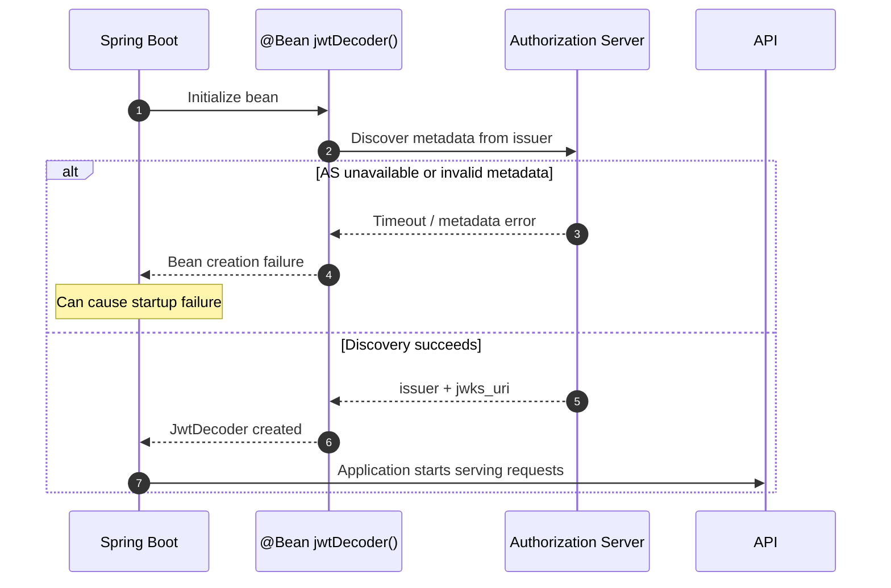
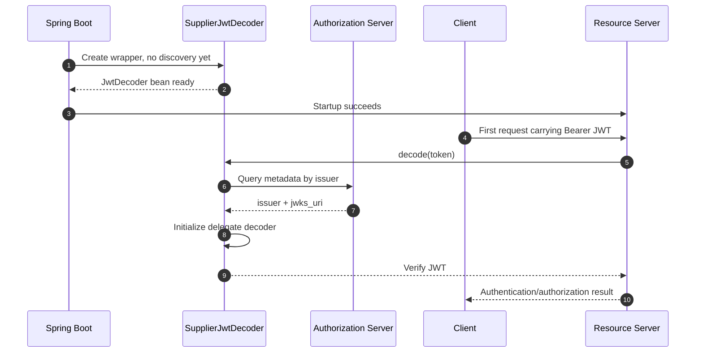
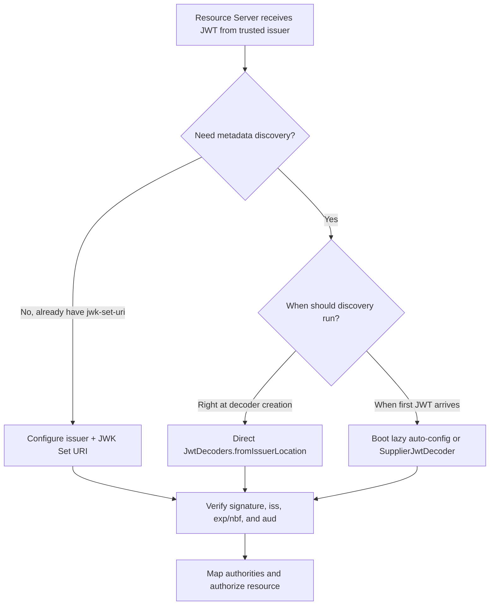

# Eager Initialization, On-Request Initialization, and Version Differences

When Spring Security OAuth 2.0 Resource Server authenticates JWT access tokens, the application is typically configured with an **issuer URI**: the identifier address of the trusted Authorization Server/OpenID Provider (OP). From the issuer, the Resource Server can discover metadata to find the **JWK Set URI**, and then use public keys to verify the JWT signature and check claims such as `iss`, `exp`, and `nbf`.

One difference with major deployment impact is **when issuer discovery is performed**:

- **Eager initialization**: the application queries metadata when constructing `JwtDecoder`, typically while building the Spring `ApplicationContext`.
- **Deferred/lazy initialization**: the application creates the security bean/wiring first, while issuer discovery happens when the first JWT actually needs to be verified.

Both approaches can **authenticate the same kind of JWT and enforce the same security policy**, yet they differ in startup time, dependency on the Authorization Server, and where errors surface. In particular, **you cannot conclude “merely setting `issuer-uri` means the application must always call the Authorization Server at startup”**: behavior depends on the Spring Boot/Spring Security version and whether the application constructs the decoder manually.

This lesson focuses on Spring Security **Servlet Resource Server**, using Java/Spring Boot 3 and Spring Security 6 syntax. Older versions and WebFlux are compared separately where relevant.

## 1. First, Distinguish Four Distinct Moments

In an application accepting JWTs, at least four activities can occur at different times:

| Activity | Purpose | When it can occur |
| --- | --- | --- |
| **Creating the `JwtDecoder` bean** | Registers the JWT verification component in the Spring context. | At startup or when a lazy bean is actually requested. |
| **Issuer discovery** | Queries metadata to confirm the issuer and locate `jwks_uri`. | Immediately when building the decoder or when decoding the first JWT. |
| **Fetching the JWK Set** | Obtains public keys used to verify signatures. | When verifying a JWT without a matching cached key; some decoder builders may perform network I/O earlier. |
| **JWT verification** | Checks signature, timestamps, issuer, audience, and validators. | When processing a request carrying a Bearer JWT. |

**Successfully creating `JwtDecoder` does not always mean a connection to the issuer has already happened**, if the bean is merely a deferred wrapper. **Successful discovery also does not guarantee the JWK Set will always be reachable** when new keys appear or the cache needs refreshing.

Example request:

```http
GET /api/orders/42 HTTP/1.1
Host: api.example.com
Authorization: Bearer <access-token>
```

In a Resource Server with a lazy decoder, this may be the first request triggering discovery. In an eager configuration, discovery may already have finished before the HTTP port starts serving requests.

## 2. `issuer-uri`, Metadata, and JWK Set Play Different Roles

Suppose the trusted issuer is:

```text
https://identity.example.com/realms/shop
```

An illustrative JWT carries claims:

```json
{
  "iss": "https://identity.example.com/realms/shop",
  "sub": "user-123",
  "aud": ["orders-api"],
  "scope": "orders.read",
  "exp": 1900000000
}
```

The JSON above is only an illustrative payload, not a genuinely signed token. To verify the token, the Resource Server can query standard metadata endpoints supported by the provider, such as OIDC Discovery:

```text
https://identity.example.com/realms/shop/.well-known/openid-configuration
```

An abbreviated metadata response:

```json
{
  "issuer": "https://identity.example.com/realms/shop",
  "jwks_uri": "https://identity.example.com/realms/shop/protocol/openid-connect/certs",
  "authorization_endpoint": "https://identity.example.com/realms/shop/authorize",
  "token_endpoint": "https://identity.example.com/realms/shop/token"
}
```

**`issuer` is the publisher identifier; `jwks_uri` is where public keys are fetched.** They are not the same URL and cannot be swapped arbitrarily. Spring Security supports discovery based on OIDC and OAuth 2.0 Authorization Server metadata, constructing URLs according to the specification and library version.

The authentication process includes:

1. Looking up metadata of the issuer that the application **configured as trusted**.
2. Identifying the JWK Set URI and the appropriate key source.
3. Verifying the JWT signature under accepted algorithms and keys.
4. Verifying `iss`, time limits `exp`/`nbf`, and other API constraints.
5. Checking the API's **audience** if required by the access token contract, then mapping authorities for authorization.

A validly signed token with `aud = payments-api` must not be used on `orders-api` if the API policy requires `aud = orders-api`. Choosing when discovery happens **does not replace** the need to verify audience, scopes, or resource-level permissions.

## 3. Eager Initialization: Discovery Runs When Building the Decoder

A direct Java configuration:

```java
import org.springframework.context.annotation.Bean;
import org.springframework.context.annotation.Configuration;
import org.springframework.security.oauth2.jwt.JwtDecoder;
import org.springframework.security.oauth2.jwt.JwtDecoders;

@Configuration
public class EagerJwtDecoderConfig {

    @Bean
    JwtDecoder jwtDecoder() {
        return JwtDecoders.fromIssuerLocation(
            "https://identity.example.com/realms/shop"
        );
    }
}
```

`JwtDecoders.fromIssuerLocation(...)` is a **factory method that actually builds a decoder using issuer information**. When Spring invokes the bean method during context initialization, this factory call can query discovery metadata **right then** to obtain the JWK Set URI. If the issuer is unavailable or metadata is invalid, bean creation can fail, causing the **`ApplicationContext` to fail startup**.

A similar form:

```java
import org.springframework.security.oauth2.jwt.NimbusJwtDecoder;

NimbusJwtDecoder decoder =
    NimbusJwtDecoder
        .withIssuerLocation("https://identity.example.com/realms/shop")
        .build();
```

In this construction, metadata discovery is tied to calling `build()` on the builder; if the statement runs during bean creation, it is still **eager**. Having a bean named `jwtDecoder` in the Spring context does not automatically make `fromIssuerLocation` or `withIssuerLocation(...).build()` lazy.

### What Happens at Startup



The advantage of eager initialization is that certain issuer and discovery misconfigurations **are caught early**, before the API receives traffic. The trade-off is that startup can depend on the network and Authorization Server.

Note: successful discovery does not mean a real JWT has been verified yet. Failures due to signing keys, expired tokens, wrong audience, or missing scopes still appear only when handling the corresponding request.

## 4. On-Request Initialization (*Lazy*): `SupplierJwtDecoder`

Spring Security provides `SupplierJwtDecoder`, a `JwtDecoder` implementation that accepts a `Supplier<JwtDecoder>` and **builds the real decoder only when a token needs to be decoded**.

Example declaring a lazy decoder explicitly:

```java
import org.springframework.context.annotation.Bean;
import org.springframework.context.annotation.Configuration;
import org.springframework.security.oauth2.jwt.JwtDecoder;
import org.springframework.security.oauth2.jwt.JwtDecoders;
import org.springframework.security.oauth2.jwt.SupplierJwtDecoder;

@Configuration
public class DeferredJwtDecoderConfig {

    @Bean
    JwtDecoder jwtDecoder() {
        String issuer =
            "https://identity.example.com/realms/shop";

        return new SupplierJwtDecoder(
            () -> JwtDecoders.fromIssuerLocation(issuer)
        );
    }
}
```

In the code above:

- During bean creation, the application builds only a **wrapper** holding the `Supplier`.
- **The lambda is not executed yet** at the `new SupplierJwtDecoder(...)` line.
- When the first request needs to decode a JWT, the wrapper invokes the supplier to build the real decoder, which may trigger metadata discovery.
- Subsequent uses can reuse the decoder initialized inside the wrapper instead of re-running discovery on every request.

This shifts **discovery risk** from startup time to the first JWT authentication. If the Authorization Server is down when the app starts but healthy when the first request arrives, the request can authenticate successfully. Conversely, if the issuer is unreachable when the first request triggers discovery, that request can fail even though the application started and reported running.



**“First request” here means a request that causes the JWT decoder to be used**, typically a request carrying a Bearer JWT through the configured filter chain. It is not necessarily the very first HTTP request to the entire application. A request to a public health endpoint with no Bearer token generally does not force the JWT decoder to perform discovery.

When initialization fails, the exception type, retry behavior, and final HTTP status depend on the implementation/version and the application's exception handling. Do not assume every lazy discovery error turns into `401` or automatically retries cleanly on the next request.

## 5. Version Differences: Why Can Documentation Appear Contradictory?

Older Spring Security docs describe startup calling issuer discovery and potentially failing when the Authorization Server is unavailable. Newer Spring Security 6.5 docs describe **deferred discovery upon receiving the first JWT** for standard Boot configurations. Both descriptions differ because **the default decoder choice changed over time**, not because issuer discovery was removed.

Notable milestones:

| Platform / configuration style | Typical discovery behavior | What to keep in mind |
| --- | --- | --- |
| **Spring Boot 2.5 and older guides** with default issuer config | Typically runs discovery **during startup** when building the default decoder. | Authorization Server can be a startup dependency. |
| **Spring Security 5.6 onward** | Introduces `SupplierJwtDecoder` for Servlet and a similar mechanism in WebFlux. | Framework supports deferring creation of the real decoder. |
| **Spring Boot 2.6 onward** with `issuer-uri` and matching auto-configuration | Boot begins auto-configuring `SupplierJwtDecoder` instead of an eager decoder, so discovery is normally deferred until the **first JWT**. | This change is documented in the Boot 2.6 release notes. |
| **Spring Boot 3.x / Spring Security 6.x** with standard JWT Resource Server config | Spring Security 6.5 docs describe deferred discovery via `SupplierJwtDecoder`. | Still verify if the application supplies custom beans/DSLs. |
| **Application calls `JwtDecoders.fromIssuerLocation(...)` directly in `@Bean`** | Can be **eager**, regardless of newer Boot supporting lazy. | A custom bean can cause Boot to back off from creating the default `SupplierJwtDecoder`. |
| **Application wraps the factory in `new SupplierJwtDecoder(...)`** | **Lazy** until the wrapper needs to decode. | Way to preserve deferred discovery when a custom decoder is needed. |
| **Declaring both `issuer-uri` and `jwk-set-uri`** | Does not need issuer discovery to find JWKS. | Must still account separately for fetching the JWK Set during JWT verification. |

Exact milestones: the Spring Boot **2.6.0 RC1 release notes** announced switching the auto-configured decoder from `NimbusJwtDecoder` to `SupplierJwtDecoder`; `SupplierJwtDecoder` was introduced in Spring Security **5.6**. Spring Security **6.5 Servlet JWT** docs describe discovery on the first JWT request and recommend wrapping a custom `JwtDecoder` in `SupplierJwtDecoder` when preserving this behavior.

**Be careful with the claim “Spring Boot 3 is always lazy”.** That statement is only safe for standard auto-configuration. A custom bean, calling a factory method directly, a custom resolver, `@PostConstruct` calling `decode`, or readiness/warm-up logic can all trigger early metadata queries. Version numbers are only part of the explanation; the **actual configuration path** determines timing.

## 6. Standard Spring Boot 3 Configuration: Let Boot Decide Laziness

First, add dependencies:

```gradle
dependencies {
    implementation 'org.springframework.boot:spring-boot-starter-security'
    implementation 'org.springframework.boot:spring-boot-starter-oauth2-resource-server'
}
```

In Spring Boot, the Resource Server starter normally brings in all libraries needed for JWT decoding/verifying, including Spring Security OAuth2 JOSE. When managing dependencies manually, ensure both the Resource Server and JOSE JWT artifacts are present.

Declare the issuer:

```yaml
spring:
  security:
    oauth2:
      resourceserver:
        jwt:
          issuer-uri: https://identity.example.com/realms/shop
          audiences:
            - orders-api
```

With Boot versions supporting the `audiences` property as shown, Boot can configure `aud` validation for JWTs; on versions lacking this property, a separate audience validator is needed.

An application-configured chain:

```java
import org.springframework.context.annotation.Bean;
import org.springframework.context.annotation.Configuration;
import org.springframework.http.HttpMethod;
import org.springframework.security.config.Customizer;
import org.springframework.security.config.annotation.web.builders.HttpSecurity;
import org.springframework.security.config.http.SessionCreationPolicy;
import org.springframework.security.web.SecurityFilterChain;

@Configuration
public class ApiSecurityConfig {

    @Bean
    SecurityFilterChain apiSecurity(HttpSecurity http) throws Exception {
        return http
            .securityMatcher("/api/**")
            .csrf(csrf -> csrf.disable())
            .sessionManagement(session -> session
                .sessionCreationPolicy(SessionCreationPolicy.STATELESS))
            .authorizeHttpRequests(auth -> auth
                .requestMatchers(HttpMethod.GET, "/api/orders/**")
                    .hasAuthority("SCOPE_orders.read")
                .anyRequest().denyAll())
            .oauth2ResourceServer(oauth2 -> oauth2
                .jwt(Customizer.withDefaults()))
            .build();
    }
}
```

In this configuration:

- The custom `SecurityFilterChain` defines which API endpoints require scopes.
- `.oauth2ResourceServer(...jwt(...))` enables Bearer JWT authentication.
- If there is **no** custom `JwtDecoder` and Boot's conditions match, Boot can supply the decoder from properties using the newer version's lazy strategy.
- `securityMatcher("/api/**")` limits the chain's scope; other chains/policies are needed for URLs outside `/api/**`.
- `csrf.disable()` here applies only to a stateless API receiving explicit Bearer tokens via headers and not relying on browser cookies sent automatically for authentication. APIs using sessions/cookies must evaluate CSRF separately.

**Adding a `SecurityFilterChain` does not necessarily disable the Boot-managed decoder.** However, if you add your own `JwtDecoder` bean, Boot typically backs off in favor of that bean; from that point, eager/lazy behavior depends on how you wrote the bean.

## 7. Same Issuer, Two Ways to Declare the Bean, Very Different Timing

Side by side:

### Approach A: Eager

```java
@Bean
JwtDecoder jwtDecoder() {
    return JwtDecoders.fromIssuerLocation(
        "https://identity.example.com/realms/shop"
    );
}
```

### Approach B: Lazy

```java
@Bean
JwtDecoder jwtDecoder() {
    String issuer =
        "https://identity.example.com/realms/shop";
    return new SupplierJwtDecoder(
        () -> JwtDecoders.fromIssuerLocation(issuer)
    );
}
```

Corresponding required imports:

```java
import org.springframework.context.annotation.Bean;
import org.springframework.security.oauth2.jwt.JwtDecoder;
import org.springframework.security.oauth2.jwt.JwtDecoders;
import org.springframework.security.oauth2.jwt.SupplierJwtDecoder;
```

**The difference is where the factory call runs**:

| Code line | Execution timing |
| --- | --- |
| `JwtDecoders.fromIssuerLocation(issuer)` directly in `@Bean` body | During bean creation. |
| `() -> JwtDecoders.fromIssuerLocation(issuer)` passed to `SupplierJwtDecoder` | When the wrapper needs to initialize the real decoder, typically on the first JWT request. |
| `NimbusJwtDecoder.withIssuerLocation(issuer).build()` directly in `@Bean` | During bean construction. |
| `() -> NimbusJwtDecoder.withIssuerLocation(issuer).build()` passed to wrapper | When the supplier is invoked. |

There is no need to put `@Lazy` on `SecurityFilterChain` just to defer metadata discovery. Spring bean `@Lazy` and `SupplierJwtDecoder` are **two different mechanisms**; `SupplierJwtDecoder` specifically defers initialization of the JWT delegate while the bean itself can be wired into the filter chain right at startup.

## 8. Preserving Lazy Discovery When the Decoder Needs a Custom Audience Validator

Sometimes a Resource Server must validate audience and custom claims that Boot properties cannot express, requiring a custom decoder. You can configure a supplier where all decoder and validator construction happens only when invoked:

```java
import java.util.List;

import org.springframework.beans.factory.annotation.Value;
import org.springframework.context.annotation.Bean;
import org.springframework.context.annotation.Configuration;
import org.springframework.security.oauth2.core.DelegatingOAuth2TokenValidator;
import org.springframework.security.oauth2.core.OAuth2TokenValidator;
import org.springframework.security.oauth2.jwt.Jwt;
import org.springframework.security.oauth2.jwt.JwtClaimValidator;
import org.springframework.security.oauth2.jwt.JwtDecoder;
import org.springframework.security.oauth2.jwt.JwtValidators;
import org.springframework.security.oauth2.jwt.NimbusJwtDecoder;
import org.springframework.security.oauth2.jwt.SupplierJwtDecoder;

@Configuration
public class DeferredValidatedJwtDecoderConfig {

    @Bean
    JwtDecoder jwtDecoder(
        @Value("${app.security.issuer}") String issuer,
        @Value("${app.security.audience}") String audience
    ) {
        return new SupplierJwtDecoder(() -> {
            NimbusJwtDecoder decoder =
                NimbusJwtDecoder.withIssuerLocation(issuer).build();

            OAuth2TokenValidator<Jwt> defaults =
                JwtValidators.createDefaultWithIssuer(issuer);

            OAuth2TokenValidator<Jwt> audienceValidator =
                new JwtClaimValidator<List<String>>(
                    "aud",
                    values -> values != null &&
                        values.contains(audience)
                );

            decoder.setJwtValidator(
                new DelegatingOAuth2TokenValidator<>(
                    defaults,
                    audienceValidator
                )
            );
            return decoder;
        });
    }
}
```

Assume the application defines custom properties:

```yaml
app:
  security:
    issuer: https://identity.example.com/realms/shop
    audience: orders-api
```

Points to understand:

1. The bean is created early, yet the supplier **has not executed**.
2. Discovery via `NimbusJwtDecoder.withIssuerLocation(...).build()` occurs when decoding is needed.
3. The custom decoder retains default, issuer, and audience validations instead of checking only the signature.
4. If metadata discovery fails, the error surfaces on the first request path needing a JWT; the application must have appropriate observability and operational handling.

When the issuer emits `aud` under a different profile from this illustrative example, adjust the validator to match the contract. **Do not lose the `iss`/timestamp validators** when customizing the decoder. If your Boot version already supports `audiences` and that constraint is all you need, property configuration can be simpler than defining your own bean.

## 9. Configuring Both `issuer-uri` and `jwk-set-uri`: Another Option

If the issuer's exact JWK Set URI is already known, you can avoid the key-endpoint discovery step:

```yaml
spring:
  security:
    oauth2:
      resourceserver:
        jwt:
          issuer-uri: https://identity.example.com/realms/shop
          jwk-set-uri: https://identity.example.com/realms/shop/keys
          audiences:
            - orders-api
```

In Boot/Spring Security configurations supporting these properties:

- `jwk-set-uri` tells the Resource Server the **public key source** without needing discovery just to find it.
- `issuer-uri` still defines the accepted `iss`.
- `audiences` (if supported by the version) enforces `aud` checking.
- **Fetching the JWK Set on demand** can still depend on the network, especially before keys are cached or when keys rotate.

This keeps the Resource Server from **having to query issuer metadata at startup**, while preserving issuer validation. It does not mean the application has preloaded every key or can verify JWTs forever while the Authorization Server is unreachable.

### Is Using Only `jwk-set-uri` Enough?

If you configure only:

```yaml
spring:
  security:
    oauth2:
      resourceserver:
        jwt:
          jwk-set-uri: https://identity.example.com/realms/shop/keys
```

the Resource Server knows the key source, yet **has no issuer value from `issuer-uri` to automatically apply the same issuer validation**. If the API must restrict tokens to the right issuer, continue declaring the issuer where supported or attach an issuer validator on a custom decoder:

```java
NimbusJwtDecoder decoder =
    NimbusJwtDecoder.withJwkSetUri(jwkSetUri).build();
decoder.setJwtValidator(
    JwtValidators.createDefaultWithIssuer(issuer)
);
```

Add an audience validator if the API requires one. A valid signature under a key from the JWK Set **is not sufficient** to conclude the token was issued for the right API or authorized to access a resource.

## 10. Startup Errors and First-Request Errors Are Not the Same

Suppose the issuer is unreachable:

| Initialization style | When does the error usually appear? | Can the app start? | Operational consequence |
| --- | --- | --- | --- |
| `JwtDecoders.fromIssuerLocation(...)` directly in eager `@Bean` | Bean/context creation. | May **not** start. | Deployment catches the error before serving traffic. |
| `SupplierJwtDecoder` wrapping an issuer-based factory | When decoding the first JWT. | **Can** start even if issuer is down. | API may fail on the first request if discovery is still broken. |
| Boot auto-config using lazy issuer decoder | When the first JWT is authenticated. | Usually independent of discovery at startup. | Must distinguish process readiness from real authentication capability. |
| Preconfigured `jwk-set-uri` | No issuer metadata discovery needed to find JWKS URL. | Usually independent of discovery at startup. | Still needs to fetch keys when verifying JWTs if cache lacks the key. |

**Do not hard-assume HTTP 401 for every failure in the second column.** `401 Unauthorized` is typically for an **invalid token**, whereas a timeout or discovery/JWK Set error means **authentication infrastructure is unavailable**. With a lazy decoder, initialization failures can be wrapped in `JwtDecoderInitializationException` and routed through framework/application exception handling, so final statuses can vary.

Distinguishing examples:

```text
Error A — token with bad signature:
  JWT decoder is working
  -> signature invalid
  -> authentication rejects token

Error B — issuer metadata unreachable:
  lazy decoder is triggered
  -> cannot build decoder due to discovery error
  -> request cannot authenticate, requires infrastructure error handling

Error C — JWK Set cannot fetch new key:
  decoder already built
  -> missing matching key / refresh needed
  -> cannot verify token under current conditions
```

Never handle errors B/C by **allowing authentication bypass** or trusting an unverified JWT payload. When proof of token authenticity is unavailable, the Resource Server must refuse the credential.

## 11. Successful Startup, Readiness, and Authentication Capability Are Three Different Signals

Lazy discovery makes the application **less dependent on the Authorization Server at startup**, creating a trade-off:

- The process can boot, open its HTTP port, and return healthy on a health endpoint.
- The real decoder is still unbuilt because no request has needed JWT verification yet.
- When the first business request arrives, the API attempts discovery and may experience latency, timeouts, or errors.

If an environment must be certain the API can validate tokens before receiving traffic, decide how to prove **authentication readiness**:

1. Use eager discovery to catch issuer/config errors at startup, accepting startup dependency.
2. Keep lazy discovery, but run an intentional check/warm-up before marking the instance ready for traffic.
3. Configure the JWK Set URI directly, and monitor key retrieval, caching, and Authorization Server health.

Do not treat a public `/actuator/health` check as proof that the JWT decoder has initialized. At the same time, never embed a real long-lived token in readiness scripts or logs just to trigger the decoder.

### Warm-Up Is an Intentional Change

A warm-up mechanism (if truly needed) can explicitly call an internal test endpoint with a valid token or perform validation with a short-lived test credential under a secure procedure. Doing so **converts part of lazy behavior into early behavior** at the readiness step. Understand the trade-off—do not silently move initialization into `@PostConstruct` while still describing the system as lazy.

In multi-replica deployments, manage timeouts and concurrent connections to the issuer when many instances boot or hit their first JWT request simultaneously.

## 12. Discovering Once Does Not Mean Never Contacting the Authorization Server Again

Even with local JWT validation, the Resource Server may need to **fetch or refresh the JWKS**:

```text
1. Decoder knows jwks_uri from discovery or direct configuration
2. Receives JWT with header kid=key-A
3. key-A is in cache -> verify locally
4. Issuer rotates to key-B
5. Receives JWT kid=key-B -> may need to refresh JWKS
6. Use key-B if fetched, or reject if unable to verify
```

`SupplierJwtDecoder` only defers **initialization of the delegate decoder**; it does not disable the real decoder's JWKS/caching logic. Similarly, eager initialization does not guarantee every verification key stays available forever if the authorization server suffers an outage.

**Distinguish two questions:**

| Question | Which component answers? |
| --- | --- |
| When does the Resource Server learn the JWKS URI? | Issuer discovery or direct `jwk-set-uri`. |
| Does the Resource Server already have the public key needed for this token? | The decoder's JWK Set fetching/caching/refresh mechanism. |

When evaluating resilience during temporary OP unavailability, consider both stages and key caching lifetimes—not just eager versus lazy.

## 13. Multiple Issuers / Multiple Tenants Can Make Laziness More Complex

A multi-tenant API may accept tokens from multiple trusted issuers, for example:

```text
https://identity.example.com/realms/tenant-a
https://identity.example.com/realms/tenant-b
```

Spring Security offers mechanisms such as `JwtIssuerAuthenticationManagerResolver`/`AuthenticationManagerResolver` to select authentication per issuer. In some configurations, a tenant's `JwtAuthenticationProvider` is created only when a token from that issuer first appears; thus **discovery can be deferred per tenant**.

Still, keep the security principles intact:

- Permit only **issuers in a trusted source set** or managed registry; never turn an unverified `iss` claim into permission to download keys from any arbitrary URL.
- After selecting a decoder by issuer, still verify **signature, issuer, timestamps, audience**, and token profile constraints.
- Each issuer/tenant may need independent key caching, timeouts, and monitoring.
- In a dynamic tenant system, adding a tenant to the registry and constructing its decoder are two separate decisions.

A token with an `iss` that looks like a valid tenant **is not proof** that the tenant is authorized for automatic registration. Only use issuers pre-approved by the application before trusting their metadata or keys.

## 14. Servlet and WebFlux: Same Idea, Different APIs

The Java examples above use the Servlet stack:

```text
JwtDecoder
SupplierJwtDecoder
JwtDecoders.fromIssuerLocation
SecurityFilterChain
```

With Spring WebFlux, the corresponding APIs belong to the reactive model:

```text
ReactiveJwtDecoder
ReactiveSupplierJwtDecoder
ReactiveJwtDecoders.fromIssuerLocation
SecurityWebFilterChain
```

Spring Boot 2.6 also documented auto-configuring `ReactiveSupplierJwtDecoder` for reactive Resource Servers. The concept of deferred discovery is analogous, but **do not copy a Servlet `JwtDecoder` bean directly into a WebFlux-only Resource Server**.

Conceptual WebFlux configuration example:

```java
@Bean
ReactiveJwtDecoder jwtDecoder() {
    String issuer = "https://identity.example.com/realms/shop";
    return new ReactiveSupplierJwtDecoder(
        () -> ReactiveJwtDecoders.fromIssuerLocation(issuer)
    );
}
```

This example highlights **different decoder types and reactive supplier styles**. In real usage, check the constructor/builder signatures in the exact Spring Security version your project targets; some versions take `Supplier<Mono<ReactiveJwtDecoder>>` or provide different helpers, so do not treat this snippet as copy-pasteable across every version without adjustment.

Since this lesson focuses on Servlet, complete examples continue using `JwtDecoder` and `SecurityFilterChain`.

## 15. Custom Beans and DSLs Can Change Discovery Timing

Spring Boot auto-configuration is **conditional**. When an application declares a `JwtDecoder` bean, Boot backs off from creating its own default decoder bean. From then on, if the application's bean uses an eager factory, **Boot's default lazy behavior no longer applies**.

Furthermore, in the JWT DSL you can pass a decoder directly to a chain:

```java
.oauth2ResourceServer(oauth2 -> oauth2
    .jwt(jwt -> jwt.decoder(customJwtDecoder)))
```

In that case, the chain uses the passed decoder. If `customJwtDecoder` was created eagerly, discovery can occur during configuration setup. If it is a `SupplierJwtDecoder`, discovery is deferred until it decodes.

Distinguish:

| Component | Effect |
| --- | --- |
| `@Bean JwtDecoder` | Determines **which decoder object** is created and can cause Boot to back off. |
| `SupplierJwtDecoder` | Determines **when** the real delegate decoder is created. |
| `JwtDecoders.fromIssuerLocation` | Performs **issuer discovery** when the factory is invoked. |
| `jwt.decoder(customJwtDecoder)` | Binds a **specific decoder** to a security chain. |
| `securityMatcher` + `@Order` | Determines which chain handles a request. |
| `authorizeHttpRequests` | Determines authorization rules inside the selected chain. |

An application with two `SecurityFilterChain` beans using different decoders can even have **two different discovery timings**. That is normal when designed explicitly.

## 16. Common Pitfalls in Production

### 16.1. Reading Old Spring Security Docs and Concluding Newer Boot Must Always Fail Startup

An older guide may describe eager initialization, whereas Boot 2.6+ with matching auto-config uses lazy initialization. Check the **actual version, the actual decoder bean, how it is built, and the request path**, rather than applying one blanket description to every version.

### 16.2. Writing a Custom `JwtDecoder` and Accidentally Losing Laziness

Previously, only `issuer-uri` was set and Boot created a lazy wrapper. After adding:

```java
@Bean
JwtDecoder jwtDecoder() {
    return JwtDecoders.fromIssuerLocation(issuer);
}
```

discovery can shift to startup. If you want to keep it lazy, wrap the call in `SupplierJwtDecoder` as in section 4.

### 16.3. Using `jwk-set-uri` and Assuming Verification Works Without Keys

The JWK Set URI is only the key address. If the decoder does not yet hold the required public key, it still must fetch JWKS; network errors can prevent JWT verification. Plan caching, key rotation, and operations accordingly.

### 16.4. Configuring Only JWKS and Omitting Issuer

A valid key is not enough to prove the token has the right `iss`. If the API must enforce issuer constraints, keep `issuer-uri` or a contract-accurate custom issuer validator, and add an audience validator when required.

### 16.5. Seeing `/health` Succeed and Assuming JWT Verification Also Works

With a lazy decoder, a public health check may never touch the authentication path. The API must be verified via dedicated mechanisms before serving critical business traffic.

### 16.6. Returning `401` for All Network Errors Without Classification

A token with a bad signature is a bad credential. A temporarily unreachable issuer/JWKS is an unavailable authentication infrastructure condition. HTTP responses can vary by version/config and should not obscure diagnostic signals; never resolve this by skipping validation.

### 16.7. Pre-Initializing by Calling `decode` with a Fake Token

Trying to trigger a lazy decoder with a dummy token string inside `@PostConstruct` creates unnecessary errors, adds startup coupling, and defeats the purpose of laziness. If warm-up is needed, follow an explicit procedure with valid test credentials and zero token leakage.

### 16.8. Confusing Metadata with UserInfo

The OIDC **UserInfo endpoint** is for Clients fetching user profile claims when needed. Resource Server discovery uses **Provider Configuration/Authorization Server Metadata** and **JWK Set** to verify JWTs. Never call UserInfo on every request simply because an OIDC issuer is used.

## 17. Observing Behavior by Phase Instead of Guessing

To determine when discovery happens, observe milestones in development or staging:

```text
T0: ApplicationContext begins creating beans
T1: Application finishes startup
T2: Public request with no Bearer token
T3: First protected request carrying a Bearer JWT
T4: Subsequent Bearer JWT request using the same issuer
T5: Issuer rotates signing key
```

Correlate with network calls to metadata/JWKS and safe logs:

| Milestone | With eager issuer decoder | With lazy issuer decoder |
| --- | --- | --- |
| T0–T1 | May call issuer metadata. | Typically no discovery yet. |
| T2 | No re-discovery triggered by public requests. | Typically still no discovery. |
| T3 | Uses already-built decoder; may fetch JWKS as needed. | Typically triggers discovery and may fetch JWKS. |
| T4 | Can reuse decoder/key cache. | Can reuse delegate/key cache. |
| T5 | May need to refresh JWKS. | May also need to refresh JWKS. |

In Spring Boot, the condition evaluation report shows which auto-configuration creates beans and which backs off. When inspecting the security chain, enable appropriate logging in a controlled environment:

```yaml
logging:
  level:
    org.springframework.security: DEBUG
```

Never log raw Bearer tokens, client secrets, refresh tokens, full `Authorization` headers, or unnecessary personal data. Log trace IDs, expected issuer, initialization phase, error types, and metadata/JWKS request latency per logging policy.

## 18. Test Scenarios to Keep Separate

| Scenario | Eager | Lazy |
| --- | --- | --- |
| Issuer down **before startup** | May fail during bean creation. | Can start since discovery is not needed yet. |
| Issuer down at **first JWT request** | If decoder already built and cached keys suffice, may continue; if JWKS fetch needed, may fail. | May fail because discovery is incomplete. |
| Issuer up at startup, down before first JWT | Eager may already have metadata, yet still depends on JWKS if keys are needed. | Lazy may fail discovery right on the request. |
| Issuer metadata advertises wrong issuer | Discovery/validation fails when building decoder. | Fails when the decoder initializes for the first time. |
| JWT has bad signature or is expired | Authentication rejects token. | Authentication rejects token once decoder is ready. |
| JWT has right issuer but wrong audience | Rejected if audience validation is configured. | Same outcome; laziness does not weaken policy. |
| Valid JWT missing scope | Authentication succeeds, authorization rejects. | Same outcome. |
| New key appears after rotation | May need to refresh JWK Set. | May also need to refresh JWK Set. |

In Spring Security Test, the MockMvc `jwt()` helper normally creates a mock JWT principal to test authorization; it **does not by default run metadata discovery or real JWT verification**. Therefore, to observe eager/lazy behavior and issuer failures, test the actual decoder/Resource Server path separately from scope and ownership tests.

You do not need to cram every case into one complex test. What matters is knowing **which test verifies bean lifecycle/discovery**, which verifies JWT validation, and which verifies authorization.

## 19. Choosing Configuration Based on Deployment Requirements

| Operational goal | Configuration to consider | Trade-off |
| --- | --- | --- |
| Prioritize startup independent of issuer metadata | Boot lazy default or `SupplierJwtDecoder`. | First JWT request may be slower or fail on discovery. |
| Catch issuer config errors right at startup | Custom eager decoder or intentional warm-up. | Startup depends on issuer and network. |
| JWK Set URI already known, want to skip discovery | Configure both `issuer-uri` and `jwk-set-uri`. | Must maintain correct URL; JWKS still must be fetched when needed. |
| Custom audience/token profile while keeping laziness | `SupplierJwtDecoder` wrapping a custom validated decoder. | More custom code; must preserve validators. |
| Multiple issuers/tenants | Resolver/decoder per trusted issuer, with per-tenant lazy strategy where suitable. | Greater complexity in registry, caching, and monitoring. |
| API must be ready to authenticate before receiving traffic | Readiness/warm-up testing the real path. | Reintroduces early dependency at the readiness step. |

A short decision diagram:



All paths must **preserve the trust boundary**: client-supplied access tokens are untrusted until the Resource Server verifies signatures and mandatory validations. Eager or lazy only changes **when the verification machinery is prepared**; it never permits bypassing issuer, audience, lifetime, scopes, or business permission policies.

## 20. How to Inspect a Running System for Its Exact Version

When inheriting a project or upgrading from Boot 2.x to 3.x, answer step by step:

1. **Which Spring Boot and Spring Security versions are in use?** Check the actual BOM/dependencies, since old docs may describe eager while newer versions use lazy.
2. **Does the app declare only `issuer-uri`, or also a custom `JwtDecoder`?** If a custom bean exists, inspect the exact decoder creation code.
3. **Is `SupplierJwtDecoder` used?** Identify which factory the supplier wraps, rather than guessing from bean names.
4. **Is `jwk-set-uri` set directly?** If so, metadata discovery may be skipped, while issuer validation must still be preserved.
5. **Which chain handles the request?** Check `.oauth2ResourceServer().jwt()`, `securityMatcher`, `@Order`, and any decoder passed directly in the DSL.
6. **Are audience and token profile validated?** Startup timing says nothing about validator completeness.
7. **Have process readiness and JWT authentication readiness been distinguished?** Especially important when using deferred discovery.
8. **Is there a JWKS refresh/key rotation mechanism?** An already-created decoder does not guarantee verifying every new key over the long run.

### Primary Sources for Version Cross-Checking

- [Spring Security 6.5 — OAuth 2.0 Resource Server JWT](https://docs.spring.io/spring-security/reference/6.5/servlet/oauth2/resource-server/jwt.html): describes deferred discovery on the first request with a JWT and how to use `SupplierJwtDecoder`.
- [Spring Security 6.5 — `SupplierJwtDecoder` API](https://docs.spring.io/spring-security/reference/6.5/api/java/org/springframework/security/oauth2/jwt/SupplierJwtDecoder.html): confirms this is a JWT decoder that lazily initializes its delegate, introduced in Spring Security 5.6.
- [Spring Boot 2.6.0 RC1 Release Notes — Deferred OpenID Connect Discovery](https://github.com/spring-projects/spring-boot/wiki/Spring-Boot-2.6.0-RC1-Release-Notes): records Boot switching auto-config to `SupplierJwtDecoder` and `ReactiveSupplierJwtDecoder`.

**Core takeaway:** Eager initialization and on-request initialization are two **strategies for issuer discovery timing**, not two different JWT authentication standards. Calling `JwtDecoders.fromIssuerLocation(...)` directly in a bean generally leads to eager discovery; `SupplierJwtDecoder` can defer discovery until the first decode; Spring Boot from 2.6 onward auto-configures deferred discovery. When upgrading versions or adding custom beans, observe the **actual decoder created and used by the security chain** to know whether an issuer failure will surface at startup or during request handling.
