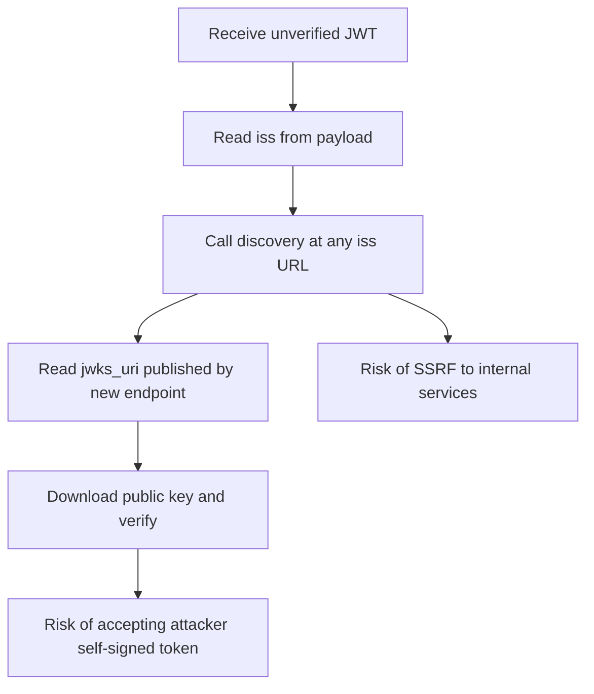
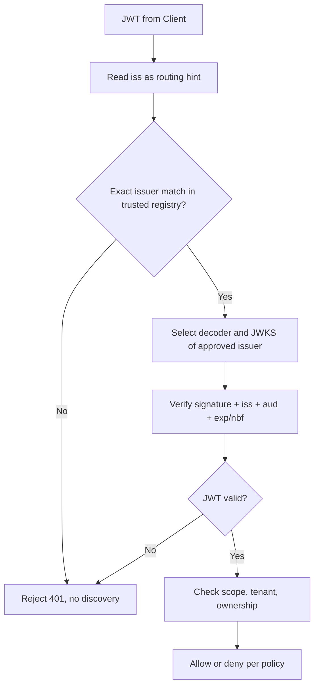
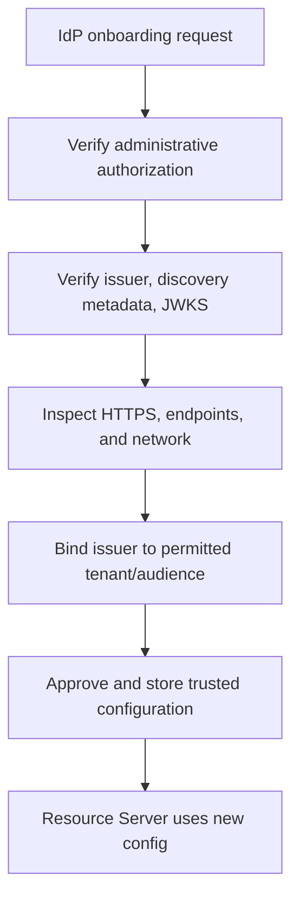

# Restricting Trusted Endpoints and Avoiding Discovery from Unverified Data

## 1. The Security Problem: Who Decides the Token Issuer Source?

In a Spring Boot application using **Spring Security OAuth 2.0 Resource Server**, a Client sends a Bearer access token to access a resource:

```http
GET /api/orders/42 HTTP/1.1
Host: orders.example.com
Authorization: Bearer <access-token>
```

For JWTs, the Resource Server needs to know **which issuer is trusted** and **which public key is used to verify the signature**. Many Authorization Servers and OpenID Providers publish configuration via *discovery metadata*, including the path to the public key set (*JWKS*).

Suppose the application's valid publisher is:

```text
https://login.example.com/realms/shop
```

A forged token may claim:

```json
{
  "iss": "https://identity.attacker.example",
  "sub": "admin",
  "aud": ["orders-api"],
  "scope": "orders.read orders.write"
}
```

The `iss` claim above is **unverified**: anyone can create similar JSON. If the Resource Server reads `iss` and immediately discovers metadata/JWKS from that issuer **without checking an approved issuer list**, an attacker can publish their own JWKS, self-sign a JWT, and trick the application into trusting the forged token.

Making HTTP requests to URLs dictated by an unverified token also creates **Server-Side Request Forgery (SSRF)** risks: the server can be steered into connecting to unintended hosts, potentially including internal services, loopback addresses, or sensitive network endpoints.

**Foundational rule:** The issuer and endpoints used for discovery/JWKS/introspection must come from **pre-governed trusted configuration**. Unverified `iss` data may only be used as a hint to select within that configuration set, and signatures and claims must still be verified afterward.

### What You Should Master After This Lesson

- Distinguish issuer identifier, discovery endpoint, JWKS endpoint, and introspection endpoint.
- Understand why `iss`, `kid`, `jku`, `Host`, and a request's tenant ID are insufficient on their own to establish trust.
- Design controlled allowlists for issuers and endpoints.
- Configure Spring Security with one or multiple issuers while avoiding dynamic discovery from arbitrary URLs.
- Restrict outbound HTTP to reduce SSRF via redirects, DNS, IPs, proxies, and metadata endpoints.
- Verify both that unfamiliar tokens are rejected **and** that the application never calls unapproved endpoints.

## 2. Easily Confused Concepts in Discovery

| Component | Function | Illustrative example |
|---|---|---|
| **Issuer identifier** | Identifies the Authorization Server or OpenID Provider; JWTs typically carry it in `iss` | `https://login.example.com/realms/shop` |
| **OIDC Discovery** | OpenID Provider metadata document | `.../.well-known/openid-configuration` |
| **OAuth AS Metadata** | Authorization Server metadata document per RFC 8414 | `.../.well-known/oauth-authorization-server` |
| **JWKS URI** | Endpoint containing the public key set in JWK format | `https://login.example.com/realms/shop/keys` |
| **Introspection URI** | Endpoint for the Resource Server to inspect opaque tokens | `https://login.example.com/realms/shop/introspect` |

Example abbreviated OIDC metadata response:

```json
{
  "issuer": "https://login.example.com/realms/shop",
  "authorization_endpoint": "https://login.example.com/realms/shop/authorize",
  "token_endpoint": "https://login.example.com/realms/shop/token",
  "jwks_uri": "https://login.example.com/realms/shop/keys"
}
```

This metadata is meaningful only when the Resource Server started from a **trusted issuer**. It is not an invitation to trust every URL written in an arbitrary JSON document.

### 2.1. Well-Known Paths Are Not Always Identical

For an issuer with a path, standards can specify different well-known locations. For example:

```text
Issuer:
  https://login.example.com/realms/shop

Common OIDC Discovery:
  https://login.example.com/realms/shop/.well-known/openid-configuration

OAuth Authorization Server Metadata (RFC 8414):
  https://login.example.com/.well-known/oauth-authorization-server/realms/shop
```

You must use the standard and endpoints the publisher actually supports; do not invent a URL and treat it as valid. Spring Security library versions may probe supported metadata locations according to their internal mechanisms.

### 2.2. Issuer Differs from JWKS URI and Audience

One issuer can issue tokens for many APIs. For example, tokens may share `iss=https://login.example.com/realms/shop` yet have `aud=orders-api` or `aud=billing-api`.

That creates independent constraints:

- **Issuer:** Did the token come from an authorized publisher?
- **Key source:** Was the signature verified with a trusted key of that publisher?
- **Audience:** Was the token issued for this specific Resource Server?
- **Lifetime:** Are `exp` and `nbf` valid?
- **Scopes/permissions:** Does the token have permission to call the endpoint and access the specific record?

A JWT with a valid signature and issuer but the wrong audience must still be rejected when the API enforces an appropriate audience policy.

## 3. Data Read Before Verifying a JWT Is Untrusted Data

A compact JWS JWT typically consists of:

```text
BASE64URL(JOSE-header).BASE64URL(payload).BASE64URL(signature)
```

Header and payload can be read via Base64URL-decoding without verifying the signature. **Base64URL is neither encryption nor authentication.**

### 3.1. The `iss` Claim in the Payload

```json
{
  "iss": "https://unapproved.example",
  "sub": "user-417"
}
```

This is merely a **claim**. If the application lets any `iss` string dynamically instantiate a decoder or key source, the application has allowed the Client to expand the trusted issuer set itself.

Valid usage: read an unverified `iss` to perform an **exact lookup** in an existing trusted issuer map. If no matching key exists in the map, **reject before performing discovery**. Afterward, the selected decoder must still verify the signature and confirm `iss` matches the expected issuer.

### 3.2. `kid` in the JOSE Header

The header may contain:

```json
{
  "alg": "RS256",
  "typ": "at+jwt",
  "kid": "shop-key-2026"
}
```

`kid` is a hint to locate a key inside a **trusted configured** JWKS. It is not proof that the key belongs to an authorized Authorization Server.

Never use `kid` directly as:

- A filename or absolute path to read a key.
- An unbound SQL string.
- A hostname or URL to download keys from a new server.
- A reason to skip checking `alg`, issuer, or audience.

When `kid` is missing from the trusted JWKS, keys may be refreshed per the library's mechanism and bounded policy, but the token must be rejected if verification fails.

### 3.3. `jku`, `jwk`, and `x5u` Headers

JOSE supports header parameters referring to keys or certificate URLs. For example:

```json
{
  "alg": "RS256",
  "jku": "https://keys.attacker.example/jwks.json",
  "kid": "attack-key"
}
```

If the decoder automatically downloads `jku` and trusts that key, an attacker can self-sign a token and supply the public key for their own signature.

The Resource Server must use keys from an approved issuer. Only allow extended header mechanisms when there is an explicit security profile and an implementation that verifies key sources per policy.

### 3.4. HTTP Headers, Host, and Tenant Parameters

Do not pull discovery endpoints directly from:

```http
GET /api/tenants/alpha/orders/42 HTTP/1.1
Host: alpha.example.com
X-Forwarded-Host: login.attacker.example
X-Issuer: https://identity.attacker.example
Authorization: Bearer <access-token>
```

Headers can be sent by Clients or manipulated via proxies. Even when `X-Forwarded-Host` is managed by a trusted reverse proxy, selecting an Authorization Server for a tenant still requires an explicit contract and governed issuer registry.

A tenant ID from a path/header **should only select within a set of permitted tenant configurations**, and the system must verify the principal's permissions for that tenant. Never interpolate `tenantId` into a hostname to discover a new IdP without approval.

## 4. Two Design Flaws: Self-Declared Issuers and SSRF

### 4.1. Dangerous Processing Path



Verifying the signature at step E alone does not solve the problem: the signature can be valid **under a key owned by the attacker**. The application must decide beforehand **who is authorized to sign tokens for the API**.

Improper code example:

```java
// ILLUSTRATES A VULNERABILITY, DO NOT USE IN REAL APPS
String unverifiedIssuer = readIssuerWithoutVerifying(token);
JwtDecoder decoder = JwtDecoders.fromIssuerLocation(unverifiedIssuer);
Jwt jwt = decoder.decode(token);
```

Without an allowlist step before calling `fromIssuerLocation`, a token can control the server's outbound HTTP requests.

### 4.2. SSRF Can Go Beyond Swapping Hostnames

If URLs are token-controlled, the resource server could:

- Connect to `127.0.0.1` or `::1`.
- Reach private IPs, link-local addresses, or internal network services.
- Follow HTTP redirects to unapproved destinations.
- Connect to hostnames whose DNS records change after validation.
- Abuse proxies that have access to other internal networks.
- Read cloud metadata from special network addresses.

Blocking a few strings like `localhost` or `127.0.0.1` in URLs is **not enough** to prevent SSRF. Sensitive environments must combine endpoint allowlists, connection restrictions, DNS/IP policies, and egress firewalls/network policies.

### 4.3. Expected Behavior of a Safe Design



In this diagram, an unverified `iss` is purely a **routing hint**, never an HTTP trigger or a decision granting trust.

## 5. Issuer Registry and Trusted Endpoint Policy

A trust registry can be managed as deployment configuration:

```yaml
# Example CUSTOM configuration format, not a default Spring Boot property.
security:
  trusted-issuers:
    - issuer: https://login.alpha.example/realms/main
      jwks-uri: https://login.alpha.example/realms/main/keys
      audience: orders-api
    - issuer: https://login.beta.example/realms/main
      jwks-uri: https://keys.beta.example/oidc/jwks.json
      audience: orders-api
```

This example configuration illustrates three things:

1. Issuers are decided **before any JWT is received**.
2. Each JWKS endpoint is bound to a specific issuer and may reside on another domain if approved.
3. Audience is constrained so tokens issued for other APIs cannot be misused.

### 5.1. Exact Issuer Matching

Avoid:

```java
// Easily permits another host sharing the same prefix:
boolean trusted = issuer.startsWith("https://login.example.com");
```

The string `https://login.example.com.attacker.example` shares the same prefix yet is a different domain.

A registry should use issuer identifier keys that **match exactly** the permitted values according to protocol/validator rules. Never strip trailing slashes, convert `http` to `https`, alter casing, or drop paths just to force a token to pass.

### 5.2. Do Not Use Arbitrary Wildcards

A policy like:

```text
Trusted issuers:
  https://*.example.com/**
```

can become overly broad if any subdomain is managed separately by customers/partners or can be provisioned dynamically. Open scope strictly along administrative boundaries of the domain and IdP.

### 5.3. HTTPS Does Not Automatically Prove an Issuer Is Permitted

An HTTPS endpoint with a valid certificate proves the connection under the TLS model; **it does not prove your organization authorized it to issue access tokens**.

The trust sequence consists of:

```text
Approved issuer identity
    → Approved metadata/JWKS retrieval
    → Trusted signing key and algorithm
    → Valid signature
    → Valid issuer/audience/time claims
    → Authorized endpoint and object
```

If any critical step is missing, a token may be accepted for the wrong purpose.

### 5.4. When Metadata Publishes JWKS on Another Domain

Some systems host JWKS on a CDN or a separate service:

```text
Issuer:
  https://login.example.com/realms/shop

JWKS:
  https://keys.example.net/shop/jwks.json
```

Do not blindly forbid every case where JWKS has a different hostname from the issuer, since legitimate architectures may use a separate domain. Instead, explicitly approve/restrict endpoints, control TLS, redirects, and egress, and verify metadata issuer against configuration.

### 5.5. Onboarding a New Issuer

Adding a new publisher should happen in a separate administrative workflow:



A JWT request from an unknown issuer **can never turn into an issuer onboarding command**. New configurations activate only after verification and approval from an authorized source.

## 6. Spring Security Resource Server: Single-Issuer Configuration

### 6.1. Dependencies

Spring Boot REST API example using Gradle:

```groovy
dependencies {
    implementation 'org.springframework.boot:spring-boot-starter-web'
    implementation 'org.springframework.boot:spring-boot-starter-security'
    implementation 'org.springframework.boot:spring-boot-starter-oauth2-resource-server'
}
```

### 6.2. Fixed Issuer in `application.yml`

```yaml
spring:
  security:
    oauth2:
      resourceserver:
        jwt:
          issuer-uri: https://login.example.com/realms/shop
```

`issuer-uri` is a value configured by the application deployer. Spring Security can discover metadata/JWKS **for the configured issuer**, verify signatures with the appropriate keys, and apply issuer/time validators.

If a Client sends a JWT claiming `https://identity.attacker.example`, that token does not alter `issuer-uri`. The Resource Server will only accept tokens where all validators satisfy policy, including the configured issuer.

When metadata discovery and JWKS fetching occur depends on framework version, decoder initialization, and caching; do not assume the server always connects to the IdP at one fixed moment.

### 6.3. Configuring Both Issuer and JWKS URI

When you want explicit control over the key source and want to limit metadata discovery steps, you can use:

```yaml
spring:
  security:
    oauth2:
      resourceserver:
        jwt:
          issuer-uri: https://login.example.com/realms/shop
          jwk-set-uri: https://login.example.com/realms/shop/keys
```

Meaning:

- `issuer-uri` enforces the expected publisher.
- `jwk-set-uri` specifies the approved public key source.

When configuring both in supported Spring Boot versions, looking up `jwks_uri` from metadata may no longer be necessary during decoder creation, while issuer verification remains active. Note that the JWKS endpoint can still be called when keys are needed or rotate.

**Do not assume setting only `jwk-set-uri` automatically validates `iss`.** If building a `JwtDecoder` manually, configure an explicit issuer validator.

### 6.4. `SecurityFilterChain`

```java
package com.example.orders;

import org.springframework.context.annotation.Bean;
import org.springframework.context.annotation.Configuration;
import org.springframework.http.HttpMethod;
import org.springframework.security.config.Customizer;
import org.springframework.security.config.annotation.web.builders.HttpSecurity;
import org.springframework.security.config.http.SessionCreationPolicy;
import org.springframework.security.web.SecurityFilterChain;

@Configuration
public class SecurityConfig {

    @Bean
    SecurityFilterChain apiSecurity(HttpSecurity http) throws Exception {
        return http
            .csrf(csrf -> csrf.disable())
            .sessionManagement(session ->
                session.sessionCreationPolicy(SessionCreationPolicy.STATELESS))
            .authorizeHttpRequests(auth -> auth
                .requestMatchers("/api/public/**").permitAll()
                .requestMatchers(HttpMethod.GET, "/api/orders/**")
                    .hasAuthority("SCOPE_orders.read")
                .anyRequest().denyAll())
            .oauth2ResourceServer(oauth2 ->
                oauth2.jwt(Customizer.withDefaults()))
            .build();
    }
}
```

`hasAuthority("SCOPE_orders.read")` enforces endpoint access after token authentication. The Service/Repository layer must still check owner/tenant to prevent reading someone else's orders.

Disabling CSRF in this example applies only to stateless REST APIs using Bearer tokens in the `Authorization` header, not cookies for automatic authentication. If cookies/sessions exist, re-evaluate CSRF.

### 6.5. Adding an Audience Validator

Without an audience validator, a token with the right issuer meant for another Resource Server can be misused. Example `JwtDecoder` bean validating `orders-api`:

```java
package com.example.orders;

import org.springframework.context.annotation.Bean;
import org.springframework.context.annotation.Configuration;
import org.springframework.security.oauth2.core.DelegatingOAuth2TokenValidator;
import org.springframework.security.oauth2.core.OAuth2Error;
import org.springframework.security.oauth2.core.OAuth2TokenValidator;
import org.springframework.security.oauth2.core.OAuth2TokenValidatorResult;
import org.springframework.security.oauth2.jwt.Jwt;
import org.springframework.security.oauth2.jwt.JwtDecoder;
import org.springframework.security.oauth2.jwt.JwtDecoders;
import org.springframework.security.oauth2.jwt.JwtValidators;
import org.springframework.security.oauth2.jwt.NimbusJwtDecoder;

@Configuration
public class JwtValidationConfig {
    @Bean
    JwtDecoder jwtDecoder() {
        String trustedIssuer = "https://login.example.com/realms/shop";

        NimbusJwtDecoder decoder =
            (NimbusJwtDecoder) JwtDecoders.fromIssuerLocation(trustedIssuer);

        OAuth2TokenValidator<Jwt> audience = jwt ->
            jwt.getAudience().contains("orders-api")
                ? OAuth2TokenValidatorResult.success()
                : OAuth2TokenValidatorResult.failure(
                    new OAuth2Error("invalid_token", "Invalid audience", null));

        decoder.setJwtValidator(
            new DelegatingOAuth2TokenValidator<>(
                JwtValidators.createDefaultWithIssuer(trustedIssuer),
                audience));

        return decoder;
    }
}
```

Here `trustedIssuer` is an approved configuration constant, never taken from the incoming JWT. Because this bean supplies the decoder itself, ensure the default validators are preserved as shown. You can also build the decoder with `NimbusJwtDecoder.withJwkSetUri(approvedJwksUri).build()` to pin the JWKS source, and apply the exact same issuer/audience validators.

The code illustrates implementation on compatible Spring Security versions; property or Java configuration APIs may vary across versions.

## 7. Supporting Multiple Issuers via Allowlist

### 7.1. Practical Need

A B2B API may trust two Authorization Servers:

```text
https://login.alpha.example/realms/main
https://login.beta.example/realms/main
```

Incoming JWTs carry different `iss` values. The Resource Server must select the right manager/decoder and keys for the corresponding issuer. You may read `iss` before verification **solely to select an existing permitted configuration**.

### 7.2. Factory Using Trusted Issuers

Certain Spring Security versions support `JwtIssuerAuthenticationManagerResolver` and the `fromTrustedIssuers` factory, for example:

```java
package com.example.orders;

import org.springframework.context.annotation.Bean;
import org.springframework.context.annotation.Configuration;
import org.springframework.security.config.annotation.web.builders.HttpSecurity;
import org.springframework.security.oauth2.server.resource.authentication.JwtIssuerAuthenticationManagerResolver;
import org.springframework.security.web.SecurityFilterChain;

@Configuration
public class MultiIssuerSecurityConfig {

    @Bean
    SecurityFilterChain apiSecurity(HttpSecurity http) throws Exception {
        JwtIssuerAuthenticationManagerResolver resolver =
            JwtIssuerAuthenticationManagerResolver.fromTrustedIssuers(
                "https://login.alpha.example/realms/main",
                "https://login.beta.example/realms/main");

        return http
            .authorizeHttpRequests(auth -> auth
                .requestMatchers("/api/public/**").permitAll()
                .anyRequest().authenticated())
            .oauth2ResourceServer(oauth2 ->
                oauth2.authenticationManagerResolver(resolver))
            .build();
    }
}
```

This snippet illustrates **issuer restriction** using the factory in versions with this API. It does not yet enforce per-endpoint audience/scope requirements: add specific validators and `authorizeHttpRequests` rules according to your project's token contract.

A crucial point is that the resolver **must never treat an arbitrary new `iss` as a trusted issuer**. For unknown issuers, the request is rejected. For issuers in the list, discovery/manager initialization must adhere to the configured trusted source for that issuer.

### 7.3. Using an Issuer → Manager Map with Fixed JWKS

If you need to manage both JWKS URIs and audiences per issuer, the system can pre-construct the managers:

```java
import java.util.Map;

import org.springframework.context.annotation.Bean;
import org.springframework.security.authentication.AuthenticationManager;
import org.springframework.security.config.annotation.web.builders.HttpSecurity;
import org.springframework.security.oauth2.core.DelegatingOAuth2TokenValidator;
import org.springframework.security.oauth2.core.OAuth2Error;
import org.springframework.security.oauth2.core.OAuth2TokenValidator;
import org.springframework.security.oauth2.core.OAuth2TokenValidatorResult;
import org.springframework.security.oauth2.jwt.Jwt;
import org.springframework.security.oauth2.jwt.JwtValidators;
import org.springframework.security.oauth2.jwt.NimbusJwtDecoder;
import org.springframework.security.oauth2.server.resource.authentication.JwtAuthenticationProvider;
import org.springframework.security.oauth2.server.resource.authentication.JwtIssuerAuthenticationManagerResolver;
import org.springframework.security.web.SecurityFilterChain;

// Illustrative methods placed inside an appropriate @Configuration class.
private AuthenticationManager managerFor(String issuer, String jwksUri) {
    NimbusJwtDecoder decoder =
        NimbusJwtDecoder.withJwkSetUri(jwksUri).build();

    OAuth2TokenValidator<Jwt> audience = jwt ->
        jwt.getAudience().contains("orders-api")
            ? OAuth2TokenValidatorResult.success()
            : OAuth2TokenValidatorResult.failure(
                new OAuth2Error("invalid_token", "Invalid audience", null));

    decoder.setJwtValidator(
        new DelegatingOAuth2TokenValidator<>(
            JwtValidators.createDefaultWithIssuer(issuer), audience));

    JwtAuthenticationProvider provider = new JwtAuthenticationProvider(decoder);
    return provider::authenticate;
}

@Bean
SecurityFilterChain apiSecurity(HttpSecurity http) throws Exception {
    Map<String, AuthenticationManager> trusted = Map.of(
        "https://login.alpha.example/realms/main",
        managerFor(
            "https://login.alpha.example/realms/main",
            "https://login.alpha.example/realms/main/keys"),
        "https://login.beta.example/realms/main",
        managerFor(
            "https://login.beta.example/realms/main",
            "https://keys.beta.example/oidc/jwks.json"));

    JwtIssuerAuthenticationManagerResolver resolver =
        new JwtIssuerAuthenticationManagerResolver(trusted::get);

    return http
        .authorizeHttpRequests(auth -> auth
            .requestMatchers("/api/public/**").permitAll()
            .anyRequest().hasAuthority("SCOPE_orders.read"))
        .oauth2ResourceServer(oauth2 ->
            oauth2.authenticationManagerResolver(resolver))
        .build();
}
```

This Java pattern fits inside a `@Configuration` class in versions supporting the constructor accepting `AuthenticationManagerResolver<String>`. In a real project, add the class wrapper and imports matching your code structure and version.

`trusted::get` returns a manager only if the issuer matches a pre-defined key. On an unknown issuer, no manager exists to authenticate. Valid managers still verify **signature, issuer claim, expiration, and audience**.

Keep **reading `iss` for routing** strictly separate from **trusting a verified issuer**. Execution must ensure validators are never bypassed.

### 7.4. Anti-Pattern: Dynamically Building Managers for Any Issuer

```java
// UNSAFE: issuer comes from an unverified JWT.
AuthenticationManagerResolver<String> unsafe = issuer -> {
    JwtDecoder decoder = JwtDecoders.fromIssuerLocation(issuer);
    return new JwtAuthenticationProvider(decoder)::authenticate;
};
```

The configuration above can fire discovery requests to Client-controlled URLs. Even adding a cache to the resolver fails to fix the flaw if any new issuer gets cached before trust is checked.

**Build managers dynamically only for approved issuers**, after checking allowlists and endpoint policies. Or pre-build all managers from config for clearer boundary control.

## 8. Controlling Network Connections to Discovery/JWKS

An issuer allowlist protects the logical decision. The HTTP client fetching metadata/JWKS still needs connection restrictions.

### 8.1. Scheme, Host, Port, and Path

In production environments:

1. Use HTTPS and verify TLS/certificates/hostnames.
2. Restrict permitted endpoint hosts, ports, and paths.
3. Never construct URLs by concatenating `Host`, `tenantId`, `iss`, or `jku` from unverified requests.
4. If JWKS resides on a different domain from the issuer, allow **only the exact approved domain/endpoint**.
5. Never disable TLS verification to work around issuer connection errors.

A hostname using HTTPS with a valid certificate can still belong to an attacker; HTTPS alone **does not replace a trust registry**.

### 8.2. Redirects

An HTTP client may automatically follow `301`, `302`, `307`, or other redirects. If an approved JWKS endpoint redirects to an unapproved address, checking only the initial URL is no longer sufficient.

Options include:

- Disable following redirects if architecture does not need them.
- Or follow redirects only after the new target also passes the same allowlist/network policy.
- Never downgrade HTTPS to HTTP.
- Limit redirect hops and never forward credentials to hosts outside the permitted scope.

### 8.3. DNS, Private IPs, and Network Policies

Even a syntactically valid hostname can resolve to loopback, private/link-local IPs, or change IPs via DNS.

In environments with strict requirements, layer defenses:

- Validate scheme/URLs per policy.
- Inspect the actual target IP, covering both IPv4 and IPv6.
- Block access to internal networks, loopback, and sensitive metadata services when unnecessary.
- Use outbound proxies/egress firewalls/network policies restricting which destinations the Resource Server can connect to.
- Prevent **DNS rebinding** or TOCTOU gaps between DNS checks and actual connections.

Do not block only the literal string `localhost`. Alternate IP encodings and redirects can bypass naive string checks.

### 8.4. Timeouts, Size Limits, and Caching

| Control | Purpose |
|---|---|
| Connect timeout | Prevents hanging connections indefinitely |
| Read timeout | Bounds wait time for metadata/JWKS |
| Response size limit | Prevents memory exhaustion from abnormal payloads |
| Redirect policy | Prevents jumping to unauthorized endpoints |
| JWKS cache | Reduces repeated network requests during JWT verification |
| Bounded refresh | Prevents tokens with unfamiliar `kid`s from triggering excessive JWKS fetches |
| Audit/logging | Tracks errors/permitted target issuers without leaking tokens |
| Network egress policy | Blocks connections to unauthorized IP ranges/hosts at the network layer |

JWKS can be refreshed during key rotation; refreshing must still use the **configured trusted key source**. If JWKS becomes temporarily unreachable, tokens using cached keys may still verify per cache policy, while tokens needing a new key may fail. Never fall back to a JWKS URL self-declared inside the token.

## 9. Metadata Must Be Verified Again

Suppose the application accepts issuer:

```text
https://login.alpha.example/realms/main
```

but metadata fetched from the expected endpoint returns:

```json
{
  "issuer": "https://login.beta.example/realms/main",
  "jwks_uri": "https://keys.beta.example/oidc/jwks.json"
}
```

This metadata **does not match** the issuer the API is establishing trust for. Do not automatically switch from Alpha to Beta just because metadata says so.

A proper discovery workflow must:

1. Start from an issuer identifier configured as trusted.
2. Use a valid discovery URL per the chosen standard/IdP.
3. Fetch metadata over a protected channel under connection policies.
4. Confirm the `issuer` value in metadata matches the expected issuer.
5. Use `jwks_uri` only when that endpoint satisfies trust/egress policies.
6. Verify the token with appropriate keys and algorithms.
7. Check `iss`, `aud`, lifetimes, and permissions.

For single-issuer systems, `issuer-uri` paired with a fixed `jwk-set-uri` can limit discovery logic. For multi-issuer systems, a registry must govern each issuer's metadata/key source.

## 10. Opaque Tokens Also Need Trusted Endpoints

OAuth access tokens do not have to be JWTs. An **opaque token** is typically verified via introspection at the Authorization Server.

Spring Boot example:

```yaml
spring:
  security:
    oauth2:
      resourceserver:
        opaque-token:
          introspection-uri: https://login.example.com/realms/shop/introspect
          client-id: INTROSPECTION_CLIENT_ID_FROM_ENV
          client-secret: INTROSPECTION_CLIENT_SECRET_FROM_ENV
```

Both `...FROM_ENV` values are placeholders: real applications must load secrets from environment variables or a secret manager, **never putting real credentials in source code**.

Key points:

- The introspection URI must be configured as trusted.
- The Resource Server must authenticate when calling the introspection endpoint per AS policy.
- The introspection response must show the token is active with matching scopes/claims.
- Never send an opaque token sequentially to every Authorization Server to guess whose token it is.
- Never let a Client specify the introspection endpoint, as the Bearer token could be **leaked to an untrusted party**.

For opaque tokens, the Resource Server is not required to locally decode an `iss` claim from a JWT; the trust boundary lies at the introspection endpoint and how the response is verified.

## 11. Tenants and Issuers in B2B Systems

An organization may share one issuer across multiple tenants, or assign each tenant its own issuer. Do not assume by default:

```text
issuer = tenant_id
```

If the system uses per-tenant issuers, maintain a governed **tenant → trusted issuer mapping**. When a tenant submits their IdP URL, it must go through administrative onboarding verification and endpoint checks before being used for authentication.

When a request arrives:

```http
GET /api/tenants/tenant-alpha/orders/42 HTTP/1.1
Authorization: Bearer <access-token>
```

The Resource Server must simultaneously verify:

1. The token was issued by an allowlisted issuer and passed signature verification.
2. Issuer/tenant claims authorize the principal to act within tenant Alpha.
3. The token carries the API's audience and required scopes.
4. Order `42` belongs to that tenant and the user/role is authorized.

Knowing only that a token came from a trusted issuer is not enough to grant access to every tenant's data. **Tenant authorization and object-level authorization form a separate layer** after token authentication.

## 12. Verifying API Behavior Over HTTP

Suppose the configuration is:

```text
Trusted issuer:
  https://login.example.com/realms/shop

Approved JWKS:
  https://login.example.com/realms/shop/keys

Audience:
  orders-api

GET /api/orders/**:
  SCOPE_orders.read
```

And the application runs on `localhost:8080`.

### 12.1. Public Request, No Token

```bash
curl -i http://localhost:8080/api/public/ping
```

If the Controller and public matcher are configured properly, `200 OK` is expected.

### 12.2. Protected Endpoint, No Token

```bash
curl -i http://localhost:8080/api/orders/42
```

`401 Unauthorized` is expected, typically with `WWW-Authenticate: Bearer`.

### 12.3. Malformed Token

```bash
curl -i \
  -H 'Authorization: Bearer invalid.jwt.value' \
  http://localhost:8080/api/orders/42
```

`401 Unauthorized` is expected. This test proves invalid tokens are rejected, but **does not by itself prove the system restricts discovery**, since malformed tokens may be rejected before metadata lookup occurs.

### 12.4. Real Signed Token from an Unapproved Issuer

If you have a valid JWT access token from another IdP not on the allowlist, the API must reject it, typically with `401`. Crucially, **no outbound discovery/JWKS request is made to the unknown issuer**.

Do not merely edit `iss` on an existing token: modifying the payload breaks the signature and only tests the invalid-signature path. To properly test trust routing, you need a fixture token signed with a test key of another issuer, plus tooling to observe outbound HTTP calls.

### 12.5. Token with Right Issuer but Wrong Audience

With a validly signed token carrying `aud=billing-api`, `orders-api` must reject it when the audience validator requires `orders-api`.

### 12.6. Token with Right Issuer/Audience but Missing Scope

An authenticated token lacking `orders.read` typically receives `403 Forbidden`. This is an **authorization** error, not a sign of an untrusted discovery endpoint.

### 12.7. Response Matrix

| Request | Condition | Typical result |
|---|---|---|
| `/api/public/ping` | No token | `200` |
| `/api/orders/42` | No token | `401` |
| `/api/orders/42` | Malformed / bad-signature JWT | `401` |
| `/api/orders/42` | JWT from issuer not on allowlist | `401` and no discovery to unknown issuer |
| `/api/orders/42` | JWT right issuer, wrong audience | `401` |
| `/api/orders/42` | Expired JWT | `401` |
| `/api/orders/42` | Valid JWT, missing scope | `403` |
| `/api/orders/42` | JWT with scope, wrong owner/tenant | `403` or `404` per policy |
| `/api/orders/42` | Valid JWT with sufficient permissions | Appropriate `2xx` |

Statuses can be influenced by exception handlers and actual configuration; at the trust boundary, unapproved issuers must always be rejected.

## 13. How to Confirm **No Discovery** Occurs to Unknown Endpoints

Looking only at HTTP status codes can miss SSRF: the app might return `401` **after** already sending a request to a dangerous endpoint. You must observe outbound HTTP traffic.

Tests to include:

1. JWT with `iss` outside allowlist: request rejected and **no** connection made to the unfamiliar issuer host.
2. JWT with valid issuer: decoder uses only metadata/JWKS from that issuer's registry entry.
3. JWT with JOSE `jku` pointing elsewhere: no JWKS fetched from the token-supplied URL.
4. JWT with unknown `kid`: may refresh JWKS from the **approved source**, never seeking a new endpoint.
5. Metadata returns `issuer` differing from expected: config never silently shifts trust.
6. JWKS/metadata returns a redirect to an unapproved endpoint: HTTP client blocks it per policy.
7. JWKS becomes unavailable: API fails closed or uses still-permitted cached keys, never falling back to an unfamiliar URL.
8. Token with right issuer but wrong audience: still rejected.
9. Token with right issuer/audience but missing scope: gets appropriate authorization denial, typically `403`.

Use HTTP stubs/mock servers in test environments, logging network proxies, firewall counters, or tracing to verify **which host was actually contacted**. When using `spring-security-test` with `with(jwt())`, remember it **mocks Authentication** and does not invoke real `JwtDecoder`/JWKS; thus it does not prove discovery is restricted.

### Why Must Logging Be Careful?

Never log full Bearer tokens, Client secrets, or private keys. Appropriate logs can record:

- Correlation/request ID.
- Issuer mapped in the trusted registry or “unknown” status.
- Decoder/validator error code without the token.
- Name of the **approved** endpoint used to fetch metadata/JWKS.
- Query latency / key rotation alerts where relevant.

## 14. Common Mistakes

| Mistake | Harm | Remediation |
|---|---|---|
| Calling discovery on any `iss` | Trusts forged issuers, SSRF | Exact allowlist before building decoder |
| Using `startsWith` to trust hostnames | Matches spoofed domains sharing a prefix | Exact issuer matching |
| Accepting token-declared `jku` | Uses attacker's public key | Use trusted JWKS source |
| Auto-adding issuer on first token | Unapproved trust on first use | Separate issuer onboarding |
| Following all HTTP redirects | Escapes endpoint allowlist | Restrict/block redirects |
| Blocking only the string `localhost` | Misses internal IPs/IPv6/DNS | Egress policy + network validation |
| Skipping metadata `issuer` check | Accepts inconsistent metadata | Match configured `issuer` |
| Verifying only signature, ignoring `aud` | Token for another API gets misused | Enforce audience |
| Configuring only JWKS, omitting issuer validator | Fails to verify publisher identity | Retain issuer/time validators |
| Probing opaque token at many introspection servers | Leaks token to untrusted parties | Fixed/trusted introspection endpoint |
| Using `Host` or tenant path to build discovery URL | Client controls outbound endpoint | Use approved tenant–issuer registry |
| Unbounded JWKS refresh | Unfamiliar `kid` triggers heavy network load | Caching and bounded refresh |

## 15. Self-Check Questions

**Question 1.** Can `iss` be read before signature verification?

**Answer:** It can be read as a **selection hint within an allowlist**. Never use it to establish new trust; the selected decoder must still verify the signature and issuer claim.

**Question 2.** Why can `JwtDecoders.fromIssuerLocation(unverifiedIss)` be dangerous?

**Answer:** Because `unverifiedIss` is Client-controlled and can force the server to query metadata/JWKS at unapproved URLs. Verify the issuer belongs to the trusted registry **before** using it for discovery.

**Question 3.** A JWT has an unfamiliar `kid` and a `jku` pointing to another JWKS. Should the API fetch keys from `jku`?

**Answer:** No. Use only the approved key source for the trusted issuer. Tokens must never redirect the JWKS endpoint themselves.

**Question 4.** Is an HTTPS discovery URL enough to become a trusted issuer?

**Answer:** No. HTTPS secures/authenticates the TLS transport. The issuer must be explicitly authorized by the application, and tokens must verify against the right keys/claims.

**Question 5.** Is blocking loopback IPs enough to prevent SSRF?

**Answer:** Not yet. Account for private/link-local IPs, IPv6, DNS rebinding, redirects, proxies, ports, and outbound network policies.

**Question 6.** How should a token signed by a trusted issuer with `aud=billing-api` sent to `orders-api` be handled?

**Answer:** Reject it if the token is not intended for `orders-api`. Valid signature and issuer do not replace audience validation.

**Question 7.** Why is confirming HTTP 401 for an unknown issuer not enough?

**Answer:** Because the API may have already fired a discovery request to the unfamiliar host before returning 401. Observe network side effects and confirm no unauthorized connections occurred.

**Question 8.** Should an opaque token be sent to all introspection endpoints to find its issuer?

**Answer:** No. Doing so can leak the Bearer token. The introspection endpoint must be chosen from trusted configuration.

## 16. Key Takeaways

A secure Resource Server **never lets an unverified JWT decide where to fetch metadata, where to fetch keys, or who is authorized to issue tokens**. Issuers, discovery endpoints, JWKS, and introspection endpoints must belong to trust boundaries governed by the application.

With Spring Security, single-issuer configuration should start from a fixed `issuer-uri` and, when needed, an approved `jwk-set-uri`. For multiple issuers, use an allowlist-based resolver and per-issuer decoders, then verify signature, `iss`, `aud`, lifetimes, scopes, and business permissions.

At the same time, enforce HTTP egress controls, TLS, redirect restrictions, DNS/IP validation, timeouts, and caching. **Restricting trust sources at the application layer** together with **restricting network connections** are two complementary layers that prevent discovery from untrusted data, block forged tokens, and reduce SSRF risk.
