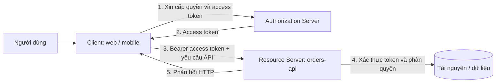
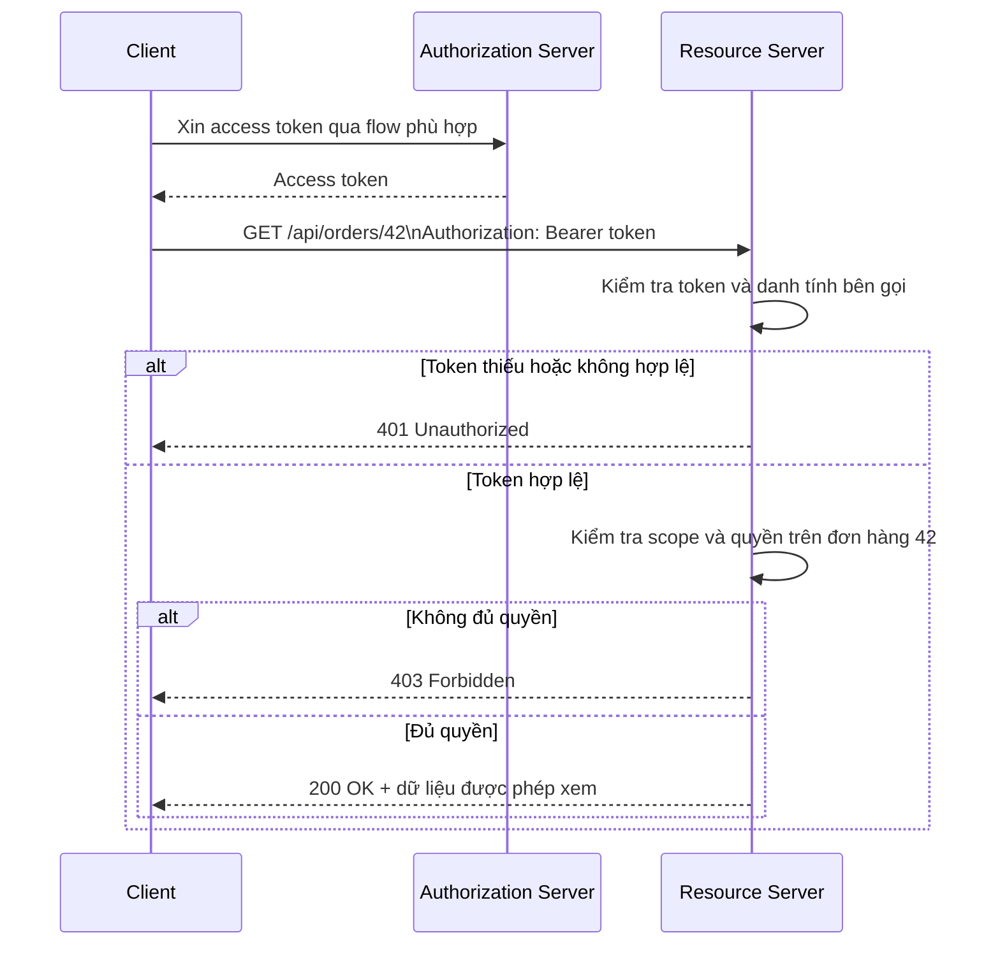
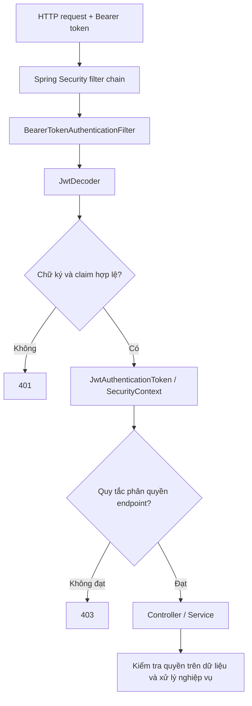

# Máy chủ tài nguyên (Resource Server) là gì và bảo vệ API như thế nào?

## 1. Resource Server giải quyết vấn đề gì?

Giả sử một hệ thống thương mại điện tử cung cấp các API:

```http
GET    /api/products
GET    /api/orders/42
POST   /api/orders
DELETE /api/orders/42
```

API sản phẩm công khai có thể cho phép mọi người truy cập, nhưng API đơn hàng phải phân biệt người gọi là ai, được phép thực hiện thao tác nào và có thực sự được truy cập đơn hàng số `42` hay không. Nếu mỗi API tự nhận tên đăng nhập và mật khẩu, tự phát hành phiên đăng nhập và tự kiểm tra quyền, hệ thống sẽ khó duy trì, khó mở rộng và làm tăng nguy cơ lộ thông tin đăng nhập.

Trong OAuth 2.0, **Resource Server** là máy chủ lưu trữ hoặc cung cấp **tài nguyên được bảo vệ** (protected resources) và tiếp nhận yêu cầu truy cập tài nguyên đó. Với ứng dụng hiện đại, Resource Server thường là một REST API, GraphQL API hoặc một dịch vụ nội bộ. Nó nhận **access token** do phía cấp quyền phát hành, xác thực token và áp dụng các quy tắc phân quyền trước khi trả dữ liệu hoặc thực hiện thao tác.

Ví dụ, API đơn hàng là Resource Server khi nó:

1. Nhận `GET /api/orders/42` kèm access token.
2. Kiểm tra token có hợp lệ, còn hạn, do nơi tin cậy phát hành và dành cho API này hay không.
3. Kiểm tra người gọi có quyền `orders.read` hay không.
4. Kiểm tra đơn hàng `42` có thuộc về người gọi hoặc người gọi có quyền quản trị phù hợp hay không.
5. Chỉ trả dữ liệu khi tất cả điều kiện cần thiết đều đạt.

**Ý chính:** Resource Server bảo vệ tài nguyên; nó không nhất thiết đăng nhập người dùng hay tự phát hành access token. Hai trách nhiệm đó thường thuộc một thành phần khác trong hệ thống.

### Kết quả cần nắm sau bài học

- Phân biệt Resource Server, Authorization Server, Client và người sở hữu tài nguyên.
- Giải thích đường đi của access token và hai bước **xác thực token** / **phân quyền thao tác**.
- Phân biệt access token với ID token, JWT với opaque token và HTTP `401` với `403`.
- Hiểu cách Spring Security biến một API Spring Boot thành OAuth 2.0 Resource Server.

## 2. Resource Server nằm ở đâu trong OAuth 2.0 và OpenID Connect?

Các vai trò thường gặp:

| Thành phần | Trách nhiệm | Ví dụ trong hệ thống đơn hàng |
|---|---|---|
| **Resource Owner** | Chủ thể có quyền đối với tài nguyên; trong nhiều luồng là người dùng | Khách hàng sở hữu đơn hàng |
| **Client** | Ứng dụng yêu cầu quyền truy cập tài nguyên | Web frontend, ứng dụng di động, dịch vụ khác |
| **Authorization Server** | Xử lý việc cấp quyền, phát hành access token và có thể cung cấp thông tin khóa xác minh | Máy chủ định danh hoặc nhà cung cấp OAuth 2.0 |
| **Resource Server** | Cung cấp API và từ chối những yêu cầu không đủ điều kiện truy cập | Dịch vụ `orders-api` |

Trong một hệ thống nhỏ, Authorization Server và Resource Server có thể được triển khai gần nhau. Về mặt giao thức, chúng vẫn giữ **vai trò khác nhau**. Một hệ thống cũng có thể có nhiều Resource Server cùng tin tưởng một Authorization Server; mỗi API cần kiểm tra token có được cấp cho **chính API đó** hay không.



Trong thực tế, trình duyệt có thể được chuyển hướng đến trang đăng nhập của Authorization Server và quay lại Client sau khi người dùng xác thực. Việc chuyển hướng và lấy token phụ thuộc vào grant/flow, không phải thao tác mà Resource Server tự thực hiện.

### OAuth 2.0 và OIDC liên quan ra sao?

**OAuth 2.0** là khuôn khổ ủy quyền: Client có thể được cấp quyền hạn chế để gọi một API. **OpenID Connect (OIDC)** bổ sung lớp xác thực danh tính trên OAuth 2.0, giúp Client biết người dùng đã đăng nhập là ai. Khi Authorization Server hỗ trợ OIDC, nó thường được gọi là **OpenID Provider**.

Hai loại token rất dễ nhầm lẫn:

| Tiêu chí | Access token | ID token (OIDC) |
|---|---|---|
| Mục đích chính | Cho phép Client truy cập Resource Server trong phạm vi được cấp | Truyền thông tin về sự kiện xác thực và danh tính tới Client |
| Bên sử dụng chính | Resource Server | OIDC Client (relying party) |
| Đối tượng nhận (`aud`) | API hoặc tài nguyên mà token được cấp cho, tùy cách triển khai | Thường là `client_id` của OIDC Client |
| Định dạng | JWT, opaque hoặc định dạng khác theo hệ thống | Thông thường là JWT |
| Có nên dùng để gọi API? | **Có**, nếu token hợp lệ và dành cho API đó | **Không**; ID token không thay thế access token |

Một người dùng đăng nhập thành công **không đồng nghĩa** với việc mọi API đều phải cho phép họ truy cập. Resource Server cần kiểm tra access token và quyền đối với tài nguyên riêng của mình.

## 3. Một yêu cầu API được bảo vệ diễn ra thế nào?

Client trước hết lấy access token thông qua một OAuth 2.0 flow phù hợp. Chẳng hạn, ứng dụng có người dùng thường sử dụng **Authorization Code + PKCE**; giao tiếp giữa các dịch vụ có thể sử dụng **Client Credentials**. Việc chọn flow và cấp token thuộc phía Client/Authorization Server.

Sau đó Client gửi token đến API:

```http
GET /api/orders/42 HTTP/1.1
Host: api.example.com
Authorization: Bearer <access-token>
Accept: application/json
```

`Bearer` có nghĩa là bên **đang nắm giữ token** có thể trình token để yêu cầu truy cập theo quyền mà nó mang lại. Vì vậy, nếu token bị đánh cắp, kẻ khác có thể sử dụng token trong thời gian nó còn hiệu lực, trừ khi hệ thống có thêm cơ chế ràng buộc hoặc chặn token. Bearer token phải được truyền qua **HTTPS**, không được ghi nguyên văn vào log hoặc chia sẻ qua URL.



Resource Server thực hiện hai nhóm kiểm tra có ý nghĩa khác nhau:

1. **Authentication — xác thực yêu cầu:** Token có đáng tin không, có còn hiệu lực không và token đại diện cho chủ thể nào? Trong Spring Security, token hợp lệ được chuyển thành một `Authentication` đặt trong `SecurityContext`.
2. **Authorization — phân quyền:** Chủ thể đó có thể gọi endpoint này, thực hiện HTTP method này và thao tác trên bản ghi cụ thể này không?

Kiểm tra đúng chữ ký token chỉ trả lời được một phần của câu hỏi đầu tiên; nó **không tự động** chứng minh người gọi được quyền đọc mọi đơn hàng.

### `401` và `403` khác nhau như thế nào?

| Tình huống | Phản hồi thường dùng | Ý nghĩa |
|---|---|---|
| API yêu cầu token nhưng yêu cầu không có thông tin xác thực hợp lệ | `401 Unauthorized` | Chưa có thông tin xác thực được chấp nhận |
| Token hết hạn, sai chữ ký hoặc không được chấp nhận | `401 Unauthorized` | Xác thực thất bại |
| Token hợp lệ nhưng thiếu `orders.write` khi tạo đơn | `403 Forbidden` | Đã xác thực, nhưng không đủ quyền |
| Token hợp lệ và có scope, nhưng đơn không thuộc người gọi | `403 Forbidden` hoặc `404 Not Found` theo chính sách API | Quy tắc phân quyền theo tài nguyên từ chối yêu cầu |
| Token hợp lệ, đúng scope, đúng quyền trên bản ghi | `200 OK`, `201 Created` hoặc mã thành công thích hợp | Yêu cầu được phép thực hiện |

Khi dùng cơ chế Bearer chuẩn, máy chủ thường gửi header `WWW-Authenticate: Bearer` cho một số lỗi xác thực; thông tin lỗi có thể bao gồm `invalid_token` hoặc `insufficient_scope`. Không nên đưa token, khóa hay dữ liệu nhạy cảm vào nội dung lỗi.

## 4. Resource Server xác thực access token ra sao?

Hai chiến lược phổ biến là **JWT tự chứa thông tin** và **opaque token được kiểm tra qua introspection**. Resource Server cần được cấu hình rõ ràng để tin tưởng đúng Authorization Server.

### 4.1. Với JWT: xác minh chữ ký và các claim

JWT thường có ba phần được mã hóa Base64URL, ngăn bởi dấu chấm:

```text
<header>.<payload>.<signature>
```

Ví dụ payload mang tính minh họa (không phải token thật):

```json
{
  "iss": "https://id.example.com/realms/shop",
  "sub": "user-123",
  "aud": ["orders-api"],
  "exp": 1893456000,
  "nbf": 1893452400,
  "scope": "orders.read orders.write"
}
```

Các claim thường quan trọng:

| Claim | Ý nghĩa và điều cần kiểm tra |
|---|---|
| `iss` (issuer) | Token do đúng Authorization Server mà API tin tưởng phát hành |
| `aud` (audience) | Token được cấp cho Resource Server này, ví dụ `orders-api` |
| `exp` (expiration) | Token chưa hết hạn |
| `nbf` (not before) | Token đã đến thời điểm được phép sử dụng |
| `sub` (subject) | Định danh chủ thể mà token đại diện; có thể là người dùng hoặc một Client/dịch vụ |
| `scope` hoặc `scp` | Các phạm vi truy cập được cấp; tên và cấu trúc phụ thuộc nhà phát hành |

Resource Server dùng **khóa xác minh tin cậy** để kiểm tra chữ ký số của JWT, đồng thời kiểm tra các claim về thời gian, nơi phát hành, đối tượng nhận và chính sách ứng dụng. Với thuật toán chữ ký bất đối xứng, Authorization Server giữ **private key** để ký; Resource Server dùng **public key** để xác minh. Nhiều nhà phát hành công bố public key qua **JWKS endpoint**; Spring Security có thể lấy và cập nhật khóa từ đó khi cấu hình phù hợp.

JWT ký số thường **không được mã hóa**: nội dung header/payload có thể được đọc sau khi giải mã Base64URL. Không đặt mật khẩu hoặc dữ liệu bí mật vào payload, không dùng kết quả “decode JWT” như bằng chứng token hợp lệ và không tự tin tưởng thuật toán/khóa tùy ý mà token đề xuất.

> **Ví dụ lỗi bảo mật:** API chỉ kiểm tra chữ ký và `exp`, nhưng bỏ qua `aud`. Token hợp lệ được cấp cho `inventory-api` có thể bị chấp nhận nhầm ở `orders-api` nếu hai API dùng cùng nguồn phát hành và không có cơ chế kiểm soát đối tượng nhận. Kiểm tra audience là một phần quan trọng của ranh giới tin cậy.

### 4.2. Với opaque token: kiểm tra bằng introspection

Opaque token là chuỗi mà Resource Server không thể dựa vào nội dung tự giải mã để kết luận nó hợp lệ, ví dụ:

```text
Authorization: Bearer 7gT...<chuoi-token-duoc-che>...9Q
```

Resource Server thường gửi token tới **introspection endpoint** của Authorization Server. Phản hồi có thể cho biết `active`, `scope`, `sub`, `exp` và các thuộc tính khác. Máy chủ API chỉ chấp nhận token nếu phản hồi cho thấy token đang hoạt động và đáp ứng các kiểm tra cần thiết. Endpoint introspection thường yêu cầu Resource Server xác thực chính mình với Authorization Server.

| Đặc điểm | JWT được xác minh cục bộ | Opaque token qua introspection |
|---|---|---|
| Cách kiểm tra phổ biến | Xác minh chữ ký và claim bằng bộ giải mã JWT | Gọi Authorization Server để hỏi trạng thái token |
| Phụ thuộc mạng khi xử lý yêu cầu | Thường không cần gọi mỗi request sau khi có khóa phù hợp | Thường cần gọi introspection cho mỗi request, trừ khi có chính sách cache |
| Thu hồi trước hạn | JWT đã phát hành thường vẫn dùng được tới khi hết hạn nếu không có cơ chế chặn bổ sung | Authorization Server có thể trả `active: false` ngay khi thông tin thu hồi có hiệu lực |
| Lưu ý | Phải kiểm tra `iss`, `aud`, thời hạn, chữ ký, scope | Phải bảo vệ thông tin xác thực introspection và kiểm tra phản hồi/phạm vi |

Không thể kết luận token “an toàn hơn” chỉ từ định dạng. Chọn JWT hay opaque token phụ thuộc yêu cầu về độ trễ, thu hồi token, kiến trúc, và mức độ kiểm soát Authorization Server. Dù dùng loại nào, **quyền truy cập nghiệp vụ vẫn phải do API kiểm tra**.

## 5. Spring Security biến một API thành Resource Server như thế nào?

Trong hệ sinh thái Spring, **Spring Security OAuth2 Resource Server** cung cấp các thành phần đọc Bearer token từ HTTP request, xác thực token và tạo đối tượng Authentication cho phần phân quyền. Với JWT, luồng khái quát như sau:



Đường đi với opaque token có vai trò tương tự, nhưng dùng thành phần **`OpaqueTokenIntrospector`** để xác minh token qua introspection thay cho `JwtDecoder`. Cơ chế filter, Authentication và kiểm soát truy cập vẫn là một phần của Spring Security.

### 5.1. Thêm dependency

Ví dụ ứng dụng Java dùng Spring Boot và Gradle:

```groovy
dependencies {
    implementation 'org.springframework.boot:spring-boot-starter-web'
    implementation 'org.springframework.boot:spring-boot-starter-security'
    implementation 'org.springframework.boot:spring-boot-starter-oauth2-resource-server'
}
```

Starter Resource Server cung cấp các thành phần cần thiết cho cơ chế Bearer token. Khi dùng JWT, framework có bộ hỗ trợ giải mã/xác minh chữ ký và xử lý các claim phổ biến. Chỉ thêm dependency **chưa hoàn tất** việc cấu hình trust và quy tắc truy cập.

### 5.2. Chỉ định Authorization Server tin cậy

Nếu access token là JWT, có thể cấu hình `issuer-uri` trong `application.yml`:

```yaml
spring:
  security:
    oauth2:
      resourceserver:
        jwt:
          issuer-uri: https://id.example.com/realms/shop
```

Thay địa chỉ minh họa bằng **issuer chính xác** mà Authorization Server công bố. Spring Security có thể dùng metadata của issuer để tìm endpoint lấy khóa công khai, sau đó xác minh JWT và kiểm tra issuer/thời hạn theo cấu hình mặc định thích hợp. Nếu API yêu cầu audience cụ thể hoặc có quy tắc claim riêng, hãy cấu hình thêm validator tương ứng; **chỉ có `issuer-uri` không có nghĩa là mọi quy tắc phân quyền và audience của ứng dụng đã được thiết lập**.

### 5.3. Phân quyền theo đường dẫn, HTTP method và scope

Ví dụ `SecurityFilterChain` cho API chỉ sử dụng Bearer token, không dùng cookie để xác thực:

```java
import org.springframework.context.annotation.Bean;
import org.springframework.context.annotation.Configuration;
import org.springframework.http.HttpMethod;
import org.springframework.security.config.Customizer;
import org.springframework.security.config.annotation.web.builders.HttpSecurity;
import org.springframework.security.config.http.SessionCreationPolicy;
import org.springframework.security.web.SecurityFilterChain;

@Configuration
public class SecurityConfig {

    @Bean
    SecurityFilterChain apiSecurity(HttpSecurity http) throws Exception {
        return http
            // Chỉ phù hợp với API stateless dùng Bearer token,
            // không sử dụng cookie phiên để xác thực request.
            .csrf(csrf -> csrf.disable())
            .sessionManagement(session ->
                session.sessionCreationPolicy(SessionCreationPolicy.STATELESS))
            .authorizeHttpRequests(authorize -> authorize
                .requestMatchers("/api/public/**").permitAll()
                .requestMatchers(HttpMethod.GET, "/api/orders/**")
                    .hasAuthority("SCOPE_orders.read")
                .requestMatchers(HttpMethod.POST, "/api/orders/**")
                    .hasAuthority("SCOPE_orders.write")
                .anyRequest().authenticated()
            )
            .oauth2ResourceServer(oauth2 ->
                oauth2.jwt(Customizer.withDefaults()))
            .build();
    }
}
```

Giải thích những điểm quan trọng:

- `oauth2ResourceServer(...jwt(...))` bật cơ chế nhận và xác minh JWT Bearer token.
- `requestMatchers` dùng đường dẫn và HTTP method để đặt điều kiện truy cập. Quy tắc cụ thể hơn cần được xếp đúng vị trí trước quy tắc tổng quát.
- Spring Security mặc định thường chuyển các giá trị trong `scope` hoặc `scp` của JWT thành authority có tiền tố **`SCOPE_`**. Scope `orders.read` sẽ tương ứng với `SCOPE_orders.read`. Có thể tùy chỉnh bằng converter khi cấu trúc claim khác mặc định.
- `anyRequest().authenticated()` yêu cầu xác thực cho các endpoint chưa được liệt kê, nhưng **không tự đặt ra quyền nghiệp vụ chi tiết** cho chúng; ứng dụng nên thêm quy tắc cụ thể cho những endpoint nhạy cảm.
- `STATELESS` nói rằng API không dựa vào HTTP session để duy trì trạng thái đăng nhập. Ví dụ tắt CSRF vì giả định token được gửi chủ động trong Authorization header và không dùng cookie tự động gửi. **Không áp dụng việc tắt CSRF một cách máy móc** nếu ứng dụng có cơ chế xác thực bằng cookie hoặc tích hợp giao diện trình duyệt cần bảo vệ CSRF.

Mã trên chỉ là ví dụ về cấu hình Resource Server, **không phải Authorization Server**; nó không cung cấp endpoint đăng nhập, trang đồng ý cấp quyền hoặc chức năng phát hành access token.

### 5.4. Đọc danh tính từ token trong controller

Khi token hợp lệ, một endpoint có thể truy cập các claim JWT đã được kiểm tra:

```java
import java.util.Map;
import org.springframework.security.core.annotation.AuthenticationPrincipal;
import org.springframework.security.oauth2.jwt.Jwt;
import org.springframework.web.bind.annotation.GetMapping;
import org.springframework.web.bind.annotation.RequestMapping;
import org.springframework.web.bind.annotation.RestController;

@RestController
@RequestMapping("/api/orders")
public class OrderController {

    @GetMapping("/me")
    public Map<String, String> currentCaller(@AuthenticationPrincipal Jwt jwt) {
        return Map.of("subject", jwt.getSubject());
    }
}
```

Với cấu hình ở mục 5.3, `GET /api/orders/me` phải có authority `SCOPE_orders.read`. Nếu token hợp lệ, `jwt.getSubject()` cho biết `sub` mà nhà phát hành gắn vào token; giá trị này **không nhất thiết là tên đăng nhập của một người**, vì token có thể được cấp cho một ứng dụng máy-máy.

Ở API thực tế, không được lấy `ownerId` từ tham số request rồi mặc nhiên trả dữ liệu theo ID đó. Ví dụ, sau khi xác định chủ thể từ token, tầng Service/Repository cần giới hạn truy vấn bằng chủ sở hữu hoặc kiểm tra chính sách phân quyền:

```java
// Minh họa quy tắc nghiệp vụ, không phải một controller hoàn chỉnh.
Order order = orderRepository.findById(orderId)
    .orElseThrow(ResourceNotFoundException::new);

if (!order.getOwnerSubject().equals(authenticatedSubject)
        && !permissionService.canReadOthersOrders(authenticatedSubject)) {
    throw new AccessDeniedException("Không được xem đơn hàng này");
}
```

**Scope** trả lời câu hỏi tổng quát “token có được cấp quyền đọc đơn hàng không?”, còn kiểm tra **ownership/đối tượng dữ liệu** trả lời câu hỏi “người gọi có được đọc **đơn hàng cụ thể này** không?”. Cần cả hai lớp cho những tài nguyên có quyền sở hữu.

### 5.5. Cấu hình audience cho JWT

Nếu hệ thống phát hành token cho nhiều API, Resource Server cần từ chối token có audience không dành cho mình. Spring Security cho phép cấu hình validator bổ sung. Ví dụ dưới đây đặt audience bắt buộc là `orders-api` và giữ các validator mặc định về issuer/thời hạn:

```java
import org.springframework.context.annotation.Bean;
import org.springframework.beans.factory.annotation.Value;
import org.springframework.security.oauth2.core.DelegatingOAuth2TokenValidator;
import org.springframework.security.oauth2.core.OAuth2Error;
import org.springframework.security.oauth2.core.OAuth2TokenValidator;
import org.springframework.security.oauth2.core.OAuth2TokenValidatorResult;
import org.springframework.security.oauth2.jwt.Jwt;
import org.springframework.security.oauth2.jwt.JwtDecoder;
import org.springframework.security.oauth2.jwt.JwtDecoders;
import org.springframework.security.oauth2.jwt.JwtValidators;
import org.springframework.security.oauth2.jwt.NimbusJwtDecoder;

// Bổ sung vào cấu hình security khi cần ràng buộc audience.
@Bean
JwtDecoder jwtDecoder(
        @Value("${spring.security.oauth2.resourceserver.jwt.issuer-uri}") String issuer) {
    NimbusJwtDecoder decoder = (NimbusJwtDecoder) JwtDecoders.fromIssuerLocation(issuer);

    OAuth2TokenValidator<Jwt> issuerAndTime =
        JwtValidators.createDefaultWithIssuer(issuer);
    OAuth2TokenValidator<Jwt> audience = jwt ->
        jwt.getAudience().contains("orders-api")
            ? OAuth2TokenValidatorResult.success()
            : OAuth2TokenValidatorResult.failure(
                new OAuth2Error("invalid_token", "Audience khong hop le", null));

    decoder.setJwtValidator(
        new DelegatingOAuth2TokenValidator<>(issuerAndTime, audience));
    return decoder;
}
```

Đoạn bổ sung có ý nghĩa khi Authorization Server thực sự phát hành access token với `aud` chứa `orders-api`; nếu không, token sẽ bị từ chối và cần điều chỉnh cấu hình phía phát hành cho đúng mục đích. Cách tổ chức validator có thể thay đổi theo phiên bản Spring Security, nhưng nguyên tắc bắt buộc là **ràng buộc issuer, audience, thời hạn và thuật toán/khóa tin cậy**.

### 5.6. Nếu Authorization Server phát hành opaque token

Thay vì JWT, ứng dụng có thể dùng introspection:

```yaml
spring:
  security:
    oauth2:
      resourceserver:
        opaque-token:
          introspection-uri: https://id.example.com/oauth2/introspect
          client-id: ${INTROSPECTION_CLIENT_ID}
          client-secret: ${INTROSPECTION_CLIENT_SECRET}
```

```java
// Trong SecurityFilterChain, chọn opaque token thay cho jwt:
.oauth2ResourceServer(oauth2 ->
    oauth2.opaqueToken(Customizer.withDefaults()))
```

URI và credential chỉ là ví dụ. Cần dùng introspection endpoint đúng của nhà phát hành, đặt bí mật trong cấu hình bí mật/biến môi trường và xác định quy tắc kiểm tra audience hoặc thuộc tính quyền theo phản hồi thực tế. **Cấu hình JWT và opaque token ở đây là hai phương án triển khai thay thế cho nhau**, không phải ghép nguyên hai đoạn cấu hình vào cùng ví dụ.

## 6. Các kịch bản thực tế

### Kịch bản A: Người dùng đọc đơn hàng của mình

1. Người dùng đăng nhập qua ứng dụng web sử dụng Authorization Code + PKCE.
2. Client nhận access token có scope `orders.read`, và token được phát hành cho `orders-api`.
3. Client gửi `GET /api/orders/42` cùng Bearer token.
4. Resource Server xác minh token, kiểm tra `orders.read`, tìm đơn hàng `42` và xác nhận người dùng được phép xem.
5. API trả đơn hàng nếu tất cả kiểm tra đều đạt.

Nếu Client đổi `42` thành `43` là đơn của người khác, scope `orders.read` vẫn không cho phép vượt qua kiểm tra ownership. Đó là lớp bảo vệ chống lỗi phân quyền theo đối tượng (thường được gọi là BOLA/IDOR).

### Kịch bản B: Dịch vụ thanh toán gọi dịch vụ đơn hàng

Một dịch vụ backend sử dụng Client Credentials để lấy access token đại diện cho **client của dịch vụ**, chẳng hạn với scope `orders.update-payment-status`. API đơn hàng xác minh token và chỉ cho phép thao tác cập nhật trạng thái thanh toán phù hợp. Vì không có người dùng tương tác trực tiếp trong flow này, Resource Server không nên mặc định `sub` là một người dùng cuối; nó cần quy tắc phân quyền cho danh tính máy/dịch vụ.

### Kịch bản C: Token hết hạn hoặc bị thu hồi

Khi JWT hết hạn (`exp` đã qua), Resource Server từ chối dù chữ ký vẫn đúng. Nếu cần thu hồi một JWT **trước** thời điểm hết hạn, hệ thống phải có chiến lược bổ sung, ví dụ vòng đời token ngắn, danh sách chặn, hoặc kiểm soát phiên/quyền qua dịch vụ trung tâm. Với opaque token, introspection có thể phản ánh trạng thái đã thu hồi, nhưng độ trễ và chính sách cache cũng phải được tính đến.

## 7. Thử kiểm tra API bằng HTTP

Sau khi cấu hình Resource Server và có Authorization Server thực tế, có thể kiểm tra ba trường hợp sau bằng `curl` (thay URL và token bằng giá trị môi trường của bạn):

```bash
# 1. Không cung cấp token cho endpoint được bảo vệ
curl -i https://api.example.com/api/orders/me

# 2. Token giả/không hợp lệ: kỳ vọng bị từ chối
curl -i -H 'Authorization: Bearer invalid.token.value' \
  https://api.example.com/api/orders/me

# 3. Access token hợp lệ, đúng audience và scope orders.read
curl -i -H "Authorization: Bearer ${ACCESS_TOKEN}" \
  https://api.example.com/api/orders/me
```

Giá trị token thật cần được giữ kín; đừng đưa vào tài liệu, log, commit hoặc công cụ giám sát không phù hợp. Nếu request hợp lệ vẫn bị từ chối, lần lượt kiểm tra **issuer**, **audience**, **hạn token**, **chữ ký/JWKS**, claim **scope**, mapping `SCOPE_` và quy tắc đường dẫn. Không nên khắc phục `403` bằng cách bỏ toàn bộ kiểm tra phân quyền.

## 8. Các sai lầm thường gặp và cách tránh

| Sai lầm | Hệ quả | Cách xử lý |
|---|---|---|
| Dùng ID token để gọi API | Token phục vụ xác thực Client có thể bị sử dụng sai mục đích | Dùng access token được cấp cho API |
| Chỉ decode JWT hoặc chỉ kiểm tra `exp` | Có thể chấp nhận token giả mạo hoặc sai nguồn | Xác minh chữ ký bằng khóa tin cậy và kiểm tra đầy đủ claim |
| Không kiểm tra `aud` khi nhiều API dùng chung issuer | API có thể chấp nhận token dành cho dịch vụ khác | Ràng buộc audience của từng Resource Server |
| Cứ có scope `orders.read` là đọc mọi đơn | Lộ dữ liệu của người dùng khác | Kiểm tra chủ sở hữu và chính sách trên từng tài nguyên |
| Tin mọi giá trị role/scope do Client gửi kèm ngoài token | Client có thể tự nâng quyền | Chỉ dùng thông tin tin cậy đã xác thực và quyền nghiệp vụ từ server |
| Gửi token qua HTTP, URL hoặc ghi token vào log | Token bị lộ và có thể bị sử dụng lại | HTTPS; Authorization header; che dữ liệu nhạy cảm |
| Giả định JWT bị thu hồi là mất hiệu lực ngay | Token còn hạn vẫn có thể được chấp nhận | Thiết kế thời hạn ngắn và cơ chế thu hồi phù hợp |
| Bỏ qua CSRF khi dùng cookie để đăng nhập | Dễ tạo lỗ hổng với request từ trình duyệt | Đánh giá cơ chế lưu/gửi thông tin xác thực và bật bảo vệ CSRF khi cần |
| Đồng nhất scope với vai trò hoặc quyền sở hữu | Quy tắc phân quyền quá rộng | Tách scope OAuth, authority trong Spring và quyền nghiệp vụ |

## 9. Ghi nhớ kiến trúc bảo vệ API

Để thiết kế một Resource Server, hãy luôn trả lời được các câu hỏi:

1. **API bảo vệ tài nguyên nào?** Endpoint nào công khai, endpoint nào yêu cầu quyền?
2. **Ai phát hành token?** `iss` và bộ khóa tin cậy/introspection endpoint là gì?
3. **Token có dành cho API này không?** `aud` mong đợi là gì và token còn hạn hay không?
4. **Token được cấp quyền nào?** Scope/authority nào cho từng thao tác?
5. **Ai sở hữu đối tượng dữ liệu?** Những điều kiện ownership, tenant hoặc nghiệp vụ nào cần kiểm tra thêm?
6. **Khi không đạt thì phản hồi thế nào?** Phân biệt lỗi xác thực `401` với lỗi thiếu quyền `403` và tránh lộ dữ liệu.

Resource Server là **cửa kiểm soát truy cập cho API**. OAuth 2.0 giúp Client mang quyền truy cập đã được cấp đến cửa đó; OIDC bổ sung thông tin xác thực danh tính cho Client; Spring Security cung cấp lớp hạ tầng xác thực token và phân quyền request. Một API chỉ thực sự được bảo vệ đúng khi kết hợp **token hợp lệ**, **phạm vi truy cập phù hợp** và **quy tắc quyền trên dữ liệu cụ thể**.
