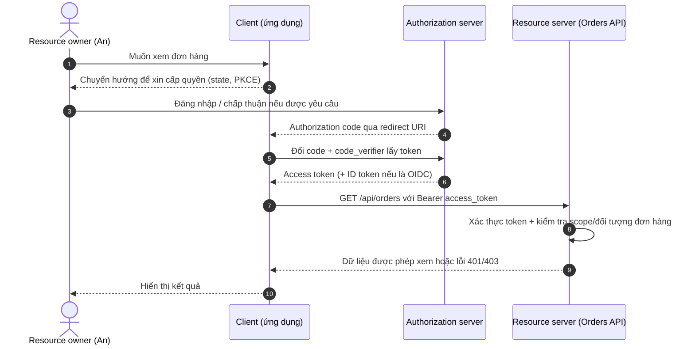
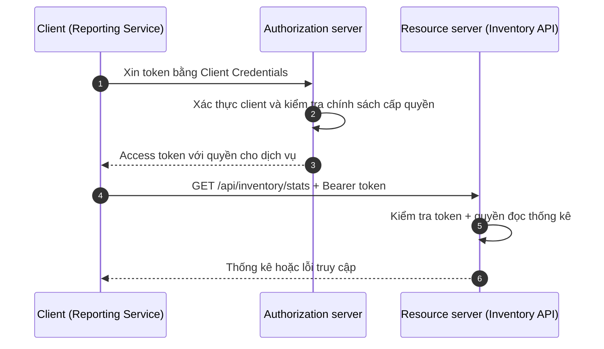

# Chủ tài nguyên, client, authorization server và resource server

Trong kiến trúc **OAuth 2.0**, bốn vai trò nền tảng là **resource owner** (chủ tài nguyên), **client** (ứng dụng khách), **authorization server** (máy chủ cấp quyền) và **resource server** (máy chủ tài nguyên). Hiểu đúng ranh giới trách nhiệm của bốn vai trò là điều kiện để thiết kế API an toàn với **Spring Security OAuth 2.0 Resource Server**, đồng thời tránh nhầm lẫn giữa **ủy quyền truy cập (authorization)** và **đăng nhập/xác thực người dùng (authentication)** khi bổ sung **OpenID Connect (OIDC)**.

> **Ý chính:** Client xin quyền truy cập; authorization server quyết định và phát hành access token theo chính sách; resource server tiếp nhận access token để bảo vệ API; resource owner là bên có quyền đối với tài nguyên được truy cập. Đây là **vai trò logic**, không nhất thiết tương ứng với bốn máy chủ hay bốn ứng dụng riêng biệt.

## 1. Bắt đầu từ một tình huống thực tế

Giả sử một hệ thống bán hàng có:

- **An**: người có các đơn hàng trong hệ thống.
- **Ứng dụng quản lý đơn hàng**: giao diện web hoặc ứng dụng di động mà An sử dụng.
- **Hệ thống đăng nhập/cấp token**: dịch vụ nhận yêu cầu đăng nhập và cấp quyền truy cập API.
- **Orders API**: dịch vụ cung cấp dữ liệu đơn hàng tại `/api/orders`.

An muốn ứng dụng hiển thị danh sách đơn hàng của mình. Ứng dụng không nên yêu cầu An giao mật khẩu rồi dùng mật khẩu đó để gọi Orders API. Thay vào đó, với một luồng OAuth 2.0 phù hợp, ứng dụng đưa An đến hệ thống cấp quyền, nhận **access token** và gửi token khi gọi API. Orders API kiểm tra token cùng quy tắc truy cập trước khi trả dữ liệu.

Ánh xạ bốn vai trò:

| Vai trò | Trong ví dụ | Trách nhiệm cốt lõi |
| --- | --- | --- |
| **Resource owner** | An, đối với các đơn hàng mà An có quyền kiểm soát | Là bên có thẩm quyền cho phép truy cập tài nguyên theo mô hình phân quyền của hệ thống |
| **Client** | Ứng dụng quản lý đơn hàng | Xin quyền, nhận token qua luồng được hỗ trợ và dùng access token để gọi API |
| **Authorization server** | Hệ thống đăng nhập/cấp token | Xác thực các bên khi cần, xử lý yêu cầu cấp quyền và phát hành token |
| **Resource server** | Orders API | Kiểm tra access token, thực thi chính sách truy cập và cung cấp tài nguyên được bảo vệ |

Trong hệ thống thực tế, cùng một sản phẩm có thể gồm nhiều client và nhiều resource server. Một tổ chức có thể dùng một authorization server để cấp token cho cả Orders API, Payments API và Inventory API; mỗi API vẫn có trách nhiệm kiểm soát tài nguyên của chính mình.

## 2. Bốn vai trò và giới hạn trách nhiệm

### 2.1. Resource owner — chủ tài nguyên

Theo mô hình OAuth 2.0, **resource owner** là thực thể có khả năng cấp quyền truy cập đến tài nguyên được bảo vệ. Khi resource owner là một con người, thực thể đó thường là người dùng cuối (**end-user**).

Trong ví dụ, An có thể đồng ý cho ứng dụng đọc đơn hàng của mình. Tuy nhiên, cần phân biệt hai điều:

1. **Ai đang đăng nhập?** Đây là câu hỏi về danh tính/xác thực.
2. **Ai được phép truy cập đơn hàng nào?** Đây là câu hỏi về quyền truy cập tài nguyên.

Hai câu hỏi không đồng nghĩa. An đã đăng nhập thành công vẫn không mặc nhiên được đọc đơn hàng của Bình. Chủ tài nguyên cũng không nhất thiết là người đã trực tiếp tạo ra bản ghi: tài nguyên có thể thuộc một tổ chức, nhóm hoặc tài khoản doanh nghiệp, với quyền sử dụng được quyết định bởi chính sách nghiệp vụ.

Một số lưu ý:

- Resource owner **không phải** tên khác của resource server. Một bên có thẩm quyền đối với tài nguyên; bên kia là hệ thống lưu trữ hoặc cung cấp tài nguyên được bảo vệ.
- Việc người dùng nhấn **Đồng ý/Consent** chỉ xuất hiện trong các luồng và chính sách có yêu cầu. Không phải mọi access token đều phát sinh từ màn hình đồng ý.
- Với luồng **Client Credentials** cho giao tiếp máy–máy, thường không có một người dùng cuối tham gia giao dịch. Quyền được cấp theo danh tính của client và chính sách của authorization server; không nên gán tùy tiện token đó cho một resource owner là con người.
- Resource owner không cần cung cấp mật khẩu của mình cho ứng dụng client. Luồng ủy quyền phù hợp giúp client nhận quyền truy cập có giới hạn mà không nắm thông tin đăng nhập của người dùng.

### 2.2. Client — ứng dụng yêu cầu truy cập

**Client** là ứng dụng yêu cầu truy cập tài nguyên được bảo vệ thay mặt resource owner hoặc nhân danh chính ứng dụng đó. Client có thể là:

- Ứng dụng web chạy phía máy chủ (backend web app/BFF).
- **Single-page application (SPA)** chạy trong trình duyệt.
- Ứng dụng di động hoặc ứng dụng máy tính.
- Một backend service gọi API của backend service khác.

Trong OAuth 2.0, cần phân biệt:

| Kiểu client | Đặc điểm | Ví dụ |
| --- | --- | --- |
| **Confidential client** | Có khả năng bảo vệ thông tin xác thực của client trong môi trường tin cậy | Backend chạy trên máy chủ, gọi token endpoint với thông tin xác thực được lưu kín |
| **Public client** | Không thể giữ một bí mật ứng dụng một cách đáng tin cậy | SPA chạy trong trình duyệt, ứng dụng di động được phân phối đến thiết bị người dùng |

`client_id` dùng để nhận diện client khi làm việc với authorization server; nó **không phải bí mật**. Không được coi việc giấu `client_id` trong JavaScript hoặc ứng dụng di động là một biện pháp bảo mật. `client_secret`, nếu được cấp cho confidential client, phải được giữ ở phía có thể bảo vệ bí mật; không nhúng vào ứng dụng public.

Client thường được đăng ký với authorization server, bao gồm các thông tin như định danh client, redirect URI, grant type được phép và phạm vi quyền dự kiến. Với ứng dụng tương tác người dùng, **Authorization Code + PKCE** là mô hình quan trọng để ngăn chặn việc mã ủy quyền bị đánh cắp và sử dụng sai; PKCE không thay thế mọi cơ chế xác thực client khi client là confidential.

**Client không tự quyết định token có hợp lệ hay không đối với API**. Nó có thể yêu cầu `orders.read`, nhưng chỉ authorization server mới quyết định quyền phát hành, và Orders API vẫn kiểm tra token cũng như chính sách nghiệp vụ trước khi cung cấp dữ liệu.

### 2.3. Authorization server — máy chủ cấp quyền

**Authorization server** là hệ thống phát hành access token cho client sau khi xử lý yêu cầu cấp quyền theo giao thức và chính sách của nó. Tùy luồng, các công việc có thể bao gồm:

- Nhận diện/xác thực người dùng cuối, xác thực client khi cần.
- Kiểm tra client, redirect URI, grant type, scope được yêu cầu và những điều kiện cấp quyền khác.
- Xử lý consent hoặc quy định cấp quyền của tổ chức khi áp dụng.
- Phát hành **access token**, tùy trường hợp có **refresh token**; với OIDC còn có **ID token**.
- Công bố metadata, khóa công khai dùng để xác minh chữ ký JWT qua **JWKS**, hoặc cung cấp endpoint **token introspection** cho token opaque khi hỗ trợ.
- Quản lý vòng đời thông tin xác thực, thời hạn token, thay khóa, chính sách thu hồi và phiên đăng nhập theo khả năng của sản phẩm.

Ví dụ triển khai có thể là Keycloak, một nhà cung cấp danh tính hỗ trợ OAuth 2.0/OIDC, hoặc một authorization server xây dựng bằng **Spring Authorization Server**. Authorization server là vai trò **cấp token**; thư viện **Spring Security Resource Server** trong một API không tự biến API đó thành authorization server.

Điểm quan trọng: authorization server có thể quyết định cấp scope `orders.read`, nhưng nó thường **không có toàn bộ dữ liệu đơn hàng** để quyết định An được xem bản ghi đơn hàng cụ thể nào. Quyết định cuối cùng ở cấp tài nguyên vẫn thuộc về resource server và lớp nghiệp vụ.

### 2.4. Resource server — máy chủ tài nguyên

**Resource server** là dịch vụ lưu trữ hoặc cung cấp tài nguyên được bảo vệ và chấp nhận access token làm một phần của cơ chế kiểm soát truy cập. Ví dụ: Orders API, Payments API, hệ thống hồ sơ nhân sự hoặc API tài liệu.

Khi nhận yêu cầu, resource server cần thực hiện hai lớp kiểm soát:

1. **Kiểm tra token**: token có xác thực được không, còn hiệu lực không, đến từ issuer đáng tin cậy không, có dành cho API này không, có đáp ứng các điều kiện như scope/claim cần thiết không?
2. **Kiểm tra quyền nghiệp vụ**: chủ thể trong token có được xem/sửa đúng bản ghi này, trong tenant này, ở trạng thái nghiệp vụ này hay không?

Với access token dạng **JWT có chữ ký**, resource server có thể kiểm tra chữ ký bằng khóa công khai tương ứng do issuer công bố, rồi kiểm tra các claim liên quan như `iss`, `exp`, `nbf` và `aud` theo cấu hình. Với **opaque token**, resource server thường gọi introspection endpoint hoặc dùng cơ chế tra cứu đáng tin cậy để lấy trạng thái và thuộc tính token.

Resource server có thể **không hề hiển thị trang đăng nhập**. Nó thường chỉ nhận yêu cầu HTTP với `Authorization: Bearer ...` và trả dữ liệu hoặc mã lỗi phù hợp. Spring Security OAuth 2.0 Resource Server chủ yếu phục vụ vai trò này.

## 3. Các vai trò phối hợp như thế nào?

### 3.1. Người dùng cấp quyền qua Authorization Code + PKCE

Sơ đồ dưới đây minh họa một ứng dụng quản lý đơn hàng dùng Authorization Code + PKCE. Các bước cụ thể phụ thuộc nền tảng và cấu hình OAuth 2.0/OIDC, nhưng ranh giới của bốn vai trò không thay đổi.



Diễn giải từng chặng:

1. **Client → Authorization server:** Client khởi tạo yêu cầu cấp quyền với `client_id`, `redirect_uri`, `scope`, `state` và thông tin PKCE. Trong OIDC, scope thường chứa `openid`.
2. **Resource owner ↔ Authorization server:** Người dùng đăng nhập và có thể quyết định có đồng ý cấp quyền hay không. Authorization server dùng chính sách của nó để quyết định tiếp tục hay từ chối.
3. **Authorization server → Client:** Sau khi hoàn tất, authorization server trả **authorization code**; client đổi code tại token endpoint để nhận token. Authorization code không phải access token.
4. **Client → Resource server:** Client đưa **access token** vào HTTP `Authorization` header khi gọi Orders API. Client không gửi ID token thay cho access token.
5. **Resource server:** API xác thực token và áp dụng quy tắc truy cập cụ thể. Nếu hợp lệ và đủ quyền, API trả dữ liệu; nếu không, API từ chối.

Một yêu cầu HTTP minh họa ở bước 4:

```http
GET /api/orders/123 HTTP/1.1
Host: orders.example.com
Authorization: Bearer <access-token>
Accept: application/json
```

`<access-token>` là ký hiệu thay thế, không phải một token thực. Client nên truyền bearer token qua header dưới kết nối HTTPS; không đặt token trong URL vì URL dễ lọt vào lịch sử trình duyệt, log hoặc các hệ thống trung gian.

### 3.2. Máy chủ gọi máy chủ bằng Client Credentials

Không phải mọi yêu cầu OAuth 2.0 đều bắt đầu bằng việc một người mở trang đăng nhập. Ví dụ, dịch vụ báo cáo nội bộ cần đọc thống kê từ Inventory API:



Trong trường hợp này không có người dùng cuối tham gia quá trình cấp token. Token đại diện cho quyền đã cấp cho **client/dịch vụ** theo chính sách. API không được giả định rằng luôn có một người dùng con người đứng sau `sub` của access token.

## 4. Access token, ID token và refresh token đi đến đâu?

Ba loại token thường xuất hiện cạnh nhau nhưng có **mục đích và đối tượng nhận khác nhau**.

| Loại token | Mục đích | Bên sử dụng chính | Có gửi đến resource server làm bằng chứng truy cập API? |
| --- | --- | --- | --- |
| **Access token** | Đại diện cho quyền được cấp để truy cập tài nguyên | Client gửi đến resource server; resource server kiểm tra | **Có** — khi token dành cho API đó |
| **ID token (OIDC)** | Cung cấp thông tin về lần xác thực người dùng cho client | OIDC client xác minh và sử dụng để xác lập phiên đăng nhập | **Không** — không thay cho access token |
| **Refresh token** | Cho phép client xin access token mới khi được cấp phép | Client gửi đến authorization server | **Không** — không gửi đến API tài nguyên |

### Access token không nhất thiết là JWT

OAuth 2.0 không yêu cầu access token phải là chuỗi JWT có thể đọc claim. Authorization server có thể cấp token opaque, hoặc JWT với cấu trúc theo hồ sơ token và cách triển khai của nhà cung cấp. Một payload **minh họa** cho access token dạng JWT có thể như sau:

```json
{
  "iss": "https://auth.example.com/realms/shop",
  "sub": "user-42",
  "aud": ["orders-api"],
  "scope": "orders.read",
  "client_id": "orders-web-app",
  "exp": 1893456000
}
```

Đây chỉ là ví dụ về các claim có thể xuất hiện, **không phải định dạng bắt buộc** hoặc token hoàn chỉnh. Tên claim, cách biểu diễn quyền (`scope`, `scp`, vai trò tùy chỉnh...), cách diễn giải `sub` và định dạng `aud` thay đổi theo issuer và quy ước hệ thống. Việc Base64-decode được payload JWT không đồng nghĩa với việc chữ ký của nó hợp lệ.

Các claim mang ý nghĩa khác nhau:

- `iss` (**issuer**): bên phát hành token. API phải tin cậy chính xác issuer được cấu hình.
- `sub` (**subject**): chủ thể mà token nói đến; có thể là người dùng hoặc chủ thể dịch vụ tùy grant và issuer.
- `aud` (**audience**): đích sử dụng dự kiến của token. Một access token dành cho Payments API không nên được Orders API chấp nhận chỉ vì chữ ký hợp lệ.
- `exp` và `nbf`: mốc hết hạn và thời điểm token bắt đầu có hiệu lực khi hiện diện.
- `scope`: quyền được cấp ở mức phạm vi, ví dụ `orders.read`; **không tự động chứng minh** quyền sở hữu mọi đơn hàng.

JWT thường được xác thực tại resource server bằng chữ ký và khóa phù hợp; token opaque thường cần truy vấn trạng thái bằng introspection. Việc chọn JWT hay opaque là quyết định thiết kế chung giữa bên phát hành và API nhận token, không phải đặc điểm cố hữu của từng vai trò.

### OIDC bổ sung điều gì?

**OAuth 2.0** chủ yếu giải quyết câu hỏi: *“Ứng dụng này được phép truy cập tài nguyên nào và với phạm vi gì?”* **OpenID Connect** là lớp nhận diện dựa trên OAuth 2.0, bổ sung giao thức xác thực người dùng cuối và thông tin danh tính chuẩn hóa, trong đó có **ID token**.

Ví dụ: Ứng dụng quản lý đơn hàng dùng OIDC để biết **An đã đăng nhập**; sau đó dùng OAuth 2.0 access token để gọi **Orders API**. Đó là hai mục đích khác nhau, dù trong cùng một quy trình người dùng có thể nhận cả ID token và access token.

Một OIDC provider thường đảm nhận vai trò authorization server và bổ sung các khả năng OIDC như discovery, ID token và có thể có UserInfo endpoint. Về phía Spring Security, cấu hình **OAuth2 Login/OIDC Client** dành cho ứng dụng đăng nhập người dùng khác với cấu hình **OAuth2 Resource Server** dành cho API nhận bearer token.

## 5. Ranh giới tin cậy và các quyết định bảo mật

Mỗi vai trò biết một phần của bức tranh. Vì vậy phải đặt kiểm tra tại đúng ranh giới:

| Ranh giới | Điều cần bảo vệ | Ví dụ sai lầm cần tránh |
| --- | --- | --- |
| Resource owner ↔ Authorization server | Xác thực người dùng và quyết định cấp quyền | Client tự thu thập mật khẩu người dùng để lấy quyền |
| Client ↔ Authorization server | Định danh client, redirect URI, grant, PKCE, phạm vi quyền | Đặt `client_secret` trong SPA, bỏ kiểm tra `state` hoặc PKCE ở luồng có yêu cầu |
| Client ↔ Resource server | Access token và kênh truyền bảo mật | Gửi ID token làm bearer token cho API hoặc đưa bearer token vào URL |
| Resource server ↔ Issuer/metadata | Chữ ký/khóa, issuer, audience và tính hợp lệ của token | Tin `sub` hoặc `scope` từ JWT chỉ vì decode đọc được payload |
| Resource server ↔ Dữ liệu nghiệp vụ | Quyền truy cập đối tượng và ngữ cảnh kinh doanh | Có `orders.read` là cho phép xem **mọi** đơn hàng của mọi khách hàng |

**Authentication, token validation và authorization là ba bước khác nhau.**

- **Authentication**: ai đang tương tác, hoặc client nào đang tự xác thực với authorization server?
- **Token validation**: token này có thực sự do issuer tin cậy phát hành, còn hiệu lực và phù hợp với API đang nhận không?
- **Authorization**: chủ thể đã được xác thực có được thực hiện thao tác cụ thể trên tài nguyên cụ thể không?

Ví dụ, An và Bình đều có token hợp lệ mang scope `orders.read`. Resource server vẫn phải kiểm tra đơn `123` thuộc phạm vi An được xem hay không. Nếu API chỉ so khớp scope mà không kiểm tra chủ sở hữu đơn hàng/tenant/quyền phân công, đó là lỗ hổng **Broken Object Level Authorization (BOLA)**.

Khi token bị từ chối, HTTP thường phân biệt:

- **401 Unauthorized**: thiếu hoặc không có thông tin xác thực/token hợp lệ; API Bearer thường trả `WWW-Authenticate` phù hợp.
- **403 Forbidden**: đã có thông tin xác thực phù hợp nhưng không đủ quyền cho thao tác, ví dụ thiếu scope hoặc bị từ chối bởi quy tắc nghiệp vụ.

Mã phản hồi thực tế còn phụ thuộc cấu hình Spring Security và xử lý lỗi của ứng dụng; không suy diễn rằng mọi 403 đều là thiếu scope.

## 6. Đặt bốn vai trò vào Spring Security Resource Server

Đối với một ứng dụng Spring Boot cung cấp Orders API, vai trò triển khai là **resource server**. Authorization server có thể là một hệ thống OIDC/OAuth 2.0 độc lập. Một client gọi API có thể được viết bằng Java, JavaScript, mobile SDK hoặc bất kỳ ngôn ngữ nào hỗ trợ HTTP.

### 6.1. Cấu hình tối thiểu để API nhận JWT

Trong ứng dụng Spring Boot dùng Spring Security tương thích, thêm dependency Resource Server:

```xml
<dependency>
    <groupId>org.springframework.boot</groupId>
    <artifactId>spring-boot-starter-oauth2-resource-server</artifactId>
</dependency>
```

Ví dụ `application.yml`:

```yaml
spring:
  security:
    oauth2:
      resourceserver:
        jwt:
          issuer-uri: https://auth.example.com/realms/shop
```

`issuer-uri` cho Spring Security biết issuer đáng tin cậy để khám phá metadata và khóa công khai theo khả năng hỗ trợ của issuer. Cấu hình JWT cần phù hợp với token mà authorization server thực sự phát hành. Ngoài các kiểm tra chuẩn của cấu hình, API cần bảo đảm **audience** đúng với chính mình; không nên mặc định rằng chỉ cấu hình issuer đã đủ để thực thi mọi chính sách audience của hệ thống.

Ví dụ về quy tắc truy cập HTTP:

```java
import org.springframework.context.annotation.Bean;
import org.springframework.context.annotation.Configuration;
import org.springframework.http.HttpMethod;
import org.springframework.security.config.annotation.web.builders.HttpSecurity;
import org.springframework.security.config.http.SessionCreationPolicy;
import org.springframework.security.web.SecurityFilterChain;
import org.springframework.security.config.Customizer;

@Configuration
public class ApiSecurityConfiguration {

    @Bean
    SecurityFilterChain apiSecurity(HttpSecurity http) throws Exception {
        return http
            // Phù hợp cho API thuần Bearer, không dùng cookie phiên để xác thực.
            .csrf(csrf -> csrf.disable())
            .sessionManagement(session ->
                session.sessionCreationPolicy(SessionCreationPolicy.STATELESS))
            .authorizeHttpRequests(auth -> auth
                .requestMatchers("/public/**").permitAll()
                .requestMatchers(HttpMethod.GET, "/api/orders/**")
                    .hasAuthority("SCOPE_orders.read")
                .requestMatchers(HttpMethod.POST, "/api/orders/**")
                    .hasAuthority("SCOPE_orders.write")
                .anyRequest().authenticated())
            .oauth2ResourceServer(oauth2 ->
                oauth2.jwt(Customizer.withDefaults()))
            .build();
    }
}
```

Trong cấu hình mặc định thông dụng, Spring Security chuyển scope của JWT thành authority có tiền tố `SCOPE_`: scope `orders.read` tương ứng `SCOPE_orders.read`. Nếu issuer dùng claim quyền khác hoặc cách biểu diễn khác, cần cấu hình mapping thích hợp. Không nên lấy `ROLE_` và `SCOPE_` làm hai tên gọi tương đương nếu chưa chủ động thiết kế quy ước.

**Lưu ý về CSRF:** Dòng `csrf(...disable())` trong ví dụ chỉ thích hợp khi API thực sự nhận Bearer token và không dựa vào cookie phiên do trình duyệt tự động đính kèm. Với ứng dụng web có cookie đăng nhập, cần đánh giá và giữ cơ chế CSRF thích hợp.

Ví dụ trên bảo vệ **đường dẫn và thao tác**, chưa kiểm tra người dùng có được xem đơn hàng `123` không. Việc kiểm tra quyền trên đối tượng cần thực hiện ở service/domain hoặc một cơ chế authorization phù hợp. Chẳng hạn, `orderService.findVisibleOrder(orderId, subject, tenant)` phải xác thực quan hệ sở hữu/quyền được giao theo dữ liệu đáng tin cậy, thay vì chỉ dựa vào scope.

Để kiểm tra **audience**, có thể khai báo audience mà API mong đợi bằng cơ chế cấu hình có hỗ trợ hoặc bổ sung `OAuth2TokenValidator<Jwt>` cho `JwtDecoder`. Cần cấu hình đúng với phiên bản Spring Boot/Spring Security và với cách authorization server phát hành `aud`; đây là một bước bảo vệ độc lập với quy tắc `hasAuthority(...)`.

### 6.2. Nếu authorization server phát hành opaque token

Với token opaque, resource server không thể tự phân tích JWT và kiểm tra chữ ký tại chỗ; nó cần cơ chế xác minh như token introspection do issuer cung cấp. Spring Security hỗ trợ cấu hình opaque-token resource server, ví dụ:

```yaml
spring:
  security:
    oauth2:
      resourceserver:
        opaquetoken:
          introspection-uri: https://auth.example.com/oauth2/introspect
          client-id: ${INTROSPECTION_CLIENT_ID}
          client-secret: ${INTROSPECTION_CLIENT_SECRET}
```

Đường dẫn introspection là **ví dụ**; phải dùng endpoint do authorization server công bố. Credentials phục vụ introspection thuộc về resource server khi gọi authorization server, không phải mật khẩu của resource owner. Với opaque token, cấu hình HTTP security cần chọn hỗ trợ opaque token thay cho `.jwt(...)`.

### 6.3. Spring Security đóng những vai trò nào?

| Thành phần/khả năng | Vai trò điển hình | Điều cần phân biệt |
| --- | --- | --- |
| **Spring Security OAuth2 Resource Server** | Resource server | Nhận Bearer access token, xác thực và bảo vệ endpoint API |
| **Spring Security OAuth2 Client / OAuth2 Login** | Client | Khởi tạo luồng OAuth 2.0/OIDC, xử lý đăng nhập và token cho ứng dụng |
| **Spring Authorization Server** | Authorization server | Xây dựng dịch vụ phát hành token và các endpoint liên quan |
| **Controller/service/domain của ứng dụng** | Một phần triển khai resource server | Thực thi quyền truy cập ở mức bản ghi, tenant và nghiệp vụ |

Một ứng dụng có thể đảm nhiệm nhiều vai trò, ví dụ vừa đăng nhập bằng OIDC như một client vừa cung cấp API dạng resource server. Tuy nhiên, mỗi vai trò có cấu hình và luồng xử lý riêng; chỉ thêm Resource Server starter không tự tạo trang đăng nhập OIDC hoặc token endpoint để phát hành access token.

## 7. Những nhầm lẫn thường gặp

| Nhận định dễ nhầm | Cách hiểu đúng |
| --- | --- |
| “Client là trình duyệt, resource server là backend.” | Client là **ứng dụng** xin quyền; có thể là SPA, mobile app hoặc backend. Resource server là vai trò phục vụ tài nguyên được bảo vệ. |
| “Người đăng nhập chính là resource server.” | Người dùng thường là resource owner; resource server là dịch vụ/API. |
| “Authorization server đã cho phép thì API không cần kiểm tra thêm.” | API vẫn phải xác thực token, scope, audience và quyền truy cập đối tượng cụ thể. |
| “Có JWT hợp lệ thì gọi được mọi API.” | Chữ ký hợp lệ mới là một điều kiện; issuer, audience, thời hạn, quyền và chính sách API đều quan trọng. |
| “OIDC ID token dùng để gọi API.” | ID token phục vụ xác thực người dùng cho client; API được bảo vệ bằng access token dành cho API đó. |
| “OAuth 2.0 luôn có người dùng nhấn consent.” | Client Credentials và các chính sách cấp quyền máy–máy không cần người dùng cuối trong từng giao dịch. |
| “Scope `orders.read` cho phép đọc mọi đơn hàng.” | Scope là điều kiện ở mức thao tác/phạm vi; quyền trên từng đơn hàng phải được kiểm tra riêng. |
| “Cấu hình Resource Server đồng thời tạo Authorization Server.” | Spring Security Resource Server xác thực token cho API; hệ thống phát hành token là một vai trò khác. |

## 8. Ghép các vai trò theo từng nhu cầu hệ thống

**Trường hợp A — Người dùng xem dữ liệu của chính mình:** An đăng nhập tại OIDC provider; ứng dụng là OAuth2/OIDC client; provider đóng vai trò authorization server; Orders API là resource server. Token cần quyền đọc, và API xác minh An được xem đúng những đơn hàng của An.

**Trường hợp B — Job nội bộ xử lý số liệu ban đêm:** Job đóng vai trò client bằng Client Credentials; authorization server cấp token theo quyền của job; Reporting API là resource server. Không tạo người dùng giả để gán mọi hoạt động của job cho một end-user.

**Trường hợp C — Một client gọi nhiều API:** Ứng dụng gọi Orders API và Payments API. Hai API đều là resource server, nhưng có thể yêu cầu **audience** và scope khác nhau. Không coi một access token được cấp cho API A là vé truy cập chung cho API B.

**Khi thiết kế một API Spring Security Resource Server, hãy xác định rõ bốn câu hỏi:** Ai có thẩm quyền với tài nguyên? Ứng dụng nào xin truy cập? Hệ thống nào phát hành token? API nào nhận token và kiểm soát dữ liệu? Câu trả lời sẽ quyết định cách đặt OAuth 2.0/OIDC vào đúng ranh giới, cấu hình trust với issuer và triển khai kiểm tra quyền tại API.
