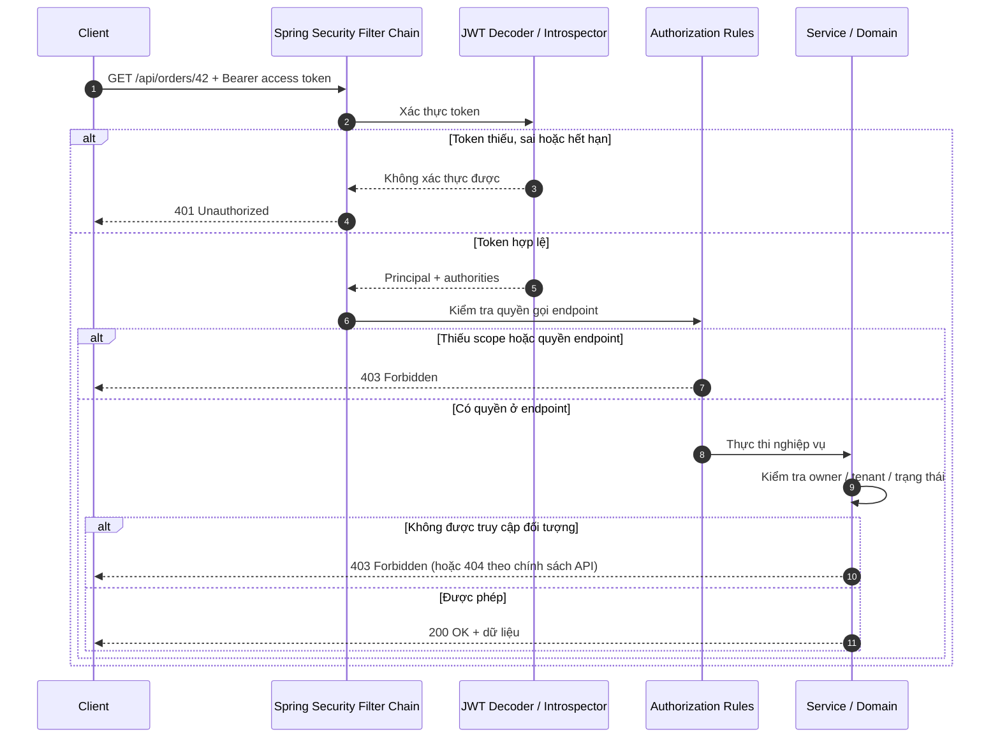

# Xác thực token và phân quyền đối với tài nguyên là hai bước khác nhau

Trong Spring Security OAuth 2.0 Resource Server, một request mang `Bearer` token có thể **vượt qua bước xác thực** nhưng vẫn **bị từ chối truy cập tài nguyên**. Đó là hành vi đúng: xác thực token (*authentication*) và phân quyền (*authorization*) trả lời hai câu hỏi khác nhau.

- **Xác thực:** Token này có hợp lệ, có đến từ bên phát hành được tin cậy và có thể dùng để xác lập danh tính/ngữ cảnh bảo mật cho request hay không?
- **Phân quyền:** Với ngữ cảnh bảo mật đã được xác lập, chủ thể này có được thực hiện **hành động cụ thể** trên **tài nguyên cụ thể** hay không?

Ví dụ, một access token đã được ký hợp lệ, chưa hết hạn và có scope `orders.read` có thể cho phép người dùng gọi API đọc đơn hàng. Tuy nhiên, nếu đơn hàng `42` thuộc về người dùng khác, ứng dụng vẫn phải từ chối. **Token hợp lệ không đồng nghĩa với quyền truy cập mọi dữ liệu.**

## 1. Resource Server đứng ở đâu trong OAuth 2.0 và OIDC?

Trong kiến trúc thường gặp:

| Thành phần | Trách nhiệm chính |
| --- | --- |
| **Client** (web, mobile, backend) | Nhận access token qua một OAuth 2.0 flow phù hợp rồi gửi request đến API. |
| **Authorization Server / OpenID Provider** | Xác thực người dùng khi cần, cấp token, công bố khóa công khai hoặc cung cấp introspection endpoint. |
| **Resource Server** (ứng dụng Spring Boot API) | Xác thực access token nhận được và áp dụng chính sách truy cập tài nguyên. |
| **Tài nguyên nghiệp vụ** | Đơn hàng, tài khoản, hồ sơ, báo cáo, dữ liệu theo tenant… mà chính sách phải bảo vệ. |

Request đến Resource Server thường có dạng:

```http
GET /api/orders/42 HTTP/1.1
Host: api.example.com
Authorization: Bearer <access-token>
```

Resource Server **không cần trực tiếp xử lý màn hình đăng nhập** để bảo vệ API. Nó nhận access token được Client gửi tới, xác minh token theo cấu hình rồi quyết định request được phép làm gì.

> **Phân biệt quan trọng trong OIDC:** `ID Token` chủ yếu dùng để Client xác minh thông tin phiên đăng nhập của người dùng. Resource Server phải kiểm tra **access token dành cho API của mình**. Không nên mặc nhiên chấp nhận ID Token thay access token chỉ vì cả hai có thể được biểu diễn dưới dạng JWT và đều có chữ ký hợp lệ.

## 2. Bước thứ nhất: xác thực access token

Khi API được cấu hình làm OAuth 2.0 Resource Server, Spring Security tích hợp xử lý Bearer token trong chuỗi security filter. Với cấu hình JWT, luồng xử lý khái quát là:

1. Đọc token từ header `Authorization: Bearer ...`.
2. Giải mã và kiểm tra chữ ký JWT bằng khóa công khai đáng tin cậy lấy từ cấu hình/JWK Set của issuer.
3. Kiểm tra các điều kiện hợp lệ như thời gian (`exp`, `nbf`) và `iss`; kiểm tra `aud` nếu API yêu cầu và đã cấu hình chính sách audience phù hợp.
4. Chuyển các claim hợp lệ thành một `Authentication` (thường là `JwtAuthenticationToken`) có principal và các `GrantedAuthority`.
5. Đặt `Authentication` vào `SecurityContext` của request, để bước phân quyền có dữ liệu ra quyết định.

Với opaque token (chuỗi không tự mang các claim có thể đọc như JWT), Resource Server thường gọi **introspection endpoint** của Authorization Server để xác định token có đang active hay không và nhận metadata/authority tương ứng. Cơ chế xác thực khác nhau, nhưng **bước phân quyền vẫn cần thiết sau đó**.

### JWT hợp lệ nghĩa là gì?

Một JWT minh họa có payload như sau (đây chỉ là các claim, **không phải token thực có thể sử dụng**):

```json
{
  "iss": "https://login.example.com/realms/shop",
  "sub": "user-123",
  "aud": ["orders-api"],
  "exp": 1790000000,
  "nbf": 1789990000,
  "scope": "orders.read orders.write",
  "roles": ["CUSTOMER"],
  "tenant_id": "tenant-a"
}
```

Các claim có vai trò khác nhau:

| Claim | Ý nghĩa khi API xử lý token |
| --- | --- |
| `iss` | Định danh bên phát hành; API phải tin cậy đúng issuer. |
| `sub` | Định danh chủ thể; thường được dùng làm `Authentication.getName()` với JWT mặc định. |
| `exp`, `nbf` | Giới hạn thời điểm token được phép sử dụng. |
| `aud` | Bên nhận dự kiến của token; giúp tránh dùng token cấp cho dịch vụ khác để gọi API này. |
| `scope` hoặc `scp` | Các phạm vi quyền đã được cấp, thường được chuyển thành authority có tiền tố `SCOPE_`. |
| `roles`, `tenant_id` | Claim riêng theo hệ thống; **không tự động** trở thành mọi quy tắc phân quyền cần thiết. |

Đừng đánh đồng **đọc được nội dung JWT** với **đã xác thực JWT**: payload JWT thường chỉ được mã hóa Base64URL, nên bất kỳ ai có chuỗi token đều có thể giải mã để xem. API chỉ được tin các claim **sau khi** đã xác minh chữ ký và thực hiện các validation bắt buộc.

### Vì sao audience quan trọng?

Giả sử hệ thống có hai API: `orders-api` và `payments-api`. Token có `aud: ["orders-api"]` có thể hợp lệ về chữ ký và thời gian, nhưng `payments-api` vẫn phải từ chối token đó nếu không được phát hành cho `payments-api`. Nếu không kiểm tra audience phù hợp, một token từ cùng issuer có nguy cơ bị dùng sai nơi nhận.

Đối với Resource Server JWT, cấu hình `issuer-uri` giúp Spring Security kiểm tra issuer, chữ ký và thời gian theo các validator mặc định. **Không nên mặc định suy ra audience đã được kiểm tra đúng ý định nghiệp vụ**; cần cấu hình validator audience hoặc thuộc tính audience được phiên bản Spring Boot đang sử dụng hỗ trợ.

## 3. Bước thứ hai: phân quyền hành động và tài nguyên

Sau khi token được xác thực, Resource Server mới có cơ sở đánh giá một chính sách như:

- User đã đăng nhập có được gọi endpoint này không (`authenticated()`)?
- Token có scope phù hợp để đọc hoặc ghi (`SCOPE_orders.read`, `SCOPE_orders.write`)?
- Chủ thể có vai trò nghiệp vụ phù hợp (`ROLE_ADMIN` nếu ứng dụng đã ánh xạ role)?
- Đơn hàng này có thuộc chính chủ thể, cùng tổ chức/tenant, hoặc nằm trong phạm vi mà họ quản lý?
- Trạng thái tài nguyên có cho phép hành động không (ví dụ, không sửa đơn đã hoàn tất)?

Các câu hỏi cuối thường không thể trả lời bằng chữ ký JWT hoặc một scope tổng quát. Chúng yêu cầu dữ liệu nghiệp vụ và chính sách của chính Resource Server.

### Ba tầng thường gặp của authorization

| Tầng kiểm tra | Ví dụ | Nơi triển khai phù hợp |
| --- | --- | --- |
| **Endpoint** | Chỉ token có `orders.read` mới được gọi `GET /api/orders/**`. | `authorizeHttpRequests` trong `SecurityFilterChain`. |
| **Chức năng / phương thức** | Chỉ người có quyền `orders.write` mới được gọi nghiệp vụ cập nhật. | `@PreAuthorize`, `@PostAuthorize` hoặc kiểm tra trong service. |
| **Đối tượng / dữ liệu** | Người dùng chỉ được đọc đơn hàng của mình, trừ khi có quyền quản trị hợp lệ. | Chính sách ở service/domain, truy vấn theo chủ thể/tenant hoặc component kiểm tra ownership. |

Nếu chỉ bảo vệ endpoint bằng `authenticated()`, người dùng có token hợp lệ có thể đi tới nhiều chức năng hơn dự kiến. Nếu chỉ kiểm tra scope mà bỏ qua ownership/tenant, người dùng có thể đổi ID trong URL để truy cập dữ liệu của người khác. Đây là dạng rủi ro **Broken Object Level Authorization (BOLA/IDOR)**.

## 4. Hai bước nằm ở đâu trong một request?



Mũi tên **xác thực → phân quyền** thể hiện thứ tự tư duy. Một số thành phần authorization có thể xuất hiện nhiều nơi trong request (filter, method security, service). Điều quan trọng là mọi nơi quyết định quyền đều phải dựa trên ngữ cảnh bảo mật hợp lệ và chính sách tương ứng.

### Các tình huống dễ nhầm

| Tình huống | Xác thực token | Phân quyền | Kết quả thường gặp |
| --- | --- | --- | --- |
| Request không có Bearer token vào endpoint yêu cầu xác thực | Không thành công | Chưa thể cho phép | `401 Unauthorized` |
| JWT sai chữ ký, sai issuer hoặc hết hạn | Thất bại | Không xét quyền của token đó | `401 Unauthorized` |
| JWT hợp lệ, chỉ có `orders.read`, gọi API yêu cầu `orders.write` | Thành công | Không đủ authority | `403 Forbidden` |
| JWT hợp lệ, có `orders.read`, đọc đơn hàng của người khác | Thành công | Không được phép trên đối tượng | `403` hoặc `404` theo chính sách |
| JWT hợp lệ, đủ scope, đúng owner/tenant | Thành công | Được phép | `2xx` nếu nghiệp vụ xử lý thành công |

`401` thường có header `WWW-Authenticate: Bearer`; khi token lỗi có thể kèm `error="invalid_token"`. Với Bearer token đã xác thực nhưng thiếu quyền, response `403` có thể kèm thông tin `insufficient_scope` tùy cấu hình. Không nên dựa vào chuỗi lỗi cụ thể thay cho HTTP status và hợp đồng API đã công bố.

## 5. Cấu hình Resource Server JWT bằng Spring Security

Ví dụ dùng Spring Boot 3 và Spring Security 6 theo API cấu hình bằng `SecurityFilterChain`. Trước hết, thêm các dependency cần thiết:

```gradle
dependencies {
    implementation 'org.springframework.boot:spring-boot-starter-security'
    implementation 'org.springframework.boot:spring-boot-starter-oauth2-resource-server'
}
```

Cấu hình issuer của Authorization Server/OpenID Provider:

```yaml
spring:
  security:
    oauth2:
      resourceserver:
        jwt:
          issuer-uri: https://login.example.com/realms/shop
```

Issuer phải là địa chỉ thật tương ứng với token trong môi trường triển khai. Spring Security sử dụng metadata/JWK Set của bên phát hành để thiết lập việc xác minh JWT. Token vẫn phải thỏa mãn các kiểm tra hợp lệ của decoder.

### Bảo vệ API theo HTTP method và scope

```java
import org.springframework.context.annotation.Bean;
import org.springframework.context.annotation.Configuration;
import org.springframework.http.HttpMethod;
import org.springframework.security.config.Customizer;
import org.springframework.security.config.annotation.method.configuration.EnableMethodSecurity;
import org.springframework.security.config.annotation.web.builders.HttpSecurity;
import org.springframework.security.config.http.SessionCreationPolicy;
import org.springframework.security.web.SecurityFilterChain;

@Configuration
@EnableMethodSecurity
public class SecurityConfig {

    @Bean
    SecurityFilterChain apiSecurity(HttpSecurity http) throws Exception {
        return http
            .csrf(csrf -> csrf.disable())
            .sessionManagement(session -> session
                .sessionCreationPolicy(SessionCreationPolicy.STATELESS))
            .authorizeHttpRequests(auth -> auth
                .requestMatchers("/actuator/health").permitAll()
                .requestMatchers(HttpMethod.GET,
                    "/api/orders", "/api/orders/**")
                    .hasAuthority("SCOPE_orders.read")
                .requestMatchers(HttpMethod.POST,
                    "/api/orders", "/api/orders/**")
                    .hasAuthority("SCOPE_orders.write")
                .anyRequest().denyAll())
            .oauth2ResourceServer(oauth2 -> oauth2
                .jwt(Customizer.withDefaults()))
            .build();
    }
}
```

Điểm cần hiểu ở cấu hình này:

1. `oauth2ResourceServer(...jwt(...))` thiết lập **cơ chế xác thực Bearer JWT**. Nó không tự quy định mọi endpoint đều được đọc hoặc sửa.
2. `hasAuthority("SCOPE_orders.read")` là **quy tắc phân quyền**. JWT hợp lệ vẫn bị chặn nếu authority này không có.
3. Spring Security mặc định ánh xạ các giá trị scope từ claim `scope`/`scp` thành authority với tiền tố `SCOPE_`. Ví dụ scope `orders.read` tương ứng `SCOPE_orders.read`.
4. `anyRequest().denyAll()` đóng những endpoint chưa có chính sách rõ ràng trong ví dụ. Ứng dụng thực tế cần bổ sung các route hợp lệ và xử lý cả các HTTP method khác nếu sử dụng.
5. `STATELESS` phù hợp với API sử dụng Bearer token trên từng request. Ví dụ tắt CSRF vì giả định API **chỉ** được xác thực bằng Bearer token truyền tường minh trong header; nếu ứng dụng còn sử dụng cookie/session cho browser, phải đánh giá và cấu hình CSRF phù hợp thay vì sao chép việc tắt này.

Đây là chính sách ở **tầng endpoint**. Nó chưa kiểm tra đơn hàng nào thuộc người dùng nào.

### Kiểm tra audience của JWT

Nếu `orders-api` chỉ chấp nhận access token có audience `orders-api`, có thể tạo `JwtDecoder` với validator bổ sung:

```java
import java.util.List;

import org.springframework.context.annotation.Bean;
import org.springframework.context.annotation.Configuration;
import org.springframework.security.oauth2.core.DelegatingOAuth2TokenValidator;
import org.springframework.security.oauth2.core.OAuth2TokenValidator;
import org.springframework.security.oauth2.jwt.Jwt;
import org.springframework.security.oauth2.jwt.JwtClaimValidator;
import org.springframework.security.oauth2.jwt.JwtDecoder;
import org.springframework.security.oauth2.jwt.JwtValidators;
import org.springframework.security.oauth2.jwt.NimbusJwtDecoder;

@Configuration
public class JwtValidationConfig {

    private static final String ISSUER =
        "https://login.example.com/realms/shop";

    @Bean
    JwtDecoder jwtDecoder() {
        NimbusJwtDecoder decoder =
            NimbusJwtDecoder.withIssuerLocation(ISSUER).build();

        OAuth2TokenValidator<Jwt> defaultValidator =
            JwtValidators.createDefaultWithIssuer(ISSUER);

        OAuth2TokenValidator<Jwt> audienceValidator =
            new JwtClaimValidator<List<String>>(
                "aud", aud -> aud != null && aud.contains("orders-api"));

        decoder.setJwtValidator(new DelegatingOAuth2TokenValidator<>(
            defaultValidator, audienceValidator));
        return decoder;
    }
}
```

Validator này yêu cầu đúng issuer và audience, bên cạnh các kiểm tra mặc định như thời gian. Trong dự án thực tế, nên đặt các giá trị này vào cấu hình theo môi trường; nếu phiên bản Spring Boot đang dùng cung cấp cấu hình `audiences` tương ứng, có thể dùng cơ chế đó. Đừng bỏ các validation mặc định khi thêm validator riêng.

## 6. Có scope chưa chắc được xem mọi đơn hàng

Xét hai tài khoản `user-123` và `user-456`, mỗi người có access token hợp lệ với `orders.read`. API `GET /api/orders/42` chỉ nên thành công nếu người gọi được quyền đọc **đơn hàng 42**, dù cả hai token đều có scope giống nhau.

Một cách triển khai là thực hiện kiểm tra quyền ở tầng service sau khi tải đối tượng:

```java
import org.springframework.http.HttpStatus;
import org.springframework.security.access.AccessDeniedException;
import org.springframework.security.access.prepost.PreAuthorize;
import org.springframework.security.core.Authentication;
import org.springframework.stereotype.Service;
import org.springframework.web.server.ResponseStatusException;

@Service
public class OrderService {

    private final OrderRepository repository;

    public OrderService(OrderRepository repository) {
        this.repository = repository;
    }

    @PreAuthorize("hasAuthority('SCOPE_orders.read')")
    public OrderDto getOrder(long orderId, Authentication authentication) {
        Order order = repository.findById(orderId)
            .orElseThrow(() ->
                new ResponseStatusException(HttpStatus.NOT_FOUND));

        String callerSubject = authentication.getName();
        if (!order.getOwnerSubject().equals(callerSubject)) {
            throw new AccessDeniedException("Order access denied");
        }

        return OrderDto.from(order);
    }
}
```

`OrderRepository`, `Order` và `OrderDto` là các kiểu nghiệp vụ minh họa, cần được hiện thực trong ứng dụng. Controller truyền `Authentication` lấy từ ngữ cảnh request vào service, ví dụ:

```java
@GetMapping("/api/orders/{id}")
public OrderDto getOrder(@PathVariable long id,
                         Authentication authentication) {
    return orderService.getOrder(id, authentication);
}
```

`@EnableMethodSecurity` trong cấu hình trước đó kích hoạt `@PreAuthorize`. Annotation kiểm tra scope, còn câu lệnh so sánh `ownerSubject` kiểm tra quyền đối với **đơn hàng cụ thể**. Với JWT mặc định, `authentication.getName()` thường tương ứng claim `sub`; nếu hệ thống tùy biến principal, cần thống nhất cách lấy định danh người gọi.

Trong hệ thống nhiều tenant, nên kiểm tra **cả tenant** và quyền truy cập đối tượng. Chỉ so sánh ID người dùng có thể chưa đủ nếu dữ liệu được phân vùng theo tổ chức. Với API danh sách, hãy áp dụng điều kiện owner/tenant ngay trong truy vấn (ví dụ `findAllByTenantIdAndOwnerSubject(...)`) để tránh tải và trả dữ liệu ngoài phạm vi; không chỉ lọc kết quả sau khi đã trả response.

Có hệ thống chọn trả `404 Not Found` cho tài nguyên ngoài quyền truy cập để tránh tiết lộ sự tồn tại của bản ghi. Chính sách đó cần nhất quán với hợp đồng API và không làm mất kiểm tra quyền thực tế.

## 7. Scope và role khác nhau như thế nào?

Một Authorization Server có thể cấp token chứa `scope: "orders.read orders.write"` hoặc claim role như `roles: ["ADMIN"]`. Resource Server phải xác định rõ sẽ tin claim nào và ánh xạ chúng thành authority nào.

| Cách kiểm tra | Ý nghĩa | Lưu ý |
| --- | --- | --- |
| `hasAuthority("SCOPE_orders.read")` | Token mang quyền OAuth scope `orders.read` đã được ánh xạ. | Ánh xạ scope thường có sẵn trong cấu hình JWT Resource Server. |
| `hasAuthority("ROLE_ADMIN")` | Người gọi có authority đúng chuỗi `ROLE_ADMIN`. | Phải có nguồn tin cậy và cơ chế ánh xạ role. |
| `hasRole("ADMIN")` | Kiểm tra authority `ROLE_ADMIN` theo tiền tố role mặc định. | Không tương đương với `SCOPE_ADMIN`. |
| Kiểm tra ownership/tenant | Có quyền với đúng đối tượng cần truy cập. | Cần dữ liệu nghiệp vụ và điều kiện phân quyền cụ thể. |

**Không phải cứ xuất hiện `roles` trong payload JWT là Spring Security sẽ tự chuyển thành `ROLE_*`.** Nếu role nằm trong claim riêng, cần cấu hình một `JwtAuthenticationConverter` có quy tắc ánh xạ rõ ràng. Ví dụ, khi issuer tin cậy phát hành claim `roles` dạng danh sách:

```java
import java.util.ArrayList;
import java.util.Collection;
import java.util.List;

import org.springframework.context.annotation.Bean;
import org.springframework.security.core.GrantedAuthority;
import org.springframework.security.core.authority.SimpleGrantedAuthority;
import org.springframework.security.oauth2.jwt.Jwt;
import org.springframework.security.oauth2.server.resource.authentication.JwtAuthenticationConverter;
import org.springframework.security.oauth2.server.resource.authentication.JwtGrantedAuthoritiesConverter;

@Bean
JwtAuthenticationConverter jwtAuthenticationConverter() {
    JwtGrantedAuthoritiesConverter scopeConverter =
        new JwtGrantedAuthoritiesConverter();

    JwtAuthenticationConverter converter = new JwtAuthenticationConverter();
    converter.setJwtGrantedAuthoritiesConverter((Jwt jwt) -> {
        Collection<GrantedAuthority> authorities =
            new ArrayList<>(scopeConverter.convert(jwt));

        List<String> roles = jwt.getClaimAsStringList("roles");
        if (roles != null) {
            for (String role : roles) {
                authorities.add(new SimpleGrantedAuthority("ROLE_" + role));
            }
        }
        return authorities;
    });
    return converter;
}
```

Gắn converter vào cấu hình Resource Server bằng `.jwt(jwt -> jwt.jwtAuthenticationConverter(jwtAuthenticationConverter()))`. Ví dụ trên chỉ áp dụng khi hợp đồng claim `roles` thực sự có dạng minh họa và issuer đáng tin cậy. Nếu provider đặt role ở vị trí khác (ví dụ object lồng nhau), cách đọc claim phải thay đổi. Cũng không nên gán role quản trị chỉ dựa trên một giá trị do client tự khai báo ở request.

Đối với một API, scope thường diễn đạt **quyền được cấp cho token/client**, còn role diễn đạt **vai trò của chủ thể trong ứng dụng**. Hai khái niệm có thể cùng tham gia authorization nhưng không thay thế việc kiểm tra quyền theo tài nguyên.

## 8. Cùng một token: bốn yêu cầu khác nhau

Giả sử `user-123` có JWT hợp lệ, `aud = orders-api` và scope `orders.read`; đơn `42` thuộc `user-123`, đơn `99` thuộc `user-456`.

```text
GET  /api/orders/42   + token hợp lệ, orders.read  -> Được phép -> 200
GET  /api/orders/99   + token hợp lệ, orders.read  -> Sai owner  -> 403/404
POST /api/orders      + token hợp lệ, orders.read  -> Thiếu write -> 403
GET  /api/orders/42   + token hết hạn             -> Token lỗi -> 401
```

Đây là các kết quả minh họa với giả định endpoint và dữ liệu đã được cấu hình như các phần trên. Với trường hợp request hợp lệ, status cuối cùng cũng phụ thuộc vào kết quả xử lý nghiệp vụ.

Có thể quan sát bằng `curl` (thay URL và token bằng giá trị môi trường thật):

```bash
# Không có token: endpoint bảo vệ thường trả 401.
curl -i https://api.example.com/api/orders/42

# Token được xác thực: tiếp tục qua phân quyền scope và ownership.
curl -i \
  -H "Authorization: Bearer ${ACCESS_TOKEN}" \
  https://api.example.com/api/orders/42
```

Để kiểm thử tầng authorization của Spring Security, `spring-security-test` cung cấp helper như `jwt()` trong MockMvc nhằm tạo ngữ cảnh JWT giả lập với authority chỉ định. Tuy nhiên, kiểm thử bằng `jwt()` **không chứng minh chữ ký/issuer/audience của token thật đã được decoder xác minh**. Việc kiểm chứng cấu hình decoder là một bài kiểm thử tích hợp riêng.

## 9. Các sai lầm thiết kế cần tránh

**Chỉ kiểm tra `isAuthenticated()`:** Điều này trả lời “có danh tính đã xác thực hay chưa”, không trả lời “được quyền sửa hoặc đọc dữ liệu này hay chưa”. Hãy áp dụng quyền theo hành động và quyền theo đối tượng.

**Coi scope rộng là quyền tuyệt đối:** `orders.read` thường chỉ là quyền *được yêu cầu đọc đơn hàng*. Nó không tự cấp quyền đọc mọi đơn hàng của mọi tenant. Cần định nghĩa chính xác phạm vi áp dụng của scope.

**Dùng ID Token để gọi API:** ID Token phục vụ ngữ cảnh đăng nhập của Client. API cần access token đúng loại, đúng issuer và audience được chấp nhận theo hợp đồng bảo mật.

**Chỉ decode payload mà không verify:** Một JWT có payload đọc được chưa chắc là JWT hợp lệ. Tuyệt đối không xây dựng phân quyền từ claim chưa được xác thực.

**Bỏ qua `aud` khi có nhiều API:** Chữ ký và issuer hợp lệ không đảm bảo token được cấp cho chính API đang nhận nó. Hãy dùng audience hoặc ràng buộc bên nhận tương đương theo token profile của hệ thống.

**Nhầm `SCOPE_` với `ROLE_`:** `hasRole("ADMIN")`, `hasAuthority("ROLE_ADMIN")` và `hasAuthority("SCOPE_admin")` kiểm tra những authority khác nhau. Chọn quy ước ánh xạ nhất quán.

**Giả định JWT bị thu hồi là hết hiệu lực ngay:** JWT tự chứa thường được kiểm tra cục bộ cho đến khi hết hạn; việc thu hồi sớm cần cơ chế bổ sung như TTL ngắn, denylist hoặc quy trình quản lý phiên/token phù hợp. Opaque token introspection có thể cho phép Authorization Server phản ánh trạng thái token khi được truy vấn, tùy chính sách cache và triển khai.

**Chỉ bảo vệ ở API Gateway:** Gateway có thể xác thực/lọc request đầu vào, nhưng mỗi Resource Server vẫn phải bảo vệ quyền đối với dữ liệu và không mặc nhiên tin mọi header danh tính do client gửi đến. Nếu có các service nội bộ, phải xác định trust boundary và cơ chế truyền/xác minh danh tính phù hợp.

## 10. Tự đối chiếu khi thiết kế một endpoint

Giả sử cần thêm `PATCH /api/orders/{id}/address`. Hãy lần lượt xác định:

1. **Token nào được chấp nhận?** Access token của issuer nào, dành cho audience nào, còn hạn và có chữ ký hợp lệ không?
2. **Hành động cần quyền gì?** Ví dụ `orders.write` để sửa địa chỉ, thay vì chỉ yêu cầu người dùng đã đăng nhập.
3. **Đối tượng nào được sửa?** Chủ đơn hàng, người được ủy quyền hoặc nhân viên có vai trò phù hợp; tenant có khớp không?
4. **Nghiệp vụ có cho sửa không?** Đơn đã giao hoặc hủy có được thay địa chỉ không?
5. **Trả lỗi thế nào?** Token thiếu/hỏng thường là `401`; token hợp lệ nhưng không có quyền là `403`; tài nguyên không tồn tại là `404` theo chính sách API.

Khi tách rõ các câu hỏi này, việc thay đổi nhà cung cấp danh tính, dạng token (JWT/opaque) hoặc role/scope sẽ ít làm lẫn logic xác thực với quyền truy cập nghiệp vụ.

**Điểm cần nhớ:** Resource Server trước hết phải có **access token đáng tin cậy** để thiết lập `Authentication`; sau đó mới áp dụng **authorization theo hành động, vai trò/scope và đối tượng dữ liệu**. Một token xác thực thành công chỉ mở đầu cho việc ra quyết định quyền truy cập, chứ không phải là quyết định cho phép cuối cùng.
