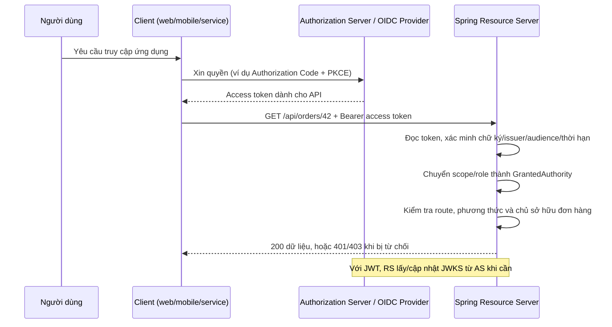

# Lộ trình từ API có bảo vệ đến xác minh, phân quyền và kiểm thử đầy đủ

Một **OAuth 2.0 Resource Server** trong Spring Security là ứng dụng cung cấp tài nguyên/API và chỉ trả dữ liệu khi yêu cầu mang thông tin truy cập hợp lệ. Khi sử dụng OpenID Connect (OIDC), một Identity Provider thường đồng thời đóng vai trò Authorization Server: xác thực người dùng, phát hành các loại token và công bố metadata cùng khóa công khai. Resource Server phải xác minh **access token** dành cho API của mình, chuyển thông tin trong token thành quyền, áp dụng quy tắc truy cập và kiểm thử các nhánh được phép/bị từ chối.

Bài học xây dựng một lộ trình có thể thực hành theo thứ tự: **API công khai → API yêu cầu xác thực → xác minh token → kiểm tra scope/role → kiểm tra quyền trên dữ liệu → kiểm thử HTTP và chữ ký thật → vận hành an toàn**. Ví dụ dùng Java 17+, Spring Boot 3.5.x và Spring Security 6.x. Tên miền, issuer, audience và token trong bài là giá trị minh họa; khi triển khai phải thay bằng cấu hình của Authorization Server thực tế.

## 1. Hiểu đường đi của một yêu cầu được bảo vệ



Ba vai trò cần phân biệt:

| Thành phần | Trách nhiệm | Không nên nhầm với |
|---|---|---|
| **Authorization Server / OIDC Provider** | Xác thực, xin sự đồng ý/cấp quyền, phát hành token; công bố issuer và JWKS. | Business API xử lý đơn hàng. |
| **Client** | Xin token bằng luồng OAuth thích hợp và gửi `Authorization: Bearer <access-token>`. | Resource Server tự đăng nhập thay client. |
| **Resource Server** | Xác minh token, xác định danh tính/quyền và bảo vệ tài nguyên. | Hệ thống phát hành token hoặc nơi giữ mật khẩu người dùng. |

OIDC thêm lớp **xác thực danh tính** dựa trên OAuth 2.0, trong đó `id_token` cung cấp thông tin phiên đăng nhập cho client. **Không dùng ID token thay access token để gọi API**: mục đích sử dụng và `aud` của hai loại token khác nhau. Resource Server cần access token mà Authorization Server dự định cấp cho API này.

Với **JWT access token**, Resource Server thường xác minh chữ ký cục bộ qua khóa công khai lấy từ JWKS. Với **opaque access token** (chuỗi không đọc được ở phía API), Resource Server phải gọi endpoint introspection của Authorization Server. Hai nhánh đều thực hiện xác thực token trước phân quyền, nhưng cách cấu hình và đặc tính vận hành khác nhau. Phần thực hành chính sử dụng JWT.

## 2. Chốt hợp đồng bảo mật trước khi viết cấu hình

Giả sử ta xây dựng `orders-api`. Mỗi đơn hàng có `ownerSub` là định danh chủ sở hữu (`sub`) trong token. Người dùng cần scope tương ứng để đọc/tạo đơn; quản trị viên cần role `ADMIN` để xem báo cáo. Bảng quyền là hợp đồng của API:

| Endpoint | Yêu cầu tối thiểu | Kiểm tra bổ sung | Kỳ vọng |
|---|---|---|---|
| `GET /api/public/ping` | Không cần token | Không | `200 OK` |
| `GET /api/me` | Access token hợp lệ | Không | `200 OK` và định danh `sub` |
| `POST /api/orders` | `orders:write` | Gán `ownerSub` từ token, không lấy từ request | `201 Created` |
| `GET /api/orders/{id}` | `orders:read` | Người gọi là chủ của đơn hàng | `200 OK` nếu được phép |
| `GET /api/admin/reports` | Role `ADMIN` | Về sau có thể thêm giới hạn tenant | `200 OK` |
| Đường dẫn khác | Từ chối theo mặc định | Không | `403` nếu đã xác thực nhưng không được phép; trường hợp chưa xác thực phụ thuộc điểm chặn |

Với các endpoint được bảo vệ, hai mã lỗi cốt lõi là:

- **401 Unauthorized**: chưa có Bearer token hợp lệ, token sai chữ ký/hết hạn/không được tin cậy hoặc không được dành cho API này. Header `WWW-Authenticate` có thể nêu lỗi Bearer.
- **403 Forbidden**: token hợp lệ, nhưng người gọi thiếu scope/role hoặc không có quyền trên tài nguyên cụ thể. Có thể chọn trả **404** để không tiết lộ tài nguyên tồn tại; cần áp dụng nhất quán.

Ví dụ token JWT đã giải mã có thể chứa các claim sau (đây chỉ là **payload minh họa**, không phải token dùng được):

```json
{
  "iss": "https://login.example.test/realms/lab",
  "sub": "alice",
  "aud": ["orders-api"],
  "scope": "orders:read orders:write",
  "roles": ["ADMIN"],
  "iat": 1890000000,
  "exp": 1890003600
}
```

Các điểm phải thống nhất với đội quản lý danh tính: `iss` chính xác; giá trị `aud` cho API; thuật toán ký và JWKS; tuổi thọ token; biểu diễn quyền qua `scope`/`scp`; nguồn role qua `roles`, `groups` hay claim riêng; định nghĩa `sub` cho người dùng và tài khoản dịch vụ. `roles` **không phải claim OAuth/OIDC chuẩn bắt buộc**: muốn sử dụng phải cấu hình Authorization Server phát hành và Resource Server đọc đúng claim. Một token có scope chưa chắc có role, và ngược lại.

### Mốc 1 — Có thể trả lời bốn câu hỏi

1. Ai phát hành access token và Resource Server tin cậy issuer nào?
2. Token có `aud` nào chứng minh nó được cấp cho `orders-api`?
3. Scope, role và quyền sở hữu đơn hàng được xác định từ đâu?
4. Token không hợp lệ, thiếu quyền và tài nguyên không thuộc người gọi sẽ trả gì?

## 3. Tạo API Spring Boot và bật xác thực JWT

Tạo ứng dụng Spring Boot với các dependency Maven sau (parent/BOM Spring Boot quản lý phiên bản):

```xml
<dependencies>
    <dependency>
        <groupId>org.springframework.boot</groupId>
        <artifactId>spring-boot-starter-web</artifactId>
    </dependency>
    <dependency>
        <groupId>org.springframework.boot</groupId>
        <artifactId>spring-boot-starter-security</artifactId>
    </dependency>
    <dependency>
        <groupId>org.springframework.boot</groupId>
        <artifactId>spring-boot-starter-oauth2-resource-server</artifactId>
    </dependency>
    <dependency>
        <groupId>org.springframework.boot</groupId>
        <artifactId>spring-boot-starter-validation</artifactId>
    </dependency>
    <dependency>
        <groupId>org.springframework.boot</groupId>
        <artifactId>spring-boot-starter-test</artifactId>
        <scope>test</scope>
    </dependency>
    <dependency>
        <groupId>org.springframework.security</groupId>
        <artifactId>spring-security-test</artifactId>
        <scope>test</scope>
    </dependency>
</dependencies>
```

Cấu hình `src/main/resources/application.yml`:

```yaml
server:
  port: 8080

spring:
  security:
    oauth2:
      resourceserver:
        jwt:
          issuer-uri: https://login.example.test/realms/lab
          audiences:
            - orders-api
```

`issuer-uri` cho Spring Security biết issuer được chấp nhận, đồng thời dùng metadata discovery để tìm JWKS endpoint của nhà phát hành. `audiences` yêu cầu JWT có đối tượng nhận là `orders-api`. Khi ứng dụng chạy với issuer thật, máy chủ phải truy cập được endpoint metadata/JWKS qua TLS. Với Authorization Server không hỗ trợ discovery hoặc muốn giảm phụ thuộc khởi động, có thể cấu hình thêm `jwk-set-uri` **cùng** `issuer-uri`; khi ấy vẫn cần kiểm tra `iss`, `aud` và các validator liên quan. Không lấy JWKS URL từ nội dung token do client tự gửi.

Đặt API ở trạng thái không lưu session xác thực; cho phép public endpoint, kiểm tra scope/role tại các tuyến còn lại và mặc định từ chối tuyến chưa được khai báo. `SecurityConfig.java`:

```java
package com.example.orders;

import java.util.ArrayList;
import java.util.Collection;
import java.util.List;

import org.springframework.context.annotation.Bean;
import org.springframework.context.annotation.Configuration;
import org.springframework.http.HttpMethod;
import org.springframework.security.config.Customizer;
import org.springframework.security.config.annotation.method.configuration.EnableMethodSecurity;
import org.springframework.security.config.annotation.web.builders.HttpSecurity;
import org.springframework.security.config.annotation.web.configurers.AbstractHttpConfigurer;
import org.springframework.security.config.http.SessionCreationPolicy;
import org.springframework.security.core.GrantedAuthority;
import org.springframework.security.core.authority.SimpleGrantedAuthority;
import org.springframework.security.oauth2.server.resource.authentication.JwtAuthenticationConverter;
import org.springframework.security.oauth2.server.resource.authentication.JwtGrantedAuthoritiesConverter;
import org.springframework.security.web.SecurityFilterChain;

@Configuration
@EnableMethodSecurity
public class SecurityConfig {

    @Bean
    SecurityFilterChain apiSecurity(HttpSecurity http,
                                    JwtAuthenticationConverter jwtConverter) throws Exception {
        return http
            .csrf(AbstractHttpConfigurer::disable)
            .sessionManagement(s -> s.sessionCreationPolicy(SessionCreationPolicy.STATELESS))
            .authorizeHttpRequests(auth -> auth
                .requestMatchers(HttpMethod.GET, "/api/public/ping").permitAll()
                .requestMatchers(HttpMethod.GET, "/api/me").authenticated()
                .requestMatchers(HttpMethod.POST, "/api/orders")
                    .hasAuthority("SCOPE_orders:write")
                .requestMatchers(HttpMethod.GET, "/api/orders/*")
                    .hasAuthority("SCOPE_orders:read")
                .requestMatchers(HttpMethod.GET, "/api/admin/reports")
                    .hasRole("ADMIN")
                .anyRequest().denyAll())
            .oauth2ResourceServer(oauth -> oauth.jwt(jwt ->
                jwt.jwtAuthenticationConverter(jwtConverter)))
            .build();
    }

    @Bean
    JwtAuthenticationConverter jwtConverter() {
        JwtGrantedAuthoritiesConverter scopes = new JwtGrantedAuthoritiesConverter();
        JwtAuthenticationConverter converter = new JwtAuthenticationConverter();

        converter.setJwtGrantedAuthoritiesConverter(jwt -> {
            Collection<GrantedAuthority> authorities =
                new ArrayList<>(scopes.convert(jwt));

            // Chỉ là hợp đồng demo: IdP phát hành roles: ["ADMIN"].
            List<String> roles = jwt.getClaimAsStringList("roles");
            if (roles != null && roles.contains("ADMIN")) {
                authorities.add(new SimpleGrantedAuthority("ROLE_ADMIN"));
            }
            return authorities;
        });
        return converter;
    }
}
```

Trong cấu hình trên:

- `oauth2ResourceServer().jwt()` bật Bearer authentication; Spring Security dùng `JwtDecoder` để kiểm tra token trước khi tạo `Authentication`.
- `JwtGrantedAuthoritiesConverter` mặc định đọc `scope` hoặc `scp` và đặt tiền tố `SCOPE_`: scope `orders:read` tạo quyền `SCOPE_orders:read`.
- `hasRole("ADMIN")` tương đương yêu cầu authority `ROLE_ADMIN`. Phần chuyển đổi `roles` phải phù hợp **claim đã ký, từ issuer tin cậy**, và chính sách cấp role thực tế; không được tin vào header/parameter `role` do client tự gửi.
- `@EnableMethodSecurity` cho phép thêm điều kiện quyền ngay tại phương thức, đặc biệt khi quyết định phụ thuộc dữ liệu.
- `denyAll()` giúp endpoint mới không vô tình trở thành public. Phải khai báo rõ health check, actuator, tài liệu API hoặc CORS nếu hệ thống cần.
- Việc tắt CSRF trong ví dụ phù hợp API **stateless chỉ dùng Bearer token qua Authorization header**, không tự động đúng cho ứng dụng đồng thời xác thực bằng cookie/session trong trình duyệt.

Không cần `formLogin`, trang đăng nhập hay `UserDetailsService` cho đường Bearer JWT này. Client thực hiện đăng nhập/ủy quyền với Authorization Server; API chỉ nhận và kiểm tra access token.

### Mốc 2 — Xác thực đúng trước khi phân quyền

Chưa cần viết nghiệp vụ phức tạp. Sau khi trỏ `issuer-uri` đến hệ thống thật, gửi request đến endpoint được bảo vệ mà không có Bearer token phải bị từ chối; gửi token đã ký đúng, chưa hết hạn, có `iss` và `aud` khớp mới vượt qua bước authentication. Nếu đây là token giả tự viết hoặc ID token dành cho client, API phải từ chối.

## 4. Thêm nghiệp vụ và quyền trên từng bản ghi

Ví dụ tối giản dưới đây lưu đơn hàng trong bộ nhớ để quan sát luồng bảo mật, không phải giải pháp lưu trữ production. Tạo `OrderApi.java` cùng package với `SecurityConfig`:

```java
package com.example.orders;

import java.util.Map;
import java.util.Optional;
import java.util.concurrent.ConcurrentHashMap;
import java.util.concurrent.atomic.AtomicLong;

import jakarta.validation.Valid;
import jakarta.validation.constraints.Min;
import jakarta.validation.constraints.NotBlank;
import org.springframework.http.HttpStatus;
import org.springframework.security.access.prepost.PreAuthorize;
import org.springframework.security.core.Authentication;
import org.springframework.security.oauth2.jwt.Jwt;
import org.springframework.security.oauth2.server.resource.authentication.JwtAuthenticationToken;
import org.springframework.security.core.annotation.AuthenticationPrincipal;
import org.springframework.stereotype.Component;
import org.springframework.web.bind.annotation.*;
import org.springframework.web.server.ResponseStatusException;

@RestController
@RequestMapping("/api")
class OrderApi {
    private final OrderStore store;

    OrderApi(OrderStore store) {
        this.store = store;
    }

    @GetMapping("/public/ping")
    Map<String, String> ping() {
        return Map.of("status", "ok");
    }

    @GetMapping("/me")
    Map<String, String> me(@AuthenticationPrincipal Jwt jwt) {
        return Map.of("subject", jwt.getSubject());
    }

    @PostMapping("/orders")
    @ResponseStatus(HttpStatus.CREATED)
    OrderView create(@Valid @RequestBody CreateOrderRequest request,
                     @AuthenticationPrincipal Jwt jwt) {
        // Lấy chủ sở hữu từ token đã xác thực, không lấy từ JSON đầu vào.
        return OrderView.from(store.create(jwt.getSubject(), request));
    }

    @GetMapping("/orders/{id}")
    @PreAuthorize("hasAuthority('SCOPE_orders:read') " +
                  "and @orderAccess.isOwner(#p0, authentication)")
    OrderView read(@PathVariable long id) {
        OrderData data = store.find(id)
            .orElseThrow(() -> new ResponseStatusException(HttpStatus.NOT_FOUND));
        return OrderView.from(data);
    }

    @GetMapping("/admin/reports")
    Map<String, Integer> report() {
        return Map.of("orderCount", store.count());
    }
}

record CreateOrderRequest(@NotBlank String sku, @Min(1) int quantity) { }
record OrderData(long id, String ownerSub, String sku, int quantity) { }
record OrderView(long id, String sku, int quantity) {
    static OrderView from(OrderData data) {
        return new OrderView(data.id(), data.sku(), data.quantity());
    }
}

@Component
class OrderStore {
    private final AtomicLong ids = new AtomicLong();
    private final Map<Long, OrderData> orders = new ConcurrentHashMap<>();

    OrderData create(String ownerSub, CreateOrderRequest request) {
        long id = ids.incrementAndGet();
        OrderData data = new OrderData(id, ownerSub, request.sku(), request.quantity());
        orders.put(id, data);
        return data;
    }

    Optional<OrderData> find(long id) {
        return Optional.ofNullable(orders.get(id));
    }

    int count() {
        return orders.size();
    }
}

@Component("orderAccess")
class OrderAccess {
    private final OrderStore store;

    OrderAccess(OrderStore store) {
        this.store = store;
    }

    public boolean isOwner(long id, Authentication authentication) {
        if (!(authentication instanceof JwtAuthenticationToken jwtAuth)) {
            return false;
        }
        String callerSub = jwtAuth.getToken().getSubject();
        return store.find(id)
            .map(order -> order.ownerSub().equals(callerSub))
            .orElse(false);
    }
}
```

**Hai lớp phân quyền phối hợp:** `SecurityFilterChain` yêu cầu scope trên route, còn `@PreAuthorize` kiểm tra chủ sở hữu của đúng bản ghi. Ví dụ chặn Alice đọc đơn của Bob ngay cả khi Alice có `orders:read`. `#p0` là đối số đầu tiên (`id`) của phương thức, tránh phụ thuộc tên parameter khi biên dịch; `authentication` là principal đã xác thực trong Spring Security.

Trong phiên bản demo, `isOwner` trả `false` cả khi không tìm thấy đơn nên phần lớn request đến ID không tồn tại bị từ chối `403` trước khi vào controller. Ở hệ thống thật, nếu muốn phản hồi `404` đồng nhất cho *không tồn tại* và *không có quyền*, cần thiết kế truy vấn có ràng buộc chủ sở hữu (ví dụ `findByIdAndOwnerSub`) tại tầng service/repository, dùng kết quả đó để quyết định và kiểm thử hành vi. Quy tắc **không lộ dữ liệu của người khác** quan trọng hơn việc chọn mã lỗi nào.

`ConcurrentHashMap` chỉ dùng để học; dữ liệu mất khi khởi động lại, không có transaction và thiếu các quy tắc nhất quán. Khi chuyển sang database, phải lọc theo người dùng/tenant **ở truy vấn nghiệp vụ**, không chỉ ẩn trường trong JSON trả về. Nếu API hỗ trợ đa tenant, kiểm tra cả `tenant_id` lấy từ ngữ cảnh đáng tin cậy; một role quản trị chung không tự động cho phép đọc mọi tenant.

### Mốc 3 — Đọc đúng dữ liệu, không chỉ đọc được endpoint

Tạo đơn khi là Alice, sau đó thử đọc cùng ID bằng token của Alice và Bob. Cả hai có thể có `orders:read`, nhưng chỉ Alice vượt qua `@orderAccess.isOwner(...)`. Nếu Bob đổi ID trong URL vẫn lấy được đơn của Alice thì phân quyền còn thiếu một lớp.

## 5. Gọi API bằng access token thật

Lấy token từ Authorization Server bằng luồng thích hợp cho từng loại client: **Authorization Code + PKCE** cho ứng dụng tương tác người dùng; **Client Credentials** cho giao tiếp giữa dịch vụ khi được cấp phép. Client Credentials đại diện cho **ứng dụng**, không mặc nhiên có quyền của một người dùng: các API yêu cầu chủ đơn theo `sub` phải xác định rõ có hỗ trợ tài khoản dịch vụ hay không.

Sau khi nhận access token hợp lệ từ IdP, thử các lệnh sau (thay `<ACCESS_TOKEN>` bằng token thật; ví dụ dùng cú pháp `curl`):

```bash
# Public: không cần Bearer token.
curl -i http://localhost:8080/api/public/ping

# Protected: thiếu token -> 401.
curl -i http://localhost:8080/api/me

# Có token hợp lệ -> 200; trả subject của token.
curl -i -H 'Authorization: Bearer <ACCESS_TOKEN>' \
  http://localhost:8080/api/me

# Cần orders:write để tạo đơn.
curl -i -X POST http://localhost:8080/api/orders \
  -H 'Authorization: Bearer <ACCESS_TOKEN>' \
  -H 'Content-Type: application/json' \
  -d '{"sku":"BOOK-01","quantity":2}'

# Cần orders:read VÀ đúng chủ sở hữu đơn số 1.
curl -i -H 'Authorization: Bearer <ACCESS_TOKEN>' \
  http://localhost:8080/api/orders/1
```

Khi chẩn đoán token, có thể đọc phần payload của JWT để quan sát `iss`, `aud`, `exp`, `scope`, `roles`, nhưng **giải mã Base64URL không phải xác minh chữ ký**. Không đưa token thật vào công cụ giải mã trực tuyến hoặc log. Kiểm tra token được cấp bởi đúng IdP và có audience của API; nhiều IdP cần cấu hình thêm resource/audience mapper mới phát hành `aud` mong muốn. `access_token` do client lấy được có thể là opaque, khi đó không thể dựa vào cấu trúc JWT để giải mã.

### Mốc 4 — Phân biệt rõ ba nguyên nhân lỗi

| Hiện tượng | Dấu hiệu | Hướng kiểm tra |
|---|---|---|
| `401` dù đã đính kèm token | Token không vượt qua authentication | Kiểm tra Bearer header, `iss`, `aud`, `exp`/`nbf`, chữ ký, JWKS, clock skew và loại token. |
| `403` ở `/api/orders/{id}` | Authentication thành công, quyền thất bại | Kiểm tra `scope`, `SCOPE_` mapping, `ownerSub`, `sub` và dữ liệu/tenant. |
| `403` ở `/api/admin/reports` | Thiếu `ROLE_ADMIN` | Kiểm tra claim vai trò do IdP phát hành và logic converter, tránh tự giả lập role trên client. |

## 6. Xác minh token: những gì API phải kiểm tra

Một JWT có ba phần `header.payload.signature`. Quy trình đáng tin cậy gồm **đọc Bearer token → chọn khóa tin cậy → xác minh chữ ký/thuật toán → kiểm tra các claim bắt buộc → xây dựng principal**. Chỉ sau đó mới xét quyền.

| Tiêu chí | Quy tắc an toàn | Nếu sai |
|---|---|---|
| Signature và thuật toán | Chỉ chấp nhận thuật toán được cấu hình, dùng khóa công khai từ JWKS của issuer tin cậy; không chấp nhận `alg=none` hay khóa do request tùy ý chỉ đến. | `401` |
| `iss` | Khớp chính xác issuer đã cấu hình; đừng ghép nhiều IdP khi chưa xác định trust boundary. | `401` |
| `aud` | Chứa identifier của API (`orders-api`), không chỉ của ứng dụng frontend. | `401` |
| `exp`, `nbf` | Token chưa hết hạn và đã có hiệu lực; cân nhắc clock skew hữu hạn. | `401` |
| `scope`/`scp`, role | Chỉ dùng quyền do issuer tin cậy phát hành và converter hợp lệ tạo ra. | Thường `403` nếu đã xác thực nhưng thiếu quyền |
| `sub`, `client_id`/`azp`, tenant | Phù hợp mô hình user token hay service token, kiểm tra owner/tenant trên nghiệp vụ. | `403` hoặc `404` theo hợp đồng API |

`issuer-uri` kết hợp `audiences` trong Spring Boot sẽ cấu hình các bước kiểm tra JWT phổ biến. Nếu **tự tạo** bean `JwtDecoder`, hãy nhớ gắn lại validator cho issuer, thời hạn và audience; việc cung cấp decoder tùy chỉnh có thể thay thế cơ chế auto-configuration. Ví dụ ghép validator riêng cho audience khi cần:

```java
OAuth2TokenValidator<Jwt> audienceValidator = jwt -> {
    if (jwt.getAudience().contains("orders-api")) {
        return OAuth2TokenValidatorResult.success();
    }
    return OAuth2TokenValidatorResult.failure(
        new OAuth2Error("invalid_token", "Audience không đúng", null));
};

NimbusJwtDecoder decoder = NimbusJwtDecoder.withPublicKey(trustedPublicKey).build();
decoder.setJwtValidator(new DelegatingOAuth2TokenValidator<>(
    JwtValidators.createDefaultWithIssuer("https://login.example.test/realms/lab"),
    audienceValidator));
```

Ở đoạn mã trên `trustedPublicKey` là `RSAPublicKey` **đã được cấu hình từ nguồn tin cậy**; đoạn này chỉ minh họa cách gắn validator, không thay thế toàn bộ cấu hình khai báo ở phần trước. Với JWT có `kid`, Resource Server sử dụng khóa tương ứng từ JWKS; khi IdP xoay vòng khóa, cần kiểm tra cache/refresh JWKS và giai đoạn các khóa cũ, mới cùng tồn tại.

**Giới hạn của JWT ngoại tuyến:** token còn hạn thường vẫn hợp lệ tại Resource Server dù phiên người dùng đã logout hoặc quyền vừa bị thu hồi, trừ khi kiến trúc có cơ chế bổ sung. Với yêu cầu thu hồi ngay, cân nhắc opaque token + introspection, thời hạn access token ngắn hoặc chiến lược revocation được thiết kế rõ. Không lưu private signing key của IdP trong Resource Server.

### Nhánh khác: opaque token

Khi Authorization Server phát hành opaque token, thay cơ chế JWT bằng introspection và cấp thông tin endpoint, client credential qua secret manager/biến môi trường:

```yaml
spring:
  security:
    oauth2:
      resourceserver:
        opaquetoken:
          introspection-uri: https://login.example.test/oauth2/introspect
          client-id: ${INTROSPECTION_CLIENT_ID}
          client-secret: ${INTROSPECTION_CLIENT_SECRET}
```

Cần đổi cấu hình security sang `oauth2ResourceServer(oauth -> oauth.opaqueToken(Customizer.withDefaults()))`, đồng thời điều chỉnh cách lấy principal/claims cho nhánh opaque. Nhánh này phát sinh một lời gọi qua mạng để kiểm tra token (trừ khi có cache được thiết kế), nên phải tính đến độ trễ, lỗi mạng và chính sách khả dụng. Không bật cả hai nhánh tùy tiện chỉ để chấp nhận mọi token.

## 7. Kiểm thử nhiều lớp: từ HTTP đến chữ ký thật

Kiểm thử đủ sâu phải chứng minh cả **được phép** lẫn **bị từ chối**. Không nên chỉ kiểm thử controller trả `200`: nhiều lỗi bảo mật nằm trong filter chain, validator hoặc kiểm tra quyền trên từng bản ghi.

### 7.1. Ma trận kiểm thử tối thiểu

| Tình huống | Token/quyền | Endpoint | Kết quả mong đợi |
|---|---|---|---|
| Public | Không token | `GET /api/public/ping` | `200` |
| Thiếu token | Không token | `GET /api/me` | `401` |
| Token giả/hỏng | Bearer không xác minh được | `GET /api/me` | `401` |
| Token hợp lệ | Bất kỳ quyền | `GET /api/me` | `200`, trả đúng `sub` |
| Thiếu scope tạo đơn | Chỉ `orders:read` | `POST /api/orders` | `403` |
| Đủ scope tạo đơn | `orders:write` | `POST /api/orders` | `201`, owner gán từ token |
| Thiếu scope đọc | Chỉ `orders:write` | `GET /api/orders/{id}` | `403` |
| Đủ scope, đúng owner | `orders:read`, `sub=alice` | Đơn của Alice | `200` |
| Đủ scope, sai owner | `orders:read`, `sub=bob` | Đơn của Alice | `403` theo ví dụ |
| Không có role admin | Token hợp lệ, không `ADMIN` | `GET /api/admin/reports` | `403` |
| Có role admin | Claim role được tin cậy: `ADMIN` | `GET /api/admin/reports` | `200` |
| Sai issuer/audience, hết hạn/chưa hiệu lực | JWT kiểm tra thất bại | Endpoint bảo vệ | `401` |
| Endpoint chưa khai báo | Token hợp lệ | Route khác | Bị từ chối theo policy |

### 7.2. Kiểm thử HTTP với MockMvc và `JwtDecoder` giả lập

`@SpringBootTest` + `@AutoConfigureMockMvc` đi qua Spring Security filter chain thật. `@MockitoBean` (Spring Framework 6.2 / Spring Boot 3.4+, phù hợp Boot 3.5.x trong bài) thay `JwtDecoder`: ta kiểm thử Bearer authentication, mapping quyền và routing nhanh, **không** kiểm thử mật mã hay discovery trong lớp test này.

```java
package com.example.orders;

import static org.mockito.Mockito.when;
import static org.springframework.test.web.servlet.request.MockMvcRequestBuilders.*;
import static org.springframework.test.web.servlet.result.MockMvcResultMatchers.*;

import java.time.Instant;
import java.util.List;

import com.fasterxml.jackson.databind.ObjectMapper;
import org.junit.jupiter.api.BeforeEach;
import org.junit.jupiter.api.Test;
import org.springframework.beans.factory.annotation.Autowired;
import org.springframework.boot.test.autoconfigure.web.servlet.AutoConfigureMockMvc;
import org.springframework.boot.test.context.SpringBootTest;
import org.springframework.http.MediaType;
import org.springframework.security.oauth2.jwt.BadJwtException;
import org.springframework.security.oauth2.jwt.Jwt;
import org.springframework.test.context.bean.override.mockito.MockitoBean;
import org.springframework.test.web.servlet.MockMvc;
import org.springframework.test.web.servlet.MvcResult;

@SpringBootTest
@AutoConfigureMockMvc
class OrdersSecurityHttpTest {
    @Autowired MockMvc mvc;
    @Autowired ObjectMapper json;
    @MockitoBean org.springframework.security.oauth2.jwt.JwtDecoder decoder;

    @BeforeEach
    void stubTokens() {
        when(decoder.decode("alice-write"))
            .thenReturn(jwt("alice-write", "alice", "orders:write", List.of()));
        when(decoder.decode("alice-read"))
            .thenReturn(jwt("alice-read", "alice", "orders:read", List.of()));
        when(decoder.decode("bob-read"))
            .thenReturn(jwt("bob-read", "bob", "orders:read", List.of()));
        when(decoder.decode("admin-token"))
            .thenReturn(jwt("admin-token", "admin", "", List.of("ADMIN")));
        when(decoder.decode("broken"))
            .thenThrow(new BadJwtException("Token bị từ chối"));
    }

    @Test
    void publicRouteAndMissingToken() throws Exception {
        mvc.perform(get("/api/public/ping"))
            .andExpect(status().isOk());
        mvc.perform(get("/api/me"))
            .andExpect(status().isUnauthorized());
    }

    @Test
    void invalidTokenIsUnauthorized() throws Exception {
        mvc.perform(get("/api/me").header("Authorization", "Bearer broken"))
            .andExpect(status().isUnauthorized());
    }

    @Test
    void validTokenRevealsOnlyAuthenticatedIdentity() throws Exception {
        mvc.perform(get("/api/me").header("Authorization", "Bearer alice-read"))
            .andExpect(status().isOk())
            .andExpect(jsonPath("$.subject").value("alice"));
    }

    @Test
    void creationNeedsWriteScope() throws Exception {
        String body = "{\"sku\":\"BOOK-01\",\"quantity\":2}";
        mvc.perform(post("/api/orders")
                .header("Authorization", "Bearer alice-read")
                .contentType(MediaType.APPLICATION_JSON).content(body))
            .andExpect(status().isForbidden());

        mvc.perform(post("/api/orders")
                .header("Authorization", "Bearer alice-write")
                .contentType(MediaType.APPLICATION_JSON).content(body))
            .andExpect(status().isCreated())
            .andExpect(jsonPath("$.sku").value("BOOK-01"));
    }

    @Test
    void readNeedsScopeAndMatchingOwner() throws Exception {
        MvcResult created = mvc.perform(post("/api/orders")
                .header("Authorization", "Bearer alice-write")
                .contentType(MediaType.APPLICATION_JSON)
                .content("{\"sku\":\"BOOK-02\",\"quantity\":1}"))
            .andExpect(status().isCreated()).andReturn();
        long id = json.readTree(created.getResponse().getContentAsString())
            .get("id").asLong();

        mvc.perform(get("/api/orders/{id}", id)
                .header("Authorization", "Bearer alice-write"))
            .andExpect(status().isForbidden()); // Thiếu orders:read.

        mvc.perform(get("/api/orders/{id}", id)
                .header("Authorization", "Bearer bob-read"))
            .andExpect(status().isForbidden()); // Đúng scope, sai owner.

        mvc.perform(get("/api/orders/{id}", id)
                .header("Authorization", "Bearer alice-read"))
            .andExpect(status().isOk())
            .andExpect(jsonPath("$.sku").value("BOOK-02"));
    }

    @Test
    void adminRoleIsRequired() throws Exception {
        mvc.perform(get("/api/admin/reports")
                .header("Authorization", "Bearer alice-read"))
            .andExpect(status().isForbidden());
        mvc.perform(get("/api/admin/reports")
                .header("Authorization", "Bearer admin-token"))
            .andExpect(status().isOk());
    }

    private static Jwt jwt(String value, String sub, String scope, List<String> roles) {
        Instant now = Instant.now();
        return Jwt.withTokenValue(value)
            .header("alg", "RS256")
            .claim("iss", "https://login.example.test/realms/lab")
            .claim("aud", List.of("orders-api"))
            .claim("sub", sub)
            .claim("scope", scope)
            .claim("roles", roles)
            .issuedAt(now)
            .expiresAt(now.plusSeconds(300))
            .build();
    }
}
```

Trong các test này, chuỗi `alice-read`, `bob-read` chỉ là khóa để Mockito trả về một đối tượng `Jwt` đã dựng sẵn; chúng **không phải Bearer JWT hợp lệ ngoài đời**. Test chứng minh pipeline Spring Security và business rule đang nối đúng, nhưng không phát hiện lỗi kiểm tra issuer, audience, chữ ký hoặc khóa. Dùng riêng một tầng test với **JWT ký thật** để đóng khoảng trống đó.

### 7.3. Kiểm thử decoder với JWT ký bằng khóa RSA thử nghiệm

Trong bài test mật mã, sinh cặp khóa RSA tại thời điểm test, ký token bằng private key và đưa **chỉ public key** vào decoder. Như vậy test không phụ thuộc mạng hay tài khoản IdP. Ví dụ một negative test cho `aud` (các import theo Spring Security 6.x, Nimbus JOSE được starter JWT cung cấp):

```java
package com.example.orders;

import static org.junit.jupiter.api.Assertions.assertThrows;

import java.security.KeyPair;
import java.security.KeyPairGenerator;
import java.security.interfaces.RSAPrivateKey;
import java.security.interfaces.RSAPublicKey;
import java.time.Instant;
import java.util.List;

import com.nimbusds.jose.jwk.JWKSet;
import com.nimbusds.jose.jwk.RSAKey;
import com.nimbusds.jose.jwk.source.ImmutableJWKSet;
import org.junit.jupiter.api.Test;
import org.springframework.security.oauth2.core.DelegatingOAuth2TokenValidator;
import org.springframework.security.oauth2.core.OAuth2Error;
import org.springframework.security.oauth2.core.OAuth2TokenValidator;
import org.springframework.security.oauth2.core.OAuth2TokenValidatorResult;
import org.springframework.security.oauth2.jose.jws.SignatureAlgorithm;
import org.springframework.security.oauth2.jwt.*;

class JwtSignatureAndClaimsTest {
    private static final String ISSUER = "https://login.example.test/realms/lab";

    @Test
    void jwtWithValidSignatureButWrongAudienceIsRejected() throws Exception {
        KeyPairGenerator generator = KeyPairGenerator.getInstance("RSA");
        generator.initialize(2048);
        KeyPair keys = generator.generateKeyPair();
        RSAPublicKey publicKey = (RSAPublicKey) keys.getPublic();

        RSAKey signingKey = new RSAKey.Builder(publicKey)
            .privateKey((RSAPrivateKey) keys.getPrivate())
            .keyID("test-key")
            .build();
        NimbusJwtEncoder encoder = new NimbusJwtEncoder(
            new ImmutableJWKSet<>(new JWKSet(signingKey)));

        NimbusJwtDecoder decoder = NimbusJwtDecoder.withPublicKey(publicKey).build();
        OAuth2TokenValidator<Jwt> audience = token ->
            token.getAudience().contains("orders-api")
                ? OAuth2TokenValidatorResult.success()
                : OAuth2TokenValidatorResult.failure(
                    new OAuth2Error("invalid_token", "Sai audience", null));
        decoder.setJwtValidator(new DelegatingOAuth2TokenValidator<>(
            JwtValidators.createDefaultWithIssuer(ISSUER), audience));

        Instant now = Instant.now();
        JwtClaimsSet claims = JwtClaimsSet.builder()
            .issuer(ISSUER)
            .subject("alice")
            .audience(List.of("another-api"))
            .issuedAt(now)
            .expiresAt(now.plusSeconds(300))
            .claim("scope", "orders:read")
            .build();
        JwsHeader header = JwsHeader.with(SignatureAlgorithm.RS256)
            .keyId("test-key").build();
        String token = encoder.encode(JwtEncoderParameters.from(header, claims))
            .getTokenValue();

        assertThrows(JwtValidationException.class, () -> decoder.decode(token));
    }
}
```

Mở rộng cùng test fixture để xác nhận: chữ ký và các claim hợp lệ thì decode thành công; token ký bằng **private key khác** bị từ chối; `iss` sai bị từ chối; `exp` ở quá khứ bị từ chối; `nbf` ở tương lai bị từ chối; `aud` không chứa API bị từ chối; thuật toán ngoài chính sách bị từ chối. Khi thử thời gian, dùng khoảng lệch lớn hơn clock-skew mà validator cho phép để kết quả không phụ thuộc vài giây sai số đồng hồ.

Test với `NimbusJwtDecoder.withPublicKey(...)` chứng minh xác minh chữ ký và validator cục bộ, **chưa** chứng minh rằng ứng dụng lấy đúng JWKS của IdP. Bổ sung một integration test dùng JWKS HTTP server cục bộ (ví dụ WireMock): xuất public JWK tại URL cấu hình; phát token ký khớp `kid`; sau đó thay `kid`/khóa và kiểm tra hành vi refresh/rotation. Test staging với Authorization Server thực sẽ xác nhận discovery, `issuer-uri`, mapping `aud`, claim `scope` và chính sách phát hành token.

### 7.4. Kịch bản end-to-end với Authorization Server thật

Thực hành theo thứ tự để tách vấn đề:

1. Client nhận **access token** thông qua luồng OAuth được IdP hỗ trợ; xác nhận có `iss`, `aud`, scope dự kiến và token còn hạn.
2. Không kèm token gọi `/api/me`: nhận `401`. Kèm token đúng: nhận `200`, `subject` trùng `sub`.
3. Dùng token chỉ có `orders:read` gọi tạo đơn: nhận `403`; cấp `orders:write` và tạo đơn: nhận `201`.
4. Dùng `orders:read` của đúng chủ đọc đơn đã tạo: nhận `200`; đổi sang token của người dùng khác: nhận phản hồi từ chối theo hợp đồng.
5. Dùng token người dùng bình thường gọi báo cáo: nhận `403`; dùng token được cấp role `ADMIN`: nhận `200`.
6. Thử token của **issuer khác**, token có `aud` cho ứng dụng khác, token hết hạn và token có chữ ký không hợp lệ: tất cả phải bị từ chối ở authentication.
7. Nếu hệ thống đa tenant, lặp lại kịch bản với hai tenant. Nếu dùng browser, kiểm tra CORS preflight `OPTIONS` và nguồn origin được phép; CORS không thay cho authentication.
8. Nếu dùng JWKS, kiểm tra thay khóa ký theo kế hoạch rotation; nếu dùng introspection, kiểm tra token không còn active và hành vi khi introspection endpoint lỗi.

Trong môi trường kiểm thử, nên có các identity riêng cho user A, user B, admin và service account; gán quyền thông qua cấu hình Authorization Server thực tế. Đừng kiểm chứng phân quyền bằng cách tự sửa payload JWT không ký lại: sửa một byte payload phải làm chữ ký không hợp lệ và dẫn tới `401`.

## 8. Đưa ra môi trường thực tế và giữ an toàn khi vận hành

Sau khi các mốc chức năng chạy đúng, kiểm tra các khía cạnh thường bị bỏ sót:

| Khía cạnh | Việc cần làm |
|---|---|
| HTTPS/TLS | Bắt buộc HTTPS giữa client, API và IdP; không gửi Bearer token trên HTTP công cộng. |
| Secrets | Resource Server xác minh JWT bằng public key; bảo vệ client secret nếu có introspection và không commit secret vào repo. |
| Log | Ghi request ID, endpoint, trạng thái 401/403 và lý do ở mức an toàn; không ghi access token/refresh token hoặc dữ liệu nhạy cảm. |
| Key rotation | Đảm bảo `kid`, JWKS cache và lịch overlap khóa cho phép token cũ còn hạn hoạt động theo chính sách. |
| Time/expiry | Đồng bộ đồng hồ, giới hạn clock skew; xác định thời hạn token và nhu cầu thu hồi quyền sớm. |
| Tách quyền | Scope mô tả hành động, role mô tả nhóm quyền, ownership/tenant là điều kiện theo từng dữ liệu; không thay thế lẫn nhau. |
| Least privilege | Client chỉ xin scope cần thiết; API chỉ trả các trường cần thiết; admin bị giới hạn theo tenant/ngữ cảnh nếu cần. |
| Error handling | `401`/`403` nhất quán, không lộ token hoặc chi tiết private key; không biến lỗi xác thực thành `500`. |
| Monitoring | Theo dõi tỷ lệ 401/403 bất thường, lỗi JWKS/introspection, độ trễ xác thực; tránh log thông tin người dùng vượt nhu cầu. |
| Thay đổi hợp đồng | Khi đổi claim, `aud`, issuer hay scope, cập nhật cấu hình IdP, API, client và các bài test cùng đợt triển khai. |

Một số sai lầm đáng tránh:

- **Giải mã JWT rồi tin ngay claims**: việc đọc payload không kiểm tra chữ ký, issuer, audience hay thời hạn.
- **Chỉ kiểm tra `.authenticated()`**: token hợp lệ vẫn có thể không đủ scope, role hoặc quyền trên bản ghi.
- **Cho client gửi `ownerId`/`role` tùy ý**: thông tin sở hữu và quyền phải đến từ principal tin cậy và dữ liệu nghiệp vụ.
- **Đưa `permitAll()` hoặc matcher quá rộng lên trước route nhạy cảm**: thứ tự matcher có thể tạo khoảng trống truy cập; ưu tiên khai báo cụ thể và `denyAll` cuối.
- **Dùng ID token hoặc token dành cho một API khác**: sai audience làm sụp ranh giới tin cậy giữa các dịch vụ.
- **Tin `@WithMockUser`/`jwt()` test là đủ**: mock authentication giúp test authorization nhưng không kiểm tra chữ ký, metadata, JWKS và validator của hệ thống thật.
- **Nghĩ JWT logout là lập tức bị thu hồi**: verifier cục bộ không tự biết trạng thái phiên hoặc quyền mới nhất nếu không có cơ chế bổ sung.
- **Tắt CSRF một cách máy móc**: API dùng cookie/session cần phân tích CSRF riêng, kể cả khi cũng hỗ trợ OAuth.

## 9. Lộ trình triển khai theo mốc bàn giao

| Mốc | Phần hoàn thành | Minh chứng cụ thể |
|---|---|---|
| **A. API có ranh giới** | Endpoint public và protected, mặc định chặn route khác | `ping` trả `200`, `/me` không token trả `401` |
| **B. Tin đúng token** | JWT Resource Server, issuer/JWKS, audience và hạn dùng | Token đúng vào được; token sai `iss`/`aud`/chữ ký bị `401` |
| **C. Quyền hành động** | Scope `orders:read`, `orders:write`; role `ADMIN` | Thiếu scope/role bị `403`, đủ quyền vượt qua filter |
| **D. Quyền dữ liệu** | So sánh `sub` với owner; bổ sung tenant nếu có | User B không thể đọc/sửa đơn User A chỉ bằng đổi ID |
| **E. Kiểm thử nhiều tầng** | MockMvc, decoder với JWT ký thật, JWKS/IdP integration | Ma trận positive/negative được thực thi tự động và qua staging |
| **F. Vận hành** | HTTPS, secret management, monitoring, key rotation, chiến lược revocation | Triển khai thử có quan sát lỗi authn/authz và xoay vòng khóa an toàn |

Làm theo đúng thứ tự giúp mỗi lỗi có phạm vi khoanh vùng rõ: **không có token** là chuyện authentication, **token sai chữ ký/issuer/audience** là chuyện trust và validation, **token đúng nhưng thiếu scope/role** là authorization trên hành động, còn **đúng scope nhưng đọc nhầm dữ liệu người khác** là authorization trên đối tượng. Một Resource Server hoàn chỉnh phải kiểm soát cả bốn lớp và có test chứng minh từng lớp.
