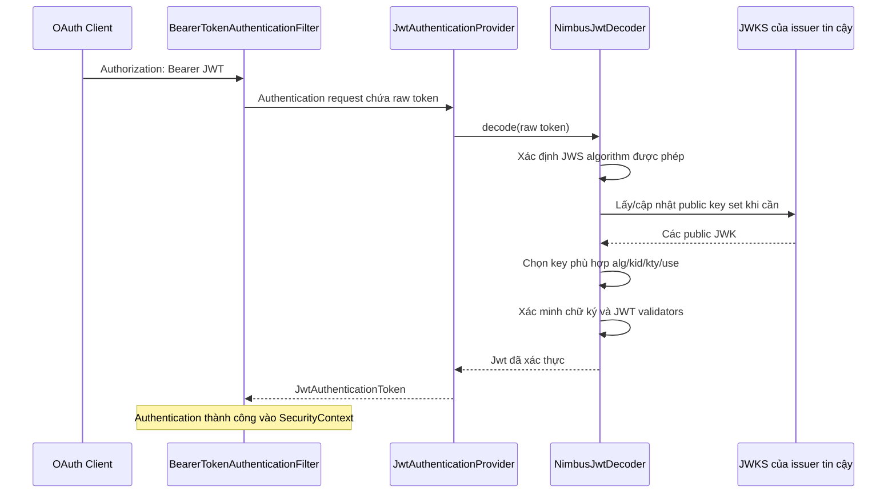

# JWK Set, loại khóa, mục đích dùng khóa và thuật toán

## 1. Vị trí của JWK trong Spring Security OAuth 2.0 Resource Server

Khi một API sử dụng **Spring Security OAuth 2.0 Resource Server** để tiếp nhận **JWT access token**, API cần xác minh chữ ký trước khi tin các claim như `sub`, `scope`, `aud` hoặc `roles`. Với JWT được ký bằng thuật toán bất đối xứng như `RS256` hoặc `ES256`, Authorization Server giữ **private key** để ký, còn Resource Server dùng **public key** tương ứng để xác minh.

**JSON Web Key (JWK)** là cách biểu diễn một khóa mật mã dưới dạng JSON. **JSON Web Key Set (JWKS)** là tài liệu JSON chứa **một mảng các JWK**. Authorization Server/OpenID Provider thường công bố JWKS qua HTTPS để Resource Server và OIDC Client lấy các khóa công khai dùng xác minh chữ ký.

Ví dụ đường đi:

```text
Authorization Server / OpenID Provider
  |
  | 1. Giữ private signing key
  | 2. Ký access token (JWS)
  | 3. Công bố các public JWK tại jwks_uri
  |
  +------ JWT: header { alg: "RS256", kid: "signing-2026-b" }
  |                      |
  |                      v
  |                Client gọi API
  |                      |
  |                      v
  |              Spring Resource Server
  |                      |
  +------ JWKS ----------+--> Tìm public key ứng viên
                                |
                                v
                         Xác minh chữ ký JWT
                                |
                                v
                         Kiểm tra issuer,
                         audience, lifetime,
                         loại access token
                                |
                                v
                         Kiểm tra scope và
                         quyền trên tài nguyên
```

Trong quá trình này, ba nhóm dữ liệu có vai trò riêng:

- **JWK/JWKS** mô tả **khóa nào có thể dùng để xác minh**, cùng thông tin về loại khóa và cách sử dụng.
- **JOSE header** của JWT thường chứa `alg` (thuật toán chữ ký), `kid` (key ID) và có thể có `typ` (loại token). Header giúp bộ xác minh chọn phép toán và khóa ứng viên.
- **JWT claims** như `iss`, `aud`, `exp`, `scope` xác định ai cấp token, token dành cho API nào, còn hiệu lực không và có quyền nào. Các claim chỉ có giá trị tin cậy **sau khi xác thực thành công**.

**Không được nhầm “đã tìm thấy khóa có `kid` phù hợp” với “chữ ký đã được xác minh”.** Chọn khóa chỉ là bước chuẩn bị. Resource Server vẫn phải thực hiện phép xác minh mật mã và kiểm tra hợp đồng access token.

## 2. JWK, JWKS, JWS, JWE và JWT liên hệ ra sao?

| Khái niệm | Vai trò | Ví dụ liên quan |
|---|---|---|
| **JWT — JSON Web Token** | Biểu diễn tập claims; có thể được bảo vệ bằng JWS hoặc JWE | Access token có các claim `iss`, `aud`, `exp` |
| **JWS — JSON Web Signature** | Ký/MAC nội dung để kiểm tra toàn vẹn và nguồn gốc mật mã | JWT dạng ba phần `header.payload.signature` |
| **JWE — JSON Web Encryption** | Mã hóa nội dung nhằm bảo vệ tính bí mật | JWT được mã hóa, dạng Compact Serialization thường có năm phần |
| **JWK — JSON Web Key** | Biểu diễn **một khóa** trong JSON | RSA public key có `kty`, `n`, `e` |
| **JWKS — JSON Web Key Set** | Chứa **nhiều JWK** trong `keys` | JWKS chứa khóa ký hiện tại và khóa ký cũ trong thời gian rotation |
| **JOSE header** | Chỉ dẫn xử lý JWS/JWE | `alg`, `kid`, `typ` trong token |

Đặc biệt, **JWK không phải JWT**. JWK là dữ liệu khóa, còn JWT là dữ liệu token/claims. Một Resource Server không kiểm tra quyền bằng cách đọc `scope` trong JWKS; JWKS không được thiết kế để chứa quyền của người dùng.

Ví dụ JWT được ký bằng JWS Compact Serialization:

```text
BASE64URL(UTF8(protected header))
.
BASE64URL(UTF8(JWT claims JSON))
.
BASE64URL(signature)
```

Header được giải mã có thể là:

```json
{
  "alg": "RS256",
  "kid": "signing-2026-b",
  "typ": "at+jwt"
}
```

Header và payload JWS có thể được đọc bằng Base64URL, nhưng **đọc được không đồng nghĩa đã kiểm tra chữ ký**. Token giả có thể tự khai `alg` và `kid` trông hợp lý. Chỉ khi xác minh bằng khóa và thuật toán **được cấu hình tin cậy**, Resource Server mới được sử dụng claims để tạo `Authentication`.

## 3. Cấu trúc của một JWK Set

Tài liệu JWKS là JSON object với trường `keys` chứa **mảng JWK**. Ví dụ minh họa cho một Authorization Server có hai public RSA signing keys:

```json
{
  "keys": [
    {
      "kty": "RSA",
      "kid": "signing-2026-a",
      "use": "sig",
      "alg": "RS256",
      "n": "PUBLIC_RSA_MODULUS_A_BASE64URL_PLACEHOLDER",
      "e": "AQAB"
    },
    {
      "kty": "RSA",
      "kid": "signing-2026-b",
      "use": "sig",
      "alg": "RS256",
      "n": "PUBLIC_RSA_MODULUS_B_BASE64URL_PLACEHOLDER",
      "e": "AQAB"
    }
  ]
}
```

Hai giá trị `n` ở đây là **placeholder không phải Base64URL hợp lệ của khóa RSA**; ví dụ nhằm minh họa cấu trúc, không dùng để tạo `JwtDecoder` thật. Các JWK công khai thực tế mang giá trị số và tọa độ được mã hóa đúng chuẩn, do thư viện tạo/quản lý khóa sinh ra.

Ý nghĩa:

- `keys` là một tập hợp, cho phép nhiều khóa cùng tồn tại.
- `kid` giúp nhận diện khóa ứng viên, đặc biệt khi issuer đang xoay khóa.
- `kty` chỉ **loại vật liệu khóa**, ở ví dụ này là RSA.
- `use` có thể gợi ý khóa dùng cho **chữ ký** (`sig`).
- `alg` có thể nêu **thuật toán dự kiến** phù hợp với khóa, ở đây là `RS256`.
- `n` và `e` là các thành phần **public RSA key**.

JWKS **không bắt buộc** chỉ chứa một khóa hoặc chỉ một `kty`. Tập khóa của issuer có thể chứa RSA, EC, OKP theo loại token/thuật toán mà issuer hỗ trợ. Resource Server phải giới hạn khóa nào có thể dùng theo **thuật toán, mục đích và issuer tin cậy**.

### JWKS endpoint thường được tìm ở đâu?

Metadata từ OIDC Discovery hoặc OAuth Authorization Server Metadata có thể cung cấp:

```json
{
  "issuer": "https://id.example.com/realms/shop",
  "jwks_uri": "https://id.example.com/realms/shop/protocol/openid-connect/certs"
}
```

Resource Server có thể lấy JWKS theo `jwks_uri`. Cần phân biệt:

- **Issuer URI:** định danh bên phát hành, dùng kiểm tra JWT `iss`.
- **Metadata endpoint:** nơi công bố `issuer`, `jwks_uri` và các endpoint của AS/OP.
- **JWKS URI:** nơi tải **tập khóa** phục vụ xác minh.

Không gán `issuer-uri` trực tiếp bằng `jwks_uri`, hoặc nhầm tài liệu metadata với tài liệu `{"keys":[...]}`.

## 4. Các trường metadata quan trọng của một JWK

Một JWK có các thành phần chung theo RFC 7517:

| Trường | Tên đầy đủ | Vai trò | Bắt buộc ở mọi JWK? |
|---|---|---|---|
| `kty` | Key Type | Xác định loại khóa, ví dụ `RSA`, `EC`, `oct`, hoặc `OKP` theo phần mở rộng | **Có** |
| `kid` | Key ID | Giúp nhận diện khóa trong một tập khóa | Không |
| `use` | Public Key Use | Mục đích cấp cao: `sig` hoặc `enc` | Không |
| `key_ops` | Key Operations | Tập thao tác được khai báo: `sign`, `verify`, `encrypt`, `decrypt`, ... | Không |
| `alg` | Algorithm | Thuật toán được khóa dự kiến sử dụng, ví dụ `RS256` | Không |
| `x5u` | X.509 URL | Liên kết một tài nguyên chứng thư X.509 | Không |
| `x5c` | X.509 Certificate Chain | Chuỗi chứng thư X.509 mã hóa Base64 DER | Không |
| `x5t` | X.509 Certificate SHA-1 Thumbprint | Dấu vân tay SHA-1 của chứng thư, sử dụng trong các profile phù hợp | Không |
| `x5t#S256` | X.509 Certificate SHA-256 Thumbprint | Dấu vân tay SHA-256 của chứng thư | Không |

Ngoài các trường chung, mỗi `kty` có thành phần riêng để biểu diễn khóa công khai hoặc khóa bí mật. Trong JWKS công khai của Authorization Server, thường xuất hiện **các thành phần công khai** đủ để kiểm tra chữ ký, không phải private key hay shared secret.

**Các trường `use`, `key_ops`, `alg` không phải giấy chứng nhận độc lập rằng khóa đáng tin.** Chúng là metadata đi kèm khóa; Resource Server vẫn cần tin **nguồn khóa**, giới hạn **thuật toán**, và xác thực chữ ký thực tế.

## 5. `kty`: loại khóa quyết định phép toán khả thi

`kty` mô tả dạng vật liệu khóa và những thao tác mật mã có thể được thực hiện. Các loại thường gặp:

| `kty` | Tên | Trường đặc trưng | Ứng dụng thường gặp |
|---|---|---|---|
| `RSA` | Khóa RSA | `n`, `e`; private key còn có các trường như `d`, `p`, `q` | Xác minh JWS `RS256`/`PS256` bằng public key |
| `EC` | Elliptic Curve key | `crv`, `x`, `y`; private key thêm `d` | JWS ECDSA như `ES256` |
| `OKP` | Octet Key Pair, theo RFC 8037 | `crv`, `x`; private key có thể thêm `d` | JWS `EdDSA` với Ed25519/Ed448; một số thuật toán trao đổi khóa dùng X25519/X448 |
| `oct` | Octet Sequence / symmetric key | `k` là key material dạng Base64URL | HMAC như `HS256`; các cơ chế mã hóa đối xứng |

**Cùng tên thuật toán ở JOSE header chưa đủ để xác định key hợp lệ**: key type, kích thước và các ràng buộc mật mã phải phù hợp. `RS256` dùng RSA key; `ES256` dùng EC key phù hợp với P-256; `HS256` dùng shared secret dạng `oct`. Một bộ xác minh không được lấy khóa RSA public key làm HMAC secret vì JWT yêu cầu `HS256`.

### 5.1. RSA JWK: `n` và `e`

Public RSA JWK có dạng:

```json
{
  "kty": "RSA",
  "kid": "rsa-signing-key",
  "use": "sig",
  "alg": "RS256",
  "n": "BASE64URL_ENCODED_RSA_MODULUS_PLACEHOLDER",
  "e": "AQAB"
}
```

- `n`: modulus RSA, được biểu diễn theo Base64URLUInt.
- `e`: public exponent RSA; `AQAB` thường biểu diễn số 65537.
- `d` và các thông số private như `p`, `q` dùng để tạo chữ ký hoặc phép toán private RSA, **không được công bố ở JWKS public**.

Trong hệ thống ký bất đối xứng:

```text
Authorization Server: RSA private key -> ký JWT
Resource Server:      RSA public key  -> xác minh JWT
```

Resource Server không cần có private signing key. Việc đưa private RSA key vào JWKS công khai có thể cho bất kỳ ai tạo chữ ký được chấp nhận, gây hậu quả nghiêm trọng.

### 5.2. EC JWK: `crv`, `x`, `y`

Ví dụ cấu trúc public EC JWK cho ECDSA P-256:

```json
{
  "kty": "EC",
  "kid": "ec-p256-signing",
  "use": "sig",
  "alg": "ES256",
  "crv": "P-256",
  "x": "BASE64URL_X_COORDINATE_PLACEHOLDER",
  "y": "BASE64URL_Y_COORDINATE_PLACEHOLDER"
}
```

- `crv` xác định elliptic curve, ví dụ `P-256`, `P-384`, `P-521`.
- `x` và `y` là tọa độ public point trên curve.
- Private EC JWK có thể chứa `d`; không đưa `d` vào JWKS công khai.
- `ES256` tương ứng ECDSA sử dụng P-256 và SHA-256; không ghép tùy tiện key P-384 với `ES256`.

Độ dài `x`/`y`, khả năng thuộc curve và phép toán chữ ký phải được thư viện JOSE xác minh. Không chỉ kiểm tra `kty=EC` rồi chấp nhận bất kỳ curve nào.

### 5.3. OKP JWK: Ed25519 khác X25519

Theo RFC 8037, `OKP` mô tả khóa kiểu octet key pair cho một số đường cong Edwards/Montgomery. Ví dụ public Ed25519 JWK:

```json
{
  "kty": "OKP",
  "kid": "ed25519-signing",
  "use": "sig",
  "alg": "EdDSA",
  "crv": "Ed25519",
  "x": "BASE64URL_PUBLIC_KEY_PLACEHOLDER"
}
```

Ed25519 thường gắn với chữ ký EdDSA; X25519 lại thường dùng cho **trao đổi/thiết lập khóa**, không tự trở thành public signing key để xác minh EdDSA. Cả hai có thể được biểu diễn qua `OKP`, nhưng giá trị `crv` và mục đích mật mã khác nhau.

Khả năng xử lý `OKP`/`EdDSA` của Spring Security, Nimbus JOSE và JDK có thể khác nhau theo phiên bản. Không coi việc thấy một JWK hợp lệ về JSON là bảo đảm rằng mọi `JwtDecoder` có thể sử dụng thuật toán đó.

### 5.4. `oct` JWK: khóa đối xứng phải được giữ bí mật

Ví dụ một symmetric JWK dùng HMAC:

```json
{
  "kty": "oct",
  "kid": "internal-hmac-1",
  "use": "sig",
  "alg": "HS256",
  "k": "BASE64URL_SHARED_SECRET_PLACEHOLDER"
}
```

`k` là **toàn bộ key material bí mật**, không phải public key. Vì thế **không công bố JWK `oct` chứa secret tại JWKS công khai**.

Với `HS256`, bên xác minh cần cùng secret với bên ký, và về mặt mật mã cũng có khả năng tạo MAC hợp lệ. Trong hệ thống có nhiều Resource Server, điều đó tạo ranh giới tin cậy khác hẳn RSA/EC public-key verification. Nếu các API không cần quyền ký token, dùng chữ ký bất đối xứng thường giúp giữ private signing key duy nhất tại Authorization Server.

## 6. `use`: mục đích sử dụng khóa ở mức tổng quát

JWK `use` là **Public Key Use**, thường có giá trị:

- `sig` — khóa dùng trong các thao tác chữ ký số hoặc MAC.
- `enc` — khóa dùng cho các thao tác liên quan tới mã hóa.

Ví dụ hai khóa trong cùng JWKS:

```json
{
  "keys": [
    {
      "kty": "RSA",
      "kid": "rsa-for-signatures",
      "use": "sig",
      "alg": "RS256",
      "n": "PUBLIC_SIGNING_MODULUS_PLACEHOLDER",
      "e": "AQAB"
    },
    {
      "kty": "RSA",
      "kid": "rsa-for-encryption",
      "use": "enc",
      "alg": "RSA-OAEP-256",
      "n": "PUBLIC_ENCRYPTION_MODULUS_PLACEHOLDER",
      "e": "AQAB"
    }
  ]
}
```

Khi API cần xác minh JWT access token được **ký bằng JWS RS256**, khóa `use=enc` không phải khóa ký phù hợp chỉ vì cùng có `kty=RSA`. Decoder phải tuân theo mục đích, key type và thuật toán đã được policy cho phép.

### `use` có bắt buộc không?

Không. Theo JWK, `use` là **thông tin tùy chọn**. Một JWK thiếu `use` không tự động là khóa giả hoặc khóa có thể được dùng cho mọi việc. Cần căn cứ vào profile, ràng buộc của thư viện và hợp đồng issuer.

Nếu `use` hiện diện, không được cố tình bỏ qua `use=enc` rồi ép khóa vào verify một cách tùy tiện. Nếu cả `use` và `key_ops` có mặt, các giá trị của chúng phải **nhất quán** về mục đích.

### `use` không nói ai được gọi API

`use=sig` mô tả công dụng của **khóa**, không phải scope hoặc role. Resource Server có thể xác minh chữ ký thành công bằng khóa `use=sig` nhưng vẫn từ chối token vì `aud=billing-api`, `exp` hết hạn hoặc thiếu `orders.read`.

## 7. `key_ops`: mô tả chi tiết thao tác được phép

Trong JWK, `key_ops` là một mảng chuỗi biểu thị những thao tác mà khóa được dự kiến sử dụng. Các giá trị tiêu chuẩn bao gồm:

| Giá trị `key_ops` | Mục đích |
|---|---|
| `sign` | Tạo chữ ký/MAC |
| `verify` | Xác minh chữ ký/MAC |
| `encrypt` | Mã hóa dữ liệu nội dung |
| `decrypt` | Giải mã dữ liệu nội dung |
| `wrapKey` | Bọc một khóa khác |
| `unwrapKey` | Mở khóa đã được bọc |
| `deriveKey` | Dẫn xuất khóa |
| `deriveBits` | Dẫn xuất chuỗi bit |

Ví dụ public signing key chỉ dành cho xác minh:

```json
{
  "kty": "RSA",
  "kid": "rsa-verify-1",
  "use": "sig",
  "key_ops": ["verify"],
  "alg": "RS256",
  "n": "PUBLIC_RSA_MODULUS_PLACEHOLDER",
  "e": "AQAB"
}
```

Dạng này diễn đạt cụ thể rằng khóa công khai dự kiến dùng để **verify**. Private key bên Authorization Server có thể đi kèm policy `sign` trong kho khóa nội bộ, nhưng **private key không được đưa vào JWKS public**.

### `key_ops` khác `use` thế nào?

- `use` là nhãn **mục đích cấp cao** như `sig` và `enc`.
- `key_ops` liệt kê **các phép toán chi tiết** như `verify`, `sign`, `encrypt`.

Ví dụ `use=sig` có thể tương thích với `key_ops=["verify"]`, vì xác minh chữ ký là một hoạt động của nhóm signature. Cấu hình `use=enc` cùng `key_ops=["verify"]` lại mâu thuẫn về mục đích.

Theo RFC 7517, nhà phát hành **nên sử dụng một trong hai** `use` hoặc `key_ops`, tránh tạo metadata thừa; nếu cả hai được khai báo thì chúng **phải nhất quán**. `key_ops` cũng là trường tùy chọn; không phải mọi JWKS đều cung cấp nó.

### Có `key_ops=["verify"]` nghĩa là key đáng tin chưa?

Không. Một attacker có thể tự tạo một JWKS bất kỳ rồi đặt `key_ops=["verify"]`. API chỉ nên chấp nhận JWK được tải từ nguồn khóa **đã gắn với issuer tin cậy**. Sau đó còn phải xác minh JWS và claims. `key_ops` là metadata giúp loại trừ cách dùng không phù hợp, **không tự tạo trust**.

## 8. `alg`: thuật toán được khai báo cho khóa

Trường `alg` trong JWK thường mô tả **thuật toán mà khóa dự kiến sử dụng**:

```json
{
  "kty": "RSA",
  "kid": "rsa-signing-2026",
  "use": "sig",
  "key_ops": ["verify"],
  "alg": "RS256",
  "n": "PUBLIC_RSA_MODULUS_PLACEHOLDER",
  "e": "AQAB"
}
```

Trong JWT JWS, JOSE header cũng có `alg`:

```json
{
  "alg": "RS256",
  "kid": "rsa-signing-2026",
  "typ": "at+jwt"
}
```

Hai trường cùng tên nhưng nằm ở hai đối tượng khác nhau:

| Vị trí | `alg` thể hiện gì? |
|---|---|
| **JWK** | Thuật toán **được dự kiến sử dụng với khóa**; có thể vắng mặt |
| **JWS protected header** | Thuật toán **được sử dụng để tạo/chứng thực chữ ký hoặc MAC** |
| **JWE protected header** | Thuật toán **quản lý hoặc trao đổi khóa mã hóa**; JWE còn có `enc` cho thuật toán mã hóa nội dung |

Một bộ xác minh an toàn không quyết định cho phép algorithm chỉ vì **JWT header** hoặc **JWK** khai báo nó. Authorization Server, thuật toán được phép và loại khóa phải được xác định trong **policy Resource Server**.

### Bảng tương ứng thuật toán JWS và key type

| JOSE `alg` | Ý nghĩa | Loại JWK phù hợp | Ghi chú |
|---|---|---|---|
| `RS256` | RSA PKCS#1 v1.5 + SHA-256 | `RSA` | Public RSA key xác minh chữ ký |
| `PS256` | RSA-PSS + SHA-256 | `RSA` | Cũng là RSA nhưng padding scheme khác |
| `ES256` | ECDSA P-256 + SHA-256 | `EC` + `crv=P-256` | Phải đúng curve |
| `ES384` | ECDSA P-384 + SHA-384 | `EC` + `crv=P-384` | Khác ES256 |
| `EdDSA` | EdDSA với đường cong phù hợp | `OKP` + `crv=Ed25519` hoặc Ed448 | Cần hỗ trợ thư viện tương ứng |
| `HS256` | HMAC SHA-256 | `oct` | Shared secret; không dùng public JWKS |
| `none` | JWT/JWS không chữ ký | Không có khóa ký | Không chấp nhận cho JWT access token API yêu cầu chữ ký |

Tên `RS256` là **thuật toán chữ ký**, không phải thuật toán **mã hóa bí mật JWT**. JWS có chữ ký bảo vệ tính toàn vẹn và nguồn gốc mật mã; payload vẫn có thể được đọc bởi bên nắm token. Muốn bảo vệ tính bí mật phải dùng cơ chế mã hóa phù hợp, ví dụ JWE ở hệ thống hỗ trợ.

### Algorithm confusion: vì sao chính sách phải cố định?

Giả sử issuer phát hành JWT với `alg=RS256` và Resource Server có RSA public key. Một token do kẻ tấn công tạo có thể đổi JOSE header thành `alg=HS256`. Nếu bộ xác minh lỗi dùng **RSA public key như HMAC shared secret**, attacker có thể tạo token giả có MAC kiểm tra được.

Bảo vệ lớp lỗi này gồm:

1. Cấu hình allow-list thuật toán, ví dụ **chỉ RS256** khi hợp đồng issuer dùng RS256.
2. Giữ ràng buộc loại khóa: `RS256` với `RSA`, `ES256` với `EC/P-256`, `HS256` với secret `oct`.
3. Không chấp nhận `none`, không tự “fallback” sang thuật toán yếu hơn khi validation thất bại.
4. Chỉ chọn key trong JWKS đã tin cậy và kiểm tra cả chữ ký lẫn các JWT claims quan trọng.

## 9. `kid`: cách chọn một khóa trong tập khóa

Một JWS header thường có:

```json
{
  "alg": "RS256",
  "kid": "signing-2026-b",
  "typ": "at+jwt"
}
```

Resource Server có thể dùng `kid` để lọc các JWK trong JWKS của issuer. Nhưng `kid` **không phải** checksum, chữ ký hay định danh issuer.

Quá trình logic:

```text
1. Resource Server có issuer/JWKS đã được cấu hình tin cậy
2. JWT có header kid="signing-2026-b", alg="RS256"
3. Chọn trong JWKS một khóa:
      kid phù hợp
      kty phù hợp thuật toán
      use/key_ops phù hợp verify
      alg nếu có không mâu thuẫn
4. Thực hiện verify signature bằng public key
5. Kiểm tra iss, aud, exp, nbf, token profile, scope
6. Áp dụng quyền với tài nguyên được yêu cầu
```

### `kid` có bắt buộc không?

Không phải mọi JWK/JWS đều bắt buộc có `kid`. Với một khóa duy nhất, thư viện có thể tìm khóa theo các tiêu chí khác. Tuy nhiên, khi issuer công bố nhiều khóa hoặc xoay khóa, `kid` giúp lựa chọn hiệu quả và minh bạch hơn.

Các tình huống cần xử lý theo policy:

- **Không tìm được `kid`:** có thể JWKS cache cũ, token ký bởi issuer sai hoặc token không hợp lệ; nếu có refresh JWKS từ nguồn tin cậy, thực hiện theo quy tắc thư viện, rồi vẫn phải xác minh signature.
- **Hai JWK có `kid` trùng nhau:** nếu key selection không còn rõ ràng, phải dựa vào các ràng buộc key/algorithm hoặc từ chối theo hợp đồng; không chọn khóa ngẫu nhiên.
- **Token không có `kid`:** không tự tin tất cả các khóa từ issuer đều phù hợp; chỉ dùng những thuật toán/key type được policy cho phép.
- **Hai issuer cùng `kid`:** hoàn toàn có thể xảy ra; tìm khóa trong namespace của **đúng issuer**, không gộp tất cả JWK thành một trust store thiếu ranh giới.
- **`kid` trông như tên file hoặc URL:** không ghép chuỗi này trực tiếp vào file path/remote URL để đọc khóa.

`kid` giúp xác định **khóa ứng viên**, còn phép verify mới cho biết **chữ ký thực sự tương ứng khóa đó**.

## 10. `use`, `key_ops` và `alg` kết hợp ra sao?

Ba trường trả lời ba câu hỏi khác nhau:

```text
kty     -> Đây là loại vật liệu khóa nào?
use     -> Khóa thuộc nhóm mục đích sig hay enc?
key_ops -> Khóa được dự kiến dùng cho phép toán cụ thể nào?
alg     -> Thuật toán JOSE nào được gắn với khóa?
```

Ví dụ các cấu hình:

| JWK metadata | Khi API xác minh JWS RS256 | Diễn giải |
|---|---|---|
| `kty=RSA`, `use=sig`, `alg=RS256` | Có thể là khóa ứng viên | Sau đó phải verify signature |
| `kty=RSA`, `key_ops=["verify"]`, `alg=RS256` | Có thể là khóa ứng viên | Metadata định hướng verify |
| `kty=RSA`, không có `use`/`alg` | Tùy policy và thư viện | Không tự kết luận hợp lệ hoặc không hợp lệ |
| `kty=RSA`, `use=enc`, `alg=RSA-OAEP-256` | Không phù hợp JWS RS256 | Dành cho cơ chế mã hóa |
| `kty=EC`, `crv=P-256`, `alg=ES256` | Không phù hợp RS256 | Có thể phù hợp khi API cho phép ES256 |
| `kty=RSA`, `use=enc`, `key_ops=["verify"]` | Metadata mâu thuẫn | Không “sửa” bằng cách tự diễn giải lại mục đích |
| `kty=oct`, `alg=HS256` | Không phù hợp RS256 | Dùng shared secret cho HMAC theo policy riêng |
| `kty=RSA`, `alg=RS256`, `kid` đúng nhưng chữ ký sai | **Từ chối** | Khớp metadata không chứng minh chữ ký |

Đừng thiết kế chính sách “chọn JWK đầu tiên có `kid`” nếu chưa kiểm tra loại khóa, thuật toán và các ràng buộc. Đồng thời, không nên biến mọi metadata tùy chọn thành bắt buộc **nếu hợp đồng issuer không yêu cầu**; JWKS từ các nhà cung cấp có thể biểu diễn cùng một public key với số lượng field khác nhau.

### `use=sig` và `key_ops=["verify"]` có mâu thuẫn không?

Không. `sig` là nhóm thao tác chữ ký; `verify` là một phép toán thuộc nhóm đó. Trong public JWKS dùng cho Resource Server, mô tả `verify` là hợp lý.

Ngược lại, `use=enc` kèm `key_ops=["verify"]` không nhất quán vì mục đích mã hóa và xác minh chữ ký bị trộn lẫn. Cần sửa metadata ở Authorization Server hoặc từ chối khóa không đáp ứng policy, tránh tự làm yếu quy tắc.

## 11. JWS signing keys khác JWE encryption keys

Một JWKS có thể chứa cả khóa ký và khóa mã hóa, nhưng Resource Server phải biết mình đang xử lý **JWS** hay **JWE**.

### JWS — xác minh chữ ký

Ví dụ:

```json
{
  "alg": "RS256",
  "kid": "jwt-signing-key",
  "typ": "at+jwt"
}
```

`alg=RS256` yêu cầu xác minh chữ ký RSA. Public signing key có thể có `use=sig`.

### JWE — mã hóa dữ liệu

Ví dụ protected header của JWE:

```json
{
  "alg": "RSA-OAEP-256",
  "enc": "A256GCM",
  "kid": "jwt-encryption-key",
  "cty": "JWT"
}
```

Trong **JWE**, `alg` nói về **key management**, còn `enc` nói về **content encryption**. Một RSA JWK có `use=enc` có thể phù hợp JWE, nhưng không phải vì thế mà dùng nó để xác minh JWS `RS256`.

Đối với một Resource Server nhận access token dạng encrypted/nested JWT, cần thiết kế các bước giải mã và xác minh theo token profile của issuer. Cấu hình JWT Resource Server thông thường vốn hướng tới **JWS được ký**, không mặc nhiên giải mã mọi JWE năm phần.

Đây cũng là lý do không phân loại token chỉ bằng việc nhìn thấy một JWK có `kty=RSA`: cùng loại key có thể được dùng trong các phép toán mật mã khác nhau, với `use` và `alg` khác nhau.

## 12. Public JWKS có được chứa private key không?

**Không** đối với endpoint JWKS công khai dùng để xác minh JWT của Resource Server.

Các ví dụ về thành phần bí mật không được đưa vào JWKS public:

| Loại khóa | Trường bí mật điển hình | Vì sao nguy hiểm khi công bố? |
|---|---|---|
| RSA private JWK | `d`, `p`, `q`, `dp`, `dq`, `qi` | Cho phép thực hiện private RSA operations hoặc tạo chữ ký |
| EC private JWK | `d` | Cho phép tạo ECDSA signature bằng cùng key pair |
| OKP private JWK | `d` | Là private key material |
| Symmetric JWK `oct` | `k` | Là shared secret; bên biết secret có thể MAC hoặc giải mã theo thuật toán |

Phân biệt:

- **Public JWKS:** API có thể tải để verify; chỉ chứa **public verification keys** và metadata phù hợp.
- **Private signing-key store:** Authorization Server quản lý, có thể là HSM/KMS/keystore; không phơi bày qua endpoint công khai.
- **Symmetric secrets:** chỉ cấp cho những thành phần thật sự cần phép toán đối xứng, qua secret management an toàn; không thể “công bố public half” như RSA/EC.

Ngay cả khi JWK private nằm trong file nội bộ, cần có kiểm soát truy cập, mã hóa lưu trữ khi phù hợp, rotation, audit và không log key material. **JWKS public response** không nên chứa secret do cấu hình nhầm khi serialize một full key pair.

## 13. JWK thumbprint khác `kid`

**RFC 7638 — JSON Web Key Thumbprint** mô tả cách tạo dấu vân tay ổn định từ các trường thành phần công khai bắt buộc của một JWK đã được chuẩn hóa theo quy tắc tiêu chuẩn.

Ví dụ khái niệm:

```text
RSA public key:
  kty = "RSA"
  n = modulus
  e = exponent

Canonical JSON của các public members theo RFC 7638
        |
        v
Hash bằng thuật toán được lựa chọn, ví dụ SHA-256
        |
        v
JWK thumbprint
```

Đặc điểm cần phân biệt:

- `kid` là **identifier** có thể được issuer chọn theo quy ước triển khai.
- **Thumbprint** được tính từ key material và những thành phần bắt buộc được định nghĩa cho `kty`.
- Một issuer **có thể** dùng thumbprint để tạo `kid`, nhưng **không bắt buộc**.
- Thay đổi `use`, `key_ops` hoặc `alg` không nhất thiết làm thay đổi RFC 7638 thumbprint, vì những trường này không nằm trong bộ thành phần công khai tối thiểu dùng tính thumbprint theo quy tắc của RFC.
- Trùng `kid` không tự chứng minh hai JWK có cùng public key; cùng thumbprint chỉ phản ánh những public key members được dùng tính, vẫn không chứng minh issuer đáng tin.

Resource Server không được chấp nhận một public key bất kỳ chỉ vì thumbprint có vẻ đúng format. Việc tin một khóa vẫn cần dựa vào issuer/JWKS và policy thiết lập trước.

## 14. Key rotation: vì sao JWK Set có nhiều khóa?

**Key rotation** là quá trình thay đổi các khóa được dùng để ký token và xác minh token trong hệ thống. JWT thường vẫn hợp lệ đến `exp` dù Authorization Server đã bắt đầu ký token mới bằng khóa khác. Vì vậy JWKS thường chứa **nhiều public keys đồng thời** trong một khoảng chuyển tiếp.

Ví dụ vòng đời:

```text
Thời điểm T0
  AS ký token bằng private key A
  JWKS công bố public key A (kid=A)

Thời điểm T1 — chuẩn bị xoay khóa
  AS tạo key pair B
  JWKS công bố public A + public B
  Resource Server có thể nhìn thấy B khi refresh cache

Thời điểm T2 — chuyển sang ký bằng B
  Token mới có kid=B, signed bằng private B
  Token cũ còn hạn có kid=A, signed bằng private A
  JWKS vẫn chứa A + B

Thời điểm T3 — hết cửa sổ token cũ
  Sau khi token A còn lại hết hiệu lực (kèm cache/clock skew policy)
  AS có thể ngừng công bố public A
  JWKS còn B (và khóa tiếp theo nếu chuẩn bị rotate)
```

Mục đích giữ khóa cũ là cho Resource Server tiếp tục xác minh **access token cũ chưa hết hạn**. Giữ key verification trong thời gian chuyển tiếp không có nghĩa Authorization Server tiếp tục dùng private key cũ để ký mới.

### JWKS response trong giai đoạn chuyển tiếp

```json
{
  "keys": [
    {
      "kty": "RSA",
      "kid": "A",
      "use": "sig",
      "alg": "RS256",
      "n": "PUBLIC_A_PLACEHOLDER",
      "e": "AQAB"
    },
    {
      "kty": "RSA",
      "kid": "B",
      "use": "sig",
      "alg": "RS256",
      "n": "PUBLIC_B_PLACEHOLDER",
      "e": "AQAB"
    }
  ]
}
```

Nếu JWT có `kid=B` còn JWKS cache chỉ biết `A`, decoder có thể cần làm mới tập khóa từ URL tin cậy theo khả năng của thư viện. Đây là tình huống kỹ thuật khi key rotation, không phải lý do bỏ kiểm tra chữ ký hoặc tự tải key từ một URL do JWT yêu cầu.

### Yếu tố vận hành cần phối hợp

| Yếu tố | Câu hỏi cần quyết định |
|---|---|
| Tuổi thọ access token | Token ký bởi khóa cũ có thể còn sống trong bao lâu? |
| Clock skew | Có cho phép độ lệch đồng hồ không, và bao nhiêu? |
| Thời gian cache JWKS | Resource Server nhận khóa mới khi nào? |
| Tần suất refresh khi `kid` lạ | Có refresh, rate limit hay backoff không? |
| Chu kỳ phát hành khóa mới | Có thời gian prepublish khóa trước khi dùng ký không? |
| Thu hồi key khẩn cấp | Nếu private key lộ, cần ngừng tin key cũ, xử lý token cũ và giảm cache thế nào? |
| Multi-region/multi-instance | Các máy chủ ký và các API xác minh có nhìn cùng tập khóa không? |
| Độ sẵn sàng của JWKS endpoint | Có retry/caching hợp lý và chiến lược tránh fail-open không? |

Trong **sự cố lộ private signing key**, kế hoạch xử lý có thể cần loại bỏ key khỏi trust và vô hiệu hóa token ký bởi key đó trước `exp`. Đây là tình huống khác với rotation định kỳ, vốn ưu tiên chuyển tiếp không gián đoạn.

## 15. Cache và việc kiểm tra JWKS trong Resource Server

Nhiều Resource Server không tải JWKS mới ở **mọi request**; thư viện JWT/JWK thường cache key set để giảm latency và phụ thuộc mạng. Khi token có `kid` mới, một decoder có thể thử refresh key set theo chiến lược nội bộ, nhưng chi tiết phụ thuộc version và cấu hình.

Cần phân biệt ba trạng thái:

1. **JWT signature sai:** key ứng viên có thể tìm thấy nhưng chữ ký không khớp. Không nên tải nguồn khóa không tin cậy chỉ để làm token qua.
2. **Không tìm được key ứng viên:** có thể JWKS cache chưa cập nhật sau rotation, `kid` sai hoặc issuer không đúng. Nếu cấu hình cho phép làm mới JWKS, chỉ tải từ endpoint tin cậy.
3. **JWKS endpoint tạm thời không truy cập được:** tùy policy, decoder có thể dùng cached keys còn được tin cậy hoặc từ chối xác thực. **Không được bỏ kiểm tra chữ ký để cho request đi tiếp**.

Nếu API thường xuyên nhận `kid` ngẫu nhiên từ client không tin cậy, cơ chế refresh không giới hạn có thể tạo tải không cần thiết lên JWKS endpoint. Có thể cần rate limiting, cache policy và giám sát lỗi; không để chuỗi `kid` tùy ý điều khiển HTTP requests mới.

### Logging và quan sát

Một số metadata có thể hữu ích khi chẩn đoán, ví dụ mã issuer đã cấu hình, thuật toán mong đợi, kết quả "key not found", chu kỳ refresh JWKS. Tuy nhiên:

- Không log nguyên `Authorization` header hoặc JWT access token.
- Không log private key, HMAC secret hoặc `k` của oct JWK.
- Hạn chế giá trị `kid` từ token chưa xác thực nếu đưa vào log để tránh log injection/cardinality tăng cao.
- Không tự ghi mọi nội dung JWKS vào log nếu tập khóa có thể chứa thông tin không phù hợp.
- Không coi chuỗi `kid` xuất hiện trong log là bằng chứng token đã được issuer phát hành.

## 16. Spring Security Resource Server sử dụng JWKS như thế nào?

Trong Servlet Resource Server, luồng thường gồm:



Sơ đồ mô tả trách nhiệm logic; việc fetch/cache JWKS có thể diễn ra trước đó hoặc dùng cache, không có nghĩa decoder luôn gọi mạng trong mọi request.

### 16.1. Cấu hình qua `issuer-uri`

Cách thường gặp trong Spring Boot:

```yaml
spring:
  security:
    oauth2:
      resourceserver:
        jwt:
          issuer-uri: https://id.example.com/realms/shop
```

Với issuer hỗ trợ metadata discovery và JWKS, Spring Security có thể dùng issuer để tìm `jwks_uri`, lấy public key và xác minh JWT. Tên chính xác của các well-known endpoints phụ thuộc OIDC Discovery, OAuth AS metadata và khả năng của version Spring Security.

**Issuer URI là trust identifier**, không phải đường dẫn tới file JWKS. Resource Server phải đối chiếu `iss` trong JWT với issuer mong đợi. Nếu chỉ xác minh chữ ký bằng một public key bất kỳ mà bỏ issuer, API có thể nhận token từ trust domain không đúng.

### 16.2. Cấu hình `jwk-set-uri` trực tiếp

Nếu đã biết địa chỉ JWKS và muốn cấu hình tường minh:

```yaml
spring:
  security:
    oauth2:
      resourceserver:
        jwt:
          issuer-uri: https://id.example.com/realms/shop
          jwk-set-uri: https://id.example.com/realms/shop/protocol/openid-connect/certs
```

Khi phiên bản framework hỗ trợ kết hợp hai property, `jwk-set-uri` cho biết nơi tải khóa mà không nhất thiết đi qua discovery, còn `issuer-uri` vẫn dùng để xác minh `iss`. Điều này hữu ích khi metadata endpoint không thể truy cập từ mạng của Resource Server nhưng JWKS URI đã được provision theo cách tin cậy.

**Không chỉ cấu hình `jwk-set-uri` rồi giả định Resource Server tự biết issuer**, nếu đã bỏ qua cấu hình/validator về `iss`. Nguồn khóa và nguồn phát hành là hai ràng buộc riêng.

### 16.3. Giới hạn thuật toán JWS và kiểm tra audience

Ví dụ cho API `orders-api` chấp nhận JWT access token **RS256** từ issuer cố định:

```java
import org.springframework.context.annotation.Bean;
import org.springframework.context.annotation.Configuration;
import org.springframework.http.HttpMethod;
import org.springframework.security.config.Customizer;
import org.springframework.security.config.annotation.web.builders.HttpSecurity;
import org.springframework.security.oauth2.core.DelegatingOAuth2TokenValidator;
import org.springframework.security.oauth2.core.OAuth2Error;
import org.springframework.security.oauth2.core.OAuth2TokenValidator;
import org.springframework.security.oauth2.core.OAuth2TokenValidatorResult;
import org.springframework.security.oauth2.jose.jws.SignatureAlgorithm;
import org.springframework.security.oauth2.jwt.Jwt;
import org.springframework.security.oauth2.jwt.JwtDecoder;
import org.springframework.security.oauth2.jwt.JwtValidators;
import org.springframework.security.oauth2.jwt.NimbusJwtDecoder;
import org.springframework.security.web.SecurityFilterChain;

@Configuration
public class ApiSecurityConfig {
    private static final String ISSUER =
            "https://id.example.com/realms/shop";
    private static final String JWKS_URI =
            "https://id.example.com/realms/shop/protocol/openid-connect/certs";

    @Bean
    JwtDecoder jwtDecoder() {
        NimbusJwtDecoder decoder =
                NimbusJwtDecoder.withJwkSetUri(JWKS_URI)
                        .jwsAlgorithm(SignatureAlgorithm.RS256)
                        .build();

        OAuth2TokenValidator<Jwt> issuerAndTime =
                JwtValidators.createDefaultWithIssuer(ISSUER);

        OAuth2TokenValidator<Jwt> audience = jwt ->
                jwt.getAudience().contains("orders-api")
                    ? OAuth2TokenValidatorResult.success()
                    : OAuth2TokenValidatorResult.failure(
                            new OAuth2Error(
                                    "invalid_token",
                                    "Token audience is not orders-api",
                                    null));

        decoder.setJwtValidator(
                new DelegatingOAuth2TokenValidator<>(
                        issuerAndTime, audience));

        return decoder;
    }

    @Bean
    SecurityFilterChain api(HttpSecurity http) throws Exception {
        return http
                .authorizeHttpRequests(auth -> auth
                        .requestMatchers(HttpMethod.GET, "/api/orders/**")
                            .hasAuthority("SCOPE_orders.read")
                        .anyRequest().authenticated())
                .oauth2ResourceServer(oauth2 ->
                        oauth2.jwt(Customizer.withDefaults()))
                .build();
    }
}
```

Trong ví dụ:

1. `JWKS_URI` là URL **cấu hình trước từ issuer tin cậy**. Decoder chỉ lấy keys từ nguồn này.
2. `jwsAlgorithm(RS256)` cố định thuật toán JWS được chấp nhận. JWT tự ghi `alg=HS256` hay `alg=none` không được tự thay policy.
3. JWK trong JWKS được lựa chọn theo metadata phù hợp và phép xác minh chữ ký. `kid` giúp tìm key ứng viên.
4. `createDefaultWithIssuer` giữ các validator liên quan issuer và hiệu lực token.
5. `audience` yêu cầu access token dành cho API `orders-api`.
6. `SCOPE_orders.read` là policy authorization HTTP sau khi token được xác thực; nếu cần kiểm tra quyền đối với order cụ thể, thực hiện tại tầng nghiệp vụ.

**Lưu ý:** `setJwtValidator` thay bộ validator hiện có của decoder. Khi tùy biến, phải giữ các điều kiện issuer, time, audience và token profile cần thiết. Code trên chỉ minh họa JWT đã ký RS256; không mặc định mọi Authorization Server đều sử dụng RS256, cũng không đảm bảo mọi access token đều là JWT.

Nếu issuer dùng RFC 9068 JWT Access Token Profile, API cần thực thi thêm ràng buộc type `at+jwt` và các claim bắt buộc theo profile. Nếu nhà cung cấp sử dụng claim riêng để phân biệt access token với ID token, áp dụng đúng hợp đồng của họ. Một chữ ký hợp lệ từ cùng JWKS không biến ID token thành access token được cấp quyền cho API.

## 17. Vì sao Resource Server không được tin bất kỳ JWKS URL nào trong token?

JOSE header có các trường liên quan nguồn khóa như `jku` (JWK Set URL), `jwk` (embedded JWK), `x5u` (X.509 URL) hoặc `x5c` (certificate chain). Nếu server tự động lấy khóa theo URL do token bất kỳ khai báo, có thể tạo một lỗ hổng nghiêm trọng:

```text
Attacker:
  1. Tạo key pair của riêng mình
  2. Công bố JWKS chứa public key của attacker
  3. Ký JWT giả bằng private key của attacker
  4. Thêm jku trỏ tới JWKS của attacker

Resource Server bị lỗi:
  5. Tin jku từ token chưa xác minh
  6. Tải public key của attacker
  7. "Xác minh thành công" JWT giả
```

Chữ ký chỉ chứng minh một private key tương ứng public key đã tạo token. Nó **không chứng minh public key đó thuộc issuer mà API tin cậy** nếu nguồn khóa cũng do attacker điều khiển.

Bởi vậy:

- JWKS phải được gắn với **issuer hoặc nguồn khóa tin cậy được cấu hình trước**.
- Không cho token điều khiển tên host, path hoặc protocol dùng tải khóa.
- Không dùng `kid` làm phần path để mở file key tùy ý.
- Không tự tin một certificate chain trong `x5c` mà chưa kiểm tra trust chain và ràng buộc issuer/policy.
- Khi có nhiều issuer, giữ ranh giới `issuer -> JWKS -> alg -> audience` cho từng issuer.
- Kiểm tra `aud`, `iss`, `exp` và token purpose sau khi xác minh chữ ký.

Trong ứng dụng production, các URL metadata/JWKS sử dụng HTTPS và cần được kiểm tra TLS/certificate trust; chỉ công bố các khóa công khai dùng verify.

## 18. Multi-issuer: `kid` giống nhau không đồng nghĩa khóa giống nhau

Trong một hệ thống đa tenant, giả sử hai issuer đều công bố `kid="primary"`:

```text
Issuer A: https://auth-a.example.com
  JWKS A:
    kid = primary, kty=RSA, public key A

Issuer B: https://auth-b.example.com
  JWKS B:
    kid = primary, kty=RSA, public key B
```

Nếu Resource Server trộn hai tập khóa vào một cache không phân biệt issuer, việc lựa chọn key có thể nhầm. Thiết kế an toàn cần:

1. Xác định issuer **thuộc danh sách được tin cậy**.
2. Dùng JWKS và thuật toán đã định nghĩa cho issuer đó.
3. Xác minh chữ ký và đối chiếu lại JWT `iss`.
4. Kiểm tra audience/token profile và những quyền mà issuer đó được phép cấp cho API.

Spring Security hỗ trợ các mô hình multi-tenant bằng `AuthenticationManagerResolver` hoặc cấu hình nhiều chain theo nhu cầu. Nếu một `iss` chưa được xác minh được sử dụng để **chọn** cấu hình, chỉ cho phép lựa chọn từ các issuer **đã đăng ký tin cậy**. Không tự tải JWKS của một issuer lạ chỉ vì token tự khai `iss` của issuer đó.

`kid` thường có ý nghĩa **trong phạm vi một JWKS/issuer**, không phải định danh duy nhất của khóa trên toàn Internet.

## 19. Kiểm tra tình huống thực tế: JWK metadata và lỗi xác thực

| Tình huống | Ý nghĩa | Kết quả/hướng xử lý phù hợp |
|---|---|---|
| Token `alg=RS256`, JWK `kty=RSA`, `kid` đúng | Có khóa ứng viên | Vẫn phải verify signature và claims |
| Token `alg=HS256`, API chỉ cho `RS256` | Thuật toán ngoài allow-list | Từ chối |
| Token `alg=none` | Không có chữ ký bảo vệ | Từ chối tại signed JWT Resource Server |
| Token `alg=ES256`, JWK `kty=RSA` | Key type không khớp algorithm | Không dùng khóa này để verify |
| Token `alg=ES256`, JWK EC `crv=P-384` | Curve không khớp ES256 | Không dùng khóa này để verify |
| JWK `use=enc` trong khi cần verify JWS | Sai mục đích dùng khóa | Không dùng làm signing verification key |
| JWK `use=sig`, `key_ops=["verify"]` | Metadata phù hợp verify | Vẫn cần signature validation |
| JWK `use=enc`, `key_ops=["verify"]` | Metadata không nhất quán | Không sử dụng trái policy |
| JWT `kid` không có trong JWKS cache | Có thể rotation/cache hoặc token giả | Chỉ refresh JWKS từ nguồn tin cậy theo policy |
| JWT có `kid` đúng nhưng signature sai | Key ID có thể bị sao chép | Từ chối |
| JWT ký đúng nhưng `aud` là API khác | Token dành cho resource khác | Từ chối |
| ID token ký đúng với JWKS chung | Đúng chữ ký nhưng sai loại token | Không dùng làm access token cho API |
| JWKS public chứa `kty=oct`/`k` bí mật | Lộ shared secret | Sự cố bảo mật; loại bỏ secret khỏi endpoint, rotate và xử lý token liên quan |
| JWKS public chứa RSA private `d` | Lộ private key | Sự cố bảo mật; thu hồi trust và rotate khẩn cấp |
| JWKS endpoint 404 hoặc TLS fail | Resource Server không lấy được key | Sửa endpoint/connectivity/trust; không bỏ signature validation |
| Token mới có `kid` B sau rotation | Cache mới có thể cần làm mới | Prepublish/refresh key set và giữ A đến khi token cũ hết hạn |
| JWT có `jku` trỏ URL tùy ý | Nguồn khóa chưa tin | Không tải khóa theo dữ liệu chưa xác thực |

Bảng mô tả **các kịch bản thiết kế**, không phải kết quả chạy kiểm thử trên một provider cụ thể. Hành vi decoder, cache và exception chính xác phụ thuộc phiên bản Spring Security/Nimbus JOSE và các validators được cấu hình.

## 20. Cách quan sát JWKS mà không làm lộ khóa

Trong môi trường được phép truy cập, có thể tải **JWKS công khai** để xem metadata:

```bash
curl --fail-with-body --silent --show-error \
  https://id.example.com/realms/shop/protocol/openid-connect/certs
```

`id.example.com` là ví dụ, không phải endpoint thật. Trước khi dùng URL trong Resource Server, cần xác nhận nó thuộc issuer đã cấu hình tin cậy.

Các điểm thường xem khi phân tích lỗi JWT:

- **Issuer URI** của API và JWT claim `iss` có đúng nhau không?
- JWKS có `keys` và key type phù hợp với JWS algorithm?
- JOSE header `kid` có tương ứng key candidate trong JWKS không?
- JWK có `use`, `key_ops`, `alg` nếu có; chúng có mâu thuẫn với công dụng verify không?
- API có allow-list `RS256`/`ES256`/... đúng hợp đồng issuer không?
- Cache JWKS đã nhận public key mới sau rotation chưa?
- Token dù chữ ký đúng có đạt `exp`, `aud`, `iss`, token type và scope của Resource Server không?

Không tải private key từ hệ thống bí mật để “so với JWKS” bằng cách copy ra máy hay chèn vào log. Với public JWK, có thể quan sát key ID và metadata nhưng phải hạn chế log trực tiếp dữ liệu từ token chưa xác thực hoặc toàn bộ token bearer của người dùng.

### Một ví dụ lỗi key rotation

Giả sử API trả 401 sau khi Authorization Server chuyển sang private key B. Đường chẩn đoán:

```text
JWT mới: kid=B
   |
   +-> JWKS endpoint tin cậy hiện có public B?
          |
          +-- Có: kiểm tra cache, alg/kty/use và signature
          |
          +-- Không: cần AS publish đúng B/đúng JWKS endpoint
   |
   +-> Sau khi signature hợp lệ:
          kiểm tra issuer, audience, time và token profile
```

Đừng “sửa nhanh” bằng cách đổi API sang bỏ `aud`, tắt `JwtDecoder` hoặc cho phép algorithm `none`. Key rotation là vấn đề **vòng đời khóa**; xác thực token và phân quyền vẫn phải giữ nguyên.

## 21. Những điểm cần ghi nhớ

1. **JWK là một khóa, JWKS là tập khóa** trong JSON. JWT là token dữ liệu, JWS/JWE là cơ chế bảo vệ token; chúng không phải một khái niệm.
2. **`kty` nhận diện loại khóa**: `RSA`, `EC`, `OKP`, `oct`. Mỗi loại có trường public/private khác nhau và tương thích với thuật toán khác nhau.
3. **`use` mô tả mục đích tổng quát**, thường `sig` hoặc `enc`; **`key_ops` mô tả phép toán chi tiết**, như `verify` hoặc `decrypt`. Khi cùng xuất hiện chúng phải nhất quán.
4. **`alg` gắn khóa với thuật toán dự kiến**, nhưng Resource Server mới quyết định những thuật toán JWS nào được tin. JOSE header `alg` trong JWT không thể tự nâng quyền được chấp nhận.
5. **`kid` giúp chọn khóa ứng viên**, nhất là khi rotation; `kid` không chứng minh chữ ký và không có tính duy nhất toàn cục.
6. **Public JWKS chỉ chứa public verification keys và metadata phù hợp**; không công bố RSA/EC/OKP private material hoặc symmetric `oct.k` secret.
7. **Key rotation cần khoảng chuyển tiếp và cache policy** để token cũ chưa hết hạn vẫn xác minh được trong khi token mới dùng khóa mới.
8. **Nguồn JWKS phải thuộc issuer tin cậy**. Không tải khóa theo `jku`, `x5u` hoặc `kid` do JWT bất kỳ chỉ định.
9. **Xác minh chữ ký mới là bước đầu**. Resource Server còn phải kiểm tra issuer, thời hạn, audience, token type và authorization trên tài nguyên.
10. **Spring Security cung cấp sẵn JWT decoder và Resource Server filter**; hãy cấu hình `issuer-uri`, `jwk-set-uri`, allow-list thuật toán và validators thay vì tự viết filter JWT xác thực song song.

Khi đọc một JWK trong JWKS, cách hiểu chính xác là: **loại vật liệu khóa (`kty`) → mục đích và thao tác (`use`, `key_ops`) → thuật toán dự kiến (`alg`) → chọn khóa (`kid`) → xác minh chữ ký thực sự → kiểm tra token được dùng đúng API và đúng quyền**.

## 22. Tài liệu tiêu chuẩn và framework

- **RFC 7517 — JSON Web Key (JWK):** các trường `kty`, `use`, `key_ops`, `alg`, `kid`, JSON Web Key Set và quy tắc nhất quán. https://www.rfc-editor.org/rfc/rfc7517
- **RFC 7518 — JSON Web Algorithms (JWA):** các thuật toán JOSE và yêu cầu sử dụng khóa. https://www.rfc-editor.org/rfc/rfc7518
- **RFC 7515 — JSON Web Signature (JWS):** ký và xác minh JWS, JOSE header, key selection. https://www.rfc-editor.org/rfc/rfc7515
- **RFC 7516 — JSON Web Encryption (JWE):** phân biệt quản lý khóa `alg` với mã hóa nội dung `enc`. https://www.rfc-editor.org/rfc/rfc7516
- **RFC 7519 — JSON Web Token (JWT):** JWT Claims Set, signed/encrypted JWT và trách nhiệm kiểm tra token. https://www.rfc-editor.org/rfc/rfc7519
- **RFC 7638 — JSON Web Key (JWK) Thumbprint:** cách tạo dấu vân tay từ public JWK members. https://www.rfc-editor.org/rfc/rfc7638
- **RFC 8037 — CFRG Elliptic Curve Diffie-Hellman and Signatures in JOSE:** loại JWK `OKP`, Ed25519/EdDSA, X25519. https://www.rfc-editor.org/rfc/rfc8037
- **RFC 8725 — JWT Best Current Practices:** chống algorithm confusion, chọn đúng issuer/audience và ranh giới tin cậy. https://www.rfc-editor.org/rfc/rfc8725
- **RFC 9068 — JWT Profile for OAuth 2.0 Access Tokens:** phân biệt JWT access token theo profile `at+jwt`. https://www.rfc-editor.org/rfc/rfc9068
- **Spring Security Reference — OAuth 2.0 Resource Server JWT:** `issuer-uri`, `jwk-set-uri`, `NimbusJwtDecoder`, thuật toán và validators. https://docs.spring.io/spring-security/reference/servlet/oauth2/resource-server/jwt.html
