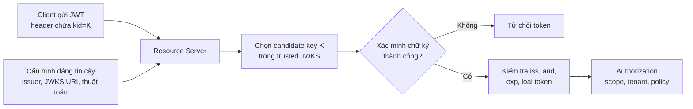
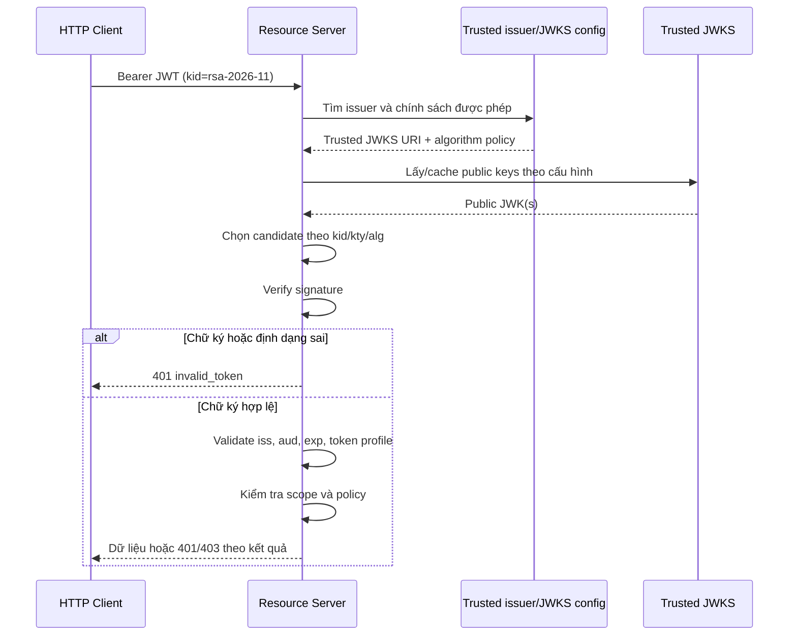

# kid giúp chọn khóa nhưng không tự tạo ra sự tin cậy

## 1. Vấn đề: biết tên khóa không đồng nghĩa tin được khóa

Trong hệ thống **Spring Security OAuth 2.0/OIDC Resource Server**, Authorization Server có thể ký JWT access token bằng một trong nhiều private key. Để Resource Server xác minh chữ ký, JWT thường mang trường **`kid` (Key ID)** trong JOSE header. Trường này giúp bên xác minh tìm nhanh public key tương ứng trong một tập khóa **JWKS (JSON Web Key Set)**.

Ví dụ, JWT có protected header:

```json
{
  "alg": "RS256",
  "typ": "at+jwt",
  "kid": "rsa-2026-11"
}
```

Từ `kid: "rsa-2026-11"`, API có thể tìm khóa cùng ID trong JWKS của issuer đã tin cậy. Nhưng **chỉ thấy `kid` không chứng minh JWT được ký bởi issuer**, vì người gửi token hoàn toàn có thể tự tạo header chứa chuỗi `kid` tùy ý.

Có hai câu hỏi khác nhau:

1. **Chọn khóa:** trong *tập khóa nào*, khóa nào có thể dùng để thử xác minh chữ ký JWT này?
2. **Tin cậy:** vì sao Resource Server cho phép dùng tập khóa đó, và chữ ký/token có thực sự vượt qua các kiểm tra bảo mật không?

`kid` hỗ trợ câu hỏi **chọn khóa**; sự tin cậy đến từ **issuer đã được cấu hình, nguồn JWKS đáng tin cậy, thuật toán được phép, kết quả xác minh chữ ký và kiểm tra claims/token profile**.

> **Quy tắc nhớ:** `kid` là **định danh để tìm khóa**, không phải mật khẩu, chữ ký, chứng chỉ hay giấy phép truy cập API. Không bao giờ cấp quyền chỉ vì `kid` khớp một tên khóa quen thuộc.

## 2. JWS Compact, JOSE header và vị trí của kid

JWT access token được ký dưới dạng **JWS Compact Serialization** thông thường gồm ba phần:

```text
BASE64URL(protected-header).BASE64URL(payload).BASE64URL(signature)
```

Payload có thể gồm:

```json
{
  "iss": "https://login.example.test/realms/shop",
  "sub": "user-123",
  "aud": ["orders-api"],
  "scope": "orders:read",
  "iat": 1893452400,
  "exp": 1893456000
}
```

Trong JWS Compact, header được Base64URL-encode nhưng **không được mã hóa để giữ bí mật**. Một client chưa được xác thực vẫn có thể đọc, sửa hoặc tự tạo header mới. Vì vậy các giá trị như `alg`, `typ` và `kid` là dữ liệu do bên gửi token cung cấp, **chưa đáng tin tại thời điểm parse**.

| Trường JOSE header | Vai trò | Điều nó **không** tự bảo đảm |
| --- | --- | --- |
| `alg` | Khai báo thuật toán JWS, chẳng hạn `RS256`, `PS256`, `ES256`. | Không quyết định thuật toán nào API **được phép** chấp nhận; chính sách phải ở server. |
| `kid` | Gợi ý lựa chọn khóa khi có nhiều khóa. | Không chứng minh khóa được tin cậy hoặc chữ ký hợp lệ. |
| `typ` | Gợi ý loại đối tượng, ví dụ `JWT` hoặc `at+jwt` theo profile. | Không thay audience, token profile và authorization validation. |
| `jku` | URL gợi ý nơi có JWK Set theo JOSE. | Không cấp phép API tự tải URL tùy ý từ token. |
| `x5u` | URL gợi ý chứng chỉ X.509. | Không chứng minh URL/chứng chỉ an toàn nếu chưa có chính sách tin cậy. |
| `x5t` / `x5t#S256` | Thumbprint chứng chỉ X.509. | Không tự tạo trust chain đến issuer hoặc quyền gọi API. |

Theo chuẩn JOSE, `kid` là một chuỗi, thường **phân biệt chữ hoa/chữ thường**, và **không bắt buộc hiện diện trong mọi JWS**. Khi issuer có nhiều khóa, việc gán `kid` duy nhất trong tập khóa giúp chọn key hiệu quả. Nhưng **không có định nghĩa rằng một `kid` là duy nhất trên toàn Internet**.

### 2.1. Header có chữ ký không?

Trong JWS Compact, protected header nằm trong dữ liệu đầu vào được ký:

```text
signingInput = BASE64URL(header) + "." + BASE64URL(payload)
signature    = SIGN(privateKey, signingInput)
```

Nếu attacker sửa `kid` sau khi token được ký mà giữ nguyên signature, signing input thay đổi và **signature phải bị từ chối**. Nhưng attacker vẫn có thể **tạo một JWT mới** chứa `kid` bất kỳ và chữ ký giả. Vì vậy, dù protected header nằm trong phần được ký, **phải xác minh chữ ký trước khi tin nội dung header/payload**.

`kid` có thể được đọc trước xác minh như một **gợi ý kỹ thuật để tìm candidate key**. Đây không phải một hành động xác thực danh tính.

## 3. JWK và JWKS: khóa được mô tả ra sao?

**JWK (JSON Web Key)** là biểu diễn khóa mật mã bằng JSON. **JWKS (JSON Web Key Set)** chứa nhiều JWK, thường được Authorization Server/OP công bố qua endpoint HTTPS để các Resource Server xác minh chữ ký JWT.

Ví dụ JWKS minh họa có hai **RSA public key**:

```json
{
  "keys": [
    {
      "kty": "RSA",
      "use": "sig",
      "kid": "rsa-2026-10",
      "alg": "RS256",
      "n": "<base64url-modulus-A>",
      "e": "AQAB"
    },
    {
      "kty": "RSA",
      "use": "sig",
      "kid": "rsa-2026-11",
      "alg": "RS256",
      "n": "<base64url-modulus-B>",
      "e": "AQAB"
    }
  ]
}
```

Các trường `n` là placeholder cho **modulus RSA**, chưa phải khóa hợp lệ để chạy thực tế. Ý nghĩa:

- `keys`: danh sách JWK.
- `kty`: loại khóa, ví dụ `RSA` hoặc `EC`.
- `use: "sig"`: khóa dự kiến sử dụng cho thao tác chữ ký.
- `alg`: gợi ý thuật toán mà khóa được dùng; API vẫn cần kiểm soát allowlist thuật toán.
- `kid`: mã định danh để tìm candidate key trong tập khóa.
- `n`, `e`: thành phần **public key RSA**.

Public JWKS cho chữ ký bất đối xứng **không được lộ** các thành phần RSA private JWK như `d`, `p`, `q`. Với khóa HMAC đối xứng, JWK `kty: "oct"` chứa secret trong `k`; **không xuất bản secret này trên public JWKS**.

### 3.1. Một `kid` không phải fingerprint mật mã bắt buộc

Ví dụ issuer có thể đặt `kid` là `rsa-2026-11`, `key-blue` hoặc một chuỗi ngẫu nhiên. Bản thân giá trị đó không nhất thiết là hash của public key, không chứng minh khóa không bị thay thế và không đảm bảo tính duy nhất toàn cục.

Chuẩn **RFC 7638 (JWK Thumbprint)** mô tả cách tính fingerprint ổn định từ các thành phần JWK công khai được chuẩn hóa. Nhà phát hành *có thể* dùng thumbprint làm `kid`, nhưng chuẩn **không bắt buộc mọi `kid` phải là thumbprint**. Nếu hệ thống muốn pin key theo fingerprint, phải tự thiết kế và quản lý chính sách pin/trust rõ ràng, không suy diễn từ tên `kid`.

### 3.2. Tập khóa có nhiều khóa để làm gì?

Trong giai đoạn **key rotation**, issuer thường công bố cả public key cũ và mới để API tiếp tục xác minh JWT đã phát hành bằng private key cũ, đồng thời nhận JWT mới. `kid` giúp tách hai khóa trong cùng JWKS, giảm nhu cầu thử mọi public key.

Nếu nhiều JWK trong một JWKS vô tình dùng **cùng `kid`**, trình xác minh có thể gặp lựa chọn mơ hồ. Issuer nên cấp key ID phân biệt trong phạm vi tập khóa, và Resource Server cần có cách xử lý mơ hồ an toàn, **không tự chọn một khóa không phù hợp hoặc bỏ qua bước kiểm tra signature**.

## 4. Trust anchor: nguồn nào khiến JWKS được tin cậy?

Trong mô hình phổ biến, Resource Server được cấu hình **issuer URI** đã được hệ thống phê duyệt:

```text
https://login.example.test/realms/shop
```

Resource Server có thể sử dụng metadata/discovery của issuer này để biết địa chỉ `jwks_uri` tương ứng, ví dụ:

```json
{
  "issuer": "https://login.example.test/realms/shop",
  "jwks_uri": "https://login.example.test/realms/shop/protocol/openid-connect/certs"
}
```

Đây là metadata minh họa. Trong triển khai thật, URL chính xác phụ thuộc Authorization Server/OP, được cung cấp theo discovery metadata hoặc cấu hình tin cậy.

**Điểm bắt đầu tin cậy nằm trong cấu hình Resource Server**, không nằm trong JWT đang được người gọi gửi đến. Server quyết định issuer nào được phép, endpoint JWKS nào được chấp nhận và kết nối tới nguồn đó phải được bảo vệ phù hợp (thông thường HTTPS/TLS với kiểm tra chứng chỉ).

Một sơ đồ ranh giới:



**Không tồn tại một phép biến đổi `kid` → “tin cậy” tự động.** Chỉ có chuỗi thao tác: định cấu hình trust → lấy tập khóa từ nguồn hợp lệ → chọn khóa phù hợp → xác minh chữ ký → thẩm định token → phân quyền.

### 4.1. Những thứ không phải trust anchor độc lập

| Thông tin nhìn thấy trong token/JWKS | Vì sao chưa đủ? |
| --- | --- |
| `kid: "production-key"` | Ai cũng có thể đặt tên giống như vậy trong JWT. |
| `alg: "RS256"` | Thuật toán được khai báo từ nguồn chưa xác thực; key và signature vẫn cần kiểm tra. |
| `iss: "https://trusted.example"` | Payload chưa được chứng thực; attacker có thể ghi issuer giả. |
| Public key tìm thấy qua URL do JWT khai báo | URL đó có thể do attacker kiểm soát; nguồn khóa chưa được tin cậy. |
| `use: "sig"` hoặc `key_ops: ["verify"]` | Là metadata sử dụng khóa, không phải bằng chứng nhà phát hành đáng tin. |
| `x5c` chứa certificate chain | Chuỗi certificate cần được đánh giá theo trust policy thích hợp, không chỉ vì nó xuất hiện trong header. |
| Signature kiểm tra thành công bằng một public key tùy ý | Chỉ chứng minh holder của private key tương ứng đã ký; chưa chứng minh holder đó là issuer được API ủy quyền. |

## 5. Quy trình xác minh an toàn với kid

Giả sử API `orders-api` chấp nhận JWT access token do issuer `https://login.example.test/realms/shop` ký bằng `RS256`.

### Bước 1 — Cấu hình nguồn tin cậy trước khi nhận request

API được triển khai với issuer tin cậy, JWKS/discovery phù hợp và danh sách thuật toán được phép. Không để header/payload của JWT tự mở rộng danh sách issuer hoặc thuật toán.

### Bước 2 — Nhận token và parse JOSE header với giới hạn an toàn

`BearerTokenAuthenticationFilter` trích chuỗi token từ request. JWT decoder đọc header để biết thông tin về algorithm, `kid` và cấu trúc JWS. **Đọc được header không có nghĩa thông tin đã xác thực**.

### Bước 3 — Lọc khóa trong đúng JWKS của issuer

Nếu header có `kid: "rsa-2026-11"`, decoder xem những public key ứng viên trong JWKS **của issuer đã định cấu hình**. Đồng thời xem loại khóa và khả năng tương thích thuật toán: không dùng HMAC secret để xác minh RSA JWS hoặc ngược lại.

### Bước 4 — Xác minh chữ ký

Sử dụng public key phù hợp để kiểm tra chữ ký trên signing input thực tế. Nếu không có candidate key, chữ ký không hợp lệ, thuật toán không được phép hoặc dữ liệu sai định dạng, token **bị từ chối**.

### Bước 5 — Thẩm định claims và token profile

Sau chữ ký, Resource Server vẫn phải kiểm tra:

- `iss` phải đúng issuer đã tin cậy.
- `aud` phải phù hợp **resource API** đang được gọi, ví dụ `orders-api`.
- `exp`, `nbf` và điều kiện thời gian phải hợp lệ.
- Token phải đúng loại/profile mà API chấp nhận, ví dụ OAuth 2.0 JWT access token theo hợp đồng, tránh nhận **OIDC ID token** dành cho client.
- Các claim bắt buộc và ràng buộc quyền của API phải được áp dụng.

### Bước 6 — Áp dụng quyền API và dữ liệu

Một JWT được xác thực có thể mang `scope: "orders:read"`. API ánh xạ thành authority phù hợp rồi dùng `hasAuthority("SCOPE_orders:read")`, đồng thời kiểm tra ownership/tenant nếu cần. **`kid` không được dùng làm role hay quyền**.



Một số library có thể xử lý bước chọn khóa, xác minh và claim validation trong thứ tự nội bộ khác nhau. Điều bảo mật cần giữ là **không dùng giá trị chưa được xác thực để cấp quyền hoặc tải nguồn khóa tùy ý**.

## 6. Ví dụ quan trọng: cùng kid, khác issuer

Hai nhà phát hành hoàn toàn có thể cùng dùng `kid: "current"`:

```text
Issuer A: https://login-a.example.test
JWKS A: kid="current" → publicKeyA

Issuer B: https://login-b.example.test
JWKS B: kid="current" → publicKeyB
```

Token A có `kid=current` không được đem xác minh bằng **tập khóa của issuer B** chỉ vì trùng ID. Việc kiểm tra `kid` luôn phải đặt trong **ngữ cảnh nguồn khóa cụ thể**.

Nếu hệ thống chấp nhận nhiều issuer, mỗi issuer cần có:

1. Danh sách issuer cho phép đã cấu hình trước.
2. JWKS/decoder và policy thuật toán của issuer đó.
3. Validator bắt buộc khớp `iss` thực tế của JWT với issuer đã chọn.
4. Audience, token profile và quyền phù hợp với API.

**Không tổ chức một kho global map `kid → publicKey` lấy từ mọi issuer rồi mặc định chọn khóa theo `kid` đơn lẻ.** Cách đó bỏ mất ranh giới giữa các trust domain.

### 6.1. Đọc issuer chưa xác minh để chọn decoder: khi nào được?

Để chọn manager trong hệ thống đa issuer, một resolver có thể cần **đọc `iss` chưa xác minh** làm gợi ý định tuyến. Điều đó chỉ an toàn khi giá trị này được so khớp với **allowlist issuer cố định**, rồi JWT decoder của issuer được chọn **xác minh lại chữ ký và `iss`**.

Một thiết kế sai là đọc `iss` tùy ý rồi tải `https://<issuer-bat-ky>/.well-known/...` để thêm issuer mới ngay khi request đến. Attacker có thể tự vận hành issuer/JWKS và ký token mà API không nên tin, hoặc khai thác việc truy vấn URL tùy ý.

## 7. Spring Boot Resource Server: trust được cấu hình ở đâu?

Với JWT access token từ một issuer hỗ trợ discovery, Spring Boot có thể được cấu hình:

```yaml
spring:
  security:
    oauth2:
      resourceserver:
        jwt:
          issuer-uri: https://login.example.test/realms/shop
```

Với các phiên bản Spring Security phù hợp và metadata issuer hợp lệ, Resource Server sử dụng issuer configuration/discovery để biết nguồn public keys và xác minh JWT. `kid` giúp decoder chọn khóa **trong tập khóa mà cấu hình này trỏ tới**.

API bảo vệ endpoints:

```java
@Configuration
class ApiSecurityConfig {

    @Bean
    SecurityFilterChain apiSecurity(HttpSecurity http) throws Exception {
        return http
                .authorizeHttpRequests(auth -> auth
                        .requestMatchers(HttpMethod.GET, "/api/orders/**")
                            .hasAuthority("SCOPE_orders:read")
                        .anyRequest().authenticated())
                .oauth2ResourceServer(oauth2 ->
                        oauth2.jwt(Customizer.withDefaults()))
                .build();
    }
}
```

Trong cấu hình phổ biến, `BearerTokenAuthenticationFilter` nhận Bearer token, `JwtAuthenticationProvider` gọi `JwtDecoder`, decoder xác minh JWS và validators, rồi `JwtAuthenticationConverter` ánh xạ claims như `scope`/`scp` thành authorities `SCOPE_...`.

**Điểm cần bổ sung cho API thực tế:** Chỉ cấu hình `issuer-uri` không mặc nhiên tạo ra chính sách audience của API trong mọi phiên bản/cấu hình. Cần kiểm tra `aud` và token type/profile theo Authorization Server đang dùng.

### 7.1. Ràng buộc thuật toán, issuer và audience bằng JwtDecoder

Một ví dụ minh họa cấu hình rõ:

```java
@Configuration
class JwtValidationConfig {

    private static final String ISSUER =
            "https://login.example.test/realms/shop";
    private static final String AUDIENCE = "orders-api";

    @Bean
    JwtDecoder jwtDecoder() {
        NimbusJwtDecoder decoder =
                NimbusJwtDecoder.withIssuerLocation(ISSUER)
                        .jwsAlgorithm(SignatureAlgorithm.RS256)
                        .build();

        OAuth2TokenValidator<Jwt> standard =
                JwtValidators.createDefaultWithIssuer(ISSUER);

        OAuth2TokenValidator<Jwt> audience = jwt ->
                jwt.getAudience().contains(AUDIENCE)
                        ? OAuth2TokenValidatorResult.success()
                        : OAuth2TokenValidatorResult.failure(
                                new OAuth2Error(
                                        "invalid_token",
                                        "Token audience is not orders-api",
                                        null));

        decoder.setJwtValidator(
                new DelegatingOAuth2TokenValidator<>(
                        standard, audience));
        return decoder;
    }
}
```

Ví dụ cần các class Spring Security `NimbusJwtDecoder`, `JwtDecoder`, `SignatureAlgorithm`, `JwtValidators`, `OAuth2TokenValidator`, `OAuth2TokenValidatorResult`, `DelegatingOAuth2TokenValidator`, `OAuth2Error`. Các import đã được lược bỏ để tập trung vào chính sách; builder/API cụ thể cần khớp phiên bản Spring Security triển khai.

Ý nghĩa:

- **`withIssuerLocation(ISSUER)`:** gắn nguồn khóa và metadata với issuer đã cấu hình.
- **`jwsAlgorithm(RS256)`:** giới hạn thuật toán chữ ký mà API chấp nhận trong ví dụ.
- **`JwtValidators.createDefaultWithIssuer`:** thực thi validator thời gian/issuer theo cơ chế mặc định tương ứng.
- **Audience validator:** buộc `aud` chứa định danh resource `orders-api`.
- **Authorities/endpoint rules:** chỉ cấp quyền sau authentication và claim validation.

Đây là **mẫu cho JWT JWS có chữ ký RS256**, không phải cách xác thực mọi loại access token. Nếu Authorization Server cấp **opaque access token**, cần cấu hình introspection phù hợp. Nếu token được mã hóa bằng **JWE**, phải có cơ chế giải mã/profile tương ứng; một JWT signature decoder thông thường không tự xử lý JWE chỉ vì có `kid`.

### 7.2. Chỉ rõ nguồn JWKS khi không dùng discovery

Nếu API được cấu hình với một JWKS URI đã được xác minh bằng phương thức đáng tin cậy, có thể sử dụng:

```yaml
spring:
  security:
    oauth2:
      resourceserver:
        jwt:
          issuer-uri: https://login.example.test/realms/shop
          jwk-set-uri: https://login.example.test/realms/shop/protocol/openid-connect/certs
```

`jwk-set-uri` phải là địa chỉ **được cấu hình tin cậy**, không phải URL trong header JWT đang gửi. Đồng thời giữ issuer validation; nếu chỉ cấu hình JWKS URI mà không kiểm tra issuer và audience thì chữ ký hợp lệ vẫn chưa đủ để chứng minh token có thể gọi API này.

Đường dẫn JWKS trong ví dụ là giả định theo kiểu nhà cung cấp; URL đúng phải được lấy từ hợp đồng hoặc metadata của issuer.

## 8. Những tấn công và cấu hình sai liên quan tới kid

### 8.1. Giả mạo kid trùng tên khóa hợp lệ

Attacker tự dựng JWT:

```json
{
  "alg": "RS256",
  "kid": "rsa-2026-11"
}
```

Attacker có thể đặt `sub=admin`, `scope=orders:write` rồi ký bằng private key do họ sở hữu. Nếu Resource Server chọn **public key thật của issuer** theo `kid=rsa-2026-11`, chữ ký giả sẽ không khớp và bị từ chối. Đây là hành vi đúng.

Nguy cơ xuất hiện khi ứng dụng suy diễn “`kid` có trong whitelist → token tin cậy” rồi bỏ bước verify. **Key ID không phải signature.**

### 8.2. Đưa đường dẫn hoặc truy vấn vào kid

Ví dụ một implementation tự viết:

```java
// SAI: kid lấy từ JWT chưa xác thực được dùng làm tên file.
Path path = Path.of("/app/keys/" + headerKid + ".pem");
PublicKey key = loadKey(path);
```

Nếu ứng dụng không kiểm soát đầu vào và nguồn khóa, việc dùng `kid` như path hoặc query có thể mở ra rủi ro **path traversal, key substitution** hoặc những lỗi truy vấn phát sinh từ chuỗi do attacker cung cấp.

Thay vào đó, để thư viện JOSE chọn khóa trong JWKS **đã tin cậy**, hoặc dùng ánh xạ cố định `kid → key` do phía server cấu hình và bảo vệ. Nếu có kho khóa nội bộ, truy xuất phải giới hạn bằng ID hợp lệ trong allowlist, phân quyền và kiểm soát lỗi phù hợp.

### 8.3. Tự tải jku hoặc x5u từ JWT

Attacker có thể tạo header:

```json
{
  "alg": "RS256",
  "kid": "attacker-key",
  "jku": "https://keys.attacker.example/jwks.json"
}
```

Nếu API tin `jku` mà không có trust policy, nó có thể tải public key do attacker vận hành và **xác minh thành công chữ ký do attacker tự tạo**. Ngoài key substitution, việc lấy URL từ dữ liệu chưa xác minh có thể gây **SSRF**, truy cập tài nguyên nội bộ hoặc làm cạn tài nguyên nếu xử lý không giới hạn.

Tương tự, `x5u` không tự làm URL chứng chỉ trở thành đáng tin. Server phải cố định/kiểm soát nguồn khóa và xác định trust chain hợp lệ. Trong Resource Server thông thường, không có lý do để chấp nhận bất kỳ JWKS URL do access token tự chỉ định.

### 8.4. Trộn khóa của hai issuer

Nếu API gom public keys của issuer A và B vào một kho khóa chung chỉ dựa trên `kid`, token có thể bị xác minh bằng khóa từ trust domain không mong đợi. Ngay cả khi signature hợp lệ, vẫn phải kiểm tra `iss` với issuer đã chọn và audience/resource. Mỗi issuer cần cấu hình trust, token profile và quyền tương ứng.

### 8.5. Algorithm confusion

`alg` cũng nằm trong header chưa xác thực. Không được để token tự yêu cầu chuyển từ RSA (`RS256`) sang HMAC (`HS256`) rồi dùng **RSA public key** làm HMAC secret. Public key là dữ liệu có thể công khai; dùng nó làm secret có thể dẫn tới giả mạo MAC nếu verifier tự triển khai sai.

Vì vậy API nên dùng `NimbusJwtDecoder` hoặc thư viện JOSE đáng tin cậy, giới hạn thuật toán theo issuer và loại khóa, từ chối `alg: none` đối với signed access token.

### 8.6. Chấp nhận JWKS bị thay thế trong đường truyền

Ngay cả khi JWT có `kid` đúng, một JWKS bị giả mạo có thể khiến verifier dùng public key của attacker. Vì vậy cấu hình **HTTPS/TLS, trust của endpoint, bảo vệ metadata/configuration và kiểm soát quyền thay đổi JWKS** là một phần của ranh giới tin cậy. Với các yêu cầu bảo mật cao hơn, hệ thống có thể áp dụng key pinning/trust policy chuyên biệt được quản trị theo vòng đời.

`kid` không phát hiện được JWKS bị thay thế nếu attacker vẫn dùng cùng key ID.

## 9. Vòng đời khóa: chuẩn bị, chuyển đổi và loại bỏ

`kid` đặc biệt hữu ích khi issuer đang xoay khóa:

```text
Giai đoạn 1: issuer ký bằng private key A.
  JWKS = [public key A, kid=A]

Giai đoạn 2: công bố trước public key B.
  JWKS = [public key A, public key B]

Giai đoạn 3: phát token mới ký bằng private key B.
  JWT mới: kid=B
  JWT cũ:  kid=A, vẫn còn hiệu lực

Giai đoạn 4: sau khi token A không còn được phép sử dụng,
  JWKS có thể gỡ public key A.
```

### 9.1. Tại sao phải công bố public key mới trước?

Resource Server thường cache JWKS. Nếu Authorization Server bắt đầu ký JWT bằng private key B khi resource server chỉ có public key A, token mới có thể bị trả **401 invalid_token** do chưa tìm được key tương ứng hoặc signature không xác minh được.

Để giảm gián đoạn:

1. Tạo key pair B bằng nguồn ngẫu nhiên và kho khóa an toàn.
2. Công bố public key B trong JWKS tin cậy **trước thời điểm** issuer dùng B ký token.
3. Duy trì public key A để Resource Server còn xác minh được token A chưa hết hạn.
4. Theo dõi cache refresh và độ sẵn sàng của mọi Resource Server.
5. Chỉ gỡ A sau cửa sổ phù hợp với thời hạn tối đa của token cũ, độ lệch đồng hồ và cache/phân phối.

Public key B xuất hiện trong JWKS không có nghĩa issuer đã bắt đầu ký bằng B. `kid` giúp biết token mới đang tham chiếu candidate key nào.

### 9.2. Khi nào gỡ khóa cũ?

Không nên xóa public key A chỉ vì đã chuyển issuance sang B. Token cuối cùng được ký bằng A có thể chưa hết hạn. Thời điểm gỡ phải xét:

- Thời hạn access token tối đa và thời điểm ngừng phát token A.
- Đồng hồ của issuer/resource server và clock skew cho phép.
- Cache JWKS ở các vùng/instance.
- Khả năng refresh/reissue token còn phát sinh token A.
- Chính sách khẩn cấp nếu private key A đã bị lộ.

Trong sự cố lộ private key, cần áp dụng quy trình thu hồi/đổi trust có kiểm soát; có thể phải ngừng chấp nhận token A sớm hơn và chấp nhận gián đoạn. **Sở hữu public key/`kid` đúng không giúp phân biệt token giả khi private key đã bị đánh cắp**.

### 9.3. kid có cần đổi mỗi khi rotation không?

Nên gán `kid` mới cho key pair mới để tránh nhầm lẫn và cache stale. Tái sử dụng cùng `kid` cho một public key khác có thể khiến các Resource Server cache khóa cũ và kiểm tra chữ ký thất bại khó chẩn đoán. `kid` nên ổn định trong vòng đời một khóa và được quản lý theo quy trình phát hành khóa.

Không tự suy luận “`kid` mới = token được tin cậy hơn”. Chỉ JWKS đáng tin cậy và kiểm tra chữ ký/token mới quyết định chấp nhận.

## 10. Khi kid không có, không tìm thấy hoặc bị trùng

| Tình huống | Điều nên hiểu | Hướng xử lý |
| --- | --- | --- |
| JWT **không có `kid`** | JOSE không bắt buộc mọi JWS có `kid`; có thể vẫn chọn được khóa nếu chỉ có một candidate rõ ràng. | Theo chính sách decoder/JWKS. Nếu không xác minh tin cậy được thì từ chối. |
| JWT `kid` không tồn tại trong JWKS cache | Có thể là khóa chưa công bố, JWKS cache cũ, issuer sai hoặc token giả. | Làm mới JWKS **chỉ từ nguồn tin cậy** theo chính sách; nếu vẫn không có khóa thì từ chối. |
| Nhiều JWK cùng `kid` | Có thể mơ hồ khi lựa chọn key. | Kiểm tra cấu hình issuer; lọc loại khóa/algorithm theo chính sách và fail closed khi không thể chọn/xác minh an toàn. |
| Có `kid` khớp nhưng signature fail | Tìm được tên khóa không có nghĩa chữ ký đúng. | Kiểm tra vật liệu public key, signature, key rotation và nguồn issuer; từ chối token. |
| `kid` khớp, signature pass nhưng `aud` sai | Token hợp lệ về chữ ký nhưng không dành cho API. | Từ chối bởi audience validator. |
| `kid` khớp, signature pass nhưng token hết hạn | Không còn hiệu lực. | Từ chối bởi time validator. |
| Token dùng `alg` không được API cho phép | Key ID không thể thay chính sách thuật toán. | Từ chối thuật toán không được phép. |
| Token chỉ có `kid`, thiếu signature | Không có bằng chứng mật mã để kiểm tra. | Từ chối; không tạo principal từ header. |

Một số decoder/JWKS client có cơ chế refresh khi không tìm thấy `kid`; hành vi cache và làm mới là chi tiết thư viện/phiên bản. Ứng dụng nên cấu hình timeout, cache, giới hạn tải và xử lý lỗi phù hợp để tránh bị spam token có `kid` ngẫu nhiên làm hệ thống liên tục gọi JWKS endpoint.

## 11. Các sự cố HTTP thường gặp

### 11.1. JWT dùng kid lạ, API không có khóa phù hợp

Client gửi:

```http
GET /api/orders HTTP/1.1
Host: api.example.test
Authorization: Bearer <jwt-with-unknown-kid>
```

Nếu JWT decoder không thể tìm/xác minh bằng khóa đáng tin cậy, token không qua authentication. Phản hồi thường là:

```http
HTTP/1.1 401 Unauthorized
WWW-Authenticate: Bearer error="invalid_token"
```

Không nên tự động tải public key từ host mà JWT đề nghị chỉ để “chữa” lỗi `kid` lạ.

### 11.2. JWT signature pass nhưng scope thiếu

Token có `kid` phù hợp, chữ ký hợp lệ, `iss` và `aud` đúng, nhưng chỉ mang `scope: "orders:read"`. Endpoint `POST /api/orders` yêu cầu `orders:write`. Token **đã xác thực**, nhưng authorization thiếu quyền:

```http
HTTP/1.1 403 Forbidden
WWW-Authenticate: Bearer error="insufficient_scope"
```

Lỗi này không phải do `kid` hoặc JWKS, nên không nên sửa key configuration để xử lý 403.

### 11.3. Thiếu Bearer token

Request không có `Authorization` vào endpoint yêu cầu xác thực thường trả **401** với Bearer challenge:

```http
HTTP/1.1 401 Unauthorized
WWW-Authenticate: Bearer
```

Đây là trường hợp **không có credential để xác minh**, khác với token `kid` không tồn tại hoặc signature sai.

### 11.4. API trả 401 sau khi issuer rotation

JWT có `kid=B` mới, nhưng API đang cache JWKS chỉ chứa A. Điều cần kiểm tra là:

1. Issuer đã công bố public key B trong JWKS được API tin cậy chưa?
2. API đang dùng đúng issuer/JWKS URL và TLS trust không?
3. Cache có cơ chế refresh khi B xuất hiện không, và thời hạn/timeout ra sao?
4. Token thực sự được ký bằng private key B tương ứng không?
5. Token còn hạn, đúng audience và profile không?

Nếu các điều kiện trên đã đúng, lỗi vẫn có thể nằm ở algorithm/claim validator. Không nên suy luận chỉ dựa vào tên `kid`.

## 12. Thực hành với Spring Security: khởi tạo bảo mật từ cấu hình

Giả sử API muốn chấp nhận hai issuer được phê duyệt trong một kiến trúc multi-tenant. Trong các phiên bản Spring Security có hỗ trợ, một resolver kiểu:

```java
AuthenticationManagerResolver<HttpServletRequest> resolver =
        JwtIssuerAuthenticationManagerResolver.fromTrustedIssuers(
                "https://login-a.example.test",
                "https://login-b.example.test");
```

có thể giúp chọn manager tương ứng với issuer **trong allowlist**. Sau đó mỗi manager phải xác minh JWT từ issuer của mình, bao gồm chữ ký, claim `iss` và những ràng buộc riêng của resource. API đa issuer còn cần audience validator, token type và quyền phù hợp với **từng trust domain**.

Trong hệ thống một issuer, cấu hình `issuer-uri`/`jwk-set-uri` rõ ràng thường đơn giản hơn. Dùng multi-issuer resolver chỉ khi có yêu cầu thật sự; không tự thêm issuer vào danh sách tin cậy chỉ vì thấy `iss` mới trong token.

### 12.1. Vì sao không nên tự viết map kid toàn cục?

Một thiết kế lỗi:

```java
// SAI về ranh giới tin cậy nếu keyMap trộn nhiều issuer.
PublicKey key = globalKeyMap.get(unverifiedHeaderKid);
boolean valid = verifyJwtWithKey(token, key);
// Sai tiếp nếu coi valid là đủ cho mọi API mà không kiểm tra iss/aud.
```

Cần xác định issuer và policy trước, chỉ chọn khóa trong tập được phép của issuer, kiểm tra signature rồi **thẩm định issuer và audience thật**. Với một hệ thống có nhiều issuer, resource ID hay định danh tenant vẫn cần được ràng buộc với trust domain cụ thể.

### 12.2. Không để kid quyết định quyền truy cập

Quy tắc API nên dựa trên **authorities/claims đã xác minh**, không dựa vào `kid`:

```java
@Bean
SecurityFilterChain apiSecurity(HttpSecurity http) throws Exception {
    return http
            .authorizeHttpRequests(auth -> auth
                    .requestMatchers(HttpMethod.GET, "/api/orders/**")
                        .hasAuthority("SCOPE_orders:read")
                    .requestMatchers(HttpMethod.POST, "/api/orders/**")
                        .hasAuthority("SCOPE_orders:write")
                    .anyRequest().authenticated())
            .oauth2ResourceServer(oauth2 ->
                    oauth2.jwt(Customizer.withDefaults()))
            .build();
}
```

Không nên viết điều kiện kiểu “nếu `kid=admin-key` thì là administrator”. `kid` chỉ phục vụ cryptographic key selection, và một private key có thể ký token mang nhiều mức quyền khác nhau.

## 13. Phân biệt kid, issuer, audience, scope và jti

| Trường | Vị trí điển hình | Câu hỏi được giải quyết |
| --- | --- | --- |
| `kid` | JOSE header hoặc metadata JWK | Dùng candidate key nào để kiểm tra chữ ký? |
| `alg` | JOSE header | Token khai cơ chế ký nào, có phù hợp allowlist/loại khóa không? |
| `iss` | JWT payload claims | Nhà phát hành được khai báo là ai, có khớp issuer tin cậy sau verification không? |
| `aud` | JWT payload claims | JWT được phát hành cho đối tượng nhận/resource nào? |
| `sub` | JWT payload claims | Subject được issuer định danh là gì? |
| `scope` / `scp` | Access token claims/profile | Quyền được cấp trong phạm vi token là gì? |
| `exp` / `nbf` | JWT payload claims | Token còn hiệu lực vào thời điểm hiện tại không? |
| `jti` | JWT payload claims | ID của **token cụ thể**, phục vụ truy vết/chính sách replay nếu có cơ chế hỗ trợ. |

Không dùng `kid` làm session ID, không dùng `jti` để chọn khóa và không dùng `aud` thay cho quyền. Các trường giải quyết các vấn đề khác nhau.

**Chữ ký hợp lệ cũng không đồng nghĩa scope đủ:** bên phát hành có thể ký token cho một người dùng không có quyền ghi đơn hàng. API vẫn phải thực thi `AuthorizationManager`/method security và kiểm tra ownership/tenant ở lớp nghiệp vụ.

## 14. Các anti-pattern cần loại bỏ

### 14.1. “kid nằm trong whitelist, vậy token hợp lệ”

`kid` chỉ là tên. Một JWT giả hoàn toàn có thể dùng cùng tên. Chỉ xác minh chữ ký bằng đúng public key mới phân biệt token của issuer với token tự tạo.

### 14.2. “Signature pass bằng bất kỳ public key nào, vậy tin token”

Nếu API lấy public key tùy ý từ `jku`, tài nguyên nội bộ hoặc một kho không được kiểm soát, attacker có thể tự tạo key pair và chữ ký hợp lệ tương ứng. Nguồn key phải thuộc issuer đã được phê duyệt.

### 14.3. “Một kid duy nhất trên toàn hệ thống”

Không có cam kết uniqueness toàn cục. Nếu nhiều issuer cùng có `kid=key1`, resource server vẫn phải tách khóa theo issuer.

### 14.4. “Cứ có kid mới thì tự thêm issuer mới”

Key rotation và issuer trust là hai vấn đề khác nhau. JWKS thuộc issuer tin cậy có thể thay key; điều đó không cấp phép tin thêm issuer hoặc JWKS URL mới do request tự đề xuất.

### 14.5. “Dùng kid làm path, SQL query hoặc HTTP URL không kiểm soát”

`kid` là dữ liệu chưa xác thực. Không được đưa trực tiếp vào đường dẫn hoặc truy vấn lấy secret/key nếu chưa qua một ánh xạ đã được giới hạn, bảo vệ và chỉ trỏ tới nguồn key tin cậy.

### 14.6. “Nếu key không tìm thấy, bỏ qua chữ ký để API không lỗi”

Đây là fail-open. Khi không tìm được khóa đáng tin cậy hoặc chữ ký không hợp lệ, Resource Server phải từ chối token. Có thể triển khai retry/làm mới JWKS theo chính sách, nhưng không được tắt verification.

### 14.7. “Đã đúng chữ ký và kid thì có thể bỏ audience”

Issuer có thể ký JWT cho OIDC Client hoặc một API khác. Resource Server phải kiểm tra `aud` và token profile; không chấp nhận ID token chỉ vì dùng chung public key/`kid`.

## 15. Chẩn đoán và quan sát an toàn

Khi một JWT bị từ chối, nên phân loại lỗi theo **giai đoạn** thay vì nhìn vào chuỗi `kid`:

| Giai đoạn | Triệu chứng | Hướng điều tra |
| --- | --- | --- |
| HTTP Bearer | Không có token trong request. | Client/proxy có gửi và chuyển tiếp `Authorization` không? |
| Parser/JOSE | Malformed JWT, `alg` không được phép, `kid` không tìm thấy khóa. | JWT có đúng JWS Compact? Decoder đúng loại token? Key/algorithm policy? |
| JWKS/rotation | Token mới fail sau khi issuer đổi khóa. | JWKS URL, TLS, cache, `kid`, thời điểm công bố public key mới. |
| Signature | Public key có nhưng signature mismatch. | Token bị sửa, sai key pair, issuer/môi trường hoặc thuật toán. |
| Claim validation | Chữ ký pass nhưng `iss`/`aud`/`exp` không hợp lệ. | So với hợp đồng issuer và API audience; không bỏ validator. |
| Authorization | JWT hợp lệ nhưng thiếu scope. | Authority mapping, `hasAuthority`, tenant, ownership, business policy. |

Để điều tra trong môi trường phát triển, có thể bật log Spring Security có kiểm soát:

```yaml
logging:
  level:
    org.springframework.security: DEBUG
```

**Không log nguyên JWT, access token, private key, shared secret hoặc toàn bộ dữ liệu nhạy cảm**. Nếu hệ thống cần log `kid` đã quan sát để chẩn đoán rotation, hãy giới hạn kích thước, chuẩn hóa định dạng và hiểu rằng giá trị trước verification **chưa đáng tin**. Dùng request ID và lỗi đã chuẩn hóa khi phù hợp; tránh dùng `kid` chưa xác thực làm nhãn metric có số lượng giá trị không giới hạn, gây tăng cardinality hoặc spam.

### 15.1. Bộ tình huống kiểm thử kiến thức

| Đầu vào | Kết quả kỳ vọng |
| --- | --- |
| JWT có `kid=A`, ký bằng private key A, JWKS tin cậy có public key A; `iss`/`aud`/thời gian đúng. | Có thể xác thực thành công; quyền còn phải được kiểm tra. |
| JWT có `kid=A` nhưng ký bằng private key của attacker. | Signature fail, không xác thực. |
| JWT có `kid=B` nhưng cache chỉ có public key A; issuer đã công bố B. | Có thể cần refresh JWKS an toàn; nếu chưa xác minh được thì từ chối. |
| JWT có `kid=key1` của issuer A nhưng resource API chỉ tin issuer B. | Không được lấy khóa chỉ theo tên key1; từ chối nếu không thuộc trust domain hợp lệ. |
| JWT khai `jku` trỏ tới website attacker với key tự tạo. | Không tải/chấp nhận theo header tùy ý; từ chối nếu không dùng trusted key. |
| JWT có `alg=none` và `kid` giống khóa production. | Không có chữ ký phù hợp; từ chối. |
| JWT signature hợp lệ nhưng `aud=web-client`, API yêu cầu `orders-api`. | Từ chối token sai audience/loại token. |
| JWT hợp lệ, `scope=orders:read` nhưng gọi endpoint cần `orders:write`. | Xác thực thành công nhưng authorization từ chối, thường 403. |
| JWKS có hai key cùng `kid` và không thể phân biệt an toàn. | Không tự chấp nhận; cần giải quyết ambiguity hoặc từ chối. |

Đây là các **tình huống để hiểu hành vi**, không phải kết quả test chạy trong repository. Khi triển khai bài test thực, cần token có chữ ký và public keys thử nghiệm tương ứng; mock `JwtAuthenticationToken` không kiểm tra được logic chọn key/JWS signature.

## 16. Câu hỏi tự kiểm tra

**1. `kid` có chứng minh JWT được ký bằng khóa thật của issuer không?** Không. Nó chỉ gợi ý tên khóa; Resource Server phải kiểm tra signature với khóa từ nguồn tin cậy.

**2. Hai issuer có được dùng cùng `kid` không?** Có thể. Vì vậy key ID phải được hiểu trong ngữ cảnh issuer/JWKS, không coi là định danh khóa toàn cầu.

**3. JWT có `kid` không tồn tại trong JWKS thì làm gì?** Có thể làm mới JWKS từ nguồn đã cấu hình đáng tin cậy theo chính sách cache; nếu không xác minh được thì từ chối token.

**4. Thêm public key B vào JWKS có cho phép attacker phát token B không?** Không, nếu attacker không sở hữu private key tương ứng và JWKS thực sự thuộc nguồn tin cậy.

**5. Token có signature hợp lệ, đúng `kid` nhưng sai `aud` có được dùng không?** Không; token không được phát hành cho resource API.

**6. `jku` do JWT chỉ định có được tự động dùng làm JWKS URL không?** Không được tin URL tùy ý. Nguồn khóa phải được cố định hoặc kiểm soát theo chính sách issuer và trust.

**7. `kid` có bắt buộc là SHA-256 thumbprint không?** Không. Có chuẩn JWK Thumbprint riêng, nhưng tên `kid` có thể do issuer chọn.

**8. Nếu issuer ký bằng HS256 thì khóa xác minh là gì?** Cùng shared HMAC secret; không thể công bố secret như RSA/EC public key.

**9. Đổi key ID có thay đổi scope của access token không?** Không. `kid` phục vụ chọn khóa; scope là dữ liệu quyền cần được xác thực và phân quyền.

**10. Có nên chấp nhận token nếu JWKS endpoint bị lỗi để hệ thống không gián đoạn?** Không fail-open. Có thể sử dụng key cache đáng tin cậy theo chính sách, nhưng token không qua signature/claim validation phải bị từ chối.

## 17. Tài liệu chuẩn liên quan

- **RFC 7515 – JSON Web Signature (JWS):** JOSE protected header, `alg`, `kid` và JWS Compact.
- **RFC 7517 – JSON Web Key (JWK):** biểu diễn JWK, JWKS, `kty`, `use`, `key_ops` và `kid`.
- **RFC 7518 – JSON Web Algorithms (JWA):** thuật toán JWS và các loại khóa tương ứng.
- **RFC 7519 – JSON Web Token (JWT):** payload claims `iss`, `aud`, `exp` và các khái niệm JWT.
- **RFC 7638 – JSON Web Key (JWK) Thumbprint:** tính fingerprint của JWK, khác với việc tự suy diễn `kid` là hash.
- **RFC 8725 – JSON Web Token Best Current Practices:** phòng tránh algorithm confusion, ràng buộc issuer/audience và tách token type.
- **RFC 9068 – JWT Profile for OAuth 2.0 Access Tokens:** quy tắc access token dạng JWT khi hệ thống áp dụng profile này.
- **Spring Security – OAuth 2.0 Resource Server JWT:** `NimbusJwtDecoder`, trusted `issuer-uri`/`jwk-set-uri`, validator và mapping authorities.

**Điểm kết luận:** `kid` giúp Resource Server **chọn một candidate key trong một tập khóa đã được tin cậy**. Nó không tự xác minh nguồn phát hành, chữ ký, issuer, audience, thời hạn hoặc scope. Khi key rotation, `kid` giúp chuyển từ khóa cũ sang khóa mới mà vẫn xác minh token hợp lệ, nhưng chỉ trong ranh giới JWKS/issuer được cấu hình và bảo vệ. **Chọn đúng tên khóa là bước tìm kiếm; chứng minh token đáng tin là toàn bộ quy trình xác minh và phân quyền.**
