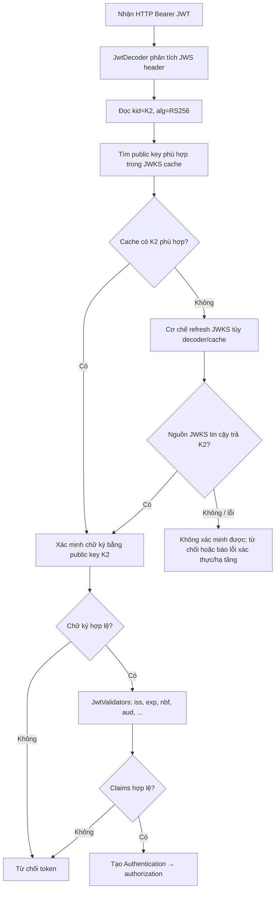
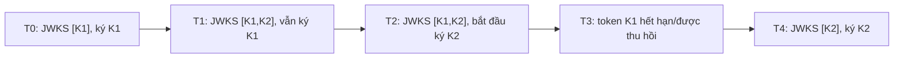

# Token có kid mới trong giai đoạn luân chuyển

Trong hệ thống **Spring Security OAuth 2.0 OIDC Resource Server**, Authorization Server thường dùng một **khóa riêng (private key)** để ký JWT access token, còn Resource Server dùng **khóa công khai (public key)** để kiểm tra chữ ký. Khi nhà phát hành luân chuyển khóa (*key rotation*), JWT mới có thể mang một giá trị `kid` chưa từng xuất hiện trong những token trước.

Một tình huống vận hành rất thực tế:

- Hôm qua, access token có header `kid=signing-2026-10` và API xác minh thành công.
- Hôm nay, Authorization Server bắt đầu phát token với `kid=signing-2026-11`.
- Resource Server vẫn đang dùng **JWKS được cache từ trước**, chỉ chứa khóa `signing-2026-10`.
- JWT mới đến API, nhưng decoder **chưa tìm được public key phù hợp** để xác minh chữ ký.

Điều này không nhất thiết chứng minh token giả mạo. Nó có thể là kết quả của quá trình đổi khóa chưa được đồng bộ. Tuy nhiên, Resource Server **không được chấp nhận token chỉ vì nghi ngờ đây là khóa mới hợp lệ**: phải lấy được khóa từ nguồn tin cậy, chọn được khóa thích hợp và xác minh chữ ký thành công.

Bài học tập trung vào: `kid` là gì, JWKS chứa nhiều khóa thế nào, vì sao cache tạo ra “khoảng trễ nhìn thấy khóa”, làm thế nào để luân chuyển khóa an toàn, và cách triển khai/quan sát quá trình này với Spring Security JWT Resource Server.

## 1. Vai trò của `kid` trong JWT đã ký

JWT access token dạng JWS compact có cấu trúc:

```text
BASE64URL(HEADER).BASE64URL(PAYLOAD).BASE64URL(SIGNATURE)
```

Ví dụ header JWT:

```json
{
  "alg": "RS256",
  "typ": "at+jwt",
  "kid": "signing-2026-11"
}
```

Ý nghĩa các trường:

| Trường | Ý nghĩa | Điểm bảo mật |
|---|---|---|
| `alg` | Thuật toán ký được khai báo, chẳng hạn `RS256`. | Resource Server chỉ chấp nhận **thuật toán đã cho phép**; không tin tùy ý thuật toán do token yêu cầu. |
| `typ` | Loại JWT được công bố; `at+jwt` là giá trị liên quan JWT access token profile (RFC 9068). | Có thể giúp chống nhầm access token với ID token, nhưng cần kiểm tra theo profile/phiên bản decoder. |
| `kid` | *Key ID*: nhãn chỉ định danh khóa ký mà verifier có thể dùng để chọn từ JWKS. | Chỉ là **gợi ý tìm khóa**, không chứng minh khóa hoặc token đáng tin. |

`kid` không phải private key, không phải nội dung bí mật và cũng không phải chữ ký. JWT header là dữ liệu **client có thể tự tạo trước khi được xác thực**. Kẻ tấn công hoàn toàn có thể gửi:

```json
{"alg":"RS256","kid":"signing-2026-99"}
```

Do đó, khi gặp `kid` lạ, một Resource Server đúng phải làm theo chính sách chọn khóa và refresh JWKS từ **issuer đã tin cậy**, chứ không “tự tạo” khóa hay bỏ qua signature verification.

### 1.1. Vì sao cần `kid`?

Trong giai đoạn bình thường, nhà phát hành có thể ký token bằng khóa `K1`. Khi chuẩn bị đổi khóa, nó công bố thêm khóa `K2` trong JWKS:

```text
JWKS trước rotation:
  K1 (kid=signing-2026-10)

JWKS khi chuyển tiếp:
  K1 (kid=signing-2026-10)
  K2 (kid=signing-2026-11)

JWKS sau chuyển tiếp:
  K2 (kid=signing-2026-11)
```

Một verifier có thể dùng `kid` trong header JWT để chọn **đúng public key** tương ứng trong tập khóa mà issuer công bố. Không nhất thiết mọi JWKS chỉ có một khóa; có nhiều khóa đồng thời là bình thường.

Dù `kid` thường giúp chọn khóa nhanh và rõ ràng, nó không thay thế các điều kiện khác như kiểu khóa `kty`, mục đích `use=sig`, thuật toán phù hợp hoặc xác minh chữ ký mật mã.

## 2. Private key, public key và JWKS có quan hệ thế nào?

Với chữ ký bất đối xứng như RSA hoặc ECDSA:

1. **Authorization Server** giữ private key và dùng nó để ký JWT.
2. **Resource Server** dùng public key tương ứng để xác minh chữ ký.
3. **JWKS endpoint** của Authorization Server công bố tập JSON Web Keys (thường là public keys).
4. **`kid` của JWT** chỉ ra khóa cần được tìm trong JWKS đáng tin.

Ví dụ JWKS minh họa:

```json
{
  "keys": [
    {
      "kty": "RSA",
      "kid": "signing-2026-10",
      "use": "sig",
      "alg": "RS256",
      "n": "<base64url-public-modulus-K1>",
      "e": "AQAB"
    },
    {
      "kty": "RSA",
      "kid": "signing-2026-11",
      "use": "sig",
      "alg": "RS256",
      "n": "<base64url-public-modulus-K2>",
      "e": "AQAB"
    }
  ]
}
```

Đây là **JSON giả lập** để giải thích cấu trúc; các giá trị `n` là placeholder, không phải public key có thể dùng ngay.

Một số thuộc tính cần nhận biết:

| Thuộc tính JWK | Vai trò |
|---|---|
| `kty` | Kiểu khóa, chẳng hạn `RSA` hoặc `EC`. |
| `kid` | Định danh khóa để kết hợp với header JWT. |
| `use` | Mục đích, ví dụ `sig` cho chữ ký. |
| `key_ops` | Những thao tác có thể được phép, ví dụ `verify`. |
| `alg` | Thuật toán được mô tả hoặc dự kiến dùng với JWK. |
| `n`, `e` | Tham số public key RSA. |
| `crv`, `x`, `y` | Tham số của các khóa elliptic curve phù hợp. |
| `x5c`, `x5t` | Thông tin liên quan chứng chỉ X.509 khi issuer công bố. |

Private key phải được giữ an toàn bởi bên ký (chẳng hạn HSM/KMS hoặc kho khóa có chính sách truy cập phù hợp). **Không công bố tham số khóa riêng** như RSA `d` lên public JWKS. Theo OIDC Discovery, JWKS được công bố không được chứa private hoặc symmetric key values.

### 2.1. Chọn khóa mới không làm thay đổi issuer

Issuer ví dụ:

```text
https://login.example.test/realms/shop
```

Tài liệu metadata đáng tin có thể chỉ ra:

```json
{
  "issuer": "https://login.example.test/realms/shop",
  "jwks_uri": "https://login.example.test/realms/shop/protocol/openid-connect/certs"
}
```

Khi xoay khóa ký từ `K1` sang `K2`, **issuer thường không thay đổi**. Resource Server tiếp tục tin đúng issuer, tải JWKS của issuer đó và kiểm tra `iss` trong access token. Việc `kid` đổi không tạo ra một issuer mới.

Không được dùng chuỗi `kid` để quyết định URL tùy ý của JWKS, cũng không được thay đổi trusted issuer theo giá trị trong JWT chưa xác thực.

## 3. Điều gì xảy ra khi một JWT mang `kid` mới đến Resource Server?

Giả sử:

- Token cũ có `kid=K1`.
- JWT mới có `kid=K2`.
- JWKS mà Resource Server đang cache chỉ chứa `K1`.

Luồng xử lý ở mức logic:



Có hai điều khác nhau:

- **Tìm được public key có `kid=K2`:** mới là điều kiện giúp verifier có *ứng viên khóa*.
- **Xác minh thành công chữ ký và validators:** mới là cơ sở chấp nhận token.

Nếu JWKS có một khóa trùng `kid` nhưng không thể kiểm tra chữ ký, token vẫn bị từ chối. `kid` trùng không phải là bằng chứng mật mã.

### 3.1. Không phải mọi thư viện đều refresh JWKS theo cùng một cách

Spring Security thường dùng `NimbusJwtDecoder` dựa trên thư viện JOSE/JWT phía dưới. Hành vi liên quan cache/refresh chịu ảnh hưởng của:

- Phiên bản Spring Security và thư viện Nimbus.
- Loại JWK source được sử dụng.
- Thời gian giữ cache và điều kiện stale/expiration.
- Cách decoder xử lý `kid` không tìm thấy.
- Cấu hình HTTP client, timeout, proxy và HTTP caching.
- Có cấu hình cache/JWK source riêng hoặc gateway trung gian hay không.

Vì vậy, **không nên hứa rằng cứ gặp `kid` mới thì mọi decoder sẽ tải JWKS lập tức, đúng một lần và chấp nhận token ngay**. Trong triển khai phổ biến, việc không tìm thấy khóa có thể dẫn đến một lần thử làm mới; nhưng điều kiện và giới hạn refresh là chi tiết cần đối chiếu với thư viện/cấu hình đang sử dụng.

Nếu không tải được khóa đáng tin để xác minh, token không được chấp nhận, ngay cả khi cả issuer và application đều đang hoạt động bình thường ở những chức năng khác.

## 4. Ba giai đoạn chính của key rotation an toàn

Một **rotation không gián đoạn** thường tuân theo nguyên tắc **công bố khóa mới trước khi dùng ký** và **giữ khóa cũ đủ lâu để token cũ còn được xác minh**.

### 4.1. Giai đoạn A — Chỉ dùng khóa cũ K1

Authorization Server:

- Dùng private key `K1` để ký access token mới.
- Công bố public key `K1` trong JWKS.
- Token có `kid=K1`.

Resource Server:

- Cache JWKS chứa `K1`.
- Xác minh token có `kid=K1`.

```text
AS ký bằng:          K1
JWKS công bố:        [K1]
Token mới phát hành: kid=K1
RS thường có:        [K1]
```

### 4.2. Giai đoạn B — Công bố K2 trong khi vẫn ký bằng K1

Authorization Server tạo cặp khóa `K2` và **thêm public key K2 vào JWKS**. Tuy nhiên, AS vẫn ký token mới bằng `K1` một khoảng thời gian phù hợp.

```text
AS ký bằng:          K1
JWKS công bố:        [K1, K2]
Token mới phát hành: kid=K1
RS có thể có:        [K1] hoặc [K1, K2] tùy cache
```

Mục tiêu của giai đoạn này là giúp Resource Server **nhìn thấy K2 trước** khi phải xác minh token ký bằng K2.

Khoảng chờ nên xét đến:

- Thời hạn cache JWKS thực tế tại Resource Servers.
- Thời gian TTL ở CDN, reverse proxy và các lớp trung gian.
- Thời gian rollout/propagation giữa những instance của Authorization Server.
- Khả năng có nhiều Resource Server hoặc tenant với cấu hình refresh khác nhau.
- Thời gian timeout và tần suất request trong hệ thống.

Nếu không có cơ chế chủ động preload/refresh ở phía RS, chỉ “thêm K2 vào JWKS” cũng chưa đảm bảo mọi instance đã nhìn thấy K2 ngay.

### 4.3. Giai đoạn C — Ký token mới bằng K2, giữ K1

Sau khoảng chờ, AS chuyển khóa ký active sang `K2`:

```text
AS ký bằng:          K2
JWKS công bố:        [K1, K2]
Token mới phát hành: kid=K2
RS đã refresh:       [K1, K2]
```

Tại thời điểm này, hai loại token có thể cùng được sử dụng:

- Token cũ mang `kid=K1`, chưa hết hạn.
- Token mới mang `kid=K2`.

Resource Server cần có khả năng xác minh cả hai nếu cả hai còn hợp lệ theo hợp đồng. **Đừng xóa K1 khỏi JWKS ngay lúc bắt đầu ký bằng K2** nếu vẫn còn token hợp lệ được ký bằng K1.

### 4.4. Giai đoạn D — Ngừng công bố khóa cũ K1

Sau khi token K1 cuối cùng đã hết hiệu lực (cộng khoảng đệm thích hợp theo chính sách phát hành, clock skew và propagation), AS có thể bỏ public key `K1` khỏi JWKS.

```text
AS ký bằng:          K2
JWKS công bố:        [K2]
Token mới phát hành: kid=K2
RS sau refresh:      [K2]
```

Nếu token cũ được thiết kế sống lâu, có thể phải giữ K1 lâu hơn. Ngược lại, trong sự cố lộ private key, tổ chức có thể phải **thu hồi K1 khẩn cấp** và chấp nhận token cũ bị từ chối; bảo mật có thể quan trọng hơn tính liên tục của những phiên truy cập đó.

### 4.5. Dòng thời gian tổng hợp



Bảng theo giai đoạn:

| Giai đoạn | Khóa được dùng ký token mới | JWKS công bố | Lý do |
|---|---|---|---|
| T0 | K1 | K1 | Vận hành bình thường |
| T1 | K1 | K1 + K2 | Pre-publish K2, chờ cache cập nhật |
| T2 | K2 | K1 + K2 | Token mới dùng K2, token cũ vẫn được xác minh |
| T3 | K2 | K1 + K2 | Chờ token K1 còn hiệu lực kết thúc |
| T4 | K2 | K2 | Hoàn tất rotation, gỡ K1 theo policy |

**Khoảng chồng lấn phụ thuộc vòng đời token và hệ thống cache, không phải một con số cố định áp dụng cho mọi tổ chức.**

## 5. Bốn trạng thái thường bị gộp thành “kid mới không chạy”

Giả sử JWT mang `kid=K2`. Có ít nhất bốn nguyên nhân khác nhau khiến request thất bại:

| Tình huống | JWKS thực tế trên issuer | JWKS ở Resource Server | Nguyên nhân chính |
|---|---|---|---|
| **A. AS ký K2 quá sớm** | Chưa công bố K2 | Không có K2 | Thứ tự rotation sai; verifier không thể tìm khóa. |
| **B. Cache RS cũ** | Đã có K2 | Cache chỉ có K1 | Độ trễ refresh/cache. |
| **C. Sai nguồn khóa** | K2 ở issuer/realm khác | RS tải JWKS khác | Nhầm issuer, realm, đường dẫn JWKS hoặc cấu hình multi-tenant. |
| **D. Có K2 nhưng chữ ký sai** | Có key ID K2 | Có key ID K2 | Key material sai, thuật toán không phù hợp, token bị sửa, hoặc `kid` bị dùng lại không đúng. |

Một lỗi khác có thể xảy ra **sau khi ký thành công**: JWT có `iss`, `aud`, `exp` hoặc token type không phù hợp. Khi đó nguyên nhân không phải JWKS cache, dù request cũng có thể trả `401`.

Để xử lý đúng, cần xác định **bước nào đã thất bại**, không thay ngay mọi cấu hình hoặc tắt validation.

## 6. Tại sao cache JWKS là cần thiết nhưng tạo độ trễ?

Tải JWKS qua HTTPS cho **mỗi JWT request** sẽ khiến API phụ thuộc mạng thường xuyên, tăng latency và tải lên Authorization Server. Vì vậy decoder/JWK source thường **cache bộ public keys**.

Ưu điểm:

- Resource Server có thể xác minh chữ ký cục bộ khi cache còn khóa cần thiết.
- Giảm tải JWKS endpoint.
- Tránh một phần phụ thuộc mạng khi Authorization Server tạm thời chậm.
- Có thể duy trì hiệu suất khi lượng JWT request lớn.

Nhược điểm:

- Public key mới có thể chưa xuất hiện trong cache tại mọi instance.
- Key cũ bị xóa khỏi JWKS có thể còn trong cache trong một khoảng thời gian.
- Caching ở CDN/proxy có thể kéo dài thời gian propagation ngoài dự kiến.
- Khi không tìm thấy `kid` mới, nhiều requests đồng thời có thể kích hoạt nhiều nhu cầu refresh.

### 6.1. Các lớp cache cần nhìn thấy

```text
Resource Server / Nimbus JWK cache
            │
            ▼
HTTP client của Resource Server
            │
            ▼
Enterprise proxy / egress gateway (nếu có)
            │
            ▼
CDN / reverse proxy của issuer (nếu có)
            │
            ▼
Authorization Server JWKS endpoint
```

Dù Resource Server vừa gửi GET mới, kết quả có thể vẫn là bộ khóa cũ nếu một tầng trung gian trả bản cache chưa được làm mới.

Khi điều tra, không chỉ hỏi “Spring Security đã tải JWKS chưa?” mà còn cần hỏi “nó nhận **JWKS phiên bản nào** từ endpoint mà nó thực sự kết nối?”.

### 6.2. HTTP cache headers và điều kiện refresh

JWKS endpoint có thể trả những header như:

```http
HTTP/1.1 200 OK
Content-Type: application/json
Cache-Control: public, max-age=300
ETag: "jwks-version-42"
```

Những header này là ví dụ minh họa, **không có nghĩa mọi phiên bản Nimbus/Spring Security đều áp dụng trực tiếp cùng một cách tính TTL**. Thư viện có thể có cache nội bộ độc lập, còn proxy/CDN có chính sách cache riêng.

Một hệ thống hỗ trợ conditional requests có thể dùng `If-None-Match`/`304 Not Modified`, nhưng cũng không nên giả định decoder đang sử dụng kỹ thuật đó nếu chưa được xác nhận từ implementation/cấu hình.

### 6.3. “Unknown kid” và nguy cơ refresh dồn dập

Một attacker có thể gửi liên tục JWT giả có `kid` ngẫu nhiên:

```json
{"alg":"RS256","kid":"random-000001"}
```

Nếu mỗi giá trị mới ép Resource Server gọi JWKS không giới hạn, endpoint issuer có thể bị quá tải (*refresh storm/cache stampede*). Thiết kế vận hành cần cân bằng:

- Nhận diện/refresh khóa mới đúng lúc khi issuer rotate thật.
- Rate limit và giới hạn kết nối/timeout phù hợp.
- Không để request không đáng tin quyết định URL tải khóa.
- Quan sát lượng unknown kid và lỗi refresh đột biến.
- Tránh tự tạo cache vô hạn theo từng `kid` do caller gửi.

**Không “chữa” unknown kid bằng cách chấp nhận token khi JWKS fetch bị lỗi.** Những tình huống này phải được xử lý như xác thực chưa thành công.

## 7. Spring Security đọc `kid` và JWKS như thế nào?

Khi cấu hình JWT Resource Server, các thành phần quan trọng là:

```text
BearerTokenAuthenticationFilter
           │
           ▼
JwtAuthenticationProvider
           │
           ▼
JwtDecoder (thường là NimbusJwtDecoder)
           │
           ├─ Parse JWS header: alg, kid, typ...
           │
           ├─ Sử dụng trusted JWK Set / key source
           │
           ├─ Verify signature
           │
           └─ JwtValidators: iss, exp, nbf, aud, ...
           │
           ▼
JwtAuthenticationToken + GrantedAuthorities
           │
           ▼
AuthorizationFilter / method security
```

Một số lưu ý:

- `JwtAuthenticationProvider` gọi decoder và tạo authentication khi decode thành công.
- `NimbusJwtDecoder` thường dùng thành phần Nimbus JOSE/JWT để chọn key và xác minh chữ ký.
- Tập khóa đáng tin được xác định bởi **cấu hình issuer/JWK Set**; `kid` chỉ dùng để lựa chọn khóa trong tập đó.
- Sau chữ ký, decoder còn chạy validators. **Khóa mới tìm thấy không khiến token tự được phân quyền**.

Resource Server nhận bearer JWT ở từng request, nhưng JWKS không nhất thiết được tải lại cho từng request. Chi tiết refresh chịu ảnh hưởng của phiên bản và cache được cấu hình.

## 8. Cấu hình cơ bản bằng `issuer-uri`

Ví dụ Spring Boot:

```yaml
spring:
  security:
    oauth2:
      resourceserver:
        jwt:
          issuer-uri: https://login.example.test/realms/shop
          audiences:
            - orders-api
```

Với cấu hình này, Spring Security có thể dùng issuer để khám phá metadata, lấy `jwks_uri` và sử dụng bộ public keys của issuer để xác minh JWT.

- `issuer-uri`: Định danh Authorization Server được tin cậy, liên quan kiểm tra claim `iss`.
- `audiences`: Audience phải chứa `orders-api` nếu phiên bản Spring Boot đang dùng hỗ trợ thuộc tính này.
- Key rotation: Khi AS công bố public key K2 trong JWKS đáng tin, decoder có thể sử dụng nó sau khi cơ chế cache/JWK source nhìn thấy cập nhật.

Ví dụ Spring Security filter chain:

```java
@Configuration
public class ApiSecurityConfig {

    @Bean
    SecurityFilterChain apiSecurity(HttpSecurity http) throws Exception {
        return http
            .authorizeHttpRequests(auth -> auth
                .requestMatchers("/public/**").permitAll()
                .requestMatchers(HttpMethod.GET, "/api/orders/**")
                    .hasAuthority("SCOPE_orders.read")
                .anyRequest().authenticated()
            )
            .oauth2ResourceServer(oauth2 ->
                oauth2.jwt(Customizer.withDefaults()))
            .build();
    }
}
```

Các import chính:

```java
import org.springframework.context.annotation.Bean;
import org.springframework.context.annotation.Configuration;
import org.springframework.http.HttpMethod;
import org.springframework.security.config.Customizer;
import org.springframework.security.config.annotation.web.builders.HttpSecurity;
import org.springframework.security.web.SecurityFilterChain;
```

Trong flow này, ngay cả khi JWT được ký bằng K2 và decoder xác minh thành công, request vẫn cần có scope/authority thích hợp. Spring Security thường chuyển `scope=orders.read` thành `SCOPE_orders.read`.

## 9. Cấu hình `jwk-set-uri` trực tiếp

Nếu Authorization Server không cung cấp metadata discovery tương thích, hoặc Resource Server muốn biết trước JWKS endpoint, có thể chỉ định URI:

```yaml
spring:
  security:
    oauth2:
      resourceserver:
        jwt:
          issuer-uri: https://login.example.test/realms/shop
          jwk-set-uri: https://login.example.test/realms/shop/protocol/openid-connect/certs
          audiences:
            - orders-api
```

Ý nghĩa:

1. Resource Server không cần discovery để tìm đường dẫn JWKS vì đã có `jwk-set-uri`.
2. Resource Server **vẫn cần tải hoặc nhận public keys** từ JWKS để kiểm tra token mang `kid` mới.
3. `issuer-uri` giúp giữ validator `iss`; chỉ khai báo JWKS URL không đủ thay thế issuer validation.
4. `audiences` giữ ràng buộc token dành cho Orders API, khi được auto-configuration áp dụng.

Một số môi trường startup yêu cầu giảm phụ thuộc vào metadata endpoint của AS. Cấu hình JWKS URI trực tiếp có thể hữu ích, nhưng **không khiến việc xác minh token hoàn toàn độc lập với nguồn khóa**: khi khóa rotate, decoder vẫn cần cập nhật tập key.

### 9.1. Cấu hình Decoder bằng Java

Ví dụ tương ứng:

```java
@Configuration
public class JwtDecoderConfiguration {

    private static final String ISSUER =
        "https://login.example.test/realms/shop";

    private static final String JWKS_URI =
        "https://login.example.test/realms/shop/protocol/openid-connect/certs";

    @Bean
    JwtDecoder jwtDecoder() {
        NimbusJwtDecoder decoder =
            NimbusJwtDecoder.withJwkSetUri(JWKS_URI).build();

        OAuth2TokenValidator<Jwt> defaultsAndIssuer =
            JwtValidators.createDefaultWithIssuer(ISSUER);

        OAuth2TokenValidator<Jwt> audienceValidator = jwt -> {
            if (jwt.getAudience().contains("orders-api")) {
                return OAuth2TokenValidatorResult.success();
            }
            return OAuth2TokenValidatorResult.failure(
                new OAuth2Error(
                    "invalid_token",
                    "Access token is not for orders-api",
                    null
                )
            );
        };

        decoder.setJwtValidator(
            new DelegatingOAuth2TokenValidator<>(
                defaultsAndIssuer,
                audienceValidator
            )
        );

        return decoder;
    }
}
```

Imports cho cấu hình:

```java
import org.springframework.context.annotation.Bean;
import org.springframework.context.annotation.Configuration;
import org.springframework.security.oauth2.core.OAuth2Error;
import org.springframework.security.oauth2.core.OAuth2TokenValidator;
import org.springframework.security.oauth2.core.OAuth2TokenValidatorResult;
import org.springframework.security.oauth2.core.DelegatingOAuth2TokenValidator;
import org.springframework.security.oauth2.jwt.Jwt;
import org.springframework.security.oauth2.jwt.JwtDecoder;
import org.springframework.security.oauth2.jwt.JwtValidators;
import org.springframework.security.oauth2.jwt.NimbusJwtDecoder;
```

Đoạn code thể hiện **hai ranh giới độc lập**:

- JWKS URI xác định **public keys** được phép dùng kiểm tra chữ ký.
- `JwtValidators.createDefaultWithIssuer(ISSUER)` và audience validator xác định **JWT claims** có phù hợp Resource Server không.

Nếu chỉ cài `withJwkSetUri` mà quên issuer/audience validators, token do issuer không mong đợi hoặc dành cho API khác có thể bị xử lý sai tùy cấu hình. Các validators cần được khai báo tường minh khi tự tạo decoder.

Cần nhớ: một `JwtDecoder` bean tùy biến có thể khiến Spring Boot bỏ qua decoder auto-configuration. Do đó, đừng cho rằng các properties JWT trong YAML tự động được áp dụng cho bean do ứng dụng tạo nếu không được nối vào cấu hình.

## 10. Khi gặp `kid` mới: các phản ứng đúng và sai

| Phản ứng | Đánh giá | Lý do |
|---|---|---|
| Tìm trong cached JWKS, thử refresh từ issuer tin cậy theo chính sách rồi xác minh chữ ký | **Phù hợp** | Giữ ranh giới khóa tin cậy. |
| Từ chối token khi không có public key phù hợp hoặc signature verification thất bại | **Phù hợp** | Chưa đủ bằng chứng token hợp lệ. |
| Theo dõi metrics/log về unknown kid và lỗi JWKS fetch | **Phù hợp** | Giúp phân biệt rotation với sự cố issuer/network. |
| Tăng cấu hình timeout/cache có kiểm soát sau khi hiểu hành vi thư viện | Có thể phù hợp | Phải cân nhắc hiệu năng, độ sẵn sàng và bảo mật. |
| Bỏ qua xác minh chữ ký trong vài phút vì “đang rotate” | **Không an toàn** | Bất kỳ JWT giả nào cũng có thể được nhận. |
| Tự tin token chỉ vì `kid` có hậu tố mới hoặc cùng tiền tố cũ | **Không an toàn** | `kid` không có giá trị chứng minh nguồn phát hành. |
| Tải JWKS từ URL do token header tự cung cấp mà không có policy | **Không an toàn** | Có thể tin khóa của attacker hoặc tạo SSRF. |
| Dùng public key cũ K1 để “bỏ qua” token ghi K2 nhưng chữ ký không hợp lệ | **Không an toàn** | Sai nguyên tắc xác minh chữ ký. |
| Thay tất cả validators bằng một kiểm tra `kid` | **Không an toàn** | Có thể bỏ issuer, time, audience và các điều kiện khác. |
| Xóa K1 khỏi JWKS ngay khi bắt đầu ký K2 | Có thể gây gián đoạn | Token K1 chưa hết hạn có thể mất khả năng xác minh. |

Một yếu tố vận hành nên ghi nhớ: **token với `kid` mới không đồng nghĩa được phép retry vô hạn**. Một client retry 401 liên tục không làm khóa trở nên đáng tin. Phía AS/RS cần sửa nguyên nhân phát hành, propagation hoặc cấu hình.

## 11. Phân biệt lỗi xác minh khóa và lỗi claim validation

Ví dụ Token A:

```json
{
  "iss": "https://login.example.test/realms/shop",
  "sub": "user-123",
  "aud": ["orders-api"],
  "scope": "orders.read",
  "exp": 1900000000
}
```

Header của token:

```json
{"alg":"RS256","kid":"K2"}
```

Xét các trường hợp:

**Trường hợp 1 — Không thấy K2 trong JWKS cache:** Decoder chưa có ứng viên khóa. Nếu refresh thành công và nguồn JWKS tin cậy chứa K2, nó có thể tiến tới xác minh chữ ký. Nếu không có K2, chưa thể chấp nhận token.

**Trường hợp 2 — JWKS có K2 nhưng chữ ký sai:** Khóa được chọn nhưng phép toán xác minh JWS thất bại. Token phải bị từ chối, bất kể claims đẹp đến đâu.

**Trường hợp 3 — Chữ ký đúng, nhưng `aud=payments-api`:** Chuyển sang validation claims, audience validator của Orders API phải từ chối.

**Trường hợp 4 — Chữ ký đúng, aud đúng, token hết hạn:** Time validator từ chối.

**Trường hợp 5 — Chữ ký đúng, claims hợp lệ, thiếu scope:** Token có thể qua Authentication nhưng `AuthorizationFilter` trả `403 Forbidden` khi endpoint yêu cầu `SCOPE_orders.read`.

**Trường hợp 6 — Token hợp lệ, đủ scope, nhưng user xem đơn hàng người khác:** Method/service authorization vẫn phải từ chối theo quyền ownership/tenant.

Điều quan trọng: lỗi “unknown kid”, “bad signature”, “invalid audience”, “expired token” và “insufficient scope” nằm ở **các lớp khác nhau**. Việc đều thấy `401` hoặc `403` ở phía client chưa đủ để kết luận nguyên nhân.

## 12. HTTP responses trong thời gian rotation

Với JWT không xác thực được, Spring Security Resource Server thường trả phản hồi bearer authentication failure, chẳng hạn:

```http
HTTP/1.1 401 Unauthorized
WWW-Authenticate: Bearer error="invalid_token"
```

Tuy nhiên, không phải mọi lỗi liên hệ JWKS endpoint đều nhất thiết dẫn đến cùng một status và header. Nếu decoder không thể tải khóa do timeout, TLS failure hoặc sự cố hạ tầng, phản hồi HTTP cuối cùng có thể phụ thuộc cách exception được chuyển và custom handlers của ứng dụng/gateway.

Nên phân biệt:

| Dấu hiệu | Kết luận có thể | Hướng điều tra |
|---|---|---|
| `401 invalid_token` ngay khi token có `kid` mới | Không xác minh được khóa hoặc token không hợp lệ | Kiểm tra JWKS và claim validators. |
| Nhiều instance API chỉ một số instance lỗi | Cache/JWKS state không đồng đều | So sánh hành vi refresh và topology deployment. |
| HTTP 503/5xx hoặc timeout khi decoder tải JWKS | Sự cố hạ tầng/network/timeout | Kiểm tra egress, TLS, DNS, AS/JWKS availability. |
| Token K1 cũ đột ngột bị 401 sau rotation | K1 bị xóa sớm hoặc issuer policy thay đổi | Kiểm tra thời điểm AS bỏ K1 khỏi JWKS và TTL token. |
| Token K2 qua signature nhưng trả 401 | Claim validation (iss, aud, exp...) có thể sai | Xem từng điều kiện decoder. |
| Token K2 xác thực được nhưng trả 403 | Thiếu scope/authority hoặc quyền dữ liệu | Xem authorization config. |

Không biến mọi lỗi JWKS thành “token giả” trong báo cáo vận hành, nhưng **cũng không được cho phép request chỉ vì lỗi có thể do hạ tầng**.

## 13. Điều tra trực tiếp metadata và JWKS

Khi xác minh một issuer mới xoay khóa, trước tiên cần xác định đúng **issuer** và **JWKS URI**.

Issuer ví dụ:

```text
https://login.example.test/realms/shop
```

OIDC configuration có thể xuất hiện tại:

```text
https://login.example.test/realms/shop/.well-known/openid-configuration
```

Dùng curl để xem:

```bash
curl --fail --silent --show-error \
  "https://login.example.test/realms/shop/.well-known/openid-configuration"
```

Trích các trường chính bằng `jq` nếu có:

```bash
curl --fail --silent --show-error \
  "https://login.example.test/realms/shop/.well-known/openid-configuration" \
  | jq '{issuer, jwks_uri}'
```

Giả sử metadata công bố:

```json
{
  "issuer": "https://login.example.test/realms/shop",
  "jwks_uri": "https://login.example.test/realms/shop/protocol/openid-connect/certs"
}
```

Đọc bộ khóa:

```bash
curl --fail --silent --show-error \
  "https://login.example.test/realms/shop/protocol/openid-connect/certs" \
  | jq '.keys[] | {kid, kty, use, alg}'
```

Kết quả có thể là:

```json
{
  "kid": "signing-2026-10",
  "kty": "RSA",
  "use": "sig",
  "alg": "RS256"
}
{
  "kid": "signing-2026-11",
  "kty": "RSA",
  "use": "sig",
  "alg": "RS256"
}
```

**Nhìn thấy `kid` trong JWKS không chứng minh JWT đã được xác minh.** Đây chỉ là cách xác nhận public key đã được issuer **công bố**. Bước xác minh chữ ký phải thực hiện bởi decoder tin cậy trên token thật.

### 13.1. Không in bearer token vào log để kiểm tra `kid`

Header JWT có thể được đọc để chẩn đoán nhưng dữ liệu đó **vẫn chưa xác thực**. Đừng đưa cả JWT vào log, ticket hoặc dashboard công khai. Nếu cần log `kid` cho troubleshooting:

- Chỉ trích ra với giới hạn kích thước/độ dài, encode an toàn và coi là input không đáng tin.
- Ghi kèm request ID, issuer **được cấu hình**, instance ID, tên key source, lỗi có kiểm soát.
- Không log raw `Authorization`, payload nhạy cảm, private keys hoặc secrets.
- Không dùng `kid` do request đưa để dựng URL, đường dẫn file hoặc câu truy vấn mà không có validation.

### 13.2. So sánh kết quả giữa các instance

Nếu một instance xác minh token K2 được còn instance khác bị 401, kiểm tra:

1. Hai instance có cấu hình **cùng issuer và `jwk-set-uri`** không?
2. Có instance dùng decoder bean tùy biến với cache riêng không?
3. Từng instance truy cập đúng JWKS endpoint hay đi qua proxy/CDN khác?
4. Các lớp cache có nhận bản cập nhật chứa K2 không?
5. Thời gian hệ thống có được đồng bộ không?
6. Phiên bản Spring Security/Nimbus có đồng nhất không?
7. Mạng/TLS có lỗi chỉ ở một node không?

Không nhất thiết cần restart tất cả pods để xử lý; nếu phải restart liên tục mới nhận khóa mới, cần xem lại cơ chế refresh/cache và quy trình rotation ở mức thiết kế.

## 14. Vai trò của Spring Security/Nimbus cache và cấu hình nâng cao

`NimbusJwtDecoder` và các JWK source ở dưới có thể sử dụng cache để tránh fetch lặp lại. Spring Security ở một số phiên bản cung cấp tùy chọn tích hợp `org.springframework.cache.Cache` khi xây dựng decoder từ JWK Set URI; chi tiết API và chính sách refresh cần kiểm tra với phiên bản thực tế.

Một ví dụ có tính định hướng:

```java
NimbusJwtDecoder decoder =
    NimbusJwtDecoder.withJwkSetUri(
        "https://login.example.test/realms/shop/protocol/openid-connect/certs"
    )
    .build();
```

Đối với yêu cầu chuyên sâu (timeout, proxy, cache TTL, preload), có thể cần cấu hình builder/HTTP client hoặc JWK source phù hợp với phiên bản. **Không nên dán một đoạn cấu hình cache từ phiên bản khác rồi giả định nó tự xử lý unknown kid và key rotation đúng như mong đợi.**

Nếu sử dụng cache tùy biến:

- Xác định key cache là gì: một JWKS response, issuer hay JWK source riêng?
- Có tránh trộn JWKS của nhiều issuer/realm không?
- Khi issuer cập nhật K2, điều gì khiến cache refresh?
- Khi token chứa `kid` lạ, có cơ chế refresh giới hạn hay không?
- Cache có thể chứa K1 trong giai đoạn chuyển tiếp không?
- Nếu JWKS fetch lỗi, decoder xử lý cache hiện tại ra sao?
- Có số lượng request tối đa và timeout phù hợp để tránh refresh storm?
- Dữ liệu cache có được đưa vào logging/telemetry không?

**Quan trọng:** Không cho cache tùy biến biến một JWKS mới nhận từ nguồn không tin cậy thành “trusted keys” chỉ vì `kid` có vẻ hợp lệ. Nguồn tải JWKS phải được quản lý theo issuer được cấu hình và HTTPS/TLS đúng.

### 14.1. Warm-up khóa trước khi AS đổi khóa

Trong hệ thống latency nhạy cảm, một số đội chọn cơ chế **chủ động làm mới** JWKS hoặc prewarm instances trước thời điểm AS bắt đầu ký bằng K2. Đây là tối ưu vận hành, không phải yêu cầu bắt buộc của chuẩn.

Hình dung lịch:

```text
09:00  AS publish K2 trong JWKS, vẫn ký bằng K1
09:05  Các RS làm mới cache hoặc vượt qua TTL
09:10  Đội vận hành xác nhận các RS nhìn thấy K2
09:15  AS bắt đầu ký bằng K2
09:15+ Cả K1/K2 cùng được xác minh
Sau TTL token K1 + margin → AS retire K1 khỏi JWKS
```

Thời gian trên là **minh họa**, không phải khuyến nghị TTL cố định. Với nhiều lớp cache hoặc token lifetime khác nhau, cần tính lại khoảng chờ và thời gian giữ K1.

### 14.2. CDN và trạng thái nhiều vùng

Trong hệ thống đa vùng, AS có thể đồng thời phát JWT từ nhiều instances. Nếu vùng A đã ký bằng K2 trong khi vùng B/CDN vẫn chỉ công bố K1, một phần client sẽ gặp lỗi ngắt quãng.

Quy trình rotation ở phía issuer cần bảo đảm:

- JWKS được publish nhất quán đến các vùng trước khi chuyển signing key.
- Các nodes AS không phát hành token với private key mà public key tương ứng chưa xuất hiện tại JWKS mà RS truy cập.
- Chính sách cache ở CDN được xét đến.
- Có bước rollback và điều tra khi tỷ lệ JWT authentication failure tăng.
- Không tái sử dụng cùng một `kid` cho **key material khác** trong cùng tập khóa; tái sử dụng ID sai có thể khiến verifier chọn nhầm khóa và làm rotation khó debug.

## 15. Tại sao không được lấy khóa từ JWT header?

JWT JOSE header có thể có những tham số như `jku` hoặc `x5u` dùng để tham chiếu thông tin khóa/chứng chỉ trong các ngữ cảnh tiêu chuẩn tương ứng. Nhưng client gửi JWT là bên **chưa đáng tin** trước khi chữ ký được xác minh.

Giả sử attacker gửi token với:

```json
{
  "alg": "RS256",
  "kid": "attacker-key",
  "jku": "https://attacker.example.test/jwks.json"
}
```

Nếu Resource Server tự làm:

```text
JWT header có jku → tải JWKS từ jku → dùng khóa đó để xác minh
```

thì attacker có thể tự tạo cặp khóa, ký JWT của mình và cung cấp public key do họ kiểm soát. Hệ thống cũng có thể bị lợi dụng tạo HTTP requests đến những địa chỉ không mong muốn.

**Cách đúng:**

1. Xác định danh sách issuer được phép từ cấu hình server/onboarding đáng tin.
2. Chọn JWKS URI theo metadata/config đã được kiểm soát.
3. Chỉ sử dụng khóa từ key source đó.
4. Kiểm tra thuật toán, key usage và chữ ký.
5. Sau đó xác minh issuer, audience, thời gian và các ràng buộc khác.

Không tin khóa chỉ vì `kid` trùng hay vì một URL được JWT cung cấp.

## 16. Multi-issuer: mỗi issuer có vòng đời khóa riêng

Một Resource Server có thể chấp nhận token từ nhiều issuer/tenant:

```text
Issuer A: https://login.example.test/realms/customers
Issuer B: https://login.example.test/realms/partners
```

Mỗi issuer có thể có:

- JWKS endpoint riêng.
- `kid` và key material riêng.
- Thuật toán ký khác nhau trong tập được cho phép.
- Thời điểm rotation và TTL token khác nhau.
- Chính sách audience/scope khác nhau.

Nếu cả hai issuer đều dùng `kid=K2`, **đây không có nghĩa hai khóa là một**. `kid` là định danh khóa **trong bối cảnh tập khóa/issuer**, không phải ID toàn cầu bảo đảm duy nhất tuyệt đối.

Một resolver nhiều tenant cần:

- Chỉ tin những issuers đã được cấu hình/đăng ký qua quy trình tin cậy.
- Gắn từng issuer với đúng decoder/JWK source và validators.
- Không lấy bất kỳ `iss` nào từ token chưa xác thực rồi mặc định tin.
- Không gộp khóa của các tenant vào một cache lỏng lẻo khiến key của issuer A được dùng để xác minh token từ issuer B.

Rotation của tenant A cũng không được làm tenant B bị gián đoạn chỉ vì họ tình cờ sử dụng cùng nhãn `kid`.

## 17. Khóa cũ K1 có nên giữ mãi trong JWKS?

Không. Public key cũ được giữ trong giai đoạn chuyển tiếp để Resource Servers tiếp tục xác minh **token K1 còn hiệu lực**.

Để quyết định khi nào có thể retire K1, cần xét:

| Yếu tố | Tác động |
|---|---|
| Access token lifetime | Token K1 có thể được sử dụng cho đến mốc `exp` của token được phát hành cuối cùng bằng K1. |
| Clock skew | Một số validator có dung sai khi xét `exp`/`nbf`. |
| Thời điểm AS dừng ký bằng K1 | Cần biết thời điểm cuối cùng một access token K1 có thể được phát hành. |
| Multiple AS instances | Đảm bảo không còn node nào tiếp tục ký K1 ngoài kế hoạch. |
| JWT hoặc token profile khác | JWKS có thể phục vụ ID token/access token khác với lifetime khác nhau; phải xét hợp đồng dùng chung key. |
| Cache propagation | Bản JWKS khác nhau giữa các node có thể làm thời điểm retire khó thống nhất. |
| Sự cố lộ khóa | Có thể buộc dừng K1 sớm dù làm token cũ không còn được chấp nhận. |

Ví dụ, nếu AS dừng ký K1 lúc 10:00 và access token có TTL tối đa 15 phút, token K1 có thể còn hiệu lực đến khoảng 10:15, chưa kể dung sai/đặc thù vận hành. Xóa K1 lúc 10:01 có thể khiến user liên tục gặp 401 dù token vẫn còn `exp` trong tương lai.

Mặt khác, **giữ một khóa bị lộ** chỉ để tránh lỗi token cũ không phải giải pháp an toàn. Rotation thông thường và rotation khẩn cấp có ưu tiên khác nhau.

## 18. Quy trình runbook khi token K2 bắt đầu bị từ chối

Khi hệ thống production có spike 401 đúng lúc AS đổi khóa, runbook nên giúp phân biệt lỗi:

### Bước 1 — Xác định phạm vi sự cố

Quan sát:

- Thời điểm xuất hiện lỗi và thời điểm AS bật ký K2.
- Có phải mọi access token đều lỗi hay chỉ những token mới có `kid=K2`?
- Các instance/vùng nào bị ảnh hưởng?
- Token cũ `kid=K1` có còn xác thực được không?
- HTTP response là `401 invalid_token` hay lỗi mạng/5xx?

Chỉ log metadata cần thiết, **không log nguyên access token**.

### Bước 2 — Xác nhận issuer và JWKS URI đáng tin

Đối chiếu cấu hình Resource Server:

```yaml
spring:
  security:
    oauth2:
      resourceserver:
        jwt:
          issuer-uri: https://login.example.test/realms/shop
          jwk-set-uri: https://login.example.test/realms/shop/protocol/openid-connect/certs
```

Nếu dùng discovery chỉ với `issuer-uri`, xác định URL metadata/JWKS thực tế decoder đang sử dụng. Không tự lấy URL từ `jku` của token để sửa nhanh.

### Bước 3 — Kiểm tra issuer đã công bố K2 chưa

GET JWKS qua HTTPS từ cùng môi trường mạng với Resource Server nếu có thể. Xác nhận `kid=K2` và public key phù hợp đã được công bố, không chỉ tồn tại trong secret manager của AS.

Nếu **JWKS chưa có K2**, phía AS phải khôi phục đúng trình tự rotation: publish key trước, rồi chuyển signing key. Resource Server không thể tự xác minh token K2 khi issuer chưa công bố public key cần thiết.

### Bước 4 — Xem cache/propagation

Nếu issuer công bố K2 nhưng một phần Resource Servers chưa nhận được:

- Kiểm tra cache TTL của decoder/JWK source.
- Kiểm tra CDN/proxy caching.
- Kiểm tra kết nối HTTP, TLS, DNS, timeout và khả năng tải JWKS.
- Kiểm tra cấu hình các node có đồng bộ không.
- Kiểm tra cơ chế refresh của phiên bản Spring Security/Nimbus.

Không lập tức giảm TTL thành 0 hoặc restart mọi instance mà chưa biết ảnh hưởng đến tải và availability. Một thao tác refresh có kiểm soát có thể phù hợp nếu hệ thống đã hỗ trợ.

### Bước 5 — Nếu K2 đã có, xác minh chữ ký và claims

Nếu public key K2 đã xuất hiện ở decoder:

- Có đúng key material của private key đang ký không?
- `alg` có nằm trong danh sách cho phép không?
- Có nhầm key use `sig`/`enc` không?
- Chữ ký JWT có bị thay đổi trong quá trình truyền không?
- Token có `iss`, `aud`, `exp` và loại access token phù hợp không?

Đây là bước phân biệt **không tìm được key** với **tìm được key nhưng token không hợp lệ**.

### Bước 6 — Theo dõi hồi phục và hoàn tất rotation

Khi token K2 xác minh được:

- Giữ K1 trong JWKS đủ lâu để token K1 đang hoạt động có thể tiếp tục được chấp nhận, trừ khi có sự cố bảo mật khẩn cấp.
- Quan sát tỷ lệ xác thực JWT thất bại, refresh JWKS và độ trễ.
- Chỉ retire K1 theo kế hoạch đã xét token TTL/clock skew/cache.
- Ghi lại nguyên nhân và điều chỉnh quy trình pre-publish/propagation để lần rotation tiếp theo ít gián đoạn.

## 19. Chỉ số vận hành nên theo dõi

Một hệ thống có nhiều JWT requests có thể ghi lại các chỉ số sau theo nguyên tắc không lộ bearer token:

| Metric / tín hiệu | Ý nghĩa |
|---|---|
| Số lần JWT signature verification thất bại | Phát hiện khóa sai, token giả hoặc lỗi key propagation. |
| Số lần không tìm được `kid` phù hợp | Quan sát unknown kid và key rotation mới. |
| JWKS fetch failures | Nhận diện lỗi network, TLS, JWKS endpoint hoặc proxy. |
| Độ trễ tải/refresh JWKS | Theo dõi khả năng phản hồi của issuer và các tầng cache. |
| Tỷ lệ HTTP 401 theo instance/vùng | Phát hiện cache không đồng đều hoặc rollout lỗi. |
| Tỷ lệ 401 của token K2 so với K1 | Xác định lỗi gắn với signing key mới. |
| Thời điểm AS bắt đầu ký K2 | Đối chiếu với thời điểm K2 được publish trong JWKS. |
| Số khóa công bố trong JWKS | Xem K1/K2 cùng tồn tại và K1 được retire đúng thời điểm. |

Không phải mọi thư viện cung cấp sẵn toàn bộ metrics trên. Có thể cần instrumentation riêng tại lớp HTTP/JWK source hoặc logging có kiểm soát; không nên tự gắn network fetch vào luồng nghiệp vụ chỉ để thu thập metric.

Nếu muốn log `kid`, hãy coi nó là input chưa xác thực và giới hạn độ dài/định dạng trước khi log. Không lưu token thô vì bearer token bị lộ có thể bị dùng lại.

## 20. Tình huống thực hành: quyết định đúng trước một token có kid mới

### Tình huống A — AS ký K2 trước khi publish JWKS

Trạng thái:

```text
JWT mới:       kid=K2
JWKS trên AS:  [K1]
JWKS cache RS: [K1]
```

**Kết luận:** Token K2 không thể được xác minh từ nguồn khóa công khai tin cậy hiện có. Resource Server phải từ chối; phía AS cần publish K2 hoặc có phương án xử lý rotation phù hợp. Không tự tin K2 chỉ vì tên `kid` có vẻ đúng.

### Tình huống B — AS công bố K2 nhưng RS chưa refresh

```text
JWT mới:       kid=K2
JWKS trên AS:  [K1, K2]
JWKS cache RS: [K1]
```

**Kết luận:** Đây có thể là vấn đề cache/propagation. Nếu decoder có cơ chế refresh đáng tin và tải được K2, nó có thể xác minh token. Nếu vẫn chưa tải được, không được chấp nhận token.

### Tình huống C — RS có K2, nhưng token do attacker tạo

```text
JWT header:    kid=K2, alg=RS256
JWKS cache RS: [K1, K2]
Signature:     không hợp lệ
```

**Kết luận:** `kid` trùng chỉ giúp chọn ứng viên public key; chữ ký sai vẫn phải bị từ chối.

### Tình huống D — JWT K2 hợp lệ nhưng aud sai

```text
Signature:   hợp lệ với K2
iss:         https://login.example.test/realms/shop
aud:         payments-api
RS expected: orders-api
```

**Kết luận:** JWT phải bị từ chối bởi audience validator dù key rotation đã thành công. Sự cố audience khác sự cố key lookup.

### Tình huống E — AS bỏ K1 quá sớm

```text
JWT cũ:       kid=K1, exp còn tương lai
JWKS trên AS: [K2]
RS sau cache refresh: [K2]
```

**Kết luận:** Token cũ có thể không còn xác minh được dù chưa hết hạn. Trong rotation thông thường, nên giữ K1 trong JWKS trong giai đoạn chồng lấn được tính toán; nếu bỏ K1 khẩn cấp do khóa bị lộ, cần thông báo đó là quyết định bảo mật và xử lý tác động.

### Tình huống F — Hai issuers cùng dùng tên K2

```text
Issuer A, JWKS A: kid=K2, key material A
Issuer B, JWKS B: kid=K2, key material B
```

**Kết luận:** Không trộn hai key sources. `kid` không phải khóa chính toàn cục của mọi issuer; phải chọn issuer/JWKS đúng trước khi xác minh.

### Tình huống G — Hàng nghìn request có kid ngẫu nhiên

Một số request mang `kid=K2` hợp lệ, nhưng đồng thời có lượng lớn JWT giả với random kid.

**Kết luận:** Cần giới hạn refresh/network load và quan sát bất thường. Unknown kid có thể là rotation thật hoặc hành vi tấn công; không được tự động tin token hay gửi request không giới hạn đến issuer.

### Tình huống H — Key rotation thành công nhưng endpoint trả 403

JWT K2 có chữ ký hợp lệ, issuer, audience và thời gian đúng, nhưng thiếu `scope=orders.read`.

**Kết luận:** Decoder đã hoàn thành xác thực; lỗi tiếp theo là **authorization**, không phải JWKS. Cần kiểm tra scope/authorities, quy tắc URL/method và quyền dữ liệu.

## 21. Quy tắc thiết kế rotation để giảm gián đoạn

Một chính sách vận hành có thể ghi:

1. **Mỗi phiên bản khóa ký có định danh `kid` riêng**; không tái sử dụng kid với public key khác.
2. **AS publish public key K2 trước khi bắt đầu ký bằng K2**.
3. **JWKS có giai đoạn chồng lấn K1 + K2** trong thời gian token K1 còn được dùng.
4. **Thời gian chờ xét cả cache và propagation** ở mọi Resource Server và gateway.
5. **AS không phát hành token với private key chưa có public key tương ứng trong JWKS tin cậy**.
6. **RS chỉ tin issuer/JWKS đã cấu hình**, không dựa vào URI từ JWT header.
7. **RS xác minh chữ ký và toàn bộ validators**, không cho qua token chỉ vì tìm thấy `kid` mới.
8. **Các tầng cache có chính sách rõ ràng** về TTL, refresh, timeout, backoff và không vượt quá giới hạn mạng.
9. **Có giám sát đủ để phân biệt rotation thật với unknown-kid abuse**.
10. **Có phương án rotation khẩn cấp** khi private key bị lộ, kể cả khả năng token cũ bị vô hiệu hóa sớm.

Đây là chính sách cho quá trình luân chuyển bình thường. Khi cần thu hồi khóa khẩn cấp, thứ tự và thời gian có thể được điều chỉnh vì mục tiêu bảo mật; thay đổi đó cần được truyền đạt rõ cho các nhóm vận hành API.

## 22. Tài liệu chuẩn để đào sâu

- [RFC 7517 — JSON Web Key (JWK)](https://www.rfc-editor.org/rfc/rfc7517): JWK/JWKS và thuộc tính `kid`, `kty`, `use`, `alg`.
- [RFC 7515 — JSON Web Signature (JWS)](https://www.rfc-editor.org/rfc/rfc7515): JWS headers, chữ ký và cách xác minh.
- [RFC 7519 — JSON Web Token (JWT)](https://www.rfc-editor.org/rfc/rfc7519): JWT claims như `iss`, `aud`, `exp`.
- [RFC 8725 — JSON Web Token Best Current Practices](https://www.rfc-editor.org/rfc/rfc8725): thực hành xác minh chữ ký/thuật toán và giảm các rủi ro JWT.
- [OpenID Connect Discovery 1.0](https://openid.net/specs/openid-connect-discovery-1_0.html): provider metadata và `jwks_uri`.
- [RFC 8414 — OAuth 2.0 Authorization Server Metadata](https://www.rfc-editor.org/rfc/rfc8414): discovery metadata của Authorization Server.
- [Spring Security — OAuth 2.0 Resource Server JWT](https://docs.spring.io/spring-security/reference/servlet/oauth2/resource-server/jwt.html): xác thực JWT, cấu hình issuer/JWK Set và key rotation.
- [Spring Security — NimbusJwtDecoder API](https://docs.spring.io/spring-security/site/docs/current/api/org/springframework/security/oauth2/jwt/NimbusJwtDecoder.html): decoder và cách xây dựng bộ xác minh JWT.

**Kết luận:** Khi access token mang `kid` mới, Resource Server có thể cần làm mới JWKS để lấy public key mới của **issuer đã tin cậy**. Chỉ khi có khóa phù hợp, chữ ký hợp lệ và các JWT validators đạt thì token mới được xác thực. Key rotation an toàn bắt đầu từ phía AS bằng việc **publish K2 trước khi ký K2**, giữ **K1 + K2 đủ lâu để quá độ**, và kết thúc bằng retire K1 theo tuổi token cùng chính sách bảo mật.
