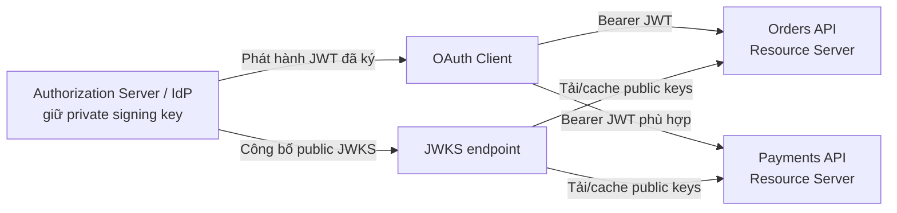
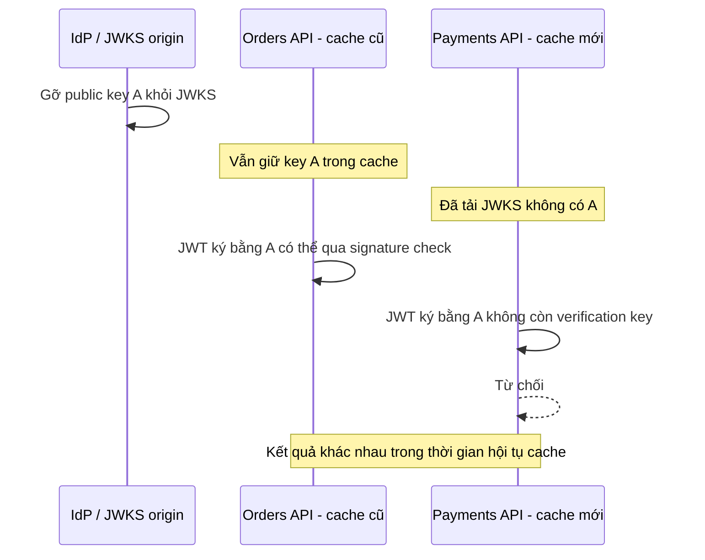
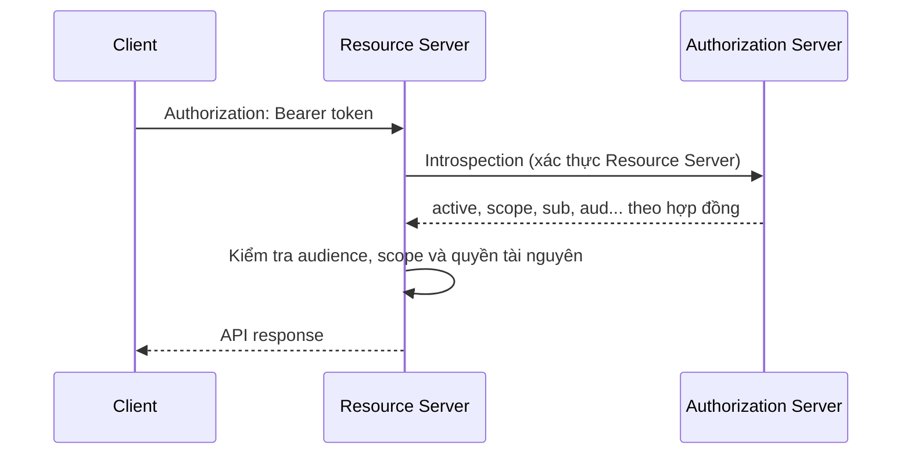

# Khóa bị gỡ, khóa bị lộ và giới hạn của cache đang giữ

Trong **Spring Security OAuth 2.0/OIDC Resource Server**, việc xác thực một JWT access token thường dựa vào các **khóa công khai** được nhà phát hành (Authorization Server/Identity Provider) cung cấp trong **JSON Web Key Set (JWKS)**. Resource Server sử dụng khóa tương ứng với chữ ký JWS để xác minh token, sau đó kiểm tra `iss`, `aud`, `exp`, `nbf` và những điều kiện khác của hợp đồng.

Một tình huống dễ gây hiểu nhầm: **Authorization Server gỡ một khóa khỏi JWKS, nhưng một số API vẫn chấp nhận token ký bằng khóa đó**. Điều này có thể xảy ra vì API, thư viện JWT, proxy hoặc lớp phân phối JWKS vẫn đang giữ bản khóa cũ trong cache. Trong xoay khóa theo kế hoạch, khoảng đệm đó có thể giúp tránh gián đoạn. Khi **private signing key bị lộ**, chính sự chậm trễ này trở thành khoảng thời gian kẻ tấn công có thể lợi dụng.

Bài học tập trung vào ý nghĩa bảo mật của ba sự kiện:

1. **Khóa bị gỡ (key removal/retirement):** public JWK không còn xuất hiện trong tập khóa mới được công bố.
2. **Khóa bí mật bị lộ (private signing key compromise):** kẻ tấn công có thể có khả năng tạo token mang chữ ký hợp lệ của khóa bị xâm phạm.
3. **Cache vẫn giữ khóa cũ:** một số Resource Server tiếp tục xác minh token bằng bản JWKS đã lưu, dù nguồn chính đã thay đổi.

Hiểu các ranh giới này giúp thiết kế vòng đời khóa, giới hạn sự cố và triển khai đúng những bảo đảm mà Resource Server thực sự có thể cung cấp.

## 1. Ai sở hữu khóa và ai tin khóa?

Xét một hệ thống gồm Authorization Server và hai API:



Với các thuật toán chữ ký bất đối xứng phổ biến như RSA/ECDSA:

| Thành phần | Sở hữu | Dùng để làm gì? |
|---|---|---|
| Authorization Server | **Private signing key** | Ký JWT access token |
| JWKS endpoint của issuer | **Public verification keys** | Cho phép Resource Server xác minh chữ ký |
| Resource Server | Public keys lấy từ nguồn issuer tin cậy, có thể được cache | Kiểm tra chữ ký của token nhận được |
| OAuth client | Access token (bearer credential) | Gửi cho API được cấp quyền |

**Công khai public verification key là bình thường và là mục đích của JWKS.** Một bên đọc được public key không tự có khả năng ký JWT giả, miễn là thuật toán và việc quản lý khóa đúng. Sự cố **lộ private signing key** nghiêm trọng hơn rất nhiều, vì bên sở hữu private key có thể tạo chữ ký JWS được kiểm chứng bằng public key tương ứng.

Phạm vi bài sử dụng mô hình JWT **JWS ký bất đối xứng**. Nếu dùng HMAC có bí mật chia sẻ (ví dụ HS256), bên biết bí mật có thể vừa ký vừa xác minh; mô hình trust và phạm vi ảnh hưởng sẽ khác. Không được coi một shared secret là “public key” để công bố trong JWKS.

## 2. JWKS chứa gì và vì sao có cache?

Ví dụ một JWKS minh họa:

```json
{
  "keys": [
    {
      "kty": "RSA",
      "use": "sig",
      "kid": "sign-2026-a",
      "alg": "RS256",
      "n": "BASE64URL_MODULUS_PLACEHOLDER",
      "e": "AQAB"
    },
    {
      "kty": "RSA",
      "use": "sig",
      "kid": "sign-2026-b",
      "alg": "RS256",
      "n": "ANOTHER_MODULUS_PLACEHOLDER",
      "e": "AQAB"
    }
  ]
}
```

Các giá trị `n` chỉ là placeholder, không phải khóa RSA sử dụng được. Trong JWKS thật, `n`, `e` (hoặc các tham số EC tương ứng) là những giá trị công khai cho phép kiểm chứng chữ ký.

Các trường nên hiểu:

- `kty`: loại khóa (RSA, EC, OKP… theo thuật toán được hỗ trợ).
- `kid`: *Key ID*, một định danh để **hỗ trợ chọn khóa** trong tập đã tin cậy; không phải bằng chứng khóa đáng tin.
- `use: "sig"`: khóa dành cho tác vụ chữ ký; không nhầm với khóa mã hóa JWE.
- `alg`: thuật toán mà khóa dự kiến hỗ trợ; API vẫn cần **allowlist thuật toán** được chấp nhận.
- Các tham số công khai (`n/e`, `crv/x/y`…): dữ liệu phục vụ xác minh.

JWT thường có header:

```json
{
  "alg": "RS256",
  "typ": "at+jwt",
  "kid": "sign-2026-a"
}
```

Resource Server tìm một khóa phù hợp với `kid`, thuật toán và issuer trong tập khóa đáng tin rồi **thực sự kiểm tra chữ ký**. Không được kết luận “token hợp lệ” chỉ vì `kid` xuất hiện trong JWKS; attacker có thể tự đặt bất kỳ `kid` nào trong header của token chưa xác thực.

### 2.1. Tại sao Resource Server không tải JWKS mỗi request?

Nếu mọi request đều truy vấn IdP/JWKS endpoint để lấy khóa, mỗi lần xác thực bearer JWT sẽ phụ thuộc trực tiếp vào mạng và trạng thái IdP. Vì vậy thư viện JWT thường có **cache public keys/metadata** để:

- Giảm độ trễ và số lần gọi mạng.
- Duy trì xử lý khi JWKS endpoint tạm chậm hoặc gián đoạn, tùy chính sách cache.
- Cho phép nhiều request dùng cùng tập public keys.

Đổi lại, **bản cache có thể lạc hậu so với JWKS vừa được cập nhật**. Chính sách TTL, cơ chế refresh và ứng xử khi truy cập JWKS lỗi là những thuộc tính của implementation/cache; không nên tự đoán một giá trị thời gian cố định cho mọi phiên bản Spring Security/Nimbus.

### 2.2. Cache nào có thể đang giữ khóa cũ?

```text
Authorization Server
  |
  v
JWKS origin / discovery metadata
  |
  v
CDN / proxy / gateway / HTTP cache (nếu có)
  |
  v
NimbusJwtDecoder / JWKSource / thư viện JWT
  |
  v
Resource Server instance A, B, C...
```

Các lớp trên có thể có chu kỳ cập nhật khác nhau. Ví dụ:

| Nơi lưu | Điều cần xem |
|---|---|
| IdP / JWKS origin | Khi nào khóa mới được công bố, khóa cũ thực sự bị gỡ? |
| CDN, reverse proxy | Cache-Control, TTL, purge/invalidation, hành vi phục vụ nội dung cũ |
| API gateway có xác thực JWT | Gateway có JWKS cache riêng hay không? |
| Nimbus/JWT decoder trong API | Tập JWK được cache và điều kiện tải lại |
| Nhiều replica của Resource Server | Mỗi instance đã nạp JWKS mới chưa? |
| Process tái khởi động, sidecar hoặc cấu hình khóa tĩnh | Khóa được nạp ở startup hay đọc lại định kỳ? |

**Một lần cập nhật JWKS tại IdP không tự đồng bộ mọi cache**. Hơn nữa, nhiều Resource Server có thể xác thực cùng một token theo các kết quả khác nhau trong giai đoạn chuyển tiếp.

## 3. “Khóa bị gỡ” nghĩa là gì — và không có nghĩa là gì?

Giả sử ở thời điểm ban đầu IdP công bố:

```text
JWKS tại T0:
  sign-2026-a
  sign-2026-b
```

Sau đó IdP gỡ khóa `sign-2026-a`:

```text
JWKS tại T1:
  sign-2026-b
```

Ta có thể kết luận:

> **JWKS mới tại nguồn không còn công bố public key A.**

Ta **chưa thể kết luận**:

- Mọi Resource Server đã nạp được JWKS mới.
- Các bản cache trung gian đã xóa khóa A.
- Tất cả JWT đã ký bằng A đều bị từ chối từ chính thời điểm T1.
- Các token đã cấp bằng A được thu hồi khỏi mọi API.
- Private signing key A đã được xóa an toàn khỏi mọi hệ thống.

JWT có chữ ký được kiểm chứng **offline** dựa trên public key đang nằm trong bộ kiểm chứng. Nếu API vẫn giữ public key A trong bộ nhớ, một JWT ký bằng private key A có thể tiếp tục vượt qua kiểm tra chữ ký. Nếu token còn hiệu lực, đúng issuer, đúng audience và không bị chặn bởi điều kiện riêng, API có thể chấp nhận nó.

### 3.1. Xóa public JWK không xóa chữ ký trên các token cũ

Một JWT đã phát hành chứa phần signature được tạo từ signing key trước đó. Khi IdP gỡ public JWK, chữ ký trong token **không thay đổi**, và token cũng không “tự biết” JWKS đã cập nhật. Chỉ **bộ kiểm chứng tại API** quyết định sẽ dùng public key nào và điều kiện nào để nhận token.



Sơ đồ minh họa khác biệt do **trạng thái tập khóa**. Quyết định cuối cùng còn phụ thuộc issuer, audience, thời gian, profile và authorization của từng API. Nếu API1 có chính sách từ chối key A độc lập với JWKS cache thì API1 vẫn có thể từ chối ngay.

### 3.2. Xóa khóa ở IdP khác với vô hiệu hóa token trong Resource Server

Các thao tác có mục tiêu riêng:

| Hành động | Tác dụng trực tiếp | Giới hạn |
|---|---|---|
| Ngừng dùng private key A để **ký token mới** | Token mới bình thường không còn được tạo với A | Attacker có private key A vẫn có thể ký token giả |
| Xóa public JWK A khỏi **JWKS origin** | Các verifier tải tập khóa mới sẽ không còn khóa A | Verifier/cache cũ có thể vẫn giữ A |
| Xóa A khỏi **tập khóa tin cậy của từng verifier** | Verifier đó không còn dùng A để xác minh | Phải triển khai đến mọi API/gateway/instance |
| Token introspection trả `active=false` | API có introspection đúng hợp đồng sẽ từ chối token không active | JWT được xác minh offline không tự gọi introspection |
| Chặn `jti`/subject/issuer theo trạng thái | Từ chối các token/phạm vi đã định khi API kiểm tra chính sách | Cần trạng thái và đồng bộ mọi nơi áp dụng |
| Đợi token hết `exp` | Token hết hạn theo chính sách thời gian | Nếu private key lộ, attacker có thể tự ký token mới với `exp` lớn nếu verifier chưa kiểm tra tuổi tối đa |

**Gỡ JWK khỏi endpoint không phải giao thức thu hồi token tức thì.** Nó là một thay đổi về tập khóa mà các verifier cần quan sát.

## 4. Cache giữ khóa cũ gây rủi ro theo thời gian

Giả sử:

```text
T0 = 10:00  API tải JWKS có khóa A và B.
T1 = 10:05  IdP gỡ khóa A khỏi JWKS.
T2 = 10:06  Client/attacker gửi JWT ký bằng A.
T3 = 10:15  API làm mới JWKS và không còn khóa A.
```

Trong khoảng T1 đến trước T3, API có thể vẫn xác minh chữ ký A. Nếu cơ chế cache không cố định thời gian cập nhật, T3 có thể muộn hơn 10:15, sớm hơn hoặc không xảy ra trong trường hợp lỗi cấu hình/không refresh.

<details>
<summary>Quan sát về khả năng chấp nhận token</summary>

```text
                       JWKS origin:      A + B ------> B
                                         T1

Resource Server cache:  A + B ---------------------> B
                                                 T3

JWT ký bằng A:
   Có thể vượt qua bước kiểm tra chữ ký khi API còn tin A.
   Bị từ chối chữ ký/không tìm thấy khóa khi verifier đã loại A.
```

</details>

**Không nên giả định tất cả token ký bằng A đều ngừng hợp lệ sau đúng một TTL duy nhất.** TTL của cache có thể khác nhau giữa các instance, proxy và các phiên bản thư viện; một số triển khai có thể dùng stale cache khi endpoint gặp lỗi, một số khác fail closed. Cần kiểm chứng hành vi **trên đúng đường xác thực đang chạy**.

### 4.1. Cache freshness và thời gian hết hạn token là hai đồng hồ khác nhau

Ta có hai khái niệm:

- **Token lifetime:** khoảng thời gian token có thể được chấp nhận theo các claim như `nbf`, `exp`, cùng validator về tuổi tối đa nếu có.
- **Key cache freshness:** khoảng thời gian verifier dùng tập public keys đã lấy trước đó trước khi nạp lại.

Token có thể **chưa hết hạn** nhưng bị từ chối do verifier đã gỡ khóa xác minh. Ngược lại, một token có chữ ký xác minh bằng khóa cached vẫn phải bị từ chối nếu `exp` đã hết hạn hoặc `aud` sai.

Trong sự cố private key lộ, thời gian rủi ro không chỉ bằng TTL JWT. Nếu attacker có thể ký token và đặt một `exp` rất xa, mà API chỉ kiểm tra thời gian hết hạn không giới hạn tuổi token, thì khi cached key còn được tin cậy, token giả có thể có hạn dùng bất thường. **Giới hạn tuổi token tối đa và chính sách phát hành** giúp bổ sung rào chắn, nhưng không thay thế việc loại khóa đã bị xâm phạm.

### 4.2. Cache-Control không phải lệnh xóa key đang nằm trong JVM

Ví dụ JWKS endpoint có HTTP response:

```http
HTTP/1.1 200 OK
Content-Type: application/json
Cache-Control: public, max-age=300
ETag: "jwks-v42"
```

Header trên mô tả cache policy ở lớp HTTP theo các thành phần tuân thủ nó; nó **không chứng minh** rằng mọi JwtDecoder trong JVM sẽ tải lại chính xác sau 300 giây. Một JWT library có thể có cơ chế cache/refresh riêng. Ứng dụng cũng có thể đọc khóa bằng file tĩnh hoặc tạo decoder tùy biến không quan tâm Cache-Control.

`ETag` và `If-None-Match` có thể giúp HTTP client kiểm tra tài liệu thay đổi một cách hiệu quả, nhưng không phải cơ chế thu hồi token và không đảm bảo **đã xóa public key A khỏi mọi bộ nhớ**.

### 4.3. Có thể xảy ra “refresh không thành công”

Các tình huống cần thiết kế:

- JWKS endpoint trả lỗi 5xx hoặc timeout.
- CDN trả nội dung cũ vì policy cho phép stale response.
- Thay đổi DNS/issuer metadata làm URL không truy cập được.
- Resource Server có cache tùy biến giữ khóa cũ để ưu tiên availability.
- Một số pod mới nạp khóa mới, pod cũ vẫn giữ khóa trước khi reload.
- Gateway có JWK cache riêng còn API kiểm tra trực tiếp bằng cache khác.

Một verifier có thể được thiết kế **fail closed** khi không xác minh được chữ ký hoặc trạng thái tin cậy, nhưng cần biết **nó đã coi khóa cached là khóa tin cậy hay chưa**. “Không gọi mạng được” và “không có khóa nào để xác minh” là hai tình huống khác nhau.

**Trong sự cố lộ khóa, cho phép cache stale để bảo đảm availability có thể xung đột trực tiếp với mục tiêu loại bỏ khóa bị lộ.**

## 5. Xoay khóa theo kế hoạch: không làm mất hiệu lực token đang dùng

Xoay khóa bình thường (*planned rotation*) nhằm đổi signing key, không nhất thiết thu hồi token hợp lệ. Một kế hoạch điển hình gồm:

### Bước 1 — Công bố public key mới trước khi dùng

```text
JWKS: [A]
     -> [A, B]

IdP vẫn ký token mới bằng A.
```

Resource Server có thời gian lấy JWKS chứa cả A và B. Giai đoạn này giúp tránh việc API lần đầu thấy `kid=B` nhưng chưa có public key B.

### Bước 2 — Chuyển IdP sang ký bằng key B

```text
JWKS: [A, B]

IdP ký token mới bằng B.
Token cũ đã ký bằng A vẫn chưa hết hạn.
```

Hai public key cùng tồn tại để API xử lý JWT cũ và mới. Một số thư viện có thể refresh JWKS khi gặp `kid` chưa có trong cache, nhưng **không nên giả định mọi version, mọi cache và mọi proxy đều refresh tức thì**. Công bố key trước khi đổi ký là cách giảm gián đoạn.

### Bước 3 — Đợi cửa sổ sử dụng token cũ kết thúc

Khóa A thường cần còn được công bố ít nhất cho đến khi:

1. Không còn token A hợp lệ dự kiến được dùng, kể cả access token còn hạn lâu nhất theo chính sách.
2. Các sai lệch đồng hồ/tolerance của Resource Server đã được tính toán.
3. Tất cả instance/gateway có thời gian nhận biết B theo chu kỳ cache và cơ chế cập nhật thực tế.

Cần tách **cửa sổ sống của token cũ** và **cửa sổ phân phối khóa mới**. Cả hai phải được xét trong kế hoạch. Nếu IdP gỡ A quá sớm, người dùng có thể nhận 401 mặc dù token chưa hết `exp`.

### Bước 4 — Gỡ key A và theo dõi

```text
JWKS: [A, B]
     -> [B]
```

Lúc này token ký bằng A đáng lẽ đã hết hạn hoặc bị ràng buộc chính sách không còn được nhận. Việc một số verifier vẫn giữ A trong cache là một trạng thái cần theo dõi, nhưng hậu quả thường thấp hơn vì **private key A không bị xem là đã lộ** và token A cũ đã hết hiệu lực thời gian.

### 5.1. Ví dụ tính cửa sổ theo kế hoạch

Giả sử hợp đồng phát hành:

```text
Access token sống tối đa:   20 phút
Clock skew được phép:        1 phút
Đổi từ ký A sang ký B:      12:00
```

Token A cuối cùng phát hành ngay trước 12:00 có thể còn hiệu lực đến khoảng **12:20**, hoặc lâu hơn chút theo cách validator áp clock skew. Nếu bỏ A khỏi JWKS lúc **12:01**, API đã refresh khóa sẽ từ chối những token A hợp lệ về thời gian.

Vì vậy cần giữ A được công bố trong **toàn bộ cửa sổ token cũ còn hợp lệ** và cân nhắc propagation của cache, khả năng IdP vẫn đang cấp token A trong lúc chuyển, và các ngoại lệ token có TTL dài hơn. Không lấy phép cộng cố định “20 + 1 phút” làm SLA cho mọi hệ thống nếu còn nhiều cấu hình và loại token khác.

## 6. Lộ private signing key: vấn đề hoàn toàn khác xoay khóa thường

**Private signing key bị lộ** có nghĩa kẻ tấn công có thể giả mạo chữ ký của issuer trên JWT mà Resource Server đang tin. Rủi ro không chỉ là attacker dùng lại các token đã đánh cắp: họ có thể **tạo JWT mới** với nội dung tự chọn, ví dụ `sub`, `scope`, `aud` hoặc `exp`, trong phạm vi những kiểm tra mà API cho phép.

Ví dụ token bị giả mạo:

```json
{
  "iss": "https://idp.example.com/realms/shop",
  "sub": "user-admin",
  "aud": ["orders-api"],
  "scope": "orders.read orders.write",
  "iat": 1893456000,
  "exp": 1893542400
}
```

Payload chỉ minh họa tác động; nếu attacker nắm private signing key A, họ có thể ký payload trên bằng A. **Chữ ký đúng không còn là bằng chứng đủ về nguồn phát hành** vì khóa của nhà phát hành đã bị xâm phạm.

### 6.1. Vì sao chỉ “ngừng ký bằng A” là chưa đủ?

IdP có thể đổi sang ký bằng B trong một phút. Nhưng attacker không cần IdP ký hộ: họ đã có private key A. Chừng nào Resource Server còn chấp nhận public key A, chữ ký do attacker tạo từ A có thể vẫn vượt qua kiểm tra mật mã.

### 6.2. Vì sao chỉ “gỡ public JWK A” cũng chưa đủ?

Một số API còn cached A. Đến khi chúng loại A khỏi tập verification keys, sự cố mới được cô lập tại những verifier đó. **Không thể coi JWKS update ở origin là thời điểm an toàn thực tế** nếu không biết trạng thái tất cả verifier.

### 6.3. Không thể phân biệt token thật và token giả chỉ bằng chữ ký A

Khi private key A đã lộ, hai token:

```text
Token thật do IdP từng ký bằng A
Token giả do attacker ký bằng A
```

có thể đều xác minh chữ ký bằng public key A. Không thể dùng một kiểm tra chữ ký A duy nhất để kết luận đâu là token thật. Muốn chọn lọc chấp nhận token A, cần **bằng chứng ngoài chữ ký bị lộ**, chẳng hạn trạng thái phát hành token do Authorization Server lưu, introspection có khả năng nhận diện token thật, hoặc một cơ chế cấp phát/ủy quyền khác được tin cậy.

Nếu hệ thống không có cách phân biệt đáng tin, biện pháp an toàn thường là **ngừng tin khóa A**, chấp nhận rằng một số token hợp lệ ký bằng A cũng bị vô hiệu. Đây là điểm khác với xoay khóa không có sự cố: cần ưu tiên cô lập khóa lộ thay vì duy trì cửa sổ tương thích bình thường.

## 7. Timeline sự cố: cache biến một thay đổi tức thì thành sự kiện phân tán

Ví dụ một sự cố giả định:

| Thời điểm | Sự kiện | Rủi ro |
|---|---|---|
| 09:00 | API A, B, C đều cache JWKS chứa key K1 | Các API tin K1 |
| 09:12 | Đội bảo mật phát hiện private signing key K1 bị lộ | Attacker có thể ký JWT giả bằng K1 |
| 09:14 | IdP dừng ký K1, chuyển sang K2 | Token thật mới dùng K2; attacker vẫn có K1 |
| 09:15 | K1 được gỡ khỏi JWKS origin | Verifier tải JWKS mới sẽ không còn K1 |
| 09:17 | API A refresh và loại K1 | API A không còn chấp nhận chữ ký K1 |
| 09:22 | API B vẫn giữ cache K1 | API B có thể còn nhận token giả |
| 09:31 | Gateway C vẫn dùng key set cũ | Đường request qua gateway này còn rủi ro |
| Sau khi xác minh toàn hệ thống | Các verifier đã loại K1 và từ chối token ký bằng K1 | Phạm vi tin cậy vào key K1 được thu hẹp/loại bỏ |

Các thời điểm chỉ minh họa. **Độ trễ gỡ khóa hiệu quả** phụ thuộc vào replica, CDN/proxy, cấu hình cache, đường truy cập, timeout, chính sách fallback và khả năng điều phối vận hành.

Khái niệm quan trọng:

```text
Thời điểm IdP phát hiện lộ key
        !=
Thời điểm JWKS origin gỡ public key
        !=
Thời điểm toàn bộ Resource Server ngừng tin key
```

Nếu còn một đường gọi API không đi qua gateway đã cập nhật, hoặc một pod cũ chưa được thay cấu hình, hệ thống vẫn có thể còn chấp nhận token dùng K1.

## 8. Playbook phản ứng khi private signing key bị lộ

Quy trình sự cố nên được xây từ trước, vì thời gian phản ứng thực tế khó giảm nếu đến lúc lộ khóa mới bắt đầu tìm danh sách service và cache.

### Pha A — Xác định phạm vi và cô lập nguồn phát hành

1. **Xác định issuer và key bị ảnh hưởng**: khóa nào, thuật toán nào, `kid`/thumbprint nào, có bao nhiêu realm/tenant dùng chung khóa?
2. **Ngừng ký token mới bằng key đó** và chuyển sang signing key an toàn đã được bảo vệ.
3. **Thu hồi quyền truy cập tới private signing key cũ**, kiểm soát secret manager/HSM/KMS và điều tra đường rò rỉ.
4. **Kiểm tra các dịch vụ đang tin issuer/key đó**, bao gồm Resource Server, API gateway, service mesh plugin, batch job, môi trường dự phòng và hệ thống được cấp quyền dùng JWKS.

Ngừng ký chỉ ngăn việc IdP phát hành hợp lệ bằng key cũ; nếu attacker đã có key, cần bước kế tiếp để **đổi tập khóa mà verifier tin**.

### Pha B — Buộc bên nhận ngừng chấp nhận key đã lộ

1. Gỡ public JWK bị ảnh hưởng khỏi tập khóa tin cậy/JWKS theo quy trình ứng phó khẩn.
2. **Bảo đảm mọi verifier loại khóa khỏi cache** bằng cơ chế refresh/invalidation được chính thư viện và hạ tầng hỗ trợ. Nếu không có invalidation API an toàn, có thể cần triển khai lại hoặc khởi động lại các instance với cấu hình mới; phải kiểm soát đường khởi tạo và tránh nạp lại JWKS stale.
3. Xem xét **chặn khóa theo chính sách độc lập** với JWKS cache tại gateway/API nếu hệ thống có cơ chế đáng tin, ví dụ policy dựa trên public-key fingerprint đã được cấu hình và triển khai tới mọi verifier.
4. Giới hạn hoặc tạm chặn các thao tác nhạy cảm nếu chưa chứng minh được mọi verifier đã loại khóa.
5. Kiểm tra đường bypass: API có endpoint nội bộ, replica hay môi trường song song nào còn chấp nhận key cũ?

**Không dựa duy nhất vào một denylist theo `kid` lấy từ header JWT chưa xác thực.** `kid` do người gửi token khai báo, có thể thiếu, trùng hoặc bị sửa. Một cơ chế chặn key an toàn phải gắn với **khóa kiểm chứng thực sự đã được lựa chọn trong tập khóa tin cậy**, ví dụ fingerprint/định danh nội bộ của verified key, hoặc loại hẳn key khỏi candidate keys của verifier.

Một rule “nếu header `kid=K1` thì reject” có thể hữu ích như lớp giảm thiểu tạm thời khi token format bắt buộc và đồng bộ `kid`, nhưng **không nên coi đó là giải pháp đầy đủ** nếu parser có thể thử khóa khi thiếu `kid` hoặc nếu còn đường xác thực khác.

### Pha C — Giảm ảnh hưởng của token đã phát hành

- Nếu đã loại key K1 khỏi verifier, cả token thật và token giả ký bằng K1 đều có thể bị từ chối. Chuẩn bị cơ chế **xin cấp access token mới** bằng key an toàn cho client hợp lệ.
- Đánh giá các access token/refresh token liên quan, quyền người dùng và khả năng lạm dụng. **Gỡ signing key không tự thu hồi refresh token** nếu refresh token dùng trạng thái/cơ chế ký khác.
- Nếu có token introspection hoặc token registry, cân nhắc vô hiệu những token bị ảnh hưởng theo khả năng phân biệt đáng tin.
- Nếu một số luồng không thể cập nhật verifier kịp, cân nhắc giới hạn mạng/endpoint hoặc tạm ngừng API nhạy cảm theo mức rủi ro.
- Nếu nghi phạm có quyền quản lý khóa hoặc IdP, điều tra rộng hơn vì thay một signing key có thể chưa đủ.

### Pha D — Quan sát, xác nhận hội tụ và phục hồi

Thời điểm tuyên bố cô lập sự cố phải dựa trên bằng chứng:

- Tất cả Resource Server/gateway liên quan đã nạp key set không chứa khóa bị lộ.
- Có phương án xác định trạng thái các replica mới, autoscaling và vùng dự phòng.
- Request mang token ký bằng khóa cũ bị từ chối ở mọi đường đã kiểm soát.
- Token ký bằng khóa an toàn mới được chấp nhận đúng issuer/audience/thời gian/scope.
- Không còn endpoint hoặc cấu hình tĩnh khác tin key K1.

Sau đó thực hiện phân tích phạm vi ảnh hưởng, log bất thường, dấu hiệu token bị giả, và tăng bảo vệ private key. Không ghi nguyên bearer tokens, private key hay credential vào ticket điều tra.

## 9. Vì sao TTL token ngắn giúp ích nhưng không thay thế gỡ khóa?

Một chiến lược phổ biến là access token sống ngắn, ví dụ 5–15 phút theo nhu cầu hệ thống. Điều này giảm khoảng thời gian sử dụng một **token đã phát hành và bị đánh cắp**.

Nhưng với **private signing key bị lộ**, attacker có thể tự phát hành token mới bằng K1:

```text
Attacker có private signing key K1
     |
     +--> tạo claims bất kỳ theo mức verifier kiểm tra
     +--> đặt iat / nbf / exp phù hợp hoặc bất thường
     +--> ký JWT bằng K1
     |
     v
API đang cached public key K1
     |
     v
Chữ ký có thể được chấp nhận nếu policy không loại K1
```

Giới hạn **max token lifetime** (ví dụ kiểm tra `exp - iat` trong giới hạn cho phép), giới hạn `iat` tương lai và giới hạn tuổi token có thể giảm một số dạng token giả. Nhưng attacker có thể **tạo token có các thời gian nằm trong khoảng hợp lệ**. Vì vậy, **rào chắn cuối cùng vẫn phải là ngừng tin compromised signing key** hoặc dựa vào một bằng chứng tin cậy độc lập mà attacker không giả được.

### 9.1. Clock skew là vấn đề riêng

Khi xác minh `exp` và `nbf`, Spring Security có thể cho phép một độ lệch đồng hồ nhỏ theo validator. Độ lệch này **không kéo dài thời gian tồn tại của khóa trong JWKS cache**, nhưng có thể kéo dài khoảng thời gian token được chấp nhận quanh ranh giới thời gian.

Đừng dùng clock-skew tolerance lớn để khắc phục đồng hồ IdP/API không đồng bộ. Nên đồng bộ thời gian hệ thống và chọn tolerance hợp lý.

### 9.2. Ngừng tin key và thu hồi từng token là hai công cụ khác nhau

| Công cụ | Phạm vi tác động | Phù hợp khi |
|---|---|---|
| Loại compromised key khỏi trusted key set | Toàn bộ token ký bằng key đó | Key lộ, không thể phân biệt token thật/giả chỉ bằng chữ ký |
| Thu hồi theo `jti`/token registry | Một hoặc một nhóm token cụ thể | Có trạng thái phát hành tin cậy và mọi verifier kiểm tra nó |
| Thu hồi theo user/session | Một nhóm quyền/tài khoản/sessions | Tài khoản bị xâm phạm hoặc quyền thay đổi |
| Introspection thời gian thực | API hỏi AS về token đang active | Cần phản ánh trạng thái thu hồi; endpoint tin cậy, trả đủ metadata |
| TTL ngắn | Giới hạn hiệu lực token đã cấp | Chính sách bình thường giảm exposure |
| Đánh giá quyền dữ liệu hiện tại | Từng thao tác trên từng đối tượng | Chặn lạm dụng quyền dù token còn hiệu lực |

Không có một giải pháp “cache refresh” đơn lẻ thay được toàn bộ các kiểm soát này.

## 10. Giới hạn của `kid`, JWKS và token claims

### 10.1. `kid` là selector, không phải trust anchor

Một JWT header có thể ghi:

```json
{
  "alg": "RS256",
  "kid": "sign-2026-a"
}
```

Nhưng `kid` chỉ là dữ liệu trong JOSE header do client gửi kèm token. API chỉ tin kết quả **chữ ký được xác minh bằng một khóa thuộc trust set hợp lệ của issuer**. Nếu hệ thống dùng `kid` như định danh bảo mật tuyệt đối mà không ràng buộc issuer, key material và loại thuật toán, có thể xảy ra key confusion.

Một số thư viện cho phép một key selector thử nhiều khóa khi `kid` vắng mặt hoặc không đủ để chọn duy nhất. Việc chặn theo chuỗi `kid` có thể không bao phủ mọi đường xác minh. Với emergency revocation, nên **loại key material/fingerprint cụ thể khỏi candidate keys** ở mọi verifier hoặc thực thi chính sách được thư viện hỗ trợ.

### 10.2. Không tải khóa theo URL do token chưa xác thực đề xuất

JOSE header có thể mang các trường như `jku` hoặc `x5u`. Không lấy những URL đó làm nguồn khóa mới tùy ý để “sửa lỗi unknown kid”. Nếu không, người gửi token có thể ảnh hưởng tới trust source và tạo rủi ro SSRF hoặc xác minh bằng khóa do chính họ kiểm soát.

Nguồn issuer, JWKS endpoint hoặc tập khóa phải xuất phát từ **cấu hình tin cậy của ứng dụng** hoặc cơ chế quản trị đáng tin. Nếu chấp nhận nhiều issuer, mỗi issuer cần có cấu hình/allowlist và validator riêng.

### 10.3. Gỡ một key không chứng minh issuer bị vô hiệu toàn bộ

IdP có thể giữ nhiều key theo từng tenant, loại token hoặc thuật toán. Một key bị lộ có thể ảnh hưởng:

- JWT access token của một realm cụ thể.
- JWT ID token của một OIDC client khác nếu dùng chung signing key.
- Một số API/resource có audience khác nhau.
- Các dịch vụ khác đang tin public key hoặc certificate đó.

Phạm vi phải xác định qua **issuer, key material, môi trường, token profile, client và verifier thực tế**, không chỉ nhìn tên `kid`. Hai issuer có thể cùng dùng một chuỗi `kid` mà khóa khác nhau.

## 11. Spring Security/NimbusJwtDecoder: cần hiểu chính xác đường cache

Trong Servlet Resource Server JWT thông thường:

```text
Authorization: Bearer JWT
    |
    v
BearerTokenAuthenticationFilter
    |
    v
JwtAuthenticationProvider
    |
    v
JwtDecoder (thường là NimbusJwtDecoder)
    |
    +--> lấy/giữ JWKs của issuer tin cậy
    +--> xác minh chữ ký JWS với public key phù hợp
    +--> chạy validators cho issuer, thời gian, audience...
    |
    v
JwtAuthenticationToken
    |
    v
Authorization / business policy
```

Spring Security dùng Nimbus JOSE + JWT trong nhiều đường JWT decoding. **Cache keys, cơ chế refresh khi gặp unknown `kid`, thời gian cache và fallback khi mạng lỗi phụ thuộc phiên bản và cách khởi tạo cụ thể**:

- Decoder mặc định do Spring Boot dựng từ `issuer-uri` có thể khác decoder ứng dụng tự tạo bằng builder.
- `jwk-set-uri` đưa vào cấu hình có thể thay đổi cách discovery endpoint.
- Một bean `JwtDecoder` do ứng dụng cung cấp có thể thay hoàn toàn hành vi auto-config.
- Application có thể sử dụng `Cache` của Spring hoặc một JWKSource tùy biến, làm khác các giá trị mặc định của Nimbus.
- Gateway/service mesh có thể xác minh JWT trước API bằng cache độc lập.

Do vậy, **không khẳng định một con số như “Spring luôn cache JWKS 5 phút” cho mọi phiên bản/cấu hình**. Các tài liệu về framework có thể nêu mặc định theo phiên bản, nhưng hệ thống vận hành cần xác định chính xác implementation đã được triển khai.

### 11.1. Cấu hình một JWT Resource Server tối thiểu

Ví dụ Spring Boot 3.x với dependencies Servlet Resource Server:

```groovy
// build.gradle
dependencies {
    implementation 'org.springframework.boot:spring-boot-starter-web'
    implementation 'org.springframework.boot:spring-boot-starter-oauth2-resource-server'
}
```

```yaml
# application.yml
spring:
  security:
    oauth2:
      resourceserver:
        jwt:
          issuer-uri: https://idp.example.com/realms/shop
          audiences:
            - orders-api
```

```java
import org.springframework.context.annotation.Bean;
import org.springframework.context.annotation.Configuration;
import org.springframework.security.config.Customizer;
import org.springframework.security.config.annotation.web.builders.HttpSecurity;
import org.springframework.security.web.SecurityFilterChain;

@Configuration
class OrdersSecurityConfiguration {

    @Bean
    SecurityFilterChain securityFilterChain(HttpSecurity http)
            throws Exception {
        return http
            .authorizeHttpRequests(auth -> auth
                .requestMatchers("/public/health").permitAll()
                .requestMatchers("/api/orders/**")
                    .hasAuthority("SCOPE_orders.read")
                .anyRequest().authenticated())
            .oauth2ResourceServer(oauth2 ->
                oauth2.jwt(Customizer.withDefaults()))
            .build();
    }
}
```

Cấu hình trên cho thấy sự phân vai: issuer/audience dùng cho kiểm chứng JWT, còn HTTP rule kiểm tra authority. Nó **không bổ sung tự động cơ chế emergency key revocation cho mọi cached JWT decoder**. Nếu muốn hỗ trợ lệnh “ngừng tin signing key K1 ngay”, hệ thống phải có khả năng quản trị **trusted verification keys** ở tất cả verifier.

Khi tự tạo `JwtDecoder`, cần giữ các điều kiện kiểm chứng cần thiết; chỉ đưa JWKS URI vào decoder mà quên issuer/audience có thể gây lỗi chấp nhận token sai đối tượng. Ví dụ cấu hình validator:

```java
import org.springframework.beans.factory.annotation.Value;
import org.springframework.context.annotation.Bean;
import org.springframework.context.annotation.Configuration;
import org.springframework.security.oauth2.core.DelegatingOAuth2TokenValidator;
import org.springframework.security.oauth2.core.OAuth2Error;
import org.springframework.security.oauth2.core.OAuth2TokenValidator;
import org.springframework.security.oauth2.core.OAuth2TokenValidatorResult;
import org.springframework.security.oauth2.jwt.Jwt;
import org.springframework.security.oauth2.jwt.JwtDecoder;
import org.springframework.security.oauth2.jwt.JwtValidators;
import org.springframework.security.oauth2.jwt.NimbusJwtDecoder;

@Configuration
class JwtContractConfiguration {

    @Bean
    JwtDecoder jwtDecoder(
            @Value("${app.security.issuer}") String trustedIssuer,
            @Value("${app.security.audience}") String requiredAudience) {

        NimbusJwtDecoder decoder =
            NimbusJwtDecoder.withIssuerLocation(trustedIssuer).build();

        OAuth2TokenValidator<Jwt> defaults =
            JwtValidators.createDefaultWithIssuer(trustedIssuer);

        OAuth2TokenValidator<Jwt> audience = jwt ->
            jwt.getAudience().contains(requiredAudience)
                ? OAuth2TokenValidatorResult.success()
                : OAuth2TokenValidatorResult.failure(
                    new OAuth2Error(
                        "invalid_token",
                        "JWT audience does not match this API",
                        null));

        decoder.setJwtValidator(
            new DelegatingOAuth2TokenValidator<>(defaults, audience));
        return decoder;
    }
}
```

```yaml
app:
  security:
    issuer: https://idp.example.com/realms/shop
    audience: orders-api
```

Trong ví dụ Java trên, chuỗi `@Value` sử dụng cú pháp property placeholder của Spring. **Đây là minh họa issuer/audience validation**, không phải triển khai cache invalidation; khi thay decoder mặc định, các validator phải tiếp tục được giữ đúng và không nên giả định việc cập nhật property sẽ làm refresh mọi key ngay lập tức.

### 11.2. Có thể ép fetch lại JWKS bằng cách nào?

Không có một câu trả lời chung an toàn cho mọi kiến trúc. Cần kiểm tra API quản trị cache được **implementation đang dùng** hỗ trợ:

- Có thể clear/invalidate một `Cache` cụ thể mà decoder thật sự đang dùng không?
- Decoder dùng JWKSource nào? Có cơ chế refresh rõ ràng hay chỉ cache theo TTL?
- Nếu khởi động lại pod, pod sẽ tải JWKS origin mới hay vẫn đi qua CDN/proxy đang stale?
- Nếu có nhiều SecurityFilterChain/issuer, đã xác định đúng decoder của mỗi chain chưa?
- Gateway trước API có cache riêng cần purge không?
- Có một policy loại compromised key độc lập với JWKS refresh được triển khai đồng bộ không?

**Không mặc định request mang `kid` chưa thấy sẽ luôn làm refresh**. Cơ chế xử lý unknown key phụ thuộc thư viện, version, thời điểm refresh gần nhất, rate limiting và JWK source. Việc liên tục yêu cầu refresh từ mỗi request lạ còn có thể bị lợi dụng gây tải lớn lên IdP.

### 11.3. Có thể dựa vào việc restart service không?

Khởi động lại process thường loại bỏ **cache trong bộ nhớ của process**. Nhưng nó không đảm bảo key mới nếu:

- JWKS endpoint, CDN hoặc sidecar vẫn trả nội dung cũ.
- Ứng dụng có bộ nhớ đệm dùng chung/bền hoặc cấu hình chứa key cũ.
- Replica chưa được restart; autoscaler tạo lại image/config cũ.
- Một đường request vẫn bypass qua service khác còn tin key cũ.

Restart có thể là **một bước phục hồi**, không phải bằng chứng hoàn tất xoay khóa. Sau đó cần quan sát và xác nhận **hành vi từ chối khóa bị lộ** ở các điểm nhận.

## 12. Introspection thay đổi mô hình thu hồi như thế nào?

Với JWT self-contained, API thường xác minh local dựa trên chữ ký và claim. Với **opaque access token/introspection**, API hỏi Authorization Server xem credential hiện còn active không.



Ví dụ cấu hình opaque token:

```yaml
spring:
  security:
    oauth2:
      resourceserver:
        opaquetoken:
          introspection-uri: https://idp.example.com/oauth2/introspect
          client-id: orders-api
          client-secret: INTROSPECTION_SECRET_FROM_SECURE_CONFIG
```

Giá trị secret chỉ là placeholder; môi trường thật phải quản lý bí mật bằng secret store/biến môi trường an toàn.

Nếu IdP có token registry, introspection có thể phản ánh trạng thái thu hồi; **JWT được introspect cũng có thể được nhận diện như một credential theo cơ chế của IdP**, miễn IdP thực sự xác minh và phân biệt token được phát hành hợp lệ. Nhưng cần làm rõ:

1. Introspection endpoint trả `active=false` với các token giả ký bằng compromised key như thế nào?
2. IdP có trạng thái phát hành token thật hay chỉ tự kiểm tra chữ ký/`exp`? Nếu chỉ kiểm tra chữ ký bằng key lộ, nó **cũng có thể bị lừa**.
3. API có cache introspection result không? Cache làm chậm hiệu lực thu hồi.
4. Endpoint trả đủ `aud`, `scope` và dữ liệu principal để Resource Server kiểm tra quyền không?

**“Dùng introspection” không tự chữa sự cố nếu chính Authorization Server vẫn tin compromised key mà không có cơ chế phát hiện token giả.** Muốn tăng tính thu hồi thực tế phải dựa vào một nguồn trạng thái/issuer trust khác mà attacker không kiểm soát.

## 13. Chính sách bổ sung ngoài JWKS cache

JWKS là một lớp tin cậy quan trọng, nhưng với API nhạy cảm có thể cần các kiểm soát bổ sung:

### 13.1. Giới hạn token lifetime và claims hợp đồng

Validator có thể kiểm tra:

```text
iss == issuer được cấu hình
aud chứa audience của API
exp > now (xét clock skew phù hợp)
nbf <= now (xét clock skew phù hợp)
iat không nằm trong tương lai quá mức
exp - iat không vượt quá max token lifetime
typ/token profile phù hợp
```

Đây là cách bảo vệ khi IdP phát hành token sai cấu hình hoặc attacker tạo claim bất thường. Tuy nhiên, attacker có compromised signing key vẫn có thể đặt claim **nằm trong khoảng hợp lệ**. Các validator này giảm phạm vi lạm dụng nhưng không thay thế key revocation.

### 13.2. Danh sách bị chặn theo token/key

Nếu API triển khai revocation:

- **Token-level** có thể dùng `iss + jti` khi token có `jti` ổn định, issuer bảo đảm định danh và mọi API kiểm tra trạng thái.
- **Key-level** nên dựa trên định danh nội bộ hoặc fingerprint của **key thật được dùng trong signature verification**, không chỉ chuỗi `kid` ở token header.
- **Issuer-level** có thể tạm vô hiệu một issuer nếu không xác định được phạm vi xâm phạm; tác động rất lớn nên phải có kế hoạch phục hồi.

Danh sách bị chặn chỉ hiệu quả khi **mọi bên nhận liên quan cùng áp chính sách**. Nếu còn một Resource Server xác minh JWT offline mà không kiểm tra trạng thái, nó vẫn có thể nhận token theo tập khóa cũ.

### 13.3. Kiểm soát quyền nghiệp vụ và an toàn kênh

Ngay cả khi token được xác thực bằng key hợp lệ:

- API cần kiểm tra scope/authority của thao tác.
- Kiểm tra ownership, tenant, trạng thái và giới hạn nghiệp vụ trên từng tài nguyên.
- Không coi `sub` hoặc claim `admin` là đủ nếu hợp đồng IdP và policy chưa cho phép.
- Bảo vệ access token trên đường truyền bằng TLS; không đặt bearer token trong URL/log.
- Xem xét idempotency cho thao tác nhạy cảm như thanh toán.

Điều này làm giảm thiệt hại do một token bị lạm dụng, nhưng không nên dùng các kiểm tra nghiệp vụ để che giấu việc key trust đã bị phá vỡ.

## 14. Hai kịch bản để so sánh trực tiếp

### Kịch bản A — Gỡ khóa do xoay bình thường

Giả sử token sống tối đa 15 phút:

```text
10:00  JWKS đã có cả A và B
10:05  IdP bắt đầu ký bằng B
10:20  Các token A cuối cùng dự kiến đã hết hạn
10:22  IdP gỡ A khỏi JWKS (đã tính clock skew)
```

Trong giai đoạn 10:05–10:22, API nên vẫn xác minh được token A hợp lệ và token B mới. Khi API cập nhật JWKS sau 10:22, việc loại A không nên gây gián đoạn nếu tất cả token A thực sự đã hết hiệu lực. Đây là **tối ưu tính liên tục dịch vụ**.

### Kịch bản B — Private key A bị lộ lúc 10:05

```text
10:05  Phát hiện attacker có private signing key A
10:06  IdP dừng ký A, chuyển B
10:07  IdP gỡ public A khỏi JWKS
10:08  Orders API 1 còn cache A
10:09  Orders API 2 đã refresh và từ chối A
10:10  Một gateway vẫn còn cache A
```

**Không thể an toàn chờ hết 15 phút chỉ vì token A bình thường sống tối đa 15 phút**: attacker có thể tạo JWT mới bằng A cho tới khi verifier ngừng tin key đó. Cần kích hoạt chính sách incident để loại A trên mọi điểm xác thực hoặc tạm chặn đường rủi ro. Đây là **ưu tiên cô lập sự cố**.

| Câu hỏi | Xoay khóa bình thường | Khóa bí mật bị lộ |
|---|---|---|
| Có cần tiếp tục nhận token A chưa hết hạn? | Thường có, để tránh 401 không cần thiết | Thường phải ngừng tin A dù token thật cũng bị ảnh hưởng |
| Gỡ public A khỏi JWKS lúc nào? | Sau cửa sổ token A và propagation phù hợp | Càng sớm càng tốt trong incident plan |
| Cache A còn hoạt động là gì? | Một phần chuyển tiếp theo lịch, nếu token A đã hết hạn thì rủi ro hạn chế | Khoảng tiếp tục tin compromised key |
| Có thể đợi TTL token? | Có trong kế hoạch đã tính hết token A | Không thể coi TTL token là biện pháp đủ |
| Ưu tiên | Liên tục dịch vụ | Cô lập khóa bị lộ và kiểm chứng toàn hệ thống |

## 15. Khi nào cần kiểm chứng cache ở môi trường thật?

Các câu hỏi thiết kế cần có câu trả lời từ cấu hình và hạ tầng:

1. **JWKS origin nằm ở đâu?** Có qua CDN/proxy không, Cache-Control và cơ chế purge là gì?
2. **Từng Resource Server lấy keys thế nào?** Boot auto-config, Nimbus decoder builder, custom JWKSource hay khóa tĩnh?
3. **Mỗi instance cache bao lâu?** Có refresh theo TTL/unknown `kid`, có stale fallback và timeout không?
4. **Làm sao buộc mọi instance loại một key ngay?** API invalidation, thay trusted key set, rollout hay restart?
5. **Đã tính gateway/service mesh/batch worker chưa?** Mỗi nơi có JWKS cache riêng?
6. **Khi JWKS endpoint lỗi, verifier fail closed hay phục vụ khóa cũ?** Chính sách ấy có phù hợp trong sự cố key compromise?
7. **Có metric nào chỉ ra key nào đang được verifier tin?** Có thể quan sát mà không log raw JWT/secret không?
8. **Thời gian phát hành token tối đa, clock skew và key retirement đã thống nhất chưa?**
9. **Một signed JWT giả có thể đặt `iat`, `exp` và `scope` tùy ý không?** Validator bổ sung và quyền dữ liệu có giới hạn gì?
10. **Đã kiểm soát mọi đường nhận token chưa?** API ngoài, API nội bộ, multi-region, standby, pod autoscaling?

### 15.1. Quan sát trạng thái mà không lộ khóa/token

Những dữ liệu vận hành có thể ghi nhận:

```text
service=orders-api
instance=orders-7b9f
issuer=https://idp.example.com/realms/shop
jwks_refresh_status=success
jwks_last_success_at=...
trusted_key_fingerprints=[fingerprint-A,fingerprint-B]
rejected_tokens_reason=invalid_signature / invalid_audience / expired
```

Fingerprint ở đây là định danh **không nhạy cảm của public verification key** theo thuật toán và canonicalization được quản trị, không phải private key. Không log `Authorization` header, full JWT hay plaintext nhạy cảm.

Thông tin “last successful refresh” hữu ích nhưng **không chứng minh** cache đã loại key A nếu endpoint trung gian trả JWKS cũ. Cần xác nhận cả **tập key tin cậy thực tế** và hành vi từ chối token ký bằng key A trên đường xác thực quan trọng.

### 15.2. Đánh giá kết quả request đúng tầng

| Dấu hiệu | Nguyên nhân cần điều tra |
|---|---|
| JWT ký bằng key cũ vẫn qua bước xác thực sau khi origin gỡ key | Cache stale, gateway cache hoặc trust set khác còn key |
| JWT ký bằng key mới trả 401 | Verifier chưa nạp key mới, key selection/algorithm hoặc claim không hợp lệ |
| JWT đúng chữ ký nhưng sai audience trả 401 | Audience validator đang từ chối, đây là hành vi mong muốn |
| JWT đã xác thực nhưng thiếu scope trả 403 | Authorization policy không cho thao tác |
| Sau key rotation có nhiều 401 với token cũ chưa hết hạn | Khóa cũ bị gỡ quá sớm hoặc replicas hội tụ không đúng kế hoạch |
| JWKS endpoint gặp sự cố nhưng request vẫn thành công | Verifier có cached keys; cần biết stale policy và tính hợp lệ thực tế |
| Đã restart một pod nhưng đường khác vẫn nhận key cũ | Các replica, gateway, cache trung gian hoặc config tĩnh chưa hội tụ |

Một dấu hiệu 401 đơn lẻ không đủ kết luận key đã bị loại; 401 có thể đến từ token hết hạn, sai audience, sai chữ ký hoặc route không dùng Resource Server. Việc xác nhận key revocation cần mô tả cụ thể **trạng thái trust set tại nơi xác minh**.

## 16. Những hiểu nhầm cần tránh

| Nhận định sai | Điều đúng cần hiểu |
|---|---|
| “IdP đã xóa key khỏi JWKS nên mọi API từ chối ngay.” | Verifier có thể còn cached key hoặc trust set tĩnh |
| “Public key bị lộ là nghiêm trọng như private key bị lộ.” | Public verification key thường được công bố; private signing key lộ mới cho phép giả chữ ký |
| “Ngừng IdP ký key A nghĩa attacker không thể ký A nữa.” | Attacker có private key A vẫn ký được |
| “JWT hết hạn sau 10 phút nên compromised key chỉ rủi ro 10 phút.” | Attacker có thể tạo token mới nếu API còn tin key; cần key revocation thực sự |
| “Xóa key ở origin đồng nghĩa thu hồi mọi token có `kid=A`.” | Đây là thay đổi trust set; cache và key selection quyết định hiệu lực |
| “Xóa cache trong API A đủ cho cả hệ thống.” | Còn gateway, API B, replicas, CDN và môi trường khác |
| “Có `kid` trong JWKS thì token đáng tin.” | `kid` chỉ giúp chọn key; phải xác minh signature, issuer, audience và claims |
| “Chặn chuỗi `kid=A` luôn đủ để chống khóa bị lộ.” | `kid` có thể thiếu/bị đổi; cần loại **key material** thực sự khỏi verifier |
| “JWKS có Cache-Control nên Nimbus chắc chắn tuân theo đúng TTL ấy.” | JWT library và cache tùy biến có chính sách riêng |
| “Gặp unknown `kid` thì thư viện luôn refresh ngay.” | Tùy version, key source, cache/rate limit và lỗi mạng |
| “Introspection tự động phát hiện token giả ký bằng compromised key.” | Chỉ khi AS có trạng thái/nguồn tin cậy độc lập để phân biệt hoặc đã loại key |
| “JWT chữ ký hợp lệ nghĩa được phép đọc mọi bản ghi.” | Còn phải kiểm tra audience, scope và business authorization |

## 17. Mô hình tin cậy để ghi nhớ

```text
Authorization Server
  |
  +-- private signing key (tuyệt đối bảo vệ)
  |
  +-- public JWKS ---------------+
                                  |
                                  v
                        Cache ở từng Resource Server
                                  |
                                  v
                         Trusted verification keys
                                  |
                    +-------------+-------------+
                    |                           |
                  Key còn                    Key đã bị
                  được tin                   loại khỏi trust set
                    |                           |
                    v                           v
            Có thể verify JWS              Không thể verify bằng key đó
                    |
                    v
          Kiểm tra iss / aud / exp / nbf / profile
                    |
                    v
          Scope + quyền nghiệp vụ trên dữ liệu
```

**Khóa công khai bị gỡ khỏi JWKS origin chỉ thay đổi thứ được công bố từ thời điểm đó; nó không bảo đảm thay đổi tức thời tập khóa mà mọi Resource Server đang giữ.** Trong xoay khóa bình thường, phải duy trì đủ thời gian cho token cũ hết hạn và hệ thống hội tụ. Khi private signing key bị lộ, không được coi khoảng đệm cache là an toàn: phải có kế hoạch **ngừng tin key bị lộ trên mọi verifier**, kiểm soát các token còn hiệu lực, và xác minh hành vi thực tế trước khi kết luận sự cố đã được cô lập.

## Tài liệu tham khảo

- [RFC 7517 — JSON Web Key (JWK)](https://www.rfc-editor.org/rfc/rfc7517): JWK/JWKS, key selection và các tham số khóa.
- [RFC 7515 — JSON Web Signature (JWS)](https://www.rfc-editor.org/rfc/rfc7515): cách bảo vệ và xác minh chữ ký JOSE.
- [RFC 7518 — JSON Web Algorithms (JWA)](https://www.rfc-editor.org/rfc/rfc7518): thuật toán chữ ký và key management trong JOSE.
- [RFC 7519 — JSON Web Token (JWT)](https://www.rfc-editor.org/rfc/rfc7519): JWT claims và xác minh.
- [RFC 8725 — JSON Web Token Best Current Practices](https://www.rfc-editor.org/rfc/rfc8725): thuật toán, issuer/audience, khóa tin cậy và phòng tránh key confusion.
- [RFC 9068 — JWT Profile for OAuth 2.0 Access Tokens](https://www.rfc-editor.org/rfc/rfc9068): profile access token và yêu cầu validation.
- [RFC 7662 — OAuth 2.0 Token Introspection](https://www.rfc-editor.org/rfc/rfc7662): xác minh trạng thái access token thông qua Authorization Server.
- [RFC 6750 — OAuth 2.0 Bearer Token Usage](https://www.rfc-editor.org/rfc/rfc6750): truyền bearer token và bảo vệ credential.
- [Spring Security — Servlet OAuth 2.0 Resource Server JWT](https://docs.spring.io/spring-security/reference/servlet/oauth2/resource-server/jwt.html): issuer/JWKS, decoder và JWT validation.
- [Spring Security — Opaque Token](https://docs.spring.io/spring-security/reference/servlet/oauth2/resource-server/opaque-token.html): token introspection và mô hình xác thực phụ thuộc trạng thái.
- [Spring Security API — NimbusJwtDecoder](https://docs.spring.io/spring-security/site/docs/current/api/org/springframework/security/oauth2/jwt/NimbusJwtDecoder.html): các builder và decoder behavior để đối chiếu với phiên bản ứng dụng.
