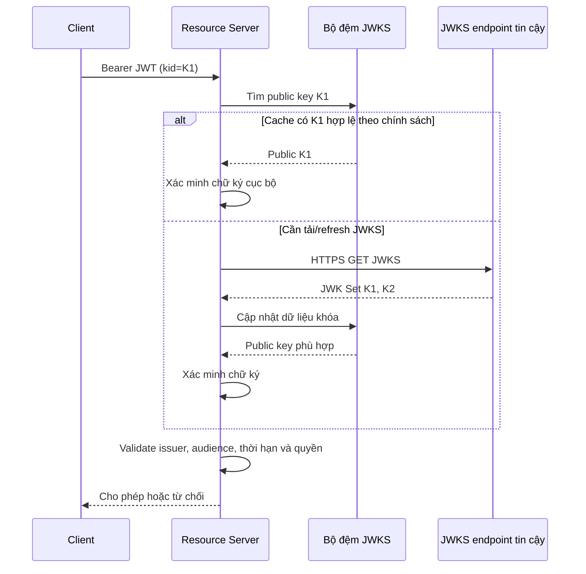
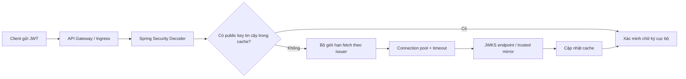
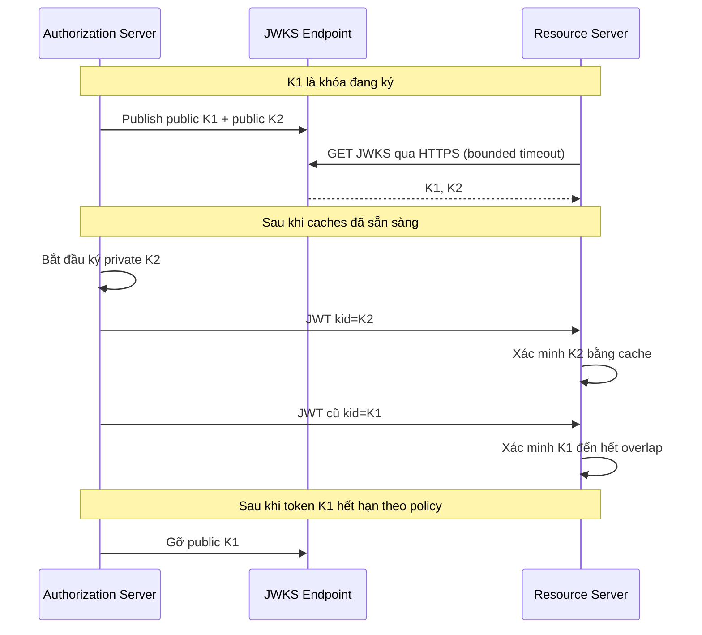

# Timeout, lỗi mạng, thử lại và giới hạn tải khi tra khóa JWK

Trong **Spring Security OAuth 2.0 / OIDC Resource Server**, ứng dụng nhận JWT access token và xác minh chữ ký bằng khóa công khai của Authorization Server. Khóa thường được công bố dưới dạng **JSON Web Key (JWK)** trong một **JSON Web Key Set (JWKS)**. Nhiều triển khai Spring Security sử dụng `NimbusJwtDecoder` để tải, lưu đệm và lựa chọn public key từ endpoint JWKS của issuer.

Quá trình xác minh chữ ký JWT vốn có thể thực hiện cục bộ, nhưng **lần đầu tải JWKS**, **khi cache cần cập nhật** hoặc **khi token tham chiếu khóa mới** có thể phát sinh HTTP request đến Authorization Server. Vì vậy hệ thống phải xử lý các tình huống endpoint JWKS chậm, mất kết nối, trả lỗi, bị quá tải, xuất hiện key ID lạ hoặc đang luân chuyển khóa. Chỉ một cấu hình URL đúng không đủ để bảo đảm API vận hành ổn định.

Bài học tập trung vào bốn vấn đề liên quan chặt chẽ:

1. Đặt **timeout** phù hợp cho kết nối và đọc JWKS để request của người dùng không bị treo quá lâu.
2. Xử lý **lỗi mạng và lỗi tải khóa** mà vẫn giữ nguyên yêu cầu xác minh chữ ký, issuer, audience và thời hạn.
3. **Thử lại có giới hạn** với backoff/jitter khi lỗi có khả năng hồi phục, tránh tự tạo bão request.
4. **Giới hạn tải khi tra khóa** bằng cache, phân phối khóa trước khi rotation, giới hạn đồng thời và quan sát hành vi khi nhiều token có `kid` lạ.

Các ví dụ sử dụng Java 17+, Spring Boot 3.x, Spring Security 6.x và endpoint giả định `https://login.example.test/realms/orders`. Mọi ngưỡng timeout, TTL và retry được nêu là giá trị minh họa, cần chọn theo SLO, độ trễ và năng lực hạ tầng thực tế.

## 1. Khi nào một Resource Server phải gọi mạng để tra khóa?

Một JWT ký bằng RSA/EC thường có ba phần:

```text
BASE64URL(protected-header).BASE64URL(payload).BASE64URL(signature)
```

Protected header có thể chứa:

```json
{
  "alg": "RS256",
  "typ": "at+jwt",
  "kid": "orders-key-2026-11"
}
```

`kid` là **key ID** giúp decoder tìm khóa phù hợp trong JWKS. Nó **không phải bằng chứng danh tính**, bởi header do người gửi token cung cấp và chỉ được tin sau khi chữ ký được xác minh bằng khóa thuộc issuer đáng tin cậy.

Ví dụ JWKS của Authorization Server:

```json
{
  "keys": [
    {
      "kty": "RSA",
      "kid": "orders-key-2026-10",
      "use": "sig",
      "alg": "RS256",
      "n": "<public-modulus-K1-base64url>",
      "e": "AQAB"
    },
    {
      "kty": "RSA",
      "kid": "orders-key-2026-11",
      "use": "sig",
      "alg": "RS256",
      "n": "<public-modulus-K2-base64url>",
      "e": "AQAB"
    }
  ]
}
```

Các chuỗi `<...>` chỉ là placeholder, không phải khóa dùng được. JWKS công khai chỉ nên chứa **public key material**; private signing key vẫn nằm tại Authorization Server hoặc HSM/KMS.

Phân biệt các thao tác:

| Thao tác | Có cần mạng tại mỗi request? | Ý nghĩa |
|---|---|---|
| Tách JWS, đọc header và JWT claims | Không | Chỉ đọc dữ liệu; chưa xác minh được độ tin cậy. |
| Xác minh chữ ký với public key **đã cache** | Thông thường không | Kiểm tra tính toàn vẹn/xác thực nguồn ký bằng mật mã cục bộ. |
| Tải JWKS lần đầu | Có thể có | Lấy public keys từ endpoint cố định, tin cậy. |
| Làm mới JWKS khi cache hết hạn hoặc không có khóa phù hợp | Có thể có | Phát hiện khóa mới/khóa bị thay hoặc bị loại. |
| Kiểm tra `iss`, `aud`, `exp`, `nbf` | Thông thường không | Quyết định token có được chấp nhận cho API này hay không. |
| Kiểm tra scope, role, chủ sở hữu/tenant | Tùy dữ liệu nghiệp vụ | Đây là lớp phân quyền, độc lập với việc tải JWKS. |

**Không phải mọi token đều khiến Spring Security gọi endpoint JWKS.** Cơ chế cache và refresh phụ thuộc phiên bản Spring Security/Nimbus, kiểu decoder và cấu hình HTTP/cache. Mọi giả định về thời điểm tải lại hoặc TTL mặc định cần được xác nhận bằng kiểm thử của hệ thống đang triển khai.

### 1.1. Phân biệt metadata discovery và JWKS fetch

Có hai giao dịch mạng cần xét riêng:

1. **OIDC/OAuth metadata discovery**: ứng dụng tìm metadata của issuer (ví dụ tài liệu OpenID Provider Configuration hoặc Authorization Server Metadata) để xác định `jwks_uri`.
2. **JWKS fetch**: decoder thực sự gọi `jwks_uri` để lấy JSON Web Key Set.

Nếu cấu hình chỉ có `issuer-uri`, một số đường khởi tạo hoặc cấu hình tùy phiên bản có thể cần liên lạc với Authorization Server để tìm metadata. Nếu cung cấp đồng thời `issuer-uri` và `jwk-set-uri` cố định, ứng dụng có thể tránh phụ thuộc vào metadata discovery lúc khởi động trong cấu hình Spring phù hợp, đồng thời vẫn giữ validator issuer.

**Timeout của metadata và timeout của JWKS có thể đi qua các HTTP client khác nhau.** Khi tự tạo decoder bằng `NimbusJwtDecoder.withJwkSetUri(...)`, ta chủ động điều khiển client dùng cho JWKS; không suy ra rằng mọi request discovery ở nơi khác sẽ tự dùng chung cấu hình timeout đó.

### 1.2. Một request có thể gặp JWKS lúc nào?



Trong sơ đồ, hành vi tải lại khi cache miss được đơn giản hóa để thấy ý tưởng. Thực tế decoder có thể chọn không tải lại ngay cho một `kid` lạ, có TTL/refresh riêng hoặc giới hạn tải đồng thời.

## 2. Ba nguyên nhân làm JWKS trở thành điểm nghẽn

### 2.1. Cold start hoặc cache rỗng

Khi pod vừa khởi động, cache public key trong bộ nhớ có thể chưa có dữ liệu. Request JWT đầu tiên cần public key sẽ phải tải JWKS. Nếu JWKS endpoint quá chậm, API bị chậm theo; nếu endpoint không thể truy cập, request thiếu khóa không thể được xác minh.

Cần phân biệt **ứng dụng Spring khởi động được** với **ứng dụng sẵn sàng xác minh token cho traffic thực tế**. Một cấu hình tránh discovery lúc startup chưa bảo đảm request đầu tiên không phải chờ mạng để lấy khóa.

### 2.2. Rotation: token mang `kid` mới

Authorization Server có thể tạo keypair K2 trong khi Resource Server đang cache JWKS chỉ có K1. Token mới mang `kid=K2` có thể buộc decoder thử tìm khóa mới. Nếu tất cả API instance cùng gặp K2 lần đầu, hàng loạt request đến JWKS có thể xuất hiện đúng lúc chuyển signer.

Giải pháp vận hành quan trọng là **công bố K2 trong JWKS trước khi phát token K2**, để các cache có thời gian cập nhật. Giữ K1 cho đến khi token K1 còn hiệu lực đã hết hạn và các điều kiện overlap được đáp ứng.

### 2.3. Lưu lượng token lỗi hoặc `kid` ngẫu nhiên

Một client không đáng tin có thể gửi rất nhiều JWT giả với các header khác nhau:

```json
{"alg":"RS256","kid":"random-000001"}
```

Sau đó thay `random-000001` thành hàng nghìn giá trị mới. Nếu bộ xác minh tải JWKS lại trên mỗi `kid` chưa biết và không có giới hạn, request từ client có thể bị khuếch đại thành traffic đến Authorization Server. Đây là dạng **tấn công làm cạn tài nguyên/khai thác cache miss**, ngay cả khi không token nào có chữ ký hợp lệ.

**`kid` không đáng tin trước xác minh.** Không để một chuỗi `kid` do client chọn quyết định URL nào được gọi, số lần retry, số phiên kết nối hoặc cardinality không giới hạn của nhãn metric.

## 3. Thiết kế timeout: kết nối, đọc và tổng thời gian

Các timeout khác nhau chặn những kiểu treo khác nhau:

| Loại timeout | Khoảng thời gian điều khiển | Nếu không giới hạn |
|---|---|---|
| **Connection timeout** | Thời gian chờ thiết lập kết nối TCP đến server/proxy. | Worker/thread có thể kẹt khi DNS/route/network sự cố. |
| **TLS handshake timeout** | Thời gian bắt tay TLS; tùy HTTP client có setting riêng hoặc dùng budget socket/connection. | Kết nối đã mở nhưng xác lập kênh tin cậy quá chậm. |
| **Read/response timeout** | Thời gian chờ dữ liệu phản hồi khi kết nối đã tồn tại. | Kết nối được chấp nhận nhưng server không trả body. |
| **Connection-pool acquisition timeout** | Thời gian chờ lấy connection từ pool khi mọi slot đang bận. | Request xếp hàng lâu trong client HTTP. |
| **Total deadline/budget** | Giới hạn tổng thời gian cho việc lấy khóa, bao gồm retry/backoff và các giai đoạn trên. | Một loạt retry khiến request API vượt SLO dù từng attempt có timeout. |

Không phải mọi HTTP client đều có đủ năm loại timeout hoặc semantics giống nhau. Ví dụ `SimpleClientHttpRequestFactory` dễ cấu hình connection/read timeout, còn deadline tổng thể hoặc pool acquisition cần giải pháp riêng theo transport HTTP.

### 3.1. Chọn timeout theo ngân sách của request API

Giả sử API có SLO phản hồi nhanh. Nếu JWKS lookup được phép chờ nhiều giây và thử lại liên tiếp, request API có thể bị timeout tại reverse proxy trước khi Spring Security trả kết quả. Điều đó tạo ra thêm retry ở client/gateway, làm tải tăng tiếp.

Một nguyên tắc thiết kế:

```text
Budget cho JWKS lookup
  <= Budget còn lại của HTTP request
     - thời gian dành cho controller/service
     - overhead mạng, gateway và xử lý lỗi
```

Với mỗi attempt, cần tính thời gian kết nối + chờ response. Tổng thời gian có thể gần:

```text
total ~= sum(duration of attempts) + sum(backoff delays)
```

Ví dụ thuần minh họa: connect timeout 1 giây, read timeout 2 giây, tối đa 2 attempts, có backoff 200 ms. Trong tình huống bất lợi, tổng chờ có thể vượt 6 giây, chưa kể DNS/TLS/pool/queue tùy HTTP client. Đây có thể là ngân sách quá lớn cho một API phải trả trong vài giây. Các tham số phải được chọn từ số đo độ trễ thực và giới hạn upstream.

**Không đặt mọi timeout vô hạn để “tránh lỗi ngẫu nhiên”.** Một dependency mạng có thể gặp treo kéo dài; timeout hữu hạn bảo vệ tài nguyên và cho phép phản hồi thất bại có kiểm soát.

### 3.2. Không nhầm network timeout với thời hạn JWT

- `exp` là **thời điểm access token hết hiệu lực**, theo policy JWT.
- JWKS cache TTL là **thời hạn giữ tài liệu public key**.
- HTTP read timeout là **thời gian đợi response từ JWKS endpoint**.
- Retry backoff là **thời gian nghỉ trước attempt khác** khi lỗi tạm thời.

Một token chưa hết `exp` vẫn có thể bị từ chối nếu decoder không có public key tin cậy để xác minh. Ngược lại, việc cache public key không làm token hết hạn trở nên hợp lệ.

## 4. Phân loại lỗi trước khi quyết định có retry

Không phải mọi lỗi xác minh JWT đều có thể sửa bằng tải JWKS lần nữa. Bảng dưới phân biệt lỗi để tránh retry sai:

| Tình huống | Ý nghĩa | Hành vi phù hợp |
|---|---|---|
| JWKS HTTP connection timeout | Chưa kết nối được nguồn khóa. | Có thể retry **ít lần** nếu còn request budget; fail closed nếu vẫn không có khóa. |
| JWKS read timeout | Endpoint không trả dữ liệu đúng hạn. | Có thể retry có backoff/jitter; không cho token qua khi chưa xác minh. |
| DNS/TLS handshake failure | Có thể lỗi mạng hoặc cấu hình trust/certificate. | Quan sát, sửa hạ tầng; không tắt TLS verification. Retry chỉ hữu ích nếu thực sự là lỗi tạm thời. |
| HTTP `500`/`502`/`503`/`504` | Endpoint hoặc proxy gặp lỗi. | Retry có giới hạn theo chính sách, cân nhắc `Retry-After` nếu được cung cấp. |
| HTTP `429 Too Many Requests` | Nguồn khóa đang hạn chế tải. | Giảm tải, backoff và tôn trọng `Retry-After` trong giới hạn deadline; không tạo thêm bão retry. |
| HTTP `401`/`403` khi gọi JWKS | Endpoint bị bảo vệ hoặc cấu hình sai. | Kiểm tra quyền/cấu hình, không lặp vô hạn. JWKS public thường không đòi client secret. |
| HTTP `404` | JWKS URL sai/đã thay. | Cấu hình lại endpoint sau khi xác minh nguồn; không brute-force thử URL khác. |
| HTTPS trả JSON sai hoặc JWK không hợp lệ | Payload JWKS không theo định dạng/policy. | Không chấp nhận khóa; alert lỗi issuer/metadata; retry không giải quyết lỗi cấu trúc ổn định. |
| `kid` không tồn tại trong JWKS hợp lệ | Token tham chiếu khóa lạ hoặc rotation chưa đồng bộ. | Có thể refresh theo policy; nếu vẫn không có khóa thì từ chối token, không quét URL khác. |
| JWT sai chữ ký dù tìm được khóa | Token không được ký bằng private key tương ứng hoặc bị sửa. | **Từ chối**; không retry gọi JWKS liên tục chỉ vì chữ ký sai. |
| JWT sai `iss`/`aud`/`exp` | Vi phạm hợp đồng token. | **Từ chối**, không retry mạng. |
| JWT hợp lệ nhưng thiếu scope/role | Authorization thất bại. | `403` theo policy; không liên quan JWKS. |

Một lỗi có thể chuyển đổi cách diễn giải theo bối cảnh. Ví dụ **unknown `kid`** trong thời gian rotation có thể là tín hiệu cache cần refresh; ngoài thời gian rotation, hàng nghìn `kid` ngẫu nhiên có thể là lưu lượng tấn công. Dù thuộc trường hợp nào, **không chấp nhận token trước khi có public key phù hợp và xác minh chữ ký thành công**.

### 4.1. Trạng thái HTTP của Resource Server

Ở API được bảo vệ:

- Thiếu Bearer token hoặc token không vượt qua xác thực/validator: thông thường **`401 Unauthorized`**.
- Token hợp lệ nhưng thiếu scope/role hoặc quyền nghiệp vụ: thông thường **`403 Forbidden`**.
- Nếu JWKS bị outage và không xác minh được token: **không cấp quyền**. Mã HTTP thực tế tùy exception propagation, Spring Security version và handler. Một ứng dụng có thể thiết kế trả `503 Service Unavailable` khi phân biệt được lỗi hạ tầng, nhưng phải triển khai và test rõ, tránh chuyển JWT không hợp lệ thành lỗi “mạng” tùy ý.

Phân biệt **authentication failure** do token sai với **dependency failure** do JWKS unavailable là hữu ích cho monitoring. Không vì muốn trả `200` mà tắt `JwtDecoder`, đặt route thành `permitAll()` hoặc lấy claim từ Base64URL chưa xác minh.

## 5. Retry đúng cách: hữu hạn, có backoff và không khuếch đại tải

Retry hữu ích cho lỗi tạm thời như mất gói tin hoặc `503` ngắn hạn; nó gây hại nếu nhiều API instances cùng retry vào endpoint đang quá tải.

### 5.1. Chỉ retry đúng loại lỗi

Những lỗi **có thể cân nhắc retry**:

- Timeout mạng ngẫu nhiên khi JWKS GET.
- `502`/`503`/`504`/`429` theo policy phù hợp.
- Kết nối bị đóng/reset tạm thời khi chưa nhận đủ response.

Những lỗi **không retry chỉ vì token bị từ chối**:

- Chữ ký JWT sai.
- `alg` không thuộc danh sách cho phép, `alg=none` hoặc key type không khớp.
- `iss`/`aud` sai, token hết hạn, chưa đến `nbf`.
- Token JWT sai cấu trúc hoặc JWS header không hợp lệ.
- Thiếu scope/role của endpoint.
- `kid` ngẫu nhiên không nằm trong keyset đã refresh và chưa đến thời điểm cache cho phép refresh tiếp.

HTTP GET JWKS là yêu cầu đọc, thông thường an toàn để thử lại về mặt chức năng, nhưng **an toàn về chức năng không có nghĩa an toàn về tải**.

### 5.2. Backoff và jitter

Không gửi lại ngay liên tiếp ở mọi pod:

```text
Lỗi attempt 1
  -> chờ backoff + jitter ngẫu nhiên
  -> attempt 2 nếu còn ngân sách
  -> thất bại thì trả lỗi an toàn, phát tín hiệu monitoring
```

Một hàm backoff minh họa:

```text
delay_n = min(baseDelay * 2^(n - 1), maxDelay)
actualDelay = random(0, delay_n)  // full jitter
```

Jitter làm giảm khả năng hàng trăm API instances cùng đồng bộ retry tại một thời điểm. Cần đặt **max attempts**, **max delay** và **total deadline**. Không để HTTP client, thư viện retry, service mesh và reverse proxy **cùng retry nhiều tầng** một cách vô tình; tổng số request outbound có thể nhân lên rất nhanh.

### 5.3. Vì sao “retry 3 lần” không đủ?

Hãy hình dung 100 request đồng thời cần JWKS; mỗi request tự tạo một JWKS GET và được phép thử 3 lần. Trong trường hợp xấu, hệ thống có thể phát sinh hàng trăm yêu cầu JWKS cho cùng một keyset. Nếu có nhiều pod, nhiều vùng địa lý hoặc gateway cũng retry, lưu lượng tới Authorization Server tăng đáng kể.

Giải pháp đúng thường gồm **cache dùng chung trong mỗi decoder**, giới hạn concurrent fetch, không cho tất cả request cùng bypass cache, và retry hữu hạn. Số lượng request thực tế phụ thuộc decoder/caching implementation; không mặc định mỗi incoming JWT tạo một HTTP request.

### 5.4. Retry phải nằm trong tổng budget

Một pseudocode thể hiện **chính sách** (không phải API Java cụ thể của Nimbus):

```text
fetchTrustedJwks(url, deadline):
    assert url đã được cấu hình và HTTPS hợp lệ
    for attempt in 1..MAX_ATTEMPTS:
        if deadline đã hết:
            fail KEY_FETCH_TIMEOUT

        try:
            return GET(url, timeout <= thời gian còn lại)
        catch transientNetworkError:
            if attempt == MAX_ATTEMPTS:
                fail KEY_FETCH_UNAVAILABLE
            wait boundedBackoffWithJitter(remainingDeadline)

    fail KEY_FETCH_UNAVAILABLE
```

Không đặt retry ở controller cho **toàn bộ quá trình decode JWT**. Nếu retry decoder vô điều kiện, token cố tình sai chữ ký hoặc `kid` không tồn tại có thể tiếp tục sinh tải mạng không cần thiết. Nếu cần custom retry, nên bọc lớp HTTP fetch JWKS với phân loại lỗi/giới hạn chặt và giữ nguyên semantics của JOSE verifier.

## 6. Cache là cơ chế giảm tải quan trọng nhất

Một JWKS chứa public keys để xác minh chữ ký. Khi public key đã có trong cache đáng tin cậy, nhiều JWT có thể được kiểm tra cục bộ mà không gọi lại JWKS endpoint.

### 6.1. Nguyên tắc cache

- **Cache key gắn với issuer và JWKS URL tin cậy**, không nhập nhiều trust domains vào một vùng nhớ không phân biệt.
- **Giới hạn dung lượng và TTL**; keyset hiếm khi rất lớn, nhưng nội dung JWKS phải có giới hạn response size/parse để không bị payload khổng lồ chiếm tài nguyên.
- **Refresh có kiểm soát** khi TTL hết hạn hoặc gặp `kid` mới, theo khả năng của thư viện.
- **Không ghi private key hay raw Bearer token vào JWKS cache**. Cache chỉ phục vụ public key metadata.
- **Không coi cache TTL là thời hạn JWT**: `exp` phải được kiểm tra ở từng token.
- **Không tự tạo hàng nghìn cache entries theo `kid` tùy ý** do client gửi; tập khóa được lấy từ một nguồn JWKS tin cậy, `kid` chỉ được dùng để lựa chọn.
- **Không cho phép keyset stale vô thời hạn**. Khi issuer vô hiệu hóa khóa bị lộ, cache cũ kéo dài thời gian tin khóa đó.

### 6.2. Cân bằng độ sẵn sàng và khả năng thu hồi khóa

Nếu JWKS endpoint mất kết nối nhưng decoder **đã có public key K1 hợp lệ trong cache theo policy**, nó có thể tiếp tục xác minh token K1, vẫn phải kiểm tra thời hạn và các claim khác. Điều này có lợi cho tính sẵn sàng.

Nhưng nếu token mang **K2 chưa từng biết**, không có cơ sở để xác minh nó. Không được đoán rằng K2 “chắc là từ cùng issuer” rồi chấp nhận.

Bảng quyết định:

| Tình trạng cache | Token | JWKS outage | Có thể xác minh an toàn? |
|---|---|---|---|
| Có K1 tin cậy, cache còn hợp lệ | JWT ký K1 | Có | **Có thể**, nếu chữ ký và mọi JWT validators đều đạt. |
| Chưa có khóa | JWT ký K1 | Có | **Không**, phải fail closed. |
| Cache chỉ có K1 | JWT ký K2 | Có | **Không**, cần public-K2 tin cậy. |
| Có K1 nhưng chính sách đã thu hồi K1 vì compromise | JWT ký K1 | Có hoặc không | **Không**, không được coi cache cũ là ngoại lệ cho key revocation. |
| JWKS đã được refresh và chứa K1+K2 | JWT ký K2 | Không | **Có thể**, sau xác minh chữ ký và claims. |

Chiến lược “stale-while-revalidate” đôi khi được cân nhắc để tăng tính sẵn sàng, nhưng **phải có thời hạn và cơ chế thu hồi rõ**. Giữ K1 stale quá lâu sau sự cố khóa riêng bị lộ có thể cho phép token giả vẫn vượt qua signature check. Đây là đánh đổi bảo mật do kiến trúc quyết định, không phải một fallback mặc định nên tự bật.

### 6.3. Unknown `kid` và cache-miss amplification

Khi decoder chưa có `kid`, có thể cần refresh JWKS. Nếu nhận nhiều `kid` giả, refresh liên tục sẽ gây tải không cần thiết. Có thể cân nhắc các cơ chế:

1. **Giới hạn tần suất refresh JWKS theo issuer**: ví dụ một khoảng cách tối thiểu giữa hai lần refresh bất thường, với ngoại lệ rotation được kiểm soát.
2. **Gộp concurrent fetch** (*single-flight/coalescing*): nhiều request cần cùng JWKS phiên bản mới chia sẻ một lần tải, thay vì mỗi request tự gọi mạng.
3. **Giới hạn số fetch đang diễn ra**: semaphore/connection pool/per-issuer cap ở client hoặc proxy.
4. **Cache âm tính ngắn hạn có kiểm soát** cho `kid` không tồn tại, nếu hệ thống có cơ chế này và không làm chặn khóa mới hợp lệ quá lâu. Đừng coi `kid` giả là cache key không giới hạn hoặc cache mãi mãi.
5. **Rate limit tại ingress/API gateway** cho request authentication thất bại bất thường, kết hợp IP/client signals hợp lý. Không giới hạn quá mức khiến user hợp lệ không thể nhận token K2 sau rotation.
6. **Giới hạn độ dài header/JWT và kích thước dữ liệu đầu vào** trước khi parsing để ngăn tài nguyên bị chiếm bởi token khổng lồ.

Không giả định Nimbus hoặc Spring tự cung cấp mọi cơ chế bên trên. Hãy kiểm tra hành vi của phiên bản đang dùng; chỉ bổ sung cơ chế khi test/metric cho thấy cần và giữ nguyên trust boundary.

### 6.4. Cache tập trung có phải lúc nào cũng tốt?

Một cache chung nhiều ứng dụng có thể giảm lượt gọi AS nhưng tăng rủi ro cấu hình sai/lan truyền sự cố. Nếu dùng cache shared:

- Namespace theo `issuer + jwks_uri` và ràng buộc thuật toán.
- Giới hạn người được quyền ghi/đọc, bảo vệ kênh mạng.
- Không để một tenant thay keyset của issuer khác.
- Xác định semantics khi cache unavailable, cache poisoning hoặc key revocation.
- Không biến shared cache thành nguồn tin **mạnh hơn issuer tin cậy** nếu chưa có quy trình bảo đảm tính toàn vẹn.

Cache trong mỗi Resource Server instance thường đơn giản hơn. Muốn tối ưu nhiều pod, có thể dùng proxy/JWKS mirror nội bộ tin cậy với cache và rate limit, nhưng phải duy trì chính sách HTTPS, issuer/key origin và rotation.

## 7. Spring Security: cấu hình JWKS và HTTP timeout

Cách cấu hình tiêu chuẩn cho JWT Resource Server thường dùng `issuer-uri` và audience:

```yaml
spring:
  security:
    oauth2:
      resourceserver:
        jwt:
          issuer-uri: https://login.example.test/realms/orders
          audiences:
            - orders-api
```

Nếu muốn kiểm soát chính xác endpoint JWKS đã được issuer xác nhận:

```yaml
spring:
  security:
    oauth2:
      resourceserver:
        jwt:
          issuer-uri: https://login.example.test/realms/orders
          jwk-set-uri: https://login.example.test/realms/orders/protocol/openid-connect/certs
          audiences:
            - orders-api
```

Các URL chỉ minh họa. Không đưa `jwk-set-uri` vào request parameter hay lấy từ JWS header `jku`/`x5u` chưa được xác minh. Việc định vị JWKS phải thuộc **cấu hình issuer đáng tin**, có HTTPS/TLS validation.

### 7.1. Tự khai báo `JwtDecoder` và HTTP client có timeout

Nếu cần chủ động đặt timeout cho **HTTP GET JWKS**, ta có thể tự khai báo bean `NimbusJwtDecoder`:

```yaml
security:
  jwt:
    issuer: https://login.example.test/realms/orders
    audience: orders-api
    jwk-set-uri: https://login.example.test/realms/orders/protocol/openid-connect/certs
```

```java
package com.example.orders.security;

import org.springframework.beans.factory.annotation.Value;
import org.springframework.context.annotation.Bean;
import org.springframework.context.annotation.Configuration;
import org.springframework.http.client.SimpleClientHttpRequestFactory;
import org.springframework.security.oauth2.core.DelegatingOAuth2TokenValidator;
import org.springframework.security.oauth2.core.OAuth2Error;
import org.springframework.security.oauth2.core.OAuth2TokenValidator;
import org.springframework.security.oauth2.core.OAuth2TokenValidatorResult;
import org.springframework.security.oauth2.jwt.Jwt;
import org.springframework.security.oauth2.jwt.JwtDecoder;
import org.springframework.security.oauth2.jwt.JwtValidators;
import org.springframework.security.oauth2.jwt.NimbusJwtDecoder;
import org.springframework.web.client.RestTemplate;

@Configuration
public class JwtKeyFetchConfig {

    @Bean
    JwtDecoder jwtDecoder(
        @Value("${security.jwt.issuer}") String issuer,
        @Value("${security.jwt.audience}") String audience,
        @Value("${security.jwt.jwk-set-uri}") String jwksUri
    ) {
        SimpleClientHttpRequestFactory factory =
            new SimpleClientHttpRequestFactory();

        // Thời gian millisecond chỉ là ví dụ cần hiệu chỉnh theo SLO.
        factory.setConnectTimeout(1_500);
        factory.setReadTimeout(2_000);

        RestTemplate jwksHttp = new RestTemplate(factory);

        NimbusJwtDecoder decoder = NimbusJwtDecoder
            .withJwkSetUri(jwksUri)
            .restOperations(jwksHttp)
            .build();

        OAuth2TokenValidator<Jwt> audienceValidator = token ->
            token.getAudience().contains(audience)
                ? OAuth2TokenValidatorResult.success()
                : OAuth2TokenValidatorResult.failure(
                    new OAuth2Error(
                        "invalid_token",
                        "Audience does not match this API",
                        null));

        decoder.setJwtValidator(
            new DelegatingOAuth2TokenValidator<>(
                JwtValidators.createDefaultWithIssuer(issuer),
                audienceValidator
            ));

        return decoder;
    }
}
```

**Ý nghĩa của đoạn cấu hình:**

- `withJwkSetUri(jwksUri)` chỉ định JWKS endpoint mà ứng dụng đã tin cậy; decoder xác minh chữ ký bằng public keys tải về.
- `restOperations(jwksHttp)` truyền HTTP client dùng để lấy JWKS cho decoder, nơi đặt connect/read timeout.
- Các validator giữ kiểm tra **issuer**, **thời hạn** và **audience**. Tự khai báo `JwtDecoder` có thể thay thế auto-configuration của Spring Boot, vì thế không được bỏ quên các điều kiện token.
- Ví dụ `SimpleClientHttpRequestFactory` có timeout cho kết nối và đọc; **không cung cấp connection pool, total deadline hay retry/backoff chính thức**. Với hệ tải cao, dùng HTTP transport có connection pool/limits và quản lý timeout phù hợp.
- Các con số `1500` và `2000` là minh họa, không phải defaults khuyến nghị cho mọi môi trường. Cần đo p95/p99, latency giữa API và IdP, deadline gateway và ngân sách request thực tế.

Lưu ý cho ứng dụng có **JWT access token tuân RFC 9068**: ngoài issuer/audience/time, Resource Server còn phải xác định loại token `at+jwt` và các claims bắt buộc theo hợp đồng. Nếu muốn dùng `JwtValidators.createAtJwtValidator()` hoặc validator riêng, hãy lựa chọn đúng phiên bản Spring Security và ghép các điều kiện trust tương ứng. Đừng để việc tối ưu timeout làm mất token-type validation.

### 7.2. Bật Resource Server và phân quyền tuyến

```java
package com.example.orders.security;

import org.springframework.context.annotation.Bean;
import org.springframework.context.annotation.Configuration;
import org.springframework.http.HttpMethod;
import org.springframework.security.config.Customizer;
import org.springframework.security.config.annotation.web.builders.HttpSecurity;
import org.springframework.security.config.annotation.web.configurers.AbstractHttpConfigurer;
import org.springframework.security.config.http.SessionCreationPolicy;
import org.springframework.security.web.SecurityFilterChain;

@Configuration
class ApiSecurityConfig {

    @Bean
    SecurityFilterChain securityFilterChain(HttpSecurity http) throws Exception {
        return http
            .csrf(AbstractHttpConfigurer::disable)
            .sessionManagement(session ->
                session.sessionCreationPolicy(SessionCreationPolicy.STATELESS))
            .authorizeHttpRequests(auth -> auth
                .requestMatchers(HttpMethod.GET, "/api/public/ping").permitAll()
                .requestMatchers(HttpMethod.GET, "/api/orders/**")
                    .hasAuthority("SCOPE_orders:read")
                .anyRequest().denyAll())
            .oauth2ResourceServer(oauth ->
                oauth.jwt(Customizer.withDefaults()))
            .build();
    }
}
```

Phần cấu hình stateless/CSRF này chỉ dành cho API dùng Bearer token qua HTTP `Authorization`; ứng dụng có cookie/session cần phân tích CSRF riêng. Khi Spring Security đã decode JWT thành công, converter mặc định thường ánh xạ claim `scope`/`scp` thành authority `SCOPE_...`. Thêm kiểm tra owner/tenant trong nghiệp vụ nếu cần; token hợp lệ không có nghĩa được đọc mọi đơn.

### 7.3. Nếu muốn tùy chỉnh JWKS cache

Spring Security 6.x có các builder option cho phép cung cấp `org.springframework.cache.Cache` phục vụ cache phản hồi JWK Set trong các phiên bản hỗ trợ. Có thể cân nhắc một cache có TTL/dung lượng hữu hạn, ví dụ Caffeine, qua phương thức `cache(...)` của builder `NimbusJwtDecoder.withJwkSetUri(...)`.

Ví dụ **biến thể lựa chọn**, không cần dùng cùng lúc với cách `.build()` ở trên:

```java
import java.time.Duration;

import com.github.benmanes.caffeine.cache.Caffeine;
import org.springframework.cache.Cache;
import org.springframework.cache.caffeine.CaffeineCache;
import org.springframework.security.oauth2.jwt.NimbusJwtDecoder;

// Cần dependency Spring Cache và Caffeine tương thích Boot version.
Cache jwkResponseCache = new CaffeineCache(
    "trusted-issuer-jwks",
    Caffeine.newBuilder()
        .maximumSize(1)
        .expireAfterWrite(Duration.ofMinutes(10))
        .build()
);

NimbusJwtDecoder decoder = NimbusJwtDecoder
    .withJwkSetUri(jwksUri)
    .restOperations(jwksHttp)
    .cache(jwkResponseCache)
    .build();

// Tiếp tục gắn issuer/audience/token-profile validators như bên trên.
```

Đoạn code chỉ minh họa cách cung cấp cache cho **một JWKS URL**. Cần xác minh chính xác API builder, cache key và hành vi refresh của Spring Security/Nimbus version đang dùng trước khi triển khai. Một TTL 10 phút không phải chuẩn chung: nó có thể quá lâu với emergency revocation hoặc quá ngắn với endpoint có giới hạn tải. Cache do Spring cung cấp cũng không tự bảo đảm giới hạn concurrent fetch, single-flight, negative cache hay total deadline.

**Không tăng TTL vô hạn để tránh lỗi mạng**. Cache phản hồi JWKS phải được phối hợp với kế hoạch rotation, thời điểm công bố key mới và quy trình khẩn cấp thu hồi khóa.

### 7.4. HTTP client production và proxy nội bộ

Với lưu lượng thực tế, thay transport đơn giản bằng client hỗ trợ:

- Connection pooling có giới hạn tổng và giới hạn mỗi host.
- Connection acquisition timeout và read/response timeout.
- Kết nối TLS đúng trust store/hostname, có cơ chế proxy nếu môi trường yêu cầu.
- Giới hạn request/response size ở lớp HTTP/client hoặc gateway phù hợp.
- Quan sát được latency, lỗi timeout, pool exhaustion và retry.
- Chính sách không tự động chuyển tiếp credentials hoặc truy cập URL tùy ý.

Không tự tạo một `RestTemplate` mới cho từng request JWT. Tạo một instance chia sẻ phù hợp thông qua bean decoder và để thư viện giữ cache/key selector. Nếu có JWKS mirror nội bộ, nó cũng phải tin cậy và phản ánh thay đổi khóa của issuer theo policy.

## 8. Giới hạn tải khi tra khóa trong hệ thống nhiều pod

### 8.1. Các tầng có thể giới hạn tải



Ở mỗi tầng có thể giảm tải khác nhau:

| Tầng | Biện pháp | Lưu ý |
|---|---|---|
| **Ingress/API gateway** | Rate limit request bất thường, giới hạn kích thước header/token, giới hạn connection. | Không khóa user hợp lệ chỉ vì có đợt rotation. |
| **JWT parser/decoder** | Kiểm tra cấu trúc đầu vào, allowlist algorithm, giới hạn xử lý header không tin cậy. | Không tin `kid` trước xác minh. |
| **JWKS cache** | Cache keyset, refresh có giới hạn, kiểm soát TTL. | Không biến cache stale thành chấp nhận khóa đã bị thu hồi. |
| **Concurrency control** | Giới hạn đồng thời JWKS fetch, gộp yêu cầu tải giống nhau. | Khi quá tải, fail closed cho token chưa xác minh; tránh treo vô hạn. |
| **HTTP transport** | Timeout, connection pool, bounded retry. | Theo dõi pool exhaustion và request budget. |
| **Issuer/mirror** | CDN/proxy cache tin cậy, rate limit hợp lý, nhiều instance JWKS. | Không thay đổi đường tin cậy tới nguồn khóa. |

Một chiến lược hoạt động tốt khi lượng request JWT cao là **không gọi mạng trên fast path** của token dùng khóa đã cache. Tránh tích hợp việc “GET JWKS cho chắc” ở mỗi request, vì nó khiến API phụ thuộc trực tiếp vào IdP cho từng lượt xác thực dù không cần thiết.

### 8.2. Circuit breaker có giúp không?

Có, nếu được dùng đúng chỗ. Circuit breaker trước JWKS endpoint có thể phát hiện dependency liên tục lỗi và ngăn hàng nghìn kết nối timeout. Trong thời gian circuit open:

- JWT có public key đã cache và vẫn còn được tin theo policy có thể tiếp tục xác minh cục bộ.
- JWT cần **khóa chưa có** không thể vượt authentication; phải từ chối hoặc phản hồi lỗi dependency an toàn.
- Khi chuyển sang half-open, chỉ nên cho số lượng nhỏ probe request, tránh mọi pod cùng thử.
- Không bật “allow unknown token while circuit open”, bởi điều đó phá vỡ toàn bộ signature verification.

Circuit breaker **không thay thế JWT validation**. Nó là cơ chế bảo vệ tài nguyên khi lấy khóa, phải đi kèm cache/timeout/rate limit. Nếu sử dụng Resilience4j hoặc gateway, cần tránh xung đột retry nhiều tầng và xác định rõ chính sách khi circuit open.

### 8.3. Không tự động retry theo `kid`

Một quy tắc sai:

```text
if kid not in cache:
    repeat GET JWKS until kid appears
```

Với `kid` random, điều này vô hạn và gây DoS. Thay bằng logic có thời hạn:

```text
if kid được biết trong trusted keyset:
    verify locally
else:
    if refresh được phép theo cache/rotation policy:
        fetch trusted JWKS (bounded)
        if matching trusted key exists:
            verify signature
    reject token if no matching trusted key
```

Trường hợp phát hiện `kid` mới đúng lịch rotation, có thể kích hoạt cơ chế refresh chủ động trong pipeline trước khi issuer ký token mới; không phụ thuộc việc người dùng thật đầu tiên “đánh thức” JWKS cache.

## 9. Luân chuyển khóa là tình huống stress-test đặc biệt

Giả sử issuer đang ký bằng K1 và muốn chuyển sang K2. Nếu ngay lập tức ký K2 mà chưa công bố public-K2, token mới có thể bị `401` trên mọi API chỉ biết K1. Nếu công bố K2 sớm nhưng cache quá lâu không refresh, một số pod vẫn không nhận K2.

Một quy trình chủ động:

| Giai đoạn | Issuer ký bằng | JWKS công bố | Công việc ở Resource Server |
|---|---|---|---|
| **A. Trước rotation** | K1 | K1 | Theo dõi fetch/cache/latency bình thường. |
| **B. Pre-publish K2** | K1 | **K1 + K2** | Cho phép cache refresh, quan sát API có thể lấy K2. |
| **C. Chuyển signer** | **K2** | K1 + K2 | Token K2 mới và K1 cũ phải được kiểm tra đúng. |
| **D. Chờ hết hiệu lực token K1** | K2 | K1 + K2 | Cân nhắc TTL tối đa, skew, cache, delay phát hành. |
| **E. Gỡ K1** | K2 | K2 | Bảo đảm caches/pod cập nhật và xử lý revocation nếu cần. |



**Pre-publish public-K2** giúp giảm “cache miss đồng loạt” và phụ thuộc fetch tại thời điểm cutover. Việc pre-warm cache có thể được triển khai bằng kiểm thử/health workflow sử dụng nguồn khóa đáng tin; không đưa private signing key vào Resource Server, không dùng token giả do client bất kỳ gửi để tự phát động tải lại không giới hạn.

### 9.1. Cache TTL và thời gian overlap

Không phải cứ tăng cache TTL là tốt:

- TTL quá ngắn: tăng tải JWKS, dễ gây sự cố khi mọi pod đồng loạt refresh.
- TTL quá dài: token K2 có thể bị từ chối nếu decoder chưa biết K2, hoặc public-K1 bị tin quá lâu sau khi AS gỡ.
- Gỡ K1 quá sớm: các token K1 còn hạn bị từ chối, dù chữ ký vẫn hợp lệ theo khóa đã nghỉ dùng.
- Thay đổi signer và `kid` không đồng bộ: có thể khiến token mang K2 nhưng header vẫn ghi K1, gây lỗi key selection.

TTL, refresh policy, rotation overlap và token lifetime cần được thống nhất thành **một hợp đồng vận hành**.

### 9.2. Rotation khẩn cấp khác rotation định kỳ

Khi private-K1 bị nghi ngờ lộ, issuer có thể phải thu hồi K1 trước khi token cũ hết hạn. Lúc này mục tiêu bảo mật ưu tiên: **mọi Resource Server phải ngừng tin K1 càng sớm càng tốt**.

Rủi ro là cache JWKS còn chứa K1. Nếu có emergency revocation, chỉ xóa key khỏi JWKS không bảo đảm các API node ngừng tin ngay. Cần quy trình clear cache/restart/rollout hoặc cơ chế push invalidation đã được kiểm chứng.

Vì thế **cơ chế cho phép dùng stale JWKS khi outage cần quy tắc ngoại lệ rõ khi key compromise**. Không biến tính sẵn sàng thành lý do tiếp tục chấp nhận chữ ký của khóa đã bị thu hồi.

## 10. Bảo vệ ranh giới tin cậy khi fetch JWKS

Timeout và retry không đủ nếu Resource Server có thể bị dẫn tới **nguồn khóa không đáng tin**.

### 10.1. Chỉ fetch từ URL đã được kiểm chứng

JWKS URL phải được cấu hình từ:

- Metadata discovery của **issuer đã xác định và tin cậy**, hoặc
- `jwk-set-uri` cố định do hệ thống cấu hình, khớp hợp đồng với issuer.

Không lấy địa chỉ tải khóa từ:

- HTTP query/header/parameter của request API.
- Claim `iss` chưa xác minh để tự tạo URL bất kỳ.
- Header `jku` hoặc `x5u` không được kiểm soát trong JWT.
- Một danh sách “thử các URL” dựa trên `kid`.

Nếu ứng dụng tự chuyển URL tùy ý, kẻ tấn công có thể chỉ tới JWKS của họ, thực hiện SSRF hoặc dùng private key của chính họ để tạo token giả.

### 10.2. TLS và chuyển hướng HTTP

- Luôn dùng HTTPS đến endpoint tin cậy, kiểm tra certificate chain và hostname.
- Không dùng `trustAllCertificates` hoặc vô hiệu hóa hostname verification để “fix timeout”.
- Không tự động theo redirect sang host bất kỳ mà không kiểm tra nguồn mới có được phép hay không.
- Kiểm soát proxy doanh nghiệp/service mesh để không sửa payload JWKS trái chính sách.
- Đặt network egress allowlist khi có thể, giới hạn chỉ những endpoint IdP/JWKS cần thiết.

Kể cả JWKS công khai, **khóa sai vẫn tạo lỗ hổng xác thực**. Tính toàn vẹn và nguồn gốc quan trọng hơn việc dữ liệu JWKS có cần giấu hay không.

### 10.3. Giới hạn kích thước response và tài nguyên parse

Một response JWKS có thể chứa nhiều keys, và một token/header có thể rất lớn. Trong hệ có attacker-controlled input, cần xem xét giới hạn phù hợp:

- Giới hạn độ dài Bearer token và HTTP header ở ingress.
- Giới hạn response JWKS, số lượng JWK, độ sâu JSON và kích thước key material theo khả năng của HTTP client/parser.
- Tránh retry hoặc log trọn body khi parse JSON lỗi.
- Giới hạn thread/connection pool và độ dài queue.
- Không tạo cache entry cho mỗi chuỗi `kid` do client chọn.

Các giới hạn phải đủ lớn cho keyset hợp lệ và rotation overlap của issuer, nhưng không phải vô hạn.

## 11. Kiểm thử lỗi mạng và bảo vệ tải

Kiểm thử nên kết hợp **HTTP stub JWKS**, JWT test được ký bằng private key thử nghiệm, và security integration test. Có thể dùng WireMock, MockWebServer hoặc HTTP server cục bộ tương tự. Không sử dụng private signing key production.

### 11.1. Ma trận kịch bản tối thiểu

| Kịch bản | Mô phỏng | Kết quả cần thấy |
|---|---|---|
| JWKS đầu tiên thành công | Endpoint trả keyset K1 hợp lệ | Token K1 được xác minh; không phải fetch lại mỗi request. |
| JWKS trả chậm hơn read timeout | Stub cố tình trì hoãn response | Kết thúc sau budget hữu hạn, không đi vào controller bảo vệ nếu chưa có key. |
| Không kết nối được | Stub đóng cổng/từ chối kết nối | Fail closed; đo được lỗi timeout/connection. |
| JWKS trả `503` | Stub lỗi tạm thời | Retry nếu cấu hình; số attempts có giới hạn; request không được cấp quyền khi chưa xác minh. |
| JWKS trả `429` | Stub throttle | Thực thi backoff/`Retry-After` theo policy, không tạo retry storm. |
| JWKS trả `404` | URL sai | Không quét sang URL khác, ghi lỗi cấu hình an toàn. |
| JSON JWKS sai hoặc `keys` không hợp lệ | Body malformed | Không nhận public key; alert dependency error. |
| Token `kid` lạ khi JWKS chỉ có K1 | Header `kid=unknown` | Từ chối nếu không tìm được key; số lần fetch không tăng vô hạn. |
| 1.000 token với 1.000 `kid` ngẫu nhiên | Nhiều request đồng thời | Số outbound JWKS fetch/connection bị giới hạn theo policy. |
| Cache có K1, JWKS outage | K1 còn tin cậy trong cache | Có thể tiếp tục xác minh K1 theo policy mà không chấp nhận token unknown key. |
| Pre-publish K2 | JWKS chuyển từ K1 sang K1+K2 | Sau refresh, token K2 hợp lệ; token K1 còn hạn vẫn hợp lệ. |
| Gỡ K1 | JWKS chỉ có K2 | Khi cache được cập nhật/thu hồi, token K1 bị từ chối. |
| Sai issuer/audience | JWT có chữ ký hợp lệ | Bị từ chối bởi validator, không retry JWKS chỉ vì claim sai. |
| Token hết hạn | `exp` ở quá khứ | Bị từ chối; public key cache không kéo dài tuổi thọ token. |
| Mất private signing key K1 | Giả lập policy thu hồi khẩn cấp | K1 bị loại khỏi mọi verifier/caches, bất kể JWKS outage. |

### 11.2. Ví dụ bố trí test với JWKS server cục bộ

Cấu trúc test có thể như sau (pseudocode phụ thuộc thư viện mock server):

```text
given:
    keypair K1, keypair K2 tạo trong test
    mock JWKS server ở localhost:<dynamic-port>
    decoder sử dụng URL mock server và HTTP timeout ngắn
    JWT K1/K2 được ký bởi private key tương ứng

test "first-fetch-and-cache":
    stub GET /jwks trả {public-K1}
    decode token K1 -> thành công
    decode thêm token K1 -> thành công
    assert GET /jwks không tăng theo mỗi lần decode

test "timeout-fails-closed":
    stub GET /jwks delay vượt readTimeout
    decoder cache rỗng
    decode token K1 -> thất bại
    assert không có Authentication được tạo
    assert elapsed time trong tổng budget

test "unknown-kid-storm":
    stub GET /jwks trả {public-K1}
    gửi nhiều token mang kid ngẫu nhiên
    assert không token nào được chấp nhận
    assert số GET/connections nằm trong giới hạn đã định

test "rotation":
    GET /jwks -> {public-K1}
    decode K1 -> thành công
    thay mock JWKS -> {public-K1,public-K2}
    kích hoạt/đợi cache refresh theo cơ chế đã test
    decode K2 -> thành công
    decode K1 còn hạn -> thành công
```

Chú ý hai điều: **test có thể phải điều khiển cache TTL/refresh** hoặc tái tạo decoder sau khi thay JWKS, tùy cơ chế thư viện; và **test chứng minh load limit chỉ có giá trị nếu thực sự đo outbound GET/concurrency**, không chỉ assert JWT bị từ chối.

### 11.3. Phân biệt test MockMvc và test decoder

`spring-security-test` cung cấp `jwt()` để chèn một authentication giả vào request MockMvc:

```java
mvc.perform(get("/api/orders/42")
        .with(jwt().authorities(
            new SimpleGrantedAuthority("SCOPE_orders:read"))))
   .andExpect(status().isOk());
```

Kịch bản này hữu ích để kiểm tra **authorization** ở HTTP route; nó **bỏ qua JWKS, HTTP fetch và cryptographic signature verification**. Vì vậy không thể dùng kết quả `jwt()` để kết luận timeout hoặc retry được cấu hình đúng.

Cần ít nhất một tầng test gửi **Bearer JWT ký thật bằng keypair test** qua security filter để kiểm tra end-to-end, hoặc test trực tiếp `JwtDecoder` cùng mock JWKS HTTP server. Nếu muốn test `401`/`503` của lỗi dependency, chạy qua lớp exception handling thật của ứng dụng để biết trạng thái HTTP chính xác.

### 11.4. Kiểm thử nhiều pod và sự cố hạ tầng

Ở staging hoặc môi trường mô phỏng nhiều instance:

1. Khởi động đồng thời nhiều pod với JWKS cache rỗng và đo số fetch ban đầu.
2. Cho JWKS endpoint chậm/trả `503`; theo dõi queue và thời gian phản hồi của API.
3. Phát token K2 sau khi pre-publish public-K2; quan sát pod nào chưa refresh.
4. Thay một phần pod bằng version mới; xác nhận không có trust policy bất nhất.
5. Thử quá trình khôi phục sau outage: API trở lại hoạt động khi JWKS có thể truy cập và decoder refresh được.
6. Thử gỡ K1 và cache invalidation khi giả định private-K1 bị lộ.

Hệ thống cần biểu đồ có thể phân biệt **số request API**, **số JWKS GET**, **số JWT bị từ chối vì không tìm được khóa**, **timeout** và **lỗi 401/403 từ quyền**.

## 12. Logging, metric và alert không làm lộ token

JWKS là metadata công khai, nhưng **raw Bearer token là credential**. Không log:

- Giá trị `Authorization: Bearer ...`.
- Toàn bộ JWT header/payload/signature hoặc claims nhạy cảm.
- Private signing key của issuer.
- Full URL có gắn token/credential (JWKS URL thông thường không cần token).
- Mọi giá trị `kid` tùy ý như một nhãn metric không kiểm soát (cardinality có thể vô hạn).

Các metric hữu ích (tên minh họa):

| Metric / sự kiện | Ý nghĩa vận hành |
|---|---|
| `jwt_jwks_fetch_total{result=success,error}` | Số lần fetch JWKS thành công/thất bại. |
| `jwt_jwks_fetch_duration_seconds` | Latency và p95/p99 của JWKS HTTP request. |
| `jwt_jwks_cache_lookup_total{result=hit,miss}` | Tần suất dùng cache; tùy API cache/instrumentation thực tế. |
| `jwt_jwks_unknown_kid_total` | Token tham chiếu khóa chưa biết; cần tránh log nguyên `kid`. |
| `jwt_jwks_fetch_inflight` | Số lượt tải khóa đồng thời, phát hiện bão tải. |
| `jwt_authentication_failure_total{reason=...}` | Tách signature/issuer/audience/expired/key-unavailable. |
| `http_server_requests_seconds` | Ảnh hưởng timeout tra khóa đến latency HTTP endpoint. |
| `jwks_cache_refresh_age_seconds` | Thời gian kể từ lần refresh keyset thành công, nếu có instrumentation. |

Gắn metric với **issuer ID hữu hạn đã đăng ký**, application/pod và mã kết quả chuẩn; không gắn trực tiếp Bearer token hoặc `kid` attacker-controlled vào label. Khi dùng log chi tiết để điều tra, sanitize/truncate mọi trường lấy từ HTTP request và giới hạn quyền truy cập log.

Một số alert hữu ích: tỷ lệ JWKS fetch timeout tăng, `unknown_kid` tăng mạnh ngoài lịch rotation, JWT `401` tăng theo từng pod ngay khi issuer đổi signer, JWKS cache không refresh được trong khoảng mong đợi, hoặc số fetch đồng thời vượt ngưỡng.

## 13. Runbook xử lý JWKS outage

Khi một API bắt đầu trả nhiều lỗi xác thực, đội vận hành cần phân loại nhanh **token sai**, **cache/rotation sai**, hay **đường mạng đến JWKS lỗi**.

**Bước 1 — Xác định biểu hiện.** Đo tỷ lệ 401/403/5xx, latency p95/p99, số JWKS fetch/timeout theo pod và phiên bản deploy. Nếu 403 tăng nhưng decoder vẫn xác minh được chữ ký, kiểm tra scope/role/tenant trước.

**Bước 2 — Xác nhận nguồn JWKS.** Kiểm tra issuer, `jwk-set-uri` đã cấu hình, DNS, TLS, proxy, đường mạng và trạng thái endpoint chính thức. Không thay bằng URL chưa được xác nhận.

**Bước 3 — Kiểm tra cache và `kid`.** Token hợp lệ đang dùng K1 hay K2? JWKS đã công bố cả hai chưa? Pod nào chưa refresh? Có xuất hiện `kid` random bất thường không? Tránh chia sẻ raw token trong ticket.

**Bước 4 — Bảo vệ tải.** Nếu endpoint quá tải, kích hoạt rate limit/circuit breaker/retry budget có kiểm soát. Không đồng loạt xóa toàn bộ JWKS cache trên mọi pod khi issuer đang outage, vì sẽ khiến mọi request phải gọi mạng.

**Bước 5 — Bảo vệ trust.** Nếu token không tìm được public key tin cậy, không cho qua. Nếu cache có key đã được xác thực và còn hợp lệ theo policy, có thể tiếp tục xác minh token tương ứng; nhưng không dùng key đã bị thu hồi trong trường hợp compromise.

**Bước 6 — Khôi phục.** Sau khi endpoint hoạt động lại, kiểm tra decoder tải đúng JWKS, các token thử nghiệm ký K1/K2 theo trạng thái hiện tại và validator issuer/audience vẫn được giữ. Theo dõi độ trễ trước khi tắt rate limiting tạm thời.

**Bước 7 — Rút kinh nghiệm.** Xác định nguyên nhân gốc: thiếu pre-publish K2, cache TTL bất hợp lý, retry đồng bộ, transport thiếu timeout, route TLS sai hoặc lưu lượng unknown `kid`. Điều chỉnh theo bằng chứng đo được, không thay đổi ngẫu nhiên mọi ngưỡng cùng lúc.

### 13.1. Runbook rotation đi kèm resilience

Trước kỳ thay khóa định kỳ:

1. Chuẩn bị K2 và `kid` mới ở Authorization Server; private-K2 không rời khỏi bên phát hành.
2. Công bố public-K2 **cùng K1** trên JWKS trước thời điểm dùng K2 để ký.
3. Xác nhận endpoint JWKS đủ capacity, timeout/retry/caching của API theo SLO.
4. Theo dõi mọi pod có khả năng lấy K2; nếu dùng cache TTL dài, cần cơ chế refresh/pre-warm rõ ràng.
5. Chuyển signer sang K2 khi các verifier đã sẵn sàng.
6. Giữ K1 trong JWKS tới khi token K1 cuối cùng hết hiệu lực, cộng chính sách clock skew/cache.
7. Gỡ K1 theo quy trình; xác nhận các caches đã loại K1 và token K2 vẫn được xác minh.
8. Nếu là sự cố private-K1 bị lộ, ưu tiên loại trust K1 nhanh hơn chu trình định kỳ và kiểm tra cache invalidation ở toàn bộ instance.

## 14. Các sai lầm thường gặp

| Sai lầm | Cách xử lý đúng |
|---|---|
| “JWT verification luôn offline nên không bao giờ cần quan tâm timeout.” | Khi cần tải/refresh JWKS, decoder có thể gọi HTTPS; hãy cấu hình timeout phù hợp. |
| “Thử lại nhiều lần sẽ tăng reliability mà không có tác dụng phụ.” | Retry không giới hạn có thể tạo retry storm và làm AS quá tải. |
| “Token chữ ký sai thì gọi JWKS lại đến khi đúng.” | Chữ ký sai là lỗi token; không đổi trust policy theo yêu cầu của token. |
| “Không tìm được `kid` thì tải khóa từ URL trong JWS header.” | Chỉ sử dụng JWKS endpoint được issuer cấu hình và tin cậy. |
| “Cứ trả `200` khi JWKS timeout vì token có thể hợp lệ.” | Token chưa xác minh phải bị từ chối; fail closed. |
| “Tăng TTL cache lên vô hạn để tránh network.” | Có thể chậm phát hiện K2 và tiếp tục tin K1 đã bị thu hồi. |
| “Cứ xóa cache mọi pod là giải quyết được outage.” | Nếu JWKS đang lỗi, xóa cache làm mất cả public keys đang tin cậy và tăng tải fetch. |
| “Dùng unknown `kid` làm label metric để biết token nào lỗi.” | `kid` attacker-controlled có thể tạo cardinality vô hạn; dùng reason/status chuẩn hóa. |
| “Spring `jwt()` test chứng minh timeout JWKS hoạt động.” | Mock JWT thường bỏ qua decoder; cần test với signed JWT và JWKS HTTP stub. |
| “`503` upstream nghĩa là mọi request phải được phép dùng stale key.” | Chỉ sử dụng cached key trong phạm vi chính sách, không dùng khóa bị compromise hoặc unknown. |
| “Chỉ cần phân quyền scope là đủ khi JWT có chữ ký hợp lệ.” | Phải kiểm tra issuer/audience/token type và quyền trên đối tượng. |

## 15. Bản thiết kế tối thiểu cho một hệ thống an toàn

Để triển khai trên một API production, nên xác định thành văn:

| Quyết định | Nội dung cần xác định |
|---|---|
| **Nguồn khóa** | Issuer tin cậy, `jwks_uri` cố định, thuật toán và key type được phép. |
| **Giao thức mạng** | HTTPS/TLS trust, proxy và policy redirect/egress. |
| **Timeout** | Connect/read/pool/total budget, cách phối hợp với gateway SLO. |
| **Retry** | Các loại lỗi được retry, số attempts, exponential backoff, jitter, `Retry-After` và max deadline. |
| **Cache** | TTL, maximum size, refresh behavior, xử lý unknown `kid` và cache isolation theo issuer. |
| **Giới hạn tải** | Per-issuer concurrency, connection pool, request rate limit, single-flight nếu cần. |
| **Key rotation** | Pre-publish K2, overlap K1+K2, thời gian chờ token cũ, cache refresh và emergency revoke. |
| **Kiểm thử** | Cold start, HTTP timeout/5xx/429, wrong `kid`, invalid signature, claim validators, concurrent load và K1/K2 rotation. |
| **Monitoring** | JWKS fetch latency/error, cache hit/miss, unknown `kid`, auth failures và per-pod correlation. |
| **Incident response** | Quy trình phân loại lỗi JWKS, bảo vệ tải, fail closed, cache invalidation và khôi phục. |

Mô hình tổng thể:

```text
Trusted Authorization Server
        │
        └── HTTPS JWKS endpoint (public keys K1, K2)
                    │
                    ▼
         HTTP fetch: connect/read timeout
           + bounded retry/backoff/jitter
           + connection/concurrency limits
                    │
                    ▼
        JWKS cache theo issuer, TTL/refresh policy
                    │
                    ▼
          Spring Security JwtDecoder
          ├── Chọn key từ trusted JWKS
          ├── Xác minh JWS chữ ký và thuật toán
          ├── Validate iss / aud / exp / nbf / profile
          └── Tạo Authentication nếu token hợp lệ
                    │
                    ▼
      Scope / role / ownership / tenant authorization
                    │
                    ▼
                 Business API
```

**Điểm mấu chốt:** tối ưu việc tra JWK là tối ưu **đường cung cấp khóa tin cậy** cho bộ xác minh JWT. Cache, timeout, retry và giới hạn tải chỉ có ý nghĩa khi vẫn giữ nguyên ranh giới an toàn: **không có public key phù hợp từ nguồn tin cậy thì không xác minh được chữ ký; không xác minh được token thì không cấp quyền truy cập**.

### Tài liệu tham khảo kỹ thuật

- [RFC 7517 — JSON Web Key (JWK)](https://www.rfc-editor.org/rfc/rfc7517.html): mô tả JWK và JWK Set.
- [RFC 7515 — JSON Web Signature (JWS)](https://www.rfc-editor.org/rfc/rfc7515.html): protected header, `kid`, chữ ký.
- [RFC 7519 — JSON Web Token (JWT)](https://www.rfc-editor.org/rfc/rfc7519.html): các claims và kiểm tra hiệu lực.
- [RFC 8725 — JWT Best Current Practices](https://www.rfc-editor.org/rfc/rfc8725.html): thuật toán, loại token và trust boundaries.
- [RFC 9068 — JWT Profile for OAuth 2.0 Access Tokens](https://www.rfc-editor.org/rfc/rfc9068.html): kiểm tra token type và audience khi dùng JWT access token.
- [Spring Security Reference — OAuth 2.0 Resource Server JWT](https://docs.spring.io/spring-security/reference/servlet/oauth2/resource-server/jwt.html): cấu hình issuer/JWKS, decoder, caching và token validation.
- [Spring Security `NimbusJwtDecoder` API](https://docs.spring.io/spring-security/site/docs/current/api/org/springframework/security/oauth2/jwt/NimbusJwtDecoder.html): cấu hình decoder và các builder options, tùy phiên bản.
- [Spring Boot Reference — Spring Security](https://docs.spring.io/spring-boot/reference/web/spring-security.html): externalized configuration của Resource Server.
