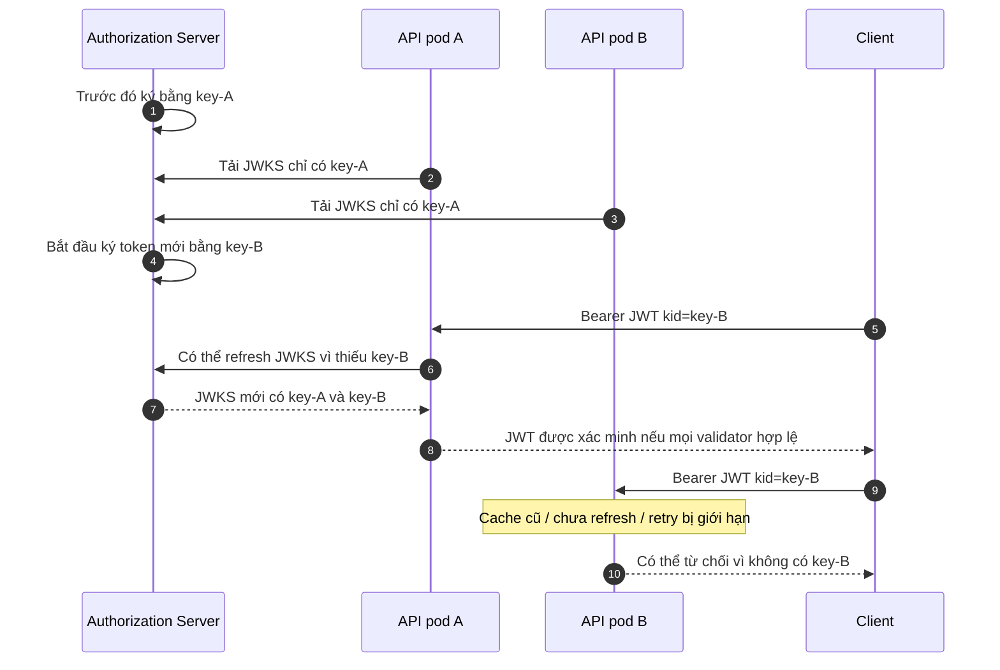
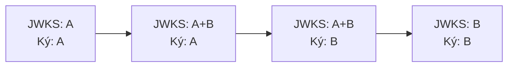

# Nhiều nút API, cache riêng và hành vi khi khóa thay đổi

Khi một hệ thống chạy nhiều instance của **Spring Security OAuth 2.0 Resource Server**, tất cả instance có thể tin cùng một Authorization Server nhưng **không nhất thiết nhìn thấy cùng một JWK Set tại cùng một thời điểm**. Mỗi instance có thể sở hữu `JwtDecoder` riêng, cache khóa riêng, thời điểm khởi động riêng và lịch sử truy cập JWK Set riêng.

Đây là nguyên nhân khiến một JWT vừa được phát hành có thể **được API pod A chấp nhận nhưng bị pod B từ chối**, dù mã nguồn, issuer và cấu hình của hai pod giống nhau. Lỗi thường xuất hiện đúng lúc Authorization Server **xoay vòng khóa ký** (*key rotation*), khi một số cache chưa biết public key mới hoặc khi public key cũ đã bị rút khỏi JWK Set quá sớm.

Bài học tập trung vào cách hiểu và thiết kế vòng đời khóa trong kiến trúc **nhiều nút API**, bao gồm:

- Phân biệt khóa ký riêng của Authorization Server với khóa công khai JWK mà Resource Server sử dụng.
- Mỗi `JwtDecoder` có thể cache JWK Set độc lập như thế nào.
- Hành vi khi `kid` mới xuất hiện, cache còn khóa cũ, JWKS endpoint chậm hoặc mất kết nối.
- Vì sao quy trình rotation cần giai đoạn **công bố khóa mới trước khi dùng** và **giữ khóa cũ đủ lâu**.
- Cách cấu hình, vận hành và quan sát Spring Security Resource Server mà không giảm yêu cầu xác minh JWT.

Các ví dụ Spring dùng phong cách **Spring Boot 3 / Spring Security 6**. Chi tiết cache, retry, timeout và cách tải lại JWK Set phụ thuộc phiên bản Spring Security, Nimbus JOSE + JWT và cấu hình HTTP client/cache; không nên coi một con số TTL hay một hành vi refresh là bất biến trong mọi bản phát hành.

## 1. Bối cảnh: một issuer, nhiều Resource Server instance

Giả sử có một dịch vụ `orders-api` triển khai sau load balancer:

```text
                       ┌──────────────────────────────┐
                       │ Authorization Server         │
                       │ Ký JWT bằng private key      │
                       │ Công bố public keys qua JWKS │
                       └──────────────┬───────────────┘
                                      │ HTTPS /jwks
                  ┌───────────────────┼───────────────────┐
                  │                   │                   │
           ┌──────▼──────┐     ┌──────▼──────┐     ┌──────▼──────┐
           │ API pod A   │     │ API pod B   │     │ API pod C   │
           │ JwtDecoder  │     │ JwtDecoder  │     │ JwtDecoder  │
           │ JWK cache A │     │ JWK cache B │     │ JWK cache C │
           └──────▲──────┘     └──────▲──────┘     └──────▲──────┘
                  │                   │                   │
                  └───────────────────┼───────────────────┘
                                      │
                               Load balancer
                                      │
                                   Client
```

Mỗi pod có cùng một cấu hình issuer, ví dụ:

```yaml
spring:
  security:
    oauth2:
      resourceserver:
        jwt:
          issuer-uri: https://identity.example.com/realms/shop
```

Nhưng **cùng issuer không đồng nghĩa cùng cache**. Nếu A đã tải JWK Set mới, B đang giữ bản cũ còn C mới khởi động, ba pod có thể tiến vào ba trạng thái khóa khác nhau.

Sự khác nhau này không chỉ xảy ra trên Kubernetes. Nó cũng có thể xảy ra giữa:

- Nhiều máy ảo chạy sau reverse proxy.
- Nhiều tiến trình Java trên cùng máy.
- Nhiều vùng địa lý, data center hoặc cluster.
- Nhiều `JwtDecoder` được tạo cho các chain/issuer khác nhau trong cùng một tiến trình.

Đơn vị cần quan sát là **cache gắn với decoder thực sự được dùng để xác thực request**, không chỉ số lượng máy chủ.

## 2. JWK, JWK Set, `kid` và JWT liên quan như thế nào?

Trong mô hình chữ ký bất đối xứng phổ biến:

1. Authorization Server giữ **private key** để ký access token JWT.
2. Authorization Server công bố **public key** tương ứng qua một endpoint JWK Set (*JWKS*).
3. Resource Server tải JWK Set từ nguồn đáng tin, lựa chọn public key phù hợp và **xác minh chữ ký**.

Một JWT compact có dạng:

```text
base64url(header).base64url(payload).base64url(signature)
```

Ví dụ header JWT:

```json
{
  "alg": "RS256",
  "typ": "at+jwt",
  "kid": "shop-signing-2026-b"
}
```

Ví dụ payload:

```json
{
  "iss": "https://identity.example.com/realms/shop",
  "sub": "user-123",
  "aud": ["orders-api"],
  "scope": "orders.read",
  "exp": 1900000000
}
```

Hai JSON trên chỉ minh họa dữ liệu; không phải token có chữ ký hợp lệ.

Một JWK Set minh họa:

```json
{
  "keys": [
    {
      "kty": "RSA",
      "kid": "shop-signing-2026-a",
      "use": "sig",
      "alg": "RS256",
      "n": "<public-modulus-of-key-a>",
      "e": "AQAB"
    },
    {
      "kty": "RSA",
      "kid": "shop-signing-2026-b",
      "use": "sig",
      "alg": "RS256",
      "n": "<public-modulus-of-key-b>",
      "e": "AQAB"
    }
  ]
}
```

Trong đó:

| Thành phần | Ý nghĩa | Lưu ý bảo mật |
| --- | --- | --- |
| `kid` | Key identifier hỗ trợ lựa chọn khóa trong JWK Set. | Là dữ liệu trong JWT header; **không tự chứng minh** token đáng tin. |
| `alg` | Thuật toán chữ ký mà JWT khai báo. | Decoder phải có danh sách thuật toán cho phép, không tin vô điều kiện mọi `alg`. |
| `kty` | Loại khóa, ví dụ RSA hoặc EC. | Phải phù hợp cách xác minh. |
| `n`, `e` | Thông tin public key RSA. | Không phải private key dùng để ký. |
| `iss` | Bên phát hành token. | Phải khớp issuer đáng tin đã cấu hình. |
| `aud` | API/bên nhận dự kiến. | Cần validator audience theo hợp đồng API. |

`kid` thường chỉ có ý nghĩa **trong ngữ cảnh một nguồn khóa/issuer cụ thể**. Không dùng `kid` làm khóa định danh toàn cục hoặc tự lấy JWK Set từ một URL bất kỳ do client cung cấp. Kẻ tấn công hoàn toàn có thể tạo token tự đặt `kid = "shop-signing-2026-b"`; decoder vẫn phải xác minh chữ ký và các claim.

## 3. Vòng đời của ba thứ dễ bị nhầm

Khi nói “cache khóa”, cần phân biệt:

| Thành phần | Dữ liệu chứa | Thời điểm phải cập nhật |
| --- | --- | --- |
| **Issuer metadata cache/discovery** | `issuer`, `jwks_uri`, metadata liên quan. | Khi khởi tạo decoder dựa trên issuer hoặc cơ chế discovery có yêu cầu. |
| **JWK Set cache** | Tập public keys đang biết của issuer. | Khi cache cần refresh, có key mới hoặc chính sách cache thay đổi. |
| **JWT access token** | Credential đã được ký, có `exp` và các claim quyền. | Token tồn tại theo vòng đời phát hành/hết hạn, **không phải một entry JWK Set**. |

Việc decoder biết `jwks_uri` **không có nghĩa** nó đang giữ mọi public key hiện hành. Việc có public key xác minh được một chữ ký **không có nghĩa** token đó còn hạn hoặc được cấp cho `orders-api`.

Ngược lại, JWT đã hết hạn có thể vẫn có chữ ký xác minh được bằng một public key còn lưu trong cache; token vẫn bị từ chối bởi validator thời gian. **Cache JWK không thay thế validation `exp`, `iss`, `aud` và quyền truy cập.**

## 4. Mỗi instance tạo cache JWK riêng như thế nào?

Với cấu hình phổ biến, mỗi tiến trình Spring Boot có một `JwtDecoder` được tạo trong `ApplicationContext`, và implementation JWT sử dụng cơ chế lưu JWK Set của thư viện giải mã. Một số phiên bản Nimbus/Spring Security có cache JWK Set trong bộ nhớ theo TTL/chính sách nhất định.

Ví dụ cùng một thời điểm:

| Pod | Khởi động | Cache hiện có | Ghi chú |
| --- | --- | --- | --- |
| A | Trước đó nhiều giờ | Khóa A và B | Đã refresh sau khi issuer công bố B. |
| B | Trước đó nhiều giờ | Chỉ khóa A | Chưa refresh kể từ khi B được công bố. |
| C | Vừa khởi động | Cache trống | Có thể phải tải JWKS ở JWT request đầu tiên. |

Trên thực tế, việc cache có khóa nào phụ thuộc **khi nào pod tải JWKS**, không chỉ dựa vào thời gian khởi động. Nếu một pod không có request Bearer nào trong nhiều phút, decoder lazy có thể chưa từng tải khóa. Nếu pod khác liên tục xử lý JWT, nó có thể đã refresh nhiều lần.

Các nút không mặc định chia sẻ bộ nhớ heap Java, do đó không có cơ chế “A đã lấy key B thì B và C tự biết” trừ khi ứng dụng/hạ tầng triển khai thêm một tầng cache hoặc hệ thống phân phối khóa được thiết kế rõ.

### Điều gì không nên giả định?

- Không coi **TTL cache JWKS luôn bằng 5 phút** cho mọi phiên bản; mặc định thực tế có thể khác theo library và cache adapter.
- Không khẳng định **gặp `kid` chưa biết luôn refresh ngay lập tức**: hành vi phụ thuộc implementation, trạng thái cache, cooldown và cấu hình.
- Không coi refresh JWKS giống “refresh access token” — đây là hai hoạt động hoàn toàn khác.
- Không mặc định thêm pod sẽ khiến JWT của tất cả pod đều được xác minh giống nhau trong một khoảng rất ngắn sau key rotation.

Trong vận hành, cần khảo sát cơ chế cache của **decoder thật đang chạy**, bao gồm TTL, refresh, cache miss, negative caching hoặc giới hạn network call nếu có.

## 5. Sự cố thường gặp: khóa B mới nhưng pod B còn cache A

Giả sử Authorization Server ban đầu chỉ ký JWT bằng private key A, còn JWKS công bố public key A. Sau đó issuer đổi sang ký bằng B.

Nếu issuer **bắt đầu ký bằng B trước khi các Resource Server có cơ hội lấy public key B**, có thể xảy ra:



Tình huống trên minh họa **khả năng khác biệt giữa các pod**, không khẳng định Nimbus ở mọi phiên bản sẽ có đúng trình tự refresh như sơ đồ. Một decoder có thể refresh khi thiếu `kid`; một decoder khác có thể chờ TTL/cooldown; và lỗi mạng có thể làm request refresh thất bại.

Từ phía client, lỗi có thể biểu hiện như “request đầu tiên 200, request tiếp theo 401” chỉ vì load balancer chuyển sang một replica chưa biết khóa. Nhưng **không nên vội kết luận mọi HTTP 401 sau rotation đều do cache**: vẫn phải kiểm tra issuer, audience, chữ ký, token expiry, allowed algorithm và authority.

## 6. Rotation an toàn: công bố trước, dùng sau, rút khóa cũ sau cùng

Với thay khóa có kế hoạch, chiến lược phổ biến là **overlapping keys**:

1. **Chuẩn bị key B** trong hệ thống quản lý khóa; private key B vẫn chỉ thuộc Authorization Server hoặc cơ chế ký được ủy quyền.
2. **Công bố public key B trong JWKS** khi Authorization Server vẫn tiếp tục ký token bằng A.
3. **Chờ khoảng thời gian phân phối đủ lớn** để các Resource Server/edge cache có cơ hội làm mới JWK Set và nhận ra B.
4. **Bắt đầu ký token mới bằng private key B**. Trong giai đoạn chuyển tiếp, JWKS vẫn giữ public key A và B.
5. **Tiếp tục phục vụ key A** chừng nào còn token hợp lệ đã được ký bằng A có thể tới các API.
6. **Chỉ rút public key A** khi các token cũ đã hết hạn theo chính sách cùng một khoảng đệm phù hợp.



Sơ đồ có bốn trạng thái:

| Giai đoạn | Khóa dùng để ký JWT mới | Public keys trong JWKS | Mục tiêu |
| --- | --- | --- | --- |
| 1. Trước rotation | A | A | Hoạt động bình thường. |
| 2. *Pre-publish* | A | A + B | Resource Server có cơ hội học khóa B trước khi dùng. |
| 3. *Overlap* | B | A + B | Token mới B và token cũ A đều có thể được xác minh. |
| 4. *Retire* | B | B | Chỉ rút A khi không còn token A hợp lệ cần hỗ trợ. |

**Đảo ngược thứ tự là nguồn lỗi phổ biến.** Nếu B bắt đầu được dùng ký trước khi B có trong JWKS, các Resource Server chưa thể xác minh token mới. Nếu A bị rút khi token cũ ký bằng A còn hiệu lực, các pod refresh JWKS mới có thể bắt đầu từ chối những token cũ.

Pre-publish là một chiến lược vận hành, không phải chứng minh tuyệt đối rằng mọi pod đã thấy B. Những pod mới khởi động, cache có thời hạn khác nhau hoặc mạng gián đoạn vẫn có thể chưa nhận B khi key B bắt đầu được dùng. Cần phối hợp monitoring và biên độ thời gian an toàn.

## 7. Tính khoảng overlap dựa trên hai hướng thời gian

Thời gian overlap thường có **hai phần**, và không nên lấy một con số chung theo thói quen:

**Phía trước thời điểm chuyển sang ký B:** Chờ để public key B lan đến các cache. Khoảng này chịu ảnh hưởng bởi TTL/refresh policy, CDN/proxy, delay đồng bộ giữa các vùng, network và hành vi khi unknown `kid`.

**Phía sau thời điểm ngừng ký A:** Giữ public key A cho tới khi token cuối cùng ký bằng A **không còn được phép sử dụng**, cộng clock skew và biên độ an toàn.

Ví dụ giả định:

```text
JWT access token lifetime tối đa:       15 phút
Độ lệch đồng hồ được validator cho phép: 1 phút
Biên độ vận hành để rút khóa cũ:         4 phút
```

Nếu thời điểm cuối cùng issuer ký JWT bằng A là `T`, thì một chính sách đơn giản có thể giữ public key A tới **ít nhất `T + 20 phút`** theo các giả định trên. Đây là phép tính minh họa:

```text
Thời gian giữ A sau lần ký cuối
  >= tuổi thọ tối đa của token A cuối
   + độ lệch đồng hồ chấp nhận
   + biên độ trễ/vận hành
```

Nó **không có nghĩa mọi hệ thống đều cần 20 phút**. Nếu có token A tồn tại lâu hơn, token được cấp ở nhiều khu vực, lịch phát hành trễ, ký theo batch hoặc đồng hồ không đồng nhất, phải lấy **tuổi thọ tối đa thực tế** của những token cần hỗ trợ.

Phần thời gian *pre-publish B* lại phải căn cứ vào **thời gian các Resource Server cập nhật cache**. Không lấy token lifetime thay cho cache refresh window: một cái liên quan **token cũ**, một cái liên quan **khóa mới**.

## 8. Vì sao pod có thể gặp hai loại lỗi ngược nhau trong một lần rotation?

Cùng lúc issuer chuyển từ A sang B có thể có hai dạng request:

| Token đến API | Trạng thái cache của pod | Hệ quả có thể xảy ra |
| --- | --- | --- |
| JWT mới, `kid = B` | Cache chỉ có A | Không tìm được public key B; cần refresh hoặc từ chối. |
| JWT mới, `kid = B` | Cache A + B | Có khả năng xác minh chữ ký bằng B. |
| JWT cũ, `kid = A`, chưa hết hạn | Cache A + B | Có khả năng tiếp tục xác minh bằng A. |
| JWT cũ, `kid = A`, chưa hết hạn | Cache chỉ có B vì A bị rút quá sớm | Không có khóa A; có thể từ chối token vẫn còn hiệu lực. |
| JWT cũ, `kid = A`, đã hết hạn | Cache vẫn có A | **Vẫn phải từ chối** do validator thời gian. |

Lỗi “chưa có khóa mới B” có thể xuất hiện **ngay sau khi issuer bắt đầu ký B**. Lỗi “mất khóa cũ A” lại có thể xuất hiện **sau khi issuer rút A khỏi JWKS**. Chúng là hai vấn đề khác nhau, cần biện pháp khắc phục khác nhau.

Trong cả hai trường hợp, API **không được bỏ bước xác minh chữ ký** chỉ vì issuer đang rotation. Khóa cũ chỉ nên được giữ khi nó vẫn được tin cậy theo chính sách và chưa bị đánh dấu compromise.

## 9. Unknown `kid`: có nên refresh JWK Set ngay?

Khi nhận JWT với header `kid` chưa có trong cache, decoder có thể muốn tải lại JWKS vì issuer vừa xoay khóa. Nhưng `kid` vẫn là dữ liệu đầu vào **do người gửi token quyết định**, nên một kẻ tấn công có thể tạo hàng nghìn JWT với `kid` ngẫu nhiên nhằm kích hoạt nhiều network request đến JWKS endpoint.

Đó là lý do refresh-on-unknown-key cần một chính sách hợp lý:

- Decoder chỉ truy cập **JWK Set URI đáng tin đã cấu hình hoặc khám phá từ issuer được tin cậy**, không tải URL do JWT tự chỉ định.
- Có timeout, cache, rate limit/cooldown hoặc cơ chế hạn chế gọi JWKS quá dày theo khả năng của thư viện.
- Không đưa mọi giá trị `kid` chưa biết thành metric label có độ phân biệt vô hạn; nguy cơ làm tăng cardinality của hệ thống monitoring.
- Khi không có public key phù hợp, **không cho request đi qua**; refresh thất bại không phải lý do tin payload.
- Hành vi cache miss thực tế cần được hiểu theo **implementation và version** đang triển khai, thay vì kỳ vọng mọi thư viện đều tự refresh vô điều kiện.

Ví dụ luồng:

```text
Bearer JWT có kid chưa biết
    -> tìm key trong cache của decoder
    -> nếu không có: xử lý refresh theo chính sách decoder
    -> nếu JWKS mới chứa key phù hợp: xác minh chữ ký + claims
    -> nếu không: authentication thất bại an toàn
```

Lưu ý rằng tìm được khóa khớp `kid` **mới chỉ là bước tìm khóa**. JWT vẫn phải có chữ ký hợp lệ, đúng issuer, chưa hết hạn, đúng audience và các ràng buộc khác.

## 10. Spring Boot Resource Server: cấu hình cơ bản cho nhiều pod

Các dependency cho một ứng dụng Servlet:

```gradle
dependencies {
    implementation 'org.springframework.boot:spring-boot-starter-security'
    implementation 'org.springframework.boot:spring-boot-starter-oauth2-resource-server'
}
```

Cấu hình JWT bằng issuer:

```yaml
spring:
  security:
    oauth2:
      resourceserver:
        jwt:
          issuer-uri: https://identity.example.com/realms/shop
```

Một `SecurityFilterChain` xác thực Bearer JWT và yêu cầu scope:

```java
import org.springframework.context.annotation.Bean;
import org.springframework.context.annotation.Configuration;
import org.springframework.http.HttpMethod;
import org.springframework.security.config.Customizer;
import org.springframework.security.config.annotation.web.builders.HttpSecurity;
import org.springframework.security.config.http.SessionCreationPolicy;
import org.springframework.security.web.SecurityFilterChain;

@Configuration
public class ApiSecurityConfig {

    @Bean
    SecurityFilterChain apiSecurity(HttpSecurity http) throws Exception {
        return http
            .securityMatcher("/api/**")
            .csrf(csrf -> csrf.disable())
            .sessionManagement(session -> session
                .sessionCreationPolicy(SessionCreationPolicy.STATELESS))
            .authorizeHttpRequests(auth -> auth
                .requestMatchers(HttpMethod.GET, "/api/orders/**")
                    .hasAuthority("SCOPE_orders.read")
                .anyRequest().denyAll())
            .oauth2ResourceServer(oauth2 -> oauth2
                .jwt(Customizer.withDefaults()))
            .build();
    }
}
```

Trong cấu hình này, decoder thường sử dụng metadata issuer/JWK Set theo cơ chế Spring Security, và **mỗi pod có thể sở hữu cache khóa riêng**. Spring Boot không tự triển khai một “cache JWKS toàn cluster” chỉ vì nhiều replica dùng cùng `issuer-uri`.

`SecurityFilterChain` chỉ bảo vệ URL khớp `/api/**`; những endpoint khác cần chain hoặc chính sách fallback riêng. `csrf.disable()` trong ví dụ giả định API stateless sử dụng Bearer token truyền tường minh qua header, không dựa vào cookie browser tự động gửi để xác thực; ứng dụng dùng session/cookie cần chính sách CSRF riêng.

### Cùng cấu hình YAML chưa đủ để đảm bảo kết quả đồng nhất

Giả sử các pod dùng **cùng image và environment**. Việc xác minh JWT vẫn phụ thuộc:

1. Pod có đúng decoder và issuer validation đang hoạt động không?
2. Pod đã tải JWKS chưa, và cache hiện còn khóa nào?
3. JWKS endpoint có trả cùng dữ liệu qua các CDN/region/proxy không?
4. Pod có truy cập được endpoint qua DNS, TLS, proxy và network policy không?
5. Đồng hồ của các pod có đồng bộ đủ chính xác cho `exp`/`nbf` không?
6. Các pod có cùng phiên bản library/cache policy không, nhất là khi rolling deployment?

Vì thế, không phải mọi khác biệt `401` giữa pod đều do rotation. Có thể đó là khác biệt **validation cấu hình, thời gian, truy cập mạng hoặc phiên bản runtime**.

## 11. Khi đã biết JWK Set URI: tách discovery khỏi việc tải key

Một deployment có thể nhận issuer URI từ Authorization Server và biết sẵn URL JWKS đáng tin:

```yaml
spring:
  security:
    oauth2:
      resourceserver:
        jwt:
          issuer-uri: https://identity.example.com/realms/shop
          jwk-set-uri: https://identity.example.com/realms/shop/keys
```

Trong cấu hình Spring Boot/Spring Security hỗ trợ, `jwk-set-uri` cung cấp **đường dẫn JWKS trực tiếp**, nên ứng dụng không cần discovery metadata chỉ để tìm URL khóa. `issuer-uri` vẫn cần cho validation claim `iss`.

Tuy nhiên:

- Pod mới vẫn có thể phải tải public keys khi JWT đầu tiên đến.
- Key rotation vẫn cần JWKS refresh và overlap.
- `jwk-set-uri` trực tiếp **không tạo shared cache** giữa các pod.
- Nếu chỉ khai báo `jwk-set-uri` mà bỏ issuer, không nên giả định `iss` tự được kiểm tra theo issuer mong muốn; cần validator đúng hợp đồng.

Một thay đổi cấu hình để tránh dependency discovery tại startup **không giải quyết được bài toán key distribution**. Nó chỉ thay đổi cách Resource Server biết nơi lấy JWK Set.

## 12. Custom `JwtDecoder`: giữ các validation khi tùy biến khóa và cache

Nếu cần cấu hình HTTP client, nguồn khóa, cache hoặc audience một cách cụ thể, có thể tạo bean `JwtDecoder` riêng. Ví dụ sau minh họa decoder dựa trên JWKS URI đã tin cậy, với kiểm tra issuer và audience:

```yaml
app:
  security:
    issuer: https://identity.example.com/realms/shop
    jwks-uri: https://identity.example.com/realms/shop/keys
    audience: orders-api
```

```java
import java.util.List;

import org.springframework.beans.factory.annotation.Value;
import org.springframework.context.annotation.Bean;
import org.springframework.context.annotation.Configuration;
import org.springframework.security.oauth2.core.DelegatingOAuth2TokenValidator;
import org.springframework.security.oauth2.core.OAuth2TokenValidator;
import org.springframework.security.oauth2.jwt.Jwt;
import org.springframework.security.oauth2.jwt.JwtClaimValidator;
import org.springframework.security.oauth2.jwt.JwtDecoder;
import org.springframework.security.oauth2.jwt.JwtValidators;
import org.springframework.security.oauth2.jwt.NimbusJwtDecoder;

@Configuration
public class TokenValidationConfig {

    @Bean
    JwtDecoder jwtDecoder(
            @Value("${app.security.issuer}") String issuer,
            @Value("${app.security.jwks-uri}") String jwksUri,
            @Value("${app.security.audience}") String audience) {

        NimbusJwtDecoder decoder =
            NimbusJwtDecoder.withJwkSetUri(jwksUri).build();

        OAuth2TokenValidator<Jwt> defaults =
            JwtValidators.createDefaultWithIssuer(issuer);

        OAuth2TokenValidator<Jwt> audienceValidator =
            new JwtClaimValidator<List<String>>(
                "aud",
                values -> values != null &&
                    values.contains(audience));

        decoder.setJwtValidator(
            new DelegatingOAuth2TokenValidator<>(
                defaults,
                audienceValidator));

        return decoder;
    }
}
```

Ở đây:

- `withJwkSetUri(jwksUri)` chọn **nguồn public key**, không tự giải quyết mọi claim validation.
- `JwtValidators.createDefaultWithIssuer(issuer)` giữ các validator tiêu chuẩn và kiểm tra issuer.
- Validator `aud` đảm bảo token dành cho `orders-api`, không phải một API khác cùng issuer.
- Cơ chế cache JWK Set vẫn do decoder/Nimbus sử dụng theo cấu hình, không phải do service/controller lưu token vào cache.

Trong ví dụ, custom bean này thường khiến Spring Boot **back off** phần auto-configuration tạo `JwtDecoder` mặc định. Nếu Boot trước đó có cơ chế lazy issuer discovery, cần hiểu rằng decoder do mình tạo sẽ có hành vi phụ thuộc **factory và cache mà mình chọn**; không thể dựa vào YAML cũ để suy ra.

Nếu phiên bản Boot hỗ trợ cấu hình audience bằng property và không cần custom decoder, dùng auto-configuration có thể đơn giản hơn. Khi custom decoder xuất hiện, ứng dụng nhận trách nhiệm bảo toàn đầy đủ validator.

## 13. Có nên sử dụng shared cache JWKS cho cả cluster?

Vì các pod dùng cache riêng nên có ý tưởng chuyển toàn bộ JWKS vào Redis hoặc một shared cache. Đây là một **lựa chọn kiến trúc**, không phải yêu cầu bắt buộc của Spring Security.

| Tiêu chí | Cache độc lập ở từng pod | Shared cache qua hạ tầng trung gian |
| --- | --- | --- |
| Độ trễ hit | Thường truy xuất trong bộ nhớ pod. | Có thêm thao tác mạng hoặc một lớp local cache. |
| Tính độc lập | Pod này không cần cache service của pod khác. | Phụ thuộc tính sẵn sàng của cache dùng chung. |
| Rotation | Pod có thể nhận key mới ở các thời điểm khác nhau. | Có thể đồng bộ dữ liệu khóa nếu thiết kế refresh/invalidation tốt. |
| Tải lên JWKS endpoint | Có thể tạo burst khi nhiều pod refresh đồng thời. | Có thể giảm số lần fetch nếu dùng single-flight/coordination. |
| Điểm lỗi | Mỗi pod có trạng thái riêng, lỗi có thể chỉ ảnh hưởng một nhóm pod. | Lỗi/cache stale tập trung có thể tác động đồng thời cả cluster. |
| Mức phức tạp | Thường đơn giản, dựa trên thư viện chuẩn. | Cần thiết kế TTL, khóa cache theo issuer, invalidation và trust boundary. |

**Shared cache không tự động “đúng hơn”.** Nếu tất cả pod dùng chung một entry JWKS cũ và không có cơ chế refresh phù hợp, toàn bộ cluster có thể cùng thiếu key mới. Nếu cache dùng chung bị nhầm dữ liệu giữa hai issuer, hậu quả còn nghiêm trọng hơn các cache tách biệt.

Trong nhiều hệ thống, **công bố khóa mới sớm và giữ khóa cũ đủ lâu** là biện pháp cơ bản, dễ vận hành hơn việc tự xây dựng shared cache phức tạp. Shared cache phù hợp hơn khi số lượng instance lớn, lưu lượng cao, rate limit JWKS chặt hoặc tổ chức cần cơ chế đồng bộ khóa trung tâm.

### Nếu có shared cache, khóa định danh cache phải rõ

Không nên dùng mỗi `kid` làm cache key:

```text
Sai: jwk-cache["key-42"]
```

Hai issuer có thể cùng dùng `kid = key-42` nhưng public key khác nhau. Tối thiểu cần phân biệt **issuer/nguồn JWKS tin cậy**, chính sách algorithm và ngữ cảnh chấp nhận token:

```text
issuer + jwksUri -> JWKS thuộc issuer cụ thể
```

Việc quản lý cache cần tuân theo trust boundary: cache chỉ chứa public key lấy từ nguồn tin cậy, không nhận một JWK Set do HTTP request bên ngoài cung cấp.

## 14. Đồng loạt refresh: nguy cơ “thundering herd”

Một cluster có 100 pod có thể đồng thời nhận JWT chứa `kid` mới. Nếu cả 100 pod đều lập tức gọi JWKS endpoint, Authorization Server hoặc CDN có thể thấy **một đợt tăng lưu lượng đột ngột**. Sự cố sẽ nghiêm trọng hơn nếu:

- Tất cả pod vừa rolling restart và cache đều rỗng.
- Cache TTL của nhiều pod kết thúc gần cùng lúc.
- Issuer chỉ cấp được số kết nối hoặc request hạn chế.
- Mạng giữa cluster và issuer có độ trễ lớn.
- Client/kẻ tấn công liên tục gửi JWT với `kid` ngẫu nhiên.

Ví dụ minh họa:

```text
100 pod x 1 JWKS fetch/pod ≈ 100 fetch trong một khoảng ngắn
```

Đó chỉ là cách hình dung tải phát sinh, không phải cam kết về số request thực tế: một pod có thể không fetch nếu cache có key, hoặc fetch nhiều lần nếu retry/chính sách refresh cho phép.

Những biện pháp cân nhắc khi quy mô lớn:

1. Pre-publish public key mới trước khi issuer bắt đầu ký bằng nó.
2. Không đồng loạt làm rỗng cache hoặc restart mọi pod đúng lúc rotation.
3. Cấu hình timeout, connection pooling, cache/cooldown và cơ chế tránh refresh đồng thời nếu thư viện/hạ tầng hỗ trợ.
4. Sử dụng CDN hoặc JWK Set endpoint có khả năng chịu tải, nhưng phải kiểm soát độ trễ cập nhật.
5. Dùng shared cache/single-flight fetch khi lợi ích đủ lớn và đã thiết kế rõ ranh giới tin cậy.
6. Giám sát tỷ lệ request thất bại và lỗi tải JWKS trên từng pod để phát hiện cache lệch nhau.

**Không nên hạ yêu cầu JWT verification hoặc chấp nhận chữ ký không kiểm chứng** để “giải quyết nhanh” burst JWKS.

## 15. JWKS endpoint hoặc Authorization Server tạm thời mất kết nối

Trên nhiều pod, khi JWKS endpoint down, các request có thể chịu ảnh hưởng khác nhau:

| Trạng thái pod | Token đến | Hành vi có thể xảy ra |
| --- | --- | --- |
| Cache có public key phù hợp và còn được sử dụng theo chính sách | JWT ký bằng key đã biết | Có thể tiếp tục xác minh cục bộ. |
| Cache chưa có key phù hợp | JWT ký bằng key mới | Có thể không xác minh được vì JWKS không truy cập được. |
| Cache bị invalidated hoặc hết hạn và cần tải lại | JWT dùng key đã từng biết | Có thể lỗi nếu policy decoder không cho dùng entry hiện tại. |
| Pod mới chưa từng tải JWKS | JWT bất kỳ cần lấy key | Có thể thất bại ở request xác thực đầu tiên. |

**Không nên khẳng định “JWT validation luôn hoạt động offline”** chỉ vì thuật toán chữ ký là bất đối xứng. Về mặt toán học, xác minh JWT không cần mạng **nếu đã có public key phù hợp và các validator cần thiết**. Nhưng cơ chế lấy và làm mới khóa vẫn có thể cần mạng khi cache chưa đáp ứng.

Lỗi token sai chữ ký khác với lỗi không lấy được khóa vì hạ tầng. HTTP status cụ thể phụ thuộc Spring Security version, decoder và exception handler: token không hợp lệ thường dẫn đến `401`, còn lỗi JWKS/discovery không sẵn sàng cần được phân loại như sự cố hạ tầng xác thực. Trong mọi trường hợp, **không biến lỗi mạng thành quyết định cho phép token chưa xác minh**.

### Có nên tự sử dụng khóa cũ sau khi cache đã hết hạn?

Đây là quyết định an toàn phải dựa trên threat model và chính sách issuer:

- Dùng khóa cũ lâu hơn có thể giúp hệ thống hoạt động khi issuer tạm gián đoạn.
- Nhưng khóa cũ có thể đã bị **thu hồi do compromise** hoặc bị issuer loại khỏi tập khóa tin cậy.
- Mỗi thư viện có policy cache khác nhau; không tự sửa decoder để bỏ qua hết hạn cache chỉ vì muốn tăng availability.

Nếu cần chế độ *stale-while-revalidate*, phải có giới hạn thời gian, nguồn dữ liệu tin cậy, monitoring và chính sách xử lý **key revocation** rõ ràng. Với khóa bị xác định là không còn đáng tin, an toàn có thể đòi hỏi **ngừng chấp nhận ngay**, chấp nhận đánh đổi availability.

## 16. Rotation bình thường và khóa bị lộ là hai tình huống khác nhau

**Rotation có kế hoạch**: private key A vẫn được tin cậy, nhưng hệ thống muốn chuyển dần sang B. Có thể pre-publish B, ký B và giữ A đến khi token cũ hết hiệu lực.

**Compromise hoặc nghi ngờ private key A bị lộ**: A không còn đáng tin. Khi đó giữ A để token cũ tiếp tục hoạt động có thể cho phép kẻ tấn công tạo JWT giả dưới khóa A. Mục tiêu an toàn có thể yêu cầu rút A nhanh, chặn những token liên quan, phát hành token mới và chấp nhận người dùng/service phải xác thực lại.

| Tình huống | Ưu tiên | Hành động điển hình |
| --- | --- | --- |
| Rotation định kỳ | Tránh gián đoạn hợp lệ. | Pre-publish B, overlap A+B, retire A sau khi token A hết hạn. |
| Khóa ký A bị lộ | Ngừng tin A nhanh theo kế hoạch ứng cứu. | Ngừng ký A, loại bỏ/deny A theo chính sách, phát hành B và xử lý token A đã cấp. |
| JWKS endpoint lỗi tạm thời | Bảo toàn tính toàn vẹn xác thực, giảm gián đoạn trong phạm vi cho phép. | Dùng cache hợp lệ theo policy; retry có giới hạn; theo dõi và khôi phục endpoint. |

**Rút public key A khỏi JWKS không nhất thiết khiến mọi pod lập tức ngừng chấp nhận JWT A**: một số pod vẫn còn A trong cache. Nếu cần thu hồi khẩn cấp, phải có cơ chế đẩy/invalidate cache hoặc chính sách riêng như denylist key ID, từ chối token profile/issuer phù hợp, thay decoder/restart có kiểm soát, tùy kiến trúc.

Ngoài ra, thay khóa ký **không giống revoke từng access token**. Một JWT đã ký hợp lệ có thể tiếp tục được chấp nhận cho đến khi hết hạn nếu không có cơ chế thu hồi bổ sung. Với yêu cầu thu hồi tức thời, cần thiết kế riêng (token lifetime ngắn, introspection/token status, denylist hoặc policy engine) chứ không mặc định chỉ cập nhật JWKS là đủ.

## 17. Key rotation không được làm mất issuer/audience validation

Trong Spring Security, `JwtDecoder` giải mã và xác minh JWT, còn các thành phần khác ánh xạ claim thành `Authentication` và authorization. Khi sửa decoder hoặc cache để xử lý rotation, **phải giữ đầy đủ validator**:

```text
Bearer JWT
  -> chọn nguồn khóa từ issuer đáng tin
  -> chọn key phù hợp trong JWK Set
  -> xác minh chữ ký và thuật toán
  -> kiểm tra iss, exp, nbf, aud và token profile
  -> tạo Authentication + authorities
  -> kiểm tra scope/role và owner/tenant
```

Ví dụ token ký bằng khóa B mới nhưng có:

```json
{
  "iss": "https://identity.example.com/realms/shop",
  "aud": ["analytics-api"],
  "scope": "analytics.read"
}
```

Nếu request đến `orders-api`, nó **không được chấp nhận** chỉ vì public key B đã có trong cache. Resource Server phải kiểm tra audience theo hợp đồng của mình.

Tương tự, việc Spring Security tạo `JwtAuthenticationToken` với `sub = user-123` không có nghĩa được đọc mọi đơn hàng của người khác. Authentication theo JWT và authorization trên tài nguyên là hai lớp khác nhau.

## 18. Quan sát cluster trong lúc rotation

Khi có lỗi chỉ xuất hiện trên một số pod, nên quan sát theo **pod + thời điểm + issuer + trạng thái refresh**. Một bộ tín hiệu vận hành hữu ích gồm:

| Tín hiệu | Vì sao cần |
| --- | --- |
| Tỷ lệ authentication thành công/thất bại theo pod | Phát hiện replica xử lý không nhất quán. |
| Loại lỗi decoder: thiếu key, sai chữ ký, `iss`/`aud`/`exp` không hợp lệ | Phân biệt lỗi cache/JWKS với token hoặc cấu hình sai. |
| Số lần tải JWKS, latency, timeout, HTTP status | Phát hiện refresh thất bại và burst network. |
| Thời điểm JWKS refresh thành công gần nhất | Nhận ra pod giữ dữ liệu cũ. |
| Issuer và phiên bản cấu hình/library | Tránh nhầm lỗi do cache với lỗi do rolling deployment cấu hình khác. |
| Số instance mới khởi động, cache miss tăng | Nhìn thấy tác động của autoscaling/rolling restart. |
| Tình trạng clock sync | Tách lỗi `exp`/`nbf` do đồng hồ khỏi lỗi khóa. |

Không phải tất cả metric trên có sẵn theo mặc định trong Spring Security; có thể phải bổ sung observability ở HTTP client/cache wrapper hoặc thông qua hạ tầng. **Không ghi raw Bearer token hoặc private key vào log**. Cẩn trọng với `kid`: nó đến từ JWT header chưa xác thực, có thể được dùng như dữ liệu chẩn đoán nhưng không nên trở thành label metric không giới hạn cardinality.

Ví dụ log có kiểm soát:

```text
time=...
service=orders-api
pod=orders-7d8f9c-abc
issuer_config=shop
stage=jwt_verification
reason=signing_key_not_available
jwks_fetch=timeout
trace_id=...
```

Không nên log nguyên payload JWT chứa dữ liệu cá nhân, nội dung `Authorization` header hoặc credential dùng cho introspection. Nếu cần liên kết các request, dùng trace ID/request ID.

## 19. Phân biệt lỗi xác thực và lỗi phân quyền trong lúc rotation

Một client báo rằng “API lúc 200, lúc 403, lúc 401” chưa đủ để khẳng định JWK cache có vấn đề:

| Kết quả | Nguyên nhân có thể | Hướng điều tra |
| --- | --- | --- |
| `401 Unauthorized` | Token không hợp lệ, sai issuer/audience, hết hạn, hoặc decoder không có key phù hợp. | Kiểm tra decoder, claim validation, trạng thái JWKS của pod. |
| `403 Forbidden` | Token đã xác thực nhưng thiếu authority, policy từ chối hoặc caller không được phép truy cập. | Kiểm tra `scope`, role, converter, endpoint/domain policy. |
| `404 Not Found` | Có thể API che giấu bản ghi ngoài owner/tenant theo chính sách. | Kiểm tra authorization dữ liệu, không mặc định là lỗi cache. |
| `5xx` | Có thể lỗi network/discovery/JWKS hoặc lỗi ứng dụng khác; phụ thuộc exception handling. | Xem stage lỗi và các thành phần upstream. |
| `2xx` | Token đã qua authentication và authorization cần thiết. | Kết quả bình thường; không dùng riêng 2xx để chứng minh mọi pod đã refresh. |

Trong OAuth 2.0 Bearer, lỗi xác thực thường có `WWW-Authenticate: Bearer`, có thể kèm `invalid_token`. Tuy nhiên status thực tế của lỗi **không tải được khóa vì outage** phụ thuộc implementation và handler; khi điều tra cần log phân loại nguyên nhân thay vì chỉ nhìn status HTTP.

## 20. Kiểm thử rotation trên nhiều pod

Trước khi đổi khóa trong production, nên thiết kế các tình huống thử nghiệm có thể tái hiện trạng thái cache khác nhau:

| Kịch bản thử | Trạng thái tạo ra | Điều cần chứng minh |
| --- | --- | --- |
| Pod A đã refresh, pod B chưa refresh | Cache không đồng bộ. | JWT mới dùng B không gây sự cố kéo dài ngoài khoảng chuyển tiếp đã thiết kế. |
| Pre-publish B, tiếp tục ký A | JWKS A+B, token mới vẫn A. | Token A hoạt động trên các pod; B đã có thể được tải. |
| Chuyển ký sang B trong overlap | JWT A và JWT B cùng tồn tại. | Các pod có cơ chế xác minh cả A/B theo chính sách, không bỏ qua validation. |
| Rút A khi JWT A còn hạn (mô phỏng sai quy trình) | Pod cache mới chỉ có B. | Nhận diện được nguy cơ từ chối token A hợp lệ. |
| JWKS endpoint down trong rotation | Có pod cache đủ, có pod cache thiếu. | Hệ thống từ chối token chưa xác minh và phát hiện lỗi dependency. |
| Nhiều pod restart cùng lúc | Cache rỗng diện rộng. | Hạ tầng JWKS chịu được tải hoặc có chiến lược giảm burst. |
| Issuer phát `kid` chưa biết | Cache miss. | Tải lại có kiểm soát, không cho token sai chữ ký vượt qua. |
| Nhiều JWT có `kid` ngẫu nhiên | Đầu vào ác ý. | Không tạo lưu lượng JWKS/metric cardinality không giới hạn. |
| JWT đúng chữ ký nhưng sai audience | Validator audience kích hoạt. | Vẫn bị từ chối dù khóa có sẵn. |
| JWT A đã hết hạn nhưng cache còn A | Khóa cũ vẫn còn. | Token hết hạn vẫn bị từ chối theo thời gian. |

Đây là **kịch bản thiết kế kiểm thử**, không phải lời khuyên thử rotation nguy hiểm trực tiếp trên production. Có thể dùng một issuer/JWK Set giả lập trong integration test, tạo cặp khóa RSA A/B riêng cho môi trường test, hoặc một staging Authorization Server hỗ trợ test rotation.

Spring Security Test MockMvc helper `jwt()` có thể tạo principal giả lập và thường **bỏ qua decoder xác minh chữ ký thật**. Do đó test dùng `jwt()` hữu ích cho authorization nhưng **không đủ** để kiểm chứng JWK cache, key rotation hoặc việc tải JWKS trên các pod. Cần kiểm thử đường đi token thật qua decoder để đánh giá các hành vi đó.

## 21. Quy trình triển khai rotation cho nhiều nút API

Một runbook có thể chia thành các mốc vận hành sau, với owner và thời gian được thống nhất trước:

**Trước rotation**

1. Thống kê issuer, `jwks_uri`, các cụm Resource Server và phiên bản decoder/cache đang chạy.
2. Xác định tuổi thọ tối đa của JWT dùng khóa A, clock skew và token profile liên quan.
3. Xác định cache TTL/refresh, edge cache/CDN và thời gian phân phối JWKS giữa các region.
4. Đảm bảo có metric về JWT failure theo pod và lỗi fetch JWKS, cũng như phương án rollback có kiểm soát.
5. Chuẩn bị private/public key B theo chính sách lưu trữ khóa; **không đưa private key vào Resource Server**.

**Thực hiện rotation có kế hoạch**

1. Công bố **public key B** trong JWKS bên cạnh A.
2. Chờ đủ thời gian propagation theo dữ liệu quan sát thực tế; nếu có thể, kiểm tra các nhóm pod đã tải JWKS phù hợp.
3. Chuyển Authorization Server sang **ký JWT mới bằng B**.
4. Theo dõi các token `kid = B` trên từng nhóm pod/region, tỷ lệ lỗi JWT và lỗi tải JWKS.
5. Tiếp tục giữ **public key A** cho token A cũ còn hạn.
6. Sau cửa sổ hết hạn và đệm an toàn, rút A có kiểm soát và tiếp tục quan sát.

**Sau rotation**

1. Xác nhận token mới B hoạt động trên các pod cũ và pod mới.
2. Xác nhận các request dùng token A quá hạn bị từ chối đúng quy tắc.
3. Kiểm tra JWKS không còn phục vụ các khóa đã được retire theo lịch.
4. Ghi nhận thời gian propagation, refresh, lỗi và điều chỉnh runbook lần sau.

Với tình huống **compromise**, không máy móc áp dụng lịch overlap trên. Quy trình ứng cứu cần ưu tiên loại bỏ khóa không còn tin cậy, theo kế hoạch khẩn cấp và có thể chấp nhận gián đoạn token cũ.

## 22. Khi nào cần thay đổi kiến trúc cache?

Không phải mọi cluster cần xây dựng shared JWKS cache. Có thể cân nhắc theo nhu cầu thực tế:

**Giữ cache cục bộ** khi số pod vừa phải, JWKS endpoint đủ khả năng phục vụ, key rotation có kế hoạch và sự lệch thời điểm refresh được xử lý nhờ pre-publish/overlap.

**Cân nhắc cache tập trung hoặc proxy JWKS** khi có hàng nghìn instance, giới hạn fetch chặt, nhiều vùng địa lý, hoặc cần kiểm soát đồng bộ cụ thể. Nhưng proxy/cache đó phải bảo vệ integrity, TTL, nguồn issuer, phân vùng tenant và cách xử lý key emergency removal.

**Cân nhắc cơ chế thu hồi khác** khi yêu cầu không phải “các pod biết public key mới” mà là “không chấp nhận ngay một token hoặc khóa bị thu hồi”. Đó có thể là chính sách token lifetime ngắn, introspection, denylist hoặc các điều kiện authorization trực tuyến; không nên nhầm với refresh JWKS thông thường.

**Cân nhắc giảm phụ thuộc startup vào discovery** khi ứng dụng thường phải khởi động độc lập với Authorization Server. Cấu hình `issuer-uri` kèm `jwk-set-uri` hoặc lazy decoder có thể giúp tránh một phần dependency sớm, nhưng không giải quyết nhu cầu lấy JWKS và xoay khóa sau đó.

## 23. Mô hình tư duy để xử lý mọi sự cố liên quan JWK

Thay vì hỏi ngay “cache bao lâu thì hết?”, hãy tách ba lớp:

```text
LỚP 1 — NGUỒN TIN CẬY
  Issuer nào được API chấp nhận?
  JWKS URI và thuật toán xác minh nào được phép?

LỚP 2 — TÌNH TRẠNG KHÓA TRÊN TỪNG NÚT
  Pod hiện có những public key nào?
  Có key phù hợp với JWT này chưa?
  Lần fetch/refresh gần nhất và lỗi network ra sao?

LỚP 3 — CHÍNH SÁCH JWT VÀ TÀI NGUYÊN
  Chữ ký, iss, exp, nbf, aud đã hợp lệ?
  Scope/role có đủ?
  Chủ thể có quyền trên owner/tenant/bản ghi cụ thể?
```

Hai pod có thể khác nhau ở **lớp 2** dù giống lớp 1 và lớp 3. Nhưng một token sai audience sẽ bị từ chối ở **lớp 3** ngay cả khi hai pod đều đã tải public key B.

**Điểm cốt lõi:** Trong Resource Server nhiều nút, JWK Set cache thường độc lập theo decoder/instance, nên quá trình rotation có thể tạo ra **cửa sổ nhìn thấy khóa không đồng nhất**. Cách giảm rủi ro chủ đạo là **pre-publish khóa mới, overlap khóa cũ và mới, giữ khóa cũ tới khi token cũ hết hiệu lực, giám sát refresh theo từng pod và luôn fail closed khi không thể xác minh JWT**. Shared cache, CDN, retry và warm-up là công cụ hỗ trợ tùy quy mô; không công cụ nào thay thế kiểm tra issuer, chữ ký, audience, thời gian và quyền trên tài nguyên.
