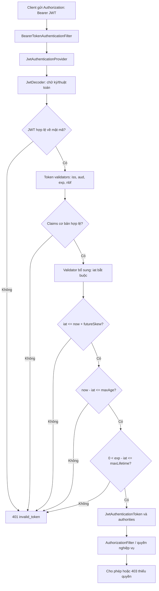

# iat, tuổi token và các chính sách bổ sung theo hợp đồng

Trong hệ thống **Spring Security OAuth 2.0 / OIDC Resource Server**, xác minh chữ ký của JWT mới chỉ cho biết token không bị sửa bởi bên không nắm khóa ký. Một access token có chữ ký hợp lệ vẫn có thể không phù hợp để sử dụng nếu nó **quá cũ**, được khai báo **phát hành trong tương lai**, sống lâu hơn thời hạn hợp đồng cho phép hoặc không đáp ứng các quy tắc riêng của API.

Claim **`iat` (Issued At)** là mốc thời gian để diễn giải thời điểm token được phát hành. Kết hợp với thời gian hiện tại, `exp` và chính sách của Authorization Server/Resource Server, `iat` có thể hỗ trợ kiểm tra **tuổi token**, **thời hạn cấp tối đa** và các ràng buộc vận hành bổ sung.

Tuy nhiên, **`iat` không phải là thời điểm người dùng đăng nhập**, không chứng minh token chưa bị thu hồi và không tự bảo đảm việc giới hạn tuổi token sẽ được áp dụng. Những điều kiện đó cần hợp đồng rõ ràng và validator tương ứng.

> **Bối cảnh minh họa:** Authorization Server có issuer `https://login.example.com`, Resource Server là Orders API với audience `orders-api`. Client gọi `GET /api/orders/42` bằng bearer access token có scope `orders.read`. Ví dụ Java dùng Spring Security 6.x với Servlet Resource Server và JWT đã được ký.

## 1. Vị trí của `iat` trong hợp đồng xác minh JWT

JWT gồm các registered claims như `iss`, `sub`, `aud`, `exp`, `nbf`, `iat` và `jti`. Ba claim thời gian dễ bị nhầm lẫn nhất là:

| Claim | Tên | Ý nghĩa | Câu hỏi khi Resource Server kiểm tra |
|---|---|---|---|
| **`iat`** | Issued At | Thời điểm issuer khai báo token được phát hành. | Token được cấp lúc nào? Đã quá cũ hoặc nằm trong tương lai không? |
| **`nbf`** | Not Before | Không được chấp nhận trước mốc này. | Đã đến lúc token bắt đầu có hiệu lực chưa? |
| **`exp`** | Expiration Time | Không được chấp nhận từ thời điểm hết hạn trở đi, ngoại trừ clock skew nhỏ nếu được cho phép. | Token đã hết hạn chưa? |

Ba claim **không thể thay thế cho nhau**:

- `iat` **không tự tạo một thời hạn sử dụng**. Token chỉ có `iat` mà không có `exp` không tự hết hạn theo tuổi nếu không có chính sách bổ sung.
- `exp` nói khi nào token hết hạn nhưng không bảo đảm nó mới được phát hành gần đây. Một token có `exp` trong tương lai có thể có `iat` từ rất lâu.
- `nbf` nói khi nào token **bắt đầu được sử dụng**, không phải thời điểm phát hành.
- `iat` thuộc nội dung JWT do issuer công bố. Resource Server chỉ nên tin claim sau khi chữ ký và các điều kiện cơ bản đã được xác minh.

### 1.1. `iat` có bắt buộc không?

Trong **RFC 7519 (JWT)**, `iat` là registered claim **tùy chọn**; ứng dụng quyết định các claim nào bắt buộc theo hợp đồng.

Trong **RFC 9068 (JWT Profile for OAuth 2.0 Access Tokens)**, `iat` nằm trong tập claim **bắt buộc** cùng `iss`, `exp`, `aud`, `sub`, `client_id` và `jti`.

Vì vậy:

- Resource Server nhận **JWT theo RFC 9068** phải bảo đảm claim `iat` được cung cấp đúng hồ sơ token.
- Resource Server dùng một **JWT profile riêng/legacy** cần chỉ rõ `iat` là bắt buộc hay tùy chọn và hậu quả khi thiếu.
- Không nên mặc định rằng mọi JWT decoder sẽ tự từ chối token thiếu `iat`. Một decoder/validator mặc định có thể tập trung vào chữ ký, `exp`, `nbf`, issuer mà chưa có chính sách **tuổi token** của nghiệp vụ.

## 2. NumericDate: đơn vị thời gian của `iat`

Theo RFC 7519, các claim thời gian tiêu chuẩn sử dụng **NumericDate**: số giây tính từ `1970-01-01T00:00:00Z` (UTC), không phải milliseconds. NumericDate có thể có phần thập phân theo định nghĩa tiêu chuẩn; nhiều issuer thực tế ghi số nguyên.

Ví dụ payload JWT:

```json
{
  "iss": "https://login.example.com",
  "sub": "user-42",
  "aud": ["orders-api"],
  "iat": 1763208000,
  "nbf": 1763208000,
  "exp": 1763208900,
  "scope": "orders.read"
}
```

Các giá trị trên chỉ là dữ liệu minh họa. Ý nghĩa của từng claim phải được diễn giải theo **giây UTC** sau khi decoder xác minh JWT; đừng dùng `System.currentTimeMillis()` trực tiếp so với NumericDate nếu chưa đổi đơn vị.

Trong Java:

```java
import java.time.Instant;

Instant issuedAt = Instant.ofEpochSecond(1763208000L);
Instant expiresAt = Instant.ofEpochSecond(1763208900L);

System.out.println(issuedAt);
System.out.println(expiresAt);
```

Trong Spring Security, `Jwt#getIssuedAt()` và `Jwt#getExpiresAt()` cho phép truy cập các mốc thời gian ở kiểu `Instant` khi các claim tương ứng được parse phù hợp.

**Cần tránh:** sử dụng timezone của người dùng hoặc server để quyết định token đã quá tuổi hay chưa. Hãy tính trên `Instant`/UTC; timezone chỉ liên quan cách **hiển thị** thời gian.

## 3. Ba phép kiểm tra thời gian khác nhau

Có ba cách so sánh thường gặp; chúng phục vụ ba mục tiêu khác nhau.

### 3.1. Kiểm tra hết hạn: `now` so với `exp`

Điều kiện nền tảng:

```text
now < exp
```

Theo định nghĩa `exp`, khi thời gian hiện tại bằng hoặc vượt thời điểm `exp` thì token không được chấp nhận, trừ một khoảng **clock skew/leeway nhỏ** mà validator cho phép.

Ví dụ:

- `now = 12:00`, `exp = 12:05`: chưa hết hạn.
- `now = 12:05`, `exp = 12:05`: đã đến thời điểm hết hạn.
- `now = 12:06`, `exp = 12:05`: đã hết hạn; không thể dùng `iat` mới để “kéo dài” `exp`.

Trong thực tế Spring Security có thể áp dụng clock skew nhỏ để bù lệch đồng hồ. Đây là một ngoại lệ kiểm tra kỹ thuật có giới hạn, **không** nên được dùng để kéo dài lifetime một cách đáng kể.

### 3.2. Kiểm tra tuổi token: `now - iat`

**Tuổi token** là khoảng thời gian tính từ lúc token được khai báo phát hành đến lúc Resource Server tiếp nhận:

\[
\text{tokenAge} = \text{now} - \text{iat}
\]

Nếu hợp đồng cho phép tuổi tối đa `maxAge`, điều kiện chấp nhận về tuổi thường là:

```text
iat >= now - maxAge
```

Giả sử `maxAge = 10 phút`:

| Mốc `iat` so với hiện tại | Tuổi token | Kết quả về tuổi |
|---|---:|---|
| 2 phút trước | 2 phút | Đạt |
| 9 phút trước | 9 phút | Đạt |
| 15 phút trước | 15 phút | **Không đạt** |
| 1 phút sau thời điểm hiện tại | -1 phút | Cần kiểm tra phát hành trong tương lai |

Một token **có `exp` còn ở tương lai** vẫn có thể bị từ chối vì `now - iat` vượt `maxAge`. Đây là chính sách nghiêm ngặt hơn việc chỉ kiểm tra `exp`.

### 3.3. Kiểm tra thời hạn được cấp: `exp - iat`

**Lifetime được khai báo khi phát hành** được tính theo:

\[
\text{issuedLifetime} = \text{exp} - \text{iat}
\]

Nếu hợp đồng yêu cầu token không được cấp quá `maxLifetime`:

```text
exp > iat
exp - iat <= maxLifetime
```

Ví dụ `maxLifetime = 15 phút`:

- `iat=12:00, exp=12:10`: thời hạn cấp 10 phút, phù hợp.
- `iat=12:00, exp=13:00`: thời hạn cấp 60 phút, **không phù hợp** dù request được gửi lúc 12:01 và token còn hạn.
- `iat=12:05, exp=12:00`: hợp đồng thời gian bất thường; nên từ chối vì `exp <= iat`.

Chính sách này đặc biệt hữu ích khi Resource Server muốn phát hiện Authorization Server phát hành access token **dài hơn mức đã cam kết** do nhầm cấu hình hoặc sự cố.

### 3.4. So sánh ba phép kiểm tra

| Kiểm tra | Công thức | Mục đích |
|---|---|---|
| Chưa hết hạn | `now < exp` | Token có còn hiệu lực tại thời điểm kiểm tra không? |
| Tuổi không vượt mức | `now - iat <= maxAge` | Token có được cấp đủ gần đây theo chính sách API không? |
| Lifetime khi phát hành không vượt mức | `exp - iat <= maxLifetime` | Issuer có cấp token với thời hạn dài hơn hợp đồng không? |

Có thể bật cả ba. **`maxAge` và `maxLifetime` không phải cùng một giá trị.** Một token có lifetime 60 phút nhưng ở thời điểm 2 phút tuổi vẫn đạt `maxAge=10m`; chính sách `maxLifetime=15m` sẽ từ chối ngay vì thời hạn phát hành 60 phút.

## 4. Sơ đồ dòng thời gian

Giả sử một access token được phát hành lúc 11:50, bắt đầu hiệu lực lúc 11:51, hết hạn lúc 12:20; hệ thống yêu cầu `maxAge=10m`.

```text
UTC:      11:50       11:51        12:00         12:10       12:20
           |-----------|-------------|-------------|-----------|
           iat         nbf           |             |           exp
                                     |             |
                                 tuổi 10m      tuổi 20m
                                 vừa đạt       quá maxAge
```

Ở 12:10, token **chưa hết hạn theo `exp`** nhưng đã **quá tuổi cho phép**. Nếu chỉ bật `JwtTimestampValidator` kiểm tra `exp/nbf`, token có thể vẫn qua bước thời gian. Cần **validator riêng cho `iat/maxAge`** nếu hợp đồng yêu cầu.

Với `iat` trong tương lai, ví dụ đồng hồ Resource Server ở 12:00 nhưng `iat` ghi 12:05, đơn giản tính `now - iat` ra số âm chưa đủ để quyết định. Phải có chính sách **future-issued-at**.

## 5. `iat` trong tương lai và clock skew

### 5.1. Vì sao `iat` có thể nằm sau `now`?

Một số nguyên nhân hợp lệ hoặc bất thường:

- Đồng hồ Authorization Server chạy nhanh hơn Resource Server.
- Hai host/node chưa đồng bộ thời gian.
- Client/issuer có lỗi chuyển đổi seconds ↔ milliseconds.
- Token được tạo với thời gian giả lập/test rồi bị đưa sang môi trường thực.
- Issuer phát hành claim thời gian sai.
- Khóa bị lộ hoặc issuer cấu hình sai khiến token mang mốc không hợp đồng.

Một validator có thể cho phép **future skew rất nhỏ**, chẳng hạn 30 giây:

```text
iat <= now + allowedFutureSkew
```

Nếu `now=12:00:00Z` và `allowedFutureSkew=30s`:

| `iat` | Nhận định |
|---|---|
| `11:59:50Z` | Trong quá khứ, kiểm tra tuổi bình thường |
| `12:00:15Z` | Trong tương lai 15 giây, có thể chấp nhận theo chính sách |
| `12:01:00Z` | Trong tương lai 60 giây, **từ chối** |
| `13:00:00Z` | Khác biệt lớn, có thể do lỗi clock hoặc token |

Phải chọn skew dựa trên độ lệch đồng hồ cho phép trong hạ tầng. Giá trị 30 giây chỉ là ví dụ, **không phải yêu cầu chung của OAuth/JWT**.

### 5.2. Đồng bộ thời gian tốt hơn nới chính sách

Các hệ thống phát hành và xác minh token nên:

1. Đồng bộ UTC thông qua dịch vụ thời gian hạ tầng đáng tin cậy.
2. Giám sát độ lệch clock ở node/VM/container.
3. Kiểm tra mốc `iat`, `nbf` và `exp` trên cùng chuẩn `Instant`.
4. Sử dụng skew nhỏ, được cấu hình và quan sát được.
5. Không tăng skew lên vài giờ để “sửa” token lỗi.

Clock skew quá rộng có thể làm token hết hạn tiếp tục được chấp nhận lâu hơn dự kiến hoặc cho phép token `nbf` còn xa trong tương lai được dùng sớm.

### 5.3. Cần phân biệt ba kiểu leeway

- **`exp` leeway:** có thể cho phép token vừa hết hạn trong một khoảng ngắn, tùy validator.
- **`nbf` leeway:** có thể cho phép token bắt đầu hiệu lực sớm một khoảng ngắn.
- **`iat` future skew:** chỉ cho phép timestamp phát hành hơi nằm trong tương lai; đây là **chính sách tùy chỉnh**, không thể mặc định rằng cấu hình clock skew ở mọi thư viện sẽ tự bao phủ `iat`.

Với API nghiêm ngặt, các ngưỡng nên nhất quán về intent và được ghi rõ trong hợp đồng. Không chọn ngưỡng dựa vào việc token nào đang gây lỗi mà không hiểu nguyên nhân.

## 6. `iat` khác `auth_time` trong OIDC

Một nhầm lẫn có tác động bảo mật lớn là xem **“token mới được phát hành”** đồng nghĩa **“người dùng vừa xác thực lại”**.

| Claim | Ngữ cảnh | Ý nghĩa |
|---|---|---|
| `iat` | JWT/JWT access token | Khi **token** được issuer phát hành. |
| `auth_time` | OIDC và hồ sơ có sử dụng claim này | Khi **người dùng thực sự xác thực** tại OpenID Provider. |
| `exp` | JWT | Hết hạn của token. |
| `max_age` | OIDC Authentication Request parameter | Client yêu cầu mức độ gần đây của **sự kiện xác thực**, không phải của access token. |

Ví dụ:

1. Người dùng đăng nhập lúc 09:00.
2. Client nhận refresh token theo chính sách.
3. Lúc 13:00 client dùng refresh token xin access token mới.
4. Access token mới có `iat=13:00`, nhưng lần xác thực người dùng vẫn có thể ở `auth_time=09:00`.

Nếu một API yêu cầu “người dùng xác thực trong 5 phút gần đây”, kiểm tra `now - iat <= 5m` **không đủ**. Token mới có thể chỉ là kết quả của **refresh**, không có tương tác đăng nhập lại.

Để thực thi chính sách xác thực gần đây, cần cơ chế OIDC/Authorization Server hỗ trợ `auth_time`, step-up, `max_age`, `acr`/`amr` hoặc tham chiếu trạng thái phiên đáng tin cậy theo hợp đồng. Resource Server phải kiểm tra claim được cấp đúng ngữ cảnh và không suy ra `auth_time` từ `iat`.

## 7. `iat` không thay thế revocation, session limit và chống replay

### 7.1. Token còn mới vẫn có thể bị thu hồi

JWT được ký và tự xác minh có thể hợp lệ về chữ ký, `iss`, `exp`, `iat` dù:

- Người dùng đã đăng xuất.
- Quyền bị thu hồi vài giây trước.
- Tài khoản bị khóa.
- Phiên đăng nhập bị vô hiệu hóa ở Authorization Server.
- Bearer token bị đánh cắp nhưng chưa hết hạn.

**Max token age không tự kiểm tra trạng thái thu hồi.** Muốn thu hồi gần thời gian thực, cần thiết kế token ngắn hạn, introspection, denylist, tham chiếu trạng thái phiên hoặc cơ chế phù hợp với mức rủi ro.

### 7.2. Token mới không chứng minh phiên mới

Nếu client dùng refresh token liên tục trong 8 giờ, mỗi access token mới có `iat` gần với thời điểm hiện tại. Kiểm tra `maxAge=10m` có thể đạt ở mọi vòng refresh, dù **phiên tổng thể đã hoạt động 8 giờ**.

Giới hạn phiên tuyệt đối phải được quản lý tại Authorization Server/session policy hoặc thông qua claim/bằng chứng độc lập phù hợp. Không thể dùng `iat` của access token mới nhất làm giới hạn toàn bộ session.

### 7.3. `iat` không tự chống replay

Với bearer token, kẻ nắm token có thể sử dụng nó nhiều lần trong thời hạn được chấp nhận. `iat` giúp hạn chế cửa sổ tuổi nếu có validator, nhưng không bảo đảm mỗi token chỉ được dùng một lần.

`jti` có thể hỗ trợ nhận diện token trong giải pháp phát hiện replay/denylist, còn sender-constrained access token như DPoP/mTLS giảm khả năng dùng token bị đánh cắp trong mô hình hỗ trợ. Đây là **các cơ chế khác** với kiểm tra `iat`.

## 8. Viết hợp đồng thời gian giữa Authorization Server và Resource Server

Trước khi viết validator, đội Authorization Server và Resource Server nên thống nhất quy tắc. Ví dụ hợp đồng dành cho Orders API:

| Điều kiện | Giá trị ví dụ | Ai chịu trách nhiệm? |
|---|---|---|
| Issuer | `https://login.example.com` | AS công bố, RS đối chiếu. |
| Audience | `orders-api` | AS phát hành đúng đích, RS đối chiếu. |
| Access token profile | Signed JWT, có `iat` và `exp` | AS phát hành đúng, RS xác minh profile. |
| `iat` bắt buộc | **Có** | AS luôn phát hành, RS từ chối khi thiếu. |
| Token age tối đa | **10 phút** | RS kiểm tra `now - iat`. |
| Lifetime được cấp tối đa | **15 phút** | RS kiểm tra `exp - iat`. |
| `iat` ở tương lai | Cho phép tối đa **30 giây** | RS kiểm tra, hạ tầng đồng bộ clock. |
| `exp` và `nbf` skew | Ví dụ **30 giây** | RS cấu hình timestamp validator. |
| Scope | `orders.read` | AS cấp; RS kiểm tra endpoint/đối tượng. |
| Khi token quá tuổi | Client xin access token mới theo flow hợp lệ | Client/AS thực hiện, RS từ chối token cũ. |
| Revocation | Chính sách riêng, không suy ra từ `iat` | AS/RS phối hợp. |

Các giá trị thời gian trong bảng là **mẫu minh họa**, không phải ngưỡng bắt buộc của Spring Security. Chúng còn phải tương thích: nếu access token được phép sống tối đa 15 phút nhưng RS từ chối sau 10 phút, client cần biết cách làm mới để tránh sự cố 401 liên tục.

Hợp đồng nên làm rõ câu hỏi: **maxAge tính từ lúc issuer phát hành token (`iat`), hay tính từ lúc người dùng đăng nhập (`auth_time`)?** Hai yêu cầu dẫn đến thiết kế khác nhau.

### 8.1. Chính sách theo API, scope hoặc mức nhạy cảm

Một tổ chức có thể phân biệt:

- API đọc danh mục công khai yêu cầu access token hợp lệ bình thường.
- API lấy hồ sơ riêng tư yêu cầu token không quá 15 phút tuổi.
- API chuyển tiền hoặc đổi mật khẩu yêu cầu **xác thực người dùng gần đây** qua step-up/authentication context, ngoài việc access token mới.
- API máy-máy dùng `client_credentials` có thể yêu cầu access token sống rất ngắn và subject/client rõ ràng, nhưng không áp dụng ngữ nghĩa “người dùng vừa đăng nhập”.

Các yêu cầu này phải xuất hiện trong **hợp đồng token và authorization**, không được chỉ thêm một phép kiểm tra `iat` ở API rồi kỳ vọng nó giải quyết mọi nghiệp vụ.

## 9. Luồng xác minh thời gian trong Spring Security



Sơ đồ thể hiện **logic điều kiện**, không cam kết thứ tự nội bộ chính xác của mọi validator. Điều bắt buộc là không tin `iat` hoặc các claims khác từ một JWT chưa được xác minh đầy đủ.

Trong Spring Security Resource Server, những điều kiện này có thể được kết hợp qua `OAuth2TokenValidator<Jwt>` và `DelegatingOAuth2TokenValidator`. Khi một validator từ chối, decoder/provider xem token không hợp lệ; request thường bị trả `401` với lỗi Bearer phù hợp.

## 10. Cấu hình Spring Security và validator tùy chỉnh cho `iat`

Ví dụ dưới đây sử dụng **Spring Boot 3.x / Spring Security 6.x trên Servlet stack**, nhận JWT access token ký bằng thuật toán được cấu hình phù hợp từ issuer đã tin cậy.

### 10.1. Dependencies

```groovy
dependencies {
    implementation 'org.springframework.boot:spring-boot-starter-web'
    implementation 'org.springframework.boot:spring-boot-starter-security'
    implementation 'org.springframework.boot:spring-boot-starter-oauth2-resource-server'
}
```

### 10.2. Cấu hình issuer ở application.yml

```yaml
spring:
  security:
    oauth2:
      resourceserver:
        jwt:
          issuer-uri: https://login.example.com
```

Trong ví dụ tiếp theo, ứng dụng tự cung cấp bean `JwtDecoder` cùng validators đầy đủ. Vì thế đừng chỉ trông chờ thuộc tính YAML audience được tự thêm vào decoder custom: validator audience sẽ được khai báo tường minh bằng Java.

### 10.3. JwtDecoder kiểm tra issuer, audience, exp/nbf và iat

```java
package com.example.orders.security;

import java.time.Clock;
import java.time.Duration;
import java.time.Instant;
import java.util.List;

import org.springframework.context.annotation.Bean;
import org.springframework.context.annotation.Configuration;
import org.springframework.security.oauth2.core.DelegatingOAuth2TokenValidator;
import org.springframework.security.oauth2.core.OAuth2Error;
import org.springframework.security.oauth2.core.OAuth2TokenValidator;
import org.springframework.security.oauth2.core.OAuth2TokenValidatorResult;
import org.springframework.security.oauth2.jwt.Jwt;
import org.springframework.security.oauth2.jwt.JwtDecoder;
import org.springframework.security.oauth2.jwt.JwtIssuerValidator;
import org.springframework.security.oauth2.jwt.JwtTimestampValidator;
import org.springframework.security.oauth2.jwt.NimbusJwtDecoder;

@Configuration
public class AccessTokenValidationConfiguration {

    private static final String ISSUER = "https://login.example.com";
    private static final String AUDIENCE = "orders-api";

    private static final Duration CLOCK_SKEW = Duration.ofSeconds(30);
    private static final Duration MAX_TOKEN_AGE = Duration.ofMinutes(10);
    private static final Duration MAX_ISSUED_LIFETIME =
        Duration.ofMinutes(15);

    @Bean
    JwtDecoder jwtDecoder() {
        NimbusJwtDecoder decoder =
            NimbusJwtDecoder.withIssuerLocation(ISSUER).build();

        // Kiểm tra exp và nbf với clock skew được thỏa thuận.
        JwtTimestampValidator timestampValidator =
            new JwtTimestampValidator(CLOCK_SKEW);

        // Bảo đảm issuer đúng, không nhận JWT của môi trường khác.
        JwtIssuerValidator issuerValidator = new JwtIssuerValidator(ISSUER);

        OAuth2TokenValidator<Jwt> audienceValidator = jwt -> {
            List<String> audiences = jwt.getAudience();
            if (audiences == null || !audiences.contains(AUDIENCE)) {
                return invalid("Required audience is missing");
            }
            return OAuth2TokenValidatorResult.success();
        };

        OAuth2TokenValidator<Jwt> issuedAtValidator =
            new IssuedAtPolicyValidator(
                Clock.systemUTC(),
                CLOCK_SKEW,
                MAX_TOKEN_AGE,
                MAX_ISSUED_LIFETIME
            );

        decoder.setJwtValidator(
            new DelegatingOAuth2TokenValidator<>(
                timestampValidator,
                issuerValidator,
                audienceValidator,
                issuedAtValidator
            )
        );
        return decoder;
    }

    private static OAuth2TokenValidatorResult invalid(String reason) {
        return OAuth2TokenValidatorResult.failure(
            new OAuth2Error("invalid_token", reason, null)
        );
    }

    private static final class IssuedAtPolicyValidator
            implements OAuth2TokenValidator<Jwt> {

        private final Clock clock;
        private final Duration futureSkew;
        private final Duration maxAge;
        private final Duration maxIssuedLifetime;

        IssuedAtPolicyValidator(
                Clock clock,
                Duration futureSkew,
                Duration maxAge,
                Duration maxIssuedLifetime) {
            this.clock = clock;
            this.futureSkew = futureSkew;
            this.maxAge = maxAge;
            this.maxIssuedLifetime = maxIssuedLifetime;
        }

        @Override
        public OAuth2TokenValidatorResult validate(Jwt jwt) {
            Instant iat = jwt.getIssuedAt();
            Instant exp = jwt.getExpiresAt();
            if (iat == null || exp == null) {
                return invalid("iat and exp are required");
            }

            Instant now = clock.instant();

            // Chặn thời điểm phát hành ở tương lai vượt sai lệch cho phép.
            if (iat.isAfter(now.plus(futureSkew))) {
                return invalid("iat is too far in the future");
            }

            // Chặn token đã phát hành quá lâu dù exp còn hiệu lực.
            if (iat.isBefore(now.minus(maxAge))) {
                return invalid("token age exceeds policy");
            }

            // Không chấp nhận khoảng thời gian phát hành âm hoặc bằng 0.
            if (!exp.isAfter(iat)) {
                return invalid("exp must be after iat");
            }

            // Chặn token được cấp với lifetime dài quá hợp đồng.
            if (exp.isAfter(iat.plus(maxIssuedLifetime))) {
                return invalid("issued token lifetime exceeds policy");
            }

            return OAuth2TokenValidatorResult.success();
        }
    }
}
```

Trong code:

- `NimbusJwtDecoder.withIssuerLocation(ISSUER)` thiết lập decoder dựa trên issuer tin cậy và cơ chế lấy khóa tương ứng theo phiên bản thư viện; ứng dụng phải bảo vệ đường HTTPS/discovery/JWKS.
- `JwtTimestampValidator` chịu trách nhiệm kiểm tra **`exp` và `nbf`** với clock skew được cấu hình.
- `JwtIssuerValidator` kiểm tra `iss`.
- `audienceValidator` chỉ chấp nhận token được cấp cho Orders API.
- `IssuedAtPolicyValidator` kiểm tra claim `iat` bắt buộc, `iat` tương lai, **maxAge** và **maxIssuedLifetime**.
- `Clock.systemUTC()` giúp phép so sánh dùng mốc thời gian tuyệt đối. Trong thiết kế cần giả lập thời gian, có thể truyền `Clock` khác vào validator để kiểm tra các biên thời gian một cách xác định.

**Quan trọng:** `decoder.setJwtValidator(...)` thiết lập tập validator được sử dụng trong decoder này. Khi tự tạo bean và thay validators, phải **bao gồm đầy đủ các kiểm tra cơ bản cần thiết**; không thêm validator `iat` rồi vô tình bỏ mất kiểm tra issuer, thời hạn hoặc audience.

Đoạn code trình bày một **hợp đồng ví dụ**. Nó chưa triển khai tất cả các yêu cầu của hồ sơ RFC 9068 (chẳng hạn phân loại `typ=at+jwt`, `jti`, `client_id`) và không thay thế kiểm tra scope/role/tenant. Nếu Resource Server cam kết nhận **RFC 9068 JWT access token**, dùng validator profile phù hợp của phiên bản Spring Security (ví dụ `JwtValidators.createAtJwtValidator()` trên các bản hỗ trợ) rồi kết hợp chính sách tuổi token, bảo đảm không làm mất kiểm tra `typ`.

### 10.4. SecurityFilterChain phân quyền Orders API

```java
package com.example.orders.security;

import org.springframework.context.annotation.Bean;
import org.springframework.context.annotation.Configuration;
import org.springframework.http.HttpMethod;
import org.springframework.security.config.Customizer;
import org.springframework.security.config.annotation.web.builders.HttpSecurity;
import org.springframework.security.config.http.SessionCreationPolicy;
import org.springframework.security.web.SecurityFilterChain;

@Configuration
public class OrdersSecurityConfiguration {

    @Bean
    SecurityFilterChain ordersApiChain(HttpSecurity http) throws Exception {
        return http
            .securityMatcher("/api/**")
            .authorizeHttpRequests(auth -> auth
                .requestMatchers(HttpMethod.GET, "/api/orders/**")
                    .hasAuthority("SCOPE_orders.read")
                .requestMatchers(HttpMethod.POST, "/api/orders/**")
                    .hasAuthority("SCOPE_orders.write")
                .anyRequest().authenticated()
            )
            .sessionManagement(session ->
                session.sessionCreationPolicy(SessionCreationPolicy.STATELESS)
            )
            .oauth2ResourceServer(oauth2 ->
                oauth2.jwt(Customizer.withDefaults())
            )
            .build();
    }
}
```

`BearerTokenAuthenticationFilter` lấy access token từ `Authorization: Bearer ...`; provider/decoder xác minh JWT và các validators; sau đó `AuthorizationFilter` kiểm tra authority của request.

Theo mapping scope thường gặp, claim `scope` chứa `orders.read` được chuyển thành `SCOPE_orders.read`. Nếu issuer dùng `scp` hoặc claim quyền riêng, cần cấu hình converter tương ứng.

**Chính sách thời gian và chính sách quyền là hai lớp riêng:** token có `iat`/`exp` hợp lệ nhưng thiếu `orders.read` vẫn bị từ chối khi gọi endpoint đọc đơn hàng.

### 10.5. Khi chỉ muốn kiểm tra tuổi mà không giới hạn lifetime được cấp

Có hợp đồng chỉ yêu cầu:

```text
iat is required
iat <= now + allowedFutureSkew
iat >= now - maxAge
```

Khi đó có thể bỏ điều kiện `exp - iat <= maxLifetime` ở custom validator, **nhưng vẫn phải giữ `exp` và các claim bắt buộc**. Ngược lại, nếu chỉ muốn giới hạn lifetime do issuer cấp, có thể kiểm tra `exp - iat` mà không áp một maxAge riêng.

Không thêm chính sách vì một phép tính “trông hữu ích”; hãy đối chiếu tác động tới client, refresh flow và vòng đời token trong hệ thống thực.

## 11. Khi token vi phạm hợp đồng, client sẽ thấy gì?

Các vấn đề ở bước xác minh token thường dẫn tới từ chối xác thực:

```http
HTTP/1.1 401 Unauthorized
WWW-Authenticate: Bearer error="invalid_token"
```

Ví dụ:

| Tình huống | Lớp lỗi | Kết quả thường gặp |
|---|---|---|
| Thiếu `iat` khi hợp đồng yêu cầu | Claim policy | `401 invalid_token` |
| `iat` nằm sau `now` 5 phút, chỉ cho skew 30 giây | Future-issued-at policy | `401 invalid_token` |
| Token 20 phút tuổi, maxAge 10 phút | Age policy | `401 invalid_token` |
| `exp - iat` là 60 phút, maxLifetime 15 phút | Issued-lifetime policy | `401 invalid_token` |
| JWT đã hết `exp` | Timestamp validator | `401 invalid_token` |
| `nbf` chưa tới, vượt skew | Timestamp validator | `401 invalid_token` |
| `iss` hoặc `aud` sai | Issuer/audience validation | `401 invalid_token` |
| Token hợp lệ cả thời gian nhưng thiếu `orders.read` | Authorization | **`403 Forbidden`** |
| Token hợp lệ, scope đủ nhưng chủ thể không được đọc đơn hàng 42 | Business authorization | Thường `403` hoặc `404` tùy chính sách |

Không nên trả ra `iat`, `sub`, bearer token, khóa hoặc toàn bộ claims trong error description. Có thể ghi log loại lỗi tổng quát để chẩn đoán, nhưng **không ghi nguyên token hoặc dữ liệu riêng tư**.

Với token quá tuổi, client có thể xin access token mới qua cơ chế OAuth đã được cấp (ví dụ refresh token tại token endpoint), rồi thử lại request. Nhưng API **không nên** tự nhận refresh token hoặc ID token để thay thế access token.

## 12. Ví dụ thời gian có kết quả cụ thể

Giả sử tại thời điểm kiểm tra:

```text
now               = 2026-11-15T12:00:00Z
maxAge            = 10 phút
maxIssuedLifetime = 15 phút
allowedFutureSkew = 30 giây
```

Đồng thời đã xác minh chữ ký, issuer, audience và các claim khác theo hợp đồng.

| `iat` | `exp` | Nhận định |
|---|---|---|
| 11:58:00Z | 12:08:00Z | Tuổi 2 phút, lifetime 10 phút: **đạt** kiểm tra custom về `iat`. |
| 11:49:00Z | 12:04:00Z | Tuổi 11 phút: **từ chối** vì `maxAge`. |
| 12:00:20Z | 12:10:20Z | `iat` tương lai 20 giây: có thể chấp nhận theo `futureSkew=30s`. |
| 12:01:00Z | 12:11:00Z | `iat` tương lai 60 giây: **từ chối**. |
| 11:58:00Z | 12:30:00Z | Lifetime được cấp 32 phút: **từ chối** vì `maxIssuedLifetime`. |
| 11:40:00Z | 11:50:00Z | Đã hết `exp` và quá tuổi: **từ chối**. |
| Thiếu `iat` | 12:05:00Z | **Từ chối** do hợp đồng yêu cầu `iat`. |
| 12:00:00Z | 11:59:59Z | `exp <= iat`: **từ chối** do quan hệ thời gian không hợp lệ. |

Các ví dụ chỉ là cách áp dụng **chính sách mẫu**. Token còn phải qua **timestamp validator của `exp/nbf`**, audience, chữ ký, issuer và quyền trên endpoint. Việc “đạt kiểm tra `iat`” không đồng nghĩa request nhất định nhận HTTP 200.

## 13. Chính sách bổ sung thường gặp ngoài `iat`

Một Resource Server có thể cần nhiều quy tắc hợp đồng cùng lúc. Điều quan trọng là chỉ thêm những điều kiện có ý nghĩa và có nguồn dữ liệu đáng tin.

### 13.1. Bắt buộc và kiểm tra `aud`

JWT hợp lệ về chữ ký nhưng `aud=billing-api` không được dùng ở `orders-api`. Audience là ranh giới giữa các Resource Server, độc lập với tuổi token.

Nếu API chấp nhận nhiều audience, phải có danh sách rõ và chính sách phân quyền phù hợp; không dùng wildcard audience không kiểm soát.

### 13.2. Kiểm tra token type

Nếu API yêu cầu **RFC 9068 JWT access token**, JOSE `typ` cần là `at+jwt` hoặc `application/at+jwt`. Không nhận **OIDC ID token** làm access token chỉ vì ID token có chữ ký cùng issuer và `iat` còn mới.

Một `typ` đúng cũng chưa đủ; phải xác minh chữ ký, issuer, audience, thời gian và các required claims.

### 13.3. Ràng buộc client ID và grant

OAuth `client_credentials` có thể phát hành token cho **ứng dụng**, không có người dùng đăng nhập. Với một số endpoint, Resource Server cần yêu cầu client thuộc danh sách được phép hoặc hạn chế grant/subject theo hợp đồng.

Claim `client_id` không đồng nghĩa `sub`; đừng tự suy ra “chủ thể người dùng” từ token máy. `iat` mới không bù được chính sách client/subject sai.

### 13.4. Ràng buộc tenant và quyền đối tượng

Một token có `aud=orders-api` và `scope=orders.read` có thể hợp lệ nhưng subject chỉ thuộc `tenant-A`. Nếu request truy cập đơn hàng của `tenant-B`, ứng dụng cần kiểm tra tenant/ownership trong authorization layer. Không xem claim tenant do client ngoài JWT gửi đến là bằng chứng phân quyền.

### 13.5. Các điều kiện thời gian nghiệp vụ

Một số API cần:

- Thời điểm xác thực user `auth_time` đủ gần.
- Chính sách `acr`/`amr` chứng minh phương thức xác thực mạnh.
- Giới hạn phiên tổng thể do AS quản lý.
- Kiểm tra mốc thay đổi mật khẩu/khóa tài khoản từ hệ thống trạng thái tin cậy.
- Từ chối token phát hành trước một sự kiện bảo mật `notBefore` của người dùng/session, **nếu** API có nguồn dữ liệu đáng tin và mô hình thu hồi rõ ràng.

Không thể gom mọi điều kiện vào `iat` mà vẫn giữ chính xác ý nghĩa bảo mật của chúng.

## 14. Khi hợp đồng yêu cầu `iat` không được quá cũ nhưng JWT không có `iat`

Có ba lựa chọn thiết kế và hậu quả khác nhau:

1. **Từ chối token thiếu `iat`**: phù hợp khi hợp đồng yêu cầu timestamp để bảo đảm freshness; client phải xin token đúng profile.
2. **Chấp nhận theo nhánh legacy có kiểm soát**: chỉ khi chính sách chuyển đổi được phê duyệt, có issuer/client/audience riêng, thời hạn kết thúc và cơ chế hạn chế rủi ro.
3. **Bỏ yêu cầu freshness**: chỉ khi nghiệp vụ thực sự không cần; không nên vô tình coi token thiếu `iat` có tuổi bằng 0.

Không nên “sửa” `iat` thiếu bằng cách gán `iat = now` trong Resource Server: điều đó khiến mọi token cũ được xem như vừa phát hành, phá vỡ ý nghĩa kiểm tra tuổi.

Tương tự, không mặc định `iat = exp - maxTTL` cho mọi token: chỉ có thể suy ra như vậy nếu issuer bảo đảm độ dài TTL cố định và điều kiện đó thực sự được ràng buộc trong hợp đồng. Khi không có bằng chứng, nên từ chối nếu freshness là yêu cầu an ninh.

## 15. Tác động tới vận hành và phân tán

### 15.1. Nhiều node Resource Server

Khi một API có nhiều replicas:

- Mỗi instance cần dùng đồng hồ được đồng bộ.
- `maxAge` và `futureSkew` nên giống nhau trong cùng security policy.
- Những instance có cấu hình hoặc clock khác nhau có thể trả `200`/`401` không nhất quán cho cùng token.
- Log nên ghi request ID, loại lỗi `iat_too_old` / `iat_in_future` ở dạng **mã nội bộ đã chuẩn hóa**, không ghi token.
- Canary rollout thay đổi chính sách cần cân nhắc tương thích với token đang lưu hành.

Nếu phát hiện lỗi chỉ xảy ra ở một pod, hãy kiểm tra đồng hồ, environment variables, cấu hình validator và phiên bản ứng dụng trước khi kết luận issuer phát hành sai token.

### 15.2. Đổi maxAge ảnh hưởng client

Giả sử AS phát hành access token TTL 60 phút, còn API bắt đầu từ chối sau 10 phút tuổi. Client có thể chưa nghĩ đến việc refresh vì `expires_in` vẫn còn 50 phút.

Để tránh lặp `401` và gián đoạn nghiệp vụ:

- Thống nhất chính sách lifetime/freshness giữa AS, RS và client.
- Thiết kế client xin token mới trước khi vượt ngưỡng nếu được phép.
- Xác định hành vi khi refresh token không tồn tại, bị thu hồi hoặc hết hạn.
- Cân nhắc nhiều API có maxAge khác nhau; client phải biết token nào đáp ứng resource nào.
- Nếu chính sách yêu cầu **user reauthentication** chứ không chỉ access token mới, mô tả rõ step-up flow.

Một token có thể còn hiệu lực theo chuẩn JWT nhưng **không còn được RS chấp nhận** theo hợp đồng riêng. Đây là quyết định hệ thống, cần được tài liệu hóa.

### 15.3. Timeouts không giải quyết được bằng tăng skew

Nếu API đôi lúc chờ vài giây trong hàng đợi rồi token hết hạn, việc mở clock skew lên hàng giờ là cách làm nguy hiểm. Nên xem:

- Token TTL hợp lý với độ trễ request thực tế.
- Đồng bộ đồng hồ.
- Chính sách refresh khi client gửi request.
- Retry và idempotency nếu cần.
- Điểm Resource Server kiểm tra token tại đầu request và thời gian xử lý backend.

Skew nên xử lý **sai lệch đồng hồ nhỏ**, không dùng để che lỗi kiến trúc của vòng đời token.

## 16. Ghi nhớ các bất biến quan trọng

```text
JWT access token đã xác minh chữ ký
              │
              ▼
         Kiểm tra iss, aud, exp, nbf
              │
              ▼
         Kiểm tra iat theo hợp đồng
           - iat phải có?
           - iat quá xa tương lai?
           - now - iat > maxAge?
           - exp - iat > maxLifetime?
              │
              ▼
         Kiểm tra scope/role/tenant
              │
              ▼
      Quyết định truy cập tài nguyên
```

Cần ghi nhớ:

- **`iat` là thời điểm cấp token**, không phải thời điểm xác thực người dùng.
- **Tuổi token**: `now - iat`. **Lifetime cấp**: `exp - iat`. **Hết hạn**: so `now` với `exp`.
- **`iat` có thể tùy chọn trong JWT chung nhưng bắt buộc trong RFC 9068 JWT access token**; Resource Server cần biết profile mình chấp nhận.
- **Clock skew chỉ nên nhỏ và có lý do**; yêu cầu `iat` không ở tương lai quá xa cần validator riêng nếu thư viện không cung cấp sẵn.
- **Validator tuổi token phải bổ sung, không làm mất** kiểm tra chữ ký, issuer, audience, `exp` và `nbf`.
- **Token mới không đồng nghĩa đăng nhập mới**, vì refresh token có thể phát hành access token có `iat` mới.
- **`iat` không tự thu hồi, không tự chống replay, không tự cấp quyền**.
- **Mọi giới hạn phải có hợp đồng** giữa Authorization Server, Resource Server và client; chính sách quá chặt mà client không biết sẽ dẫn tới 401 không mong đợi.

## 17. Tài liệu chuẩn để tham khảo

- [RFC 7519 — JSON Web Token](https://www.rfc-editor.org/rfc/rfc7519): ý nghĩa của `iat`, `exp`, `nbf` và kiểu `NumericDate`.
- [RFC 9068 — JWT Profile for OAuth 2.0 Access Tokens](https://www.rfc-editor.org/rfc/rfc9068): claim bắt buộc `iat` và các yêu cầu của hồ sơ JWT access token.
- [RFC 8725 — JWT Best Current Practices](https://www.rfc-editor.org/rfc/rfc8725): xác minh token theo issuer, audience, algorithm và ngăn nhầm loại JWT.
- [OpenID Connect Core 1.0](https://openid.net/specs/openid-connect-core-1_0.html): `auth_time`, `max_age`, các ngữ cảnh xác thực và ID token.
- [Spring Security Reference — OAuth 2.0 Resource Server JWT](https://docs.spring.io/spring-security/reference/servlet/oauth2/resource-server/jwt.html): `JwtDecoder`, `JwtTimestampValidator`, `JwtValidators` và cách mở rộng validation.

Khi nhận yêu cầu **“token không được quá cũ”**, việc đầu tiên là làm rõ **“quá cũ so với mốc nào?”**. Nếu đo từ lúc phát hành access token, `iat` là mốc phù hợp để thực thi `maxAge`. Nếu yêu cầu người dùng vừa xác thực, phải dựa vào ngữ cảnh **`auth_time`/step-up** hoặc trạng thái độc lập; `iat` không thể thay thế yêu cầu đó.
