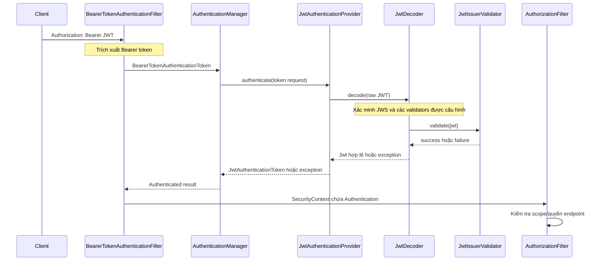

# `JwtIssuerValidator` và kiểm tra đúng nhà phát hành trong Spring Security Resource Server

## 1. Vì sao phải kiểm tra issuer của JWT access token?

Trong hệ thống **OAuth 2.0 / OpenID Connect (OIDC)**, một **Resource Server** (API) nhận access token do **Authorization Server** (AS) hoặc OpenID Provider (OP) phát hành. Khi token được biểu diễn bằng JWT đã ký, Resource Server thường xác minh chữ ký bằng khóa công khai tương ứng của nhà phát hành. Nhưng chỉ kiểm tra chữ ký, thời hạn hoặc sự có mặt của claim `sub` **không đủ** để xác định token có đến từ **đúng nhà phát hành được API tin tưởng** hay không.

JWT có claim `iss` (*issuer*) để chỉ danh tính thực thể phát hành token. Ví dụ JWT Claims Set:

```json
{
  "iss": "https://identity.example.com/realms/shop",
  "sub": "user-123",
  "aud": ["orders-api"],
  "iat": 1910000000,
  "exp": 1910003600,
  "scope": "orders.read"
}
```

Trong API `orders-api`, ta muốn ràng buộc:

```text
JWT iss trong access token
        ==
Issuer identifier được cấu hình là đáng tin
```

Nếu API đã thiết lập chỉ tin issuer `https://identity.example.com/realms/shop`, một JWT có `iss=https://identity.example.com/realms/other` phải bị từ chối, **kể cả khi** token có cấu trúc hợp lệ, chưa hết hạn và mang những claim quyền trông đúng.

Spring Security cung cấp **`JwtIssuerValidator`**, một `OAuth2TokenValidator<Jwt>`, để thực thi quy tắc này khi kiểm tra JWT đã được giải mã. Nó thường được tích hợp qua bộ validators của `JwtDecoder`, ví dụ `JwtValidators.createDefaultWithIssuer(issuer)`.

Bài học tập trung vào:

- Hiểu chính xác JWT `iss`, issuer URI và ranh giới tin cậy của Resource Server.
- Biết `JwtIssuerValidator` kiểm tra gì, **và không kiểm tra gì**.
- Cấu hình `issuer-uri`, JWKS và bộ validators trong Spring Security Servlet Resource Server.
- Phân biệt sai issuer với sai chữ ký, sai audience, sai token purpose hoặc thiếu scope.
- Xử lý tình huống issuer có path, reverse proxy, key rotation, multi-issuer và những lỗi cấu hình phổ biến.

## 2. Claim `iss` theo JWT và issuer identifier theo OAuth/OIDC

### 2.1. `iss` là claim nào?

Theo RFC 7519, `iss` là claim nhận diện **principal đã phát hành JWT**. Giá trị của nó là chuỗi dạng `StringOrURI`; khi là URI, cần tuân theo quy tắc định danh chính xác của giao thức đang áp dụng.

Trong OAuth 2.0 và OIDC, issuer thường là **URL HTTPS định danh Authorization Server/OpenID Provider**, chẳng hạn:

```text
https://identity.example.com/realms/shop
```

Định danh đó có thể xuất hiện ở ba nơi khác nhau:

1. Trong cấu hình tin cậy của Resource Server, ví dụ `issuer-uri`.
2. Trong JSON metadata của AS/OP, dưới trường `issuer`.
3. Trong JWT access token, dưới claim `iss`.

Một mô hình cấu hình nhất quán:

```text
Resource Server config:
  issuer-uri: https://identity.example.com/realms/shop

Discovery metadata:
  "issuer": "https://identity.example.com/realms/shop"

JWT payload:
  "iss": "https://identity.example.com/realms/shop"
```

Cả ba giá trị trên mô tả cùng một issuer identifier. Nếu có sự khác biệt, Resource Server cần xem đó là lỗi hợp đồng phát hành hoặc cấu hình, **không tự nới lỏng issuer validation để làm token qua được**.

### 2.2. Issuer không phải mọi endpoint của Authorization Server

Một hệ thống có thể công bố những URL:

```text
Issuer:
  https://identity.example.com/realms/shop

OIDC discovery:
  https://identity.example.com/realms/shop/.well-known/openid-configuration

Authorization endpoint:
  https://identity.example.com/realms/shop/protocol/openid-connect/auth

Token endpoint:
  https://identity.example.com/realms/shop/protocol/openid-connect/token

JWKS endpoint:
  https://identity.example.com/realms/shop/protocol/openid-connect/certs
```

Chúng phục vụ các vai trò khác nhau:

| Giá trị | Dùng để làm gì? | Có thay cho `iss` được không? |
|---|---|---|
| **Issuer identifier** | Định danh bên phát hành; dùng trong `iss` | **Đây là giá trị mong đợi** |
| **Discovery URL** | Trả metadata của OP/AS | Không |
| **Authorization endpoint** | Nơi client mở luồng authorization | Không |
| **Token endpoint** | Nơi client đổi code hoặc refresh token | Không |
| **`jwks_uri`** | Nơi Resource Server lấy public keys để verify JWS | Không |
| **Introspection endpoint** | Hỏi trạng thái và metadata token opaque | Không |

Nếu cấu hình `issuer-uri` thành `.../token` hoặc `.../certs`, Spring Security có thể dò metadata sai và token có `iss` chuẩn cũng bị từ chối.

### 2.3. `iss` không phải `sub`, `aud` hoặc `client_id`

| Claim | Câu hỏi trả lời | Ví dụ |
|---|---|---|
| `iss` | **Ai phát hành token?** | `https://identity.example.com/realms/shop` |
| `sub` | **Token nói về chủ thể nào?** | `user-123` hoặc subject của client |
| `aud` | **Token dành cho bên nhận nào?** | `orders-api` |
| `client_id` | **Client nào liên quan đến việc yêu cầu token theo profile?** | `shop-web` |
| `scope` / `scp` | **Những phạm vi quyền nào được cấp?** | `orders.read` |
| `exp` / `nbf` | **Token có hiệu lực khi nào?** | Epoch seconds |

**Issuer đúng chưa chứng minh audience đúng**. Một OP có thể ký ID token dành cho `shop-web` và access token dành cho `orders-api` bằng cùng cặp khóa. Cả hai có thể có `iss` giống nhau, nhưng ID token **không được dùng thay access token** khi gọi API.

## 3. `JwtIssuerValidator` là gì?

Trong Spring Security, `JwtIssuerValidator` là lớp dùng để kiểm tra claim issuer của một `Jwt`:

```java
import org.springframework.security.oauth2.jwt.JwtIssuerValidator;
```

Nó triển khai hợp đồng:

```java
OAuth2TokenValidator<Jwt>
```

Về mặt khái niệm:

```text
Input:
  Jwt đã được đưa vào giai đoạn token validation
  expected issuer từ cấu hình đáng tin

Operation:
  Đối chiếu claim iss của Jwt với expected issuer

Output:
  OAuth2TokenValidatorResult.success()
     hoặc
  OAuth2TokenValidatorResult.failure(...)
```

Ví dụ:

```java
String expectedIssuer =
        "https://identity.example.com/realms/shop";

JwtIssuerValidator issuerValidator =
        new JwtIssuerValidator(expectedIssuer);
```

Một `Jwt` có issuer đúng sẽ vượt qua **riêng điều kiện issuer**. Nếu claim `iss` vắng mặt hoặc không khớp, validator báo failure.

### 3.1. `JwtIssuerValidator` làm gì?

- So sánh JWT issuer với issuer được Resource Server mong đợi.
- Từ chối issuer khác hoặc thiếu issuer theo chính sách validator.
- Trả kết quả validation để `JwtDecoder`/provider chuyển thành thành công hoặc lỗi xác thực.
- Có thể phối hợp với các `OAuth2TokenValidator<Jwt>` khác trong `DelegatingOAuth2TokenValidator`.

### 3.2. `JwtIssuerValidator` không làm gì?

Nó **không**:

- Tải JWKS hoặc chọn khóa công khai từ `kid`.
- Xác minh chữ ký JWS, thuật toán `alg` hay định dạng JWT.
- Tự kiểm tra `aud`, `exp`, `nbf`, token type hoặc scope.
- Kiểm tra user còn tồn tại trong database.
- Đảm bảo token là **access token** thay vì OIDC ID token.
- Quyết định quyền đọc hoặc sửa một đơn hàng cụ thể.

Những kiểm tra khác được thực hiện qua **JWT decoder**, các validators khác và tầng **authorization**.

### 3.3. Tại sao không dùng `iss` trước khi verify chữ ký để cấp quyền?

Header và payload của JWT JWS có thể được decode từ Base64URL mà chưa cần private key. Một attacker có thể tạo payload:

```json
{
  "iss": "https://identity.example.com/realms/shop",
  "sub": "admin",
  "scope": "orders.write",
  "exp": 1910003600
}
```

Nhưng **tự khai `iss` không biến token thành token do issuer thật phát hành**. Attacker không chứng minh sở hữu signing key của issuer.

Resource Server phải kiểm tra **chữ ký** bằng khóa tin cậy và thuật toán được phép, sau đó thực thi issuer, audience, time, token profile và authorization. `JwtIssuerValidator` xử lý **một phần** của chuỗi điều kiện đó, không phải toàn bộ cơ chế xác thực.

## 4. Chuỗi xác thực JWT access token trong Servlet Resource Server

Khi client gọi API:

```http
GET /api/orders/42 HTTP/1.1
Host: orders.example.com
Authorization: Bearer ACCESS_TOKEN
```

luồng Spring Security thường là:



Sơ đồ mô tả trách nhiệm logic; thứ tự cụ thể bên trong decoder tùy triển khai thư viện. **Không có** việc `JwtIssuerValidator` độc lập chấp nhận bearer request khi chưa có JWT verification.

Trong một đường xử lý điển hình:

1. `BearerTokenResolver` tách chuỗi token từ HTTP.
2. `BearerTokenAuthenticationFilter` tạo `BearerTokenAuthenticationToken` chưa xác thực.
3. `JwtAuthenticationProvider` yêu cầu `JwtDecoder` xử lý token.
4. Decoder xác minh cấu trúc JWS và chữ ký bằng key/algorithm được tin cậy.
5. Các validators kiểm tra issuer, thời gian, audience và hợp đồng token.
6. Provider xây `JwtAuthenticationToken` từ JWT đã xác thực.
7. Filter gắn kết quả vào `SecurityContext`; security rules áp dụng authority và quyền đối tượng.

Nếu issuer validation thất bại, request không được coi là đã authenticated, dù token có `scope=orders.read`.

## 5. Cách đơn giản nhất: khai báo `issuer-uri` trong Spring Boot

Với Spring Boot có hỗ trợ OAuth 2.0 Resource Server và issuer cung cấp metadata/JWKS phù hợp:

```yaml
spring:
  security:
    oauth2:
      resourceserver:
        jwt:
          issuer-uri: https://identity.example.com/realms/shop
```

Khi cấu hình này được Spring Boot sử dụng để tạo decoder JWT mặc định, Spring Security có thể:

- Dùng issuer đã cấu hình làm điểm bắt đầu **discovery** thông tin Authorization Server/OpenID Provider.
- Tìm `jwks_uri` trong metadata và tải public key phục vụ xác minh JWT.
- Kiểm tra chữ ký của access token nhận được.
- Áp dụng validator phù hợp cho issuer `iss` và các điều kiện JWT mặc định, tùy phiên bản/framework configuration.
- Tạo `Authentication` thành công để security chain tiếp tục authorization.

Ví dụ `SecurityFilterChain` cho Servlet API:

```java
import org.springframework.context.annotation.Bean;
import org.springframework.context.annotation.Configuration;
import org.springframework.http.HttpMethod;
import org.springframework.security.config.Customizer;
import org.springframework.security.config.annotation.web.builders.HttpSecurity;
import org.springframework.security.web.SecurityFilterChain;

@Configuration
public class OrdersSecurityConfig {

    @Bean
    SecurityFilterChain ordersApi(HttpSecurity http) throws Exception {
        return http
                .securityMatcher("/api/**")
                .authorizeHttpRequests(auth -> auth
                        .requestMatchers(HttpMethod.GET, "/api/orders/**")
                            .hasAuthority("SCOPE_orders.read")
                        .requestMatchers(HttpMethod.POST, "/api/orders/**")
                            .hasAuthority("SCOPE_orders.write")
                        .anyRequest().authenticated())
                .oauth2ResourceServer(oauth2 ->
                        oauth2.jwt(Customizer.withDefaults()))
                .build();
    }
}
```

Các URL và scope là **giá trị minh họa**. API vẫn phải yêu cầu token có **audience** dành cho chính API; chỉ có issuer và chữ ký là chưa đủ để xác nhận token được phát hành đúng mục đích. Với ứng dụng có nhiều security chain, `securityMatcher("/api/**")` chỉ áp dụng chain này cho đường dẫn tương ứng; phải bảo vệ các đường dẫn khác bằng policy phù hợp.

### 5.1. `issuer-uri` đóng hai vai trò riêng

Trong mô hình JWT, issuer URI giúp:

1. **Tìm metadata/JWKS** của issuer đã tin cậy, khi đi qua cơ chế discovery.
2. **Thiết lập kỳ vọng issuer** để JWT claim `iss` phải khớp.

Hai vai trò liên quan nhưng không đồng nhất. Nếu đã biết JWKS URI mà không làm discovery, API vẫn cần **issuer validation**. Nếu chỉ có issuer mà JWT ký bằng khóa không tin cậy, API vẫn phải từ chối.

### 5.2. Discovery không phải xác thực user

Resource Server tải metadata/JWKS để xác thực JWT do client trình bày. Nó **không** tự thực hiện OIDC login chỉ vì issuer có `openid-configuration`, không tự lấy ID token và cũng không chuyển hướng user đến authorization endpoint như một OAuth Client.

OIDC Client kiểm tra ID token dành cho `client_id`; Resource Server kiểm tra access token dành cho **audience/resource của API**.

## 6. `JwtValidators.createDefaultWithIssuer` — cách thường dùng khi cấu hình decoder riêng

Khi ứng dụng đăng ký `JwtDecoder` bean riêng, nên gắn các validators đầy đủ. Spring Security cung cấp helper:

```java
import org.springframework.security.oauth2.jwt.JwtValidators;

JwtValidators.createDefaultWithIssuer(
        "https://identity.example.com/realms/shop");
```

Helper này tạo bộ validators mặc định và bao gồm **issuer validation**, để không chỉ có `JwtIssuerValidator` mà còn có các ràng buộc JWT mặc định như thời hạn theo phiên bản Spring Security đang dùng.

Ví dụ Resource Server dùng JWKS URI được cấu hình trực tiếp, tin `RS256`, kiểm tra issuer và audience:

```java
import org.springframework.context.annotation.Bean;
import org.springframework.context.annotation.Configuration;
import org.springframework.http.HttpMethod;
import org.springframework.security.config.Customizer;
import org.springframework.security.config.annotation.web.builders.HttpSecurity;
import org.springframework.security.oauth2.core.DelegatingOAuth2TokenValidator;
import org.springframework.security.oauth2.core.OAuth2Error;
import org.springframework.security.oauth2.core.OAuth2TokenValidator;
import org.springframework.security.oauth2.core.OAuth2TokenValidatorResult;
import org.springframework.security.oauth2.jose.jws.SignatureAlgorithm;
import org.springframework.security.oauth2.jwt.Jwt;
import org.springframework.security.oauth2.jwt.JwtDecoder;
import org.springframework.security.oauth2.jwt.JwtValidators;
import org.springframework.security.oauth2.jwt.NimbusJwtDecoder;
import org.springframework.security.web.SecurityFilterChain;

@Configuration
public class JwtIssuerSecurityConfig {

    private static final String ISSUER =
            "https://identity.example.com/realms/shop";

    private static final String JWKS_URI =
            "https://identity.example.com/realms/shop/protocol/openid-connect/certs";

    @Bean
    JwtDecoder jwtDecoder() {
        NimbusJwtDecoder decoder = NimbusJwtDecoder
                .withJwkSetUri(JWKS_URI)
                .jwsAlgorithm(SignatureAlgorithm.RS256)
                .build();

        OAuth2TokenValidator<Jwt> issuerAndDefaults =
                JwtValidators.createDefaultWithIssuer(ISSUER);

        OAuth2TokenValidator<Jwt> audience = jwt ->
                jwt.getAudience().contains("orders-api")
                        ? OAuth2TokenValidatorResult.success()
                        : OAuth2TokenValidatorResult.failure(
                                new OAuth2Error(
                                        "invalid_token",
                                        "Token audience must include orders-api",
                                        null));

        decoder.setJwtValidator(
                new DelegatingOAuth2TokenValidator<>(
                        issuerAndDefaults, audience));

        return decoder;
    }

    @Bean
    SecurityFilterChain api(HttpSecurity http) throws Exception {
        return http
                .securityMatcher("/api/**")
                .authorizeHttpRequests(auth -> auth
                        .requestMatchers(HttpMethod.GET, "/api/orders/**")
                            .hasAuthority("SCOPE_orders.read")
                        .anyRequest().authenticated())
                .oauth2ResourceServer(oauth2 ->
                        oauth2.jwt(Customizer.withDefaults()))
                .build();
    }
}
```

**Phân tích trách nhiệm:**

| Thành phần | Điều kiện được xử lý |
|---|---|
| `withJwkSetUri(JWKS_URI)` | Nguồn khóa công khai đã cấu hình tin cậy |
| `jwsAlgorithm(RS256)` | Giới hạn thuật toán JWS được chấp nhận |
| Bộ xác minh JWS của decoder | Signature phải đúng với khóa tin cậy |
| `JwtValidators.createDefaultWithIssuer(ISSUER)` | Bao gồm issuer check và các validation mặc định |
| Validator `audience` | Token phải dành cho `orders-api` |
| `hasAuthority("SCOPE_orders.read")` | Token đã xác thực phải đủ quyền đọc endpoint |
| Service/domain | Kiểm tra order/tenant cụ thể mà principal có quyền truy cập |

Điểm đặc biệt quan trọng: **`decoder.setJwtValidator(...)` thay thế bộ validators được gắn trước đó**. Vì thế không viết mỗi audience validator rồi quên khôi phục issuer và time validation. Việc dùng `createDefaultWithIssuer` làm thành phần trong `DelegatingOAuth2TokenValidator` giúp giữ các điều kiện nền tảng cần thiết.

Nếu issuer áp dụng **RFC 9068 JWT Access Token Profile**, API cần kiểm tra thêm token profile như `typ=at+jwt` và các claim theo RFC 9068. Nếu issuer dùng profile riêng, phải thực thi hợp đồng thực tế, không mặc định một thuật toán hoặc loại token cho mọi nhà cung cấp.

## 7. Dùng trực tiếp `JwtIssuerValidator` trong tập hợp validators

`createDefaultWithIssuer` thường đủ dùng. Tuy nhiên, để hiểu API và khi cần xây validator tùy biến, có thể tạo `JwtIssuerValidator` trực tiếp.

Ví dụ tập hợp các điều kiện:

```java
import org.springframework.security.oauth2.core.DelegatingOAuth2TokenValidator;
import org.springframework.security.oauth2.core.OAuth2Error;
import org.springframework.security.oauth2.core.OAuth2TokenValidator;
import org.springframework.security.oauth2.core.OAuth2TokenValidatorResult;
import org.springframework.security.oauth2.jwt.Jwt;
import org.springframework.security.oauth2.jwt.JwtIssuerValidator;
import org.springframework.security.oauth2.jwt.JwtValidators;

public final class OrdersJwtValidators {

    private OrdersJwtValidators() {}

    public static OAuth2TokenValidator<Jwt> create(String trustedIssuer) {
        OAuth2TokenValidator<Jwt> defaults =
                JwtValidators.createDefault();

        OAuth2TokenValidator<Jwt> issuer =
                new JwtIssuerValidator(trustedIssuer);

        OAuth2TokenValidator<Jwt> audience = jwt ->
                jwt.getAudience().contains("orders-api")
                    ? OAuth2TokenValidatorResult.success()
                    : OAuth2TokenValidatorResult.failure(
                            new OAuth2Error(
                                    "invalid_token",
                                    "Invalid API audience",
                                    null));

        return new DelegatingOAuth2TokenValidator<>(
                defaults, issuer, audience);
    }
}
```

Sau khi tạo decoder và cấu hình nguồn khóa, sử dụng:

```java
decoder.setJwtValidator(
        OrdersJwtValidators.create(
                "https://identity.example.com/realms/shop"));
```

Trong ví dụ:

- `JwtValidators.createDefault()` cung cấp các validators JWT mặc định.
- `new JwtIssuerValidator(trustedIssuer)` thêm ràng buộc riêng về `iss`.
- `audience` bắt buộc token hướng tới `orders-api`.
- `DelegatingOAuth2TokenValidator` phối hợp các điều kiện; **không** coi một điều kiện thành công là đủ để bỏ qua điều kiện còn lại.

Nếu đã dùng `JwtValidators.createDefaultWithIssuer(trustedIssuer)`, thông thường **không cần lặp thêm** `new JwtIssuerValidator(trustedIssuer)`, trừ khi có lý do đặc biệt. Lặp không làm tăng trust; nó chỉ khiến cấu hình khó đọc hơn.

### 7.1. Không chỉ đặt `JwtIssuerValidator` rồi bỏ thời hạn

Ví dụ cần tránh:

```java
// KHÔNG nên cấu hình chỉ có issuer validator
// nếu vô tình bỏ mất validation về thời hạn và các điều kiện khác.
decoder.setJwtValidator(new JwtIssuerValidator(TRUSTED_ISSUER));
```

`JwtIssuerValidator` không kiểm tra `exp` hoặc `nbf`. Dù token có `iss` đúng, nó vẫn có thể đã hết hạn hoặc chưa tới lúc có hiệu lực. Tập validators phải bao gồm đầy đủ các điều kiện của access-token contract.

### 7.2. Nếu cần kiểm tra một claim khác thì sao?

Spring Security có `JwtClaimValidator<T>` để diễn đạt điều kiện trên một JWT claim, hoặc có thể tự triển khai `OAuth2TokenValidator<Jwt>`. Nhưng claim `iss` đã có lớp **`JwtIssuerValidator` chuyên dụng**, nên không cần tự viết lại logic so sánh issuer bằng string manipulation.

Dùng validator riêng cho audience, token purpose, client binding hoặc các claim provider-specific khi có hợp đồng. **Đừng** dùng điều kiện `sub != null` như một cách thay issuer validation.

## 8. Kiểm tra issuer chính xác: dấu gạch chéo, hostname và scheme

Với các issuer identifier dựa trên URL, một số giá trị trông gần giống nhưng **không tự động tương đương**:

| Issuer được tin cậy | JWT `iss` | Nên xử lý |
|---|---|---|
| `https://id.example.com/realms/shop` | `https://id.example.com/realms/shop` | Khớp |
| `https://id.example.com/realms/shop` | `https://id.example.com/realms/other` | Từ chối |
| `https://id.example.com/realms/shop` | `https://id.example.com/realms/shop/` | Không giả định khớp; dấu `/` cuối là khác biệt |
| `https://id.example.com/realms/shop` | `http://id.example.com/realms/shop` | Từ chối: khác scheme và ranh giới an toàn |
| `https://id.example.com/realms/shop` | `https://id-internal:8080/realms/shop` | Từ chối: issuer public khác internal host |
| `https://id.example.com/realms/shop` | `https://id.example.com` | Từ chối: thiếu path của issuer |
| `https://id.example.com/realms/shop` | Không có `iss` | Từ chối theo issuer validator |
| `https://id.example.com/realms/shop` | `https://fake.example/realms/shop` | Từ chối |

Issuer check là kiểm tra **định danh**, không phải so khớp “gần đúng”. Với các chuẩn OAuth/OIDC, thông thường cần dùng chính xác issuer identifier do provider công bố, thay vì tự coi URL sau chuẩn hóa là tương đương. Không tự loại bỏ path, query hay dấu slash để cho token đi qua.

### 8.1. Tại sao trailing slash thường gây lỗi?

Giả sử metadata:

```json
{
  "issuer": "https://id.example.com/realms/shop"
}
```

Nhưng ứng dụng cấu hình:

```yaml
issuer-uri: https://id.example.com/realms/shop/
```

Tùy cơ chế discovery, API có thể không tìm đúng metadata hoặc JWT `iss` không khớp. Cách sửa là đặt cấu hình theo **chuỗi issuer chính thức**, không tắt `JwtIssuerValidator`.

### 8.2. Reverse proxy, Kubernetes, gateway và issuer nội bộ

Một vấn đề phổ biến:

```text
Public URL:
  https://auth.example.com/realms/shop

Issuer trả trong JWT:
  http://keycloak-service:8080/realms/shop
```

Cả hai địa chỉ có thể đến cùng một ứng dụng AS qua mạng khác nhau, nhưng **không phải cùng issuer identifier**. Resource Server không được tự xem chúng như một.

Hướng xử lý:

- Cấu hình AS/OP với **public issuer ổn định**.
- Cấu hình trusted proxy headers, external hostname và TLS termination cho đúng sản phẩm.
- Đảm bảo metadata `issuer` và JWT `iss` cùng chuỗi đã công bố.
- Nếu Resource Server phải tải JWKS qua mạng nội bộ, có thể cấu hình **JWKS URI nội bộ đáng tin** riêng trong khi giữ issuer validation dựa trên public issuer, khi kiến trúc cho phép.

Tách **trust identity** khỏi **địa chỉ kết nối mạng** giúp tránh lý do bỏ issuer validation mỗi khi API chạy trong container.

## 9. Issuer discovery, metadata và JWKS liên hệ thế nào?

Issuer metadata có thể được công bố qua:

- **OIDC Provider Configuration** theo OpenID Connect Discovery 1.0.
- **OAuth 2.0 Authorization Server Metadata** theo RFC 8414.

Ví dụ issuer có path:

```text
Issuer:
  https://id.example.com/realms/shop

OIDC Provider Configuration:
  https://id.example.com/realms/shop/.well-known/openid-configuration

OAuth Authorization Server Metadata theo RFC 8414:
  https://id.example.com/.well-known/oauth-authorization-server/realms/shop
```

Một response metadata OIDC minh họa:

```json
{
  "issuer": "https://id.example.com/realms/shop",
  "authorization_endpoint": "https://id.example.com/realms/shop/protocol/openid-connect/auth",
  "token_endpoint": "https://id.example.com/realms/shop/protocol/openid-connect/token",
  "jwks_uri": "https://id.example.com/realms/shop/protocol/openid-connect/certs"
}
```

Spring Security có thể dùng metadata để tìm JWKS, nhưng các endpoint well-known được hỗ trợ và thứ tự thử URL có thể khác giữa các phiên bản. Nếu tự cấu hình decoder, cần hiểu rõ sự khác nhau giữa **issuer identifier**, **discovery endpoint** và **JWKS URL**.

### 9.1. Trình tự xác minh issuer và khóa

```text
issuer-uri đã cấu hình
          |
          v
Dò metadata của issuer (nếu dùng discovery)
          |
          +----> metadata issuer phải nhất quán
          |
          v
jwks_uri được tin cậy
          |
          v
Public signing keys (JWK Set)
          |
          v
Verify JWT signature theo algorithm allow-list
          |
          v
JwtIssuerValidator so sánh iss với issuer-uri
          |
          v
Các validators khác: exp, nbf, aud, token profile
          |
          v
Authorization với scope và object-level permission
```

`kid` trong JOSE header có thể hỗ trợ chọn khóa trong JWKS. Nó **không** thay việc kiểm tra `iss`. Hai issuer khác nhau có thể dùng cùng `kid` hoặc thậm chí cùng thuật toán; các tiêu chí tin cậy vẫn phải được thiết lập theo issuer.

### 9.2. Vì sao không tự tin `iss` do token khai báo?

Một attacker có thể tạo JWT có:

```json
{
  "iss": "https://attacker.example",
  "aud": "orders-api",
  "scope": "orders.read"
}
```

Nếu server tự đọc `iss`, tải metadata/JWKS từ URL đó, rồi tin public key được attacker công bố, chữ ký token giả sẽ được xác minh bằng chính key của attacker. Việc có “signature valid” trong quy trình đó **không chứng minh token được phát hành bởi Authorization Server mà API được phép tin**.

Resource Server phải lấy danh sách issuer hoặc key sources từ **cấu hình đáng tin**, không tạo trust mới chỉ dựa trên claims chưa xác thực.

## 10. Kết hợp `issuer-uri` và `jwk-set-uri`

Trong một số môi trường, Resource Server không truy cập được discovery endpoint từ mạng nội bộ nhưng có thể truy cập trực tiếp JWKS. Spring Boot hỗ trợ cấu hình đồng thời issuer và địa chỉ khóa trong các phiên bản thích hợp:

```yaml
spring:
  security:
    oauth2:
      resourceserver:
        jwt:
          issuer-uri: https://auth.example.com/realms/shop
          jwk-set-uri: https://auth-internal.example.local/realms/shop/certs
```

Với cấu hình được framework hỗ trợ:

- `issuer-uri` giữ **định danh issuer mong đợi**, để JWT `iss` được đối chiếu.
- `jwk-set-uri` chỉ rõ **địa chỉ lấy public key**; có thể bỏ qua bước metadata discovery khi tạo decoder.
- Decoder vẫn cần kiểm tra signature, thuật toán, thời hạn, audience và token type theo hợp đồng.
- JWKS URI nội bộ chỉ được chấp nhận khi thuộc **nguồn khóa được tổ chức provision và tin cậy**, không phải URL do token/HTTP request cung cấp.

Nếu chỉ cấu hình `jwk-set-uri` mà bỏ `issuer-uri`, **không được giả định issuer validation vẫn tự xuất hiện**. Khi tự tạo decoder trong trường hợp này, thêm rõ `JwtValidators.createDefaultWithIssuer(expectedIssuer)` hoặc cơ chế tương đương.

### 10.1. Cấu hình decoder trực tiếp và rủi ro quên issuer

Ví dụ tối giản chỉ có JWKS URI:

```java
NimbusJwtDecoder decoder =
        NimbusJwtDecoder.withJwkSetUri(JWKS_URI).build();
```

Đoạn này định nghĩa **nguồn khóa**; nó **không tự mô tả issuer** mà API mong đợi. Nếu ứng dụng sử dụng decoder tự tạo, hãy chủ động gắn issuer validation:

```java
decoder.setJwtValidator(
        JwtValidators.createDefaultWithIssuer(EXPECTED_ISSUER));
```

Đây là một lỗi cấu hình thường gặp vì JWT có signature hợp lệ vẫn có thể không thuộc đúng trust domain hoặc mục đích API. Với hệ thống có nhiều issuer, tuyệt đối không giải quyết bằng cách bỏ `iss` khỏi bộ validation.

## 11. Khi issuer đúng nhưng token vẫn phải bị từ chối

`JwtIssuerValidator` là điều kiện **cần** trong nhiều profile, không phải điều kiện **đủ**.

### 11.1. Issuer đúng nhưng JWT signature sai

JWT tự khai:

```json
{
  "iss": "https://identity.example.com/realms/shop",
  "aud": "orders-api",
  "scope": "orders.read"
}
```

nhưng signature không tương ứng public key tin cậy. Decoder phải từ chối **trước khi** có authenticated principal. Issuer đúng về mặt chuỗi không chứng minh nguồn gốc token.

### 11.2. Issuer đúng nhưng audience sai

Một Authorization Server có thể phát hành token:

```json
{
  "iss": "https://identity.example.com/realms/shop",
  "aud": "billing-api",
  "scope": "orders.read",
  "exp": 1910003600
}
```

Nếu `orders-api` chỉ kiểm tra issuer và signature, nó có thể nhận nhầm access token phát cho `billing-api`. API phải kiểm tra audience `aud` chứa đúng resource được phép.

### 11.3. Issuer đúng nhưng token là OIDC ID token

Ví dụ ID token:

```json
{
  "iss": "https://identity.example.com/realms/shop",
  "sub": "user-123",
  "aud": "shop-web",
  "nonce": "login-nonce",
  "exp": 1910003600
}
```

ID token dùng để OIDC Client xác thực kết quả đăng nhập; nó **không phải access token** của Resource Server. Cùng issuer, cùng signing key hoặc cùng `sub` không làm hai loại token thay thế được cho nhau. Nếu AS phát hành JWT access token theo RFC 9068, API có thể kiểm tra thêm `typ=at+jwt` và những yêu cầu profile; các provider khác có thể dùng token-purpose claim riêng.

### 11.4. Issuer đúng nhưng token hết hạn

Nếu `exp` đã qua, `JwtIssuerValidator` vẫn có thể báo issuer hợp lệ khi kiểm tra riêng; tuy nhiên bộ validators đầy đủ phải từ chối token do **`JwtTimestampValidator`** hoặc kiểm tra thời hạn tương đương.

### 11.5. Issuer và audience đúng nhưng thiếu scope

Token đã được decoder chấp nhận, nhưng endpoint `POST /api/orders` cần `orders.write` trong khi token chỉ có `orders.read`. Đây là **lỗi authorization**, thường dẫn tới **403 Forbidden**, không phải lỗi issuer.

### 11.6. Issuer, audience và scope đúng nhưng khác tenant

Một token cho `orders-api` chứa `scope=orders.read` vẫn không tự cho phép đọc đơn hàng thuộc tenant khác. Domain service hoặc policy phù hợp phải kiểm tra quyền trên **đối tượng tài nguyên cụ thể**.

## 12. Multi-issuer: nhiều nhà phát hành hợp lệ nhưng không được bỏ issuer validation

Một ứng dụng có thể phục vụ nhiều tenant, mỗi tenant có Authorization Server hoặc realm riêng:

```text
Tenant A:
  issuer = https://id.example.com/realms/tenant-a
  JWKS   = https://.../tenant-a/certs

Tenant B:
  issuer = https://id.example.com/realms/tenant-b
  JWKS   = https://.../tenant-b/certs
```

Nếu API thực sự tin **cả hai**, không nên viết validator kiểm tra `iss` “có chứa `id.example.com`”. Cách đó nới rộng phạm vi tin cậy sang các realm khác trên cùng domain mà không được đăng ký.

Một kiến trúc đúng giữ mapping:

```text
issuer A  -> JWKS A  -> validators A  -> audience/scope policy A
issuer B  -> JWKS B  -> validators B  -> audience/scope policy B
issuer lạ -> reject
```

### 12.1. Chọn AuthenticationManager theo issuer

Spring Security Servlet có cơ chế **`AuthenticationManagerResolver<HttpServletRequest>`** và các hỗ trợ multi-tenant như `JwtIssuerAuthenticationManagerResolver` (API cụ thể phụ thuộc Spring Security version). Với issuer đã cấu hình tin cậy, resolver có thể chọn một `AuthenticationManager`/decoder tương ứng.

Ví dụ ý tưởng:

```java
// API minh họa cho phiên bản Spring Security có fromTrustedIssuers(...):
JwtIssuerAuthenticationManagerResolver resolver =
        JwtIssuerAuthenticationManagerResolver.fromTrustedIssuers(
                "https://id.example.com/realms/tenant-a",
                "https://id.example.com/realms/tenant-b");
```

Gắn resolver phù hợp vào Resource Server DSL theo phiên bản framework đang dùng, ví dụ:

```java
.oauth2ResourceServer(oauth2 -> oauth2
        .authenticationManagerResolver(resolver))
```

**Điểm bảo mật:** khi dùng issuer từ JWT chưa xác thực để **định tuyến**, giá trị đó chỉ được phép chọn **một cấu hình đã nằm trong allow-list**. Decoder được chọn vẫn phải xác minh chữ ký và claim `iss` thực sự. Không dùng untrusted `iss` để mở rộng trust sang một domain mới.

### 12.2. Vì sao `JwtIssuerValidator` riêng lẻ không đủ cho multi-issuer?

Một `JwtIssuerValidator` cơ bản được tạo với **một expected issuer**. Nếu API tin nhiều issuer, việc đổi validator thành kiểu “issuer bằng A hoặc B” trong cùng một decoder chỉ là một phần của bài toán. Bạn còn phải gắn từng issuer với **đúng nguồn khóa**; một signing key của issuer A không được tùy tiện dùng xác minh token khai `iss=B`.

Trong nhiều kiến trúc, cách dễ lý giải hơn là **mỗi issuer có decoder/validation riêng**, rồi Resource Server chọn manager dựa trên danh sách issuer tin cậy.

### 12.3. Không sử dụng issuer wildcard hoặc so khớp domain sơ sài

Sai về ranh giới tin cậy:

```text
Accept if iss startsWith("https://id.example.com")
```

Điều kiện này có thể chấp nhận:

```text
https://id.example.com/realms/untrusted
https://id.example.com/anything-else
```

Dù ở cùng host, các realm/tenant có thể đại diện cho **những nhà phát hành khác nhau** với key, client, audience và policy riêng. Thay vào đó, duy trì issuer allow-list cụ thể và kiểm tra chuỗi issuer đầy đủ.

## 13. Kiểm tra issuer với opaque access token thì sao?

`JwtIssuerValidator` áp dụng cho đối tượng **`Jwt`**. Không thể áp dụng trực tiếp nó cho một **opaque access token** chỉ là chuỗi ký tự không thể decode ra claims JWT.

Nếu API sử dụng OAuth 2.0 Token Introspection (RFC 7662), Resource Server gửi token đến **introspection endpoint đã được cấu hình tin cậy** để lấy trạng thái/metadata:

```yaml
spring:
  security:
    oauth2:
      resourceserver:
        opaquetoken:
          introspection-uri: https://identity.example.com/realms/shop/protocol/openid-connect/token/introspect
          client-id: orders-api-introspection
          client-secret: ${INTROSPECTION_CLIENT_SECRET}
```

Các URI là ví dụ; địa chỉ introspection phải lấy từ cấu hình provider thực tế, không tự suy ra cho mọi Authorization Server.

Introspection response có thể gồm:

```json
{
  "active": true,
  "iss": "https://identity.example.com/realms/shop",
  "sub": "user-123",
  "aud": ["orders-api"],
  "scope": "orders.read",
  "client_id": "shop-web",
  "exp": 1910003600
}
```

Tuy nhiên `iss` **không phải một trường bắt buộc trong mọi introspection response** theo RFC 7662. Với opaque access token, nguồn tin cậy nằm ở **introspection endpoint/credentials đã cấu hình** cùng các metadata và điều kiện mà AS cam kết. Nếu cần issuer/resource binding bổ sung, hãy đặt trong `OpaqueTokenIntrospector` hoặc một policy phù hợp với response được trả về; không cố decode một opaque token như JWT rồi gọi `JwtIssuerValidator`.

`active=true` cũng không tự đồng nghĩa API được quyền chấp nhận token cho mọi resource. Audience, scope và quyền đối tượng vẫn phải được xác định theo hợp đồng.

## 14. Lỗi authentication và mã HTTP liên quan issuer mismatch

Khi JWT access token có issuer sai, đó là lỗi **authentication/token validation**. Theo mô hình Resource Server Bearer, phản hồi thường gặp:

```http
HTTP/1.1 401 Unauthorized
WWW-Authenticate: Bearer error="invalid_token"
```

Các lỗi khác nhau có thể dẫn tới status tương tự:

| Tình huống | Bước thất bại | Kết quả thường gặp |
|---|---|---|
| Không có Bearer token, endpoint yêu cầu đăng nhập | Thiếu credential | 401 với Bearer challenge |
| Bearer token sai cấu trúc | `BearerTokenResolver` | Lỗi request/token tùy mapping framework |
| JWT signature sai | `JwtDecoder` | 401, thường `invalid_token` |
| JWT `iss` khác expected issuer | `JwtIssuerValidator` | 401, thường `invalid_token` |
| JWT không có `iss` theo contract bắt buộc | Issuer validation | 401 |
| JWT `exp` hết hạn | Time validation | 401 |
| JWT `aud` không chứa API audience | Audience validation | 401 |
| JWT đã xác thực nhưng thiếu `orders.write` | Authorization layer | 403, có thể `insufficient_scope` |
| Token hợp lệ nhưng người dùng không được xem order khác tenant | Domain authorization | Từ chối truy cập theo policy |

Response chính xác phụ thuộc exception, `BearerTokenAuthenticationEntryPoint`, `BearerTokenAccessDeniedHandler`, SecurityFilterChain và phiên bản framework. **Không đưa nội dung JWT hoặc token raw vào error description**.

### 14.1. Có nên trả “issuer mismatch” cho client?

Thông tin dạng `invalid_token` thường đủ cho client biết credential không dùng được. Chi tiết expected issuer và token issuer có thể hữu ích cho vận hành, nhưng cần giới hạn xuất hiện trong log/metrics để tránh rò rỉ thông tin kiến trúc hoặc token nhạy cảm.

Phía client nên nhận đúng **access token dành cho API từ Authorization Server được cấu hình**, thay vì cố sửa JWT payload `iss`. Bất kỳ thay đổi payload nào sau khi ký đều làm chữ ký không còn hợp lệ.

## 15. Những lỗi thường gặp khi dùng `JwtIssuerValidator`

### 15.1. Bỏ issuer check khi tự tạo `JwtDecoder`

Ví dụ:

```java
NimbusJwtDecoder decoder =
        NimbusJwtDecoder.withJwkSetUri(JWKS_URI).build();
```

Đây là bước cấu hình nguồn khóa, chưa mô tả rõ expected issuer. Nếu không thêm issuer validation tương ứng, API có thể chỉ xác thực JWS mà thiếu một ràng buộc quan trọng của access-token contract.

**Hướng xử lý:** đăng ký `JwtValidators.createDefaultWithIssuer(ISSUER)` và các validators như audience/required token type theo hợp đồng.

### 15.2. Thay toàn bộ validators bằng một kiểm tra issuer

```java
// Anti-pattern: chỉ còn issuer validator, các kiểm tra khác bị bỏ.
decoder.setJwtValidator(new JwtIssuerValidator(ISSUER));
```

**Hướng xử lý:** sử dụng `createDefaultWithIssuer` để giữ các validator mặc định, sau đó bổ sung audience và token-profile validation.

### 15.3. Không biết `issuer-uri` phải trỏ tới đâu

Sai:

```text
issuer-uri = https://id.example.com/realms/shop/.well-known/openid-configuration
```

Đúng theo định danh issuer ví dụ:

```text
issuer-uri = https://id.example.com/realms/shop
```

Issuer là identifier, không phải endpoint metadata.

### 15.4. Thay issuer theo environment bằng cách tự viết lại `iss`

Một microservice chạy trên Kubernetes có thể truy cập AS qua tên nội bộ. Nhưng JWT `iss` đã được phát hành theo public issuer. Không chỉnh token hoặc thay expected issuer thành hostname nội bộ để “kết nối thuận lợi”. Thay vào đó, cấu hình JWKS endpoint nội bộ an toàn nếu cần, và giữ issuer identifier đúng với metadata/token.

### 15.5. Không kiểm tra audience vì issuer đã đúng

Một Authorization Server phát hành access token cho nhiều API. Token dành cho `billing-api` có thể do đúng issuer ký; nếu `orders-api` chấp nhận nó, tài nguyên bị rò quyền giữa các API.

**Hướng xử lý:** audience validator phải là thành phần bắt buộc trong hợp đồng access token của API.

### 15.6. Dùng ID token làm Bearer access token

ID token OIDC thường có issuer và chữ ký hợp lệ từ cùng OP, nhưng `aud` dành cho **OIDC client**. Resource Server không được dùng ID token thay access token. Nếu issuer hỗ trợ RFC 9068, token type `at+jwt` là một công cụ phân loại; vẫn phải kiểm tra audience và profile đầy đủ.

### 15.7. Tự động discovery từ bất kỳ `iss` trong JWT

Nếu JWT tự khai một URL, thư viện tự viết có thể vô tình tải JWKS của attacker và chấp nhận chữ ký giả. Đây là lỗi **trust-on-first-use** từ dữ liệu chưa được xác thực.

**Hướng xử lý:** chỉ dùng danh sách issuer đã cấu hình trước, không cho một token tự thêm issuer mới.

### 15.8. Kiểm tra `iss` bằng `contains`/`startsWith`

Ví dụ:

```java
// Không dùng cho trust decision:
boolean seemsTrusted =
        issuerFromJwt.startsWith("https://id.example.com");
```

Đây không phải issuer validation chính xác. Resource Server nên dùng `JwtIssuerValidator`/validator của profile tương ứng với chuỗi issuer đầy đủ.

### 15.9. Không phân biệt issuer validation với JWKS caching

Nếu token mới có `kid` mà JWKS cache chưa thấy, signature verification có thể thất bại **trước khi** đến issuer check. Đừng kết luận mọi lỗi 401 là do `JwtIssuerValidator`. Chẩn đoán theo tầng: transport → JWT parsing/signature → validators → authorization.

## 16. Minh họa tập tình huống kiểm tra issuer

Các trường hợp dưới đây là **bảng kỳ vọng thiết kế**, không phải kết quả chạy thử trên một hệ thống cụ thể.

Giả định API tin issuer:

```text
https://id.example.com/realms/shop
```

và audience:

```text
orders-api
```

| JWT access token đầu vào | `JwtIssuerValidator` | Kết quả toàn bộ Resource Server |
|---|---|---|
| `iss` đúng, signature đúng, `aud=orders-api`, chưa hết hạn, đủ scope | Thành công | Có thể truy cập sau khi xét quyền đối tượng |
| `iss` khác `/realms/other` | **Thất bại** | Từ chối xác thực |
| `iss` có thêm `/` cuối | Không giả định trùng | Từ chối nếu không đúng expected issuer |
| `iss` thiếu | **Thất bại** | Từ chối xác thực |
| `iss` đúng, signature sai | Có thể khớp nếu chỉ xét claims | Decoder phải từ chối vì chữ ký sai |
| `iss` đúng, JWT hết hạn | Khớp issuer | Bộ validators thời hạn từ chối |
| `iss` đúng, `aud=billing-api` | Khớp issuer | Audience validator từ chối |
| `iss` đúng, token là ID token `aud=shop-web` | Khớp issuer | Token-purpose/audience contract từ chối |
| `iss` đúng, `scope=orders.read` nhưng POST cần `orders.write` | Khớp issuer | Authorization từ chối |
| `iss` đúng, `kid` không có trong JWKS tin cậy | Có thể trùng theo payload | Decoder không xác minh được chữ ký nên từ chối |
| `iss` thuộc issuer chưa allow-list ở mô hình multi-issuer | Không được chọn làm trusted issuer | Từ chối trước khi tạo identity |
| `iss` đúng, JWT ký bằng khóa của một issuer khác | Trùng về mặt claim | Signature phải không vượt qua key verification tin cậy |

Bảng cho thấy **đúng issuer là một điều kiện riêng**, không đủ thay signature, audience, time hay quyền truy cập.

## 17. Ví dụ kiểm tra riêng `JwtIssuerValidator` bằng code

Để hiểu rằng validator không tự xác thực chữ ký, có thể tạo một `Jwt` trong code ví dụ và gọi validator trực tiếp:

```java
import java.time.Instant;

import org.springframework.security.oauth2.core.OAuth2TokenValidatorResult;
import org.springframework.security.oauth2.jwt.Jwt;
import org.springframework.security.oauth2.jwt.JwtIssuerValidator;

public final class IssuerValidatorExample {

    public static void main(String[] args) {
        String expectedIssuer =
                "https://id.example.com/realms/shop";

        JwtIssuerValidator validator =
                new JwtIssuerValidator(expectedIssuer);

        Instant issuedAt = Instant.now();
        Instant expiresAt = issuedAt.plusSeconds(3600);

        Jwt matchingIssuerJwt = Jwt.withTokenValue("illustration-only")
                .header("alg", "RS256")
                .issuer(expectedIssuer)
                .subject("user-123")
                .issuedAt(issuedAt)
                .expiresAt(expiresAt)
                .build();

        OAuth2TokenValidatorResult result =
                validator.validate(matchingIssuerJwt);

        boolean issuerAccepted = !result.hasErrors();
        System.out.println("issuer accepted: " + issuerAccepted);
    }
}
```

**Giới hạn rõ ràng:** `Jwt.withTokenValue(...)` trong ví dụ tạo **đối tượng thử nghiệm trong bộ nhớ**, không tạo một JWS có chữ ký thật. `validator.validate(jwt)` kiểm tra **riêng điều kiện issuer**, không chứng minh token có chữ ký hợp lệ. Không lấy ví dụ này làm API xác thực token cho request thực tế.

Khi ứng dụng chạy thật, `JwtDecoder` chịu trách nhiệm giải mã và xác minh token trước khi trả `Jwt` đã được chấp nhận cho provider.

### 17.1. Kỳ vọng khi `iss` sai

Nếu thay:

```java
.issuer("https://id.example.com/realms/other")
```

và giữ `expectedIssuer` như trên, `validator.validate(jwt)` phải trả về kết quả có lỗi theo logic issuer validation. Điều này chỉ chứng minh **issuer check** hoạt động, không phải một integration test của chữ ký/JWKS hay SecurityFilterChain.

### 17.2. Không dùng `jwt()` request post-processor để chứng minh chữ ký thật

Trong Spring Security Test, post-processor `jwt()` có thể đưa một `JwtAuthenticationToken` mô phỏng vào request để kiểm thử **authorization logic**. Đó là cơ chế test tiện ích, nhưng có thể **bỏ qua đường xử lý JWT decoder/issuer signature validation thật**.

Muốn xác minh rằng API thực tế từ chối JWT sai `iss`, cần một kiểm thử tích hợp đi qua đúng Resource Server authentication filter và decoder đã cấu hình với nguồn khóa tin cậy của môi trường test, hoặc kiểm thử trực tiếp validator cho điều kiện issuer. Không coi một test mock authentication là bằng chứng triển khai production đã kiểm tra issuer.

Trong bài này không chạy bộ kiểm thử; các đoạn trên chỉ minh họa phương pháp đánh giá đúng từng trách nhiệm.

## 18. Phân biệt issuer validation, authentication và authorization

Khi phân tích lỗi của Resource Server, điều quan trọng là biết **lỗi xảy ra ở đâu**:

```text
HTTP Authorization: Bearer token
             |
             v
BearerTokenResolver:
  Có một Bearer credential đúng cấu trúc?
             |
             v
JwtDecoder:
  Cấu trúc JWS và chữ ký đúng theo keys/alg?
             |
             v
JWT validators:
  iss == expected issuer?
  exp/nbf phù hợp?
  aud dành cho API?
  token type/profile hợp lệ?
             |
             v
JwtAuthenticationToken:
  Principal và authorities từ claims đã xác thực
             |
             v
Authorization:
  Endpoint yêu cầu scope nào?
  User/client có quyền trên tài nguyên này không?
```

`JwtIssuerValidator` thuộc **tầng JWT claims validation**, không thuộc tầng HTTP header parsing, cũng không thuộc tầng authorization nghiệp vụ.

Một hệ thống được cấu hình đầy đủ có thể trả:

- **401** khi credential thiếu, signature sai, issuer sai, audience sai hoặc token hết hạn.
- **403** khi token đã được chấp nhận nhưng không có authority/scope/quyền phù hợp.
- Lỗi khác theo cấu hình riêng khi bearer request sai hình thức hoặc endpoint có handler tùy biến.

Không bắt client **sửa claim `iss`** trong JWT để qua lỗi 401; JWT được ký, nên việc sửa payload sẽ làm signature sai. Client phải lấy **access token đúng từ issuer tin cậy**, và API phải cấu hình issuer/metadata đúng với môi trường.

## 19. Vận hành và gỡ lỗi issuer mismatch an toàn

Khi một API trả `invalid_token`, có thể đi theo thứ tự chẩn đoán:

### 19.1. Cấu hình issuer mà API đang tin

Xác định giá trị `issuer-uri`/expected issuer từ cấu hình deployment, không từ lời khai của client. Kiểm tra có bị nhầm URL JWKS, token endpoint hoặc internal hostname không.

### 19.2. Metadata issuer của Authorization Server

OIDC discovery có thể trả:

```json
{
  "issuer": "https://id.example.com/realms/shop",
  "jwks_uri": "https://id.example.com/realms/shop/protocol/openid-connect/certs"
}
```

So sánh **chuỗi issuer** với cấu hình. Nếu không khớp, sửa provider hoặc deployment configuration. Không chấp nhận metadata từ issuer bất kỳ chỉ vì endpoint trả 200.

### 19.3. JWT `iss` có đúng expected issuer?

Đối với một token ở môi trường kiểm thử an toàn, có thể xem claim `iss` bằng công cụ debug nội bộ. Tuy nhiên, decode JWT mà chưa verify chỉ cho thấy **giá trị tự khai**. Không đưa access token thật vào website decode JWT công cộng hoặc ghi raw bearer token vào log.

Nếu `iss` mismatch, nguyên nhân thường do:

- Client đang lấy token từ realm/tenant khác.
- Token phát hành từ environment staging nhưng gửi đến API production.
- AS sau reverse proxy công bố sai external issuer.
- API dùng issuer có/không có trailing slash khác token.
- API dùng token endpoint làm issuer thay vì issuer identifier.
- Token thuộc một security domain khác dù dùng cùng thuật toán ký.

### 19.4. Signature và JWKS có hoạt động không?

Nếu signature verification đã thất bại, issuer validator có thể **chưa phải điểm lỗi quyết định**. Xem JWS `alg`, `kid`, JWKS endpoint tin cậy và key rotation. Không bật `alg=none` hoặc thử các JWKS URL tùy ý để “cho token qua”.

### 19.5. Audience và mục đích access token có đúng không?

Issuer đúng nhưng JWT được phát cho `shop-web` (ID token) hoặc `billing-api` thì Resource Server `orders-api` vẫn từ chối. Tình huống này cần sửa scope/resource/audience trong flow cấp token hoặc thực hiện token exchange phù hợp, không sửa issuer validator.

### 19.6. Logging an toàn

Nên log/meter các nhãn đã chuẩn hóa:

```text
jwt_signature_invalid
jwt_issuer_mismatch
jwt_audience_mismatch
jwt_expired
jwt_profile_invalid
insufficient_scope
```

Không log nguyên `Authorization` header, toàn bộ JWT, refresh token hoặc signing key. Nếu log issuer string được đọc từ token chưa xác thực, hãy giới hạn kích thước/ký tự để tránh log injection và cardinality tăng cao, và không đưa dữ liệu nhạy cảm vào lỗi trả cho client.

## 20. Những hiểu lầm cần tránh

| Hiểu lầm | Cách hiểu đúng |
|---|---|
| “JWT có `iss` đúng thì đáng tin.” | Phải xác minh signature và các validators khác; `iss` tự khai chưa đủ |
| “JWT ký đúng bằng key của OP thì dùng được cho mọi API.” | Cần `aud`, token purpose, time và authorization |
| “`JwtIssuerValidator` tải JWKS.” | JWKS do decoder/key source xử lý; validator so `iss` |
| “Issuer là `jwks_uri`.” | Issuer là định danh AS/OP, JWKS URI là endpoint public keys |
| “Issuer chỉ cần cùng hostname.” | Cần expected issuer identifier đầy đủ, kể cả path/realm |
| “Trùng `kid` nghĩa là cùng issuer.” | `kid` chỉ nhận diện key ứng viên trong một phạm vi key set |
| “Có thể tắt issuer check vì đã có signature.” | Thiếu ràng buộc trust domain; cần contract rõ ràng |
| “Tạo custom `JwtDecoder` sẽ tự kiểm tra mọi claim.” | Khi tự thay validator, phải giữ issuer/time/audience và các yêu cầu profile |
| “ID token cùng issuer là Bearer access token tốt.” | ID token được phát cho OIDC Client, không phải Resource Server |
| “Issuer sai thì client sửa payload JWT.” | Client phải lấy token mới từ issuer đúng; chỉnh payload làm chữ ký sai |
| “Chỉ cần một validator OR cho mọi tenant.” | Cần allow-list issuer và mapping issuer → JWKS/policy |
| “Opaque access token cũng dùng `JwtIssuerValidator`.” | Opaque token cần introspection/metadata và policy phù hợp |

## 21. Các nguyên tắc triển khai cần nhớ

1. **Xác định issuer đáng tin từ cấu hình**, không lấy một issuer URL bất kỳ từ JWT rồi tự tin metadata/JWKS của nó.
2. **Dùng đúng issuer identifier**, không nhầm với OIDC well-known URL, token endpoint hoặc JWKS endpoint.
3. **`JwtIssuerValidator` kiểm tra claim `iss`**; nó không kiểm tra chữ ký, thời hạn, audience hoặc quyền.
4. **Giữ validator mặc định khi tùy biến**: `JwtValidators.createDefaultWithIssuer(ISSUER)` là cách thường dùng để thêm issuer validation cùng các điều kiện JWT mặc định.
5. **Nếu khai báo decoder riêng với JWKS URI**, gắn expected issuer validator tường minh; chỉ tìm được khóa ký không đồng nghĩa đúng issuer.
6. **Kiểm tra audience/resource và token profile** để ngăn access token cho API khác hoặc OIDC ID token bị chấp nhận nhầm.
7. **Trong multi-issuer**, chỉ cho phép các issuer đã đăng ký tin cậy và ràng buộc mỗi issuer với đúng JWKS/validators.
8. **Không nới lỏng so sánh issuer** bằng substring, wildcard hostname hoặc bỏ trailing slash tùy ý.
9. **Giữ authorization tách biệt**: issuer đúng + token hợp lệ không tự cho phép truy cập mọi endpoint và đối tượng dữ liệu.
10. **Khi có lỗi**, chẩn đoán đúng tầng (resolver, signature/JWKS, issuer, audience, time, authorization) và không làm lộ Bearer token.

Có thể ghi nhớ bằng công thức logic:

```text
Chấp nhận JWT access token cho API
    =
  nguồn khóa đáng tin
  AND chữ ký JWS hợp lệ
  AND issuer == expected issuer
  AND JWT còn hiệu lực
  AND audience dành cho API
  AND token đúng loại/mục đích
  AND các điều kiện access-token contract khác

Cho phép hành động
    =
  access token được chấp nhận
  AND scope/authority phù hợp
  AND quyền trên tài nguyên cụ thể được đáp ứng
```

**Kết luận:** `JwtIssuerValidator` là ranh giới bảo vệ **“đúng nhà phát hành”** trong Spring Security JWT Resource Server. Muốn bảo vệ API đúng, phải đặt nó trong cơ chế `JwtDecoder` với **nguồn khóa tin cậy**, các validator khác và chính sách authorization, chứ không dùng riêng `iss` hoặc một JWT signature hợp lệ để quyết định truy cập.

## 22. Tài liệu tham khảo

- **Spring Security API — `JwtIssuerValidator`**: validator kiểm tra issuer của JWT. https://docs.spring.io/spring-security/site/docs/current/api/org/springframework/security/oauth2/jwt/JwtIssuerValidator.html
- **Spring Security API — `JwtValidators`**: các helper như `createDefaultWithIssuer`. https://docs.spring.io/spring-security/site/docs/current/api/org/springframework/security/oauth2/jwt/JwtValidators.html
- **Spring Security Reference — OAuth 2.0 Resource Server JWT (Servlet)**: cấu hình `issuer-uri`, JWKS và validators. https://docs.spring.io/spring-security/reference/servlet/oauth2/resource-server/jwt.html
- **Spring Security Reference — OAuth 2.0 Resource Server**: kiến trúc authentication JWT/opaque. https://docs.spring.io/spring-security/reference/servlet/oauth2/resource-server/index.html
- **RFC 7519 — JSON Web Token (JWT)**: định nghĩa `iss`, `sub`, `aud` và các claim liên quan. https://www.rfc-editor.org/rfc/rfc7519
- **RFC 8725 — JWT Best Current Practices**: xác thực issuer, audience, thuật toán và tránh token confusion. https://www.rfc-editor.org/rfc/rfc8725
- **RFC 8414 — OAuth 2.0 Authorization Server Metadata**: issuer identifier và metadata của Authorization Server. https://www.rfc-editor.org/rfc/rfc8414
- **OpenID Connect Discovery 1.0**: trường `issuer`, `jwks_uri` và Provider Configuration. https://openid.net/specs/openid-connect-discovery-1_0.html
- **RFC 9068 — JWT Profile for OAuth 2.0 Access Tokens**: issuer, audience và các yêu cầu JWT access token profile. https://www.rfc-editor.org/rfc/rfc9068
- **RFC 6750 — OAuth 2.0 Bearer Token Usage**: Bearer access token và phản hồi lỗi của Resource Server. https://www.rfc-editor.org/rfc/rfc6750
