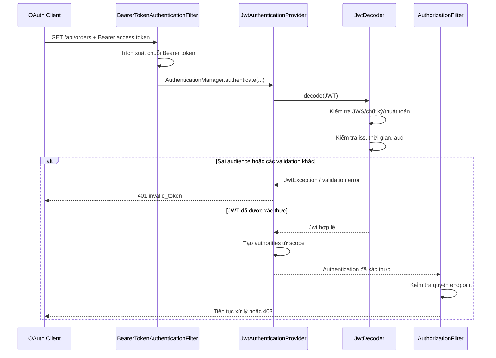
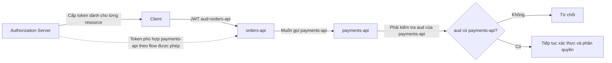

# Audience của API và kiểm tra danh sách aud

## 1. Vì sao access token phải có audience phù hợp với API?

Trong hệ thống **Spring Security OAuth 2.0/OIDC Resource Server**, Authorization Server có thể phát hành JWT access token cho nhiều API: đơn hàng, thanh toán, hồ sơ người dùng hoặc dịch vụ nội bộ. Một token có chữ ký hợp lệ từ cùng một issuer **không mặc nhiên dùng được cho mọi API**.

Claim **`aud` (audience)** giúp xác định **đối tượng nhận dự kiến của JWT**. Với access token dành cho Resource Server, audience thường là định danh của một resource/API mà Authorization Server đã cấp token hướng tới. Khi nhận yêu cầu Bearer, API cần kiểm tra **audience của access token có bao gồm chính API đó theo hợp đồng đã cấu hình hay không**.

Ví dụ:

- Authorization Server `https://login.example.test/realms/shop` phát token cho `orders-api`.
- Ứng dụng web nhận access token và gọi `GET /api/orders`.
- Resource Server `orders-api` xác minh chữ ký, issuer, thời hạn **và audience**.
- Nếu token thực tế dành cho `payments-api`, `orders-api` phải từ chối dù chữ ký JWT hợp lệ.

**Mệnh đề then chốt:** chữ ký chứng minh JWT được bảo vệ bởi khóa của issuer được tin cậy; audience ràng buộc token đó với **bên được phép nhận**. Hai kiểm tra phục vụ hai câu hỏi khác nhau và đều cần thiết.

> `aud` **không phải** danh sách người dùng có quyền, không phải địa chỉ IP được phép gọi, không phải scope và cũng không phải danh sách client đã đăng nhập. Nó là một phần của hợp đồng nhận token giữa Authorization Server và Resource Server.

## 2. Vai trò của audience trong mô hình OAuth 2.0

| Thành phần | Vai trò đối với audience |
| --- | --- |
| **Authorization Server (AS)** | Cấp access token theo thông tin client, quyền và resource được phép; đặt audience theo chính sách của mình. |
| **OAuth 2.0 Client** | Xin token phù hợp resource cần gọi; truyền **access token** chứ không thay bằng ID token. |
| **Resource Server (API)** | Xác minh token có được phát hành cho chính resource này không; nếu không thì từ chối. |
| **OIDC Client / Relying Party** | Xác minh **ID token** có `aud` chứa `client_id` của chính mình; mục đích khác với audience của API. |

Ví dụ hai JWT đều được issuer `https://login.example.test/realms/shop` ký bằng cùng khóa:

**Access token cho API đơn hàng:**

```json
{
  "iss": "https://login.example.test/realms/shop",
  "sub": "user-123",
  "aud": ["orders-api"],
  "scope": "orders:read",
  "iat": 1893452400,
  "exp": 1893456000
}
```

**Access token cho API thanh toán:**

```json
{
  "iss": "https://login.example.test/realms/shop",
  "sub": "user-123",
  "aud": ["payments-api"],
  "scope": "payments:read",
  "iat": 1893452400,
  "exp": 1893456000
}
```

Đây là **payload giả định đã giải mã**, không phải các JWT có chữ ký dùng được. `orders-api` phải từ chối token thứ hai **ngay cả khi JWT được ký hợp lệ và subject là cùng một người**.

### 2.1. Audience chống việc dùng token sai đích

Giả sử một client đã có access token dành cho `profile-api`. Nếu API đơn hàng chỉ kiểm tra chữ ký/issuer/thời hạn, client có thể gửi token `profile-api` đến `orders-api`. Khi đó token được cấp cho một resource bị chấp nhận ngoài phạm vi dự kiến, mở ra rủi ro **token substitution/cross-resource token confusion**.

Kiểm tra audience giúp giữ ranh giới giữa các tài nguyên. Tuy nhiên, audience **không thay thế** các kiểm tra còn lại: token đúng audience vẫn có thể hết hạn, thuộc issuer sai hoặc thiếu quyền trên endpoint.

## 3. RFC 7519: aud có thể là string hoặc mảng string

Theo mô hình JWT, claim `aud` chứa **một hoặc nhiều định danh đối tượng nhận**. Trong trường hợp thông thường chỉ có một audience, nó **có thể được biểu diễn thành một string**. Khi có nhiều đối tượng nhận, nó là **mảng các string**.

### 3.1. Một audience dưới dạng string

```json
{
  "iss": "https://login.example.test",
  "aud": "orders-api",
  "scope": "orders:read",
  "exp": 1893456000
}
```

### 3.2. Một audience trong mảng

```json
{
  "iss": "https://login.example.test",
  "aud": ["orders-api"],
  "scope": "orders:read",
  "exp": 1893456000
}
```

Hai biểu diễn trên có thể có **cùng ý nghĩa một audience** nếu hợp đồng issuer/resource chấp nhận cả hai dạng. API không nên chỉ kiểm tra `aud` như một string thô rồi lỗi khi issuer chuyển sang mảng.

### 3.3. Nhiều audience trong mảng

```json
{
  "iss": "https://login.example.test",
  "aud": ["orders-api", "reports-api"],
  "scope": "orders:read reports:read",
  "exp": 1893456000
}
```

Ví dụ này biểu diễn JWT có hai đối tượng nhận. `orders-api` có thể xem mình là một phần audience nếu hợp đồng cho phép token đa audience và các điều kiện khác đều thỏa mãn. **Mảng nhiều audience không tự động sai theo JWT**, nhưng việc cho phép một token dùng trên nhiều API cần có quyết định bảo mật rõ ràng.

Một số hệ thống muốn mỗi access token chỉ hướng tới **một resource duy nhất** để giảm rủi ro token bị dùng lại giữa các API. Khi đó validator có thể yêu cầu danh sách audience **chính xác bằng tập chỉ chứa định danh API đó**. Đây là **chính sách của API**, không phải quy tắc bắt buộc đối với mọi JWT.

### 3.4. Những kiểu dữ liệu không đúng hợp đồng

| Claim trong payload | Nhận định |
| --- | --- |
| `"aud": "orders-api"` | Hợp lệ về hình thức: một audience string. |
| `"aud": ["orders-api"]` | Hợp lệ về hình thức: mảng một audience string. |
| `"aud": ["orders-api", "reports-api"]` | Hợp lệ về hình thức: nhiều audience; API quyết định chính sách chấp nhận. |
| `"aud": 123` | Không đúng kiểu claim audience của JWT. |
| `"aud": {"name": "orders-api"}` | Không đúng kiểu claim audience của JWT. |
| `"aud": [123, "orders-api"]` | Mảng chứa phần tử sai kiểu. |
| `"aud": []` | Không định danh resource cụ thể; API yêu cầu `orders-api` phải từ chối. |
| Không có `aud` | API có chính sách bắt buộc audience phải từ chối token. |
| `"aud": null` | Không đáp ứng hợp đồng audience string/list. |

Resource Server nên dùng parser/decoder chuẩn và validator tin cậy để xử lý kiểu dữ liệu. Không tự chuyển một giá trị kiểu số hoặc object thành string rồi chấp nhận vì “trông giống” resource ID.

## 4. So khớp audience phải chính xác

RFC 7519 quy định việc so sánh các định danh audience theo quy tắc **case-sensitive string comparison** trong ngữ cảnh claim JWT. Vì vậy, khi API được cấu hình mong đợi `orders-api`, phải phân biệt:

| Audience của token | Audience API yêu cầu | Kết quả so khớp chính xác |
| --- | --- | --- |
| `orders-api` | `orders-api` | Khớp. |
| `Orders-API` | `orders-api` | Không khớp. |
| `orders-api-v2` | `orders-api` | Không khớp. |
| `orders-api-admin` | `orders-api` | Không khớp. |
| `https://api.example.test/orders` | `orders-api` | Không khớp nếu hợp đồng không có mapping riêng. |
| `https://api.example.test/orders/` | `https://api.example.test/orders` | Không khớp theo chuỗi; có thêm dấu `/`. |

Không nên làm:

```java
// SAI: đối tượng nhận phải được so khớp chính xác.
if (rawAudienceString.contains("orders-api")) {
    // có thể nhận nhầm "orders-api-admin" hoặc "not-orders-api"
}
```

Hoặc:

```java
// SAI: "orders-api-v2" cũng có cùng tiền tố.
if (rawAudienceString.startsWith("orders-api")) {
    // ...
}
```

Nếu API dùng audience dạng URI, phải **chốt chính xác URI mà issuer phát hành** trong hợp đồng. Không nên tự ý chuyển chữ hoa/thường, bỏ trailing slash, lược path hoặc dùng một phép so URL tùy tiện để mở rộng những giá trị được chấp nhận.

## 5. Phân biệt aud với iss, client_id, sub, scope và azp

Một access token có thể chứa nhiều claim đều trông như “định danh” nhưng phục vụ mục đích khác nhau:

| Claim | Trả lời câu hỏi | Vì sao không thay được `aud`? |
| --- | --- | --- |
| `iss` | Ai đã phát hành token? | Cùng issuer có thể cấp token cho hàng chục API. |
| `aud` | Những đối tượng nhận nào được token hướng tới? | Là ràng buộc đích nhận, nhưng không tự định nghĩa quyền. |
| `sub` | Subject do issuer định danh là ai? | Người dùng/service có thể có token cho nhiều tài nguyên khác nhau. |
| `client_id` | Client nào được cấp token? (theo profile của issuer) | Client ID xác định bên yêu cầu/được cấp, không phải API nhận token. |
| `scope` / `scp` | Token có các quyền hoặc phạm vi ủy quyền nào? | Scope không chứng minh token được cấp cho API này. |
| `azp` | Authorized party trong ngữ cảnh OIDC ID token và một số profile/provider. | Không nên coi là alias của API audience. |
| `exp` / `nbf` | Token có còn nằm trong thời gian hiệu lực không? | Token chưa hết hạn vẫn có thể dành cho API khác. |
| `jti` | ID duy nhất của một JWT theo issuer/profile. | Không biểu thị resource, scope hoặc quyền. |

Ví dụ token:

```json
{
  "iss": "https://login.example.test/realms/shop",
  "sub": "user-123",
  "client_id": "web-client",
  "aud": ["orders-api"],
  "scope": "orders:read",
  "exp": 1893456000
}
```

Trong ví dụ:

- `web-client` là **OAuth client** đang sử dụng token.
- `orders-api` là **Resource Server** được token hướng tới.
- `orders:read` là **quyền** cần được API diễn giải sau khi xác thực token.
- `user-123` là subject, không tự có quyền đọc mọi đơn hàng.

**Đừng cấu hình `aud=web-client` cho Resource Server chỉ vì client là ứng dụng gọi API.** Resource Server cần một resource identifier được Authorization Server và API cùng thỏa thuận.

### 5.1. ID token và access token không cùng audience

Trong OpenID Connect, **ID token** hướng tới **OIDC Client** và `aud` thường chứa `client_id` của client đăng nhập. Access token dùng cho API phải đáp ứng hợp đồng audience của **Resource Server**.

```text
ID token:
  aud = ["web-client"]     // OIDC Client xác thực đăng nhập

Access token:
  aud = ["orders-api"]     // Resource Server xác thực truy cập API
```

Nếu ứng dụng lấy ID token từ kết quả đăng nhập OIDC rồi gửi:

```http
GET /api/orders HTTP/1.1
Authorization: Bearer <id_token>
```

API phải từ chối token không được cấp cho resource của nó, dù ID token được **cùng OpenID Provider ký**. Kiểm tra audience và token type/profile giúp giảm rủi ro **cross-JWT confusion**.

## 6. Từ yêu cầu access token đến audience được phát hành

Một client không thể tự thêm `aud` vào JWT sau khi nhận token, vì điều đó làm thay đổi payload và mất hiệu lực chữ ký. Audience do **Authorization Server phát hành** theo chính sách cấu hình, grant và resource mà client được phép truy cập.

Trong OAuth 2.0, **RFC 8707 — Resource Indicators for OAuth 2.0** định nghĩa tham số `resource` để client có thể chỉ định protected resource mong muốn trong những authorization flow/provider có hỗ trợ:

```http
GET /authorize?response_type=code
  &client_id=web-client
  &redirect_uri=https%3A%2F%2Fapp.example.test%2Flogin%2Foauth2%2Fcode%2Fshop
  &scope=openid%20orders%3Aread
  &resource=https%3A%2F%2Fapi.example.test%2Forders
  &state=example-state
  &code_challenge=...
  &code_challenge_method=S256
```

Đây là request được trình bày nhiều dòng cho dễ đọc; trên mạng phải là URL được mã hóa hợp lệ. `resource` là định danh resource **theo hợp đồng provider**, không phải một cách để client tự cấp quyền. Authorization Server có thể từ chối resource không được phép hoặc yêu cầu thêm consent/policy.

**Không phải mọi nhà cung cấp nhận `resource` theo cùng cách hoặc sử dụng URI đó nguyên vẹn làm `aud`.** Nhiều hệ thống cấu hình audience qua API registration, permission, token exchange, custom scope hay cơ chế riêng. Hai phía phải thống nhất **giá trị audience cuối cùng xuất hiện trong access token**.

### 6.1. Scope và audience cùng cần đúng

Một client xin `orders:read` chưa bảo đảm access token có `aud=orders-api`. Ngược lại, token có audience `orders-api` chưa chứng minh người gọi được phép đọc hoặc ghi đơn hàng.

Ví dụ `GET /api/orders`:

| Audience | Quyền | Quyết định điển hình |
| --- | --- | --- |
| `orders-api` | `orders:read` | Có thể tiếp tục xử lý, sau khi token và nghiệp vụ được thẩm định. |
| `payments-api` | `orders:read` | **401 invalid_token** vì token sai audience. |
| `orders-api` | `payments:read` | Xác thực thành công nhưng thiếu quyền đọc đơn; thường **403**. |
| `orders-api` | `orders:write` | Nếu endpoint chỉ yêu cầu `orders:read`, không nên mặc định coi `write` là `read` trừ khi policy quy định. |
| `web-client` (ID token) | Có claim nhóm/roles tùy chỉnh | Không dùng làm access token của API; từ chối theo audience/token profile. |

## 7. Danh sách aud: “chứa API này” hay “chỉ chứa API này”?

Khi JWT có audience dạng mảng, hai chính sách thường được cân nhắc:

**Chính sách A — Membership:** Chấp nhận nếu danh sách audience có chứa định danh API mong đợi.

```text
expected = "orders-api"

aud = ["orders-api"]                  → nhận qua bước aud
aud = ["orders-api", "reports-api"]   → nhận qua bước aud
aud = ["payments-api"]                → từ chối
```

Đây là cách thể hiện trực tiếp nguyên tắc “Resource Server phải là một trong những đối tượng nhận JWT” khi issuer chủ động phát token đa audience.

**Chính sách B — Audience duy nhất:** Chỉ chấp nhận nếu tập audience **chính xác** là `{"orders-api"}`.

```text
expected = "orders-api"

aud = ["orders-api"]                  → nhận qua bước aud
aud = ["orders-api", "reports-api"]   → từ chối
aud = ["payments-api"]                → từ chối
```

Chính sách B thường được lựa chọn khi API yêu cầu token **ràng buộc riêng một resource**. Nó giảm khả năng một access token bị sử dụng ở nhiều API ngoài dự kiến, nhưng chỉ nên dùng nếu Authorization Server được cấu hình phát token có audience duy nhất.

| Vấn đề | Membership | Audience duy nhất |
| --- | --- | --- |
| Token có `["orders-api"]` | Chấp nhận ở bước audience. | Chấp nhận ở bước audience. |
| Token có `["orders-api", "reports-api"]` | Chấp nhận ở bước audience. | Từ chối. |
| Phù hợp issuer phát token dùng chung cho nhiều API | Có thể phù hợp nếu các API cùng chấp thuận hợp đồng. | Cần issuer phát token chuyên biệt cho API. |
| Rủi ro dùng lại token giữa nhiều API | Phạm vi token có thể rộng hơn. | Phạm vi audience hẹp hơn. |
| Mức độ tương thích | Linh hoạt hơn. | Nghiêm ngặt hơn; đòi hỏi phối hợp phát hành. |

**Không chọn cách “union mọi audience đã biết” rồi để token của API khác được chấp nhận.** Khi cần hỗ trợ nhiều audience do migration, phải có **allowlist chính xác, lý do nghiệp vụ, kiểm tra quyền riêng và thời hạn hỗ trợ**. Quy tắc dài hạn nên phản ánh resource boundary thực tế.

## 8. Spring Security: JwtDecoder trả danh sách aud như thế nào?

Khi một JWT đã được `JwtDecoder` phân tích thành `Jwt`, Spring Security cung cấp phương thức:

```java
List<String> audiences = jwt.getAudience();
```

Phương thức này biểu diễn audience ở dạng danh sách để ứng dụng có thể so khớp mà không cần tự xử lý payload JSON string hay array. Ví dụ:

```java
String expectedAudience = "orders-api";
boolean aimedAtThisApi = jwt.getAudience()
        .contains(expectedAudience);
```

`List.contains(...)` ở đây so sánh **từng phần tử string** với giá trị kỳ vọng, không phải tìm chuỗi con trong một audience dài. Nó phù hợp cho chính sách membership khi token đã được parse đúng và contract cho phép danh sách audience.

**Tuy nhiên**, không được chỉ đọc JWT bằng Base64URL rồi tự chạy câu lệnh trên và coi là đã xác thực. Resource Server cần kiểm tra **chữ ký, thuật toán, issuer và thời gian** bằng decoder cùng validators, sau đó mới dùng audience để quyết định chấp nhận token.

### 8.1. Bẫy khi đọc aud bằng getClaimAsString

Một số đoạn code xử lý JWT trực tiếp như:

```java
String audience = jwt.getClaimAsString("aud");
```

Cách này giả định claim là string. Khi issuer phát `"aud": ["orders-api", "reports-api"]`, việc ép thành một string có thể sai hoặc dẫn đến logic kiểm tra không đúng. Trong Spring Security, nên ưu tiên **`jwt.getAudience()`** khi cần danh sách recipients, rồi áp dụng chính sách rõ ràng.

### 8.2. Audience validator dùng kết quả chuẩn hóa

Ví dụ validator trong Spring Security:

```java
private static final String EXPECTED_AUDIENCE = "orders-api";

OAuth2TokenValidator<Jwt> audienceValidator = jwt -> {
    if (jwt.getAudience().contains(EXPECTED_AUDIENCE)) {
        return OAuth2TokenValidatorResult.success();
    }
    return OAuth2TokenValidatorResult.failure(
            new OAuth2Error(
                    "invalid_token",
                    "JWT was not issued for orders-api",
                    null));
};
```

Đây là **chính sách membership**. Nếu JWT có `aud=["orders-api","reports-api"]`, validator chấp nhận ở bước audience và vẫn phải để những validator/phân quyền khác kiểm tra token.

## 9. Ví dụ Resource Server hoàn chỉnh với issuer + audience

Giả sử ứng dụng Spring Boot bảo vệ `orders-api`, sử dụng **JWT access token có chữ ký** từ issuer đã tin cậy.

### 9.1. Cấu hình issuer

```yaml
spring:
  security:
    oauth2:
      resourceserver:
        jwt:
          issuer-uri: https://login.example.test/realms/shop
```

Thông qua discovery/JWKS phù hợp, Resource Server có thể lấy public keys đáng tin cậy và xác minh token. Nhưng **đừng giả định cấu hình issuer tự động kiểm tra đúng audience API trong mọi phiên bản và mọi kiểu cấu hình**. API nên có một chính sách audience tường minh.

Một số phiên bản Spring Boot có cơ chế cấu hình audience qua properties; ví dụ dưới đây sử dụng **validator riêng** để thấy rõ nguyên tắc và tránh phụ thuộc tính năng cấu hình của một phiên bản Boot cụ thể.

### 9.2. Bean JwtDecoder xác thực chữ ký, issuer, thời gian và aud

```java
import org.springframework.context.annotation.Bean;
import org.springframework.context.annotation.Configuration;
import org.springframework.security.oauth2.core.OAuth2Error;
import org.springframework.security.oauth2.core.OAuth2TokenValidator;
import org.springframework.security.oauth2.core.OAuth2TokenValidatorResult;
import org.springframework.security.oauth2.core.DelegatingOAuth2TokenValidator;
import org.springframework.security.oauth2.jwt.Jwt;
import org.springframework.security.oauth2.jwt.JwtDecoder;
import org.springframework.security.oauth2.jwt.JwtValidators;
import org.springframework.security.oauth2.jwt.NimbusJwtDecoder;

@Configuration
public class OrdersJwtValidationConfig {

    private static final String ISSUER =
            "https://login.example.test/realms/shop";

    private static final String EXPECTED_AUDIENCE = "orders-api";

    @Bean
    JwtDecoder jwtDecoder() {
        NimbusJwtDecoder decoder =
                NimbusJwtDecoder.withIssuerLocation(ISSUER).build();

        OAuth2TokenValidator<Jwt> defaults =
                JwtValidators.createDefaultWithIssuer(ISSUER);

        OAuth2TokenValidator<Jwt> audienceValidator = jwt -> {
            if (jwt.getAudience().contains(EXPECTED_AUDIENCE)) {
                return OAuth2TokenValidatorResult.success();
            }
            return OAuth2TokenValidatorResult.failure(
                    new OAuth2Error(
                            "invalid_token",
                            "JWT audience does not include orders-api",
                            null));
        };

        decoder.setJwtValidator(
                new DelegatingOAuth2TokenValidator<>(
                        defaults, audienceValidator));

        return decoder;
    }
}
```

Các điểm đáng chú ý:

1. `withIssuerLocation(ISSUER)` cấu hình nguồn JWT/public keys dựa trên issuer được tin cậy. Chữ ký không được xác minh bằng khóa tùy ý lấy từ token.
2. `JwtValidators.createDefaultWithIssuer(ISSUER)` cung cấp các validation mặc định có kiểm tra issuer và những điều kiện thời gian tương ứng.
3. `audienceValidator` buộc `aud` có **phần tử chính xác** là `orders-api`.
4. `DelegatingOAuth2TokenValidator` ghép các điều kiện: **chữ ký/issuer/thời gian/audience** đều phải được chấp nhận.
5. Resource Server vẫn cần xác minh access-token profile/loại token, thuật toán được phép và những claim bắt buộc theo hợp đồng với nhà phát hành.

Tên lớp, package và builder trong ví dụ tương ứng với Spring Security sử dụng mô hình `NimbusJwtDecoder`; khi triển khai cần khớp phiên bản Spring Security được dùng trong dự án. `JwtDecoder` bean này minh họa cho **API đơn hàng riêng** và không nên vô tình chia sẻ một audience cố định cho các API có resource ID khác nhau.

### 9.3. Bảo vệ endpoint bằng authorities

```java
import org.springframework.context.annotation.Bean;
import org.springframework.context.annotation.Configuration;
import org.springframework.http.HttpMethod;
import org.springframework.security.config.Customizer;
import org.springframework.security.config.annotation.web.builders.HttpSecurity;
import org.springframework.security.web.SecurityFilterChain;

@Configuration
public class OrdersApiSecurityConfig {

    @Bean
    SecurityFilterChain apiSecurity(HttpSecurity http) throws Exception {
        return http
                .authorizeHttpRequests(auth -> auth
                        .requestMatchers(HttpMethod.GET, "/api/orders/**")
                            .hasAuthority("SCOPE_orders:read")
                        .requestMatchers(HttpMethod.POST, "/api/orders/**")
                            .hasAuthority("SCOPE_orders:write")
                        .anyRequest().authenticated())
                .oauth2ResourceServer(oauth2 ->
                        oauth2.jwt(Customizer.withDefaults()))
                .build();
    }
}
```

Với mapping JWT phổ biến, Spring Security chuyển `scope`/`scp` thành `GrantedAuthority` có tiền tố `SCOPE_`. Nếu Authorization Server dùng claim riêng như `permissions`, cần thiết kế `JwtAuthenticationConverter` phù hợp; **đừng lấy audience làm quyền**.

Trong cấu hình này:

- **Audience sai:** authentication thất bại trước khi đến authorization, thường trả 401.
- **Audience đúng, token và chữ ký hợp lệ, thiếu scope:** authentication thành công nhưng authorization từ chối, thường trả 403.
- **Audience đúng, đủ scope:** request tiếp tục qua bước authorization; service vẫn cần kiểm tra ownership, tenant và nghiệp vụ.

### 9.4. Nếu chính sách chỉ chấp nhận một audience

Nếu issuer đã cam kết mỗi access token cho `orders-api` phải có đúng **một** audience, thay validator membership bằng phép kiểm tra tập audience:

```java
OAuth2TokenValidator<Jwt> singleAudience = jwt -> {
    boolean valid = jwt.getAudience().size() == 1
            && "orders-api".equals(jwt.getAudience().get(0));

    if (valid) {
        return OAuth2TokenValidatorResult.success();
    }
    return OAuth2TokenValidatorResult.failure(
            new OAuth2Error(
                    "invalid_token",
                    "Token must target only orders-api",
                    null));
};
```

Validator này chấp nhận một audience dù payload gốc biểu diễn dưới dạng **string** hay **mảng một string** sau khi được chuẩn hóa thành danh sách. Nó từ chối token đa audience; hãy sử dụng đúng chính sách được hai phía thống nhất.

## 10. Luồng xác thực thực tế trong Servlet Resource Server



Sơ đồ lược bỏ một số thành phần để tập trung vào audience: thực tế `BearerTokenAuthenticationFilter` gọi `AuthenticationManager`, thường điều phối `JwtAuthenticationProvider`, sau đó SecurityContext và các filter phân quyền được sử dụng. Nếu token bị từ chối ở decoder, không được tạo principal “tạm” từ payload chưa hợp lệ.

## 11. Một audience có dạng URI phải được quản lý thế nào?

Nhiều Authorization Server dùng audience như một resource URI:

```json
{
  "aud": [
    "https://api.example.test/orders"
  ]
}
```

Resource Server phải được cấu hình mong đợi **đúng chuỗi này**:

```java
private static final String EXPECTED_AUDIENCE =
        "https://api.example.test/orders";
```

Không nhất thiết resource audience trùng với URL request đang gọi. Ví dụ:

- Audience có thể là `https://api.example.test/orders`.
- HTTP request thực tế đi qua gateway `https://gateway.example.test/api/v1/orders`.
- Một deployment có nhiều host/pod nhưng cùng đại diện cho resource `orders-api`.

**Audience là định danh tài nguyên trong hợp đồng token**, không phải phép lấy `request.getRequestURL()` rồi so sánh động theo host/path cho mọi request. Tính audience từ HTTP Host chưa được kiểm soát có thể gây lỗi hoặc tạo cơ hội host-header manipulation. Hãy đặt định danh resource ổn định trong cấu hình deployment, được phối hợp với Authorization Server.

### 11.1. Path của endpoint có phải một audience riêng?

Không mặc định. Có thể mọi endpoint `/api/orders/**` chia sẻ audience `orders-api` và phân biệt hành động bằng scope/authorization. Chỉ nên dùng audience riêng cho từng nhóm tài nguyên nếu kiến trúc và issuer chủ động thiết kế các resource boundary tương ứng.

Ví dụ:

```text
GET  /api/orders/**  → aud=orders-api + scope=orders:read
POST /api/orders/**  → aud=orders-api + scope=orders:write
```

API không nhất thiết cần `aud=orders-read-api` và `aud=orders-write-api`. Audience định danh **bên nhận**, scope/policy quyết định **được làm gì**.

## 12. Gateway, microservices và truyền tiếp access token

Trong hệ thống có nhiều dịch vụ, dễ gặp tình huống **token vốn được cấp cho dịch vụ A lại được chuyển sang B**.



Nếu `orders-api` nhận JWT có `aud=["orders-api"]` rồi chuyển **nguyên token** cho `payments-api`, Resource Server thanh toán phải từ chối token sai audience, dù service gọi là nội bộ.

Các hướng thiết kế phù hợp có thể gồm:

- **Token riêng cho từng API:** OAuth client xin token có audience mà resource cần nhận.
- **Token exchange/ủy quyền tiếp theo:** Service trung gian dùng flow được Authorization Server hỗ trợ (ví dụ cơ chế dựa trên RFC 8693 khi phù hợp) để nhận access token dành cho downstream API.
- **Token đa audience có chủ đích:** Chỉ khi issuer và các API chấp thuận ranh giới quyền chung, hiểu tác động bảo mật và có quy tắc phân quyền riêng cho từng service.

Không giải quyết bằng cách tắt audience validation trên downstream service. **Mọi Resource Server phải thẩm định token theo resource của chính mình**, kể cả khi gateway đã kiểm tra token ở lớp ngoài; mức độ kiểm tra có thể được thiết kế theo trust boundary rõ ràng nhưng không được vô tình coi mọi JWT trong mạng nội bộ là hợp lệ.

## 13. Nhiều issuer tin cậy và audience của cùng API

Một Resource Server đôi khi nhận access token từ hai Authorization Server:

```text
Issuer A: https://login-partner.example.test
Issuer B: https://login-internal.example.test
API:      orders-api
```

Mỗi issuer có khóa, metadata và profile riêng. Token có `aud=orders-api` từ **issuer chưa được tin cậy** vẫn phải bị từ chối. Tương tự, cùng issuer có thể dùng audience khác nhau theo client hoặc grant; API không được chấp nhận tất cả.

Đối với multi-issuer Resource Server:

1. Duy trì **allowlist issuer** cụ thể, không tải JWKS từ `iss` tùy ý do JWT chưa được xác thực cung cấp.
2. Mỗi issuer có `JwtDecoder`/validators và chính sách thuật toán tin cậy.
3. Sau xác minh, kiểm tra audience mà API chấp nhận trong trust domain đó.
4. Nếu hai issuer dùng audience khác nhau cho cùng API, phải mô tả mapping chính xác và có lý do nghiệp vụ.
5. Kiểm tra claim quyền, subject và tenant theo hợp đồng riêng của issuer, không tự gộp mọi role thành cùng authority.

Spring Security cung cấp các cơ chế như `AuthenticationManagerResolver<HttpServletRequest>` và `JwtIssuerAuthenticationManagerResolver` cho một số kiến trúc nhiều issuer. Khi resolver đọc `iss` chưa xác thực để chọn decoder, nó **chỉ được dùng giá trị này như gợi ý tra cứu trong allowlist**, sau đó decoder thực sự phải xác minh `iss`, chữ ký và audience.

## 14. Nếu access token là opaque thì audience được kiểm tra ở đâu?

Không phải access token nào cũng là JWT. Với **opaque access token**, Resource Server không thể đọc trực tiếp `aud` bằng `JwtDecoder`. Nó thường gọi token introspection (RFC 7662) hoặc dùng một cơ chế kiểm tra do Authorization Server cung cấp.

Phản hồi introspection giả định:

```json
{
  "active": true,
  "iss": "https://login.example.test/realms/shop",
  "sub": "user-123",
  "client_id": "web-client",
  "aud": ["orders-api"],
  "scope": "orders:read",
  "exp": 1893456000
}
```

Trong ví dụ, trạng thái `active: true` nói token đang được công nhận theo hệ thống introspection; nó **không tự động có nghĩa token được dùng cho mọi resource**. Resource Server vẫn phải áp dụng chính sách resource/audience, quyền và các claim bổ sung theo hợp đồng/provider.

Với Spring Security opaque token:

```yaml
spring:
  security:
    oauth2:
      resourceserver:
        opaquetoken:
          introspection-uri: https://login.example.test/oauth2/introspect
          client-id: orders-introspection-client
          client-secret: replace-with-secure-secret
```

`OpaqueTokenIntrospector` trả principal/attributes được sử dụng khi xác thực. Nếu hợp đồng đòi audience trong introspection response, API cần áp dụng **validation đáng tin cậy trên thuộc tính introspection** hoặc sử dụng policy/introspection service bảo đảm token chỉ active cho đúng resource. Không giả định mọi provider đều trả claim `aud` cùng định dạng, và không tự xem opaque token là JWT chỉ để giải mã.

## 15. Lỗi HTTP 401 và 403 liên quan đến audience

Với một API Bearer-only được cấu hình audience validation:

| Tình huống | Kết quả điển hình |
| --- | --- |
| Không gửi Bearer token vào endpoint được bảo vệ | **401 Unauthorized**, thường `WWW-Authenticate: Bearer` không có mã `error`. |
| Gửi access token JWT sai chữ ký | **401 invalid_token**. |
| JWT đúng chữ ký nhưng `aud=["payments-api"]` | **401 invalid_token** do sai đối tượng nhận. |
| JWT không có `aud` nhưng API bắt buộc `orders-api` | **401 invalid_token**. |
| JWT có audience đúng nhưng `iss` sai | **401 invalid_token**. |
| JWT có audience đúng nhưng đã hết hạn | **401 invalid_token**. |
| JWT đúng issuer, chữ ký, audience nhưng thiếu `orders:read` | **403 Forbidden**, thường `insufficient_scope`. |
| JWT hợp lệ, đúng audience và scope nhưng không sở hữu đơn hàng | Từ chối theo chính sách dữ liệu, thường 403 hoặc quyết định nghiệp vụ phù hợp. |

Ví dụ khi audience validator từ chối:

```http
HTTP/1.1 401 Unauthorized
WWW-Authenticate: Bearer error="invalid_token"
```

Không bắt buộc phản hồi tiết lộ chi tiết `"audience mismatch"` cho client. API có thể trả mô tả lỗi tổng quát, trong khi log nội bộ ghi nguyên nhân có kiểm soát để chẩn đoán.

Nếu token hoàn toàn hợp lệ và chỉ **thiếu authority**, Resource Server thường trả:

```http
HTTP/1.1 403 Forbidden
WWW-Authenticate: Bearer error="insufficient_scope"
```

**Không nên dùng 403 để biểu diễn “token sai audience” sau khi đã coi token là authenticated.** Với JWT Resource Server, audience là bước chấp nhận token; sai audience nên bị từ chối trước khi tạo principal tin cậy.

## 16. Kiểm thử audience trong Spring Security

Để xác định một Resource Server có đang thẩm định `aud` đúng, cần test **cả token hợp lệ và token sai đối tượng nhận**, bao gồm trường hợp string/array và nhiều audience.

| Tình huống | `aud` của JWT | Kỳ vọng với chính sách membership (`orders-api`) |
| --- | --- | --- |
| Một audience string đúng | `"orders-api"` | Chấp nhận qua audience validator. |
| Một phần tử array đúng | `["orders-api"]` | Chấp nhận qua audience validator. |
| Nhiều phần tử có API | `["orders-api", "reports-api"]` | Chấp nhận qua audience validator, trừ khi policy yêu cầu duy nhất. |
| Array chỉ có resource khác | `["payments-api"]` | Từ chối. |
| Array gồm tên gần giống | `["orders-api-admin"]` | Từ chối. |
| Chữ hoa/thường khác | `["Orders-API"]` | Từ chối. |
| Không có aud | Không có claim `aud` | Từ chối. |
| Mảng rỗng | `[]` | Từ chối. |
| Claim sai kiểu | `123` hoặc object | Từ chối qua parser/validation hợp đồng. |
| Token có audience đúng nhưng chữ ký sai | `["orders-api"]` | Từ chối; audience đúng không cứu chữ ký sai. |
| Token có audience đúng nhưng issuer sai | `["orders-api"]` | Từ chối. |
| Token có audience đúng nhưng hết hạn | `["orders-api"]` | Từ chối. |
| Token có audience đúng nhưng thiếu scope | `["orders-api"]` | Xác thực có thể thành công; authorization từ chối khi endpoint cần scope. |

### 16.1. Kiểm thử JwtDecoder khác kiểm thử quyền endpoint

Trong `spring-security-test`, ví dụ MockMvc:

```java
mockMvc.perform(get("/api/orders")
        .with(jwt().authorities(
                new SimpleGrantedAuthority("SCOPE_orders:read"))))
        .andExpect(status().isOk());
```

Test trên có thể kiểm tra **authorization khi đã có JwtAuthenticationToken giả lập**, nhưng **không chứng minh `JwtDecoder` đã xác minh audience**. Bộ test dùng `jwt()` mock thường bỏ qua con đường chữ ký/issuer/audience validator thực tế.

Để kiểm tra audience validation:

1. Sử dụng `JwtDecoder` thực được cấu hình với issuer/JWKS thử nghiệm hoặc một decoder/validator được dựng cho unit test.
2. Tạo token thử nghiệm có chữ ký hợp lệ nhưng `aud` đúng/sai theo từng ca, tránh dùng credential production.
3. Kiểm tra decoder chấp nhận token đúng audience và từ chối token sai audience bằng exception phù hợp.
4. Trong test tích hợp, đi qua `BearerTokenAuthenticationFilter` và security chain để xác nhận endpoint phản hồi 401/403 đúng kỳ vọng.
5. Kiểm tra thêm kiểu string/mảng và chính sách đa audience mà issuer thực sự phát hành.

Đây là **định hướng kiểm thử**, không phải kết quả test đã chạy trong repository. Khi dùng test doubles, cần phân biệt rõ test parser/validator với test authorization.

### 16.2. Ví dụ logic test của validator

Một validator độc lập có thể được kiểm tra với các `Jwt` dựng theo API builder của Spring Security:

```java
Jwt jwt = Jwt.withTokenValue("test-token")
        .header("alg", "RS256")
        .issuer(URI.create("https://login.example.test/realms/shop"))
        .audience(List.of("orders-api", "reports-api"))
        .issuedAt(Instant.parse("2029-12-31T00:00:00Z"))
        .expiresAt(Instant.parse("2030-01-01T00:00:00Z"))
        .subject("user-123")
        .build();

boolean containsExpectedAudience =
        jwt.getAudience().contains("orders-api");
```

Đoạn code kiểm tra việc biểu diễn claim thành audience list; **không phải token JWS đã được ký hay một bài test chữ ký**. Khi cần kiểm tra decoder, phải sử dụng JWT có chữ ký thử nghiệm và nguồn key tương ứng.

## 17. Triển khai thay đổi audience mà không phá vỡ các API

Audience là một phần của hợp đồng access token. Thay đổi định danh resource có thể làm mọi token đang lưu hành bị từ chối.

Ví dụ:

```text
Phiên bản cũ của access token:
  aud = ["orders-api"]

Phiên bản mới của access token:
  aud = ["https://api.example.test/orders"]
```

Nếu API chỉ chấp nhận `orders-api`, token mới bị 401. Nếu API chỉ chấp nhận URI mới, token cũ chưa hết hạn bị 401. Khi cần migration:

1. Ghi rõ audience cũ, audience mới, các Resource Server liên quan và lý do thay đổi.
2. Nâng API để chấp nhận **hai giá trị chính xác** trong một cửa sổ chuyển tiếp được phê duyệt, nếu chính sách bảo mật cho phép.
3. Sau khi API triển khai đầy đủ, thay đổi cấu hình Authorization Server để phát audience mới.
4. Theo dõi tỷ lệ 401, client đang nhận token cũ/mới và các instance chưa cập nhật.
5. Chờ access token cuối cùng mang audience cũ hết hạn, tính thêm clock skew và khả năng phát hành lại từ refresh flow.
6. Gỡ chấp nhận audience cũ khi không còn người tiêu thụ hợp lệ, theo thời hạn đã định.

Một kiểu validator tạm thời cho migration:

```java
private static final Set<String> ALLOWED_AUDIENCES = Set.of(
        "orders-api",
        "https://api.example.test/orders");

OAuth2TokenValidator<Jwt> migrationAudienceValidator = jwt -> {
    boolean accepted = jwt.getAudience().stream()
            .anyMatch(ALLOWED_AUDIENCES::contains);

    return accepted
            ? OAuth2TokenValidatorResult.success()
            : OAuth2TokenValidatorResult.failure(
                    new OAuth2Error("invalid_token",
                            "Audience is not allowed", null));
};
```

Đây là **allowlist tạm thời** cho cùng một Resource Server theo hợp đồng migration. Nếu hệ thống yêu cầu audience duy nhất, cần kết hợp điều kiện không có audience ngoài tập/định danh hợp lệ. Không nên để allowlist phình thành mọi audience của hệ sinh thái vì như vậy sẽ làm mất tác dụng ràng buộc resource.

## 18. Sai lầm thực tế và cách tránh

### Sai lầm 1 — Chỉ kiểm tra iss, chữ ký và exp

JWT từ issuer đáng tin cậy có thể dành cho bất kỳ API nào mà issuer phục vụ. Nếu bỏ `aud`, Resource Server có nguy cơ chấp nhận token sai đích. Cần thêm audience validator rõ ràng.

### Sai lầm 2 — Xem client_id là aud

OAuth client và Resource Server là hai vai trò khác nhau. `web-client` có thể gọi nhiều API, nhưng `aud` của access token cần tương ứng với resource được cấp quyền.

### Sai lầm 3 — Dùng ID token làm Bearer access token

OIDC ID token được cấp cho OIDC Client, thường có `aud=client_id`. API phải yêu cầu access token đúng audience/token profile; không chấp nhận ID token chỉ vì cùng issuer ký.

### Sai lầm 4 — So khớp gần đúng

`startsWith("orders-api")` và so substring có thể chấp nhận nhầm `orders-api-admin`. Dùng so sánh **chính xác từng audience string**.

### Sai lầm 5 — Chỉ hỗ trợ aud là string

Issuer có thể phát `aud` dưới dạng mảng. Dùng `Jwt.getAudience()` hoặc API chuẩn hóa danh sách, không tự ép kiểu sang string rồi bỏ sót token hợp lệ.

### Sai lầm 6 — Cho phép token đa audience mà không hiểu hợp đồng

Danh sách đa audience không tự sai theo JWT, nhưng có thể mở rộng phạm vi dùng lại token. Chọn membership hay audience duy nhất dựa trên resource boundary và khả năng phát hành của Authorization Server.

### Sai lầm 7 — Tạo audience từ HTTP Host mỗi request

Host/gateway/path có thể khác resource identifier được issuer phát. Cần cấu hình resource audience ổn định, không biến dữ liệu request chưa được tin cậy thành quyết định audience.

### Sai lầm 8 — Chấp nhận mọi audience khi đổi issuer hoặc xoay khóa

Rotation JWKS, thay issuer và đổi audience là các trục khác nhau. Sửa lỗi 401 bằng cách bỏ audience validation làm mất ranh giới bảo mật. Phải phân tích nguyên nhân và migration đúng hợp đồng.

### Sai lầm 9 — Dùng audience để suy ra quyền tenant

`aud=orders-api` chỉ nói token hướng tới API đơn hàng; không chứng minh người gọi được đọc mọi đơn hàng/tenant. Quyền trên bản ghi cần chính sách riêng.

### Sai lầm 10 — Tin kết quả MockMvc jwt() là đã kiểm thử decoder

Mock authentication rất hữu ích cho authorization, nhưng không đi qua mọi bước JWT signature/claim verification. Để bảo đảm audience validator hoạt động, phải test trực tiếp decoder hoặc chạy integration test với token ký thử nghiệm.

## 19. Chẩn đoán 401 liên quan đến aud

| Triệu chứng | Câu hỏi cần kiểm tra |
| --- | --- |
| JWT được ký đúng nhưng API luôn 401 | Có audience validator không? Token `aud` thực tế là gì, API đang mong đợi gì? |
| Chỉ client web lỗi, service client khác gọi được | Authorization Server có cấp audience khác nhau theo client registration/flow không? |
| Token dành cho gateway được API phía sau từ chối | Gateway đã xin/trao đổi token dành cho downstream API chưa? |
| `aud` là array nhưng code dùng `getClaimAsString("aud")` | Có lỗi ép kiểu hoặc so chuỗi không đúng không? |
| API mới đổi domain thì 401 tăng | Audience có bị so với URL request động thay vì định danh resource ổn định không? |
| Một issuer mới có token cùng audience nhưng vẫn 401 | Issuer có nằm trong allowlist? Chữ ký/JWKS, token profile có đúng không? |
| Token có nhiều audience và một API vẫn 401 | API có chính sách audience duy nhất hay resource ID không khớp? |
| Token đúng audience nhưng 403 | Scope/authority, policy tenant/ownership có đáp ứng không? |
| Token ID từ OIDC login bị từ chối | Client có đang gửi nhầm ID token thay access token? |

Trong môi trường phát triển, có thể bật log Spring Security có kiểm soát:

```yaml
logging:
  level:
    org.springframework.security: DEBUG
```

**Không log nguyên access token, ID token, refresh token hay các claim nhạy cảm**. Để điều tra, có thể ghi request ID, loại lỗi, issuer đã kiểm chứng, resource ID kỳ vọng và kết quả audience validation ở mức phù hợp chính sách. Đừng ghi audience chưa xác thực vào metric có cardinality không giới hạn; tránh để đầu vào do attacker điều khiển tạo ra hàng triệu nhãn log/metric.

### 19.1. Khi gặp audience mismatch cần sửa ở đâu?

Không thể sửa chữ ký JWT sau khi phát hành bằng cách thay `aud` thủ công. Những lựa chọn đúng là:

- **Phía client:** yêu cầu access token dành cho đúng resource theo cơ chế provider hỗ trợ.
- **Phía Authorization Server:** cấu hình audience mapper/resource registration/permission hoặc token exchange đúng hợp đồng.
- **Phía Resource Server:** khai báo expected audience chính xác, kiểm tra decoder và định dạng danh sách. Chỉ thêm audience được phép khi có thay đổi contract thực sự.
- **Với nhiều API:** xác định mỗi resource tự nhận token hay sử dụng token exchange/multi-audience được thiết kế có chủ đích.

Không giải quyết bằng cách tắt audience validator hoặc xem mọi token cùng issuer là hợp lệ.

## 20. Câu hỏi tự kiểm tra

**1. `aud` xác định điều gì?** Đối tượng nhận dự kiến của JWT. Với access token, Resource Server cần có định danh phù hợp trong audience.

**2. `aud` có thể là string hay bắt buộc array?** Có thể là string khi chỉ có một audience, hoặc array string khi có nhiều audience. Spring Security `Jwt.getAudience()` giúp làm việc với danh sách.

**3. API mong đợi `orders-api` có nên chấp nhận `orders-api-v2` không?** Không theo so khớp chính xác; chỉ khi hợp đồng chuyển đổi cho phép thêm audience riêng.

**4. Token có `aud=["orders-api","reports-api"]` có tự động sai không?** Không theo JWT. Việc chấp nhận phụ thuộc chính sách đa audience của Resource Server.

**5. Chữ ký JWT hợp lệ đã đủ để bỏ kiểm tra audience chưa?** Chưa. Issuer có thể ký token cho nhiều resource và OIDC clients.

**6. `scope=orders:read` có thay được `aud=orders-api` không?** Không. Scope là quyền, audience là đối tượng nhận.

**7. ID token có `aud=web-client` có được gửi vào `orders-api` không?** Không. ID token phục vụ OIDC Client; API yêu cầu access token đúng audience/token profile.

**8. Sai audience trả 401 hay 403?** Với JWT Resource Server xác minh audience ở bước authentication, thường là **401 invalid_token**. **403** thường dành cho token đã xác thực nhưng thiếu quyền.

**9. API đi qua reverse proxy có nên lấy hostname làm audience không?** Không mặc định. Resource audience cần là định danh ổn định được hai phía thỏa thuận.

**10. Vì sao MockMvc `jwt()` không đủ để chứng minh audience validator chạy?** Vì nó có thể tạo sẵn authenticated principal, bỏ qua JWT decoder và kiểm tra chữ ký/claim thực.

## 21. Tài liệu chuẩn để tìm hiểu thêm

- **RFC 7519 — JSON Web Token (JWT):** claim `aud`, các dạng string/array và quy tắc so khớp.
- **RFC 8725 — JWT Best Current Practices:** xác nhận audience, phòng tránh nhầm loại JWT và token được phát hành cho mục đích khác.
- **RFC 9068 — JWT Profile for OAuth 2.0 Access Tokens:** profile access token dạng JWT và các yêu cầu claims/đối tượng nhận khi áp dụng profile này.
- **RFC 8707 — Resource Indicators for OAuth 2.0:** tham số `resource` để client yêu cầu access token hướng tới tài nguyên cụ thể khi provider hỗ trợ.
- **RFC 6749 — OAuth 2.0 Authorization Framework:** vai trò Authorization Server, client, Resource Server và scope.
- **RFC 6750 — OAuth 2.0 Bearer Token Usage:** Bearer credential và lỗi `invalid_token`, `insufficient_scope`.
- **RFC 7662 — OAuth 2.0 Token Introspection:** metadata về opaque access token và cách Resource Server xác minh token qua introspection.
- **OpenID Connect Core:** ID token được phát hành cho OIDC Client, phân biệt với access token gọi API.
- **Spring Security OAuth 2.0 Resource Server JWT:** `JwtDecoder`, `NimbusJwtDecoder`, `OAuth2TokenValidator`, `Jwt.getAudience()` và cấu hình authorization cho Resource Server.

**Nguyên tắc cuối cùng:** Resource Server chỉ nên chấp nhận JWT access token khi token **được xác minh bằng issuer/khóa đáng tin cậy, chưa hết hạn, có audience khớp chính xác với API theo chính sách đã định và đáp ứng hợp đồng access token**. `aud` có thể là một string hoặc danh sách string; kiểm tra membership hay audience duy nhất phải là quyết định tường minh. Sau authentication, API mới áp dụng scope, tenant, ownership và quyền nghiệp vụ. Nhờ đó một token hợp lệ cho resource này không bị dùng nhầm làm credential cho resource khác.
