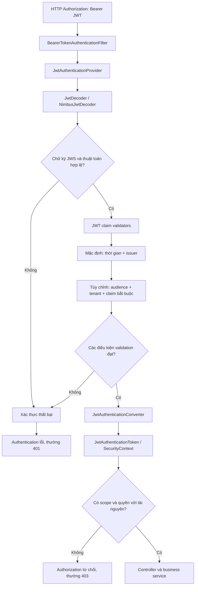

# OAuth2TokenValidator, JwtClaimValidator và quy tắc tùy chỉnh

Trong **Spring Security OAuth 2.0 Resource Server**, xác minh được chữ ký JWT là điều kiện quan trọng, nhưng **chưa đủ để chấp nhận token cho API**. Một access token có chữ ký đúng vẫn có thể sai nhà phát hành, đã hết hạn, dành cho Resource Server khác hoặc không đáp ứng một hợp đồng claim cụ thể của hệ thống.

Spring Security cung cấp hai công cụ rất hữu ích để diễn đạt các quy tắc kiểm tra claim:

- **`OAuth2TokenValidator<Jwt>`:** Giao diện tổng quát nhận một đối tượng `Jwt` và trả kết quả validation. Dùng cho điều kiện đơn giản hoặc phức tạp, kiểm tra nhiều claims hay các ràng buộc đặc thù của ứng dụng.
- **`JwtClaimValidator<T>`:** Một cách triển khai `OAuth2TokenValidator<Jwt>` chuyên kiểm tra **một claim** thông qua một `Predicate<T>`. Thích hợp cho các quy tắc ngắn, rõ ràng, dựa trên giá trị claim.

Các validator có thể được kết hợp bằng **`DelegatingOAuth2TokenValidator`** và gắn vào `JwtDecoder`, cùng những điều kiện mặc định về issuer/thời gian. Đây là bước **kiểm tra token có phù hợp để được xác thực tại Resource Server**, không thay thế authorization của từng endpoint.

Bài học tập trung vào cách chọn validator, viết quy tắc tùy chỉnh an toàn, ghép các điều kiện thành một chuỗi hoàn chỉnh và xử lý những trường hợp có claim thiếu, sai kiểu hoặc không phù hợp hợp đồng.

## 1. Vị trí của claim validation trong hành trình access token

Giả sử Orders API nhận request:

```http
GET /api/orders/42 HTTP/1.1
Host: api.example.test
Authorization: Bearer <ACCESS_TOKEN>
Accept: application/json
```

Request đi qua luồng điển hình:



**Có ba ranh giới không được trộn lẫn:**

1. **Xác minh chữ ký và nguồn khóa:** JWT có được ký bằng key tin cậy, thuật toán được cho phép, nội dung không bị sửa?
2. **Token validation:** Các claims của token có đáp ứng hợp đồng Resource Server không, ví dụ `iss`, `exp`, `nbf`, `aud`, `tenant_id`?
3. **Authorization:** Caller đã xác thực có đủ scope/authority, role và quyền đối với đơn hàng số 42 hay không?

Một JWT **hợp lệ về chữ ký** vẫn có thể bị một `OAuth2TokenValidator<Jwt>` từ chối. Ngược lại, token vượt qua tất cả validators vẫn có thể bị `AuthorizationFilter` hoặc method security chặn.

### 1.1. Token ví dụ xuyên suốt bài

Giả sử Authorization Server phát hành JWT access token cho Orders API:

```json
{
  "iss": "https://login.example.test/realms/shop",
  "sub": "user-123",
  "aud": ["orders-api"],
  "client_id": "shop-web",
  "scope": "orders.read",
  "tenant_id": "shop",
  "iat": 1794715200,
  "nbf": 1794715200,
  "exp": 1794718800
}
```

Trong bài này:

| Trường | Giá trị kỳ vọng hoặc ý nghĩa |
|---|---|
| `iss` | Nhà phát hành được Resource Server tin cậy: `https://login.example.test/realms/shop` |
| `aud` | Có chứa `orders-api`: token được cấp cho Orders API |
| `exp` | Token có thời điểm hết hạn và chưa hết hạn theo chính sách thời gian |
| `nbf` | Nếu có, token không được sử dụng trước thời điểm có hiệu lực |
| `tenant_id` | Claim tùy chỉnh theo hợp đồng, ví dụ tenant `shop` |
| `client_id` | Ứng dụng xin token, ví dụ `shop-web`; không phải audience |
| `scope` | Phạm vi quyền, ví dụ `orders.read`; dùng cho authorization |
| `sub` | Chủ thể do issuer xác nhận; có thể là user hoặc service principal tùy grant |

**Ví dụ trên chỉ là payload JSON minh họa**, không phải JWT đã ký. Không lấy các claims từ payload chưa xác minh để cấp quyền.

## 2. `OAuth2TokenValidator<Jwt>` là gì?

Spring Security định nghĩa `OAuth2TokenValidator<T>` như một hợp đồng validation. Trong trường hợp JWT, lập trình viên làm việc với kiểu `OAuth2TokenValidator<Jwt>`.

Chữ ký ở mức khái niệm:

```java
public interface OAuth2TokenValidator<T extends OAuth2Token> {
    OAuth2TokenValidatorResult validate(T token);
}
```

Một validator nhận **một token đã được decoder xây dựng**, đánh giá tính hợp lệ theo chính sách, rồi trả:

- `OAuth2TokenValidatorResult.success()` khi điều kiện đạt.
- `OAuth2TokenValidatorResult.failure(OAuth2Error)` hoặc tập các lỗi khi điều kiện không đạt.

Ví dụ một validator audience:

```java
OAuth2TokenValidator<Jwt> audienceValidator = jwt -> {
    if (jwt.getAudience().contains("orders-api")) {
        return OAuth2TokenValidatorResult.success();
    }

    return OAuth2TokenValidatorResult.failure(
        new OAuth2Error(
            "invalid_token",
            "Access token is not intended for orders-api",
            null
        )
    );
};
```

Các import cơ bản:

```java
import org.springframework.security.oauth2.core.OAuth2Error;
import org.springframework.security.oauth2.core.OAuth2TokenValidator;
import org.springframework.security.oauth2.core.OAuth2TokenValidatorResult;
import org.springframework.security.oauth2.jwt.Jwt;
```

Ví dụ trên cho thấy một quy tắc rất nhỏ nhưng quan trọng: token chỉ được dùng tại Orders API nếu `aud` chứa audience đã cấu hình của API.

### 2.1. Validator nhìn dữ liệu ở cấp độ nào?

Khi nhận `Jwt`, validator có thể đọc:

```java
jwt.getIssuer();
jwt.getAudience();
jwt.getSubject();
jwt.getExpiresAt();
jwt.getIssuedAt();
jwt.getNotBefore();
jwt.getClaimAsString("tenant_id");
jwt.getClaims();
jwt.getHeaders();
```

Vì vậy một validator có thể kiểm tra **nhiều claim cùng lúc**, chẳng hạn yêu cầu `tenant_id=shop` chỉ khi `client_id=partner-app`, hoặc yêu cầu tenant nằm trong một allowlist do server quản trị.

Tuy nhiên, khả năng đọc nhiều thông tin **không có nghĩa nên nhồi mọi logic vào một validator**. Các ràng buộc độc lập và có thể tái sử dụng nên được tách rõ, giúp người đọc hiểu điều kiện nào khiến token không hợp lệ.

### 2.2. Validator không tự giải mã hay ký JWT

`OAuth2TokenValidator<Jwt>` không chịu trách nhiệm tìm JWKS, chọn public key hay kiểm tra JWS signature. Những việc đó thuộc bộ xử lý chữ ký bên trong `JwtDecoder`. Validator cũng không phải nơi chuyển `scope` thành `GrantedAuthority`; điều đó thuộc converter và tầng authorization.

Một rule kiểm tra `tenant_id` **không bao giờ được dùng thay thế** kiểm tra chữ ký hoặc issuer.

## 3. `OAuth2TokenValidatorResult` và `OAuth2Error`

Ví dụ một lỗi từ validator:

```java
new OAuth2Error(
    "invalid_token",
    "Required tenant_id claim is missing",
    null
);
```

Ba đối số gồm mã lỗi, mô tả và URI tham chiếu nếu có. Với lỗi xác thực JWT, `invalid_token` là mã thường được dùng trong ví dụ để Spring Security xử lý kết quả từ chối token.

| Đối tượng | Vai trò |
|---|---|
| `OAuth2TokenValidatorResult.success()` | Thông báo validator chấp nhận token theo rule này. |
| `OAuth2TokenValidatorResult.failure(error)` | Thông báo thất bại và mang lỗi xác thực. |
| `OAuth2Error` | Chứa error code, description và URI tùy chọn. |
| `DelegatingOAuth2TokenValidator` | Gọi nhiều validator và tổng hợp kết quả cần thiết. |

Trong ứng dụng thực, **không đưa raw access token, private data hoặc bí mật vào error description**. Mô tả đủ cho chẩn đoán nội bộ nhưng không nhất thiết phải được gửi nguyên văn tới caller.

### 3.1. Hàm tiện ích để viết validator dễ đọc hơn

Khi cần nhiều validators tùy chỉnh, có thể dùng helper:

```java
private static OAuth2TokenValidatorResult invalid(String reason) {
    return OAuth2TokenValidatorResult.failure(
        new OAuth2Error("invalid_token", reason, null)
    );
}
```

Sau đó:

```java
OAuth2TokenValidator<Jwt> requiredSubject = jwt ->
    jwt.getSubject() != null && !jwt.getSubject().isBlank()
        ? OAuth2TokenValidatorResult.success()
        : invalid("Missing required subject");
```

Điều kiện `sub` bắt buộc chỉ thích hợp khi **hợp đồng token của issuer** yêu cầu nó. Với một số grant hoặc profile riêng, ý nghĩa của subject có thể khác user đăng nhập.

## 4. `JwtClaimValidator<T>`: kiểm tra một claim bằng Predicate

Khi rule là một điều kiện trên **một claim**, Spring Security có `JwtClaimValidator<T>`.

Ví dụ token phải có tenant `shop`:

```java
OAuth2TokenValidator<Jwt> tenantValidator =
    new JwtClaimValidator<String>(
        "tenant_id",
        "shop"::equals
    );
```

Import:

```java
import org.springframework.security.oauth2.jwt.JwtClaimValidator;
```

Cấu trúc:

```text
JwtClaimValidator<T>(claimName, predicate)
                                 │
                                 ▼
              Đọc claim từ Jwt và đưa vào Predicate<T>
                                 │
                  ┌──────────────┴──────────────┐
                  │                             │
              predicate=true                predicate=false
                  │                             │
              success()                  failure(...)
```

Ưu điểm:

- Ngắn gọn, thể hiện rõ một điều kiện claim.
- Tái sử dụng `Predicate<T>` của Java.
- Không phải tự viết một lambda đầy đủ với `OAuth2TokenValidatorResult` cho mỗi điều kiện.
- Có thể ghép cùng các validators khác trong `DelegatingOAuth2TokenValidator`.

### 4.1. Ví dụ: chỉ cho phép tenant thuộc allowlist

```java
Set<String> allowedTenants = Set.of("shop", "partner-shop");

OAuth2TokenValidator<Jwt> tenantValidator =
    new JwtClaimValidator<String>(
        "tenant_id",
        allowedTenants::contains
    );
```

Import bổ sung:

```java
import java.util.Set;
```

**Allowlist phải đến từ cấu hình đáng tin cậy của Resource Server**, không phải từ header hoặc query parameter do client tự gửi.

Nếu token có `tenant_id=unknown`, predicate trả false và token bị từ chối ở bước validation.

### 4.2. Ví dụ: yêu cầu audience nằm trong danh sách

`aud` theo JWT là chuỗi hoặc mảng chuỗi; trong đối tượng `Jwt` do Spring Security xử lý, `getAudience()` cung cấp danh sách audience. Với một số trường hợp, có thể dùng `JwtClaimValidator<List<String>>`:

```java
OAuth2TokenValidator<Jwt> audienceValidator =
    new JwtClaimValidator<List<String>>(
        "aud",
        audiences -> audiences != null &&
            audiences.contains("orders-api")
    );
```

Import:

```java
import java.util.List;
```

Khi nguồn token có cách biểu diễn claim không nhất quán hoặc cần thông báo lỗi rõ ràng hơn, sử dụng validator đọc `jwt.getAudience()` trực tiếp sẽ dễ kiểm soát hơn:

```java
OAuth2TokenValidator<Jwt> audienceValidator = jwt ->
    jwt.getAudience().contains("orders-api")
        ? OAuth2TokenValidatorResult.success()
        : invalid("Unexpected audience");
```

**Audience không phải client ID.** Nếu client `shop-web` gọi Resource Server `orders-api`, API thường cần kiểm tra `aud=orders-api`, không phải `aud=shop-web`. Cách OIDC ID token sử dụng audience dành cho relying party không được bê nguyên sang access token API.

### 4.3. Ví dụ: kiểm tra kiểu/giá trị của claim tùy chỉnh

Nếu issuer cam kết claim `token_version` có giá trị số nguyên, lập trình viên có thể dùng predicate có kiểu tương ứng:

```java
OAuth2TokenValidator<Jwt> versionValidator =
    new JwtClaimValidator<Integer>(
        "token_version",
        version -> version != null && version >= 2
    );
```

Cần thận trọng: claims sau khi parse JSON có thể có kiểu Java khác với dự kiến, tùy claim converter và implementation. Một claim do issuer gửi dưới dạng số JSON có thể được biểu diễn bằng kiểu `Integer` hoặc `Long`; nếu khai báo kiểu không đúng, `Predicate<Integer>` có thể gặp lỗi ép kiểu khi thực thi.

Với dữ liệu có thể thay đổi kiểu, nên xác định hợp đồng chuyển đổi claim rõ ràng hoặc dùng `OAuth2TokenValidator<Jwt>` để kiểm tra `instanceof` theo cách có kiểm soát.

Ví dụ:

```java
OAuth2TokenValidator<Jwt> versionValidator = jwt -> {
    Object raw = jwt.getClaim("token_version");

    if (!(raw instanceof Number)) {
        return invalid("token_version must be numeric");
    }

    int version = ((Number) raw).intValue();

    return version >= 2
        ? OAuth2TokenValidatorResult.success()
        : invalid("Unsupported token_version");
};
```

Đoạn này cho thấy **có thể dùng validator tổng quát để xử lý kiểm tra kiểu dữ liệu**. Với chính sách có độ chính xác số lớn, hãy tránh ép `Number` về `int` tùy tiện; quy tắc phải dựa trên kiểu và khoảng giá trị được issuer đảm bảo.

### 4.4. Khi nào nên dùng `JwtClaimValidator`?

| Nhu cầu | Cách làm thường phù hợp |
|---|---|
| `tenant_id` phải bằng chuỗi cố định | `JwtClaimValidator<String>` với predicate equals |
| `client_id` phải thuộc allowlist đã quản trị | `JwtClaimValidator<String>` với predicate contains |
| `aud` phải chứa audience của API | `JwtClaimValidator<List<String>>` nếu kiểu claim ổn định; hoặc validator tổng quát đọc `getAudience()` |
| Claim có kiểu phức tạp/không ổn định | `OAuth2TokenValidator<Jwt>` với kiểm tra kiểu và lỗi rõ |
| So sánh hai hoặc nhiều claims | `OAuth2TokenValidator<Jwt>` |
| Cần điều kiện theo thời gian hiện tại | Validator tổng quát với `Clock`/`Instant` |
| Cần kiểm tra thuộc tính của request cụ thể | Thường **không** thuộc JWT validator dùng chung; ưu tiên authorization hoặc chính sách gắn với request |

## 5. Claim thiếu, claim null và quy tắc bắt buộc

Một JWT có thể không chứa claim tùy chỉnh mà ứng dụng mong đợi. Cần phân biệt:

1. **Claim có mặt và đúng giá trị.**
2. **Claim có mặt nhưng sai giá trị.**
3. **Claim không có hoặc được chuyển thành null.**
4. **Claim có mặt nhưng sai kiểu Java.**

Không nên viết predicate giả định giá trị luôn tồn tại:

```java
// Rủi ro NullPointerException khi claim bị thiếu:
new JwtClaimValidator<String>(
    "tenant_id",
    value -> value.equals("shop")
);
```

Cách an toàn hơn:

```java
new JwtClaimValidator<String>(
    "tenant_id",
    "shop"::equals
);
```

Với method reference trên, khi `value=null`, phép so sánh trả false thay vì truy cập phương thức của null.

### 5.1. Claim tùy chọn và claim bắt buộc

Một số claims là **tùy chọn theo định dạng JWT**, nhưng tổ chức có thể đặt yêu cầu chặt hơn. Ví dụ:

- `exp` phải tồn tại trong access token cho API.
- `tenant_id` bắt buộc đối với hệ thống multi-tenant.
- `client_id` bắt buộc nếu policy resource phụ thuộc vào OAuth client.
- `sub` phải là chuỗi không rỗng nếu mọi access token trong hệ thống đều đại diện cho một subject theo hợp đồng.

Ví dụ kiểm tra có `exp`:

```java
OAuth2TokenValidator<Jwt> expirationRequired = jwt ->
    jwt.getExpiresAt() != null
        ? OAuth2TokenValidatorResult.success()
        : invalid("Missing exp claim");
```

Đây là **kiểm tra sự tồn tại**; nó không thay thế `JwtTimestampValidator` kiểm tra token còn hiệu lực. Nếu hồ sơ access token yêu cầu `exp`, cần đảm bảo **cả sự tồn tại và tính hợp lệ về thời gian**.

Ví dụ yêu cầu `sub` không rỗng:

```java
OAuth2TokenValidator<Jwt> subjectRequired = jwt -> {
    String subject = jwt.getSubject();

    if (subject == null || subject.isBlank()) {
        return invalid("Missing required subject");
    }

    return OAuth2TokenValidatorResult.success();
};
```

Đừng buộc `sub` có định dạng email hay user ID nếu Authorization Server phát hành service principal hoặc định danh pairwise khác.

## 6. Giữ lại các validator mặc định bằng `JwtValidators`

Spring Security cung cấp các factory để tạo nhóm validation tiêu chuẩn:

```java
OAuth2TokenValidator<Jwt> defaults =
    JwtValidators.createDefault();

OAuth2TokenValidator<Jwt> defaultsAndIssuer =
    JwtValidators.createDefaultWithIssuer(
        "https://login.example.test/realms/shop"
    );
```

Những factory này giúp thiết lập các điều kiện nền tảng phù hợp phiên bản Spring Security đang chạy, điển hình là validation thời gian và issuer ở biến thể `createDefaultWithIssuer`.

**Không giả định** việc đặt một audience validator mới sẽ tự động giữ lại issuer/time validators:

```java
// Cần tránh nếu đây là toàn bộ validator gắn vào decoder:
decoder.setJwtValidator(audienceValidator);
```

`setJwtValidator(...)` nhận một validator mới thay cho bộ validation đã được cấu hình trước đó. Nếu chỉ truyền audience validator, ứng dụng có thể vô tình bỏ qua những điều kiện quan trọng về issuer/thời gian.

Cách tiếp cận phổ biến:

```java
OAuth2TokenValidator<Jwt> combined =
    new DelegatingOAuth2TokenValidator<>(
        JwtValidators.createDefaultWithIssuer(ISSUER),
        audienceValidator,
        tenantValidator
    );

decoder.setJwtValidator(combined);
```

Tập điều kiện cụ thể bên trong factory có thể phát triển theo phiên bản thư viện. Nếu dự án yêu cầu một profile chặt hơn hoặc điều chỉnh clock skew/từng điều kiện mặc định, cần hiểu những validator được áp dụng trong phiên bản đó và thiết kế nhóm tường minh.

### 6.1. Không kiểm tra issuer bằng cách “startsWith”

Issuer là một **định danh tin cậy**, ví dụ:

```text
https://login.example.test/realms/shop
```

Một token từ:

```text
https://login.example.test/realms/admin
```

không phải token từ issuer được cấu hình chỉ vì cùng host hoặc có đường dẫn gần giống. Với các trường hợp cần kiểm tra issuer, hãy dùng đúng issuer string theo hợp đồng và validator chuẩn như `JwtIssuerValidator` hoặc `createDefaultWithIssuer`.

Không xây dựng trusted issuer từ `iss` do JWT chưa xác thực tự khai báo, rồi tải metadata/JWKS của bất kỳ URL nào. Khi nhiều issuer được phép, phải có danh sách issuer tin cậy được quản trị.

## 7. `DelegatingOAuth2TokenValidator` kết hợp các điều kiện thế nào?

Một API có thể cần:

- Issuer đúng.
- Token còn hạn.
- Audience chứa `orders-api`.
- Tenant thuộc tập được phép.
- Claim `exp` bắt buộc.

Có thể kết hợp:

```java
OAuth2TokenValidator<Jwt> combined =
    new DelegatingOAuth2TokenValidator<>(
        JwtValidators.createDefaultWithIssuer(ISSUER),
        audienceValidator,
        tenantValidator,
        expirationRequired
    );
```

**Về quyết định cuối cùng, đây là phép AND:** token phải đáp ứng tất cả quy tắc bắt buộc. Nếu một điều kiện thất bại, decoder không chấp nhận token.

| Chữ ký JWT | Mặc định + issuer | Audience | Tenant | Exp bắt buộc | Kết quả |
|---|---|---|---|---|---|
| Sai | Chưa thể tin claims | — | — | — | Từ chối ở xác minh chữ ký |
| Đúng | Đạt | Đạt | Đạt | Đạt | Token qua validation |
| Đúng | Hết hạn | Đạt | Đạt | Đạt | Từ chối |
| Đúng | Đạt | Sai | Đạt | Đạt | Từ chối |
| Đúng | Đạt | Đạt | Sai | Đạt | Từ chối |
| Đúng | Đạt | Đạt | Đạt | Thiếu exp | Từ chối |
| Đúng | Sai issuer | Sai audience | Đạt | Đạt | Từ chối |

Các validator có thể trả về nhiều thông tin lỗi; đừng thiết kế logic phụ thuộc “validator nào chắc chắn được chạy đầu tiên” hoặc mong một validator sửa dữ liệu để validator tiếp theo sử dụng. **Validators đánh giá điều kiện, không phải pipeline biến đổi claim.**

### 7.1. Không nhầm validators với converter

Trong JWT Resource Server có ba dạng xử lý gần nhau nhưng khác vai trò:

| Xử lý | Thành phần | Đích đến |
|---|---|---|
| Chuẩn hóa/đọc dữ liệu claim | JWT parser hoặc claim-set converter | Claim trong `Jwt` có kiểu/định dạng được hỗ trợ |
| Quyết định token có hợp lệ | `OAuth2TokenValidator<Jwt>` | `success` hoặc `failure` |
| Chuyển claims thành authorities | `JwtAuthenticationConverter` / `JwtGrantedAuthoritiesConverter` | `JwtAuthenticationToken` có `GrantedAuthority` |

Ví dụ `scope` được cấp dưới dạng:

```json
"scope": "orders.read orders.write"
```

Spring Security có thể tạo:

```text
SCOPE_orders.read
SCOPE_orders.write
```

Đây là **ánh xạ authority**, không phải một điều kiện xác thực thời gian/audience. Quy tắc endpoint như `hasAuthority("SCOPE_orders.write")` thường thuộc authorization.

## 8. Tạo `JwtDecoder` với nhiều quy tắc tùy chỉnh

Ví dụ sau minh họa một cấu hình Spring Security đầy đủ về mặt liên kết các validators. Hệ thống chỉ tin issuer `shop` và chấp nhận token cho `orders-api` với tenant `shop`.

```java
@Configuration
public class JwtValidationConfig {

    private static final String ISSUER =
        "https://login.example.test/realms/shop";

    private static final String EXPECTED_AUDIENCE =
        "orders-api";

    private static final String EXPECTED_TENANT =
        "shop";

    @Bean
    JwtDecoder jwtDecoder() {
        NimbusJwtDecoder decoder =
            NimbusJwtDecoder.withIssuerLocation(ISSUER).build();

        OAuth2TokenValidator<Jwt> issuerAndDefaults =
            JwtValidators.createDefaultWithIssuer(ISSUER);

        OAuth2TokenValidator<Jwt> audienceValidator = jwt ->
            jwt.getAudience().contains(EXPECTED_AUDIENCE)
                ? OAuth2TokenValidatorResult.success()
                : invalid("Unexpected audience");

        OAuth2TokenValidator<Jwt> tenantValidator =
            new JwtClaimValidator<String>(
                "tenant_id",
                EXPECTED_TENANT::equals
            );

        OAuth2TokenValidator<Jwt> expirationRequired = jwt ->
            jwt.getExpiresAt() != null
                ? OAuth2TokenValidatorResult.success()
                : invalid("Missing exp");

        decoder.setJwtValidator(
            new DelegatingOAuth2TokenValidator<>(
                issuerAndDefaults,
                audienceValidator,
                tenantValidator,
                expirationRequired
            )
        );

        return decoder;
    }

    private static OAuth2TokenValidatorResult invalid(
            String description) {
        return OAuth2TokenValidatorResult.failure(
            new OAuth2Error("invalid_token", description, null)
        );
    }
}
```

Imports:

```java
import org.springframework.context.annotation.Bean;
import org.springframework.context.annotation.Configuration;
import org.springframework.security.oauth2.core.OAuth2Error;
import org.springframework.security.oauth2.core.OAuth2TokenValidator;
import org.springframework.security.oauth2.core.OAuth2TokenValidatorResult;
import org.springframework.security.oauth2.core.DelegatingOAuth2TokenValidator;
import org.springframework.security.oauth2.jwt.Jwt;
import org.springframework.security.oauth2.jwt.JwtClaimValidator;
import org.springframework.security.oauth2.jwt.JwtDecoder;
import org.springframework.security.oauth2.jwt.JwtValidators;
import org.springframework.security.oauth2.jwt.NimbusJwtDecoder;
```

### 8.1. Tại sao cần từng thành phần?

**`withIssuerLocation(ISSUER)`:** Decoder được tạo cho một issuer tin cậy và có thể dùng discovery để tìm JWKS theo cơ chế Spring Security hỗ trợ. Nếu issuer không hỗ trợ discovery tương thích, có thể dùng cấu hình `jwk-set-uri` trực tiếp.

**`createDefaultWithIssuer(ISSUER)`:** Bảo lưu các phép kiểm tra tiêu chuẩn, trong đó có issuer và thời gian hiệu lực phù hợp với version.

**Audience validator:** Xác định token dành cho `orders-api`, không phải cho API khác hoặc cho chính OAuth client.

**`JwtClaimValidator<String>` cho tenant:** Yêu cầu claim tùy chỉnh `tenant_id` đúng với hợp đồng. Nếu tenant này không tồn tại trong token của issuer thực tế, không được tự áp quy tắc này.

**Expiration presence:** Yêu cầu có claim `exp`. Thời gian đã quá hạn hay chưa là trách nhiệm của validator timestamp.

**`DelegatingOAuth2TokenValidator`:** Bắt decoder từ chối token nếu có bất kỳ điều kiện nào không đạt.

### 8.2. Kết nối decoder với Servlet filter chain

```java
@Configuration
public class SecurityConfig {

    @Bean
    SecurityFilterChain securityFilterChain(HttpSecurity http)
            throws Exception {
        return http
            .authorizeHttpRequests(auth -> auth
                .requestMatchers("/public/**").permitAll()
                .requestMatchers(HttpMethod.GET, "/api/orders/**")
                    .hasAuthority("SCOPE_orders.read")
                .requestMatchers(HttpMethod.POST, "/api/orders/**")
                    .hasAuthority("SCOPE_orders.write")
                .anyRequest().authenticated()
            )
            .oauth2ResourceServer(oauth2 ->
                oauth2.jwt(Customizer.withDefaults()))
            .build();
    }
}
```

Imports:

```java
import org.springframework.context.annotation.Bean;
import org.springframework.context.annotation.Configuration;
import org.springframework.http.HttpMethod;
import org.springframework.security.config.Customizer;
import org.springframework.security.config.annotation.web.builders.HttpSecurity;
import org.springframework.security.web.SecurityFilterChain;
```

Khi có bean `JwtDecoder` được đăng ký, nhánh JWT Resource Server dùng decoder được cấu hình theo cách framework hỗ trợ. **Đừng cho rằng việc tạo decoder bean tùy biến vẫn giữ nguyên mọi cấu hình auto-configuration của Spring Boot**. Những ràng buộc thiết yếu cần được đăng ký tường minh trong bean đang chạy.

Đoạn `authorizeHttpRequests` là authorization: token đã được chấp nhận ở decoder vẫn cần đủ `SCOPE_orders.read` hoặc `SCOPE_orders.write` cho HTTP method tương ứng.

## 9. So sánh auto-configuration với decoder tùy biến

Nếu chỉ cần issuer và audience, ở những phiên bản Spring Boot hỗ trợ properties phù hợp, một cấu hình đơn giản có thể đủ:

```yaml
spring:
  security:
    oauth2:
      resourceserver:
        jwt:
          issuer-uri: https://login.example.test/realms/shop
          audiences:
            - orders-api
```

Tuy nhiên, nếu cần kiểm tra `tenant_id`, `token_version`, `exp` presence hoặc nhiều claims liên hệ nhau, bean decoder tùy biến cho phép gắn validators riêng.

| Nhu cầu | Lựa chọn thường gặp |
|---|---|
| Chỉ cần issuer + audience tiêu chuẩn | Properties Spring Boot nếu phiên bản hỗ trợ |
| Thêm một claim bắt buộc | Custom `JwtClaimValidator` hoặc validator tổng quát ghép vào decoder |
| Nhiều claims liên hệ nhau | `OAuth2TokenValidator<Jwt>` |
| Tùy chỉnh JWT timestamp skew | `JwtTimestampValidator` và nhóm validation rõ ràng |
| AS không có discovery phù hợp | Cấu hình `jwk-set-uri` kèm issuer validator |
| Nhiều issuers | Decoder/resolver theo danh sách issuer được phép, gắn validators tương ứng |
| Token opaque | Không dùng `JwtClaimValidator` trực tiếp; xem hợp đồng introspection và validator phù hợp với dữ liệu từ AS |

### 9.1. Cấu hình JWKS cố định

Nếu không dùng issuer discovery để tìm keys:

```java
NimbusJwtDecoder decoder =
    NimbusJwtDecoder.withJwkSetUri(
        "https://login.example.test/realms/shop/protocol/openid-connect/certs"
    ).build();
```

Sau đó vẫn cần gắn:

```java
decoder.setJwtValidator(
    new DelegatingOAuth2TokenValidator<>(
        JwtValidators.createDefaultWithIssuer(ISSUER),
        audienceValidator,
        tenantValidator
    )
);
```

**JWK Set URI chỉ xác định nguồn khóa ký**, không thay thế việc kiểm tra `iss`, `aud` và các ràng buộc khác. Cũng không lấy JWKS URI tùy ý từ JWT header do client cung cấp.

## 10. Quy tắc tùy chỉnh khi hai claims phải nhất quán

Một điều kiện không thể diễn đạt tự nhiên bằng predicate trên một claim có thể là **mối quan hệ giữa hai claims**.

Giả sử hợp đồng của AS quy định:

- Token có `token_kind=user` phải có `sub` bắt đầu bằng tiền tố đại diện user.
- Token có `token_kind=service` phải có `client_id` thuộc danh sách service clients đã được phép.
- Các kiểu token khác bị từ chối.

Đây là chính sách **minh họa của một hệ thống giả định**, không phải yêu cầu tiêu chuẩn của mọi Authorization Server.

```java
OAuth2TokenValidator<Jwt> kindValidator = jwt -> {
    String kind = jwt.getClaimAsString("token_kind");
    String subject = jwt.getSubject();
    String clientId = jwt.getClaimAsString("client_id");

    if ("user".equals(kind)) {
        if (subject != null && subject.startsWith("user-")) {
            return OAuth2TokenValidatorResult.success();
        }
        return invalid("User token must have user subject");
    }

    if ("service".equals(kind)) {
        Set<String> allowedServices =
            Set.of("orders-worker", "report-scheduler");

        if (allowedServices.contains(clientId)) {
            return OAuth2TokenValidatorResult.success();
        }
        return invalid("Service client is not allowed");
    }

    return invalid("Unsupported token_kind");
};
```

Điều kiện này chỉ có ý nghĩa khi AS **thật sự phát hành** `token_kind` với ngữ nghĩa như mô tả. Nếu hệ thống sử dụng chuẩn token type khác, phải theo profile thực tế.

### Khi nào không nên ghép quy tắc kiểu này vào decoder chung?

Nếu cùng Resource Server có endpoints dành cho user và service với quyền khác nhau, kiểm tra **loại token chung** có thể hợp lý ở decoder, nhưng yêu cầu “chỉ service được gọi `POST /batch/import`” thường là **authorization theo endpoint**, không nhất thiết là lỗi token trên toàn hệ thống.

Nếu đưa quy tắc của một endpoint vào JWT validator toàn cục, một token hợp lệ cho endpoint khác cũng có thể bị từ chối ở bước authentication.

## 11. Quy tắc thời gian tùy chỉnh với `Clock`

Các validator tiêu chuẩn xử lý hiệu lực token theo `exp` và `nbf`. Khi hệ thống yêu cầu chính sách riêng, ví dụ **token dành cho API quản trị không được cũ hơn 10 phút kể từ `iat`**, có thể xây dựng validator dựa trên `Clock`.

```java
Clock clock = Clock.systemUTC();

OAuth2TokenValidator<Jwt> maxAgeValidator = jwt -> {
    Instant issuedAt = jwt.getIssuedAt();

    if (issuedAt == null) {
        return invalid("Missing iat");
    }

    Instant now = clock.instant();
    Duration age = Duration.between(issuedAt, now);

    if (age.isNegative() ||
        age.compareTo(Duration.ofMinutes(10)) > 0) {
        return invalid("Token age is not allowed");
    }

    return OAuth2TokenValidatorResult.success();
};
```

Imports:

```java
import java.time.Clock;
import java.time.Duration;
import java.time.Instant;
```

**Lưu ý:**

- Đây là **chính sách tuổi token bổ sung**, không thay thế `JwtTimestampValidator` và yêu cầu `exp` còn hiệu lực.
- Nếu đồng hồ issuer/Resource Server có sai lệch, phải tính đến clock skew hợp lý; ví dụ đơn giản ở trên không cho phép `iat` nằm trong tương lai.
- Không áp một quy tắc 10 phút cho mọi token khi AS thực tế phát hành token có vòng đời dài và hợp đồng API không yêu cầu.
- Ưu tiên inject một `Clock` được cấu hình thay vì tự tạo thời gian bên trong những chỗ khó kiểm thử.

### 11.1. Khi cần thay đổi clock skew

Spring Security có `JwtTimestampValidator`:

```java
JwtTimestampValidator timestampValidator =
    new JwtTimestampValidator(Duration.ofSeconds(45));
```

Import:

```java
import org.springframework.security.oauth2.jwt.JwtTimestampValidator;
```

Nếu cần **chủ động thay** chính sách timestamp mặc định, có thể tạo nhóm tường minh:

```java
OAuth2TokenValidator<Jwt> validators =
    new DelegatingOAuth2TokenValidator<>(
        new JwtTimestampValidator(Duration.ofSeconds(45)),
        new JwtIssuerValidator(ISSUER),
        audienceValidator,
        expirationRequired,
        tenantValidator
    );

decoder.setJwtValidator(validators);
```

Import thêm:

```java
import org.springframework.security.oauth2.jwt.JwtIssuerValidator;
```

Đây là ví dụ về việc **tự chịu trách nhiệm thiết lập tập validator tường minh**. Nếu profile hoặc phiên bản Spring Security đang dùng có các điều kiện mặc định khác, nhóm này phải được bổ sung tương ứng. Đừng giả định có thể đặt một `JwtTimestampValidator` khác bên cạnh default để “ghi đè” dung sai: nếu cả hai cùng chạy, điều kiện nghiêm hơn vẫn có thể từ chối token.

Clock skew là dung sai kỹ thuật cho sai lệch đồng hồ, **không phải cách kéo dài thời hạn token để tránh lỗi vận hành**.

## 12. Audience validator: một hay nhiều resource?

### 12.1. Một Resource Server có một audience

Ví dụ:

```java
OAuth2TokenValidator<Jwt> audienceValidator = jwt ->
    jwt.getAudience().contains("orders-api")
        ? OAuth2TokenValidatorResult.success()
        : invalid("Invalid audience");
```

Token hợp lệ phải có `aud` chứa `orders-api`, dù nó có thể có những audience khác.

### 12.2. Một API chấp nhận hai định danh trong giai đoạn chuyển đổi

Giả sử API đang chuyển từ định danh `orders-api-v1` sang `orders-api-v2` nhưng hai định danh đều thực sự đại diện cho cùng API trong hợp đồng với AS:

```java
Set<String> allowedAudiences =
    Set.of("orders-api-v1", "orders-api-v2");

OAuth2TokenValidator<Jwt> audienceValidator = jwt -> {
    boolean matched = jwt.getAudience().stream()
        .anyMatch(allowedAudiences::contains);

    return matched
        ? OAuth2TokenValidatorResult.success()
        : invalid("Invalid audience");
};
```

Đây là **điều kiện OR giữa các giá trị audience**, nằm bên trong **một validator**. Khi ghép vào `DelegatingOAuth2TokenValidator`, toàn bộ điều kiện audience này vẫn phải kết hợp **AND** với issuer, thời gian và các ràng buộc bắt buộc khác.

Đừng thêm `payments-api` hoặc tất cả audiences của tổ chức vào tập chấp nhận chỉ để giảm lỗi 401. Điều đó có thể làm API nhận token vốn được cấp cho bên khác, phá ranh giới resource.

### 12.3. Phải có tất cả audiences hay chỉ một?

Hai chính sách có nghĩa khác nhau:

```java
// Có ít nhất một audience được phép:
audiences.stream().anyMatch(allowed::contains);

// Có đầy đủ mọi audience bắt buộc:
audiences.containsAll(required);
```

Với Resource Server độc lập, thường chỉ cần token chứa **định danh của API đó**. Yêu cầu token chứa nhiều audiences đồng thời là chính sách đặc thù, có thể vô tình làm yếu nguyên tắc quyền tối thiểu nếu buộc client xin token đa tài nguyên. Chọn theo hợp đồng thực tế, không tự đặt vì có nhiều chuỗi trong cấu hình.

## 13. Tenant validation và tenant authorization là hai việc khác nhau

Một hệ thống nhiều tenant có thể dùng claim:

```json
{
  "iss": "https://login.example.test/realms/shop",
  "aud": ["orders-api"],
  "tenant_id": "shop",
  "sub": "user-123"
}
```

Nếu Resource Server triển khai **riêng cho tenant shop**, validator:

```java
new JwtClaimValidator<String>(
    "tenant_id",
    "shop"::equals
);
```

có thể giúp bác bỏ token từ tenant khác, ngay cả khi token có chữ ký từ một issuer chung.

Nhưng nếu một API **phục vụ nhiều tenants**, việc bắt buộc `tenant_id=shop` trong decoder toàn cục sẽ làm token của tenant hợp lệ khác bị từ chối. Khi đó:

- Token validator có thể chỉ xác nhận claim tenant **có tồn tại và thuộc định dạng/allowlist hợp lệ**.
- Authorization theo request kiểm tra rằng caller được phép truy cập **tenant của bản ghi** đang được yêu cầu.

Ví dụ:

```text
Token đã xác thực:
  tenant_id = shop
  sub = user-123
  scope = orders.read

HTTP:
  GET /api/tenants/partner/orders/42

Bước kiểm tra claim:
  token hợp lệ đối với API và issuer đã tin cậy

Bước authorization nghiệp vụ:
  tenant_id=shop có được xem tenant=partner không?
  -> Thường phải từ chối nếu không có quyền đặc biệt
```

Đừng lấy expected tenant từ query/path của request rồi dùng nó làm “nguồn tin cậy” để quyết định toàn bộ tính hợp lệ token mà không có chính sách phân quyền phù hợp. Path có thể là dữ liệu do caller chọn; quyền đối với đối tượng/tenant phải dựa trên dữ liệu được quản lý.

## 14. Client identity, scopes và token type: không trộn mục đích

### 14.1. `client_id` có thể là điều kiện bổ sung

Một API dành riêng cho các tích hợp được duyệt có thể yêu cầu `client_id` thuộc allowlist:

```java
Set<String> allowedClients =
    Set.of("shop-web", "trusted-batch-worker");

OAuth2TokenValidator<Jwt> clientValidator =
    new JwtClaimValidator<String>(
        "client_id",
        allowedClients::contains
    );
```

Điều này chỉ phù hợp khi `client_id` là claim được issuer **ký và định nghĩa đáng tin** theo hợp đồng access token. Nếu issuer dùng claim khác như `azp`, phải xác nhận ý nghĩa thực tế; không suy đoán từ tên.

**`client_id` không thay thế `aud`.** Client nào xin token và API nào được phép nhận token là hai thông tin độc lập.

### 14.2. Phân quyền scope thường đặt ngoài JWT validator

Giả sử access token cho API có:

```json
"scope": "orders.read"
```

Một endpoint GET đòi `orders.read`, còn endpoint POST đòi `orders.write`. Nếu decoder toàn cục yêu cầu cả hai scopes, token chỉ đọc hợp lệ cũng có thể bị bác bỏ ngay ở bước authentication.

Thiết kế thường phù hợp:

```java
.requestMatchers(HttpMethod.GET, "/api/orders/**")
    .hasAuthority("SCOPE_orders.read")
.requestMatchers(HttpMethod.POST, "/api/orders/**")
    .hasAuthority("SCOPE_orders.write")
```

Tầng converter ánh xạ scope thành `SCOPE_...`; tầng authorization xét theo HTTP method/route.

Nếu hợp đồng thực sự quy định **mọi token đến Resource Server phải có một claim thể hiện scope ở định dạng hợp lệ**, có thể có validator cấu trúc claim. Nhưng **quyền để thực hiện một thao tác cụ thể** thông thường nên nằm ở authorization.

### 14.3. OIDC ID token không phải access token

OIDC ID token có thể là JWT được cùng issuer ký bằng cùng JWKS. Nó thường có `aud` là OAuth/OIDC client ID, ví dụ `shop-web`. Trong khi đó access token dành cho Orders API cần audience `orders-api`.

Một Resource Server đúng không nhận ID token chỉ vì chữ ký hợp lệ. Nếu issuer tuân theo JWT Profile for OAuth 2.0 Access Tokens (RFC 9068), có thể cần kiểm tra token type/profile thích hợp, chẳng hạn header `typ` cho access token.

Việc kiểm tra type có thể nằm trong cấu hình JOSE/JWT decoder hoặc validator tùy phiên bản, nên không nên chỉ viết một predicate header rồi cho rằng đã đáp ứng tất cả yêu cầu của profile. **Audience và loại token là hai điều kiện bảo vệ bổ sung.**

## 15. Claim dữ liệu sai kiểu: cần validation hay conversion?

Khi tích hợp AS, có thể gặp những biểu diễn khác nhau:

```json
{
  "aud": ["orders-api"],
  "tenant_id": "shop",
  "token_version": 2,
  "groups": ["sales", "support"]
}
```

Nhưng issuer khác có thể trả:

```json
{
  "aud": "orders-api",
  "tenant_id": 17,
  "token_version": "2",
  "groups": "sales support"
}
```

Không nên tự coi các định dạng khác nhau đều có cùng ý nghĩa nếu hợp đồng không nói vậy.

Có hai chiến lược:

**Chiến lược A — Strict validation:** Từ chối token nếu claim không đúng kiểu. Phù hợp với hệ thống cần hợp đồng chặt chẽ, tránh diễn giải mơ hồ:

```java
OAuth2TokenValidator<Jwt> tenantFormatValidator = jwt -> {
    Object raw = jwt.getClaim("tenant_id");

    if (raw instanceof String value && !value.isBlank()) {
        return OAuth2TokenValidatorResult.success();
    }

    return invalid("tenant_id must be a nonblank string");
};
```

Đoạn trên dùng pattern matching `instanceof` (Java phiên bản hỗ trợ).

**Chiến lược B — Claim-set conversion có chủ đích:** Nếu AS chính thức cam kết một định dạng khác, converter có thể chuẩn hóa claims trước khi validators/authority converter sử dụng, theo khả năng decoder. Phải làm cẩn thận vì **chuyển đổi dữ liệu trước xác thực claims có thể thay đổi ngữ nghĩa**.

Ví dụ không nên tự động:

- Chuyển mọi chuỗi `"true"` thành boolean `true` mà không có hợp đồng.
- Chuyển số tenant thành chuỗi tùy ý nếu `tenant_id` được dùng làm khóa phân quyền.
- Gộp mảng nhóm thành một chuỗi không có escaping, gây nhầm nhóm.
- Bỏ những giá trị không hiểu thay vì từ chối token cần ràng buộc bắt buộc.

Cả validation lẫn conversion phải nhất quán giữa mọi instance Resource Server, để cùng một token không được chấp nhận ở node này nhưng bị từ chối ở node khác chỉ vì khác parser.

## 16. Kiểm tra claim thời gian và chính sách hiện hành

Một số claim thời gian có nhiệm vụ khác nhau:

| Claim | Chức năng | Một sai lầm phổ biến |
|---|---|---|
| `exp` | Token hết hạn vào mốc thời gian nào | Chỉ kiểm tra có mặt nhưng không kiểm tra đã hết hạn |
| `nbf` | Token chưa có hiệu lực trước thời điểm nào | Bỏ qua khiến token được sử dụng quá sớm |
| `iat` | Token được phát hành khi nào | Dùng thay `exp` dù AS không cam kết thời hạn từ iat |
| Clock skew | Dung sai sai lệch đồng hồ hệ thống | Đặt rất lớn để “sửa” lỗi đồng hồ |

Trong Spring Security, `JwtTimestampValidator` thực hiện các kiểm tra thời gian phù hợp. Nếu policy yêu cầu `exp` bắt buộc, có thể thêm validator kiểm tra sự tồn tại như phần trước.

Ví dụ phân biệt:

```text
JWT A:
  exp = 1900000000
  -> cần kiểm tra thời điểm hiện tại còn trước giới hạn hợp lệ

JWT B:
  không có exp
  -> policy bắt buộc exp phải từ chối, dù time validator
     có thể chỉ kiểm tra những mốc có trong token

JWT C:
  iat = 1794715200
  -> biết thời điểm phát hành nhưng chưa tự biết TTL
```

### 16.1. Không sử dụng dữ liệu request làm thời gian chuẩn

Validator phải đọc thời gian từ một `Clock` tin cậy trên server hoặc cơ chế thời gian của framework, không dùng timestamp do client gửi ở header để quyết định token “chưa hết hạn”.

Đồng bộ đồng hồ bằng NTP và đặt skew phù hợp. Clock skew không phải cách gia hạn token theo ý muốn.

## 17. Tự kiểm tra validator ở mức unit test

Để hiểu logic predicate, có thể tạo một `Jwt` giả trong **unit test** mà không cần ký token thật. Ví dụ:

```java
@Test
void rejectsUnexpectedTenant() {
    OAuth2TokenValidator<Jwt> validator =
        new JwtClaimValidator<String>(
            "tenant_id",
            "shop"::equals
        );

    Instant now = Instant.now();

    Jwt jwt = Jwt.withTokenValue("test-only")
        .header("alg", "RS256")
        .subject("user-123")
        .audience(List.of("orders-api"))
        .claim("tenant_id", "other")
        .issuedAt(now)
        .expiresAt(now.plusSeconds(300))
        .build();

    OAuth2TokenValidatorResult result = validator.validate(jwt);

    assertTrue(result.hasErrors());
}
```

Imports minh họa:

```java
import static org.junit.jupiter.api.Assertions.assertTrue;
import java.time.Instant;
import java.util.List;
import org.junit.jupiter.api.Test;
import org.springframework.security.oauth2.core.OAuth2TokenValidator;
import org.springframework.security.oauth2.core.OAuth2TokenValidatorResult;
import org.springframework.security.oauth2.jwt.Jwt;
import org.springframework.security.oauth2.jwt.JwtClaimValidator;
```

**Quan trọng:** Đối tượng `Jwt` tạo bằng builder ở unit test **không được ký** và **không phải bằng chứng token hợp lệ**. Bài test này chỉ xác nhận predicate đối với một giá trị claim. Kiểm tra chữ ký/JWKS/issuer và luồng filter thực tế cần token test được ký phù hợp và đi qua decoder thật trong tích hợp của ứng dụng.

### 17.1. Các tình huống nên thể hiện trong bài học hoặc test

| Trường hợp claim | Điều kiện mong đợi |
|---|---|
| `aud` chứa `orders-api` | Audience validator thành công |
| `aud` chỉ chứa `payments-api` | Audience validator thất bại |
| `tenant_id` bằng `shop` | Tenant validator thành công |
| `tenant_id` bằng giá trị khác | Tenant validator thất bại |
| Không có `tenant_id` | Validator bắt buộc thất bại |
| `tenant_id` sai kiểu | Từ chối hoặc xử lý theo quy tắc conversion đã định nghĩa |
| `exp` không có nhưng API bắt buộc | Presence validator thất bại |
| `exp` trong quá khứ | Timestamp validator thất bại |
| `iss` khác issuer tin cậy | Issuer validator thất bại |
| JWT có chữ ký sai | Decoder từ chối trước khi coi claims đáng tin |
| JWT hợp lệ nhưng thiếu scope endpoint | Authorization từ chối sau validation |

Đừng coi bài test validator với `Jwt.withTokenValue(...)` là phép thử end-to-end chứng minh access token do AS cấp. Đây chỉ là cách cô lập một phần logic để hiểu chính xác điều kiện.

## 18. Từ validator failure đến HTTP 401

Giả sử token được issuer tin cậy ký nhưng có:

```json
{
  "iss": "https://login.example.test/realms/shop",
  "aud": ["payments-api"],
  "tenant_id": "shop",
  "exp": 1900000000
}
```

Resource Server yêu cầu `aud=orders-api`. Luồng có thể là:

1. `BearerTokenAuthenticationFilter` đọc bearer token.
2. `JwtAuthenticationProvider` gọi `JwtDecoder`.
3. Bộ xử lý JWS xác minh chữ ký thành công.
4. `DelegatingOAuth2TokenValidator` chạy issuer/time và custom audience validator.
5. Audience validator trả `OAuth2TokenValidatorResult.failure(...)`.
6. Decoder từ chối token, có thể ném `JwtValidationException`.
7. Provider/filter chuyển lỗi thành bearer authentication failure; API thường trả `401` với mã `invalid_token`.

Ví dụ response:

```http
HTTP/1.1 401 Unauthorized
WWW-Authenticate: Bearer error="invalid_token"
```

Với token đúng audience/tenant nhưng thiếu scope để gọi endpoint, một tình huống khác xảy ra:

```http
HTTP/1.1 403 Forbidden
WWW-Authenticate: Bearer error="insufficient_scope"
```

Đây là ví dụ điển hình; mã/header cụ thể có thể khác theo exception handlers và cấu hình Spring Security.

| Tình huống | Có phải lỗi JWT validator? | Kết quả thường gặp |
|---|---|---|
| JWT sai chữ ký | Không; bị từ chối ở xác minh chữ ký | `401` |
| JWT hết hạn | Có, ở timestamp validation | `401` |
| Sai issuer | Có, ở issuer validation | `401` |
| Sai audience | Có, ở audience validation | `401` |
| Thiếu tenant bắt buộc | Có, nếu đã cấu hình tenant validation | `401` |
| JWT đúng nhưng thiếu `SCOPE_orders.read` | Không; authorization | `403` |
| JWT đúng và đủ scope nhưng không sở hữu đơn hàng | Không; authorization nghiệp vụ | `403` hoặc `404` theo chính sách |
| JWT đúng và đủ quyền | Không có lỗi | API tiếp tục xử lý |

**Đừng chuyển mọi lỗi 403 thành lỗi decoder** chỉ để có một loại response thống nhất. Điều đó làm mất khả năng phân biệt authentication với authorization và có thể từ chối token hợp lệ đối với endpoint khác.

## 19. Những lỗi dễ gặp khi viết custom validator

### Lỗi 1 — Quên các điều kiện mặc định

```java
decoder.setJwtValidator(tenantValidator);
```

Nếu đây là validator duy nhất, ứng dụng có thể bỏ các điều kiện mặc định từng được áp dụng. Phương án phù hợp là ghép:

```java
decoder.setJwtValidator(
    new DelegatingOAuth2TokenValidator<>(
        JwtValidators.createDefaultWithIssuer(ISSUER),
        audienceValidator,
        tenantValidator
    )
);
```

### Lỗi 2 — Tin giá trị claim chưa xác minh

Tự giải Base64URL payload rồi đọc `tenant_id` để cho phép truy cập trước khi decoder kiểm tra chữ ký là không an toàn. Các claims chỉ được dùng cho chính sách tin cậy **sau khi đi qua quá trình xác thực JWT**.

### Lỗi 3 — Predicate gây NullPointerException

```java
value -> value.equals("shop")
```

Có thể lỗi khi claim thiếu. Dùng:

```java
"shop"::equals
```

hoặc kiểm tra null tường minh.

### Lỗi 4 — Dùng sai kiểu generic

```java
new JwtClaimValidator<Integer>(
    "token_version",
    version -> version >= 2
);
```

có thể không phù hợp nếu `token_version` được parser thể hiện bằng `Long` hoặc string. Xác định kiểu claim trong hợp đồng hoặc dùng validator tổng quát có kiểm tra kiểu.

### Lỗi 5 — Lấy expected value từ caller

Nếu một validator so sánh `aud` với chuỗi audience do chính HTTP request cung cấp, caller có thể khiến điều kiện luôn đạt. Expected audience/tenant/client allowlist phải đến từ nguồn cấu hình tin cậy.

### Lỗi 6 — Đưa quyền riêng của từng endpoint vào decoder toàn cục

Buộc mọi JWT đều chứa `orders.write` khiến token chỉ đọc bị 401, dù token ấy có quyền đọc phù hợp. Quyền theo HTTP method nên nằm ở authorization như `hasAuthority("SCOPE_orders.write")`.

### Lỗi 7 — Cho phép issuer bằng startsWith hoặc domain

`https://login.example.test/realms/shop` và `https://login.example.test/realms/admin` có thể là hai issuers riêng. Dùng exact issuer validation theo hợp đồng, không chỉ so host/path prefix.

### Lỗi 8 — Bỏ qua token type

JWT được ký đúng có thể là OIDC ID token, không phải access token. Cần kiểm tra token được phát hành đúng mục đích, audience và profile; không mặc định chữ ký đúng là đủ.

### Lỗi 9 — Bắt exception rồi chấp nhận token

Một wrapper decoder/introspector không bao giờ được tạo Authentication hợp lệ khi validation thất bại để “giảm lỗi đăng nhập”. Nếu không xác minh được token thì endpoint bảo vệ phải **fail closed**.

### Lỗi 10 — Nhiều issuer nhưng một bộ validators chung quá rộng

Nếu hệ thống chấp nhận nhiều issuers/tenants, không gộp tất cả issuer/audience/key vào một chính sách thiếu mối liên hệ. Phải xác định issuer đã được quản trị và gắn đúng decoder, audience, claim semantics tương ứng.

## 20. Multi-tenant và multi-issuer: ràng buộc phải đi thành cặp

Giả sử Resource Server chấp nhận hai nhà phát hành:

```text
Issuer A: https://login.example.test/realms/shop
  expected audience: orders-api-shop

Issuer B: https://login.example.test/realms/partner
  expected audience: orders-api-partner
```

Một token có `iss=A` và `aud=orders-api-partner` không đương nhiên hợp lệ chỉ vì cả hai chuỗi nằm trong hai allowlists toàn cục riêng biệt.

Thiết kế đúng phải kiểm tra **cặp issuer–audience**:

```text
(iss=A, aud=orders-api-shop)      -> có thể hợp lệ
(iss=B, aud=orders-api-partner)   -> có thể hợp lệ
(iss=A, aud=orders-api-partner)   -> không được hợp thức hóa tự động
(iss=khác danh sách)              -> từ chối
```

Trong ứng dụng Spring Security nhiều issuer, có thể sử dụng kiến trúc resolver chọn `AuthenticationManager`/decoder theo issuer được phép, đồng thời cấu hình validators tương ứng. Dữ liệu `iss` trong JWT **chưa xác thực** chỉ có thể đóng vai trò hỗ trợ lựa chọn giữa những issuer đã được cho phép; không được khiến server tự tin issuer bất kỳ do caller chỉ định.

## 21. Những điều custom JWT validation không giải quyết

Ngay cả khi mọi validators đều đạt, vẫn còn các rủi ro ngoài phạm vi claim validation.

**Revocation:** JWT ký hợp lệ và chưa hết hạn có thể đã bị thu hồi. Kiểm tra claims cục bộ không tự biết token bị revoked trước `exp`. Nếu nghiệp vụ yêu cầu trạng thái cập nhật, cần cơ chế bổ sung như denylist, introspection hoặc token ngắn hạn theo thiết kế.

**Bearer token replay:** Các claims `iss`, `aud` và `client_id` không chứng minh bên gửi request đang giữ private key của client. Nếu cần token bị ràng buộc với sender, có thể dùng DPoP hoặc mTLS certificate-bound access token và kiểm tra binding đúng tại Resource Server.

**Ownership:** Token cho phép `orders.read` không nghĩa user được xem mọi đơn hàng. Quyền bản ghi/tenant vẫn phải được đánh giá trong service hoặc method security.

**JWKS/key rotation:** Validators chạy trên dữ liệu do decoder đã xử lý. Vấn đề không tìm được `kid` mới, JWKS cache cũ hoặc signature verification thất bại là trách nhiệm của decoder/JWK source, không thể sửa bằng cách bỏ claim validation.

**Ý nghĩa claim từ AS:** Một claim có chữ ký chứng minh issuer đã đưa dữ liệu đó vào token. Nó không tự chứng minh mọi thuộc tính như email hoặc group đã được kiểm tra đúng theo quy tắc nghiệp vụ nếu issuer không có cam kết tương ứng.

## 22. Mẫu hợp đồng claim validation cho một Resource Server

Một nhóm phát triển có thể ghi rõ:

```text
Resource Server:
  name: orders-api

Trusted issuer:
  https://login.example.test/realms/shop

Signature trust:
  JWKS of trusted issuer
  allowed signing algorithms according to policy

Token-wide validation:
  - Default JWT validation (time/profile conditions as configured)
  - iss must equal configured issuer
  - aud must contain orders-api
  - exp must exist and be valid
  - tenant_id must equal shop
  - token type must represent an access token

After authentication:
  - GET /api/orders/** requires SCOPE_orders.read
  - POST /api/orders/** requires SCOPE_orders.write
  - record access requires ownership/tenant policy
```

Cấu trúc này giúp phân biệt **hợp đồng token-wide** (được kiểm tra tại decoder) và **chính sách request/resource-specific** (được kiểm tra tại authorization).

Khi xảy ra lỗi, vận hành có thể xác định:

- Lỗi chữ ký/khóa ký.
- Lỗi issuer/thời gian/audience/claim bắt buộc.
- Lỗi authority/scope.
- Lỗi quyền bản ghi.

Thay vì log raw token, nên ghi mã lỗi phân loại, request ID, expected audience/issuer theo cấu hình và route đã ẩn ID nhạy cảm:

```text
request_id=req-123
resource_server=orders-api
auth_result=FAILED
reason=INVALID_TENANT_CLAIM
configured_issuer=https://login.example.test/realms/shop
expected_audience=orders-api
route=/api/orders/{id}
```

Không gửi token thật hoặc chi tiết nội bộ nhạy cảm trong log/tracing hay error response.

## 23. Tài liệu tham khảo để học sâu hơn

- [Spring Security — OAuth 2.0 Resource Server JWT](https://docs.spring.io/spring-security/reference/servlet/oauth2/resource-server/jwt.html): cấu hình `JwtDecoder`, issuer, validation và authority mapping.
- [Spring Security API — OAuth2TokenValidator](https://docs.spring.io/spring-security/site/docs/current/api/org/springframework/security/oauth2/core/OAuth2TokenValidator.html): hợp đồng tạo validator cho OAuth 2.0 token.
- [Spring Security API — JwtClaimValidator](https://docs.spring.io/spring-security/site/docs/current/api/org/springframework/security/oauth2/jwt/JwtClaimValidator.html): kiểm tra một claim bằng predicate.
- [Spring Security API — JwtValidators](https://docs.spring.io/spring-security/site/docs/current/api/org/springframework/security/oauth2/jwt/JwtValidators.html): các factory validation mặc định/issuer.
- [Spring Security API — DelegatingOAuth2TokenValidator](https://docs.spring.io/spring-security/site/docs/current/api/org/springframework/security/oauth2/core/DelegatingOAuth2TokenValidator.html): ghép các điều kiện validation.
- [Spring Security API — JwtTimestampValidator](https://docs.spring.io/spring-security/site/docs/current/api/org/springframework/security/oauth2/jwt/JwtTimestampValidator.html): thời gian hiệu lực và clock skew.
- [RFC 7519 — JSON Web Token](https://www.rfc-editor.org/rfc/rfc7519): ngữ nghĩa `iss`, `aud`, `exp`, `nbf`, `iat` và các JWT registered claims.
- [RFC 9068 — JWT Profile for OAuth 2.0 Access Tokens](https://www.rfc-editor.org/rfc/rfc9068): ràng buộc access token profile, audience, client identity và token type.
- [RFC 8725 — JSON Web Token Best Current Practices](https://www.rfc-editor.org/rfc/rfc8725): thực hành xác minh JWT, tránh nhầm loại token và nguồn khóa không đáng tin.

**Kết luận:** `JwtClaimValidator<T>` rất phù hợp cho điều kiện đơn giản trên **một claim**; `OAuth2TokenValidator<Jwt>` thích hợp khi cần kiểm tra đa claim, sự tồn tại, kiểu dữ liệu hoặc thời gian. Ghép chúng cùng nhóm mặc định/issuer bằng `DelegatingOAuth2TokenValidator` để giữ các ràng buộc cơ bản. Khi JWT đã được decoder chấp nhận, **authorization vẫn là bước riêng** để quyết định quyền gọi endpoint và sử dụng tài nguyên cụ thể.
