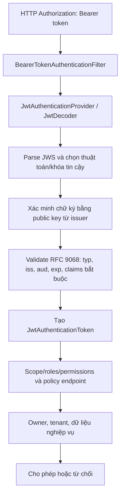
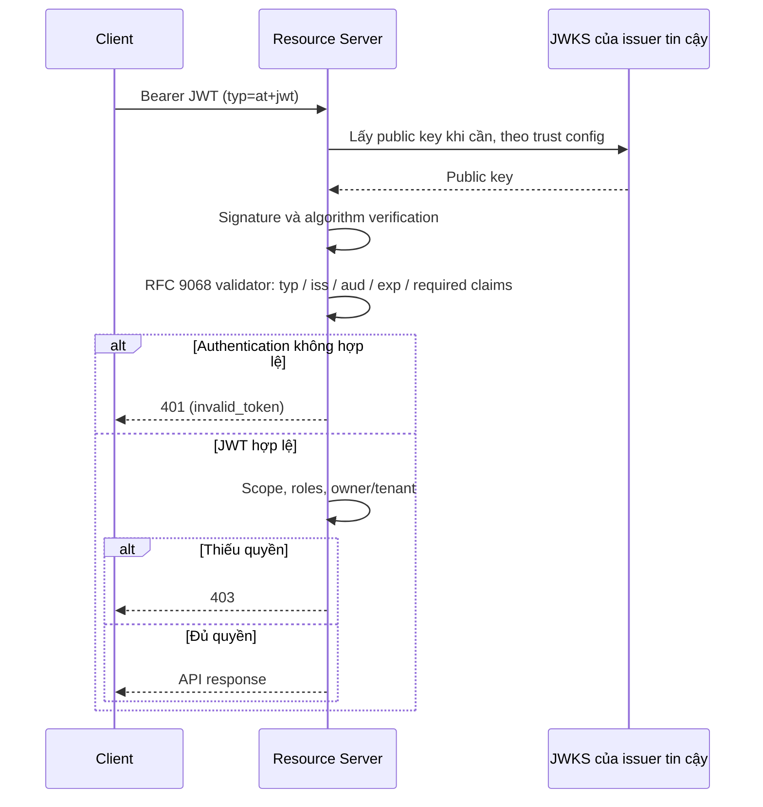

# Kiểm tra RFC 9068 theo phạm vi hỗ trợ của phiên bản Spring Security

Trong **Spring Security OAuth 2.0 / OIDC Resource Server**, việc cấu hình một JWT decoder có thể giúp API xác minh chữ ký, issuer và thời gian hiệu lực của access token. Nhưng **JWT hợp lệ về mặt mật mã chưa chắc là JWT access token tuân RFC 9068**. Một ID Token của OpenID Connect cũng có thể là JWT được ký bởi cùng Authorization Server, chứa `sub` và `exp`, nhưng có mục đích sử dụng hoàn toàn khác.

**RFC 9068 — JSON Web Token (JWT) Profile for OAuth 2.0 Access Tokens** xác định một hồ sơ chuẩn cho **JWT access token**, bao gồm dấu hiệu loại token trong JWS header (`typ`), một nhóm claim bắt buộc (`iss`, `sub`, `aud`, `exp`, `iat`, `jti`, `client_id`), quy tắc xác minh và cách diễn giải thông tin ủy quyền. Bên cạnh tiêu chuẩn, còn một câu hỏi thực dụng: **phiên bản Spring Security đang chạy có sẵn validator theo RFC 9068 hay cần tự tích hợp các điều kiện tương đương?**

Bài học hướng dẫn cách đọc yêu cầu của RFC 9068, phân biệt validation mặc định với validation theo hồ sơ, nhận diện thay đổi API theo phiên bản, xây dựng `JwtDecoder` phù hợp và thiết kế kiểm thử ngăn nhận nhầm ID Token, token sai audience hoặc token thiếu claim bắt buộc.

Các ví dụ minh họa API `orders-api` nhận JWT do issuer `https://login.example.test/realms/orders` phát hành. Chúng chỉ sử dụng URL, client ID và keys giả định, không phải credential sản xuất.

## 1. RFC 9068 là một hồ sơ access token, không phải định nghĩa của mọi JWT

OAuth 2.0 không bắt buộc access token có định dạng JWT. Có thể gặp:

- **Opaque access token**: Resource Server thường dùng introspection để lấy trạng thái và thông tin liên quan.
- **JWT access token theo profile riêng của IdP**: có thể dùng `azp`, `scp`, `realm_access` hoặc một kiểu header khác và không thỏa toàn bộ RFC 9068.
- **JWT access token tuân RFC 9068**: issuer cam kết có cấu trúc và quy tắc xác minh mà RFC 9068 định nghĩa.
- **OIDC ID Token**: JWT phục vụ OIDC client xác minh sự kiện xác thực của người dùng; **không phải Bearer access token dành cho API**.

Vì vậy, **không thể suy ra rằng chỉ cần một access token có ba đoạn phân tách bằng dấu chấm thì nó thuộc RFC 9068**. Đội tích hợp phải xác nhận nhà phát hành hỗ trợ profile nào và có thực sự phát hành token loại `at+jwt` hay không.

### 1.1. Luồng xác minh và điểm áp dụng profile



Quá trình chia làm ba lớp:

| Lớp | Nhiệm vụ | Nếu không đạt |
|---|---|---|
| **JOSE/JWS cryptography** | Chỉ chấp nhận thuật toán được phép, dùng public key tin cậy, xác minh chữ ký; `alg=none` không được phép. | Không có danh tính từ token, thường trả `401`. |
| **JWT access-token profile** | Xác minh đây thực sự là `at+jwt` theo RFC 9068, đúng issuer, audience, thời gian và các required claims. | Từ chối authentication, thường `401` / `invalid_token`. |
| **Authorization** | Diễn giải scope, role, client/tenant/owner và điều kiện của resource. | Token có thể hợp lệ nhưng bị `403`/`404` theo hợp đồng API. |

Một tập claim đầy đủ trong JSON chưa thể cấp quyền nếu chữ ký không hợp lệ; một JWT ký hợp lệ nhưng thiếu `client_id` hoặc sai `typ` cũng không đáp ứng hồ sơ RFC 9068.

## 2. Cấu trúc token mà RFC 9068 yêu cầu

RFC 9068 định nghĩa **JWT access token phải được ký**. Hồ sơ cho phép nhiều thuật toán ký phù hợp, khuyến nghị bất đối xứng vì giúp phân phối public verification key, và yêu cầu các implementation tuân profile hỗ trợ `RS256`. Điều này **không có nghĩa Resource Server phải bật mọi thuật toán**. Với mỗi issuer, chỉ chấp nhận những thuật toán thực tế được thỏa thuận và được thư viện hỗ trợ an toàn.

### 2.1. Header `typ` ngăn nhầm ID Token thành access token

Ví dụ JWS protected header:

```json
{
  "typ": "at+jwt",
  "alg": "RS256",
  "kid": "orders-signing-key-01"
}
```

RFC 9068 quy định access token mang kiểu `application/at+jwt`; biểu diễn header thường lược tiền tố `application/` thành `at+jwt`. Resource Server tuân profile phải chấp nhận hai kiểu tương ứng theo RFC và từ chối các kiểu khác.

| Header `typ` | Diễn giải cho Resource Server **chỉ nhận RFC 9068** |
|---|---|
| `at+jwt` | Loại token phù hợp về mặt header; tiếp tục xác minh. |
| `application/at+jwt` | Cách biểu diễn đầy đủ được RFC cho phép; tiếp tục xác minh. |
| `JWT` | Không đủ; có thể là ID Token hoặc JWT khác; từ chối theo profile. |
| Thiếu `typ` | Không đáp ứng RFC 9068; từ chối. |
| `JOSE`, `id_token` hoặc giá trị không được profile cho phép | Từ chối. |

**`typ` chỉ là bước phân loại**, không phải bằng chứng độc lập: kẻ tấn công có thể tự viết `"typ":"at+jwt"`, nhưng không thể tạo chữ ký hợp lệ với private key issuer tin cậy. Xác minh chữ ký và claims vẫn bắt buộc.

Một trường hợp rất quan trọng: OIDC client có thể nhận **ID Token** với `aud=web-client`, `typ=JWT` hoặc không có `typ`. Không được gửi ID Token đó tới API như Bearer access token, ngay cả khi ký bằng cùng khóa của issuer.

### 2.2. Các claims bắt buộc

RFC 9068, mục 2.2, yêu cầu các claims sau trong JWT access token:

| Claim | Yêu cầu | Ý nghĩa và kiểm tra |
|---|---|---|
| `iss` | **REQUIRED** | Issuer đã phát hành token; phải **khớp chính xác** identifier đã tin cậy. |
| `sub` | **REQUIRED** | Chủ thể của token; có thể là user hoặc service/client tùy grant. Không mặc định luôn là user. |
| `aud` | **REQUIRED** | Tài nguyên được phép nhận token; phải chứa identifier mà API mong đợi. |
| `exp` | **REQUIRED** | Thời điểm token hết hiệu lực, theo JWT NumericDate; cần kiểm tra thời gian hiện tại và skew nhỏ theo policy. |
| `client_id` | **REQUIRED** | OAuth client đã xin access token; không đồng nghĩa `sub` hay `aud`. |
| `iat` | **REQUIRED** | Thời điểm phát hành token; cần định dạng thời gian hợp lệ. |
| `jti` | **REQUIRED** | Định danh token giúp nhận diện duy nhất trong ngữ cảnh phù hợp. |

Lưu ý sự khác biệt giữa **claim có mặt** và **claim mang giá trị được API cho phép**. RFC yêu cầu `client_id` xuất hiện, nhưng API có thể có nhiều OAuth clients hợp lệ; việc chỉ cho phép một client ID cụ thể là **policy bổ sung**. Tương tự, `jti` tồn tại không đồng nghĩa server đã triển khai danh sách thu hồi token.

Một payload minh họa:

```json
{
  "iss": "https://login.example.test/realms/orders",
  "sub": "user-123",
  "aud": ["orders-api"],
  "exp": 1890003600,
  "iat": 1890000000,
  "jti": "token-id-8f65",
  "client_id": "web-portal",
  "scope": "orders:read"
}
```

Dữ liệu trên là JSON trước khi ký, **không phải access token hợp lệ**. `exp` và `iat` là NumericDate, thường biểu diễn giây từ Unix epoch. Khi Spring Security giải mã, các mốc thời gian thường được chuyển thành `Instant` và `aud` thành một tập chuỗi; cần tránh kiểm tra sai kiểu dữ liệu đã được decoder chuyển đổi.

### 2.3. Claims tùy chọn và các ràng buộc ngữ nghĩa

RFC 9068 còn mô tả:

- `scope` **SHOULD** xuất hiện nếu authorization request có scope; các scope trong token phải có nghĩa với resource được chỉ ra trong `aud`. Không đồng nhất “`scope` không bắt buộc tuyệt đối trong RFC” với “API phải cho qua khi thiếu scope”.
- `auth_time`, `acr`, `amr` có thể xuất hiện trong luồng có người dùng và có bối cảnh xác thực; không phải claims bắt buộc chung cho tất cả access token.
- `groups`, `roles`, `entitlements` có thể mang thông tin authorization; ý nghĩa cụ thể phải gắn với issuer và API.
- Claims riêng như `tenant_id`, `organization_id`, `permissions` được hiểu theo hợp đồng với issuer; không phải mọi tên claim tự động mang cùng ý nghĩa giữa các nhà cung cấp.
- `azp` là claim có nghĩa chuẩn hóa trong **OIDC ID Token**. Một số IdP đưa nó vào access token, nhưng **không dùng `azp` thay `client_id` mặc định** khi tuyên bố tuân RFC 9068.

Bảo đảm profile chưa đủ để quyết định owner/tenant. Ví dụ token hợp lệ có `scope=orders:read` vẫn không được xem đơn hàng của người khác nếu ứng dụng yêu cầu kiểm tra quyền sở hữu.

## 3. Chính xác Resource Server phải xác minh những gì?

Theo RFC 9068, mục 4, Resource Server cần kiểm tra tối thiểu:

1. `typ` là loại access token được chuẩn cho phép.
2. Nếu token được mã hóa theo thỏa thuận, phải giải mã với khóa/thuật toán thích hợp; nếu encryption đã được yêu cầu mà token đến không mã hóa, có quy tắc từ chối theo thỏa thuận.
3. `iss` phải khớp chính xác Authorization Server tin cậy.
4. `aud` phải có identifier của Resource Server đang xử lý request.
5. Chữ ký phải hợp lệ theo JWS và khóa do Authorization Server tin cậy cung cấp; `alg=none` không được chấp nhận.
6. Thời gian hiện tại phải trước `exp`, với clock skew nhỏ nếu policy cho phép.
7. Các trường bắt buộc của profile phải tồn tại với kiểu dữ liệu hợp lệ và phải được diễn giải nhất quán.



**Thứ tự logic quan trọng:** không xây dựng principal và authorities từ JWT chưa vượt qua signature verification và các validator chính. Client không được quyết định JWKS URL hay thuật toán được chấp nhận qua header/parameter chưa tin cậy.

### 3.1. `sub` và `client_id` theo loại grant

Hai ví dụ:

| Luồng | `sub` thường biểu diễn | `client_id` biểu diễn |
|---|---|---|
| Authorization Code + PKCE | Người dùng/resource owner như `user-123`. | Frontend/mobile client `web-portal` đã xin token. |
| Client Credentials | Một định danh ứng dụng/dịch vụ do issuer quy định. | Client `batch-importer` đã xin token. |

Không yêu cầu `sub == client_id` trong mọi grant. Cũng không dùng `sub` làm client ID fallback nếu token thiếu `client_id`. Khi token bị thiếu claim bắt buộc, nó không đạt hồ sơ RFC 9068 và phải bị từ chối theo chính sách strict.

### 3.2. JWT ký đúng nhưng dành cho resource khác

Giả sử token:

```json
{
  "iss": "https://login.example.test/realms/orders",
  "sub": "user-123",
  "aud": ["billing-api"],
  "client_id": "web-portal",
  "scope": "orders:read"
}
```

Dù chữ ký đúng và issuer giống nhau, `orders-api` vẫn phải từ chối, vì `aud` không bao gồm `orders-api`. Không lấy việc scope có chữ `orders` để suy ra audience.

### 3.3. Thời hạn và claim bắt buộc bị thiếu

Thư viện phổ biến có `JwtTimestampValidator` xử lý `exp`/`nbf` khi các trường tồn tại và theo chính sách của nó. **Đừng nhầm việc kiểm tra timestamp với việc chứng minh mọi claim REQUIRED của RFC 9068 luôn xuất hiện.** Hồ sơ yêu cầu `exp`, `iat`, `jti`; token thiếu chúng cần bị từ chối bởi validation profile thích hợp.

`nbf` không nằm trong danh sách 7 required claims của RFC 9068, nhưng nếu nó xuất hiện, Resource Server phải diễn giải đúng theo JWT/time policy. `iat` là thời điểm phát hành, không thay thế `nbf` hay `exp`. Có thể bổ sung policy “token không được có `iat` quá xa trong tương lai” theo hợp đồng, nhưng cần phân biệt đó là chính sách bổ sung thay vì tự gán thành yêu cầu nguyên văn của RFC 9068.

## 4. Phạm vi hỗ trợ RFC 9068 theo phiên bản Spring Security

Điểm dễ sai nhất khi học qua tài liệu ở các thời điểm khác nhau là **sao chép code ví dụ của Spring Security mới vào dự án đang chạy thư viện cũ**. Tên method và vị trí xử lý `typ` đã thay đổi.

| Nhánh phiên bản | Cơ chế cần chú ý | Cách triển khai |
|---|---|---|
| **Spring Security trước 6.5**, ví dụ một dự án 6.3/6.4 | **Chưa có** factory `JwtValidators.createAtJwtValidator()` được giới thiệu từ 6.5. JOSE type verification có hành vi khác nhau tùy decoder/cấu hình. | Dùng validator tùy chỉnh cho claims và cấu hình JOSE type handling phù hợp **phiên bản thực tế**; hoặc nâng lên bản có hỗ trợ nếu phù hợp. |
| **Spring Security 6.5.x** | Có `JwtValidators.createAtJwtValidator()` và `JwtValidators.AtJwtBuilder`, được đánh dấu `@since 6.5` trong API. Builder hỗ trợ `issuer(...)`, `audience(...)`, `clientId(...)`, `validators(...)`. | Có thể dùng built-in RFC 9068 validator. Với `NimbusJwtDecoder` cần chuyển trách nhiệm kiểm tra `typ` vào validator bằng API mà Javadoc đúng version cung cấp. |
| **Spring Security 7.x và phiên bản mới hơn** | Cơ chế/điểm mặc định xử lý `typ` và tên API builder có thể khác 6.5; hướng dẫn migration mô tả việc xử lý type ở tầng Spring validator. | Đọc Javadoc và migration guide của **đúng version**; giữ policy RFC 9068, không sao chép máy móc `validateType(s)` từ ví dụ khác phiên bản. |

**Các dữ kiện nên nhớ:**

- Trong Spring Security **6.5.6 Javadoc**, `createAtJwtValidator()` và `AtJwtBuilder` được đánh dấu “Since 6.5”.
- Trong **6.5.6 Javadoc** của `NimbusJwtDecoder.JwkSetUriJwtDecoderBuilder`, method là **`validateType(boolean)` (số ít)**, đánh dấu “Since 6.5”.
- Một số trang hướng dẫn/migration và bản mới dùng cách viết **`validateTypes(false)` (số nhiều)**; không xem hai chữ ký luôn thay thế nhau trên mọi dependency version.
- `JwtValidators.createAtJwtValidator().clientId("...")` ở built-in profile **kiểm tra một client ID được cấu hình**, phù hợp khi API chỉ chấp nhận một OAuth client. Nếu API chấp nhận nhiều client IDs, cần quyết định policy/validator tương ứng; RFC 9068 yêu cầu claim hiện diện nhưng không bắt buộc toàn hệ thống chỉ có một client.

**Không suy đoán Spring Security version từ việc dự án dùng Java 17, Spring Boot 3 hoặc nhìn vào tài liệu trực tuyến “current”.** Spring Boot quản lý dependency qua BOM, nhưng dependency override và starter version có thể thay đổi phiên bản cuối cùng. Hãy đọc dependency đã resolve.

### 4.1. Kiểm tra phiên bản trong Maven/Gradle

Với Maven:

```bash
./mvnw dependency:tree \
  -Dincludes=org.springframework.security:spring-security-oauth2-jose,org.springframework.security:spring-security-oauth2-resource-server
```

Với Gradle:

```bash
./gradlew dependencyInsight \
  --dependency spring-security-oauth2-jose \
  --configuration runtimeClasspath

./gradlew dependencyInsight \
  --dependency spring-security-oauth2-resource-server \
  --configuration runtimeClasspath
```

Các lệnh này là **hướng dẫn tra cứu khi triển khai**, không phải yêu cầu chạy task QA cho bài học. Điều cần xác định là phiên bản thực được resolve của `spring-security-oauth2-jose` và `spring-security-oauth2-resource-server`; kiểm tra thêm BOM override và sự đồng bộ dependency.

Nếu IDE báo không tìm thấy `createAtJwtValidator()`, đừng viết một class cùng tên rồi giả lập rằng đã có hỗ trợ chuẩn. Đối chiếu Javadoc của dependency đã resolve, dùng đường fallback có validator tương đương hoặc lên kế hoạch nâng phiên bản.

## 5. Spring Boot tối giản đang kiểm tra gì và chưa kiểm tra gì?

Cấu hình thường gặp:

```yaml
spring:
  security:
    oauth2:
      resourceserver:
        jwt:
          issuer-uri: https://login.example.test/realms/orders
          audiences:
            - orders-api
```

Khi khai báo như trên trong môi trường Spring Boot/Security tương ứng, JWT Resource Server có thể:

- Xác minh chữ ký bằng public key của issuer qua discovery/JWKS.
- Kiểm tra `iss` theo `issuer-uri`.
- Kiểm tra `exp`/`nbf` qua các validator timestamp mặc định.
- Kiểm tra `aud` nếu thuộc tính `audiences` được hỗ trợ và cấu hình đúng.
- Chuyển `scope`/`scp` thành `SCOPE_...` cho authorization.

**Chưa thể kết luận rằng cấu hình đó đã bắt buộc token phải là RFC 9068 `at+jwt`**, hoặc tự kiểm tra đầy đủ `sub`, `client_id`, `iat`, `jti` theo hồ sơ. Trong một số cấu hình, bước JOSE header handling mặc định còn có thể **từ chối `typ=at+jwt` vì đang mong `JWT`**, trước cả khi custom claim validator chạy.

Hệ quả: nếu API yêu cầu RFC 9068 strict, phải **kích hoạt validation profile rõ ràng**, không chỉ đặt `issuer-uri` và `audiences` rồi coi đã xong.

### 5.1. Cảnh báo “replace defaults” khi tự tạo decoder

Nếu bạn tự khai báo:

```java
@Bean
JwtDecoder jwtDecoder() {
    return NimbusJwtDecoder.withJwkSetUri(jwksUri).build();
}
```

Thì bean đó có thể thay thế auto-configuration `JwtDecoder` của Spring Boot. Không mặc định property `issuer-uri`/`audiences` từ YAML được “gộp” vào bean vừa tạo. Phải tự gọi `setJwtValidator(...)` với issuer, audience, thời gian và profile phù hợp, hoặc dùng builder/factory đã cấu hình đủ.

## 6. Spring Security 6.5: dùng built-in RFC 9068 validator

Ví dụ cho **Spring Security 6.5.x** và Servlet-based Resource Server, chỉ cho token đã được cấp cho `web-portal` gọi `orders-api`. Giả sử issuer thực sự phát hành token `at+jwt` theo RFC 9068.

### 6.1. Dependency

Sử dụng Spring Boot BOM/parent để quản lý version; tránh tự trộn bản Security không tương thích:

```xml
<dependencies>
    <dependency>
        <groupId>org.springframework.boot</groupId>
        <artifactId>spring-boot-starter-web</artifactId>
    </dependency>
    <dependency>
        <groupId>org.springframework.boot</groupId>
        <artifactId>spring-boot-starter-security</artifactId>
    </dependency>
    <dependency>
        <groupId>org.springframework.boot</groupId>
        <artifactId>spring-boot-starter-oauth2-resource-server</artifactId>
    </dependency>
    <dependency>
        <groupId>org.springframework.boot</groupId>
        <artifactId>spring-boot-starter-test</artifactId>
        <scope>test</scope>
    </dependency>
    <dependency>
        <groupId>org.springframework.security</groupId>
        <artifactId>spring-security-test</artifactId>
        <scope>test</scope>
    </dependency>
</dependencies>
```

### 6.2. Bean `JwtDecoder` với `createAtJwtValidator()`

Ở **Spring Security 6.5.x**, tham khảo chữ ký `validateType(boolean)` trong Javadoc của `NimbusJwtDecoder` builder cho JWKS URI:

```java
package com.example.orders.security;

import org.springframework.beans.factory.annotation.Value;
import org.springframework.context.annotation.Bean;
import org.springframework.context.annotation.Configuration;
import org.springframework.security.oauth2.jose.jws.SignatureAlgorithm;
import org.springframework.security.oauth2.jwt.JwtDecoder;
import org.springframework.security.oauth2.jwt.JwtValidators;
import org.springframework.security.oauth2.jwt.NimbusJwtDecoder;

@Configuration
public class Rfc9068JwtConfig {

    @Bean
    JwtDecoder jwtDecoder(
            @Value("${app.security.issuer}") String issuer,
            @Value("${app.security.jwks-uri}") String jwksUri,
            @Value("${app.security.audience}") String audience,
            @Value("${app.security.allowed-client-id}") String allowedClientId) {

        NimbusJwtDecoder decoder = NimbusJwtDecoder
            .withJwkSetUri(jwksUri)
            // Giới hạn thuật toán theo hợp đồng issuer.
            .jwsAlgorithm(SignatureAlgorithm.RS256)
            // 6.5 Javadoc: chuyển typ validation cho Spring validator.
            .validateType(false)
            .build();

        decoder.setJwtValidator(
            JwtValidators.createAtJwtValidator()
                .issuer(issuer)
                .audience(audience)
                .clientId(allowedClientId)
                .build()
        );

        return decoder;
    }
}
```

Với cấu hình:

```yaml
app:
  security:
    issuer: https://login.example.test/realms/orders
    jwks-uri: https://login.example.test/realms/orders/protocol/openid-connect/certs
    audience: orders-api
    allowed-client-id: web-portal
```

Các khóa `app.security.*` là **cấu hình ứng dụng tự định nghĩa**, không phải thuộc tính tự động của Spring Boot. URL JWKS phải được lấy từ metadata/issuer đáng tin cậy, cố định theo môi trường và truy cập bằng HTTPS; không lấy địa chỉ từ token header `jku`, `kid` hoặc request input chưa được tin.

**Vai trò của từng dòng quan trọng:**

1. `.withJwkSetUri(jwksUri)`: dùng keyset của issuer tin cậy để chọn public key và kiểm tra chữ ký JWS.
2. `.jwsAlgorithm(RS256)`: chỉ chấp nhận thuật toán ký đã được API thỏa thuận; không cho client tự bật `none` hay chuyển RSA sang HMAC.
3. `.validateType(false)`: tắt bước `typ` validation mặc định của Nimbus ở đường builder **trong 6.5**, để validator profile ở Spring xử lý kiểu `at+jwt`. **Không có nghĩa cho phép mọi `typ`** nếu validator RFC 9068 ở bước sau được giữ.
4. `JwtValidators.createAtJwtValidator()`: tạo bộ validator phục vụ token theo RFC 9068, gồm các quy tắc profile.
5. `.issuer(issuer)`, `.audience(audience)`, `.clientId(allowedClientId)`: ràng buộc chính xác các giá trị mà API tin cậy. Với ví dụ này, client phải là `web-portal`.
6. `.build()` và `decoder.setJwtValidator(...)`: áp dụng validation cho JWT đã được decoder giải mã và xác minh.

Nếu phiên bản bạn đang dùng **chỉ có `validateTypes(false)`**, phải theo **Javadoc của bản đó** thay vì đổi tùy ý tại runtime. Ngược lại, project 6.5 được resolve theo Javadoc `validateType(false)` có thể không compile đoạn lấy từ docs dùng tên số nhiều. Đây là chính xác lý do bài học yêu cầu **đối chiếu version trước khi sao chép**.

> **Ranh giới an toàn:** nếu tắt Nimbus `typ` check rồi quên thiết lập `createAtJwtValidator()` hoặc một validator type tương đương, API có nguy cơ nhận loại JWT khác với hợp đồng. Hai phần phải đi cùng nhau.

### 6.3. Cấu hình filter chain và quyền endpoint

```java
package com.example.orders.security;

import org.springframework.context.annotation.Bean;
import org.springframework.context.annotation.Configuration;
import org.springframework.http.HttpMethod;
import org.springframework.security.config.Customizer;
import org.springframework.security.config.annotation.web.builders.HttpSecurity;
import org.springframework.security.config.annotation.web.configurers.AbstractHttpConfigurer;
import org.springframework.security.config.http.SessionCreationPolicy;
import org.springframework.security.web.SecurityFilterChain;

@Configuration
class ApiSecurityConfig {
    @Bean
    SecurityFilterChain apiSecurity(HttpSecurity http) throws Exception {
        return http
            // Chỉ dành cho API stateless dùng Bearer trong Authorization header.
            .csrf(AbstractHttpConfigurer::disable)
            .sessionManagement(session ->
                session.sessionCreationPolicy(SessionCreationPolicy.STATELESS))
            .authorizeHttpRequests(auth -> auth
                .requestMatchers(HttpMethod.GET, "/api/public/ping")
                    .permitAll()
                .requestMatchers(HttpMethod.GET, "/api/orders/**")
                    .hasAuthority("SCOPE_orders:read")
                .anyRequest().denyAll())
            .oauth2ResourceServer(oauth ->
                oauth.jwt(Customizer.withDefaults()))
            .build();
    }
}
```

Tắt CSRF như trên chỉ là lựa chọn cho API stateless dùng Bearer header, không dùng chung cho web app xác thực bằng cookie mà không đánh giá riêng.

Sau khi token vượt qua profile validation, `scope` thường được ánh xạ thành authorities có tiền tố `SCOPE_`. `JwtDecoder` không tự cấp quyền đọc mọi đơn: quyền trên tài nguyên cụ thể, tenant và owner phải được kiểm tra ở service hoặc phương thức bảo vệ phù hợp.

### 6.4. Chính sách nhiều OAuth clients hợp lệ

`JwtValidators.AtJwtBuilder` yêu cầu cấu hình `clientId(...)`, tức một giá trị client ID mục tiêu theo contract. Nhưng một API có thể phục vụ:

- `web-portal` qua Authorization Code.
- `mobile-app` qua Authorization Code + PKCE.
- `partner-batch` qua Client Credentials với phạm vi quyền hạn riêng.

Trong trường hợp đó, **RFC 9068 vẫn yêu cầu `client_id` hiện diện**, nhưng không quy định chỉ một giá trị. Có thể thiết kế một validator tùy chỉnh để kiểm tra `client_id` là string hợp lệ trong danh sách tin cậy, hoặc thay thế validator `client_id` trong builder bằng `validators(...)` của Spring Security 6.5. Đồng thời, có thể tách policy “client nào được gọi endpoint nào” sang authorization.

Một ví dụ riêng biệt về **nguyên tắc validator client ID**:

```java
import java.util.Set;
import org.springframework.security.oauth2.core.OAuth2Error;
import org.springframework.security.oauth2.core.OAuth2TokenValidator;
import org.springframework.security.oauth2.core.OAuth2TokenValidatorResult;
import org.springframework.security.oauth2.jwt.Jwt;

final class ClientIdPolicies {

    static OAuth2TokenValidator<Jwt> allowedClients(Set<String> allowed) {
        return jwt -> {
            Object raw = jwt.getClaims().get("client_id");
            if (raw instanceof String clientId
                    && !clientId.isBlank()
                    && allowed.contains(clientId)) {
                return OAuth2TokenValidatorResult.success();
            }
            return OAuth2TokenValidatorResult.failure(
                new OAuth2Error(
                    "invalid_token",
                    "client_id is missing or not allowed",
                    null));
        };
    }
}
```

Để tích hợp validator này với `AtJwtBuilder` trong version có `validators(...)`, phải bảo đảm **thay đúng validator của trường `client_id` mà vẫn giữ các validator RFC 9068 còn lại**, không gỡ toàn bộ mặc định. Một cấu trúc minh họa:

```java
// Spring Security 6.5.x: thêm vào dòng build của validator profile.
OAuth2TokenValidator<Jwt> atProfile = JwtValidators.createAtJwtValidator()
    .issuer(issuer)
    .audience(audience)
    .clientId("placeholder-only-for-builder")
    .validators(v -> v.put(
        "client_id",
        ClientIdPolicies.allowedClients(
            Set.of("web-portal", "mobile-app", "partner-batch"))))
    .build();
```

`"placeholder-only-for-builder"` là một giá trị chỉ phục vụ việc cấu hình builder trước khi thay validator `client_id`; **không** phải một client hợp lệ thực tế và không được dựa vào nó trong authorization. Khi dùng kỹ thuật thay validator, kiểm tra contract API chính xác trong version và test cả token được chấp nhận/bị từ chối. Với nhiều issuer, danh sách client ID phải được namespace theo issuer và profile.

Một lựa chọn khác dễ quản lý hơn là **một decoder/profile validator cho các điều kiện chung**, tiếp đó policy riêng của endpoint yêu cầu client ID cụ thể. Tuy nhiên không được bỏ bước **`client_id` bắt buộc theo RFC 9068** chỉ vì định thực hiện phân quyền client ở tầng sau.

## 7. Phiên bản trước 6.5: kiểm tra tương đương mà không giả định có factory

Trong các bản Spring Security cũ hơn, API `JwtValidators.createAtJwtValidator()` có thể không tồn tại. Điều này không làm yêu cầu bảo mật biến mất; thay vào đó phải **tự cấu hình các validator tương ứng** hoặc nâng cấp dependency đã được kiểm thử.

### 7.1. Hai tầng phải xử lý riêng

**Tầng A — JOSE type verification và chữ ký.** Decoder Nimbus trên một số phiên bản mặc định kiểm tra `typ` với giả định JWT thông thường. Nếu issuer phát hành `typ=at+jwt`, token có thể bị từ chối **trước khi `OAuth2TokenValidator` nhận được một `Jwt`**. Khi ấy phải cấu hình JOSE type verifier ở Nimbus theo API của phiên bản để chấp nhận **chính xác các giá trị `at+jwt` phù hợp**, vẫn giới hạn algorithm và key source.

**Tầng B — Claim/profile validation.** Sau khi decoder đã xác minh JWS, kiểm tra issuer, audience, thời hạn và các required claims; nếu `typ` chưa được chặn ở JOSE layer, phải kiểm tra kiểu trong một validator đáng tin cậy trước khi xây dựng Authentication.

Đừng thay tầng A bằng cách “parse raw token rồi xem `typ` bằng Base64URL trong controller”. Mọi yêu cầu authorization phải dựa trên token đã qua decoder tin cậy.

### 7.2. Custom validator cho các required claims

Đây là ví dụ **có thể tái sử dụng về mặt ý tưởng** ở các version đã hỗ trợ `OAuth2TokenValidator<Jwt>`. Nó kiểm tra bổ sung sự hiện diện/kiểu của `sub`, `client_id`, `jti`, `iat` và `exp` sau khi parser đã chuyển đổi claims. **Nó không thay thế signature, issuer, audience, time hoặc type validator**.

```java
package com.example.orders.security;

import java.time.Instant;

import org.springframework.security.oauth2.core.OAuth2Error;
import org.springframework.security.oauth2.core.OAuth2TokenValidator;
import org.springframework.security.oauth2.core.OAuth2TokenValidatorResult;
import org.springframework.security.oauth2.jwt.Jwt;

public final class RequiredAtClaimsValidator
        implements OAuth2TokenValidator<Jwt> {

    @Override
    public OAuth2TokenValidatorResult validate(Jwt jwt) {
        if (!nonBlankString(jwt.getClaims().get("sub"))
            || !nonBlankString(jwt.getClaims().get("client_id"))
            || !nonBlankString(jwt.getClaims().get("jti"))
            || !(jwt.getClaims().get("iat") instanceof Instant)
            || !(jwt.getClaims().get("exp") instanceof Instant)
            || jwt.getAudience() == null
            || jwt.getAudience().isEmpty()
            || !nonBlankString(jwt.getClaims().get("iss"))) {

            return OAuth2TokenValidatorResult.failure(
                new OAuth2Error(
                    "invalid_token",
                    "Missing or malformed RFC 9068 claim",
                    null));
        }

        return OAuth2TokenValidatorResult.success();
    }

    private static boolean nonBlankString(Object value) {
        return value instanceof String s && !s.isBlank();
    }
}
```

Spring/Nimbus có thể chuyển `iss` thành `String`, `exp`/`iat` thành `Instant`, `aud` thành `List<String>` theo claim mapping mặc định. Khi dùng custom claim-set converter, cần thống nhất lại các kiểu. Không chuyển mọi Object qua `toString()` rồi coi là hợp lệ; dữ liệu array/object ở nơi cần string phải bị từ chối theo schema.

Một cấu hình validator claims với issuer/audience và thời gian (giả sử decoder đã xử lý JWS và `typ` đúng ở JOSE layer):

```java
import org.springframework.security.oauth2.core.DelegatingOAuth2TokenValidator;
import org.springframework.security.oauth2.core.OAuth2Error;
import org.springframework.security.oauth2.core.OAuth2TokenValidator;
import org.springframework.security.oauth2.core.OAuth2TokenValidatorResult;
import org.springframework.security.oauth2.jwt.Jwt;
import org.springframework.security.oauth2.jwt.JwtValidators;

// Đoạn minh họa cách ghép validator sau khi đã tạo decoder phù hợp.
OAuth2TokenValidator<Jwt> audienceValidator = jwt ->
    jwt.getAudience().contains("orders-api")
        ? OAuth2TokenValidatorResult.success()
        : OAuth2TokenValidatorResult.failure(
            new OAuth2Error(
                "invalid_token", "Wrong audience", null));

decoder.setJwtValidator(
    new DelegatingOAuth2TokenValidator<>(
        JwtValidators.createDefaultWithIssuer(
            "https://login.example.test/realms/orders"),
        audienceValidator,
        new RequiredAtClaimsValidator()
    )
);
```

**Giới hạn của ví dụ:** một validator có `createDefaultWithIssuer(...)` trong phiên bản cũ có thể gắn với kiểu JWT mặc định ở Nimbus; để xử lý `at+jwt` đúng, cần cấu hình JOSE typ verifier tương ứng và test signed token end-to-end. Đừng chỉ test phương thức `validate(Jwt)` rồi kết luận hệ thống đã nhận được `at+jwt` khi decoder thực tế còn từ chối ở bước parse/type.

### 7.3. Hướng xử lý JOSE type ở bản cũ

Nếu Javadoc của phiên bản cho phép `jwtProcessorCustomizer(...)` trên `NimbusJwtDecoder` builder, có thể điều chỉnh **Nimbus JOSE type verifier** để cho phép đúng loại token RFC 9068; mã minh họa với API Nimbus thường gặp:

```java
import com.nimbusds.jose.JOSEObjectType;
import com.nimbusds.jose.proc.DefaultJOSEObjectTypeVerifier;
import com.nimbusds.jose.proc.SecurityContext;
import org.springframework.security.oauth2.jwt.NimbusJwtDecoder;

// Với bản cũ: đối chiếu API Nimbus JOSE + JWT thực tế khi tích hợp.
NimbusJwtDecoder decoder = NimbusJwtDecoder.withJwkSetUri(jwksUri)
    .jwtProcessorCustomizer(processor ->
        processor.setJWSTypeVerifier(
            new DefaultJOSEObjectTypeVerifier<SecurityContext>(
                new JOSEObjectType("at+jwt"),
                new JOSEObjectType("application/at+jwt"))))
    .build();
```

Mã trên chỉ thể hiện cách giới hạn type ở **Nimbus processor**; bạn vẫn phải ghép validators issuer/audience/time/required claims và bảo đảm thuật toán/key source được cố định. Tính tương thích của `jwtProcessorCustomizer`, `DefaultJOSEObjectTypeVerifier` và generics phụ thuộc phiên bản Nimbus trong dependency thực tế, nên cần dùng Javadoc và biên dịch trong project khi triển khai.

**Không** thay ví dụ bằng một verifier “accept any `typ`” hoặc `setJWSTypeVerifier((type, context) -> {})` chỉ để vượt lỗi. Nếu tắt type verification mà chưa có validator bảo đảm token là `at+jwt`, API có thể chấp nhận token sai mục đích.

### 7.4. Khi nào nên nâng phiên bản?

Nên cân nhắc nâng Spring Security khi:

- Hệ thống yêu cầu áp dụng RFC 9068 chuẩn, nhưng mã cũ có quá nhiều custom JOSE/type validators khó duy trì.
- Version đang chạy không có API type validation cần thiết, khiến tích hợp phức tạp hoặc khó đảm bảo tương thích.
- Có lỗ hổng/bản vá security đang được nhà cung cấp khuyến nghị.
- Tổ chức muốn giảm số custom parser/decoder để dễ review bảo mật.

Tuy nhiên nâng version không tự biến access token của IdP thành `at+jwt`. Cần kiểm tra **issuer thực tế phát hành claim/header nào**, điều chỉnh client registration/hồ sơ token, và test trước khi bật chính sách strict. Không vô hiệu hóa kiểm tra để “qua migration”.

## 8. Sự khác biệt giữa kiểm tra bắt buộc và chính sách bổ sung

Có hai loại điều kiện:

**Điều kiện của RFC 9068 profile:** token phải được ký, `typ` đúng, có các required claims, issuer/audience/time phải đạt, thuật toán và key từ nguồn tin cậy.

**Điều kiện của sản phẩm:** client ID nằm trong allowlist, scope cho phép endpoint, tenant được cấp phép, user sở hữu đơn, token không đến từ thiết bị bị khóa hoặc phải có mức xác thực `acr` cụ thể.

Ví dụ một token hợp lệ theo RFC 9068:

```json
{
  "iss": "https://login.example.test/realms/orders",
  "sub": "alice",
  "aud": ["orders-api"],
  "exp": 1890003600,
  "iat": 1890000000,
  "jti": "tok-123",
  "client_id": "mobile-app",
  "scope": "orders:read"
}
```

Nếu endpoint chỉ cho client `web-portal`, token này có thể **đúng profile** nhưng **không được phép gọi endpoint**, vì client không thuộc policy. Trong một thiết kế, ràng buộc client ID nằm ngay trong `AtJwtBuilder` sẽ từ chối ở authentication. Trong một thiết kế khác, profile chỉ yêu cầu `client_id` hợp lệ và xét allowlist ở authorization. Cả hai phải được mô tả rõ để phân biệt `401` (token không đáp ứng hợp đồng mà API nhận) với `403` (token hợp lệ nhưng thiếu quyền cho tác vụ).

### 8.1. Tránh biến `scope` thành toàn bộ quyết định

Với Spring Security:

```java
.authorizeHttpRequests(auth -> auth
    .requestMatchers("/api/orders/**")
        .hasAuthority("SCOPE_orders:read")
    .anyRequest().denyAll()
)
```

Dòng `SCOPE_orders:read` nói rằng token đã xác minh chứa quyền thao tác thuộc scope này. Nó không tự xác minh resource owner hoặc tenant. Cần kiểm tra:

```text
issuer/audience/profile/signature/time
    AND scope=orders:read
    AND (iss, sub) thuộc user được phép
    AND owner/tenant của bản ghi khớp policy
```

Đừng dùng `client_id` hay `azp` như bằng chứng user sở hữu dữ liệu. Chúng chỉ liên quan đến OAuth client theo hồ sơ, không thay thế `sub` và dữ liệu nghiệp vụ.

### 8.2. ID Token có thể qua nhiều điều kiện chung nhưng vẫn sai mục đích

ID Token thường chứa `iss`, `sub`, `aud`, `iat`, `exp`, và được ký bằng khóa của cùng issuer. Nếu API chỉ kiểm tra chữ ký/issuer, ID Token có thể trông rất giống access token.

Sự khác biệt cần được bảo vệ:

| Tiêu chí | JWT access token RFC 9068 | OIDC ID Token |
|---|---|---|
| Mục đích | OAuth access tới resource/API. | Thông tin về quá trình xác thực cho OIDC client. |
| `typ` | `at+jwt` hoặc `application/at+jwt`. | Có thể `JWT` hoặc một giá trị khác theo OIDC/JOSE profile. |
| `aud` | Resource Server/API. | OAuth/OIDC client nhận ID Token. |
| `client_id` | Required theo RFC 9068. | Không phải required claim phổ quát của ID Token. |
| `azp` | Không thay thế `client_id` của RFC 9068. | Có ý nghĩa OIDC authorized party trong những trường hợp áp dụng. |
| Cách dùng | Trong `Authorization: Bearer access_token`. | OIDC client xác minh khi đăng nhập; không gửi như Bearer access token. |

Kiểm tra `typ` và `aud` cùng nhau giúp chống **cross-JWT confusion**. Trong hệ đa resource, không tái sử dụng audience không rõ ràng như một chuỗi chung cho mọi ứng dụng và API nếu điều đó cho phép token bị dùng sai nơi.

## 9. Kiểm thử RFC 9068 theo phiên bản và từng tầng

Một bài test chỉ kiểm tra `jwt.getClaim("client_id")` không chứng minh decoder đã xác minh chữ ký hoặc đúng loại token. Cần chia test:

1. **Validator unit tests**: đầu vào `Jwt` có headers/claims tạo trong bộ nhớ để kiểm tra logic của `AtJwtBuilder` hoặc validator tùy chỉnh.
2. **Decoder tests**: ký JWT thật bằng private key test, cung cấp public key hoặc mock JWKS, gọi `JwtDecoder.decode(token)` để kiểm tra JOSE/type/profile.
3. **HTTP security tests**: đi qua `SecurityFilterChain` để xác nhận invalid token thành `401` và token hợp lệ nhưng thiếu quyền thành `403`.
4. **IdP integration tests**: lấy access token từ Authorization Server staging, xác nhận headers/claims do IdP thực sự cấp cho từng grant.

### 9.1. Ma trận đầu vào quan trọng

| Trường hợp | Kết luận mong đợi với API chỉ nhận RFC 9068 |
|---|---|
| `typ=at+jwt`, chữ ký/`iss`/`aud`/required claims hợp lệ | Có thể authentication thành công; tiếp tục authorization. |
| `typ=application/at+jwt`, các điều kiện khác hợp lệ | Có thể authentication thành công theo RFC. |
| `typ=JWT` hoặc thiếu `typ` | Từ chối. |
| Access token có `typ=at+jwt` nhưng chữ ký sai | Từ chối. |
| `alg=none` | Từ chối. |
| Token từ issuer khác dù cùng cấu trúc | Từ chối. |
| `aud` không chứa `orders-api` | Từ chối. |
| Thiếu `exp` | Từ chối vì required claim. |
| `exp` đã hết hạn | Từ chối vì thời hạn. |
| Thiếu `iat`, `jti`, `sub` hoặc `client_id` | Từ chối theo profile. |
| `client_id` là object/array thay vì string | Từ chối vì schema/validator. |
| Token có `azp` nhưng thiếu `client_id` | Từ chối; không fallback sang `azp`. |
| Client Credentials có `sub` khác `client_id` | **Không tự từ chối chỉ vì hai trường khác nhau**, nếu issuer/contract cho phép. |
| Token hợp lệ nhưng thiếu `orders:read` | Authentication có thể thành công, authorization từ chối. |
| Token hợp lệ, có scope nhưng không sở hữu đơn | Authorization nghiệp vụ từ chối. |
| OIDC ID Token từ cùng issuer | Từ chối vì sai loại token/audience/profile. |

Nếu API dùng built-in builder với `.clientId("web-portal")`, một token mang `client_id="mobile-app"` sẽ bị từ chối **ngay trong profile validator được cấu hình**. Nếu ứng dụng muốn chấp nhận nhiều client IDs nhưng hạn chế theo endpoint, cần thiết kế validator khác và test đường `403` tương ứng.

### 9.2. Unit test validator với `Jwt.withTokenValue`

Ví dụ kiểm tra logic độc lập với HTTP/JWKS, theo Spring Security 6.5 và một client ID cố định:

```java
package com.example.orders.security;

import static org.junit.jupiter.api.Assertions.assertTrue;

import java.time.Instant;
import java.util.List;

import org.junit.jupiter.api.Test;
import org.springframework.security.oauth2.core.OAuth2TokenValidator;
import org.springframework.security.oauth2.jwt.Jwt;
import org.springframework.security.oauth2.jwt.JwtValidators;

class AtJwtProfileValidatorTest {
    private final String issuer =
        "https://login.example.test/realms/orders";

    private final OAuth2TokenValidator<Jwt> validator =
        JwtValidators.createAtJwtValidator()
            .issuer(issuer)
            .audience("orders-api")
            .clientId("web-portal")
            .build();

    @Test
    void validProfileClaimsAreAccepted() {
        Jwt jwt = jwtWithType("at+jwt", true, true);
        assertTrue(validator.validate(jwt).hasErrors() == false);
    }

    @Test
    void wrongTokenTypeIsRejected() {
        Jwt jwt = jwtWithType("JWT", true, true);
        assertTrue(validator.validate(jwt).hasErrors());
    }

    @Test
    void missingClientIdIsRejected() {
        Jwt jwt = jwtWithType("at+jwt", false, true);
        assertTrue(validator.validate(jwt).hasErrors());
    }

    @Test
    void wrongAudienceIsRejected() {
        Jwt jwt = jwtWithType("at+jwt", true, false);
        assertTrue(validator.validate(jwt).hasErrors());
    }

    private Jwt jwtWithType(
        String typ,
        boolean hasClientId,
        boolean properAudience
    ) {
        Instant now = Instant.now();

        Jwt.Builder builder = Jwt.withTokenValue("unit-test-token")
            .header("alg", "RS256")
            .header("typ", typ)
            .issuer(issuer)
            .subject("user-123")
            .audience(
                properAudience
                    ? List.of("orders-api")
                    : List.of("other-api"))
            .issuedAt(now)
            .expiresAt(now.plusSeconds(300))
            .id("unit-test-jti");

        if (hasClientId) {
            builder.claim("client_id", "web-portal");
        }

        return builder.build();
    }
}
```

Bài unit test này **không xác minh signature**, vì `Jwt.withTokenValue(...)` tạo một đối tượng claim đã parse trong bộ nhớ. Nó chỉ kiểm tra hành vi của validator. Để chứng minh `typ` được Nimbus cho qua đúng tầng, cần test `JwtDecoder.decode(...)` với token ký thật ở phần sau.

### 9.3. Decoder test: token ký thật bằng keypair test

Trong test, sinh RSA keypair mô phỏng issuer (không dùng private key production) và dùng Nimbus JOSE/JWT để ký một access token thử nghiệm. Decoder được cấu hình dùng `publicKey` hoặc mock JWKS tin cậy.

Luồng test:

```text
privateTestKey
    -> ký header typ=at+jwt, alg=RS256 + claims RFC 9068
    -> JWS Compact
    -> JwtDecoder dùng publicTestKey
    -> kiểm tra chữ ký rồi kiểm tra profile
```

Nên có tối thiểu ba cặp thử nghiệm:

1. Token `typ=at+jwt` được ký bằng private key test → decode thành công khi mọi claim và audience đúng.
2. Cùng claims nhưng `typ=JWT` và chữ ký mới hợp lệ → **không** được chấp nhận vào API strict.
3. Token có `typ=at+jwt`, chữ ký không hợp lệ hoặc `aud=other-api` → bị từ chối.

Nếu chỉ sửa phần Base64URL của token đã ký, test sẽ chủ yếu chứng minh **chữ ký bị phá**, không cô lập được validator `typ`. Để test chính xác phân loại token, hãy tạo lại **token ký hợp lệ** với `typ` khác nhau rồi đưa vào cùng decoder.

### 9.4. MockMvc test và giới hạn của `jwt()`

`spring-security-test` cung cấp `jwt()` để gắn principal giả đã xác thực:

```java
mvc.perform(get("/api/orders/42")
        .with(jwt().authorities(
            new SimpleGrantedAuthority("SCOPE_orders:read"))))
   .andExpect(status().isOk());
```

Ví dụ chỉ hợp lý nếu controller test có endpoint trả 200 và không áp điều kiện owner khác. **`jwt()` thường bỏ qua decoder thực tế**, nên nó không thể chứng minh chữ ký, `typ`, audience hay các required claims của RFC 9068 đã được xác minh. Dùng nó để test **authorization**, không dùng làm bằng chứng hồ sơ token đã được bảo vệ.

### 9.5. Chứng minh HTTP status đúng

| Trường hợp | Tầng lỗi | Kết quả thường gặp |
|---|---|---|
| Không có Bearer token ở endpoint bắt buộc | Authentication chưa có | `401 Unauthorized`. |
| Chữ ký sai, `typ` sai, required claims thiếu, issuer/audience sai | JWT authentication/validation | `401`, có thể kèm Bearer `invalid_token` theo xử lý lỗi. |
| JWT hợp lệ theo profile nhưng thiếu scope `orders:read` | Authorization | `403 Forbidden`. |
| JWT hợp lệ nhưng không sở hữu tài nguyên | Business authorization | `403` hoặc `404` theo hợp đồng API. |
| JWKS endpoint không truy cập được và không có trusted key để xác minh | Dependency/key-fetch failure | **Không cho qua**; mã cụ thể tùy exception handling và chính sách API. |

Đừng biến lỗi xác minh token thành `200` bằng cách tạm tắt filter. Cũng đừng trả nguyên JWT hoặc nội dung private key/client secret trong `WWW-Authenticate`, log hay response.

## 10. Ranh giới với OIDC, multi-issuer và opaque token

### 10.1. OIDC không đồng nghĩa RFC 9068

Một OIDC Provider có thể phát hành ID Token chuẩn OIDC nhưng access token ở dạng **opaque** hoặc JWT theo vendor profile, không phải RFC 9068. Cấu hình `issuer-uri` của Resource Server không tự ép provider phải thay đổi định dạng token.

Nếu provider chưa hỗ trợ `at+jwt`, ba hướng triển khai hợp lệ:

1. Yêu cầu provider cấu hình phát hành access token theo RFC 9068 nếu có tính năng tương ứng.
2. Chấp nhận **vendor-specific JWT access token** với một profile validation riêng, tách biệt, không tuyên bố nó tuân RFC 9068.
3. Dùng opaque token introspection theo hợp đồng AS/API nếu định dạng token không cho phép tự xác minh theo JWT profile.

Không đưa code “nếu `typ=JWT` thì cứ coi là access token” vào cùng strict RFC 9068 validator; cách làm này có thể tạo đường token substitution từ ID Token.

### 10.2. Multi-issuer và profile selection

Nếu API tin nhiều issuer, **không** nên đọc raw `iss` của JWT chưa xác minh rồi tự tin mọi metadata/JWKS URL do nó chỉ định. Bộ resolver phải giới hạn issuer vào **allowlist đã cấu hình**, gắn mỗi issuer với trust keyset, thuật toán, token profile và validators riêng.

Ví dụ:

| Issuer | Token profile | Validation |
|---|---|---|
| `issuer-A` | JWT access token RFC 9068 | `typ=at+jwt`, required claims, audience API và client policy A. |
| `issuer-B` | JWT access token vendor | Header/claims theo contract B, không mặc định RFC 9068. |
| `issuer-C` | Opaque token | Introspection từ AS C, kiểm tra `active` và quyền theo policy C. |

Không hợp nhất tất cả keys vào một keyset rồi cho mọi issuer dùng chung để xác minh, cũng không fallback từ strict validation A sang weak validation B chỉ vì một token bị lỗi.

### 10.3. Token exchange và đa client

Trong Token Exchange, claim `sub`, `client_id` và `act` có thể mang các vai trò khác nhau. RFC 9068 vẫn yêu cầu `client_id` nhưng **không yêu cầu `sub == client_id`**. Nếu Resource Server có policy dựa trên client ID hoặc actor, phải viết thành hợp đồng riêng với issuer, không suy ra từ tên claim.

## 11. Lộ trình nâng cấp và bảo vệ tương thích

Khi một API đang chạy Spring Security cũ và muốn thực thi RFC 9068 strict, nên chuẩn bị theo thứ tự:

**Bước 1 — Xác nhận phát hành.** Thu thập token **thử nghiệm** từ Authorization Server staging, xem header `typ`, các required claims, issuer, audience, thuật toán và client ID. Không dán token thật lên dịch vụ decode công cộng hay ticket.

**Bước 2 — Xác nhận dependency.** Kiểm tra resolved Spring Security version và Javadoc đúng version. Xác định có `createAtJwtValidator()` và method `validateType(...)` hay `validateTypes(...)` hay không.

**Bước 3 — Chốt policy.** API chấp nhận một hay nhiều `client_id`; audience nào; grant nào; loại token nào? Phân biệt profile validation và endpoint authorization.

**Bước 4 — Tạo decoder phù hợp.** Spring 6.5+ có thể dùng built-in `AtJwtBuilder`; version cũ cần JOSE type verifier và các custom claim validators tương đương. Tất cả phải bảo đảm chữ ký/issuer/audience/time.

**Bước 5 — Kiểm thử âm tính.** Đặc biệt: ID Token từ cùng issuer, `typ=JWT`, thiếu `client_id`/`jti`/`iat`, sai audience, chữ ký sai, token hết hạn và Client Credentials có subject dạng service.

**Bước 6 — Triển khai có giám sát.** Quan sát lý do `401` tăng sau bật strict profile, tách lỗi decoder/JOSE type với lỗi claims, đánh giá ảnh hưởng client cũ. Không âm thầm hạ chuẩn để khôi phục traffic mà chưa đánh giá rủi ro.

**Bước 7 — Chuẩn hóa hợp đồng.** Ghi lại issuer, audience, token format, `typ`, required claims, allowed algorithms, JWKS rotation, scope/client policy, TTL/clock skew và owner của từng thay đổi.

### 11.1. Bảng kiểm đổi version

| Điểm kiểm tra | Hành động |
|---|---|
| `JwtValidators.createAtJwtValidator()` tồn tại? | Chỉ dùng khi version hỗ trợ (bắt đầu từ Spring Security 6.5). |
| Method tắt Nimbus typ check tên gì? | Đọc Javadoc đúng artifact: `validateType` hoặc `validateTypes` tùy version. |
| Built-in validator yêu cầu `clientId(...)`? | Với `AtJwtBuilder` 6.5, xác định một client cụ thể hoặc thay validator claim theo policy đã review. |
| `iss`/`aud` có được kiểm tra sau khi tự tạo bean? | Không dựa vào auto-config nếu đã thay `JwtDecoder`. |
| Token profile có `at+jwt` thật không? | Kiểm thử issuer staging; OIDC ID Token không phải access token. |
| Bộ test có ký JWT thật? | Bổ sung signed JWT integration tests, không chỉ `jwt()` MockMvc. |
| JWKS và thuật toán đang được tin cậy? | Giới hạn theo issuer; không để token quyết định URL hoặc `alg` tùy ý. |
| Claims/roles có làm thay đổi quyền ngoài ý muốn? | Test fail closed, kiểm tra owner/tenant và policy endpoint. |

## 12. Sai lầm thường gặp và cách tránh

| Hiểu nhầm | Điều cần làm |
|---|---|
| “Spring Boot có `issuer-uri` nên mặc định tuân toàn bộ RFC 9068.” | Kiểm tra riêng `typ`, các required claims, audience và profile; không suy ra từ chữ ký/issuer. |
| “Tắt `validateType(s)` nghĩa là cho phép mọi token.” | Phải gắn validator profile `at+jwt` **ngay sau khi chuyển trách nhiệm kiểm tra type**, nếu không sẽ nguy hiểm. |
| “`client_id` không cần có vì đã có `azp`.” | RFC 9068 yêu cầu `client_id`; `azp` không phải alias mặc định của access-token profile. |
| “`scope` là REQUIRED của mọi JWT theo RFC 9068.” | Scope là claim authorization có quy tắc SHOULD theo ngữ cảnh request; API vẫn có thể yêu cầu scope cho endpoint. |
| “`sub` luôn là user ID.” | Client Credentials thường đại diện client/service, không có resource owner. |
| “Chỉ cần `exp` đúng, thiếu `iat` hoặc `jti` vẫn tuân profile.” | `iat` và `jti` là REQUIRED theo RFC 9068. |
| “JWT ký đúng từ cùng IdP thì ID Token cũng dùng được cho API.” | Kiểm tra access-token `typ` và audience; ngăn cross-JWT confusion. |
| “Có thể copy `createAtJwtValidator()` vào Spring Security 6.4.” | API được giới thiệu từ 6.5; dùng fallback đúng version hoặc nâng version. |
| “Đổi `validateType` sang `validateTypes` không ảnh hưởng.” | Tên method là vấn đề **compile-time**, phải theo đúng Javadoc/version. |
| “MockMvc `jwt()` chứng minh signature và RFC 9068 profile hoạt động.” | `jwt()` thường tạo authentication giả, không test decoder; cần signed JWT tests. |
| “Bật mọi thuật toán để chấp nhận token cũ.” | Chỉ allowlist algorithms/keys theo hợp đồng issuer, tránh algorithm confusion. |
| “Token có đúng `client_id` thì có mọi quyền.” | Vẫn cần scope/role, audience, owner/tenant và các policy nghiệp vụ. |

## 13. Mô hình ghi nhớ

Khi làm việc với một JWT access token theo RFC 9068, hãy coi kiểm tra là một tập hợp các điều kiện **độc lập nhưng cùng bắt buộc trong phạm vi profile**:

```text
JWT access token gửi đến API
  │
  ├─ (1) JWS: thuật toán cho phép + khóa issuer tin cậy + chữ ký đúng
  │
  ├─ (2) Token type: typ = at+jwt / application/at+jwt
  │
  ├─ (3) Required claims:
  │       iss, sub, aud, exp, iat, jti, client_id
  │
  ├─ (4) Values: issuer đúng, audience chứa API,
  │       thời hạn hợp lệ, schema/claim semantics hợp đồng
  │
  └─ (5) Authorization: scope, role, tenant, owner
           │
           ▼
       API được phép xử lý request
```

**Phiên bản Spring Security quyết định cách viết code để thực hiện các điều kiện trên, chứ không làm thay đổi ý nghĩa của RFC 9068.** Từ 6.5, `JwtValidators.createAtJwtValidator()` giúp giảm code profile validator; ở các bản cũ hơn phải ghép những kiểm tra tương đương và xử lý `typ` ở đúng tầng JOSE. Trong mọi trường hợp, không nhận JWT chỉ vì parse được JSON hoặc chữ ký hợp lệ.

### Tài liệu chuẩn và tài liệu theo phiên bản

- [RFC 9068 — JWT Profile for OAuth 2.0 Access Tokens](https://www.rfc-editor.org/rfc/rfc9068.html): đặc tả `typ`, required claims, validation và security considerations.
- [RFC 7519 — JSON Web Token (JWT)](https://www.rfc-editor.org/rfc/rfc7519.html): semantics của `iss`, `sub`, `aud`, `exp`, `iat`, `jti`.
- [RFC 7515 — JSON Web Signature](https://www.rfc-editor.org/rfc/rfc7515.html): ký, xác minh và JWS protected header.
- [RFC 8725 — JWT Best Current Practices](https://www.rfc-editor.org/rfc/rfc8725.html): type confusion, algorithms và trust boundaries.
- [RFC 6750 — OAuth 2.0 Bearer Token Usage](https://www.rfc-editor.org/rfc/rfc6750.html): cách API nhận và phản hồi lỗi Bearer token.
- [OpenID Connect Core 1.0](https://openid.net/specs/openid-connect-core-1_0.html): ID Token và cách OIDC client xác minh.
- [Spring Security 6.5 Servlet OAuth 2.0 Resource Server JWT](https://docs.spring.io/spring-security/reference/6.5/servlet/oauth2/resource-server/jwt.html): phần “Configuring RFC 9068 Validation”.
- [Spring Security 6.5.6 `JwtValidators` Javadoc](https://docs.spring.io/spring-security/site/docs/6.5.6/api/org/springframework/security/oauth2/jwt/JwtValidators.html): `createAtJwtValidator()` có từ 6.5.
- [Spring Security 6.5.6 `JwtValidators.AtJwtBuilder` Javadoc](https://docs.spring.io/spring-security/site/docs/6.5.6/api/org/springframework/security/oauth2/jwt/JwtValidators.AtJwtBuilder.html): `issuer`, `audience`, `clientId` và `validators`.
- [Spring Security 6.5.6 `NimbusJwtDecoder.JwkSetUriJwtDecoderBuilder` Javadoc](https://docs.spring.io/spring-security/site/docs/6.5.6/api/org/springframework/security/oauth2/jwt/NimbusJwtDecoder.JwkSetUriJwtDecoderBuilder.html): chữ ký `validateType(boolean)` và hỗ trợ algorithm/JWK Set.
- [Spring Security 7 migration documentation](https://docs.spring.io/spring-security/reference/migration/servlet/oauth2.html): hành vi type validation trong các nhánh mới; cần đối chiếu với dependency thực tế.

Kết luận thực hành: **bắt đầu từ hợp đồng token của issuer, xác nhận version Security đã resolve, rồi chọn built-in validator hoặc custom validator đúng phiên bản**. Khi thay decoder, luôn kiểm tra lại chữ ký, thuật toán, `typ`, issuer, audience, thời hạn, claims bắt buộc và quyền nghiệp vụ; tuyệt đối không hy sinh các lớp bảo vệ chỉ để làm token “pass” sau một lần nâng cấp thư viện.
