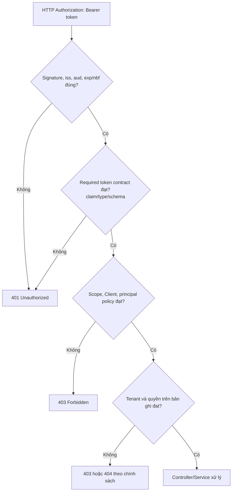

# Ràng buộc tenant, client hoặc loại token khi hợp đồng yêu cầu

## 1. Vì sao một access token hợp lệ vẫn có thể bị API từ chối?

Hãy tưởng tượng hệ thống SaaS có REST API quản lý hóa đơn:

```http
GET /api/tenants/tenant-alpha/invoices/inv-42 HTTP/1.1
Host: invoices.example.com
Authorization: Bearer <access-token>
```

Spring Security có thể xác minh JWT access token thành công: chữ ký đúng, issuer đáng tin, token chưa hết hạn và có authority `SCOPE_invoices.read`. Tuy nhiên, API vẫn phải trả lời những câu hỏi cụ thể hơn:

1. **Tenant:** Token cho phép truy cập dữ liệu của `tenant-alpha` hay một tenant khác?
2. **Client:** Token đã được cấp cho ứng dụng nào? Endpoint này có chỉ dành cho một nhóm Client được đăng ký trước không?
3. **Loại token:** Đây có thực sự là **access token dành cho API**, hay là một ID token OIDC có chữ ký hợp lệ nhưng không được dùng để truy cập tài nguyên?
4. **Ngữ cảnh chủ thể:** Token đại diện cho người dùng, dịch vụ máy-máy, hay một cơ chế ủy quyền đặc biệt? Điều đó có ảnh hưởng đến chính sách endpoint không?

Những câu hỏi trên thuộc **hợp đồng access token** giữa Authorization Server và Resource Server. Một hợp đồng có thể quy định các claim hoặc JOSE header parameter bắt buộc, giá trị chấp nhận được và cách xử lý token không đáp ứng.

Ví dụ một JWT access token được phát hành theo quy ước riêng của hệ thống:

```json
{
  "iss": "https://id.example.com/realms/shop",
  "sub": "user-417",
  "aud": ["invoices-api"],
  "iat": 1893455100,
  "exp": 1893456000,
  "client_id": "portal-web",
  "scope": "invoices.read",
  "tenant_id": "tenant-alpha",
  "principal_type": "user"
}
```

Ở đây `tenant_id` và `principal_type` là **claim tùy biến**, không phải claim bắt buộc của mọi JWT. `client_id` có ngữ nghĩa phụ thuộc token profile của nhà phát hành. Giá trị `exp` chỉ là mốc minh họa, không đại diện cho token thật.

Nếu Client thay URL thành `/api/tenants/tenant-beta/...`, dù JWT vẫn hợp lệ và có scope đọc hóa đơn, API **không được** tự cho phép truy cập Beta. Tương tự, nếu token có `client_id=unknown-app` trong khi hợp đồng endpoint yêu cầu Client đã được phê duyệt, API phải xử lý theo chính sách.

### Mục tiêu của bài học

Sau bài học, bạn có thể:

- Phân biệt **kiểm tra token hợp lệ**, **kiểm tra hợp đồng claim**, **phân quyền endpoint** và **quyền trên đối tượng**.
- Xác định khi nào cần ràng buộc `tenant_id`, `client_id` hoặc loại access token.
- Hiểu `typ` trong JOSE header khác `token_type=Bearer`, `grant_type` và các claim tùy biến.
- Cấu hình `JwtDecoder` cùng `OAuth2TokenValidator<Jwt>` trong Spring Security.
- Thiết kế tenant isolation và client allowlist mà không tin header/path do Client tự khai.
- Diễn giải đúng phản hồi `401`, `403` và `404`, đồng thời lập các trường hợp kiểm tra.

## 2. “Hợp đồng yêu cầu” nghĩa là gì?

OAuth 2.0 không bắt buộc tất cả access token phải có cùng định dạng hoặc cùng tập claim. Access token có thể là **JWT** hoặc **opaque token**. Các claim như `tenant_id`, `organization_id`, `client_id`, `azp`, `roles` và `principal_type` chỉ có thể được sử dụng đúng khi Resource Server biết **nhà phát hành nào tạo ra**, **ngữ nghĩa gì**, **kiểu dữ liệu nào**, và **quyền nào được đảm bảo**.

Một hợp đồng token nên mô tả:

| Thành phần hợp đồng | Ví dụ | Resource Server cần làm gì? |
|---|---|---|
| Issuer | `https://id.example.com/realms/shop` | Chỉ tin issuer được cấu hình |
| Audience | `invoices-api` | Từ chối token cấp cho API khác |
| Thời hạn | `exp`, `nbf` | Chỉ chấp nhận token còn hiệu lực |
| Loại token | JWT access token theo profile có `typ=at+jwt` | Chỉ chấp nhận loại token đúng profile, nếu hợp đồng bắt buộc |
| Tenant hiện hành | `tenant_id` là một chuỗi không rỗng | Xác minh claim và ràng buộc tenant khi truy cập dữ liệu |
| Client được cấp token | `client_id` | Kiểm tra định danh Client theo issuer và chính sách |
| Scope | `invoices.read`, `invoices.write` | Ánh xạ thành authority, áp dụng rule endpoint |
| Loại principal | `principal_type=user` hoặc `service` | Chỉ tin claim nếu nhà phát hành quản lý và định nghĩa rõ |
| Quyền nghiệp vụ | Owner, tenant role, tổ chức được phép | Kiểm tra tại Service/Repository hoặc authorization layer |

Không nên thêm một validator tùy biến chỉ vì thấy một claim trong vài token mẫu. Đầu tiên phải xác định **API có thực sự yêu cầu claim đó ở mọi token hay chỉ trong một số thao tác**.

Chẳng hạn:

- Endpoint `/api/tenants/{tenantId}/invoices/**` cần tenant context.
- Endpoint `/api/internal/billing-sync` có thể yêu cầu Client thuộc danh sách dịch vụ cho phép.
- Endpoint `/api/public/health` không cần access token.
- Một endpoint quản trị platform có chính sách riêng, có thể không dùng tenant cố định nhưng phải có grant liên tenant được kiểm soát rõ.

**Đừng biến một chính sách dành cho một endpoint thành ràng buộc toàn cục khiến token hợp lệ của những trường hợp khác bị loại nhầm.** Có thể đặt quy tắc ở decoder khi đó là điều kiện bắt buộc của mọi token được API chấp nhận, hoặc ở authorization layer khi điều kiện chỉ áp dụng cho một route/nghiệp vụ.

## 3. Ba lớp bảo vệ không được đánh đồng

Trong Spring Security Resource Server, nên tách rõ ba lớp:

### 3.1. Lớp A: xác thực token và kiểm tra cấu trúc/hợp đồng bắt buộc

Tại `JwtDecoder` hoặc opaque token introspection:

- Chữ ký và thuật toán có được chấp nhận không?
- `iss` có khớp issuer tin cậy không?
- Token còn hạn theo `exp`, `nbf` không?
- `aud` có đúng Resource Server không?
- Nếu **toàn bộ JWT access token phải có** `tenant_id` hoặc `client_id`, claim đó có tồn tại và đúng kiểu không?
- Nếu profile đòi loại token trong JOSE header, giá trị `typ` có phù hợp không?

Nếu token không đạt điều kiện xác thực/validator bắt buộc, Resource Server thường trả **`401 Unauthorized`** với lỗi Bearer phù hợp, vì token **không được chấp nhận để xác thực**.

### 3.2. Lớp B: phân quyền endpoint và Client

Sau khi `Authentication` được tạo:

- Endpoint GET có yêu cầu `SCOPE_invoices.read` không?
- Endpoint nội bộ có chỉ dành cho `billing-worker` hoặc các Client được đăng ký không?
- Token có phải principal loại `service` nếu nghiệp vụ endpoint chỉ cho phép dịch vụ?
- Người dùng có role thích hợp **trong tenant hiện hành** không?

Nếu token xác thực thành công nhưng không đủ quyền cho endpoint, phản hồi thông thường là **`403 Forbidden`**.

### 3.3. Lớp C: phân quyền trên tài nguyên thực tế

Khi đọc `inv-42`, Service/Repository cần kiểm tra:

- Hóa đơn thuộc tenant nào?
- Người gọi có quyền truy cập tenant đó?
- Người gọi có sở hữu hóa đơn hoặc có vai trò được phép xem?
- Bản ghi có thuộc phạm vi dữ liệu mà Client/dịch vụ được phép xử lý không?

Một token hợp lệ, đúng tenant và đủ scope vẫn có thể bị từ chối vì không phải chủ sở hữu bản ghi. API có thể trả `403` hoặc `404` theo chính sách chống lộ sự tồn tại của tài nguyên.



**Điểm mấu chốt:** Một claim được ký và xác minh là **dữ liệu đáng tin về nguồn phát hành**, không tự động là **quyền truy cập mọi tài nguyên** mà claim đó nhắc đến.

## 4. Ràng buộc tenant khi API có dữ liệu đa tổ chức

### 4.1. Tenant là gì?

Trong SaaS multi-tenant, **tenant** là một không gian khách hàng/tổ chức được phân biệt để cô lập dữ liệu và quyền. Ví dụ:

- `tenant-alpha`: tổ chức Alpha sở hữu hóa đơn `inv-42`.
- `tenant-beta`: tổ chức Beta sở hữu hóa đơn `inv-57`.

`tenant_id` không phải registered JWT claim bắt buộc. Authorization Server có thể dùng `tid`, `org_id`, một claim URI có namespace hoặc mô hình riêng. Không tự xem hai tên claim là tương đương nếu hợp đồng chưa nói như vậy.

Một tenant ID hợp lý nên ổn định, duy nhất trong miền ứng dụng và đối chiếu được với dữ liệu nghiệp vụ; tránh dùng email domain hay tên hiển thị làm định danh bảo mật nếu chúng có thể thay đổi.

### 4.2. Một token gắn với đúng một tenant

Một hợp đồng đơn giản:

```json
{
  "sub": "user-417",
  "aud": ["invoices-api"],
  "scope": "invoices.read",
  "tenant_id": "tenant-alpha"
}
```

Khi truy cập tài nguyên tenant-bound, Resource Server cần đảm bảo ít nhất:

```text
tokenTenant == requestedTenant   (nếu tenant có trong URL)
tokenTenant == resourceTenant    (tenant của dữ liệu)
```

Cần thêm ownership hoặc tenant-specific role nếu nghiệp vụ đòi hỏi. `tenant_id` trong JWT chỉ nên được tin sau khi xác minh token và xác định nhà phát hành **có quyền gán tenant đó cho principal** theo hợp đồng cấp token.

### 4.3. Tenant trong request không được ghi đè tenant trong token

Ví dụ nguy hiểm:

```http
GET /api/tenants/tenant-beta/invoices/inv-57 HTTP/1.1
Authorization: Bearer <token-of-tenant-alpha>
X-Tenant-ID: tenant-beta
```

`tenant-beta` trong path hoặc header là **dữ liệu do Client cung cấp**. Nó có thể là một lựa chọn tenant được yêu cầu, nhưng không chứng minh người gọi có quyền với Beta.

Với token một tenant, API phải từ chối nếu giá trị được yêu cầu không khớp `tenant_id` đã xác thực.

Với token đa tenant, yêu cầu phải được so sánh với **phạm vi tenant được phép theo từng quyền**, không chỉ kiểm tra một danh sách tùy ý mà không biết scope của từng tenant.

### 4.4. Đưa tenant vào truy vấn dữ liệu

Cách truy vấn dễ gây lỗi:

```sql
SELECT * FROM invoices
WHERE id = :invoice_id;
```

Cách an toàn hơn với dữ liệu tenant-bound:

```sql
SELECT id, tenant_id, owner_subject, amount
FROM invoices
WHERE id = :invoice_id
  AND tenant_id = :verified_tenant_id;
```

Nếu endpoint chỉ cho phép user xem hóa đơn của mình:

```sql
SELECT id, tenant_id, owner_subject, amount
FROM invoices
WHERE id = :invoice_id
  AND tenant_id = :verified_tenant_id
  AND owner_subject = :verified_subject;
```

Khi ghi dữ liệu, `tenant_id` cũng phải lấy từ context đã được phân quyền, thay vì tin field `tenantId` trong JSON body. Các quan hệ tới khách hàng, sản phẩm, file đính kèm và báo cáo cần kiểm tra tenant tương ứng.

Một JWT có `tenant_id=tenant-alpha` không ngăn lộ dữ liệu nếu Repository vẫn tìm theo `id` rồi trả toàn bộ bản ghi của Beta.

### 4.5. Nhiều tenant trong một token

Một số nhà phát hành có thể đưa:

```json
{
  "allowed_tenants": ["tenant-alpha", "tenant-beta"],
  "scope": "invoices.read"
}
```

Đây chỉ là ví dụ claim tùy biến. API cần xác định tenant hiện hành được yêu cầu, kiểm tra nó thuộc tập được phép, sau đó truy vấn **trong tenant đó**.

Nếu quyền khác nhau giữa hai tenant (được đọc Alpha nhưng chỉ được ghi Beta), một chuỗi scope phẳng cộng một mảng tenant không diễn đạt đầy đủ quan hệ quyền. Khi đó nên có token một tenant, hoặc mô hình claim quyền theo tenant được nhà phát hành bảo đảm và API hiểu rõ.

### 4.6. Membership có thể thay đổi sau khi token được cấp

JWT đã ký vẫn có thể còn hạn sau khi người dùng bị rút khỏi tenant. Việc xác minh chữ ký không tự cập nhật trạng thái membership hiện tại. Nếu ứng dụng yêu cầu thu hồi quyền gần như tức thì, cần thiết kế thời hạn token ngắn, introspection/entitlement check hoặc cơ chế thu hồi phù hợp.

**Kết luận cho tenant:** Kiểm tra claim ở decoder giúp bảo đảm token có trường đúng hợp đồng; kiểm tra tenant trong Service/Repository mới thực thi cô lập dữ liệu thực sự.

## 5. Ràng buộc OAuth Client khi ứng dụng yêu cầu

### 5.1. `client_id` khác `sub`

OAuth **Client** là ứng dụng đã được Authorization Server đăng ký. `client_id` định danh Client; `sub` định danh chủ thể token theo profile của nhà phát hành.

Hai trường có thể khác nhau:

```json
{
  "sub": "user-417",
  "client_id": "portal-web",
  "scope": "invoices.read"
}
```

Hoặc trong Client Credentials, một hệ thống có thể cấp token như:

```json
{
  "sub": "billing-worker",
  "client_id": "billing-worker",
  "scope": "invoices.reconcile"
}
```

Không nên suy ra mọi `sub` là user ID, hoặc mọi token có `client_id` là Client Credentials. Grant type mô tả cách cấp token và không bắt buộc xuất hiện trong access token.

Một số nhà phát hành dùng `azp` (*authorized party*), `appid` hoặc claim khác theo profile. Đặc biệt, `azp` có ngữ nghĩa OIDC ở những trường hợp nhất định; **không tự hoán đổi `azp` và `client_id`** nếu hợp đồng chưa định nghĩa.

### 5.2. Khi nào cần Client allowlist?

Giả sử `POST /api/internal/reconcile` chỉ được gọi bởi ứng dụng nội bộ `billing-worker`, ngay cả khi một Client khác tình cờ có scope cùng tên.

Có thể đặt chính sách:

```text
Require:
  access token valid for invoices-api
  scope includes invoices.reconcile
  client_id == billing-worker
  principal_type == service (nếu AS có hợp đồng claim này)
  tenant/resource permission satisfies operation
```

Scope thể hiện **quyền đã cấp**, còn Client ID thể hiện **ứng dụng nhận token**. Kết hợp hai thông tin hữu ích khi một thao tác nhạy cảm chỉ dành cho một hoặc vài ứng dụng cụ thể.

Nếu endpoint chấp nhận nhiều Client, định nghĩa một allowlist được quản trị. Không dùng `client_id` từ header tự khai, query string hoặc body thay cho claim đã được issuer xác minh.

### 5.3. Ràng buộc Client có giới hạn gì?

Kiểm tra `client_id` trong JWT **không chứng minh** rằng chính tiến trình ứng dụng Client đang gửi HTTP request là bên nắm credential hợp lệ ở thời điểm này. Với **Bearer token**, ai có token còn hiệu lực đều có thể trình nó cho Resource Server nếu không có cơ chế sender-constraining.

Do đó:

- Bảo vệ token khi lưu trữ và truyền qua HTTPS.
- Cân nhắc access token ngắn hạn và cơ chế thu hồi khi cần.
- Nếu hệ thống yêu cầu chứng minh Client hiện tại sở hữu khóa/chứng thư riêng, phải thiết kế cơ chế sender-constrained token như mTLS-bound access token hoặc DPoP khi được hỗ trợ, cùng kiểm tra binding phù hợp. **Chỉ xem claim `client_id` không thay thế sender-constraining.**

Không nên nhầm **Client được phép phát hành token** với **người gửi request hiện tại đã chứng minh là Client đó**.

### 5.4. Global validation hay endpoint authorization?

Hai tình huống khác nhau:

**Hợp đồng toàn API:** “Resource Server này chỉ nhận token phát hành cho các Client A và B.” Có thể kiểm tra Client allowlist ở `JwtDecoder`; token Client C bị coi là không đáp ứng token contract và thường nhận `401`.

**Hợp đồng endpoint:** “API nói chung cho nhiều Client truy cập, nhưng `/api/internal/reconcile` chỉ dành cho Client B.” Nên xác thực token chung trước; rồi phân quyền endpoint với Client ID + scope. Khi Client A dùng token hợp lệ để gọi endpoint này, thường nhận `403`.

Đặt sai tầng làm khó phân biệt token không hợp lệ với token hợp lệ nhưng thiếu quyền ở một route cụ thể.

## 6. Ràng buộc loại token: access token không phải ID token

### 6.1. Vì sao cần kiểm tra loại token?

Một OpenID Provider có thể cấp cùng lúc:

- **ID token:** phục vụ OIDC Client để biết về quá trình xác thực người dùng.
- **Access token:** phục vụ Resource Server để truy cập API.

Cả hai có thể có định dạng JWT, có `iss` giống nhau và được ký bằng khóa của cùng nhà phát hành. Nếu API chỉ kiểm tra chữ ký và issuer nhưng không xác minh audience/loại token theo hợp đồng, ID token có thể bị chấp nhận nhầm như access token.

**Không sử dụng ID token thay access token trong `Authorization: Bearer ...`.**

### 6.2. `typ` là JOSE header parameter

Trong JWT được ký dạng JWS Compact, header có thể như:

```json
{
  "alg": "RS256",
  "kid": "signing-key-11",
  "typ": "at+jwt"
}
```

`typ` là thông tin về loại đối tượng JOSE/JWT. Với **JWT Profile for OAuth 2.0 Access Tokens** (RFC 9068), access token dạng JWT có thể dùng `typ` là `at+jwt` hoặc `application/at+jwt` theo profile.

Một ID token OIDC thường không có giá trị `typ=at+jwt` theo quy ước đó. Tuy nhiên, **không phải mọi JWT access token trên thị trường đều theo RFC 9068**: nhiều issuer phát hành token với `typ=JWT` hoặc không công bố cùng quy tắc. Không tự yêu cầu `at+jwt` nếu hợp đồng AS/API không bảo đảm điều đó.

| Giá trị/thuộc tính | Ý nghĩa | Có chứng minh đây là access token cho API không? |
|---|---|---|
| `typ=at+jwt` | Header type theo JWT access token profile phù hợp | Là một điều kiện có ích nếu issuer tuân theo profile, nhưng vẫn cần xác minh chữ ký/claims |
| `typ=JWT` | Cho biết dạng JWT chung | Không đủ phân biệt access token và ID token |
| `token_type=Bearer` | Thường nằm trong **token endpoint response** | Chỉ nói cách dùng Bearer, không phải claim loại token bên trong JWT |
| `grant_type=authorization_code` | Tham số của yêu cầu cấp token | Không tự chứng minh loại token từ JWT |
| `principal_type=service` | Claim tùy biến của AS, nếu có | Không phải chuẩn phân biệt access token/ID token |
| `aud` chứa API | Token hướng đến Resource Server | Điều kiện rất quan trọng, nhưng phải hiểu đúng profile và kiểm tra thêm nếu cần |

Đặc biệt, `typ` nằm trong header **có thể được đọc trước khi xác minh chữ ký**. Không dùng chuỗi đó để cấp quyền trước khi decoder hoàn tất xác minh token. Với JWS Compact, protected header là một phần của dữ liệu được ký; validator chỉ nên tin nó sau khi chữ ký hợp lệ và các điều kiện khác đạt.

### 6.3. Hai hướng kiểm tra loại token

**Hướng A — Theo JWT access token profile rõ ràng:** API và AS thống nhất signed JWT access token phải có `typ=at+jwt` và các claim cần thiết theo profile. Resource Server cấu hình bộ xử lý JWT cho phép loại này và validator kiểm tra `typ`.

**Hướng B — Theo hợp đồng issuer tùy biến:** Nếu AS cấp JWT access token với `typ=JWT`, API phải dùng những ràng buộc đáng tin khác như issuer, audience, claim profile được cấp cho access token, scope, client và quy ước AS quản lý. Đừng chỉ nhìn `typ=JWT` rồi coi token đúng mục đích.

Trong cả hai hướng, lựa chọn thuật toán ký và khóa xác minh phải được giới hạn độc lập. Header `alg` hoặc `kid` do token tự đưa vào không có quyền mở rộng tập khóa/thuật toán được API tin.

## 7. Quy tắc thiết kế claim validator

Một validator tùy biến nên có các tính chất sau:

1. **Áp dụng sau xác thực chữ ký:** Không dựa vào payload tự decode mà chưa kiểm chứng.
2. **Có hợp đồng rõ ràng:** Tên claim, kiểu dữ liệu, cách so sánh và giá trị cho phép được xác định.
3. **Fail closed khi bắt buộc:** Nếu thiếu claim quan trọng hoặc claim sai kiểu, từ chối.
4. **Không suy đoán grant type:** Tránh dựa vào tên `sub` hoặc sự có mặt của `client_id` để kết luận chắc chắn token đến từ luồng nào.
5. **Không thay validator chuẩn:** Khi thêm tenant/client/type, vẫn giữ issuer, thời hạn, audience và thuật toán/chữ ký.
6. **Không thay quyền trên tài nguyên:** Có tenant claim không đủ chứng minh người gọi sở hữu bản ghi.
7. **Đúng phạm vi áp dụng:** Validator toàn cục cho điều kiện token-level; authorization manager/Service cho điều kiện endpoint-specific.
8. **Dựa vào cùng một issuer contract:** Nếu chấp nhận nhiều issuer, claim names/semantics phải được cấu hình đúng theo từng issuer.

### 7.1. Lưu ý kiểu dữ liệu

Ví dụ hợp đồng nói:

```text
tenant_id:
  required: true
  type: string
  nonempty: true

client_id:
  required: true
  type: string
  nonempty: true
```

Không nên chấp nhận:

```json
{"tenant_id": ["tenant-alpha", "tenant-beta"]}
```

như một tenant string hợp lệ nếu hợp đồng chỉ cho phép chuỗi. Tương tự, không tự chuyển kiểu số, array hoặc object thành chuỗi bằng `toString()` rồi sử dụng làm tenant ID bảo mật.

Giá trị tenant cần có namespace/định dạng rõ, có thể giới hạn độ dài. Nhưng **đúng định dạng không có nghĩa tenant tồn tại hoặc principal còn quyền tại tenant đó**; điều này cần AS bảo đảm khi phát hành và/hoặc API kiểm tra từ dữ liệu quyền hiện hành.

### 7.2. Có kiểm tra token profile ở tầng decoder không?

Khi token type là điều kiện bắt buộc của toàn Resource Server, validator JWT có thể kiểm tra header `typ` sau khi token đã được xác minh. Tùy phiên bản và cấu hình của Spring Security/Nimbus, quá trình xử lý `typ` mặc định có thể từ chối token trước khi validator tùy chỉnh được gọi.

Vì vậy, nếu AS dùng `typ=at+jwt`, cần cấu hình decoder **tương thích với token profile** và có validator type rõ ràng; không chỉ thêm một validator mà bỏ qua hành vi kiểm tra type của thư viện. Phần triển khai riêng về `typ` ở mục 9 minh họa cách tiếp cận trên những phiên bản có builder `validateType(false)`.

## 8. Cấu hình Spring Security kiểm tra issuer, audience, tenant và client

Phần này giả định Resource Server dùng **JWT access token**, một issuer, audience `invoices-api` và **mọi JWT token được API chấp nhận đều phải có `tenant_id`, `client_id` hợp lệ**. Nếu có endpoint được phép dùng token platform-level không gắn tenant, cần thiết kế riêng để tránh validator quá chặt.

### 8.1. Dependency

Với Spring Boot + Gradle:

```groovy
dependencies {
    implementation 'org.springframework.boot:spring-boot-starter-web'
    implementation 'org.springframework.boot:spring-boot-starter-security'
    implementation 'org.springframework.boot:spring-boot-starter-oauth2-resource-server'
}
```

Spring Boot sẽ quản lý phiên bản Spring Security tương thích theo dependency management của dự án.

### 8.2. Issuer tin cậy

Ví dụ trong `application.yml`:

```yaml
spring:
  security:
    oauth2:
      resourceserver:
        jwt:
          issuer-uri: https://id.example.com/realms/shop
```

Địa chỉ là placeholder cho issuer thực tế. `issuer-uri` phải trùng với `iss` được AS công bố. Không lấy issuer từ header HTTP hoặc một `iss` chưa xác thực rồi tự động tin URL đó.

### 8.3. Bean JwtDecoder kết hợp validator

Dưới đây là ví dụ cụ thể cho ba điều kiện toàn API: **audience**, **tenant claim đúng kiểu**, và **Client ID thuộc allowlist**.

```java
package com.example.invoices;

import java.util.Set;
import org.springframework.context.annotation.Bean;
import org.springframework.context.annotation.Configuration;
import org.springframework.security.oauth2.core.DelegatingOAuth2TokenValidator;
import org.springframework.security.oauth2.core.OAuth2Error;
import org.springframework.security.oauth2.core.OAuth2TokenValidator;
import org.springframework.security.oauth2.core.OAuth2TokenValidatorResult;
import org.springframework.security.oauth2.jwt.Jwt;
import org.springframework.security.oauth2.jwt.JwtDecoder;
import org.springframework.security.oauth2.jwt.JwtDecoders;
import org.springframework.security.oauth2.jwt.JwtValidators;
import org.springframework.security.oauth2.jwt.NimbusJwtDecoder;

@Configuration
public class JwtValidationConfig {

    private static final String ISSUER =
        "https://id.example.com/realms/shop";

    private static final String EXPECTED_AUDIENCE = "invoices-api";

    // Ví dụ: API chỉ nhận access token của hai Client đã được phép.
    private static final Set<String> ALLOWED_CLIENTS =
        Set.of("portal-web", "billing-worker");

    private static OAuth2TokenValidatorResult reject(String reason) {
        return OAuth2TokenValidatorResult.failure(
            new OAuth2Error("invalid_token", reason, null));
    }

    @Bean
    JwtDecoder jwtDecoder() {
        NimbusJwtDecoder decoder =
            (NimbusJwtDecoder) JwtDecoders.fromIssuerLocation(ISSUER);

        OAuth2TokenValidator<Jwt> audience = jwt ->
            jwt.getAudience().contains(EXPECTED_AUDIENCE)
                ? OAuth2TokenValidatorResult.success()
                : reject("Invalid audience");

        OAuth2TokenValidator<Jwt> tenantClaim = jwt -> {
            Object value = jwt.getClaims().get("tenant_id");

            if (!(value instanceof String tenantId)) {
                return reject("Invalid tenant_id type");
            }

            if (tenantId.isBlank() || tenantId.length() > 100) {
                return reject("Invalid tenant_id value");
            }

            return OAuth2TokenValidatorResult.success();
        };

        OAuth2TokenValidator<Jwt> allowedClient = jwt -> {
            Object value = jwt.getClaims().get("client_id");

            if (!(value instanceof String clientId)) {
                return reject("Missing client_id");
            }

            return ALLOWED_CLIENTS.contains(clientId)
                ? OAuth2TokenValidatorResult.success()
                : reject("Client is not allowed");
        };

        decoder.setJwtValidator(
            new DelegatingOAuth2TokenValidator<>(
                JwtValidators.createDefaultWithIssuer(ISSUER),
                audience,
                tenantClaim,
                allowedClient
            ));

        return decoder;
    }
}
```

Ý nghĩa:

- `JwtDecoders.fromIssuerLocation(ISSUER)` tạo decoder gắn với issuer tin cậy và cơ chế lấy khóa thích hợp.
- `JwtValidators.createDefaultWithIssuer(ISSUER)` giữ các validator cần thiết về issuer/thời gian.
- `audience` từ chối token không dành cho `invoices-api`.
- `tenantClaim` chỉ cho phép `tenant_id` dạng chuỗi, không rỗng và có giới hạn độ dài.
- `allowedClient` yêu cầu `client_id` thuộc tập Client được AS/ứng dụng cho phép.
- `DelegatingOAuth2TokenValidator` phối hợp nhiều điều kiện; token bị từ chối khi một điều kiện bắt buộc không đạt.

Đây là ví dụ cho một hợp đồng **global Client allowlist**. Nếu chỉ endpoint `/api/internal/reconcile` mới giới hạn Client, không nên thêm `allowedClient` vào decoder toàn hệ thống; thay vào đó đặt rule ở endpoint authorization (mục 10).

**Không dùng `jwt.getClaims().get(...)` trước khi token được decoder xác minh**, hoặc tạo decoder mới từ issuer do JWT tự khai. Tên claim cũng phải khớp hợp đồng token thực tế.

### 8.4. SecurityFilterChain cho endpoint

```java
package com.example.invoices;

import org.springframework.context.annotation.Bean;
import org.springframework.context.annotation.Configuration;
import org.springframework.http.HttpMethod;
import org.springframework.security.config.Customizer;
import org.springframework.security.config.annotation.web.builders.HttpSecurity;
import org.springframework.security.config.http.SessionCreationPolicy;
import org.springframework.security.web.SecurityFilterChain;

@Configuration
public class ApiSecurityConfig {

    @Bean
    SecurityFilterChain apiSecurity(HttpSecurity http) throws Exception {
        return http
            .csrf(csrf -> csrf.disable())
            .sessionManagement(session ->
                session.sessionCreationPolicy(SessionCreationPolicy.STATELESS))
            .authorizeHttpRequests(auth -> auth
                .requestMatchers("/api/public/**").permitAll()
                .requestMatchers(HttpMethod.GET, "/api/tenants/*/invoices/**")
                    .hasAuthority("SCOPE_invoices.read")
                .requestMatchers(HttpMethod.POST, "/api/internal/reconcile")
                    .hasAuthority("SCOPE_invoices.reconcile")
                .anyRequest().denyAll()
            )
            .oauth2ResourceServer(oauth2 ->
                oauth2.jwt(Customizer.withDefaults()))
            .build();
    }
}
```

Theo mapping thông dụng của Spring Security, claim `scope` hoặc `scp` được chuyển thành authorities có tiền tố `SCOPE_`. Nếu AS dùng một định dạng khác, ứng dụng cần tùy chỉnh `JwtAuthenticationConverter`.

Ở đây:

- `JwtDecoder` xác minh token và claim profile toàn cục.
- `SecurityFilterChain` yêu cầu scope tại endpoint.
- Controller/Service thực hiện ràng buộc tenant, Client-specific permission và dữ liệu cụ thể.

Ví dụ sử dụng `STATELESS`, tắt CSRF cho REST API thuần Bearer token trong Authorization header và **không có cookie để tự động xác thực**. Nếu ứng dụng dùng session/cookie, phải thiết kế CSRF theo kiến trúc đó.

## 9. Kiểm tra `typ=at+jwt` khi AS tuân theo JWT access token profile

### 9.1. Điều kiện tiên quyết

Giả sử AS tuyên bố phát hành JWT access token theo profile đòi `typ` thuộc:

```text
at+jwt
application/at+jwt
```

Resource Server cần đảm bảo bộ decoder **chấp nhận profile được dự kiến**, nhưng **không chấp nhận `typ=JWT` chung** như một access token có type rõ ràng, trừ khi hợp đồng có quy định khác.

Spring Security/Nimbus có cơ chế kiểm tra token type trước hoặc trong quá trình decoding, phụ thuộc phiên bản. Trên những phiên bản cung cấp `NimbusJwtDecoder...validateType(false)`, có thể chuyển trách nhiệm kiểm tra loại JWT vào một validator ứng dụng đã khai báo. **Không được tắt kiểm tra type rồi bỏ quên validator thay thế.**

### 9.2. Ví dụ validator token type

Mẫu minh họa cho các phiên bản hỗ trợ builder `validateType(false)`:

```java
package com.example.invoices;

import java.util.Set;
import org.springframework.context.annotation.Bean;
import org.springframework.context.annotation.Configuration;
import org.springframework.security.oauth2.core.DelegatingOAuth2TokenValidator;
import org.springframework.security.oauth2.core.OAuth2Error;
import org.springframework.security.oauth2.core.OAuth2TokenValidator;
import org.springframework.security.oauth2.core.OAuth2TokenValidatorResult;
import org.springframework.security.oauth2.jwt.Jwt;
import org.springframework.security.oauth2.jwt.JwtDecoder;
import org.springframework.security.oauth2.jwt.JwtValidators;
import org.springframework.security.oauth2.jwt.NimbusJwtDecoder;

@Configuration
public class AccessTokenTypeConfig {

    @Bean
    JwtDecoder typedAccessTokenDecoder() {
        String issuer = "https://id.example.com/realms/shop";

        NimbusJwtDecoder decoder = NimbusJwtDecoder
            .withIssuerLocation(issuer)
            .validateType(false)
            .build();

        OAuth2TokenValidator<Jwt> accessTokenType = jwt -> {
            Object value = jwt.getHeaders().get("typ");
            boolean accepted =
                value instanceof String type
                    && Set.of("at+jwt", "application/at+jwt")
                        .contains(type);

            return accepted
                ? OAuth2TokenValidatorResult.success()
                : OAuth2TokenValidatorResult.failure(
                    new OAuth2Error(
                        "invalid_token", "Unexpected token type", null));
        };

        OAuth2TokenValidator<Jwt> audience = jwt ->
            jwt.getAudience().contains("invoices-api")
                ? OAuth2TokenValidatorResult.success()
                : OAuth2TokenValidatorResult.failure(
                    new OAuth2Error(
                        "invalid_token", "Invalid audience", null));

        decoder.setJwtValidator(
            new DelegatingOAuth2TokenValidator<>(
                JwtValidators.createDefaultWithIssuer(issuer),
                audience,
                accessTokenType
            ));

        return decoder;
    }
}
```

**Đây là phương án thay thế decoder trong mục 8.3, không phải bean thứ hai để khai báo đồng thời.** Khi dùng kiểu token validation thực tế, bạn phải **gộp** tenant/client validators cần thiết vào cùng một decoder; nếu chỉ dùng ví dụ `typedAccessTokenDecoder` thì nó chưa thực thi tenant/client contract.

Builder `validateType(false)` chỉ có trong những phiên bản Spring Security hỗ trợ tùy chọn đó; cần sử dụng API tương ứng của phiên bản dự án. Các bộ decoder khác có thể thực hiện type validation mặc định theo cơ chế khác. Điều không thay đổi là phải **đặt kiểm tra type rõ ràng và giữ signature, issuer, audience, time validators**.

Ngoài ra, một profile JWT access token có thể yêu cầu thêm claim hoặc kiểu dữ liệu bắt buộc khác. Nếu đã chọn profile RFC 9068, nên kiểm tra **toàn bộ hợp đồng profile liên quan**, không chỉ `typ`.

### 9.3. Đừng dùng `typ` như một nhánh cho phép tùy ý

Ví dụ không an toàn về mặt ý tưởng:

```text
if header.typ == "at+jwt":
    allow API call
```

Bất kỳ ai cũng có thể tạo header chưa ký có chuỗi `at+jwt`. Quyết định chỉ có ý nghĩa **sau khi token được xác minh bằng nguồn khóa tin cậy và các claim đạt validator**.

## 10. Ràng buộc Client theo từng endpoint

Giả sử Resource Server chấp nhận token hợp lệ từ `portal-web` và `billing-worker`, nhưng endpoint đối soát chỉ dành cho `billing-worker`. Thay vì từ chối `portal-web` ngay ở decoder cho mọi endpoint, có thể tạo một `AuthorizationManager<RequestAuthorizationContext>` tùy biến.

### 10.1. Ví dụ chính sách Client và scope

```java
package com.example.invoices;

import java.util.function.Supplier;
import org.springframework.security.authorization.AuthorizationDecision;
import org.springframework.security.authorization.AuthorizationManager;
import org.springframework.security.core.Authentication;
import org.springframework.security.oauth2.server.resource.authentication.JwtAuthenticationToken;
import org.springframework.security.web.access.intercept.RequestAuthorizationContext;

public final class BillingClientAuthorizationManager
        implements AuthorizationManager<RequestAuthorizationContext> {

    @Override
    public AuthorizationDecision check(
            Supplier<Authentication> authentication,
            RequestAuthorizationContext context) {

        Authentication auth = authentication.get();

        if (!(auth instanceof JwtAuthenticationToken jwtAuth)
                || !auth.isAuthenticated()) {
            return new AuthorizationDecision(false);
        }

        Object clientId =
            jwtAuth.getToken().getClaims().get("client_id");

        boolean allowedClient = "billing-worker".equals(clientId);

        boolean allowedScope = auth.getAuthorities().stream()
            .anyMatch(authority ->
                "SCOPE_invoices.reconcile"
                    .equals(authority.getAuthority()));

        return new AuthorizationDecision(
            allowedClient && allowedScope);
    }
}
```

Đoạn trên kiểm tra Client ID từ **JWT đã được xác thực** trong `JwtAuthenticationToken`. Nếu token hợp lệ nhưng đến từ `portal-web`, manager trả `false` và endpoint thường phản hồi `403`.

Trong `SecurityFilterChain` có thể sử dụng manager ở route nội bộ:

```java
.requestMatchers(HttpMethod.POST, "/api/internal/reconcile")
    .access(new BillingClientAuthorizationManager())
```

Thay rule scope đơn thuần trong ví dụ mục 8.4 bằng dòng này nếu muốn áp dụng **cả Client ID và scope** cho endpoint nội bộ.

Ở ứng dụng thật, có thể thêm kiểm tra `principal_type` do AS quản lý, role nội bộ, tenant được phép hoặc xác minh Client registration hiện hành. Cơ chế ràng buộc Client không thay thế xác thực người gửi bằng sender-constrained token nếu ứng dụng yêu cầu điều đó.

### 10.2. Vì sao không tin header `X-Client-Id`?

Một Client có thể tự gửi:

```http
POST /api/internal/reconcile HTTP/1.1
Authorization: Bearer <token-of-portal-web>
X-Client-Id: billing-worker
```

`X-Client-Id` là dữ liệu do người gọi kiểm soát. Nếu API dùng header thay cho claim đã xác thực để xét Client allowlist, bất kỳ Client nào cũng có thể tự nhận là `billing-worker`.

Sử dụng claim đáng tin do issuer bảo đảm hoặc một cơ chế Client authentication/sender constraining được hệ thống thiết kế rõ. Không chọn Client ID dựa vào tên ứng dụng trong User-Agent, Origin hay địa chỉ IP nếu chúng không thuộc mô hình ủy quyền.

## 11. Ràng buộc tenant tại Controller và Repository

### 11.1. Đọc JWT đã xác thực

Một Controller nhận `Jwt` qua `@AuthenticationPrincipal`:

```java
package com.example.invoices;

import java.util.UUID;
import org.springframework.security.core.annotation.AuthenticationPrincipal;
import org.springframework.security.oauth2.jwt.Jwt;
import org.springframework.web.bind.annotation.GetMapping;
import org.springframework.web.bind.annotation.PathVariable;
import org.springframework.web.bind.annotation.RequestMapping;
import org.springframework.web.bind.annotation.RestController;

@RestController
@RequestMapping("/api/tenants/{tenantId}/invoices")
public class InvoiceController {

    private final InvoiceService invoiceService;

    public InvoiceController(InvoiceService invoiceService) {
        this.invoiceService = invoiceService;
    }

    @GetMapping("/{invoiceId}")
    public InvoiceDto getInvoice(
            @PathVariable String tenantId,
            @PathVariable UUID invoiceId,
            @AuthenticationPrincipal Jwt jwt) {

        String tokenTenant =
            jwt.getClaimAsString("tenant_id");

        if (!tokenTenant.equals(tenantId)) {
            throw new org.springframework.security.access.AccessDeniedException(
                "Tenant access denied");
        }

        return invoiceService.findVisibleInvoice(
            invoiceId, tokenTenant, jwt.getSubject());
    }
}
```

Ví dụ này giả định `JwtDecoder` đã yêu cầu `tenant_id` string không rỗng, và `sub` tương ứng một user ID theo hợp đồng issuer. Đối với Client Credentials, `sub` có thể là Client ID; trường hợp đó cần quy tắc Service riêng thay vì đối chiếu owner của người dùng.

Điều kiện `tokenTenant.equals(tenantId)` xác định **tenant request** được phép. Nó không thay thế điều kiện tenant ở truy vấn dữ liệu.

### 11.2. Truy vấn đúng tenant

Ví dụ Spring Data JPA:

```java
import java.util.Optional;
import java.util.UUID;
import org.springframework.data.jpa.repository.JpaRepository;

public interface InvoiceRepository
        extends JpaRepository<InvoiceEntity, UUID> {

    Optional<InvoiceEntity> findByIdAndTenantIdAndOwnerSubject(
        UUID id, String tenantId, String ownerSubject);
}
```

Phác thảo Service:

```java
InvoiceEntity invoice = repository
    .findByIdAndTenantIdAndOwnerSubject(
        invoiceId, verifiedTenant, verifiedSubject)
    .orElseThrow(() -> new ResponseStatusException(
        HttpStatus.NOT_FOUND, "Invoice not found"));

return mapper.toDto(invoice);
```

Các class `InvoiceEntity`, `InvoiceDto` và `mapper` là thành phần domain minh họa. Trong project thật cần khai báo JPA mapping, tên field và model nghiệp vụ tương ứng.

Nên truy vấn với tenant predicate ngay từ đầu, thay vì lấy bản ghi bằng ID không giới hạn tenant rồi hy vọng mọi đường code sẽ kiểm tra sau đó.

### 11.3. Tạo hoặc cập nhật dữ liệu

Với request:

```http
POST /api/tenants/tenant-alpha/invoices HTTP/1.1
Authorization: Bearer <token-tenant-alpha>
Content-Type: application/json

{
  "tenantId": "tenant-beta",
  "customerId": "customer-123",
  "amount": 250
}
```

Không lấy `tenantId` từ body để xác định chủ sở hữu bản ghi. Server phải sử dụng tenant đã được phân quyền, đồng thời xác minh `customerId` thuộc cùng tenant hoặc được phép tham chiếu theo chính sách.

Khi cập nhật/xóa dữ liệu, câu lệnh SQL cũng cần tenant predicate:

```sql
UPDATE invoices
SET status = :new_status
WHERE id = :invoice_id
  AND tenant_id = :verified_tenant_id;
```

Các lớp cache, search index, export, file storage và event consumer cần áp dụng cùng nguyên tắc. Nếu cache key chỉ có invoice ID, request Beta có thể đọc nhầm dữ liệu Alpha dù Controller đã có tenant check.

## 12. Opaque access token: ràng buộc claim qua introspection

Không phải mọi access token đều có dạng JWT. Với **opaque token**, Resource Server thường gọi một **introspection endpoint tin cậy** để xác định token còn hoạt động và lấy thuộc tính cần thiết.

Ví dụ Spring Boot:

```yaml
spring:
  security:
    oauth2:
      resourceserver:
        opaque-token:
          introspection-uri: https://id.example.com/oauth2/introspect
          client-id: INTROSPECTION_CLIENT_ID_FROM_ENV
          client-secret: INTROSPECTION_CLIENT_SECRET_FROM_ENV
```

Các giá trị `...FROM_ENV` chỉ là placeholder. Khi triển khai, lấy credential qua biến môi trường hoặc secret manager, không lưu bí mật thật trong source code.

Ví dụ một phản hồi introspection minh họa:

```json
{
  "active": true,
  "iss": "https://id.example.com/realms/shop",
  "sub": "user-417",
  "client_id": "portal-web",
  "aud": ["invoices-api"],
  "scope": "invoices.read",
  "tenant_id": "tenant-alpha",
  "exp": 1893456000
}
```

Phản hồi thực tế có thể có tập thuộc tính khác. API chỉ được diễn giải những trường AS thực sự cung cấp theo hợp đồng. Không thể đọc JOSE `typ` trên một opaque token như JWT; nếu cần phân biệt loại token, hệ thống phải có cơ chế hoặc metadata tin cậy tương ứng.

Cần lưu ý:

- Introspection endpoint phải được chọn từ cấu hình tin cậy; không gửi opaque token đến server bất kỳ.
- `active=true` là một điều kiện, không tự cấp mọi scope hoặc quyền tài nguyên.
- Nếu endpoint tenant-bound yêu cầu `tenant_id` nhưng introspection không có trường đó, phải từ chối theo hợp đồng hoặc thay đổi cách cấp quyền; không lấy tenant từ HTTP header để thay thế.
- Đối với Opaque Token authentication, principal có thể khác `Jwt`; code Controller và converter phải phù hợp với loại `Authentication` thực tế.

## 13. Multi-issuer: cùng tên claim chưa chắc cùng ngữ nghĩa

Giả sử `invoices-api` tin hai issuer:

```text
https://login.alpha.example/realms/main
https://login.beta.example/realms/main
```

Issuer Alpha cấp `tenant_id` là UUID; issuer Beta cấp `org_id` là chuỗi định danh. Nếu API mặc định mọi token đều dùng `tenant_id` với ngữ nghĩa như nhau, những token hợp lệ của Beta có thể bị từ chối sai hoặc diễn giải sai phạm vi dữ liệu.

Một hệ thống multi-issuer cần:

1. Chỉ chọn decoder từ **allowlist issuer** được quản trị.
2. Xác minh chữ ký, issuer và audience **bằng cấu hình của chính issuer được chọn**.
3. Ánh xạ claim sang một mô hình principal nội bộ đã được định nghĩa, ví dụ `VerifiedTenantContext`, `VerifiedClientIdentity`.
4. Duy trì namespace rõ ràng: cặp `(iss, sub)` thường cần để phân biệt subject trùng giữa hai issuer.
5. Không tự gán quyền xuyên tenant chỉ vì Client hoặc user ID trùng chuỗi.

Khi cần mapping `org_id` của issuer Beta sang tenant nội bộ, phải dùng ánh xạ tin cậy được cấu hình; không lấy `org_id` tự khai trên HTTP request.

### 13.1. Client ID có thể trùng giữa issuer

Ví dụ:

```text
Issuer Alpha: client_id = billing-worker
Issuer Beta:  client_id = billing-worker
```

Hai Client này **không mặc nhiên là cùng một ứng dụng**. Nếu API giới hạn Client, nên kiểm tra theo **issuer và client ID** hoặc một định danh Client nội bộ đã được ánh xạ đáng tin.

Đối với hệ thống một issuer, allowlist theo `client_id` có thể đủ. Với nhiều issuer, `client_id` trùng chuỗi nhưng khác namespace có thể làm phát sinh cấp quyền chéo nếu không phân biệt.

## 14. Phân biệt kết quả HTTP khi kiểm tra claims

| Trường hợp | Lớp phát hiện | Kết quả điển hình |
|---|---|---|
| Không có token ở endpoint bảo vệ | Authentication | `401` |
| Token sai chữ ký hoặc issuer | `JwtDecoder` | `401` |
| Token hết hạn | JWT validator | `401` |
| Token đúng issuer, sai audience | Audience validator | `401` |
| Hợp đồng toàn API bắt buộc `tenant_id` nhưng token thiếu/sai kiểu | JWT claim validator | `401` |
| Hợp đồng toàn API chỉ chấp nhận Client đã đăng ký nhưng token có Client lạ | JWT claim validator | `401` |
| Hợp đồng JWT access token yêu cầu `typ=at+jwt` nhưng token sai type | Decoder/type validator | `401` |
| Token hợp lệ nhưng thiếu `SCOPE_invoices.read` | Endpoint authorization | `403` |
| Token hợp lệ, đủ scope nhưng Client không được gọi endpoint đối soát | Endpoint authorization manager | `403` |
| Token hợp lệ của Alpha thử truy cập tenant Beta | Tenant authorization | `403` hoặc `404` tùy chính sách |
| Token hợp lệ, đúng tenant nhưng không sở hữu hóa đơn | Object-level authorization | `403` hoặc `404` |
| Token hợp lệ, đúng Client/tenant/type và đủ quyền dữ liệu | Controller/Service | `2xx` phù hợp |

Cần chú ý cách lựa chọn **tầng kiểm tra**. Nếu một điều kiện được áp dụng dưới dạng validator token toàn cục, vi phạm thường dẫn đến `401`. Nếu đó là chính sách chỉ áp dụng ở một endpoint sau khi token đã xác thực, vi phạm thường dẫn đến `403`.

Mã HTTP cụ thể còn phụ thuộc exception handler và cách ứng dụng tổ chức authorization. Dù trả mã nào, **không được trả dữ liệu vượt quyền**.

## 15. Bộ tình huống kiểm tra hợp đồng

Khi chuẩn bị kiểm thử thực tế với issuer/token đã được phê duyệt, có thể thiết kế các trường hợp sau:

### 15.1. Các token mẫu cần có

- **Token A:** `aud=invoices-api`, `tenant_id=tenant-alpha`, `client_id=portal-web`, `scope=invoices.read`, `typ` đúng theo hợp đồng.
- **Token B:** Tương tự A nhưng `tenant_id=tenant-beta`.
- **Token C:** Hợp lệ nhưng thiếu `tenant_id` nếu profile toàn API yêu cầu.
- **Token D:** Hợp lệ nhưng `tenant_id` là mảng thay cho chuỗi.
- **Token E:** Hợp lệ nhưng `client_id` thuộc Client ngoài allowlist.
- **Token F:** Hợp lệ nhưng thiếu `scope=invoices.read`.
- **Token G:** Hợp lệ về chữ ký nhưng sai `aud`.
- **Token H:** Một ID token hoặc JWT sai `typ` theo hợp đồng API.
- **Token I:** Hợp lệ cho `billing-worker` có `invoices.reconcile`.

Để kiểm tra chính xác các lỗi claim, token fixture phải được ký bằng **khóa thử nghiệm tin cậy** hoặc phát hành từ Authorization Server kiểm thử. Không sửa payload thủ công của một JWT đã ký rồi mong chỉ kiểm tra được claim sai: chữ ký sẽ hỏng trước.

### 15.2. Một số HTTP request minh họa

```bash
# Endpoint cần JWT hợp lệ và scope đọc hóa đơn.
curl -i \
  -H "Authorization: Bearer $TOKEN_A" \
  'https://invoices.example.com/api/tenants/tenant-alpha/invoices/inv-42'

# Token thuộc Alpha, request đổi sang Beta.
curl -i \
  -H "Authorization: Bearer $TOKEN_A" \
  'https://invoices.example.com/api/tenants/tenant-beta/invoices/inv-57'

# Token thiếu scope.
curl -i \
  -H "Authorization: Bearer $TOKEN_F" \
  'https://invoices.example.com/api/tenants/tenant-alpha/invoices/inv-42'
```

Các biến shell ở trên chỉ đại diện cho token đã chuẩn bị. Không đưa token thật vào tài liệu, log hoặc source control; chỉ thử qua HTTPS.

### 15.3. Ma trận kỳ vọng

| Trường hợp | Mong đợi |
|---|---|
| A đọc hóa đơn Alpha mà user sở hữu | `2xx` thành công |
| A đọc hóa đơn Beta | Bị từ chối do tenant không khớp |
| B đọc hóa đơn Beta phù hợp quyền | `2xx` nếu ownership/role đạt |
| C thiếu tenant claim bắt buộc | `401` nếu validator toàn cục được bật |
| D tenant claim sai kiểu | `401` |
| E Client ngoài global allowlist | `401` nếu global client validator bật |
| F thiếu scope | `403` |
| G sai audience | `401` |
| H sai token type bắt buộc | `401` |
| Token hợp lệ của `portal-web` gọi endpoint chỉ dành `billing-worker` | `403` |
| I gọi endpoint đối soát với tenant/quyền đúng | `2xx` phù hợp |
| Token hợp lệ nhưng user không sở hữu hóa đơn trong cùng tenant | `403` hoặc `404` theo chính sách |

### 15.4. Phân biệt Spring Security Test với token ký thật

Dùng `MockMvc` và `spring-security-test` với `with(jwt())` có thể kiểm tra scope/Client/tenant authorization bằng principal giả lập. Tuy nhiên, cách đó **không xác minh chữ ký và không chạy đầy đủ `JwtDecoder`**.

Nếu muốn kiểm tra `OAuth2TokenValidator<Jwt>`, cần test trực tiếp decoder/validator hoặc test tích hợp với khóa/JWKS thử nghiệm để chứng minh token sai `iss`, `aud`, `typ` hoặc kiểu claim bị từ chối. Việc viết ra tình huống kiểm thử là hướng dẫn cho người học; không thể kết luận hệ thống đã đạt các điều kiện nếu chưa chạy kiểm thử thực tế.

## 16. Các lỗi triển khai thường gặp

### 16.1. Chỉ kiểm tra `tenant_id` có tồn tại

Một token có `tenant_id=tenant-alpha`, nhưng Controller dùng `findById(invoiceId)` mà không ràng buộc tenant. API có thể trả dữ liệu Beta nếu user đoán/biết ID.

**Khắc phục:** Kiểm tra tenant của request và tài nguyên, dùng tenant predicate trong query, kiểm tra ownership/tenant role.

### 16.2. Lấy tenant từ header để thay claim còn thiếu

Một request có `X-Tenant-ID` do Client tự gửi. Nếu token không có tenant claim bắt buộc mà server cho phép header thay thế, người gửi có thể tự chọn tenant.

**Khắc phục:** Từ chối token không đạt hợp đồng hoặc yêu cầu cơ chế chọn tenant được xác thực/phân quyền riêng.

### 16.3. Nhầm `azp` với `client_id`

Một IdP phát claim `azp`, IdP khác cấp `client_id`. Code dùng fallback tùy ý `azp ?: client_id` mà không hiểu ngữ nghĩa từng issuer có thể phân quyền sai.

**Khắc phục:** Định nghĩa mapping theo token profile và nhà phát hành, xác minh cả issuer namespace và Client registration.

### 16.4. Coi Client Credentials là token của người dùng

`sub` của Client Credentials có thể đại diện cho Client/dịch vụ. Dùng `sub` đó như user ID và ghép với dữ liệu owner có thể dẫn tới sai quyền.

**Khắc phục:** Sử dụng hợp đồng loại principal/Client riêng; không suy diễn grant type từ hình thức token.

### 16.5. Chỉ kiểm tra Client ID rồi coi request sender là Client đó

Bearer token có thể bị đánh cắp và phát lại. Claim `client_id` cho biết Client được cấp token, không chứng minh bên gọi hiện tại đang sở hữu secret/key của Client.

**Khắc phục:** Quản lý token an toàn, HTTPS, thời hạn/thu hồi; dùng sender-constrained token khi yêu cầu chứng minh người gửi.

### 16.6. Chỉ dựa vào `typ=JWT`

`JWT` là tên dạng token chung và có thể xuất hiện ở nhiều loại JWT. Nó không phải bằng chứng token được phép gọi API.

**Khắc phục:** Ràng buộc audience, profile/type phù hợp, issuer, chữ ký và quyền; nếu có `at+jwt` theo hợp đồng thì thực thi đúng.

### 16.7. Đổi `alg`/`typ` mà không cấu hình decoder tương thích

Khi Authorization Server chuyển sang JWT access token profile với `typ=at+jwt`, decoder mặc định của một số phiên bản có thể từ chối type trước khi validator tùy biến chạy.

**Khắc phục:** Thiết kế type validation theo version thư viện và profile; nếu tắt type validation mặc định, phải bổ sung validator thay thế.

### 16.8. Đặt Client allowlist quá rộng

Ví dụ mọi Client có scope `invoices.reconcile` đều được gửi đối soát. Nếu AS cấp scope này cho Client khác, API nội bộ có thể bị mở sai.

**Khắc phục:** Với endpoint nhạy cảm, kiểm tra cả scope và Client identity/loại principal đáng tin; AS cũng phải kiểm soát việc cấp scope.

### 16.9. Kiểm tra Client ID theo một namespace khi có nhiều issuer

Client `billing-worker` của issuer A không mặc nhiên giống Client `billing-worker` của issuer B.

**Khắc phục:** Dùng cặp issuer–Client ID hoặc ánh xạ Client nội bộ được quản trị.

### 16.10. Xóa validator chuẩn khi bổ sung claim validator

Tự gọi `decoder.setJwtValidator(tenantValidator)` có thể thay thế các validator mặc định mà không duy trì issuer/time validation tùy cách tạo decoder.

**Khắc phục:** Kết hợp các validator cần thiết, chẳng hạn `JwtValidators.createDefaultWithIssuer(issuer)` cùng audience/tenant/client/type theo hợp đồng.

## 17. Câu hỏi tự kiểm tra

**Câu 1.** Một JWT có chữ ký đúng, còn hạn và `scope=invoices.read`. Nếu token thuộc tenant Alpha nhưng URL yêu cầu tenant Beta, API có thể cho phép không?

**Trả lời:** Không nếu principal không có quyền Beta. Cần so sánh tenant được yêu cầu với phạm vi tenant đã xác thực và tenant của dữ liệu; scope đọc hóa đơn không tự cấp quyền xuyên tenant.

**Câu 2.** Khi nào thiếu `tenant_id` nên trả `401`, khi nào trả `403`?

**Trả lời:** Nếu `tenant_id` là claim bắt buộc của **mọi token** theo hợp đồng tại decoder, thiếu claim làm token không đạt validation và thường trả `401`. Nếu token được xác thực hợp lệ cho API nói chung nhưng một endpoint tenant-bound yêu cầu quyền tenant mà principal không có, thường trả `403`.

**Câu 3.** Vì sao `client_id` không chứng minh rằng HTTP request được gửi bởi tiến trình Client hợp lệ?

**Trả lời:** Với Bearer token, bất kỳ ai nắm token còn hạn có thể gửi lại. `client_id` cho biết Client được cấp token theo nhà phát hành; để xác nhận người gửi sở hữu khóa/chứng thư cần sender-constraining phù hợp.

**Câu 4.** Một ID token có chữ ký và issuer hợp lệ có được dùng như access token không?

**Trả lời:** Không. Resource Server cần access token được phát hành cho API đúng audience/token profile và quyền. ID token là kết quả xác thực dành cho OIDC Client.

**Câu 5.** `typ=JWT` có đủ chứng minh đây là OAuth 2.0 access token không?

**Trả lời:** Không. Đó là loại JWT chung. Khi AS áp dụng RFC 9068 và hợp đồng yêu cầu, có thể ràng buộc `at+jwt`/`application/at+jwt` cùng các validation khác.

**Câu 6.** Tại sao phải giữ `JwtValidators.createDefaultWithIssuer(...)` khi thêm tenant validator?

**Trả lời:** Để không vô tình bỏ các kiểm tra issuer/thời hạn cần thiết. Claim tenant đúng kiểu không thay thế chữ ký, issuer, audience và time validity.

**Câu 7.** Một API có nhiều issuer. Hai token có `client_id=billing-worker` có mặc nhiên là cùng Client không?

**Trả lời:** Không. Client ID có namespace theo issuer/AS. Cần ràng buộc issuer và client hoặc ánh xạ đến định danh nội bộ đã được quản trị.

**Câu 8.** Vì sao chỉ test `with(jwt())` không chứng minh decoder đã chặn token sai `typ`?

**Trả lời:** `with(jwt())` giả lập authentication trong Security Test. Nó không kiểm tra chữ ký, JWKS và mọi bước xử lý của `JwtDecoder`; cần kiểm tra decoder/validator hoặc tích hợp với JWT được ký bằng khóa thử nghiệm.

## 18. Kết luận

Ràng buộc **tenant**, **client** và **loại token** là phần bổ sung quan trọng của hợp đồng access token khi API có yêu cầu đặc thù. Không phải mọi hệ thống đều cần cùng tên claim hoặc cùng cấu trúc profile; những quy tắc chỉ đúng khi Authorization Server và Resource Server thống nhất cách cấp, định nghĩa và kiểm tra thông tin đó.

Trong Spring Security OAuth 2.0 Resource Server, hãy tách rõ:

1. **Xác thực token:** chữ ký, issuer, audience, thời hạn và các claim/type bắt buộc của toàn token profile.
2. **Phân quyền endpoint:** scope, Client được phép, loại principal và chính sách theo thao tác.
3. **Phân quyền tài nguyên:** tenant của bản ghi, ownership, vai trò theo tenant và giới hạn dữ liệu.

**JWT hợp lệ không đồng nghĩa được truy cập tài nguyên bất kỳ.** Chỉ khi claim đã được xác minh, phù hợp hợp đồng và được ràng buộc với yêu cầu/dữ liệu thực tế, Resource Server mới có thể ra quyết định cho phép truy cập một cách có căn cứ.
