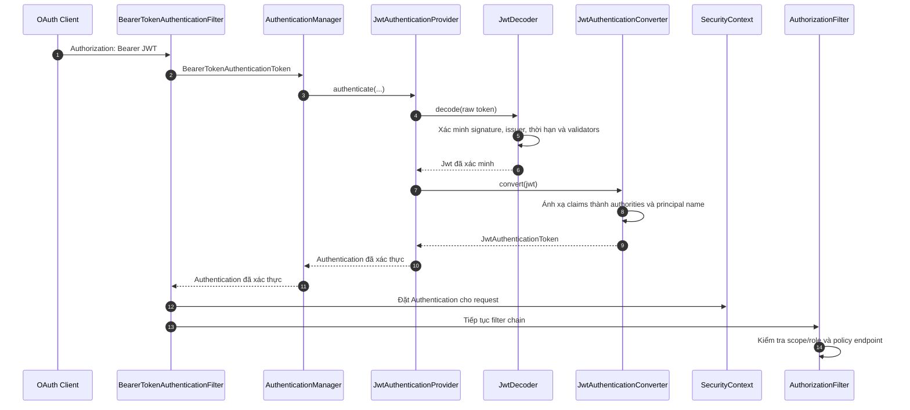

# JwtAuthenticationConverter và chuyển token thành Authentication

Trong **Spring Security OAuth 2.0 Resource Server**, một JWT access token được gửi qua HTTP header `Authorization: Bearer ...` không trực tiếp trở thành danh tính và quyền truy cập của request. Spring Security trước hết phải **xác minh token**, sau đó chuyển những claims đã được xác minh thành một đối tượng **`Authentication`** để phần còn lại của ứng dụng sử dụng.

**`JwtAuthenticationConverter`** là thành phần thực hiện bước chuyển đổi đó trong luồng xác thực JWT của Spring Security. Nó quyết định:

1. Những claims nào được diễn giải thành **`GrantedAuthority`**, thường là quyền `SCOPE_*`.
2. Claim nào được dùng làm **tên principal** khi gọi `Authentication.getName()`.
3. Đối tượng xác thực trả về, theo mặc định là **`JwtAuthenticationToken`**.

Điểm cần phân biệt: **converter không phải bộ xác minh chữ ký JWT** và **không tự quyết định API có được truy cập hay không**. Nó chạy trong luồng `JwtAuthenticationProvider` **sau khi** `JwtDecoder` trả về JWT đã được xác minh. Quyết định cuối cùng thuộc các quy tắc authorization và kiểm tra quyền nghiệp vụ.

Bài học tập trung vào **Principal và danh tính** trong Spring Security Servlet Resource Server, đồng thời giải thích cách đọc scope, role và các claim tùy chỉnh mà không nhầm danh tính user với danh tính OAuth client.

> **Ví dụ xuyên suốt:** Authorization Server có issuer `https://login.example.com`; Orders API là Resource Server với audience `orders-api`. Một access token có scope `orders.read` được phép gọi endpoint đọc đơn hàng, nhưng quyền trên từng đơn hàng vẫn phải được kiểm tra ở tầng nghiệp vụ.

## 1. Bốn đối tượng dễ nhầm trong JWT Resource Server

| Đối tượng | Nó là gì? | Chứa thông tin nào? | Vai trò bảo mật |
|---|---|---|---|
| **JWT access token** | Chuỗi bearer credential do Authorization Server cấp | Header, payload claims, chữ ký/MAC | Dữ liệu đầu vào chưa được tin ngay khi nhận request |
| **`Jwt`** | Đối tượng Spring Security biểu diễn token đã được `JwtDecoder` giải mã/xác minh | Token value, headers, claims, `sub`, `iss`, `exp`, v.v. | Đưa claims đã xác minh tới converter |
| **`JwtAuthenticationToken`** | Kết quả xác thực kiểu `Authentication` cho JWT | Principal là `Jwt`, tên principal, authorities, thông tin xác thực | Được đặt vào `SecurityContext` để phần còn lại của Spring Security sử dụng |
| **`GrantedAuthority`** | Một quyền/đặc quyền được biểu diễn bằng chuỗi | Ví dụ `SCOPE_orders.read`, `ROLE_ORDER_MANAGER` | Được kiểm tra bởi authorization rules |

**Principal** và **authorities** không phải một thứ:

- *Principal* trả lời: “Request này đang đại diện cho chủ thể nào?”
- *Authorities* trả lời: “Chủ thể được trao những quyền nào trong ngữ cảnh xác thực hiện tại?”
- *Authentication* gói các dữ liệu này lại cùng trạng thái xác thực để Spring Security có thể xử lý.
- *Authorization* quyết định liệu một action cụ thể có được phép dựa trên authentication và ngữ cảnh tài nguyên hay không.

Không nên suy luận rằng một JWT có claim `sub=user-42` đồng nghĩa user-42 được phép gọi mọi API. Điều đó còn phụ thuộc audience, scope, role, tenant và điều kiện nghiệp vụ.

## 2. Chuỗi xử lý: JWT đi đến JwtAuthenticationConverter bằng cách nào?

Luồng điển hình trong **Servlet / Spring MVC**:



Diễn giải từng bước:

1. `BearerTokenAuthenticationFilter` lấy chuỗi token từ request bằng `BearerTokenResolver` (thường là header `Authorization`).
2. Filter tạo `BearerTokenAuthenticationToken` là yêu cầu xác thực chưa được xác minh.
3. `AuthenticationManager` chuyển yêu cầu đến `JwtAuthenticationProvider` phù hợp.
4. `JwtAuthenticationProvider` gọi `JwtDecoder.decode(token)`.
5. Decoder xác minh chữ ký, thuật toán, thời gian và những claim validator được cấu hình, chẳng hạn `iss` và `aud`.
6. Khi decoder thành công, provider gọi `JwtAuthenticationConverter` để tạo `Authentication`.
7. `JwtAuthenticationToken` được đưa vào `SecurityContext`, sau đó authorization rules đánh giá quyền.
8. Request thiếu quyền bị từ chối dù chữ ký token hợp lệ.

**Quan trọng:** converter chỉ xử lý claims **sau khi decoder đã hoàn thành bước xác minh**, không lấy JSON payload do client tự gửi rồi coi đó là nguồn tin cậy.

### 2.1. JWT decode được không có nghĩa đã authenticated

Một JWT ký kiểu JWS thường có ba đoạn `header.payload.signature`. Client có thể Base64URL-decode payload mà không cần khóa. Nhưng decode chỉ giúp **đọc claims**, không chứng minh JWT do issuer tin cậy phát hành.

Ví dụ token có payload:

```json
{
  "sub": "user-42",
  "scope": "orders.write",
  "aud": "orders-api"
}
```

Nếu client tự sửa `scope` từ `orders.read` thành `orders.write`, JSON vẫn có thể đọc được, nhưng chữ ký cũ không còn hợp lệ. Bộ `JwtDecoder` đúng sẽ từ chối trước khi converter tạo authority `SCOPE_orders.write`.

Nếu bỏ decoder và tự tạo `Authentication` từ payload chưa xác minh, ứng dụng phá vỡ ranh giới tin cậy. **Không dùng `JwtAuthenticationConverter` làm bộ xác thực JWT độc lập.**

## 3. JwtAuthenticationToken chứa những gì?

`JwtAuthenticationToken` triển khai mô hình `Authentication` của Spring Security dành cho JWT. Sau khi provider xác thực thành công, có thể hiểu các thuộc tính:

| API | Giá trị điển hình | Lưu ý |
|---|---|---|
| `authentication.getPrincipal()` | Đối tượng `Jwt` | Principal **không mặc định là `UserDetails`** hay entity user trong database. |
| `authentication.getName()` | Giá trị claim `sub` mặc định | Có thể đổi claim dùng làm tên qua `setPrincipalClaimName(...)`. |
| `authentication.getAuthorities()` | Danh sách `GrantedAuthority`, ví dụ `SCOPE_orders.read` | Do authorities converter tạo từ claims đã xác minh. |
| `authentication.isAuthenticated()` | `true` khi provider đã xác thực thành công | Không có nghĩa đã được phép truy cập tất cả endpoint. |
| `jwtAuthenticationToken.getToken()` | `Jwt` đã xác minh | Token value là bearer credential nhạy cảm. |
| `jwtAuthenticationToken.getTokenAttributes()` | Claims của token | Không tự trả toàn bộ claims cho client hoặc đưa vào log. |

Trong Java có thể xem ý nghĩa loại Authentication:

```java
import org.springframework.security.core.Authentication;
import org.springframework.security.oauth2.server.resource.authentication.JwtAuthenticationToken;

if (authentication instanceof JwtAuthenticationToken jwtAuth) {
    System.out.println(jwtAuth.getName());
    // Chỉ log giá trị phù hợp chính sách riêng tư.
    // Không log raw JWT hoặc toàn bộ claims.
}
```

Ví dụ trên minh họa API, không phải khuyến nghị ghi tên chủ thể vào mọi log.

### 3.1. Principal object khác principal name

Với cấu hình mặc định:

```text
Principal object  : Jwt
Principal name    : giá trị "sub"
GrantedAuthorities: quyền chuyển từ "scope" hoặc "scp"
```

Điểm này giải thích vì sao:

- `@AuthenticationPrincipal Jwt jwt` thường hoạt động trong JWT Resource Server.
- `Authentication.getName()` thường là chuỗi định danh `sub`.
- `@AuthenticationPrincipal UserDetails user` **không mặc định hoạt động** chỉ vì request đã có access token.
- `JwtAuthenticationToken.getToken()` trả về JWT đã decode/verify, không phải một đối tượng người dùng đã tải từ database.

Nếu ứng dụng cần hồ sơ đầy đủ, có thể lấy thông tin qua service có phân quyền sau bước xác thực; không ép toàn bộ thuộc tính cá nhân vào JWT cho tiện dùng.

## 4. Hành vi mặc định của JwtAuthenticationConverter

Khi chưa cấu hình tùy chỉnh, Spring Security thường:

1. Dùng claim `sub` làm **tên principal**.
2. Dùng `JwtGrantedAuthoritiesConverter` để đọc claim scope có hỗ trợ, thông thường `scope` hoặc `scp`.
3. Thêm tiền tố `SCOPE_` cho các scope được trích xuất.
4. Trả về `JwtAuthenticationToken` có principal `Jwt` và authorities tương ứng.

Ví dụ access token:

```json
{
  "iss": "https://login.example.com",
  "sub": "user-42",
  "aud": ["orders-api"],
  "exp": 2000000000,
  "iat": 1999996400,
  "scope": "orders.read orders.write"
}
```

Sau khi token được decoder xác minh:

```text
authentication.getPrincipal()    -> Jwt
authentication.getName()         -> "user-42"
authentication.getAuthorities()  -> [
                                    "SCOPE_orders.read",
                                    "SCOPE_orders.write"
                                   ]
```

Các mốc thời gian ở trên chỉ minh họa payload. Để một request thực sự được chấp nhận, token còn cần chữ ký, issuer, audience, thời hạn và các điều kiện hợp lệ ở thời điểm gọi API.

### 4.1. Quy tắc ánh xạ `scope` và `scp`

Các Authorization Server có thể biểu diễn scope bằng một chuỗi phân cách dấu cách hoặc danh sách strings:

**Chuỗi OAuth scope:**

```json
{
  "scope": "orders.read orders.write"
}
```

**Danh sách scope:**

```json
{
  "scp": ["orders.read", "orders.write"]
}
```

Với bộ chuyển đổi mặc định hỗ trợ những cấu trúc này, các giá trị trên tạo các authority tương ứng có tiền tố `SCOPE_`.

Không nên mặc định:

- Spring tự nối **cả** `scope` và `scp` nếu token có đồng thời hai claim; converter lựa chọn claim theo quy tắc hiện hành, nên phải thống nhất một hợp đồng issuer.
- Spring tự đọc `roles`, `permissions`, `groups` hoặc nested JSON để cấp quyền.
- Claim bất kỳ tên `admin` hoặc `is_admin` được hiểu tự động là role.

Những trường tùy chỉnh cần **converter có chủ đích**, không phải thêm một claim rồi hy vọng authorization tự hiểu.

### 4.2. `hasAuthority` và `hasRole`

Spring Security phân biệt:

```java
.hasAuthority("SCOPE_orders.read")
```

với:

```java
.hasRole("ORDER_MANAGER")
```

- `hasAuthority("SCOPE_orders.read")` kiểm tra chính xác authority có tên đó.
- `hasRole("ORDER_MANAGER")` theo quy ước mặc định kiểm tra authority `ROLE_ORDER_MANAGER`; truyền vào `ORDER_MANAGER` chứ không thêm `ROLE_` một lần nữa.
- `hasAuthority("ROLE_ORDER_MANAGER")` cũng có thể kiểm tra trực tiếp tên đầy đủ nếu ứng dụng muốn thể hiện rõ tiền tố.

**Không đồng nhất scope với role**:

| Loại | Ví dụ | Ý nghĩa thường dùng |
|---|---|---|
| OAuth scope | `orders.read` | Quyền được cấp cho **OAuth client** để truy cập một phạm vi chức năng của API |
| Authority trong Spring | `SCOPE_orders.read` | Biểu diễn nội bộ của scope dùng trong authorization |
| Role nghiệp vụ | `ORDER_MANAGER` | Vai trò trong mô hình quyền của tổ chức hoặc ứng dụng |
| Authority của role | `ROLE_ORDER_MANAGER` | Biểu diễn role khi ứng dụng chủ động chuyển đổi thành authority |

Một token có `scope=orders.read` không tự mang `ROLE_ORDER_MANAGER`, và một role admin cũng không tự bảo đảm token có audience hoặc scope được phép cho API.

## 5. Cấu hình Resource Server cơ bản

Dự án Spring Boot 3.x / Spring Security 6.x sử dụng Servlet/Spring MVC, ví dụ dependencies Gradle:

```groovy
dependencies {
    implementation 'org.springframework.boot:spring-boot-starter-web'
    implementation 'org.springframework.boot:spring-boot-starter-security'
    implementation 'org.springframework.boot:spring-boot-starter-oauth2-resource-server'
}
```

Ví dụ `application.yml`:

```yaml
spring:
  security:
    oauth2:
      resourceserver:
        jwt:
          issuer-uri: https://login.example.com
          audiences:
            - orders-api
```

- `issuer-uri` xác định issuer mà JWT decoder tin cậy và dùng cho discovery/JWKS theo hỗ trợ của provider.
- `audiences` chỉ được áp dụng bởi các phiên bản Spring Boot có hỗ trợ thuộc tính này. Nếu dự án dùng phiên bản khác hoặc custom `JwtDecoder`, cần tự cài validator `aud`.
- Cấu hình này liên quan đến **JWT verification**, không phải cấu hình authorities converter.
- Nếu API yêu cầu JWT access token theo RFC 9068, còn cần kiểm tra token type `at+jwt` và những claims bắt buộc của hồ sơ; converter không thực thi các điều kiện đó.

Security chain đơn giản:

```java
package com.example.orders.security;

import org.springframework.context.annotation.Bean;
import org.springframework.context.annotation.Configuration;
import org.springframework.http.HttpMethod;
import org.springframework.security.config.Customizer;
import org.springframework.security.config.annotation.web.builders.HttpSecurity;
import org.springframework.security.web.SecurityFilterChain;

@Configuration
public class OrdersResourceServerSecurity {

    @Bean
    SecurityFilterChain apiChain(HttpSecurity http) throws Exception {
        return http
            .securityMatcher("/api/**")
            .authorizeHttpRequests(auth -> auth
                .requestMatchers(HttpMethod.GET, "/api/orders/**")
                    .hasAuthority("SCOPE_orders.read")
                .requestMatchers(HttpMethod.POST, "/api/orders/**")
                    .hasAuthority("SCOPE_orders.write")
                .anyRequest().authenticated()
            )
            .oauth2ResourceServer(oauth2 ->
                oauth2.jwt(Customizer.withDefaults())
            )
            .build();
    }
}
```

Khi request gửi `Authorization: Bearer ...`:

1. Spring lấy token.
2. JWT decoder xác minh token.
3. `JwtAuthenticationConverter` mặc định tạo `JwtAuthenticationToken`.
4. `AuthorizationFilter` kiểm tra `SCOPE_orders.read` hoặc `SCOPE_orders.write` theo endpoint.

**Chỉ những URL khớp `securityMatcher("/api/**")` mới thuộc chain này.** Trong ứng dụng thực tế, URL còn lại cần security chain/fallback policy phù hợp.

## 6. Tùy chỉnh tên principal bằng setPrincipalClaimName

Mặc định `Authentication.getName()` thường đọc claim `sub`. Một số hệ thống muốn hiển thị tên khác như `preferred_username`.

Ví dụ payload:

```json
{
  "iss": "https://login.example.com",
  "sub": "9a5d25f5-f392-4a30-93d2-928ab1b3fc1d",
  "preferred_username": "lan.nguyen",
  "email": "lan@example.com",
  "scope": "orders.read"
}
```

Có thể cấu hình:

```java
import org.springframework.context.annotation.Bean;
import org.springframework.security.oauth2.server.resource.authentication.JwtAuthenticationConverter;

@Bean
JwtAuthenticationConverter jwtAuthenticationConverter() {
    JwtAuthenticationConverter converter = new JwtAuthenticationConverter();
    converter.setPrincipalClaimName("preferred_username");
    return converter;
}
```

Khi converter đó được gắn vào Resource Server, `Authentication.getName()` sẽ dựa trên `preferred_username` theo hợp đồng token, trong khi **`authentication.getPrincipal()` vẫn là `Jwt`**.

### 6.1. Khi nào nên giữ `sub`?

Đối với phân quyền dữ liệu, cần ưu tiên **định danh ổn định**:

- `sub` thường là định danh chủ thể trong phạm vi issuer.
- `preferred_username` có thể đổi khi người dùng đổi tên đăng nhập.
- `email` có thể thay đổi, có thể không được xác minh hoặc có thể được tái sử dụng theo chính sách issuer.
- Tên hiển thị/biệt danh không nhất thiết duy nhất.

Vì vậy, nếu mục tiêu là **khóa liên kết tới bản ghi người dùng**, nên dùng cặp **`(iss, sub)`** hoặc định danh ứng dụng ổn định được xác nhận, thay vì mặc định dùng `preferred_username`/`email`.

Có thể giữ `sub` làm principal name và lấy `preferred_username` riêng cho UI khi thật sự cần. Không thay đổi `principalClaimName` chỉ để “nhìn log dễ hiểu hơn” nếu nó có thể ảnh hưởng tới kiểm tra quyền hoặc định danh trong service.

### 6.2. Nếu claim principal name bị thiếu?

Một số access token (đặc biệt token machine-to-machine) không có `preferred_username`. Nếu converter được cấu hình lấy tên từ claim đó, kết quả có thể không đúng kỳ vọng của ứng dụng và tùy phiên bản/converter có thể phát sinh lỗi hoặc tên không sử dụng được.

Cách xử lý tốt hơn:

1. Chọn claim mà **hợp đồng issuer bảo đảm có mặt** trong loại token API chấp nhận.
2. Nếu cần danh tính ổn định, ưu tiên `sub` trong ngữ cảnh issuer.
3. Nếu có nhiều loại token, phân định chính sách client credentials/user-delegated trước khi chọn name mapping.
4. Khi claim bắt buộc bị thiếu, từ chối token qua validator thích hợp thay vì âm thầm tạo principal giả.

**`setPrincipalClaimName` không tự xác minh claim có tồn tại/duy nhất/đúng kiểu** theo yêu cầu nghiệp vụ. Converter không thay validator.

## 7. Tùy chỉnh authorities từ một claim khác

Có Authorization Server phát hành danh sách quyền ở `permissions` thay vì `scope`:

```json
{
  "iss": "https://login.example.com",
  "sub": "user-42",
  "aud": ["orders-api"],
  "permissions": [
    "orders.read",
    "orders.export"
  ]
}
```

Nếu đây là **hợp đồng đã được thống nhất** giữa AS và Orders API, có thể hướng `JwtGrantedAuthoritiesConverter` đọc claim đó.

```java
import org.springframework.context.annotation.Bean;
import org.springframework.security.oauth2.server.resource.authentication.JwtAuthenticationConverter;
import org.springframework.security.oauth2.server.resource.authentication.JwtGrantedAuthoritiesConverter;

@Bean
JwtAuthenticationConverter customPermissionsConverter() {
    JwtGrantedAuthoritiesConverter grantedAuthorities =
        new JwtGrantedAuthoritiesConverter();

    grantedAuthorities.setAuthoritiesClaimName("permissions");
    grantedAuthorities.setAuthorityPrefix("PERMISSION_");

    JwtAuthenticationConverter jwtConverter =
        new JwtAuthenticationConverter();
    jwtConverter.setJwtGrantedAuthoritiesConverter(grantedAuthorities);

    // Giữ tên principal mặc định dựa trên sub.
    return jwtConverter;
}
```

Kết quả:

```text
JWT claim: ["orders.read", "orders.export"]

GrantedAuthorities:
  PERMISSION_orders.read
  PERMISSION_orders.export
```

Endpoint có thể kiểm tra:

```java
.requestMatchers("/api/export/**")
    .hasAuthority("PERMISSION_orders.export")
```

**Điểm rất quan trọng:** việc thay `authoritiesClaimName` thành `permissions` khiến converter này **không còn mặc định lấy scope từ `scope/scp`** để tạo `SCOPE_*`. Nếu SecurityFilterChain vẫn dùng `hasAuthority("SCOPE_orders.read")`, request có thể bị `403` dù JWT hợp lệ.

Nếu API cần **cả scope lẫn permissions/roles**, phải xây converter hợp nhất một cách có chủ đích như phần sau.

### 7.1. Đổi prefix cho scope

Nếu vẫn dùng `scope` nhưng muốn tên authority tùy chỉnh:

```java
JwtGrantedAuthoritiesConverter grantedAuthorities =
    new JwtGrantedAuthoritiesConverter();

grantedAuthorities.setAuthoritiesClaimName("scope");
grantedAuthorities.setAuthorityPrefix("SCOPE_");
```

Trên thực tế `SCOPE_` đã là prefix phổ biến mặc định. Nếu đổi thành `AUTH_`:

```java
grantedAuthorities.setAuthorityPrefix("AUTH_");
```

thì `orders.read` sẽ thành `AUTH_orders.read`. Mọi `hasAuthority(...)` và `@PreAuthorize(...)` phải thống nhất theo prefix mới.

**Không bỏ prefix chỉ để ngắn hơn** nếu trong hệ thống vừa có scope vừa có role. Prefix rõ ràng làm giảm nhầm lẫn giữa các loại quyền và tránh trùng tên.

### 7.2. Định dạng chuỗi và dấu phân cách

Một số issuer trả claim scope dưới dạng chuỗi có dấu phân cách riêng. `JwtGrantedAuthoritiesConverter` có API `setAuthoritiesClaimDelimiter(...)` ở các bản Spring Security hỗ trợ (ví dụ từ 6.1), để thay dấu phân cách mặc định.

Ví dụ chỉ có thể dùng **khi issuer thực sự phát hành claim đó**:

```java
JwtGrantedAuthoritiesConverter permissions =
    new JwtGrantedAuthoritiesConverter();

permissions.setAuthoritiesClaimName("permissions");
permissions.setAuthoritiesClaimDelimiter(",");
permissions.setAuthorityPrefix("PERMISSION_");
```

Với claim:

```json
{
  "permissions": "orders.read,orders.export"
}
```

Không áp dụng delimiter tùy chỉnh cho claim `scope` theo chuẩn OAuth chỉ vì một client gửi dữ liệu sai. Scope OAuth dạng chuỗi thường phân cách bằng khoảng trắng; nên sửa hợp đồng phát hành tại Authorization Server nếu định dạng sai.

## 8. Kết hợp scope và roles trong một JwtAuthenticationConverter

Một trường hợp thực tế là access token có **scope OAuth** và **role nghiệp vụ** ở một claim riêng.

Ví dụ:

```json
{
  "iss": "https://login.example.com",
  "sub": "user-42",
  "aud": ["orders-api"],
  "scope": "orders.read orders.write",
  "realm_access": {
    "roles": ["ORDER_VIEWER", "ORDER_MANAGER"]
  }
}
```

`JwtGrantedAuthoritiesConverter` mặc định không tự trích xuất đường dẫn lồng nhau `realm_access.roles`. Nếu API cần các role này, có thể viết `Converter<Jwt, Collection<GrantedAuthority>>` tùy chỉnh:

```java
package com.example.orders.security;

import java.util.Collection;
import java.util.LinkedHashSet;
import java.util.Map;
import java.util.Set;

import org.springframework.core.convert.converter.Converter;
import org.springframework.security.core.GrantedAuthority;
import org.springframework.security.core.authority.SimpleGrantedAuthority;
import org.springframework.security.oauth2.jwt.Jwt;
import org.springframework.security.oauth2.server.resource.authentication.JwtGrantedAuthoritiesConverter;

public final class OrdersAuthoritiesConverter
        implements Converter<Jwt, Collection<GrantedAuthority>> {

    private static final Set<String> ALLOWED_ROLES = Set.of(
        "ORDER_VIEWER",
        "ORDER_MANAGER"
    );

    private final JwtGrantedAuthoritiesConverter scopes =
        new JwtGrantedAuthoritiesConverter();

    @Override
    public Collection<GrantedAuthority> convert(Jwt jwt) {
        Set<GrantedAuthority> result = new LinkedHashSet<>();

        // Giữ scope OAuth theo mapping mặc định: SCOPE_*
        result.addAll(scopes.convert(jwt));

        // Chỉ diễn giải role theo hợp đồng đã kiểm chứng với issuer.
        Object claim = jwt.getClaim("realm_access");
        if (claim instanceof Map<?, ?> realm) {
            Object rawRoles = realm.get("roles");
            if (rawRoles instanceof Collection<?> roleNames) {
                for (Object item : roleNames) {
                    if (item instanceof String role
                            && ALLOWED_ROLES.contains(role)) {
                        result.add(
                            new SimpleGrantedAuthority("ROLE_" + role)
                        );
                    }
                }
            }
        }

        return result;
    }
}
```

Đăng ký converter này:

```java
import org.springframework.context.annotation.Bean;
import org.springframework.security.oauth2.server.resource.authentication.JwtAuthenticationConverter;

@Bean
JwtAuthenticationConverter ordersJwtAuthenticationConverter() {
    JwtAuthenticationConverter converter =
        new JwtAuthenticationConverter();

    converter.setJwtGrantedAuthoritiesConverter(
        new OrdersAuthoritiesConverter()
    );

    return converter;
}
```

Với payload ví dụ đã được xác minh, authorities sẽ có:

```text
SCOPE_orders.read
SCOPE_orders.write
ROLE_ORDER_VIEWER
ROLE_ORDER_MANAGER
```

**Vì sao có allowlist `ALLOWED_ROLES`?**

- Tránh ánh xạ toàn bộ chuỗi không kiểm soát thành quyền mới.
- Làm rõ role nào thực sự có ý nghĩa đối với Orders API.
- Giảm rủi ro cấp role ngoài dự kiến khi issuer thêm nhóm/role mới.
- Cho phép review sự thay đổi quyền ở Resource Server, không coi mọi claim tùy ý là policy an toàn.

Allowlist chỉ là một lớp phòng thủ. Nếu issuer bị cấu hình sai hoặc khóa ký bị lộ, mọi claim chứa trong JWT có thể không còn đáng tin; cần bảo vệ issuer, signing keys, audience và quy tắc ủy quyền từ gốc.

### 8.1. Gắn converter vào SecurityFilterChain

Khi có bean `JwtAuthenticationConverter`:

```java
package com.example.orders.security;

import org.springframework.context.annotation.Bean;
import org.springframework.context.annotation.Configuration;
import org.springframework.http.HttpMethod;
import org.springframework.security.config.annotation.web.builders.HttpSecurity;
import org.springframework.security.oauth2.server.resource.authentication.JwtAuthenticationConverter;
import org.springframework.security.web.SecurityFilterChain;

@Configuration
public class OrdersSecurityConfiguration {

    @Bean
    SecurityFilterChain ordersApiChain(
            HttpSecurity http,
            JwtAuthenticationConverter ordersJwtAuthenticationConverter)
            throws Exception {

        return http
            .securityMatcher("/api/**")
            .authorizeHttpRequests(auth -> auth
                .requestMatchers(HttpMethod.GET, "/api/orders/**")
                    .hasAuthority("SCOPE_orders.read")
                .requestMatchers(HttpMethod.POST, "/api/orders/**")
                    .hasAuthority("SCOPE_orders.write")
                .requestMatchers(HttpMethod.DELETE, "/api/orders/**")
                    .hasRole("ORDER_MANAGER")
                .anyRequest().authenticated()
            )
            .oauth2ResourceServer(oauth2 -> oauth2
                .jwt(jwt -> jwt
                    .jwtAuthenticationConverter(
                        ordersJwtAuthenticationConverter
                    )
                )
            )
            .build();
    }
}
```

Trong ví dụ:

- `GET` yêu cầu scope `orders.read`.
- `POST` yêu cầu scope `orders.write`.
- `DELETE` yêu cầu role `ORDER_MANAGER` được converter thêm thành `ROLE_ORDER_MANAGER`.
- Resource Server còn phải kiểm tra `iss`, `aud`, signature, thời hạn và quyền trên **từng bản ghi** ở service.

Đây là một **mô hình minh họa về mapping**, không phải khuyến nghị mọi request DELETE chỉ cần role mà không cần scope. Endpoint nhạy cảm có thể cần **đồng thời role và scope** cùng kiểm tra nghiệp vụ:

```java
import org.springframework.security.access.prepost.PreAuthorize;

@PreAuthorize(
    "hasAuthority('SCOPE_orders.delete') and hasRole('ORDER_MANAGER')"
)
public void deleteOrder(String orderId) {
    // Service phải kiểm tra tenant/ownership/trạng thái đơn hàng.
}
```

Để dùng `@PreAuthorize`, cần bật method security phù hợp (ví dụ `@EnableMethodSecurity` trong cấu hình Spring Security) và gọi qua cơ chế proxy Spring như bình thường. Các ví dụ route-level và method-level phải được thiết kế nhất quán.

### 8.2. Có nên dùng nested role của mọi issuer?

Không nên. Các claim như `realm_access.roles`, `resource_access` hoặc `groups` thường là **quy ước của một nhà cung cấp định danh**, không phải cấu trúc JWT chung bắt buộc theo RFC.

Với hệ thống nhiều issuer:

- Trước hết phải xác minh `iss` và `aud` của token.
- Mỗi issuer có thể dùng format claim riêng; converter không nên diễn giải dữ liệu ngoài hợp đồng.
- Role toàn cục của một realm không tự đồng nghĩa role của Orders API.
- Cần phân biệt role thuộc **client**, **tenant** hay **resource** để tránh cross-application privilege escalation.
- Không áp dụng một converter đọc mọi role từ mọi issuer rồi ghép thành quyền cao nếu tên role tình cờ giống nhau.

## 9. Principal trong luồng user và machine-to-machine

Trong OAuth 2.0, không phải access token nào cũng đại diện cho **người dùng cuối**.

### 9.1. Authorization Code: token đại diện cho user theo ngữ cảnh ủy quyền

Ví dụ một access token user-delegated:

```json
{
  "iss": "https://login.example.com",
  "sub": "user-42",
  "client_id": "web-orders",
  "aud": ["orders-api"],
  "scope": "orders.read"
}
```

Ý nghĩa:

- `sub=user-42` là subject mà issuer xác định.
- `client_id=web-orders` là OAuth client nhận token.
- `aud=orders-api` là Resource Server được phép nhận.
- `scope=orders.read` là quyền đã được cấp.

**Không nên lấy `client_id` làm tên người dùng** nếu API xử lý dữ liệu theo danh tính user. `client_id` mô tả ứng dụng/client, không phải chủ sở hữu dữ liệu cá nhân.

### 9.2. Client Credentials: token đại diện cho ứng dụng

Một token `client_credentials` có thể như sau:

```json
{
  "iss": "https://login.example.com",
  "sub": "inventory-worker",
  "client_id": "inventory-worker",
  "aud": ["orders-api"],
  "scope": "orders.read"
}
```

Ở đây `sub` có thể đại diện ứng dụng/service theo hợp đồng issuer, không có user đang tương tác. `Authentication.getName()` sẽ là một định danh máy nếu dùng mapping `sub`.

Những điều cần tránh:

- Cho token client_credentials truy cập dữ liệu user vì `getName()` tình cờ trùng username.
- Giả định `@AuthenticationPrincipal Jwt` luôn chứa email hoặc hồ sơ người dùng.
- Gán mọi token M2M thành vai trò `ROLE_USER` mà không xét grant/subject/client policy.
- Xem `sub` như định danh toàn cục giữa các issuer.

Cặp **`(issuer, subject)`** và ngữ cảnh client/grant là cơ sở tốt hơn để xác định chủ thể, khi hệ thống có nhiều issuer hoặc nhiều loại access token.

### 9.3. Principal name có thể không phải định danh nghiệp vụ

`Authentication.getName()` là một tên principal thuận tiện cho Spring Security, **không phải khóa ngoại mặc định của database**. Tên này có thể thay đổi nếu converter thay `principalClaimName` hoặc mô hình issuer thay đổi.

Nếu ứng dụng cần liên kết chủ thể OAuth với user nội bộ, nên có lớp mapping riêng:

```text
JWT đã xác minh
  issuer + subject
       ↓
Bảng ánh xạ danh tính tin cậy / domain service
       ↓
internalUserId hoặc servicePrincipalId
       ↓
Kiểm tra tenant và quyền trên dữ liệu
```

Không sao chép claim email vào database làm khóa định danh duy nhất chỉ vì email dễ đọc.

## 10. Đọc Authentication trong controller

### 10.1. Lấy Jwt bằng @AuthenticationPrincipal

```java
package com.example.orders.api;

import java.util.Map;

import org.springframework.security.core.annotation.AuthenticationPrincipal;
import org.springframework.security.oauth2.jwt.Jwt;
import org.springframework.web.bind.annotation.GetMapping;
import org.springframework.web.bind.annotation.RestController;

@RestController
public class IdentityController {

    @GetMapping("/api/me")
    public Map<String, String> me(@AuthenticationPrincipal Jwt jwt) {
        // Token đã đi qua JwtDecoder và provider của Resource Server.
        return Map.of(
            "subject", jwt.getSubject(),
            "issuer", jwt.getIssuer().toString()
        );
    }
}
```

Ví dụ giả định endpoint yêu cầu authentication và JWT đáp ứng hợp đồng `sub`/`iss`. Không trả nguyên `Jwt` hoặc `jwt.getClaims()` trong production response: token có thể chứa metadata quyền hoặc dữ liệu cá nhân không nên tiết lộ rộng hơn.

### 10.2. Lấy Authentication để xem name và authorities

```java
package com.example.orders.api;

import java.util.List;
import java.util.Map;

import org.springframework.security.core.Authentication;
import org.springframework.web.bind.annotation.GetMapping;
import org.springframework.web.bind.annotation.RestController;

@RestController
class AuthInfoController {

    @GetMapping("/api/auth-summary")
    Map<String, Object> summary(Authentication authentication) {
        List<String> authorities = authentication.getAuthorities()
            .stream()
            .map(a -> a.getAuthority())
            .toList();

        return Map.of(
            "name", authentication.getName(),
            "authorities", authorities
        );
    }
}
```

Đoạn code nhằm minh họa kết quả mapping. Ở hệ thống thật, việc trả toàn bộ authorities có thể làm lộ cấu trúc quyền nội bộ; nên giới hạn endpoint test/debug, hoặc chỉ trả dữ liệu cần thiết cho UI theo chính sách.

### 10.3. Authentication trong SecurityContextHolder

Ở tầng service Servlet đồng bộ có thể truy cập:

```java
import org.springframework.security.core.Authentication;
import org.springframework.security.core.context.SecurityContextHolder;

Authentication authentication =
    SecurityContextHolder.getContext().getAuthentication();
```

Cần hiểu giới hạn:

- `SecurityContext` thường gắn với **ngữ cảnh xử lý request**, không nên coi đó là phiên đăng nhập lưu mãi.
- Với xử lý async hoặc thread do ứng dụng tự tạo, việc truyền SecurityContext cần cơ chế thích hợp, không tự giả định ThreadLocal sẽ có mặt trên mọi worker thread.
- Đối với API dùng bearer, client thông thường gửi access token cho **mỗi request**; không dựa vào việc request trước đã authenticated để request sau tự hợp lệ.
- Trong nghiệp vụ, ưu tiên truyền định danh/authorization context cần thiết qua interface rõ ràng thay vì để mọi service tùy ý đọc raw JWT.

## 11. Opaque token có dùng JwtAuthenticationConverter không?

**Không phải luồng mặc định.** Khi Resource Server dùng opaque token introspection:

```text
BearerTokenAuthenticationFilter
    → OpaqueTokenAuthenticationProvider
    → OpaqueTokenIntrospector
    → BearerTokenAuthentication
```

Principal thường là `OAuth2AuthenticatedPrincipal` với attributes/authorities được introspector hoặc converter tương ứng cung cấp; không phải `Jwt` qua `JwtAuthenticationConverter`.

Cấu hình opaque mẫu:

```yaml
spring:
  security:
    oauth2:
      resourceserver:
        opaquetoken:
          introspection-uri: https://login.example.com/oauth2/introspect
          client-id: orders-api-introspection
          client-secret: REPLACE_WITH_SECRET_FROM_MANAGER
```

Giá trị client secret trên chỉ là placeholder, không phải credential thật. Khi triển khai, lấy secret từ secret manager/environment phù hợp; không commit vào repository.

**Không cố ép opaque token qua `JwtAuthenticationConverter`** để dùng lại logic một cách mù quáng. Nếu cả JWT lẫn opaque cần chung chính sách quyền, hãy tách mapping domain theo abstraction phù hợp và giữ từng đường xác thực độc lập.

## 12. Authentication khác Authorization

Trong SecurityFilterChain:

```java
.authorizeHttpRequests(auth -> auth
    .requestMatchers("/api/public/**").permitAll()
    .requestMatchers("/api/orders/**")
        .hasAuthority("SCOPE_orders.read")
    .anyRequest().authenticated()
)
```

Có hai câu hỏi:

1. **Authentication:** Token có hợp lệ? Ai là principal? Converter đã tạo authorities gì?
2. **Authorization:** Để gọi đường dẫn này, authentication có đáp ứng rule không?

Kết quả thường gặp:

| Tình huống | Trạng thái | Cách hiểu |
|---|---|---|
| Không có Bearer token ở endpoint bảo vệ | Thường `401` | Chưa authenticated |
| Token sai signature, issuer, audience hoặc đã hết hạn | Thường `401 invalid_token` | JwtDecoder/provider từ chối, chưa tới bước converter đáng tin |
| Token hợp lệ nhưng chỉ có `SCOPE_orders.read` khi endpoint yêu cầu `SCOPE_orders.write` | Thường `403 Forbidden` | Authentication hợp lệ, nhưng authority thiếu |
| Token hợp lệ, scope đúng nhưng subject không được đọc đơn hàng 42 | `403` hoặc `404` theo chính sách | Cần kiểm tra quyền trên đối tượng |
| Token hợp lệ, converter trỏ sai claim permissions khiến authorities rỗng | Thường `403` trên endpoint yêu cầu quyền | Lỗi hợp đồng claim-to-authority, không phải lỗi chữ ký |
| Token hợp lệ, mọi quyền phù hợp | Có thể tới controller | Service vẫn kiểm tra tenant/ownership |

Một lỗi phổ biến là **nới lỏng decoder** vì API trả `403`. Cách đúng là xem token đã được verify chưa, authorities nào được tạo và endpoint yêu cầu authority gì; không tắt signature/issuer/audience validation để xử lý thiếu quyền.

### 12.1. Scope đủ chưa chắc được đọc bản ghi

Ví dụ `SCOPE_orders.read` cho phép gọi API đọc đơn hàng, nhưng một user `sub=user-42` không tự động được xem đơn hàng thuộc người khác.

Tầng service vẫn cần kiểm tra:

```java
public OrderDto readOrder(
        String orderId,
        Authentication authentication) {

    Order order = orderRepository.findById(orderId)
        .orElseThrow(OrderNotFoundException::new);

    if (!orderAccessPolicy.canRead(authentication, order)) {
        throw new AccessDeniedException("Not allowed");
    }

    return orderMapper.toDto(order);
}
```

Đây là ví dụ nghiệp vụ rút gọn, giả định các class domain có sẵn. Converter **không thay thế** truy vấn phân quyền theo chủ sở hữu, tenant hoặc trạng thái tài nguyên.

## 13. Lọc authorities theo issuer, audience và tenant

Converter nhận đối tượng `Jwt` đã qua decoder, nhưng việc **claim đã xác minh** không có nghĩa claim đó tự có **quyền gì trong Orders API**.

Ví dụ hai token đều có claim:

```json
{
  "roles": ["ADMIN"]
}
```

Chúng có thể có các ý nghĩa khác nhau:

- Issuer A: `ADMIN` là quản trị Orders API.
- Issuer B: `ADMIN` chỉ là quản trị ứng dụng đăng nhập.
- Issuer A, tenant X: `ADMIN` chỉ áp dụng tenant X.
- Issuer A, token dành cho Billing API: `ADMIN` không phải quyền của Orders API.

**Thêm `ROLE_ADMIN` vô điều kiện từ bất kỳ claim `roles` nào là quyết định nguy hiểm.**

Thiết kế tốt cần:

1. Xác minh đúng **`iss`** với danh sách issuer được phép.
2. Xác minh token được phát hành cho **`aud=orders-api`**.
3. Xác nhận loại access token/token profile phù hợp; không nhận ID token.
4. Hiểu claim role/scope thuộc **resource** và **tenant** nào.
5. Ánh xạ có allowlist/tên quyền riêng của ứng dụng.
6. Kiểm tra quyền theo bản ghi/tenant ở authorization layer, không chỉ dựa vào role string.

Nếu multi-tenant, không tạo một authority toàn cục `ROLE_ADMIN` mà bỏ mất tenant scope; có thể dùng quyền có namespace và kiểm tra tài nguyên theo tenant trong chính sách service.

## 14. Vấn đề với claim sub, email và preferred_username

| Claim | Có nên làm principal name? | Rủi ro/cân nhắc |
|---|---|---|
| `sub` | **Thường là lựa chọn ổn định nhất trong phạm vi issuer** | Không mặc định là toàn cục giữa các issuer; có thể đại diện service trong client_credentials |
| `preferred_username` | Dùng khi cần tên dễ đọc, hợp đồng bảo đảm | Có thể đổi, có thể không duy nhất, có thể thiếu ở token máy |
| `email` | Không nên làm khóa định danh nghiệp vụ mặc định | Có thể đổi, rò thông tin cá nhân, không mặc định được xác minh |
| `client_id` | Có ý nghĩa với chính sách OAuth client | Không đồng nghĩa danh tính người dùng cuối |
| `name` / `given_name` | Phù hợp hiển thị | Không ổn định hoặc không duy nhất |
| Claim tùy chỉnh `employee_id` | Có thể dùng khi issuer/hợp đồng bảo đảm | Cần quy tắc namespace, kiểu dữ liệu, tính ổn định và kiểm tra thuộc tính |

Trong OIDC còn có khái niệm **pairwise subject** để tránh liên kết danh tính giữa các client một cách không cần thiết. Vì vậy không nên giả định mọi issuer/client đều phát hành `sub` có nghĩa giống nhau.

Nếu ứng dụng thực sự cần hiển thị tên cho frontend, tốt hơn là lấy profile đã được phân quyền hoặc claim hiển thị phù hợp **tách biệt** với khóa định danh bảo mật.

## 15. Đừng nhầm access token với ID token

**ID token** của OIDC là JWT dành cho **OAuth/OIDC client** xác minh kết quả đăng nhập. **Access token** dành cho Resource Server kiểm tra quyền truy cập API.

Cả hai có thể:

- Là JWT có ba đoạn.
- Được ký bởi cùng issuer và cùng bộ public keys.
- Chứa `sub`, `iss`, `exp` và các claim nhận dạng.

Nếu Resource Server chỉ dựa vào chữ ký và converter rồi tự tạo `JwtAuthenticationToken`, nó có nguy cơ nhận nhầm ID token làm quyền gọi API.

Cần xác minh:

- Token có đúng **loại access token** mà API chấp nhận không?
- `aud` có chứa Resource Server identifier được mong đợi không?
- `iss` có đúng issuer không?
- Token có còn hiệu lực và đáp ứng token profile được thỏa thuận không?
- Scope/authority có thực sự được cấp để gọi API không?

Khi áp dụng hồ sơ **RFC 9068 JWT access token**, kiểm tra JOSE `typ=at+jwt` hoặc `application/at+jwt` cùng những required claims phù hợp. **`JwtAuthenticationConverter` không tự làm tất cả các kiểm tra này**: cần validator/decoder thích hợp.

## 16. Kiểm thử JwtAuthenticationConverter độc lập

Một lợi ích của converter là có thể kiểm tra **quy tắc mapping** tách biệt khỏi network, JWKS và HTTP.

### 16.1. Unit test mapping scope mặc định

Ví dụ JUnit 5, dùng đối tượng `Jwt` do test tự tạo:

```java
package com.example.orders.security;

import java.util.Set;
import java.util.stream.Collectors;

import org.junit.jupiter.api.Test;
import org.springframework.security.core.GrantedAuthority;
import org.springframework.security.oauth2.jwt.Jwt;
import org.springframework.security.oauth2.server.resource.authentication.JwtAuthenticationConverter;
import org.springframework.security.oauth2.server.resource.authentication.JwtAuthenticationToken;

import static org.assertj.core.api.Assertions.assertThat;

class JwtAuthenticationConverterTest {

    @Test
    void mapsScopeToAuthoritiesAndSubjectToName() {
        Jwt jwt = Jwt.withTokenValue("test-token-value")
            .header("alg", "RS256")
            .claim("sub", "user-42")
            .claim("scope", "orders.read orders.write")
            .build();

        JwtAuthenticationConverter converter =
            new JwtAuthenticationConverter();

        JwtAuthenticationToken authentication =
            (JwtAuthenticationToken) converter.convert(jwt);

        Set<String> names = authentication.getAuthorities()
            .stream()
            .map(GrantedAuthority::getAuthority)
            .collect(Collectors.toSet());

        assertThat(authentication.getName()).isEqualTo("user-42");
        assertThat(names).contains(
            "SCOPE_orders.read",
            "SCOPE_orders.write"
        );
        assertThat(authentication.getPrincipal()).isSameAs(jwt);
    }
}
```

Đây là **unit test converter**; `Jwt.withTokenValue(...)` tạo đối tượng JWT thử nghiệm mà **không đi qua xác minh signature thực tế**. Kết quả test chứng minh mapping hoạt động, **không chứng minh Resource Server đã chặn JWT bị giả mạo**.

### 16.2. Unit test role tùy chỉnh

Với `OrdersAuthoritiesConverter` từ phần trước:

```java
@Test
void mapsOnlyAllowedRolesFromRealmAccess() {
    Jwt jwt = Jwt.withTokenValue("test-token-value")
        .header("alg", "RS256")
        .claim("sub", "user-42")
        .claim("scope", "orders.read")
        .claim("realm_access", Map.of(
            "roles", List.of("ORDER_MANAGER", "UNEXPECTED_SUPER_ADMIN")
        ))
        .build();

    OrdersAuthoritiesConverter converter =
        new OrdersAuthoritiesConverter();

    Set<String> authorities = converter.convert(jwt)
        .stream()
        .map(GrantedAuthority::getAuthority)
        .collect(Collectors.toSet());

    assertThat(authorities).contains(
        "SCOPE_orders.read",
        "ROLE_ORDER_MANAGER"
    );

    assertThat(authorities)
        .doesNotContain("ROLE_UNEXPECTED_SUPER_ADMIN");
}
```

Đoạn test minh họa đặt trong một test class có imports `Map`, `List`, `Set`, `Collectors` và AssertJ/JUnit như ví dụ ở trên.

Nên bao gồm những trường hợp nghiệp vụ:

| Trường hợp test | Mong đợi |
|---|---|
| Có `scope` là chuỗi | Tạo `SCOPE_*` tương ứng |
| Có `scp` là danh sách | Tạo `SCOPE_*` theo cấu trúc được hỗ trợ |
| Không có claim scope | Không tự sinh quyền `SCOPE_*` |
| `roles` chứa role ngoài allowlist | Không cấp authority ngoài danh sách |
| `realm_access` không phải map | Converter xử lý an toàn, không cấp role ngoài dự kiến |
| `preferred_username` thiếu | Hợp đồng/validator xử lý, không dựa vào tên giả |
| Token machine-to-machine | Principal name và quyền phản ánh service/client policy, không giả định user |
| Role cùng tên nhưng khác issuer/tenant | Chỉ mapping theo policy của issuer/tenant được phép |

### 16.3. Integration test khác unit test converter

Với `MockMvc`, `SecurityMockMvcRequestPostProcessors.jwt()` có thể tạo authentication giả lập để kiểm tra quyền endpoint:

```java
mvc.perform(
    get("/api/orders/42")
        .with(jwt().authorities(
            new SimpleGrantedAuthority("SCOPE_orders.read")
        ))
).andExpect(status().isOk());
```

Test này hữu ích cho **authorization** nhưng không chứng minh converter thực chạy trên JWT lấy từ header và không xác minh chữ ký JWT thật. Để kiểm tra luồng end-to-end:

1. Gửi HTTP request có header `Authorization: Bearer <test JWT>`.
2. Dùng issuer/JWKS hoặc `JwtDecoder` được thiết lập kiểm soát cho integration test.
3. Đảm bảo filter chain thật gọi provider và converter.
4. Kiểm tra token sai chữ ký/issuer/audience bị `401`.
5. Kiểm tra token hợp lệ nhưng mapping thiếu quyền bị `403`.
6. Kiểm tra token hợp lệ đủ quyền mới tới controller.
7. Kiểm tra profile token (ví dụ không chấp nhận ID token) theo hợp đồng.

Không coi một bài test `jwt()` tạo authentication trực tiếp là bằng chứng hệ thống đã cấu hình JWT validation đúng.

## 17. Những lỗi thường gặp và cách tìm đúng tầng

### Lỗi 1 — JWT hợp lệ nhưng endpoint luôn trả 403

Nguyên nhân có thể là converter đọc sai claim:

```json
{
  "scope": "orders.read"
}
```

nhưng cấu hình:

```java
grantedAuthorities.setAuthoritiesClaimName("permissions");
```

Khi đó converter không đọc `scope` và có thể không tạo `SCOPE_orders.read`.

**Cách xử lý:** xem hợp đồng claims và mapping converter; không tắt kiểm tra signature hoặc đổi endpoint thành `permitAll()`.

### Lỗi 2 — Role admin có trong token nhưng hasRole("ADMIN") thất bại

JWT:

```json
{
  "roles": ["ADMIN"]
}
```

Mặc định Spring không tự biến claim này thành `ROLE_ADMIN`. Cần converter role có chủ đích và xác định role có đúng audience/tenant và được phép cấp quyền API hay không.

### Lỗi 3 — getName() là UUID thay vì email

Đây thường là hành vi bình thường: tên principal lấy từ `sub`, có thể là UUID.

Nếu cần email để hiển thị, đọc qua kênh thông tin phù hợp. Nếu đổi `principalClaimName("email")`, cần hiểu rủi ro email đổi hoặc thiếu; không dùng email làm identity key chỉ để tên đẹp.

### Lỗi 4 — @AuthenticationPrincipal UserDetails không có giá trị

JWT Resource Server mặc định đưa `Jwt` làm principal. `UserDetails` không tự được nạp từ database.

Dùng `@AuthenticationPrincipal Jwt` hoặc `Authentication`. Nếu ứng dụng cần principal domain tùy chỉnh, thiết kế converter với `Authentication` riêng và cơ chế nạp/đối chiếu danh tính có kiểm soát, thay vì mặc định đoán từ claim.

### Lỗi 5 — Token đến từ issuer khác vẫn xuất hiện role giống nhau

Hai issuer có thể dùng cùng chuỗi `ADMIN` với ý nghĩa khác nhau. Nếu API không kiểm tra issuer/audience hoặc converter bỏ qua namespace, token ngoài hợp đồng có thể được cấp quyền không phù hợp.

Cần thiết lập issuer allowlist, validator đầy đủ và mapping theo resource/tenant.

### Lỗi 6 — JWT decoder báo 401 nhưng sửa converter không giúp

`401 invalid_token` thường cho biết token chưa vượt qua bước xác minh như chữ ký, thời hạn, issuer, audience hoặc token profile. Converter thường **chưa được dùng** khi decoder từ chối.

Cần chẩn đoán `JwtDecoder`/key/claims validators trước khi xem phần authority mapping.

### Lỗi 7 — API dùng opaque token nhưng converter JWT không chạy

Opaque resource server dùng provider và principal khác. Cần cấu hình chính sách introspection/authority cho opaque token; `JwtAuthenticationConverter` không phải bước mặc định của luồng này.

### Lỗi 8 — Converter tùy chỉnh vô tình mất các scopes

Khi `setJwtGrantedAuthoritiesConverter(...)` nhận một converter chỉ đọc roles mà không gọi `JwtGrantedAuthoritiesConverter` cho scope, các authority `SCOPE_*` sẽ biến mất. Nếu API vẫn yêu cầu scope, request bị `403`.

Khi cần kết hợp, hãy **hợp nhất** kết quả scope và role theo hợp đồng, như `OrdersAuthoritiesConverter`.

## 18. Cách thiết kế danh tính an toàn từ access token

Có thể dùng một chuỗi quyết định rõ ràng:

```text
Token được nhận qua Authorization: Bearer
                |
                v
      JwtDecoder xác minh token
   signature / iss / aud / exp / typ
                |
                v
       JwtAuthenticationConverter
                |
        +-------+--------+
        |                |
        v                v
  Principal name    GrantedAuthorities
  (sub mặc định)     SCOPE_* / ROLE_* có kiểm soát
        |                |
        +-------+--------+
                |
                v
        JwtAuthenticationToken
                |
                v
           SecurityContext
                |
                v
       Authorization policies
     route, method, tenant, ownership
```

Khi xây hệ thống thực tế, nên đặt ra một số câu hỏi:

1. **Token này là access token nào?** JWT theo profile nào, issuer/audience/thuật toán nào?
2. **`sub` đại diện cho ai?** Người dùng, ứng dụng hay chủ thể được trao đổi token?
3. **Tên principal có ổn định không?** Có cần dùng cặp `(iss, sub)` hoặc internal ID?
4. **Claims quyền nào được phép diễn giải?** `scope`, `scp`, `roles`, `permissions`; cấu trúc và namespace là gì?
5. **Role có được cấp cho đúng API/tenant không?** Không trao quyền chỉ vì trùng tên.
6. **API cần scope, role hay cả hai?** Mapping phải tương ứng chính sách endpoint và service.
7. **Những dữ liệu nào không được log/trả ra?** Bearer token, PII, metadata nhạy cảm.
8. **Unit test mapping và integration test xác thực có tách biệt không?** Cả hai cần được hiểu đúng.

## 19. Tài liệu tham khảo

- [Spring Security — OAuth 2.0 Resource Server JWT](https://docs.spring.io/spring-security/reference/servlet/oauth2/resource-server/jwt.html): giải mã JWT, scope mapping và tùy chỉnh authorities.
- [Spring Security API — JwtAuthenticationConverter](https://docs.spring.io/spring-security/site/docs/current/api/org/springframework/security/oauth2/server/resource/authentication/JwtAuthenticationConverter.html): `setJwtGrantedAuthoritiesConverter` và `setPrincipalClaimName`.
- [Spring Security API — JwtGrantedAuthoritiesConverter](https://docs.spring.io/spring-security/site/docs/current/api/org/springframework/security/oauth2/server/resource/authentication/JwtGrantedAuthoritiesConverter.html): tên claim, prefix và cách phân tách authorities.
- [Spring Security API — JwtAuthenticationToken](https://docs.spring.io/spring-security/site/docs/current/api/org/springframework/security/oauth2/server/resource/authentication/JwtAuthenticationToken.html): kết quả xác thực từ JWT.
- [RFC 7519 — JSON Web Token](https://www.rfc-editor.org/rfc/rfc7519): các registered claims như `sub`, `iss`, `aud`, `exp`.
- [RFC 9068 — JWT Profile for OAuth 2.0 Access Tokens](https://www.rfc-editor.org/rfc/rfc9068): cấu trúc và kiểm tra access token theo một hồ sơ thống nhất.
- [RFC 8725 — JWT Best Current Practices](https://www.rfc-editor.org/rfc/rfc8725): hạn chế token confusion, thuật toán và yêu cầu xác minh.

**Ghi nhớ:** `JwtDecoder` quyết định **token có đáng tin không**; `JwtAuthenticationConverter` quyết định **claims đã được xác minh được biểu diễn thành principal name và authorities như thế nào**; `AuthorizationFilter` và chính sách nghiệp vụ quyết định **request có được thực hiện hành động cụ thể hay không**. Giữ ba trách nhiệm này tách biệt là nền tảng để xử lý danh tính và phân quyền JWT an toàn trong Spring Security Resource Server.
