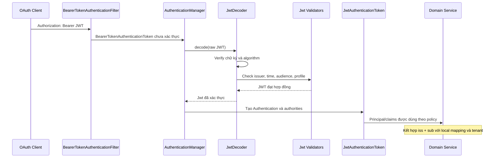

# Subject cần được định danh trong phạm vi issuer

## 1. Vấn đề cốt lõi: `sub` không phải định danh toàn cục của người dùng

Trong **Spring Security OAuth 2.0 / OIDC Resource Server**, một JWT access token thường chứa các claim:

```json
{
  "iss": "https://identity.example.com/realms/shop",
  "sub": "user-0042",
  "aud": ["orders-api"],
  "scope": "orders.read",
  "iat": 1910000000,
  "exp": 1910003600
}
```

Hai trường đặc biệt quan trọng khi xác định chủ thể:

- **`iss` — issuer:** định danh thực thể phát hành token, thường là URL của Authorization Server/OpenID Provider.
- **`sub` — subject:** định danh chủ thể được token mô tả **trong ngữ cảnh của bên phát hành**.

Đối với các JWT do nhiều issuer khác nhau phát hành, không thể mặc nhiên coi `sub="user-0042"` của issuer A là cùng một người với `sub="user-0042"` của issuer B. Khóa định danh bên ngoài an toàn hơn thường là **cặp `(iss, sub)`**.

```text
Issuer A: https://identity-a.example.com
  sub = user-0042
  => (https://identity-a.example.com, user-0042)

Issuer B: https://identity-b.example.com
  sub = user-0042
  => (https://identity-b.example.com, user-0042)

Cùng giá trị sub, nhưng KHÔNG có bằng chứng là cùng chủ thể.
```

Điều ngược lại cũng đúng: một người thật có thể xuất hiện với **nhiều subject identifier khác nhau**, nhất là khi đăng nhập qua nhiều issuer, nhiều tài khoản hoặc OIDC pairwise identifiers. Không dùng email hoặc tên đăng nhập để tự động kết luận các định danh đó thuộc cùng một người.

**Quy tắc thiết kế trọng tâm:** khi lưu hoặc so sánh định danh từ OAuth 2.0/OIDC token, phải giữ **issuer + subject** cùng nhau và chỉ tin hai giá trị sau khi Resource Server đã xác thực access token theo đúng hợp đồng.

## 2. Ý nghĩa của subject trong JWT và OIDC

### 2.1. JWT `sub` theo RFC 7519

Theo **RFC 7519**, claim `sub` nhận diện principal là chủ thể của JWT. Chuẩn yêu cầu giá trị subject phải **độc nhất cục bộ trong phạm vi issuer** hoặc bản thân nó phải có tính độc nhất toàn cục. Vì vậy, với một hệ thống đa issuer, việc lưu `sub` riêng lẻ mà không mang theo issuer sẽ đánh mất phạm vi định danh.

Trong JWT nói chung, `sub` là claim được đăng ký (*registered claim*) nhưng không bắt buộc xuất hiện ở mọi JWT không theo profile cụ thể. Với những profile như **OIDC ID Token** hoặc **RFC 9068 JWT access token**, có các yêu cầu riêng về sự hiện diện và ý nghĩa của `sub`.

Ví dụ:

```json
{
  "iss": "https://auth.example.com/tenant-a",
  "sub": "839204",
  "aud": "orders-api",
  "exp": 1910003600
}
```

`839204` có thể là định danh nội bộ do issuer `tenant-a` cấp. Nó **không nhất thiết** là ID trong database của `orders-api`, email, số điện thoại hoặc UUID do API tự tạo.

### 2.2. OIDC `sub` có ý nghĩa cụ thể hơn

Trong OpenID Connect, `sub` của **ID Token** là định danh subject tại OpenID Provider. OIDC Core quy định subject identifier **ổn định, độc nhất trong phạm vi issuer và không được gán lại cho người khác** theo những điều kiện của profile.

Để định danh người dùng mà một OIDC Client nhận được từ OP, cặp `(iss, sub)` là cơ sở quan trọng. Nhưng **ID Token dành cho OIDC Client không phải Bearer access token dành cho Resource Server**. Khi API nhận access token, API phải xác minh đúng access-token contract trước khi dùng `iss`/`sub` để xác định principal.

### 2.3. `sub` có luôn chỉ người dùng cuối không?

**Không.** Trong OAuth 2.0, access token có thể đại diện cho:

- **Resource owner / end user** trong những flow ủy quyền người dùng.
- **Client/service principal** khi sử dụng `client_credentials`.
- Một chủ thể đặc thù khác do token profile và hợp đồng của Authorization Server quy định.

Ví dụ token của một service:

```json
{
  "iss": "https://auth.example.com",
  "sub": "batch-import-service",
  "client_id": "batch-import-service",
  "aud": "orders-api",
  "scope": "orders.sync",
  "exp": 1910003600
}
```

Không tự diễn giải `sub=batch-import-service` thành “người dùng tên batch-import-service”, cũng không tự tìm user record theo chuỗi đó. API phải biết **loại principal** được chấp nhận trên từng endpoint và cách diễn giải `sub` theo issuer/profile.

Một số access token có `sub` bằng `client_id` theo hợp đồng của issuer, đặc biệt ở client-credentials flows. Nhưng không coi điều đó là quy tắc bất biến của mọi Authorization Server.

## 3. Phạm vi issuer: tại sao `sub` trùng nhau là bình thường?

Giả sử API chấp nhận token của hai realm:

```text
https://login.example.com/realms/customers
https://login.example.com/realms/partners
```

Cả hai đều cấp `sub="123"`. Có thể đó là hai tài khoản độc lập, hai organization, hai người khác nhau hoặc hai đối tượng dịch vụ. **Chung host không làm các realm thành một issuer**.

| Issuer | Subject | Khóa định danh hợp lý | Có thể coi là cùng người? |
|---|---|---|---|
| `https://login.example.com/realms/customers` | `123` | `(customers-issuer, 123)` | Không suy ra |
| `https://login.example.com/realms/partners` | `123` | `(partners-issuer, 123)` | Không suy ra |
| `https://login.example.com/realms/customers` | `456` | `(customers-issuer, 456)` | Không suy ra |
| `https://login.example.com/realms/customers` | `123` ở token khác | Cùng cặp issuer/subject | Có thể là cùng subject theo hợp đồng issuer, sau khi mỗi token đã được xác thực |

Trong phạm vi một issuer, `sub` có thể duy trì qua nhiều lần đăng nhập hoặc nhiều access token. Tuy nhiên, token mới có thể có `aud`, `scope`, `client_id`, `exp` hoặc context khác; **cùng subject không có nghĩa cùng quyền**.

### Trùng subject gây lỗi gì nếu lưu sai?

Thiết kế nguy hiểm:

```sql
CREATE TABLE external_users (
    subject VARCHAR(255) PRIMARY KEY,
    local_user_id UUID NOT NULL
);
```

Khi issuer A tạo bản ghi `sub=123`, sau đó issuer B gửi token cũng có `sub=123`, ứng dụng có thể:

1. Tra ra local user của A.
2. Gán tài khoản B vào quyền/dữ liệu của A.
3. Ghi audit log dưới identity sai.
4. Vượt ranh giới tenant hoặc rò rỉ dữ liệu người dùng.

Đây là **identity collision/account confusion**, không phải chỉ là vấn đề “tên trùng”. Nó có thể dẫn đến sai phân quyền nghiêm trọng.

## 4. Issuer identifier được xác định chính xác như thế nào?

`iss` thường là một URL như:

```text
https://identity.example.com/realms/shop
```

Giá trị này phải được đối chiếu với issuer **mà Resource Server đã cấu hình tin cậy**, không phải host được suy đoán từ request hay JWT header.

Phân biệt:

| Khái niệm | Ví dụ | Công dụng |
|---|---|---|
| Issuer identifier | `https://identity.example.com/realms/shop` | Danh tính bên phát hành |
| OIDC discovery URL | `https://identity.example.com/realms/shop/.well-known/openid-configuration` | Tìm metadata của issuer |
| JWKS URI | `https://identity.example.com/realms/shop/protocol/openid-connect/certs` | Tải public signing keys |
| Token endpoint | `https://identity.example.com/realms/shop/protocol/openid-connect/token` | Client xin access/refresh token |
| JWT `sub` | `user-0042` | Chủ thể trong issuer |
| JWT `aud` | `orders-api` | Bên nhận dự kiến của token |

Đừng dùng JWKS endpoint, token endpoint hoặc URL discovery làm phần issuer của identity key. Nếu metadata và JWT cùng công bố issuer `https://identity.example.com/realms/shop`, hãy dùng **chính issuer identifier đó**.

### 4.1. Vì sao không tự chuẩn hóa URL issuer?

Những chuỗi sau có thể **không tương đương theo quy tắc issuer matching**:

```text
https://identity.example.com/realms/shop
https://identity.example.com/realms/shop/
http://identity.example.com/realms/shop
https://identity.example.com/realms/other
https://identity-internal:8080/realms/shop
```

Không tự gỡ dấu `/` cuối, bỏ path realm, đổi scheme hoặc thay public hostname bằng internal hostname khi so sánh issuer. Với OIDC và các profile OAuth, cần tuân theo **issuer identifier chính xác** do provider công bố.

Nếu hệ thống dùng reverse proxy hoặc Kubernetes, việc Resource Server truy cập JWKS bằng địa chỉ nội bộ **không đồng nghĩa issuer identifier cũng phải đổi sang địa chỉ nội bộ**. Hợp đồng phát hành JWT và metadata phải thống nhất issuer.

### 4.2. Issuer trust phải tồn tại trước khi token được đọc

Sai về trust boundary:

```text
Client đưa JWT có iss=https://new-idp.example
    |
    v
API tự tải https://new-idp.example/.well-known/...
    |
    v
API tự tin JWKS của new-idp
    |
    v
API chấp nhận chữ ký do chính new-idp kiểm soát
```

Đó là cơ chế **tin bất kỳ issuer nào do token tự chỉ định**. Một attacker có thể lập issuer riêng, ký token và yêu cầu API công nhận. API phải duy trì danh sách issuer được chấp nhận **từ cấu hình đáng tin**, không mở rộng từ claim `iss` chưa xác minh.

## 5. Subject là identity, không phải email hoặc tên hiển thị

Các claim thường thấy:

```json
{
  "iss": "https://identity.example.com",
  "sub": "c38f1a",
  "preferred_username": "linh",
  "name": "Linh Tran",
  "email": "linh@example.com",
  "email_verified": true
}
```

Không đánh đồng:

- **`sub`** là subject identifier do issuer gán theo hợp đồng.
- **`preferred_username`** là tên hiển thị/đăng nhập có thể thay đổi và không nhất thiết duy nhất.
- **`name`** là thông tin hiển thị.
- **`email`** là địa chỉ liên hệ; có thể thay đổi, tái cấp hoặc được dùng ở nhiều tài khoản khác nhau.
- **`email_verified`** có nghĩa theo quy tắc xác minh email của provider, không tự chứng minh hai subject từ hai issuer là cùng một chủ thể có quyền liên kết tài khoản.

Ví dụ hai issuer cùng trả:

```text
Issuer A:
  sub = 001
  email = kim@example.com

Issuer B:
  sub = xyz
  email = kim@example.com
```

**Không được tự gộp tài khoản** chỉ vì email giống nhau, kể cả khi cả hai token đều khai `email_verified=true`. Tài khoản có thể thuộc hai người, chính sách email verification khác nhau, hoặc người dùng đã mất quyền kiểm soát một địa chỉ trước đây.

### Nếu người dùng đổi email thì sao?

Một kiến trúc tốt không dùng email làm khóa ngoại chính cho identity. Nếu user đổi email mà cặp `(iss, sub)` không đổi, local account vẫn được xác định nhất quán. Email có thể cập nhật như profile attribute sau khi được xác thực, theo chính sách đồng bộ phù hợp.

### Nếu người dùng đổi username thì sao?

Tương tự, `preferred_username` hoặc username display là thuộc tính tiện dùng cho UX, không nên được xem là principal identifier ổn định. Nếu muốn dùng tên dễ đọc trong log hoặc UI, vẫn phải giữ **identity key bất biến** tại tầng nghiệp vụ.

## 6. OIDC public subject và pairwise subject

OpenID Connect mô tả hai kiểu **subject identifier**:

1. **Public subject identifier:** OP có thể cấp cùng một `sub` cho user khi tương tác với những client khác nhau, tùy cấu hình.
2. **Pairwise subject identifier:** OP tạo các subject identifier khác nhau cho cùng một end user ở các **sector** khác nhau để hạn chế liên kết danh tính chéo ứng dụng.

Ví dụ minh họa:

```text
Một end user tại OP:
  issuer = https://accounts.example.com

OIDC Client A / sector A:
  sub = pair-82fb

OIDC Client B / sector B:
  sub = pair-19cd

Cả hai có thể là một người tại OP.
Nhưng Client A không được tự suy ra danh tính bên Client B.
```

### 6.1. Pairwise subject có thể khác theo sector

Trong OIDC, **sector identifier** giúp OP quyết định nhóm client nào cùng nhận subject identifier liên quan. Một triển khai có thể dùng host của redirect URI hoặc một `sector_identifier_uri` được đăng ký theo quy tắc OIDC.

Hệ quả:

- Cùng một end user có thể nhận các `sub` khác nhau ở hai ứng dụng.
- Hai client dùng cùng sector theo hợp đồng có thể được OP cấp subject identifier tương ứng, nhưng không mặc định mọi client đều như vậy.
- Không lấy email hoặc username để “phục hồi” một global ID khi OP cố ý dùng pairwise identifiers vì lý do riêng tư.
- Không coi mọi khác biệt `sub` trong cùng issuer là lỗi: cần xem **ngữ cảnh client/sector, token profile và hợp đồng OP**.

### 6.2. Cặp `(iss, sub)` đã đủ cho mọi trường hợp chưa?

Cặp này là **khóa tốt để định danh subject như issuer trình bày**. Nhưng có các giới hạn:

- Trong OIDC pairwise, cùng người có thể có nhiều subject identifier khác nhau tùy sector.
- Nếu Resource Server đang nhận **access token**, không được giả định `sub` có cùng hình thức hoặc cách sinh với `sub` của ID token ở một client khác.
- Issuer có thể phát hành token cho service principal chứ không phải user.
- Một principal có thể thuộc nhiều tenant hoặc có nhiều role theo từng resource.

Vì vậy, **`(iss, sub)` nhận diện external principal theo hợp đồng**, còn việc một số external principal được liên kết vào **cùng local person/account** là một quyết định riêng, phải có bằng chứng và quy trình được phép.

## 7. Phân biệt issuer, subject, audience và tenant

Nhiều hệ thống kết hợp **federated identity** và **multi-tenant authorization**. Bốn khái niệm cần tách:

```text
iss       : Ai phát hành credential?
sub       : Credential nói về chủ thể nào ở issuer đó?
aud       : Credential dành cho Resource Server nào?
tenant_id : Chủ thể hoạt động trong tổ chức/phạm vi dữ liệu nào?
```

Ví dụ JWT:

```json
{
  "iss": "https://login.example.com/realms/shared",
  "sub": "user-0042",
  "aud": "orders-api",
  "tenant_id": "tenant-blue",
  "scope": "orders.read"
}
```

**Không được dùng `tenant_id` thay thế `iss` hoặc `sub`**. Có thể cùng subject tham gia nhiều tenant. Cũng có thể hai issuer khác nhau cùng phát hành claim `tenant_id=tenant-blue`; giá trị tenant claim chỉ có ý nghĩa trong hợp đồng tin cậy tương ứng.

Ví dụ quan hệ:

```text
External principal:
  issuer = https://login.example.com/realms/shared
  subject = user-0042

Local account:
  local_user_id = 76a9... (UUID trong database của ứng dụng)

Memberships:
  local_user_id -> tenant-blue (orders.read)
  local_user_id -> tenant-green (orders.admin)
```

Khi người dùng gọi `GET /api/tenants/tenant-blue/orders/10`, ứng dụng phải kiểm tra **membership và quyền đối với order cụ thể**. Cùng `(iss, sub)` không tự cấp toàn quyền trên mọi tenant.

### Tại sao issuer scope và tenant scope đều quan trọng?

- **Issuer scope** ngăn nhầm chủ thể giữa các AS/OP không cùng miền tin cậy.
- **Tenant scope** ngăn cùng chủ thể đi qua ranh giới dữ liệu của các tổ chức.
- **Audience scope** ngăn token được phát cho API khác bị dùng thay cho API hiện tại.

Ba lớp này bổ sung nhau, không thay thế nhau.

## 8. Vị trí của principal trong Spring Security Resource Server

Với Servlet Resource Server nhận JWT access token, chuỗi xử lý thường là:



Một số thành phần:

| Thành phần | Vai trò |
|---|---|
| `BearerTokenAuthenticationFilter` | Tách Bearer credential và tạo yêu cầu xác thực |
| `JwtAuthenticationProvider` | Nhờ `JwtDecoder` kiểm tra JWT và tạo kết quả authentication |
| `NimbusJwtDecoder` | Xác minh JWS và chạy token validators |
| `JwtIssuerValidator` | Kiểm tra `iss` đúng issuer dự kiến |
| `JwtAuthenticationConverter` | Chuyển JWT đã xác thực thành principal/authorities |
| `JwtAuthenticationToken` | `Authentication` đại diện JWT đã xác thực |
| `SecurityContextHolder` | Cung cấp authentication của request trong security context |
| `AuthorizationFilter` và domain service | Xét quyền endpoint và quyền đối tượng |

### 8.1. `Authentication.getName()` thường chỉ trả về subject

Ở cấu hình mặc định phù hợp của JWT Resource Server, `JwtAuthenticationToken.getName()` thường lấy principal name từ claim **`sub`** (hoặc claim khác được cấu hình trong converter).

Ví dụ:

```java
Authentication authentication =
        SecurityContextHolder.getContext().getAuthentication();

String name = authentication.getName();
```

Nếu `name="user-0042"`, giá trị này **chưa chứa issuer**. Trong một API chỉ tin một issuer, đôi khi tên này đủ để hiển thị; trong multi-issuer, dùng `authentication.getName()` một mình làm database key có thể gây nhầm danh tính.

Muốn nhận diện external principal đúng, cần lấy **cả `Jwt.getIssuer()` lẫn `Jwt.getSubject()` từ JWT đã xác thực**. Không dựa vào một `getName()` vốn chỉ phản ánh claim name.

### 8.2. `JwtAuthenticationToken` khác `BearerTokenAuthenticationToken`

`BearerTokenAuthenticationToken` được tạo từ raw Bearer credential **trước xác thực**. Ở giai đoạn này, `getPrincipal()` có thể vẫn chính là token string; không được dùng nó như một user ID.

`JwtAuthenticationToken` là kết quả sau khi JWT được decoder/provider chấp nhận. Nó mang `Jwt` với claims đã được xác minh theo cấu hình, và authorities được ánh xạ. Dùng object này để suy ra `(iss, sub)` **sau khi** các validators quan trọng đã chạy.

## 9. Cấu hình issuer, audience và subject trong JWT Resource Server

Giả sử `orders-api` chỉ chấp nhận access token phát bởi:

```text
https://identity.example.com/realms/shop
```

Một cấu hình Spring Boot cơ bản:

```yaml
spring:
  security:
    oauth2:
      resourceserver:
        jwt:
          issuer-uri: https://identity.example.com/realms/shop
```

Trong ứng dụng, một security chain có thể cấu hình:

```java
import org.springframework.context.annotation.Bean;
import org.springframework.context.annotation.Configuration;
import org.springframework.http.HttpMethod;
import org.springframework.security.config.Customizer;
import org.springframework.security.config.annotation.web.builders.HttpSecurity;
import org.springframework.security.web.SecurityFilterChain;

@Configuration
public class OrdersSecurityChain {

    @Bean
    SecurityFilterChain api(HttpSecurity http) throws Exception {
        return http
                .securityMatcher("/api/**")
                .authorizeHttpRequests(auth -> auth
                        .requestMatchers(HttpMethod.GET, "/api/orders/**")
                            .hasAuthority("SCOPE_orders.read")
                        .anyRequest().authenticated())
                .oauth2ResourceServer(oauth2 ->
                        oauth2.jwt(Customizer.withDefaults()))
                .build();
    }
}
```

`issuer-uri` giúp framework thiết lập issuer trust và discovery/JWKS theo cấu hình và phiên bản Spring Security. Nhưng **Resource Server vẫn cần hợp đồng access token đầy đủ**, đặc biệt **audience của API**, token lifetime và token purpose/profile. Nếu dùng OIDC ID token thay access token, cả `iss` và chữ ký có thể đúng nhưng `aud` không dành cho API.

### 9.1. Tạo JWT decoder và kiểm tra đầy đủ claims

Ví dụ dưới đây yêu cầu JWT ký bằng `RS256`, do một issuer cố định phát hành, audience chứa `orders-api` và có subject khác rỗng:

```java
import org.springframework.context.annotation.Bean;
import org.springframework.context.annotation.Configuration;
import org.springframework.security.oauth2.core.DelegatingOAuth2TokenValidator;
import org.springframework.security.oauth2.core.OAuth2Error;
import org.springframework.security.oauth2.core.OAuth2TokenValidator;
import org.springframework.security.oauth2.core.OAuth2TokenValidatorResult;
import org.springframework.security.oauth2.jose.jws.SignatureAlgorithm;
import org.springframework.security.oauth2.jwt.Jwt;
import org.springframework.security.oauth2.jwt.JwtDecoder;
import org.springframework.security.oauth2.jwt.JwtValidators;
import org.springframework.security.oauth2.jwt.NimbusJwtDecoder;

@Configuration
public class JwtValidationConfig {

    private static final String ISSUER =
            "https://identity.example.com/realms/shop";

    private static final String JWKS_URI =
            "https://identity.example.com/realms/shop/protocol/openid-connect/certs";

    @Bean
    JwtDecoder jwtDecoder() {
        NimbusJwtDecoder decoder = NimbusJwtDecoder
                .withJwkSetUri(JWKS_URI)
                .jwsAlgorithm(SignatureAlgorithm.RS256)
                .build();

        OAuth2TokenValidator<Jwt> issuerAndTime =
                JwtValidators.createDefaultWithIssuer(ISSUER);

        OAuth2TokenValidator<Jwt> audience = jwt ->
                jwt.getAudience().contains("orders-api")
                    ? OAuth2TokenValidatorResult.success()
                    : invalid("Access token is not intended for orders-api");

        OAuth2TokenValidator<Jwt> subject = jwt ->
                jwt.getSubject() != null
                        && !jwt.getSubject().isBlank()
                    ? OAuth2TokenValidatorResult.success()
                    : invalid("Access token must contain a subject");

        decoder.setJwtValidator(
                new DelegatingOAuth2TokenValidator<>(
                        issuerAndTime, audience, subject));

        return decoder;
    }

    private static OAuth2TokenValidatorResult invalid(String message) {
        return OAuth2TokenValidatorResult.failure(
                new OAuth2Error("invalid_token", message, null));
    }
}
```

Những điểm quan trọng:

1. `JWKS_URI` là nguồn khóa **đã được cấu hình tin cậy**, không lấy từ URL do JWT tự khai báo.
2. `jwsAlgorithm(RS256)` giới hạn thuật toán JWS được Resource Server cho phép.
3. `JwtValidators.createDefaultWithIssuer` giữ kiểm tra issuer và các validator mặc định về hiệu lực token; `JwtIssuerValidator` không tự kiểm tra mọi claim.
4. Audience validator yêu cầu token dành cho chính `orders-api`, không phải OIDC Client hoặc API khác.
5. Subject validator kiểm tra **sự hiện diện và không rỗng của `sub` theo hợp đồng API này**. Không phải mọi JWT nói chung đều bắt buộc có `sub`; chính API/profile quyết định điều kiện này.
6. `setJwtValidator` thay toàn bộ tập validator trên decoder, nên cần giữ những điều kiện mặc định quan trọng khi thêm rule riêng.

Nếu issuer phát hành JWT access token theo **RFC 9068**, Resource Server còn cần xác thực token type/profile và các claim bắt buộc khác của profile đó. Nếu provider dùng profile riêng, phải thực thi quy tắc thực tế; không tự mặc định mọi JWT có `sub` đều là access token.

### 9.2. Điều gì xảy ra nếu `iss` và `sub` đều “trông đúng” nhưng chữ ký sai?

`JwtDecoder` phải từ chối chữ ký trước khi coi claims là đáng tin. Một kẻ tấn công có thể tự tạo JWT có:

```json
{
  "iss": "https://identity.example.com/realms/shop",
  "sub": "user-0042",
  "aud": "orders-api",
  "scope": "orders.write"
}
```

Nhưng việc đặt các giá trị này trong JSON **không chứng minh** token do issuer thật phát hành. Chỉ sau khi JWT vượt qua chữ ký, issuer, lifetime và các validators, API mới được sử dụng cặp `(iss, sub)` để tra cứu local identity.

## 10. Tạo một kiểu dữ liệu biểu diễn `(issuer, subject)`

Trong code nghiệp vụ, nên xây **value object** thay vì truyền một chuỗi `sub` không rõ nguồn.

Ví dụ Java với `record`:

```java
import java.net.URI;
import java.util.Objects;

public record ExternalPrincipalKey(String issuer, String subject) {

    public ExternalPrincipalKey {
        Objects.requireNonNull(issuer, "issuer");
        Objects.requireNonNull(subject, "subject");

        if (issuer.isBlank() || subject.isBlank()) {
            throw new IllegalArgumentException(
                    "issuer and subject must not be blank");
        }
    }

    public static ExternalPrincipalKey fromValidatedJwt(
            org.springframework.security.oauth2.jwt.Jwt jwt) {

        URI jwtIssuer = jwt.getIssuer();
        String jwtSubject = jwt.getSubject();

        if (jwtIssuer == null || jwtSubject == null) {
            throw new IllegalArgumentException(
                    "Verified JWT must contain iss and sub");
        }

        return new ExternalPrincipalKey(
                jwtIssuer.toString(),
                jwtSubject);
    }
}
```

**Ý nghĩa:**

- Code phải mang theo **cả hai thành phần** ở mọi nơi dùng external identity.
- `record` tự có `equals` và `hashCode` dựa trên cả `issuer` và `subject`.
- Dùng `String` cho issuer nhằm giữ chính chuỗi identifier; không tự rút hostname hoặc làm mất path realm.
- `fromValidatedJwt` chỉ nên gọi trên `Jwt` đã qua **Spring Security JwtDecoder và validators của Resource Server**. Bản thân phương thức này không xác minh chữ ký.
- Nên phân biệt loại principal trong kiến trúc nếu ứng dụng nhận cả user access token và client-credentials access token.

Ví dụ:

```java
ExternalPrincipalKey customerA = new ExternalPrincipalKey(
        "https://id.example.com/realms/customers", "123");

ExternalPrincipalKey partnerB = new ExternalPrincipalKey(
        "https://id.example.com/realms/partners", "123");

boolean same = customerA.equals(partnerB); // false
```

Đây là phép so sánh định danh; nó không tự xác thực credential.

### 10.1. Tránh ghép chuỗi không có định dạng rõ

Đôi khi ứng dụng dùng:

```java
String identity = issuer + ":" + subject;
```

Tuy nhiên, cách ghép chuỗi không có quy tắc escaping/length-prefix có thể gây nhập nhằng nếu thành phần chứa ký tự phân tách, và khó truy vấn database.

Ưu tiên **hai field riêng biệt** hoặc một value object có `equals`/`hashCode` theo cả hai giá trị. Nếu cần tạo một khóa dạng chuỗi cho hệ thống bên ngoài, quy định rõ cách mã hóa chống nhập nhằng và versioning, hoặc ánh xạ cặp này sang **local UUID**.

## 11. Mô hình dữ liệu: ánh xạ external principal sang local account

Một hệ thống nghiệp vụ không nên dùng trực tiếp JWT `sub` làm primary key của bảng user. Thay vào đó, có thể có:

- **Local user/account ID** do hệ thống tự tạo, ổn định trong database.
- **External identities** liên kết tài khoản nội bộ với các cặp `issuer + subject`.
- **Membership/authorization** theo tenant và tài nguyên.

Ví dụ SQL khái niệm theo PostgreSQL:

```sql
CREATE TABLE app_users (
    id UUID PRIMARY KEY,
    display_name VARCHAR(200)
);

CREATE TABLE external_identities (
    id BIGINT GENERATED ALWAYS AS IDENTITY PRIMARY KEY,
    issuer VARCHAR(512) NOT NULL,
    subject VARCHAR(512) NOT NULL,
    app_user_id UUID NOT NULL REFERENCES app_users(id),

    CONSTRAINT uq_external_principal
        UNIQUE (issuer, subject)
);

CREATE INDEX idx_external_identities_app_user
    ON external_identities(app_user_id);

CREATE TABLE tenant_memberships (
    app_user_id UUID NOT NULL REFERENCES app_users(id),
    tenant_id UUID NOT NULL,
    membership_status VARCHAR(32) NOT NULL,
    PRIMARY KEY (app_user_id, tenant_id)
);
```

Trong mô hình này:

```text
JWT access token (đã xác thực)
  iss = https://id-a.example.com
  sub = 8932
      |
      v
external_identities(issuer, subject)
      |
      v
app_user_id = 0e91... UUID nội bộ
      |
      v
tenant_memberships / domain permissions
      |
      v
Quyền với order cụ thể
```

**Lợi ích:**

1. Hai issuer có cùng `sub` không xung đột.
2. Local user ID không phụ thuộc cách provider đặt subject.
3. Có thể hỗ trợ account linking qua quy trình xác thực riêng, thay vì tự gộp theo email.
4. Có chỗ lưu quyền tenant hoặc trạng thái người dùng độc lập với claims.
5. Nếu issuer đổi trong một migration, có thể ánh xạ identity cũ và mới qua quy trình kiểm soát.

### 11.1. Có nên đưa `tenant_id` vào unique key của external identity?

Nếu một **issuer thực sự dùng cùng `sub` cho cùng principal xuyên tenant**, cặp `(issuer, sub)` đã định danh principal, còn membership tenant lưu riêng. Không thêm tenant vào khóa định danh chỉ để che đi việc phân quyền tenant bị thiếu.

Nếu nhà cung cấp có hợp đồng khác khiến subject cần một ngữ cảnh bổ sung (ví dụ provider-specific account namespace), phải mô hình hóa rõ **ngữ cảnh cấp subject** theo tài liệu provider. Không giả định mọi claim `tenant_id` trong token đều là một phần chuẩn của `sub`.

### 11.2. Cách quản lý migration của issuer

Nếu nhà cung cấp chuyển từ:

```text
https://id.old.example.com/realms/shop
```

sang:

```text
https://id.new.example.com/realms/shop
```

thì hai chuỗi issuer là **hai định danh khác nhau**. Không tự thay URL trong database và coi mọi `sub` còn tương ứng, vì nhà cung cấp có thể đổi cả policy cấp subject, key hoặc realm.

Hãy định nghĩa quy trình migration đáng tin: mapping được bên phát hành xác nhận, token mới có issuer được tin, audit thay đổi, rollback và điều kiện hoàn thành. Việc chuyển local account phải dựa trên chứng cứ, không chỉ “`sub` trùng”.

## 12. Sử dụng cặp issuer–subject trong controller/service

Giả sử endpoint `/api/me` chạy sau khi Spring Security đã xác thực JWT và Resource Server có validator issuer/audience phù hợp. Controller có thể nhận `Jwt` đã được xác thực từ security context.

Ví dụ:

```java
import org.springframework.security.core.annotation.AuthenticationPrincipal;
import org.springframework.security.oauth2.jwt.Jwt;
import org.springframework.web.bind.annotation.GetMapping;
import org.springframework.web.bind.annotation.RestController;

@RestController
public class MyAccountController {

    private final IdentityDirectory identityDirectory;

    public MyAccountController(IdentityDirectory identityDirectory) {
        this.identityDirectory = identityDirectory;
    }

    @GetMapping("/api/me")
    public MyAccountResponse me(@AuthenticationPrincipal Jwt jwt) {
        if (jwt == null) {
            throw new IllegalStateException(
                    "This endpoint requires JWT authentication");
        }

        ExternalPrincipalKey key =
                ExternalPrincipalKey.fromValidatedJwt(jwt);

        LocalAccount account = identityDirectory
                .findByExternalPrincipal(key)
                .orElseThrow(() ->
                        new AccountNotProvisionedException());

        return new MyAccountResponse(account.id(), account.displayName());
    }
}
```

Trong ví dụ, `IdentityDirectory`, `LocalAccount`, `MyAccountResponse` và `AccountNotProvisionedException` là **các thành phần giả định của ứng dụng**; cần định nghĩa theo domain thực tế. Đoạn code tập trung vào cách lấy identity key, không phải một project có thể build độc lập.

Trách nhiệm:

- **Spring Security:** xác thực JWT, issuer, audience, thời hạn, access-token profile.
- **Controller/service:** tìm local account bằng cả issuer và subject.
- **Domain authorization:** kiểm tra quyền người dùng với từng tenant, order hoặc tài nguyên.

Nếu token thuộc **client-credentials/service principal**, endpoint `/api/me` dành riêng cho người dùng có thể không phù hợp. Nên phân định endpoint có chấp nhận service principal hay không trước khi map sang bảng `app_users`.

### Không dựa vào `authentication.getName()` làm khóa tra cứu duy nhất

Ví dụ nguy hiểm trong multi-issuer:

```java
String subject = authentication.getName();
User user = userRepository.findByExternalSubject(subject);
```

Nếu hai issuer đều có `subject=123`, truy vấn có thể trả cùng một user sai. Thay bằng lookup theo **`(issuer, subject)`**, hoặc local account ID đã được ánh xạ sau khi token được xác thực.

## 13. Có nên đổi `Authentication.getName()` thành composite identifier?

Trong Spring Security, `JwtAuthenticationConverter` có thể đổi claim làm principal name:

```java
JwtAuthenticationConverter converter =
        new JwtAuthenticationConverter();

converter.setPrincipalClaimName("sub");
```

Nhưng việc đặt principal claim name thành `sub` **không làm nó độc nhất xuyên issuer**. Nếu dùng `preferred_username`, giá trị càng có thể thay đổi hoặc trùng.

Có thể viết một `Converter<Jwt, AbstractAuthenticationToken>` tùy biến để biểu diễn principal theo chính sách riêng, nhưng không phải lúc nào cũng cần. Một cách thường an toàn và dễ kiểm soát hơn:

1. Giữ `JwtAuthenticationToken` làm authentication result.
2. Từ `Jwt` đã xác thực, tạo `ExternalPrincipalKey(issuer, subject)`.
3. Ánh xạ cặp này sang **local account ID** trong service.
4. Dùng local account ID và quyền tenant làm khóa nghiệp vụ.

Không sử dụng delimiter đơn giản `issuer + "|" + sub` như một public identifier nếu chưa có quy tắc encoding ổn định. Càng không nên log raw JWT token để “định danh” người dùng.

## 14. Khi token là OIDC ID token thay vì access token

Cùng một OpenID Provider có thể phát hành:

**ID token cho OIDC Client:**

```json
{
  "iss": "https://identity.example.com/realms/shop",
  "sub": "user-0042",
  "aud": "web-client",
  "nonce": "client-login-nonce",
  "exp": 1910003600
}
```

**Access token cho Resource Server:**

```json
{
  "iss": "https://identity.example.com/realms/shop",
  "sub": "user-0042",
  "aud": "orders-api",
  "scope": "orders.read",
  "exp": 1910003600
}
```

Cặp `(iss, sub)` có thể giống nhau trong ví dụ. Nhưng **token purpose không giống nhau**:

- ID token dùng ở **OIDC Client/Relying Party** để xác nhận kết quả đăng nhập.
- Access token dùng ở **Resource Server** để truy cập API theo phạm vi quyền được cấp.

Không nhận ID token thay access token chỉ vì `iss`/`sub` khớp. API phải kiểm tra audience `aud`, token profile (ví dụ RFC 9068 `typ=at+jwt` nếu dùng chuẩn đó), signature, thời hạn và quyền.

### Nếu OIDC `sub` và access-token `sub` không giống nhau thì sao?

Không tự sửa token hoặc tự ép hai subject thành một người. Trước tiên xác định:

- OIDC Provider có dùng pairwise subject hay không?
- Access token theo profile nào? `sub` dùng cho end user hay client/service?
- Token có thực sự được phát hành bởi cùng issuer không?
- Hai token phục vụ client/audience khác nhau không?
- Provider có cơ chế liên kết identity chính thức hay không?

Đối với các hệ thống liên kết tài khoản, nên yêu cầu tín hiệu đáng tin từ issuer, một lần user chứng thực cả hai tài khoản hoặc quy trình quản trị được ủy quyền, tùy rủi ro nghiệp vụ.

## 15. Client credentials và định danh service principal

Một API có thể nhận cả user-delegated token và machine-to-machine token.

Ví dụ user access token:

```json
{
  "iss": "https://auth.example.com",
  "sub": "person-777",
  "client_id": "shop-web",
  "aud": "orders-api",
  "scope": "orders.read",
  "exp": 1910003600
}
```

Ví dụ service access token:

```json
{
  "iss": "https://auth.example.com",
  "sub": "fulfillment-worker",
  "client_id": "fulfillment-worker",
  "aud": "orders-api",
  "scope": "orders.sync",
  "exp": 1910003600
}
```

Khi cả hai được issuer chấp nhận và Resource Server xác thực đúng, `(iss, sub)` vẫn là cặp cần thiết để tránh va chạm giữa issuer. Nhưng **ý nghĩa nghiệp vụ** khác nhau.

| Endpoint | Principal cần thiết | Yêu cầu nên kiểm tra |
|---|---|---|
| `GET /api/orders/me` | Người dùng cuối | User context hợp lệ và quyền trên tài khoản/đơn hàng |
| `POST /api/orders/sync` | Service `fulfillment-worker` | Service principal được cho phép và `orders.sync` |
| `POST /api/admin/users` | User quản trị hoặc service được ủy quyền rõ | Policy của từng loại principal và tenant |
| `GET /api/tenants/{id}/orders` | User hoặc service theo contract | Tenant binding, audience, scope và quyền trên tenant |

Không dùng kiểu điều kiện:

```text
if (jwt.sub != null) -> đây là người dùng đã đăng nhập
```

`sub` chỉ nhận diện **subject theo token profile**. Với client credentials, nó có thể là client/application principal. Nếu domain cần phân biệt, nên mô hình hóa `PrincipalType.USER` và `PrincipalType.SERVICE` dựa trên nguồn dữ liệu đã xác thực và hợp đồng issuer, không tự suy diễn từ hình dạng chuỗi `sub`.

## 16. Multi-issuer trong Spring Security

Khi Resource Server tin nhiều issuer, mỗi issuer cần có **bộ khóa và validators riêng**:

```text
Trusted issuer A
  https://login-a.example.com
       |
       +-- JWKS A
       +-- JWT iss=A
       +-- audience orders-api
       +-- subject namespace A

Trusted issuer B
  https://login-b.example.com
       |
       +-- JWKS B
       +-- JWT iss=B
       +-- audience orders-api
       +-- subject namespace B

Unknown issuer
       |
       +-- Reject
```

Spring Security Servlet có cơ chế như `AuthenticationManagerResolver<HttpServletRequest>` và các hỗ trợ JWT multi-tenant theo phiên bản để chọn authentication manager/decoder. Trong trường hợp phải đọc JWT `iss` **chưa xác thực** làm gợi ý định tuyến, chỉ được chọn giữa **các issuer đã nằm trong allow-list** và sau đó phải xác minh chữ ký, đối chiếu `iss` lần nữa.

### 16.1. Không mở rộng trust bằng issuer string từ token

Sai:

```text
parse JWT -> read iss
    |
    v
download iss + "/.well-known/openid-configuration"
    |
    v
trust whatever JWKS returned
```

Đúng về nguyên tắc:

```text
parse JWT -> read iss only as routing hint
    |
    v
iss thuộc tập issuer đã cấu hình?
    | NO -> reject
    | YES
    v
decoder của issuer được chọn
    |
    v
verify signature, issuer, audience, token profile, expiry
    |
    v
map (iss, sub) -> local principal
```

Để tránh nhầm khóa giữa issuer, không gom chung JWK của mọi issuer rồi chọn duy nhất bằng `kid` (key ID), vì `kid` có thể trùng nhau giữa các issuer.

### 16.2. Subject là khóa theo issuer, không phải theo host

Ngay cả khi hai realm cùng host:

```text
https://id.example.com/realms/tenant-a
https://id.example.com/realms/tenant-b
```

chúng có thể là hai issuer độc lập, với subject namespace và chính sách khác nhau. Hãy so sánh **issuer identifier đầy đủ**; không lấy `id.example.com` làm đại diện cho mọi realm.

## 17. Federation: upstream identity và token issuer có thể khác nhau

Trong kiến trúc có **identity broker/federation**, một API có thể nhận access token từ một Authorization Server nội bộ, trong khi user thật đăng nhập qua Google, Microsoft hoặc một IdP khác.

Ví dụ:

```text
User -> Upstream IdP
           |
           v
   Identity Broker / Authorization Server
       issuer = https://auth.company.example
       subject = broker-user-381
           |
           v
   Access token cho orders-api
       iss = https://auth.company.example
       sub = broker-user-381
           |
           v
   Orders Resource Server
```

Resource Server đang xác thực **token của broker/AS**, nên issuer để ghép identity key là **JWT `iss` của token đã được xác minh**, không tự thay bằng upstream IdP chỉ vì profile có `idp=google`.

Một người có thể có nhiều upstream identities được broker liên kết vào một local broker subject. Quy tắc liên kết đó thuộc chính sách của broker hoặc quản lý tài khoản, không thể suy ra bằng cách ghép email.

### Có nên lưu upstream issuer + upstream sub không?

Có thể cần nếu ứng dụng trực tiếp quản lý identity federation. Nhưng phải dùng các thông tin được **bên có thẩm quyền cung cấp và xác thực**. Không lấy tùy ý `upstream_iss`/`upstream_sub` từ custom claims để bypass ranh giới token issuer.

Nếu broker cung cấp identity link có đảm bảo hợp đồng, hãy phân biệt rõ:

- **Token issuer / token subject**: căn cứ để xác thực access token hiện tại.
- **Federated upstream identity**: thông tin liên kết, có thể dùng theo chính sách riêng.
- **Local account ID**: định danh nội bộ dùng cho dữ liệu nghiệp vụ.

## 18. Thay đổi subject theo thời gian: xử lý account lifecycle

Một thiết kế identity không chỉ cần uniqueness mà còn cần lifecycle.

### 18.1. Subject ổn định trong issuer

Theo hợp đồng OIDC, OP không được gán lại subject identifier cho một end user khác. Vì vậy, **`sub` không nên được tái sử dụng tùy tiện**. Tuy nhiên, Resource Server vẫn cần tuân theo token profile và provider contract thực tế; không tự giả định mọi nhà cung cấp JWT tùy biến đều cam kết OIDC stable subject semantics.

### 18.2. Tài khoản bị vô hiệu hóa

Một access token JWT đã ký có thể còn hiệu lực đến `exp`, dù tài khoản người dùng bị disable sau thời điểm phát hành. Chỉ `(iss, sub)` không cho biết trạng thái tài khoản hiện thời.

Nếu hệ thống yêu cầu khóa truy cập tức thì, cần chiến lược bổ sung như short token TTL, introspection, session revocation, user-status lookup hoặc policy chặn local account, tùy kiến trúc. Không giải quyết bằng việc đổi subject ngẫu nhiên.

### 18.3. Xóa và tạo lại user ở issuer

Với issuer tuân thủ OIDC, subject không được gán lại cho user khác. Nếu provider tùy biến vi phạm điều kiện đó, mọi hệ thống dùng `(iss, sub)` có thể bị account takeover sau tái cấp định danh. Do đó cần kiểm tra cam kết uniqueness/non-reassignment của provider và có kế hoạch xử lý lifecycle.

### 18.4. Chuyển realm hoặc chuyển OP

Khi issuer thay đổi, cặp identity key thay đổi ngay cả khi `sub` giữ nguyên. Cần account-linking/migration có kiểm soát. Không tự chuẩn hóa issuer hoặc liên kết bằng email để duy trì dữ liệu.

## 19. Quyền truy cập không được suy ra từ cặp identity

Ngay cả khi hai token có cùng `iss` và `sub`:

```text
Token 1: scope=orders.read,  aud=orders-api
Token 2: scope=orders.write, aud=orders-api
Token 3: scope=profile,      aud=userinfo-api
```

chúng **không có cùng quyền và đối tượng nhận**. Định danh chủ thể chỉ trả lời câu hỏi **“Ai?”**, còn authorization trả lời **“Chủ thể đó được làm gì với tài nguyên nào?”**.

Trong application service, nên dùng:

```text
Authenticated access token
        |
        v
(issuer, subject) -> local account
        |
        v
Token authorities + tenant membership + domain policy
        |
        v
Allowed / Denied for specific resource
```

Ví dụ SQL truy vấn order theo local user và tenant:

```sql
SELECT *
FROM orders
WHERE id = :order_id
  AND tenant_id = :authorized_tenant_id
  AND owner_user_id = :local_user_id;
```

Cách này giới hạn dữ liệu theo object ownership, không chỉ xem role `USER` hoặc `scope=orders.read`. Trong hệ thống phức tạp, quyền truy cập có thể dựa vào membership, delegation hoặc service policies; query phải phản ánh mô hình domain thật.

## 20. Các kiểu dữ liệu khác nhau của identity cần lưu ý

Một hệ thống có thể xử lý nhiều principal ngoài JWT Resource Server:

| Bối cảnh | Authentication/Principal điển hình | Cách định danh cần hiểu |
|---|---|---|
| JWT Resource Server | `JwtAuthenticationToken`, principal là `Jwt` | Dùng JWT `iss` + `sub` đã xác thực |
| Opaque Resource Server | `BearerTokenAuthentication`, principal từ introspection | Dựa vào trusted introspection metadata và issuer/resource contract |
| OIDC Login | `OAuth2AuthenticationToken` và `OidcUser` | Dùng OIDC ID token `iss` + `sub` trong vai trò RP |
| Form login nội bộ | `UsernamePasswordAuthenticationToken` hoặc custom auth | Identity theo local user store, không phải tự nhiên có `iss` |
| Client credentials JWT | `JwtAuthenticationToken` cho service | `sub` có thể là service/client principal, không mặc nhiên là user |

**Không gộp mọi authentication vào một phương thức `getName()` rồi tra bảng users**, đặc biệt khi backend vừa có `oauth2Login()` vừa có `oauth2ResourceServer()`. Bên nhận token và chính sách identity khác nhau.

### Opaque token không có JWT `iss` để đọc trực tiếp

Một opaque access token không nhất thiết cho Resource Server đọc được claim `iss` hay `sub`. API thường dùng **RFC 7662 Token Introspection** từ một AS được tin cậy. Introspection response có thể chứa `sub`, `iss`, `aud` và metadata khác, nhưng không phải mọi trường đều bắt buộc theo RFC 7662.

Khi cần tạo identity key cho opaque token, phải dựa vào **nguồn introspection đáng tin** và các metadata/profile đã cam kết. Không tự giải mã opaque string như JWT, không giả định `token_type=Bearer` tự xác định principal hoặc issuer.

## 21. Ma trận tình huống về định danh theo issuer

Bảng dưới đây là **các tình huống thiết kế**, không phải kết quả kiểm thử đã thực thi.

| Tình huống | Định danh/chính sách nên áp dụng | Lỗi cần tránh |
|---|---|---|
| Hai issuer khác nhau cùng cấp `sub=123` | Hai external principal keys khác nhau | Gộp theo `sub` |
| Một issuer cấp `sub=123` qua nhiều access token | Cùng external principal sau khi token hợp lệ | Cho rằng cùng subject nghĩa là cùng scope |
| Một người có account tại hai issuer | Chỉ liên kết qua quy trình đáng tin | Auto-link theo email |
| OIDC pairwise subject khác giữa hai sector | Tôn trọng định danh khác nhau | Suy luận rằng provider đã cấp sai ID |
| JWT có `sub` nhưng thiếu `iss` mà API yêu cầu | Reject theo token profile | Dùng `sub` một mình |
| JWT tự khai `iss` đúng nhưng signature sai | Reject vì chưa xác minh mật mã | Tin claims sau Base64URL decode |
| JWT signature và issuer đúng nhưng `aud` sai | Reject vì sai đối tượng nhận | Dùng token cho API khác |
| OIDC ID token cùng `iss`/`sub` với access token | Không thay access token | Chấp nhận ID token gọi API |
| Client-credentials token có `sub=service-id` | Xử lý như service principal theo profile | Tra bảng end users |
| Issuer đổi public hostname | Cần migration/trust policy | Tự coi issuer cũ và mới là một |
| JWKS xoay signing key, `iss`/`sub` giữ nguyên | Identity ổn định nếu token hợp lệ | Lấy `kid` làm user ID |
| Cùng user tham gia hai tenant | Một principal có nhiều memberships | Mặc định cấp mọi quyền tenant |
| Hai realm cùng host có `sub=123` | Hai namespace issuer độc lập | Chỉ so hostname |
| User đổi `email` nhưng `iss`/`sub` giữ nguyên | External identity vẫn khớp | Dùng email làm PK |
| Local account bị disable nhưng JWT còn hạn | Thực thi policy revocation/account status | Tin `sub` là đủ cho phép |
| Opaque token introspection không trả thông tin định danh cần thiết | Điều chỉnh contract hoặc từ chối | Phỏng đoán từ opaque string |

## 22. Thiết kế kiểm thử và các boundary đáng chú ý

Khi xây dựng test cho lớp mapping identity, các trường hợp hữu ích gồm:

### 22.1. Hai issuer, cùng subject phải khác identity key

```java
ExternalPrincipalKey first = new ExternalPrincipalKey(
        "https://issuer-a.example.com", "123");

ExternalPrincipalKey second = new ExternalPrincipalKey(
        "https://issuer-b.example.com", "123");

assert !first.equals(second);
```

Đoạn code này kiểm thử semantics của value object, không kiểm chứng JWT signature.

### 22.2. Một issuer, cùng subject phải khớp identity key

```java
ExternalPrincipalKey first = new ExternalPrincipalKey(
        "https://issuer-a.example.com", "123");

ExternalPrincipalKey second = new ExternalPrincipalKey(
        "https://issuer-a.example.com", "123");

assert first.equals(second);
```

### 22.3. Issuer có path khác nhau phải không được khớp

```java
ExternalPrincipalKey first = new ExternalPrincipalKey(
        "https://id.example.com/realms/customer", "123");

ExternalPrincipalKey second = new ExternalPrincipalKey(
        "https://id.example.com/realms/admin", "123");

assert !first.equals(second);
```

### 22.4. Authentication tích hợp phải qua decoder thật khi cần kiểm tra trust

Spring Security Test có các helper như `jwt()` request post-processor để tạo authentication giả lập, hữu ích cho test authorization. Nhưng nó có thể **bỏ qua bước decoder/JWKS/issuer verification thực tế**.

Nếu cần chứng minh một JWT có issuer sai sẽ bị API từ chối, phải có test đi qua **Resource Server authentication filter + decoder/validators** với khóa và token test thích hợp, hoặc unit test `JwtIssuerValidator` riêng cho quy tắc issuer. Không suy ra từ một mock JWT rằng production thực sự kiểm tra `iss`.

Các mục này chỉ mô tả thiết kế kiểm thử; chúng không có nghĩa bài học đã chạy test.

## 23. Quy tắc an toàn khi logging và xử lý dữ liệu cá nhân

`sub` có thể là định danh cá nhân ổn định. Khi kết hợp với issuer, nó có thể trở thành external personal identifier. Dù không phải password, nó vẫn cần được xử lý theo chính sách riêng tư và bảo mật của tổ chức.

- **Không log nguyên Bearer JWT** hoặc `Authorization` header; bearer token là credential có thể bị dùng lại.
- Nếu cần audit, lưu **local account ID** hoặc identity key trong hệ thống kiểm soát truy cập; không phát tán `sub` rộng rãi tới mọi log/analytics.
- Không dùng `sub` như tên hiển thị hoặc địa chỉ email nếu provider không cam kết semantics đó.
- Giới hạn người/ứng dụng được tra mapping external identities.
- Nếu thiết kế dùng hashing/pseudonymization cho analytics, phải làm rõ chuẩn hóa dữ liệu đầu vào, cách tránh collision, quản lý salt/key và khả năng liên kết; hashing không tự thay access control.
- Phân biệt việc lưu external principal key để xác thực tài khoản với quyền dùng nó để cross-service user tracking. Tôn trọng thiết kế pairwise subject của OIDC.
- Kiểm soát account linking, account deletion và audit để tránh gộp dữ liệu của hai chủ thể độc lập.

Nếu cần ghi lỗi issuer mismatch, nên log mã lỗi chuẩn hóa như `jwt_issuer_mismatch` thay vì ghi toàn bộ token. Các claim từ token chưa được xác minh có thể bị attacker điều khiển và cần được coi là dữ liệu không đáng tin khi đưa vào log.

## 24. Những nhầm lẫn phổ biến và cách sửa

| Nhầm lẫn | Cách hiểu đúng |
|---|---|
| “`sub` luôn là ID toàn cục.” | `sub` có phạm vi issuer hoặc được định nghĩa duy nhất toàn cục theo profile; dùng `(iss, sub)` cho external identity |
| “`sub` giống nhau nghĩa là cùng người.” | Giữa các issuer, không có căn cứ; phải có quy trình liên kết |
| “`email_verified=true` là đủ để gộp tài khoản.” | Không; email không phải identity key và policy verification có thể khác |
| “`Authentication.getName()` đủ làm PK của user trên multi-issuer API.” | Thường chỉ là `sub` hoặc claim name; cần issuer + subject hoặc local ID |
| “`issuer` là hostname.” | Issuer identifier có thể gồm cả path/realm, phải khớp chính xác |
| “Cùng issuer thì mọi token được dùng gọi API.” | Cần đúng access-token profile, audience, expiry, scope |
| “`sub` luôn là human user.” | Trong client credentials, subject có thể là client/service |
| “Cùng issuer và sub nghĩa là cùng quyền.” | Quyền thuộc từng token, audience, tenant và domain policy |
| “OIDC pairwise sub khác nhau là lỗi.” | Khác sector có thể được cấp sub khác nhau có chủ đích |
| “Xoay khóa làm thay identity.” | Key rotation là vòng đời ký; subject và issuer có thể giữ nguyên |
| “Đổi issuer URL không ảnh hưởng identity.” | Issuer là thành phần của external key; migration phải có kiểm soát |
| “Có thể lấy issuer URL trực tiếp từ token rồi tin JWKS.” | Chỉ tin issuer được cấu hình allow-list; token claims chưa xác thực |
| “Opaque token chắc chắn có thể đọc `iss`/`sub`.” | Cần metadata introspection phù hợp hợp đồng |
| “Lấy subject từ JWT decode Base64URL là đủ.” | Phải verify signature và validators trước khi dùng claims |

## 25. Nguyên tắc thiết kế cần ghi nhớ

1. **Nhận diện một external subject bằng cặp `(iss, sub)`**, không chỉ bằng `sub`.
2. **Chỉ lấy cặp đó từ token đã được xác thực**: chữ ký, thuật toán, issuer, hiệu lực, audience và token profile phải đạt yêu cầu của API.
3. **Không tự tin issuer tùy ý do JWT khai báo**. Multi-issuer phải có allow-list và đúng key source theo từng issuer.
4. **Không dùng email, username, tên hiển thị hoặc `client_id` thay `sub`** mà không có hợp đồng riêng. `client_id` xác định client; `sub` xác định subject theo profile.
5. **Không coi `sub` luôn là con người**. User-delegated và machine-to-machine access token cần mô hình principal và policy khác nhau.
6. **Hiểu OIDC public/pairwise subject**: cùng người có thể có nhiều `sub` dưới các sector hoặc issuer khác nhau; không tự tạo global identity bằng cách suy luận.
7. **Đặt local account ID riêng**, ánh xạ external identities qua bảng có unique key `(issuer, subject)`.
8. **Tách identity khỏi authorization**. Membership, scope, audience, quyền trên tài nguyên/tenant vẫn phải được kiểm tra riêng.
9. **Quản lý account linking và issuer migration có kiểm soát**. Không gộp tài khoản tự động theo email hoặc `sub` trùng.
10. **Bảo vệ dữ liệu định danh trong log và storage**; tuyệt đối không log raw access token.

Có thể mô tả tư duy kiểm tra như sau:

```text
                      ACCESS TOKEN TỪ CLIENT
                                |
                                v
               JwtDecoder / trusted introspection
                 chữ ký/trạng thái + issuer
                   audience + time + profile
                                |
                                v
                      Trusted claims/metadata
                                |
                                v
                      External identity key
                         (issuer, subject)
                                |
                                v
                   Local account / service principal
                                |
                                v
                    Tenant membership + permissions
                                |
                                v
                   Authorization for this resource
```

**Kết luận:** `sub` chỉ có ý nghĩa định danh khi đi cùng **issuer và token profile tin cậy**. Trong Spring Security OAuth 2.0/OIDC Resource Server, cặp `(iss, sub)` giúp bảo vệ hệ thống trước va chạm subject xuyên nhà phát hành; local account mapping và authorization tiếp tục quyết định chủ thể đó có được thực hiện thao tác cụ thể hay không.

## 26. Tài liệu tham khảo

- **RFC 7519 — JSON Web Token (JWT)**: `iss`, `sub`, tính duy nhất của subject trong phạm vi issuer và các claim JWT. https://www.rfc-editor.org/rfc/rfc7519
- **OpenID Connect Core 1.0 — Subject Identifier**: `sub`, public/pairwise subject và các yêu cầu ổn định trong OIDC. https://openid.net/specs/openid-connect-core-1_0.html
- **OpenID Connect Discovery 1.0**: issuer identifier, provider configuration và JWKS URI. https://openid.net/specs/openid-connect-discovery-1_0.html
- **RFC 8414 — OAuth 2.0 Authorization Server Metadata**: issuer định danh Authorization Server và metadata discovery. https://www.rfc-editor.org/rfc/rfc8414
- **RFC 8725 — JWT Best Current Practices**: issuer/audience validation, token substitution và ranh giới tin cậy. https://www.rfc-editor.org/rfc/rfc8725
- **RFC 9068 — JWT Profile for OAuth 2.0 Access Tokens**: yêu cầu claim `sub` và cách diễn giải trong access-token profile. https://www.rfc-editor.org/rfc/rfc9068
- **RFC 7662 — OAuth 2.0 Token Introspection**: metadata cho opaque access token. https://www.rfc-editor.org/rfc/rfc7662
- **Spring Security Reference — OAuth 2.0 Resource Server JWT (Servlet)**: `issuer-uri`, `JwtDecoder`, JWT claims và authorities. https://docs.spring.io/spring-security/reference/servlet/oauth2/resource-server/jwt.html
- **Spring Security Reference — OAuth 2.0 Resource Server**: kiến trúc authentication JWT/opaque. https://docs.spring.io/spring-security/reference/servlet/oauth2/resource-server/index.html
- **Spring Security API — `JwtAuthenticationToken`**: principal name, JWT và authorities. https://docs.spring.io/spring-security/site/docs/current/api/org/springframework/security/oauth2/server/resource/authentication/JwtAuthenticationToken.html
