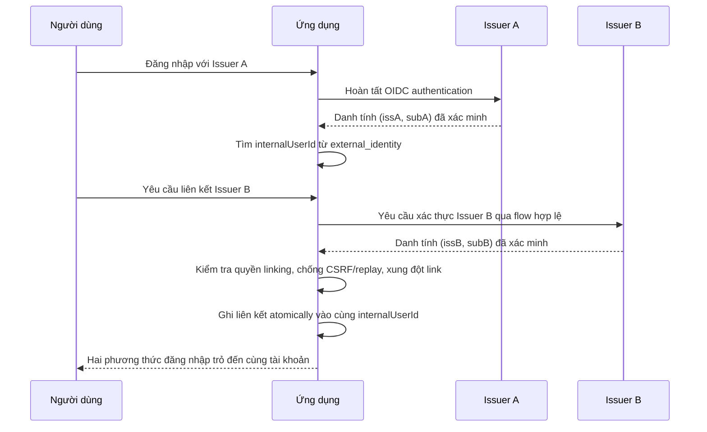
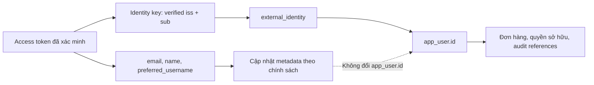

# Không dùng email hoặc tên hiển thị làm định danh ổn định khi chưa có hợp đồng

## 1. Định danh principal là một hợp đồng, không phải một chuỗi “trông giống tên người”

Trong **Spring Security OAuth 2.0/OIDC Resource Server**, sau khi access token được xác thực, Spring Security tạo một đối tượng `Authentication` đại diện cho **principal**: chủ thể được nhận diện trong ngữ cảnh request. Principal có thể là **người dùng**, **tài khoản dịch vụ**, hoặc một loại chủ thể khác theo hợp đồng của Authorization Server.

Một JWT access token có thể chứa:

```json
{
  "iss": "https://login.example.test/realms/shop",
  "sub": "a8f37c21-12d4-47f6-9980-e1fd0aa9e442",
  "aud": ["orders-api"],
  "scope": "orders:read",
  "email": "linh.nguyen@example.test",
  "email_verified": true,
  "preferred_username": "linh.nguyen",
  "name": "Nguyễn Linh",
  "iat": 1893452400,
  "exp": 1893456000
}
```

Đây là **payload giả định để minh họa**, không phải JWT có chữ ký sử dụng được. Những claim trên phục vụ các mục đích khác nhau:

- `iss` (issuer): bên đã phát hành JWT.
- `sub` (subject): định danh chủ thể do issuer công bố.
- `aud`: resource dự kiến nhận token.
- `scope`: những quyền/phạm vi được cấp cho access token.
- `email`, `preferred_username`, `name`: có thể hữu ích cho liên hệ hoặc hiển thị, **nhưng không tự bảo đảm tính ổn định, duy nhất hay không tái sử dụng**.

Ví dụ một hệ thống lưu quyền sở hữu đơn hàng bằng `email`:

```text
orders.owner_email = "linh.nguyen@example.test"
```

Khi người dùng đổi email, email cũ được thu hồi hoặc một người khác nhận lại địa chỉ đó, liên kết “ai sở hữu đơn hàng” có thể bị đứt hoặc — nghiêm trọng hơn — gắn nhầm sang người khác. Nếu lưu bằng tên hiển thị, vấn đề còn lớn hơn: hàng nghìn người có thể cùng tên và một người có thể đổi tên bất cứ lúc nào.

> **Nguyên tắc chính:** Không dùng `email`, `name`, `preferred_username` hoặc `Authentication.getName()` như khóa định danh bất biến **nếu chưa có hợp đồng rõ ràng** với issuer về tính duy nhất, vòng đời, phạm vi và khả năng tái sử dụng. Trong mô hình OIDC thông dụng, bắt đầu bằng cặp **`(iss, sub)`** cho danh tính bên ngoài; gắn cặp đó với **ID nội bộ ổn định** do ứng dụng quản lý.

## 2. Tại sao “nhận diện được người” khác với “có định danh ổn định”?

Nhiều giá trị có thể giúp con người nhận ra nhau trên giao diện, nhưng không phù hợp làm khóa lưu trữ hoặc phân quyền lâu dài.

| Thuộc tính | Dùng để làm gì | Có nên tự động dùng làm khóa danh tính? |
| --- | --- | --- |
| `sub` | Định danh subject do issuer phát hành. | **Có điều kiện:** thường dùng cùng `iss`, trong đúng ngữ cảnh và theo hợp đồng issuer. |
| `iss` | Xác định miền định danh/nhà phát hành. | Không đủ một mình; phải kết hợp subject tương ứng. |
| `email` | Gửi thông báo, liên hệ hoặc hiển thị. | **Không mặc định.** Có thể đổi, không bắt buộc luôn có, có thể được tái sử dụng. |
| `email_verified` | Issuer báo trạng thái xác minh địa chỉ theo quy trình của họ. | Không. Không chứng minh email bất biến hoặc duy nhất suốt đời. |
| `preferred_username` | Tên đăng nhập/biệt danh người dùng muốn dùng. | Không mặc định. Có thể đổi hoặc tái cấp cho người khác. |
| `name` | Tên đầy đủ để hiển thị. | Không. Trùng lặp và đổi tùy ý. |
| `given_name`, `family_name` | Các thành phần tên cho giao diện. | Không. Có thể thay đổi và không duy nhất. |
| `picture` | URL ảnh đại diện. | Không. URL có thể đổi, hết hạn hoặc cần cấp phép mới. |
| `client_id` | Định danh OAuth 2.0 client. | Phù hợp để phân biệt client theo hợp đồng, **không tự thay** user subject. |
| `jti` | Định danh một JWT/token cụ thể. | Không. Token mới thường có `jti` mới, không phải ID của người dùng. |
| `aud` | Resource nhận JWT. | Không. Audience không phải danh tính người dùng. |
| `tenant_id` | Ngữ cảnh tenant theo hợp đồng issuer/API. | Là ranh giới/phạm vi dữ liệu; không mặc định thay cho `sub`. |

### 2.1. Một ví dụ thay đổi mà người dùng không đổi

**Lần đăng nhập thứ nhất:**

```json
{
  "iss": "https://login.example.test/realms/shop",
  "sub": "user-4be18",
  "email": "linh.old@example.test",
  "name": "Nguyễn Linh"
}
```

**Lần đăng nhập thứ hai:**

```json
{
  "iss": "https://login.example.test/realms/shop",
  "sub": "user-4be18",
  "email": "linh.new@example.test",
  "name": "Linh Nguyễn"
}
```

Giả sử issuer cam kết `sub` ổn định trong miền issuer này, hai phiên đăng nhập thuộc về **cùng external subject**. Nếu hệ thống lấy email làm khóa chính, nó có thể tạo ra **hai tài khoản nội bộ** cho một người hoặc khiến người dùng mất quyền truy cập lịch sử của mình.

### 2.2. Hai người khác nhau có thể cùng thông tin hiển thị

```json
{
  "iss": "https://login.example.test/realms/shop",
  "sub": "user-111",
  "email": "support@example.test",
  "name": "Support Team"
}
```

```json
{
  "iss": "https://login.example.test/realms/shop",
  "sub": "user-222",
  "email": "support@example.test",
  "name": "Support Team"
}
```

Ví dụ này giả định issuer có thể trả trùng thông tin liên hệ/hiển thị. Dù một số nhà cung cấp áp đặt chính sách email duy nhất, **Resource Server không được tự suy luận mọi issuer đều làm vậy**. Hai subject khác nhau vẫn phải được xem là hai danh tính riêng, trừ khi có **quy trình liên kết danh tính** được chứng thực và phê duyệt.

## 3. sub và iss: nền tảng danh tính OIDC

Trong OpenID Connect, `sub` là subject identifier mà OpenID Provider cấp cho End-User. Thuộc tính này được thiết kế để ổn định và không tái sử dụng **trong phạm vi do OP xác định**, và cần được hiểu kết hợp với `iss` để có định danh chủ thể toàn cục trong ngữ cảnh OIDC phù hợp.

Ví dụ:

```text
Identity A
  iss = https://login-a.example.test
  sub = 12345

Identity B
  iss = https://login-b.example.test
  sub = 12345
```

**Hai cặp này không tự động là cùng người**, dù `sub` trùng nhau. Issuer A và issuer B là hai **miền định danh** riêng. Một ID đơn lẻ như `"12345"` không đủ làm khóa cho hệ thống đa issuer.

Khóa danh tính bên ngoài nên được biểu diễn về mặt logic như:

```text
ExternalIdentityKey = (issuer, subject)
```

Với hệ thống đa tenant mà issuer dùng namespace subject riêng theo tenant, phải bổ sung **định danh tenant theo hợp đồng** hoặc dùng issuer/realm riêng phù hợp. Không đoán quy tắc namespace từ email hoặc tên tenant hiển thị.

### 3.1. Các thuộc tính của sub cần hiểu đúng

- `sub` thường là **opaque identifier**: đừng cố giải mã, suy luận ý nghĩa nghiệp vụ hoặc dựa vào việc nó “giống UUID”.
- `sub` là chuỗi **phân biệt chữ hoa/thường**; không tự động lowercase, trim hoặc thay ký tự nếu issuer không quy định phép chuẩn hóa đó.
- `iss` là một URI issuer được ràng buộc bởi validator, không phải bất kỳ URL nào client tự gửi. Hãy dùng chính giá trị issuer đã được xác thực và được cấu hình tin cậy.
- Subject có ý nghĩa trong **miền issuer**, không phải một user ID toàn cầu dùng được ở mọi IdP.
- Khi thay issuer, chuyển tenant/realm hoặc thay chính sách subject, `sub` có thể thay đổi. Cần một **quy trình migration/linking** có bằng chứng, thay vì tự kết nối hai bản ghi vì email giống nhau.

### 3.2. Public và pairwise subject identifiers

OIDC có hai mô hình subject identifier thường được nhắc tới:

**Public subject identifier:** cùng End-User có thể nhận cùng `sub` khi tương tác với nhiều client của cùng OP, theo chính sách OP.

**Pairwise subject identifier:** OP có thể cấp một `sub` khác nhau cho cùng End-User ở những **sector identifier** khác nhau. Mục đích là hạn chế việc những client không liên quan tự nối danh tính qua cùng một định danh.

Ví dụ:

```text
OP = https://login.example.test

Web App A (sector A):
  sub = pairwise-a-913

Web App B (sector B):
  sub = pairwise-b-472
```

Không được kết luận hai `sub` khác nhau chắc chắn là hai người khác nhau **ở ngoài ranh giới client/sector**; nhưng cũng không được tự liên kết chúng bằng email. Nếu sản phẩm cần nhận biết cùng một con người giữa hai ứng dụng, phải có hợp đồng IdP hoặc quy trình account linking được người dùng ủy quyền.

**Cảnh báo khi kết hợp OIDC Client và OAuth2 Resource Server:** `sub` trong OIDC **ID token** và `sub` trong **access token** không mặc nhiên luôn có cùng semantics theo mọi provider, đặc biệt khi token dùng profile riêng, service principal hoặc cặp subject theo sector. API phải dựa vào hợp đồng **access token dành cho resource của mình**. Không lấy `sub` của ID token rồi tự cho rằng nó luôn trùng subject của mọi access token downstream.

## 4. Email và email_verified không bảo đảm điều gì?

### 4.1. Email không phải định danh bất biến

Các tình huống bình thường có thể xảy ra:

1. Người dùng đổi từ email cá nhân sang email công việc.
2. Doanh nghiệp đổi tên miền, email alias thay đổi.
3. Người dùng đổi họ hoặc tên và thay email.
4. Hộp thư bị đóng, sau đó địa chỉ được một chủ thể khác sử dụng.
5. Nhiều tài khoản sử dụng chung địa chỉ liên hệ hoặc một alias nhóm.
6. Nhà cung cấp danh tính trả email theo chính sách ẩn thông tin, proxy email hoặc email tạm thời.
7. Access token **không có claim `email`**, vì claim này không bắt buộc trong mọi profile.

Nếu ứng dụng lưu `email` làm foreign key cho quyền truy cập, những trường hợp trên tạo rủi ro “đổi thông tin liên hệ đồng nghĩa đổi chủ sở hữu”.

### 4.2. email_verified có ý nghĩa giới hạn

Trong OIDC, `email_verified: true` nghĩa là OP tuyên bố đã thực hiện quy trình xác minh email tại một thời điểm/theo cơ chế của họ. Nó **không** tự đảm bảo:

- Email không bao giờ đổi.
- Email là duy nhất trên toàn bộ hệ thống hoặc trên mọi issuer.
- Địa chỉ email sẽ không được tái sử dụng cho người khác.
- Chủ thể vẫn kiểm soát hộp thư tại thời điểm hiện tại nếu dữ liệu đã cũ.
- Hai tài khoản có cùng email thuộc cùng một người.

`email_verified` có thể hữu ích cho quy trình gửi email, xác minh phương thức liên hệ hoặc các bước **account linking có kiểm soát**, nhưng **không nên tự động biến nó thành khóa định danh**.

### 4.3. Không lấy domain email làm bằng chứng tenant/role

Ví dụ:

```java
// KHÔNG AN TOÀN như một quy tắc cấp quyền tổng quát:
if (email.endsWith("@example-company.test")) {
    grantAdminAccess();
}
```

Domain email là thông tin liên hệ và có thể bị ảnh hưởng bởi chính sách phát hành email, alias hoặc dữ liệu cũ. Tư cách thành viên tổ chức, vai trò quản trị và tenant phải được xác nhận bằng **claim được hợp đồng bảo đảm**, API/IdP group membership hoặc policy engine đáng tin cậy. Ngay cả khi email đã được xác minh, điều đó không tự cấp quyền administrator.

## 5. name và preferred_username chỉ là metadata cho giao diện

`name` trong OIDC có thể là tên đầy đủ hiển thị; `preferred_username` có thể là nickname hoặc login handle. Chúng không nên dùng làm:

- Primary key hoặc foreign key trong bảng nghiệp vụ.
- Khóa cache lâu dài của quyền truy cập.
- Khóa chống trùng user toàn hệ thống.
- Tiêu chí tự động gắn nhiều tài khoản OIDC với một user.
- Điều kiện cho phép người dùng xem dữ liệu của một người khác.
- ID bất biến trong audit log.

Ví dụ hai người cùng tên:

```text
sub=user-a, name="Nguyễn Văn An"
sub=user-b, name="Nguyễn Văn An"
```

Nếu dùng `name` để tìm chủ sở hữu đơn hàng, ứng dụng không có đủ thông tin để phân biệt hai người. Nếu dùng `preferred_username` và nhà cung cấp cho phép đổi handle, hệ thống có thể mất liên kết dữ liệu hoặc nhầm với người nhận handle cũ.

**Nên tách:**

```text
identity_key   = (verified issuer, verified subject)
local_user_id  = UUID do ứng dụng cấp, dùng cho foreign keys
display_name   = metadata có thể cập nhật
contact_email  = metadata có thể cập nhật và xác minh theo chính sách
```

Metadata hiển thị có thể được làm mới khi người dùng đăng nhập hoặc qua đồng bộ hồ sơ, nhưng không được dùng nó để quyết định một user mới có quyền tiếp quản bản ghi cũ.

## 6. Spring Security thể hiện principal thế nào?

Trong Spring Security, `Authentication` mô tả một chủ thể được xác thực và những authority đi kèm:

```java
Authentication authentication =
        SecurityContextHolder.getContext().getAuthentication();

String name = authentication.getName();
Collection<? extends GrantedAuthority> authorities =
        authentication.getAuthorities();
```

Đoạn code giả định được gọi trong request đã được Spring Security xử lý. **`getName()` không phải lời cam kết định danh bất biến ở cấp business.** Giá trị trả về phụ thuộc loại `Authentication` và converter:

| Ngữ cảnh | Principal điển hình | Tên được trả về |
| --- | --- | --- |
| JWT Resource Server | `JwtAuthenticationToken` từ JWT đã xác minh. | Mặc định thường dựa trên `sub`, nếu issuer/token có claim đó. |
| JWT Resource Server có converter tùy chỉnh | `JwtAuthenticationToken` với principal claim được cấu hình. | Có thể là `preferred_username` hoặc claim khác nếu lập trình viên đổi mapping. |
| OIDC Login Client | `OAuth2AuthenticationToken` với `OidcUser`. | Phụ thuộc `OidcUser`/client registration và name attribute. |
| Basic/form authentication | Username/password principal. | Thường là username của hệ thống đăng nhập. |
| Opaque Resource Server | Principal từ introspection. | Phụ thuộc introspector/provider và mapping. |

Do đó, trong API dùng JWT, nên lấy **issuer và subject đã được xác minh một cách tường minh**, thay vì dùng một chuỗi tên duy nhất mà không biết nguồn.

### 6.1. JwtAuthenticationToken và principal claim name

Với JWT Resource Server, `JwtAuthenticationConverter` có thể cấu hình claim dùng làm tên của `Authentication`:

```java
JwtAuthenticationConverter converter = new JwtAuthenticationConverter();
converter.setPrincipalClaimName("preferred_username");
```

Nếu cấu hình như vậy, `Authentication.getName()` có thể trở thành `preferred_username`. Việc đổi này có thể hữu ích cho logging hoặc hiển thị ở một vài hệ thống, **nhưng nó không làm username trở thành khóa danh tính ổn định**.

Một ứng dụng đã có code:

```java
String ownerId = authentication.getName();
orderRepository.findByOwnerId(ownerId);
```

có thể bị lỗi âm thầm khi đổi principal claim từ `sub` sang `preferred_username`. Cách bền vững hơn là thiết kế tầng **identity mapping** riêng với định danh đã được xác minh và lưu khóa nội bộ.

### 6.2. Controller đọc claim đã xác minh

Trong JWT Resource Server, Spring Security có thể inject `Jwt` của principal:

```java
@RestController
class AccountController {

    @GetMapping("/api/me")
    Map<String, Object> me(@AuthenticationPrincipal Jwt jwt) {
        String issuer = jwt.getIssuer().toString();
        String subject = jwt.getSubject();

        return Map.of(
                "issuer", issuer,
                "subject", subject);
    }
}
```

Trong ví dụ, request phải đi qua **`BearerTokenAuthenticationFilter`, `JwtAuthenticationProvider`, `JwtDecoder` và validators** đã cấu hình, rồi mới đến controller. `@AuthenticationPrincipal Jwt` không tự chứng thực JWT nếu ứng dụng bỏ security filter chain; tính tin cậy đến từ toàn bộ quy trình xác thực trước đó.

Không phải API nào cũng nên trả issuer/subject ra public response như ví dụ minh họa. Khi triển khai thực tế, chỉ trả dữ liệu định danh mà ứng dụng có lý do chính đáng và quyền tiết lộ cho client.

## 7. Xây dựng trust boundary trước khi lấy danh tính

Đừng đọc `sub` từ một JWT bất kỳ rồi ghi ngay vào database:

```java
// SAI: chỉ Base64URL-decode payload rồi tin sub.
String[] parts = token.split("\\.");
String payloadJson = new String(
        Base64.getUrlDecoder().decode(parts[1]),
        StandardCharsets.UTF_8);
// Dùng sub trong payloadJson để tìm owner: không an toàn.
```

Một attacker có thể tự tạo payload với `sub` của nạn nhân. Resource Server chỉ được tin principal **sau khi**:

1. Nhận Bearer credential qua kênh/cơ chế được hỗ trợ.
2. Xác minh **chữ ký JWS**, thuật toán và public key/JWKS của issuer đã tin cậy (hoặc dùng introspection đáng tin cậy nếu token opaque).
3. Kiểm tra **`iss`** đúng issuer được cho phép.
4. Kiểm tra **`aud`** có resource API đang nhận token.
5. Kiểm tra **`exp`, `nbf`** và điều kiện thời gian cần thiết.
6. Kiểm tra **token type/profile**; không chấp nhận OIDC ID token như access token.
7. Kiểm tra **scope/authority**, tenant và chính sách nghiệp vụ.

`iss` trong JWT chưa xác minh chỉ là dữ liệu do người gửi cung cấp. Khi hỗ trợ nhiều issuer, có thể đọc `iss` trước để định tuyến **vào một allowlist được cấu hình sẵn**, nhưng decoder được chọn vẫn phải xác minh lại issuer và chữ ký. Không tự động tin issuer/JWKS URL bất kỳ mà token khai báo.

### 7.1. Ví dụ JwtDecoder kiểm tra issuer và audience

```java
@Configuration
class JwtValidationConfig {

    private static final String ISSUER =
            "https://login.example.test/realms/shop";
    private static final String EXPECTED_AUDIENCE = "orders-api";

    @Bean
    JwtDecoder jwtDecoder() {
        NimbusJwtDecoder decoder =
                NimbusJwtDecoder.withIssuerLocation(ISSUER).build();

        OAuth2TokenValidator<Jwt> standard =
                JwtValidators.createDefaultWithIssuer(ISSUER);

        OAuth2TokenValidator<Jwt> audience = jwt ->
                jwt.getAudience().contains(EXPECTED_AUDIENCE)
                        ? OAuth2TokenValidatorResult.success()
                        : OAuth2TokenValidatorResult.failure(
                                new OAuth2Error(
                                        "invalid_token",
                                        "JWT audience is not orders-api",
                                        null));

        decoder.setJwtValidator(
                new DelegatingOAuth2TokenValidator<>(
                        standard, audience));
        return decoder;
    }
}
```

Đoạn trên minh họa `JwtDecoder`, `NimbusJwtDecoder`, `JwtValidators`, `OAuth2TokenValidator` và `OAuth2Error`; các import được lược bớt để tập trung vào chính sách. Trong dự án thực tế, cấu hình thuật toán, access-token profile và các claims bắt buộc phải được bổ sung theo issuer và phiên bản Spring Security đang dùng.

Đặc biệt, **ID token** do cùng OIDC Provider ký thường dành cho **OIDC Client**, không phải Resource Server; audience validator và token profile phù hợp giúp tránh việc API nhận nhầm ID token.

## 8. Mô hình dữ liệu nên dùng: internal ID và external identity link

Thay vì lưu email như khóa sở hữu dữ liệu, thiết kế **một internal user ID** ổn định và bảng ánh xạ danh tính bên ngoài:

```text
app_user
  id                 UUID PRIMARY KEY
  display_name       TEXT          -- metadata thay đổi được
  contact_email      TEXT          -- metadata thay đổi được
  created_at         TIMESTAMP

external_identity
  id                 UUID PRIMARY KEY
  user_id            UUID REFERENCES app_user(id)
  issuer             TEXT NOT NULL
  subject            TEXT NOT NULL
  created_at         TIMESTAMP
  UNIQUE (issuer, subject)

orders
  id                 UUID PRIMARY KEY
  owner_user_id      UUID REFERENCES app_user(id)
  ...
```

Ở đây:

- `app_user.id` là định danh nghiệp vụ do **ứng dụng** cấp và kiểm soát.
- `external_identity.issuer` + `subject` định danh một principal từ IdP.
- Một người dùng nội bộ có thể liên kết nhiều external identities **chỉ sau quy trình linking hợp lệ**.
- `orders.owner_user_id` không bị thay đổi khi email, nickname hoặc tên hiển thị thay đổi.
- Constraint `UNIQUE(issuer, subject)` chặn một external identity bị liên kết đồng thời với hai user nội bộ.

Đây là **sơ đồ logic minh họa**; DDL thực tế tùy database, collation và chính sách multi-tenant. Các cột `issuer`/`subject` nên được so khớp theo giá trị/canonicalization đã xác định trong hợp đồng, tránh collation tự gộp chữ hoa/thường không mong muốn.

### 8.1. Tại sao không lấy sub làm primary key của app_user?

Một ứng dụng chỉ có một issuer ổn định có thể dùng `sub` làm khóa logic trong phạm vi đó. Tuy nhiên dùng internal ID giúp tách **vòng đời dữ liệu nghiệp vụ** khỏi:

- Di chuyển OIDC Provider hoặc thay realm/issuer.
- Liên kết nhiều đăng nhập của cùng người.
- Các định danh pairwise theo client/sector.
- Việc đồng bộ và nhập dữ liệu lịch sử.
- Tài khoản được tạo trước khi có external identity.

Khi user đổi IdP, có thể thêm external identity link mới vào cùng `app_user.id` sau khi đã xác thực quyền sở hữu danh tính. Các bảng đơn hàng vẫn tham chiếu internal ID cũ.

### 8.2. Entity và repository minh họa

```java
public record ExternalIdentityKey(String issuer, String subject) {
    public ExternalIdentityKey {
        if (issuer == null || issuer.isBlank()
                || subject == null || subject.isBlank()) {
            throw new IllegalArgumentException(
                    "Issuer and subject must be present");
        }
    }
}

public interface ExternalIdentityRepository {
    Optional<UUID> findInternalUserId(ExternalIdentityKey identity);

    // Việc tạo link phải dùng transaction và unique constraint.
    void link(ExternalIdentityKey identity, UUID internalUserId);
}
```

Khi gọi repository, chỉ tạo `ExternalIdentityKey` từ **principal đã qua authentication**, không từ query parameters `?sub=...` hoặc header `X-User-Email` do client tự gửi.

Repository trên là ví dụ interface ở tầng domain, **không phải Spring Data repository được framework tự động suy ra implementation**. Môi trường thực tế cần implementation/JPA entity/schema, transaction và xử lý xung đột phù hợp.

## 9. Từ JWT đến internal user trong Resource Server

Giả sử endpoint cần đọc dữ liệu của user hiện tại. Ứng dụng có thể triển khai một service ánh xạ principal:

```java
@Service
public class CurrentUserResolver {
    private final ExternalIdentityRepository identityRepository;

    public CurrentUserResolver(
            ExternalIdentityRepository identityRepository) {
        this.identityRepository = identityRepository;
    }

    public UUID requireInternalUserId(Jwt jwt) {
        if (jwt == null || jwt.getIssuer() == null
                || jwt.getSubject() == null
                || jwt.getSubject().isBlank()) {
            throw new AccessDeniedException(
                    "No stable external subject was provided");
        }

        ExternalIdentityKey key = new ExternalIdentityKey(
                jwt.getIssuer().toString(),
                jwt.getSubject());

        return identityRepository.findInternalUserId(key)
                .orElseThrow(() -> new AccessDeniedException(
                        "External subject has no linked user"));
    }
}
```

Ví dụ controller:

```java
@RestController
class MyOrdersController {
    private final CurrentUserResolver currentUserResolver;
    private final OrderService orderService;

    public MyOrdersController(
            CurrentUserResolver currentUserResolver,
            OrderService orderService) {
        this.currentUserResolver = currentUserResolver;
        this.orderService = orderService;
    }

    @GetMapping("/api/orders/mine")
    public List<OrderDto> myOrders(@AuthenticationPrincipal Jwt jwt) {
        UUID localUserId =
                currentUserResolver.requireInternalUserId(jwt);
        return orderService.findOrdersOwnedBy(localUserId);
    }
}
```

Ví dụ giả định `OrderService` và `OrderDto` là kiểu của ứng dụng; các import được lược bớt. Lớp `CurrentUserResolver` không tự xác minh JWT mà **dựa vào security chain đã kiểm tra token**. Endpoint thực tế vẫn cần policy `SCOPE_orders:read` và ràng buộc sở hữu dữ liệu.

### 9.1. Cấu hình endpoint yêu cầu scope phù hợp

```java
@Bean
SecurityFilterChain apiSecurity(HttpSecurity http) throws Exception {
    return http
            .authorizeHttpRequests(auth -> auth
                    .requestMatchers(HttpMethod.GET, "/api/orders/**")
                        .hasAuthority("SCOPE_orders:read")
                    .anyRequest().authenticated())
            .oauth2ResourceServer(oauth2 ->
                    oauth2.jwt(Customizer.withDefaults()))
            .build();
}
```

Spring Security thường chuyển `scope` hoặc `scp` từ JWT access token thành authority `SCOPE_...`. Nếu provider dùng claim riêng, cần converter tuân hợp đồng. **Không cấp `SCOPE_orders:read` vì email thuộc một tên miền cụ thể**, và cũng không cho phép truy cập mọi bản ghi chỉ vì có scope. Quy tắc ownership trong `OrderService` phải tiếp tục áp dụng.

### 9.2. Với user mới chưa có external identity link

Khi `findInternalUserId` không tìm thấy, **không tự ghép tài khoản bằng email**. Tùy nghiệp vụ:

- API có thể từ chối request và yêu cầu hoàn tất onboarding/provisioning.
- Một dịch vụ provisioning đáng tin có thể tạo `app_user` và `external_identity` mới bằng transaction.
- Nếu có xung đột identity key, phải dùng unique constraint và xử lý concurrency; không tạo hai user chỉ vì hai request đầu tiên đến đồng thời.
- Nếu email đã tồn tại trong bảng user cũ, thực hiện luồng xác minh/linking thay vì tự chuyển quyền sở hữu sang principal mới.

Việc có claim `email_verified=true` không thay thế quá trình xác định tài khoản nội bộ nào được phép liên kết.

## 10. Account linking: cùng email không có nghĩa cùng tài khoản

Một sản phẩm có thể hỗ trợ đăng nhập qua nhiều OIDC Provider, ví dụ:

```text
Login A:
  issuer  = https://login-company.example.test
  subject = employee-123
  email   = linh@example.test

Login B:
  issuer  = https://login-social.example.test
  subject = social-987
  email   = linh@example.test
```

Không được tự động kết luận hai đăng nhập trên là **cùng người** chỉ vì email giống nhau. Cũng không nên tự động hợp nhất hai internal users đang sở hữu dữ liệu nhạy cảm.

### 10.1. Luồng liên kết an toàn hơn



Quy trình thực tế phải bảo vệ chống **account takeover**, session fixation, CSRF, replay và race condition. Việc gắn danh tính mới vào tài khoản đang đăng nhập có thể yêu cầu **reauthentication** hoặc một bước xác minh bổ sung tùy mức độ rủi ro.

### 10.2. Một email cũ được tái cấp có thể gây chiếm tài khoản

Giả sử:

1. Người A từng sở hữu `old@example.test` và tạo tài khoản có dữ liệu quan trọng.
2. A ngừng sử dụng email đó, nhưng tài khoản ứng dụng vẫn lưu `owner_email`.
3. Người B nhận lại địa chỉ email từ nhà cung cấp.
4. B đăng nhập với một IdP trả `email=old@example.test`.
5. Ứng dụng tự liên kết B vào tài khoản A do email trùng.

Đây là nguy cơ **account takeover**. Cách thiết kế tránh lỗi là lưu owner theo internal ID, liên kết external identity dựa trên subject đã xác thực, và chỉ cho phép nhập/gộp tài khoản qua quy trình có bằng chứng quyền sở hữu.

### 10.3. Phải làm gì khi IdP thay đổi subject?

Nếu nhà cung cấp thay `sub` trong một migration, đừng tự biến `email` thành “cầu nối” không kiểm soát. Cần một trong các phương pháp phù hợp:

- Bản mapping cũ–mới được issuer cung cấp qua kênh tin cậy và có chính sách xác minh.
- Người dùng xác thực cả danh tính cũ và mới trong một phiên linking hợp lệ.
- Quy trình khôi phục tài khoản có kiểm chứng, phê duyệt và audit.

Tài liệu migration phải ghi rõ **issuer cũ/issuer mới, subject namespace, phạm vi tenant, tính duy nhất và phương thức xử lý trùng/thiếu**.

## 11. Service principal: không phải sub nào cũng là người dùng

OAuth 2.0 cho phép luồng **Client Credentials** để machine-to-machine (M2M) gọi API. Trong trường hợp này không có End-User trực tiếp. JWT access token có thể mang `client_id`, `sub` được issuer định nghĩa theo cách riêng, hoặc những claim service identity tương đương.

Ví dụ:

```json
{
  "iss": "https://login.example.test/realms/shop",
  "sub": "billing-batch-service",
  "client_id": "billing-batch-service",
  "aud": ["orders-api"],
  "scope": "orders:reconcile",
  "exp": 1893456000
}
```

**Đừng** tự lập một `app_user` cá nhân từ `sub` của token M2M chỉ vì code giả định mọi JWT đại diện một người. Cần contract nêu:

- Token đại diện **End-User**, **client/service**, hay cả hai theo trường hợp?
- Claim nào nhận diện user và claim nào nhận diện OAuth client?
- Nếu là client credentials, service principal có được ánh xạ sang **service_account** riêng không?
- Quyền của service có giống quyền người dùng không? Có cần kiểm tra hành động ủy quyền/delegation?
- Audit cần ghi nhận actor thực sự là user hay service?

### 11.1. Phân loại principal trước khi ánh xạ

Một mô hình nội bộ có thể tách:

```text
AuthenticatedActor
  kind = HUMAN | SERVICE
  issuer
  stableExternalId
  internalUserId?        // chỉ với human đã được liên kết
  internalServiceId?     // chỉ với service đã đăng ký
  clientId?
  authorities
```

`kind` ở đây là **khái niệm nội bộ của ứng dụng**, không phải claim mà mọi Authorization Server tự cung cấp. Xác định loại actor bằng các claim/flow đã được issuer cam kết và validation phù hợp; không chỉ suy đoán từ việc `sub` có chứa từ `service` hay không.

Một API dùng chung endpoint cho human và service cần chính sách rõ ràng về hành động nào mỗi loại actor được phép làm. Không cho service token truy cập dữ liệu cá nhân bằng cách gán đại một email mặc định.

## 12. Multi-tenant: danh tính và phạm vi dữ liệu phải tách riêng

Trong ứng dụng đa tenant, cặp `(iss, sub)` có thể định danh chủ thể, nhưng **quyền của chủ thể trong một tenant** vẫn là quan hệ khác.

```text
app_user:
  user_id = 74f...

external_identity:
  issuer = https://login.example.test
  sub = user-4be18
  user_id = 74f...

tenant_membership:
  tenant_id = tenant-42
  user_id = 74f...
  role = order_reader

orders:
  tenant_id = tenant-42
  owner_user_id = 74f...
```

Một token có `tenant_id="tenant-42"` không tự có nghĩa người dùng được xem **mọi** đơn hàng của tenant đó. API còn cần xác minh role, scope, ownership và ràng buộc truy vấn:

```sql
SELECT *
FROM orders
WHERE tenant_id = :authorized_tenant_id
  AND owner_user_id = :current_user_id;
```

Hai tham số phải được lấy từ **ngữ cảnh đã xác thực và đã phân quyền**, không từ query parameters do client tự chọn rồi tin vô điều kiện. Nếu API hỗ trợ người dùng chọn tenant qua URL/header, cần kiểm tra người dùng có quyền ở tenant đó trước khi thực thi truy vấn.

### 12.1. Issuer và subject có thể thay đổi theo tenant

Một IdP có thể cấp mỗi tenant một issuer/realm, hoặc dùng một issuer nhưng `sub` có namespace riêng. **Không có một quy tắc chung cho mọi provider**. Hợp đồng phải quy định:

- Subject là duy nhất theo issuer hay theo cặp issuer–tenant?
- Khi chuyển user sang tenant khác, subject có giữ nguyên không?
- Quyền tenant được cấp trong access token hay tra cứu qua policy service?
- Có cho phép một human principal thuộc nhiều tenant không?

Nếu issuer không cam kết `sub` là duy nhất trên toàn issuer, **khóa nghiệp vụ cần thêm namespace được cam kết**, thay vì mặc định dùng email.

## 13. Cập nhật thông tin hồ sơ mà không thay đổi quyền sở hữu

Một luồng đồng bộ profile nên coi email/tên hiển thị như **thuộc tính có thể thay đổi**:



Ví dụ quy trình:

1. Tìm `app_user.id` qua external identity key đã xác minh.
2. Lấy profile claims từ **nguồn được hợp đồng cho phép**: ID token/UserInfo khi ứng dụng đang ở vai trò OIDC Client, hoặc access token/introspection nếu issuer cam kết các claim này cho API.
3. Xem claim có hiện diện và đúng kiểu hay không; nếu thiếu, không mặc định xóa dữ liệu liên hệ đã có.
4. Cập nhật `display_name`, `contact_email` theo chính sách ứng dụng, audit thay đổi quan trọng.
5. **Không sửa `orders.owner_user_id` chỉ vì email mới xuất hiện**.
6. Không tự thêm external identity mới khi chỉ có email giống nhau.

**Lưu ý:** Không phải mọi access token đều chứa `email` hoặc `name`. API không được giả định các OIDC standard scopes như `email`/`profile` làm các claim tự động xuất hiện trong **access token**. ID token và UserInfo là nguồn profile trong vai trò OIDC Client; Resource Server cần contract riêng về claim nào được phát trong access token.

## 14. Audit, cache và logging cần định danh nào?

### 14.1. Audit log

Log hành động quan trọng nên gắn với một định danh ổn định:

```text
event_id        = evt-10001
action          = ORDER_CANCEL
actor_kind      = HUMAN
internal_user_id = 74f...
issuer          = https://login.example.test/realms/shop
subject         = user-4be18
order_id        = order-123
timestamp       = ...
```

Tên hiển thị và email có thể được thêm như **snapshot metadata** nếu thực sự cần và chính sách bảo vệ dữ liệu cho phép, nhưng không được dùng chúng làm chìa khóa truy tìm actor duy nhất. Nếu subject thay đổi theo migration, giữ bảng mapping/audit history để điều tra theo định danh đúng thời kỳ.

### 14.2. Cache keys và authorization decisions

Một cache quyền khóa theo email:

```text
permissions:linh@example.test
```

có thể bị đụng khóa khi email thay đổi/tái sử dụng. Cần khóa theo **principal đáng tin cậy và resource/policy context**, chẳng hạn:

```text
permissions:<issuer-id>:<subject-id>:<tenant-id>:<policy-version>
```

Ví dụ chỉ mô tả thành phần logic; implementation thực tế cần encoding hoặc hashing an toàn để tránh delimiter collision, rò rỉ PII và high-cardinality. Nếu user liên kết nhiều IdP vào cùng internal user, có thể chọn internal ID cho cache của domain nhưng vẫn phải kiểm soát scope, tenant, token lifetime và invalidation.

Đừng lưu access token nguyên vẹn làm cache key hoặc log key.

### 14.3. Dữ liệu liên hệ và quyền riêng tư

Email là thông tin cá nhân. Chỉ thu thập và lưu theo mục đích phù hợp, áp dụng hạn chế quyền truy cập và retention. JWT được ký JWS **không mặc nhiên mã hóa payload**: dữ liệu email/name trong access token có thể đọc được bởi bên giữ token. Tránh cho access token chứa nhiều thông tin hồ sơ không cần thiết đối với Resource Server.

## 15. Quy trình lựa chọn một khóa danh tính cho dự án

Với mỗi issuer/API, nên lập **hợp đồng định danh principal**. Ví dụ:

```yaml
identity_contract:
  issuer: https://login.example.test/realms/shop
  accepted_token_kind: oauth2-access-token
  expected_audience: orders-api
  human_subject:
    claim: sub
    type: string
    unique_within: issuer
    case_sensitive: true
    reuse_policy: never-reuse-within-issuer
  service_subject:
    claim: client_id
    type: string
    meaning: oauth-client-id
  local_mapping:
    human_key: [issuer, sub]
    service_key: [issuer, client_id]
    internal_user_id: uuid
    internal_service_id: uuid
  metadata_only:
    - email
    - email_verified
    - preferred_username
    - name
    - picture
  account_linking:
    automatic_link_by_email: false
    require_verified_identity_flow: true
```

Đây là **ví dụ tài liệu hợp đồng**, không phải Spring Boot property tự động được framework đọc. Nó mô tả những điều **issuer phải thật sự cam kết**; nếu issuer không bảo đảm `never-reuse` hoặc subject namespace như ví dụ, không nên viết cam kết đó chỉ vì mong muốn.

### 15.1. Những câu hỏi cần hỏi nhà phát hành

1. `sub` có duy nhất trong toàn issuer, trong tenant hay trong sector không?
2. `sub` có được tái cấp cho người khác sau khi tài khoản bị xóa không?
3. `sub` có thể đổi khi migration, federation hoặc đổi realm không?
4. Access token mang subject của End-User hay client? Cách phân biệt theo grant/profile là gì?
5. Claim nào được xem là định danh client/service ổn định?
6. `email` có thể thiếu/đổi/tái sử dụng không? `email_verified` được xác định theo chính sách nào?
7. Mỗi issuer có public/pairwise subject policy thế nào? Có khác nhau theo client/sector không?
8. Có API chính thức cung cấp mapping cũ–mới khi chuyển issuer không?
9. Các claim nào được cấp trong access token, ID token và UserInfo tương ứng?
10. Nếu có nhiều tenant, subject namespace và tenant authorization được ràng buộc thế nào?

Nếu câu trả lời chưa rõ, **không giả định email hoặc tên hiển thị là định danh ổn định**. Thiết kế internal ID và identity link sẽ giảm phụ thuộc vào những trường chưa được cam kết.

## 16. Một ví dụ migration từ email-based ownership

Giả sử hệ thống cũ có:

```text
app_user:
  email (PRIMARY KEY)
  display_name

orders:
  owner_email (FOREIGN KEY → app_user.email)
```

Thiết kế mới muốn:

```text
app_user:
  id (PRIMARY KEY)
  contact_email
  display_name

external_identity:
  issuer
  sub
  user_id
  UNIQUE (issuer, sub)

orders:
  owner_user_id (FOREIGN KEY → app_user.id)
```

### 16.1. Các bước chuyển đổi an toàn

**Bước 1 — Chốt hợp đồng danh tính.** Làm rõ issuer, subject, tenant namespace, cách liên kết tài khoản cũ và các trường có thể thay đổi. Không chạy migration chỉ với giả định `email` duy nhất.

**Bước 2 — Thêm internal ID và bảng external identity.** Tạo UUID nội bộ, bảng link có unique constraint, hỗ trợ transaction và audit.

**Bước 3 — Backfill dữ liệu sở hữu.** Ánh xạ bản ghi orders cũ sang internal ID **dựa trên quan hệ tài khoản đã xác minh hoặc dữ liệu nội bộ đáng tin cậy**. Những trường hợp trùng/mơ hồ phải được xử lý riêng, không tự chọn một user bằng tên/email.

**Bước 4 — Triển khai dual-read có kiểm soát.** Ứng dụng mới ưu tiên `owner_user_id` và duy trì đường chuyển tiếp khi thật sự cần, nhưng không cấp quyền dựa trên email chưa có mapping. Có log/mức cảnh báo cho trường hợp thiếu link.

**Bước 5 — Chuyển hoàn toàn sang internal ID.** Khi mọi dữ liệu đã được xác minh và client nâng cấp, ngừng dùng `owner_email` làm khóa phân quyền. Email còn tồn tại chỉ để liên hệ hoặc hiển thị.

**Bước 6 — Gỡ legacy an toàn.** Không xóa các trường liên quan trước khi kiểm tra luồng báo cáo, audit, hàng đợi và xử lý dữ liệu cũ.

### 16.2. Tại sao không backfill chỉ bằng email?

Nếu dữ liệu cũ có hai account cùng email, email đã đổi hoặc địa chỉ thuộc một người mới, backfill tự động có thể chuyển quyền sở hữu dữ liệu nhạy cảm. Phải xem đây là vấn đề **data integrity + security**, không chỉ phép join SQL.

Đối với trường hợp không đủ bằng chứng, tốt hơn là **đánh dấu cần xử lý** theo quy trình khôi phục/kiểm chứng, thay vì đoán rồi gán sai owner.

## 17. Kiểm thử danh tính và quyền sở hữu

Việc kiểm tra nên bao phủ cả **identity mapping** và **authorization**, không chỉ assert HTTP 200.

| Tình huống | Kỳ vọng |
| --- | --- |
| Cùng `iss`, cùng `sub` nhưng đổi `email` | Ánh xạ tới **cùng internal user ID**. |
| Cùng `iss`, cùng `sub` nhưng đổi `name` | Vẫn cùng internal user; chỉ cập nhật display metadata. |
| Khác `sub`, cùng `email` | **Không tự gộp** tài khoản. |
| Khác `iss`, cùng `sub` | Hai external identity keys khác nhau. |
| Khác issuer, cùng email, cả hai `email_verified=true` | Không tự liên kết nếu chưa có flow account linking. |
| JWT có `sub` của nạn nhân nhưng chữ ký sai | Từ chối authentication, không truy vấn/quyền theo sub giả. |
| JWT đúng chữ ký nhưng `aud` sai | Từ chối token; không tạo principal tin cậy cho API này. |
| ID token OIDC có cùng `sub` nhưng không phải access token của API | Từ chối theo audience/token profile. |
| `sub` thiếu nhưng API yêu cầu human identity | Fail-closed, không fallback sang email để xác định user. |
| Client Credentials token không có End-User | Ánh xạ theo service principal contract; không tạo user cá nhân bằng email. |
| Hai request provisioning cho cùng `(iss, sub)` cùng lúc | Chỉ tạo một identity link nhờ transaction/unique constraint. |
| Hai người cùng tên hiển thị | Không truy cập chéo dữ liệu. |
| User thuộc tenant A gửi tenant B trong URL | Từ chối nếu không có membership/quyền tenant B. |
| Email cũ được gán lại cho người khác | Không chuyển quyền sở hữu dữ liệu cũ. |
| Đổi OIDC Provider qua migration | Liên kết qua bằng chứng đáng tin cậy, giữ internal user ID và audit. |

### 17.1. Đừng nhầm mock authentication với kiểm tra JWT thực

Trong Spring Security Test, `MockMvc` có thể dùng:

```java
mockMvc.perform(get("/api/orders/mine")
        .with(jwt()
                .jwt(jwt -> jwt
                        .issuer("https://login.example.test/realms/shop")
                        .subject("user-123"))
                .authorities(new SimpleGrantedAuthority(
                        "SCOPE_orders:read"))))
        .andExpect(status().isOk());
```

Đây là ví dụ minh họa cách **giả lập JWT principal** phục vụ test controller/authorization, với điều kiện repository đã có identity link tương ứng và endpoint trả dữ liệu hợp lệ. **Nó không chứng minh JWT đã được ký hoặc `JwtDecoder` đã xác thực issuer/audience thực**. Để test chữ ký và claims, cần integration test đi qua decoder với token và key thử nghiệm phù hợp.

Trong các test về business ownership, nên dùng **hai principal khác nhau nhưng cùng email** rồi bảo đảm không thể xem dữ liệu của nhau.

### 17.2. Kiểm tra điều kiện quyền riêng với định danh

Một principal có external identity đúng vẫn có thể không được phép đọc đơn hàng vì:

- Không có `SCOPE_orders:read`.
- Không thuộc tenant yêu cầu.
- Không sở hữu bản ghi.
- Tài khoản nội bộ bị khóa theo policy.
- Token có subject hợp lệ nhưng client không được phép thực hiện hành động này.

**Nhận diện ai đang gọi** và **được phép làm gì** là hai quyết định. Không để việc trùng email vượt qua kiểm tra quyền.

## 18. HTTP 401 và 403: danh tính sai ở giai đoạn nào?

| Trường hợp | Giai đoạn bị chặn | Phản hồi điển hình |
| --- | --- | --- |
| Không gửi Bearer token vào endpoint được bảo vệ | Chưa có credential | **401**, thường `WWW-Authenticate: Bearer`. |
| JWT sai chữ ký/issuer/audience/hết hạn | Authentication | **401 invalid_token**. |
| Token hợp lệ nhưng thiếu `sub` bắt buộc theo access-token profile | Token/claim validation nếu API định nghĩa validator | **401 invalid_token**. |
| Token hợp lệ, `sub` có nhưng không có internal identity link | Domain authorization/onboarding policy | **403** hoặc phản hồi onboarding riêng theo hợp đồng ứng dụng. |
| Token hợp lệ, internal user tồn tại nhưng thiếu scope | Authorization | **403** và có thể `insufficient_scope`. |
| Token hợp lệ, user có scope nhưng không sở hữu dữ liệu | Object-level authorization | **403/404** hoặc chính sách từ chối phù hợp. |

Nếu ứng dụng cần bảo đảm `sub` tồn tại cho **mọi** JWT access token ở một API chỉ phục vụ human users, có thể thêm `OAuth2TokenValidator<Jwt>` yêu cầu claim đó có mặt/đúng kiểu, để thiếu claim bị từ chối ngay trong authentication. Nhưng **không áp dụng validator “phải có human sub” cho mọi service token** nếu contract cho phép machine principals khác.

### 18.1. Ví dụ validator subject theo hợp đồng riêng

```java
OAuth2TokenValidator<Jwt> requireSubject = jwt -> {
    String subject = jwt.getSubject();
    if (subject != null && !subject.isBlank()) {
        return OAuth2TokenValidatorResult.success();
    }

    return OAuth2TokenValidatorResult.failure(
            new OAuth2Error(
                    "invalid_token",
                    "Token has no subject required by this API",
                    null));
};
```

Validator này minh họa cho **API yêu cầu subject**, không xác định liệu subject là End-User hay service. Nếu cần phân biệt hai loại, phải thêm chính sách token profile/claim từ issuer, chứ không chỉ kiểm tra chuỗi `sub` tồn tại.

## 19. Những anti-pattern phải tránh

### 19.1. Lấy email làm owner ID

`orders.owner_email` khiến quyền sở hữu đổi theo dữ liệu liên hệ. Dùng internal user ID và ánh xạ qua external identity.

### 19.2. Lấy Authentication.getName() làm khóa vĩnh viễn

`getName()` phụ thuộc implementation/converter; có thể đổi từ `sub` sang username. Phải biết ngữ nghĩa principal đang dùng và dựa vào hợp đồng identity tường minh.

### 19.3. Tự liên kết account khi email_verified=true

Email verified chỉ phản ánh thông tin xác minh do issuer tuyên bố, không chứng minh hai tài khoản hoặc hai IdP thuộc cùng một người trong mọi thời điểm. Cần linking flow có chứng thực.

### 19.4. Hạ chữ hoa/thường hoặc format sub tùy ý

`sub` là opaque, có phân biệt chữ hoa/thường theo ngữ nghĩa của issuer. Biến đổi chuỗi không được cam kết có thể gây trùng identity hoặc mất liên kết.

### 19.5. Bỏ iss, chỉ lưu sub

Hai issuer có thể phát cùng giá trị `sub`. Khi chấp nhận nhiều IdP, thiếu issuer sẽ tạo xung đột hoặc rủi ro gán nhầm.

### 19.6. Đọc claim trong JWT chưa xác minh

Payload JWT có thể bị attacker tạo giả. Chỉ dùng `sub`, email/role/tenant làm input cho domain logic **sau authentication** và kiểm tra profile/audience phù hợp.

### 19.7. Dùng ID token làm access token

OIDC ID token dành cho OIDC Client; Resource Server cần access token đúng đối tượng nhận. Không coi cùng `sub` hoặc cùng issuer là đủ để chấp nhận sai loại token.

### 19.8. Xem mọi sub là End-User

Client credentials và token của workload có thể đại diện service/client. Dựa vào token profile/issuer contract để xác định actor kind.

### 19.9. Gộp hai user vì trùng tên hiển thị

`name` hoặc `preferred_username` có thể trùng hoặc đổi. Gộp tài khoản là tác vụ bảo mật, không phải phép so sánh chuỗi.

### 19.10. Sử dụng email domain để cấp quyền quản trị

Domain email chưa đủ bảo đảm membership hay role. Quyền phải đến từ chính sách và dữ liệu đáng tin cậy.

## 20. Tình huống thực hành

### Tình huống A — Đổi email sau khi đã có đơn hàng

User đã có external identity `(issA, sub1)` gắn với `user_id=U1`. Khi email đổi, cập nhật `app_user.contact_email`, giữ nguyên `U1` và `orders.owner_user_id`. Người dùng tiếp tục xem đúng đơn hàng.

### Tình huống B — Hai issuer phát cùng sub

Issuer A phát `sub=100` cho Alice. Issuer B phát `sub=100` cho Bob. Nếu khóa external identity chỉ có `sub`, ứng dụng có thể gộp Alice/Bob. Với khóa `(iss, sub)`, hai người tách biệt.

### Tình huống C — Hai tài khoản cùng email

User A và B có hai `sub` khác nhau và cùng `email=support@example.test`. Repository không tự link vào cùng internal ID; mọi thao tác gộp đều yêu cầu workflow được ủy quyền.

### Tình huống D — Thay đổi preferred_username

Một người đổi username từ `linh.n` thành `linh.dev`. Nếu business logic dùng `Authentication.getName()` sau khi converter chuyển sang `preferred_username`, owner lookup có thể thất bại. Dùng verified issuer/subject và internal ID để không phụ thuộc name attribute.

### Tình huống E — Cùng người qua hai sector OIDC

OP cấp pairwise subject khác nhau cho cùng người ở hai ứng dụng. Không thể chỉ so `sub` để kết luận cùng danh tính xuyên sector, cũng không tự gộp bằng email. Khi cần shared account, sử dụng mapping/consent được OP và sản phẩm hỗ trợ.

### Tình huống F — Machine token gọi user endpoint

Một workload dùng Client Credentials gửi token có `client_id=billing-batch` vào `/api/orders/mine`. Không có user subject theo contract. API nên từ chối hoặc đưa workload sang endpoint/service policy riêng, không dùng `billing@example.test` làm user ID dự phòng.

### Tình huống G — User có cùng sub nhưng token dành cho API khác

User sở hữu `sub=user-1` trong một token có `aud=payments-api`. Đơn hàng API không được lấy `sub` rồi tìm `orders.owner_user_id` trước khi kiểm tra audience. Token sai resource phải bị từ chối ở authentication.

## 21. Câu hỏi tự kiểm tra

**1. Có thể dùng email làm khóa định danh user chỉ vì email_verified=true không?** Không. Phải có hợp đồng về tính duy nhất, vòng đời, khả năng đổi/tái sử dụng và quy trình liên kết.

**2. Vì sao thường lưu cả iss và sub?** Vì `sub` là danh tính trong namespace của issuer; hai issuer có thể dùng cùng giá trị subject cho hai người khác nhau.

**3. sub có luôn là UUID không?** Không. Đây là định danh opaque theo hợp đồng issuer; không tự parse hoặc chuẩn hóa tùy ý.

**4. Có thể dùng name làm khóa foreign key không?** Không. Tên hiển thị có thể trùng và thay đổi.

**5. Spring Security Authentication.getName() có luôn là immutable user ID không?** Không. Nó phụ thuộc loại Authentication và principal claim converter.

**6. Vì sao lưu app_user.id riêng?** Để dữ liệu nghiệp vụ giữ khóa ổn định khi external identity, email, issuer hoặc cơ chế login thay đổi.

**7. Hai IdP trả cùng email verified có chắc là cùng người không?** Không. Cần account linking được xác thực và bảo vệ khỏi takeover.

**8. Pairwise sub có tác động gì?** Cùng người có thể nhận subject khác nhau ở những sector khác nhau; không thể tự nối danh tính xuyên sector.

**9. JWT đúng chữ ký nhưng sai aud có được dùng để tra user không?** Không. API phải xác minh token được phát hành cho chính resource trước khi dựa vào subject.

**10. Client Credentials token có nhất thiết đại diện End-User không?** Không. Thường đại diện OAuth client/service; cần contract actor kind riêng.

**11. Khi user đổi email, order owner cần cập nhật không?** Không nếu quyền sở hữu đã lưu bằng internal user ID.

**12. Khi chuyển issuer, có thể tự link bằng email để khỏi hỏi người dùng không?** Không mặc định. Dùng mapping đáng tin cậy, flow xác minh hai danh tính hoặc quy trình khôi phục có kiểm chứng.

## 22. Tài liệu chuẩn và khái niệm nên tra cứu

- **OpenID Connect Core 1.0:** `sub`, `iss`, `email`, `email_verified`, `preferred_username`, `name` và mô hình public/pairwise subject identifiers.
- **RFC 7519 — JSON Web Token (JWT):** các registered claims như `iss`, `sub`, `aud`, `exp` và `jti`.
- **RFC 8725 — JWT Best Current Practices:** chống nhầm JWT giữa ngữ cảnh, ràng buộc issuer/audience và xác minh token.
- **RFC 9068 — JWT Profile for OAuth 2.0 Access Tokens:** ngữ nghĩa của JWT access token khi áp dụng profile, bao gồm các claim về subject/client/resource.
- **RFC 6749 — OAuth 2.0 Authorization Framework:** Client Credentials, scopes, roles của OAuth Client, Authorization Server và Resource Server.
- **RFC 6750 — OAuth 2.0 Bearer Token Usage:** cách Resource Server nhận và xác thực Bearer access token.
- **RFC 7662 — OAuth 2.0 Token Introspection:** trường hợp opaque access token được xác thực qua introspection thay vì `JwtDecoder`.
- **Spring Security — OAuth 2.0 Resource Server JWT:** `BearerTokenAuthenticationFilter`, `JwtAuthenticationToken`, `JwtDecoder`, `JwtAuthenticationConverter` và `@AuthenticationPrincipal Jwt`.
- **Spring Security — OAuth2 Login/OIDC:** `OidcUser` và phân biệt ID token của OIDC Client với access token của Resource Server.

**Kết luận:** Principal là một **danh tính đã được xác thực theo một hợp đồng**. `email`, `name` và `preferred_username` có thể hữu ích để hiển thị, tìm kiếm hoặc liên hệ nhưng không mặc định ổn định, duy nhất hoặc không thể tái sử dụng. Trong hệ thống OIDC, hãy bắt đầu bằng **issuer + subject đã xác minh** trong đúng namespace, liên kết chúng với **internal user ID**; khi có service principal, pairwise subject, multi-tenant hoặc migration issuer, phải dùng contract và workflow riêng. **Đừng đánh đổi quyền sở hữu dữ liệu và ranh giới truy cập chỉ vì hai chuỗi email hay tên hiển thị giống nhau.**
