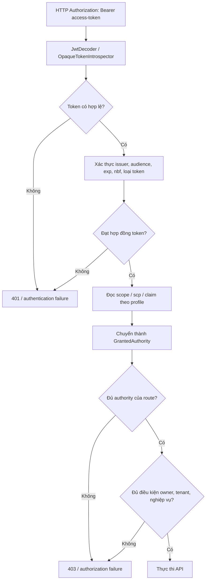
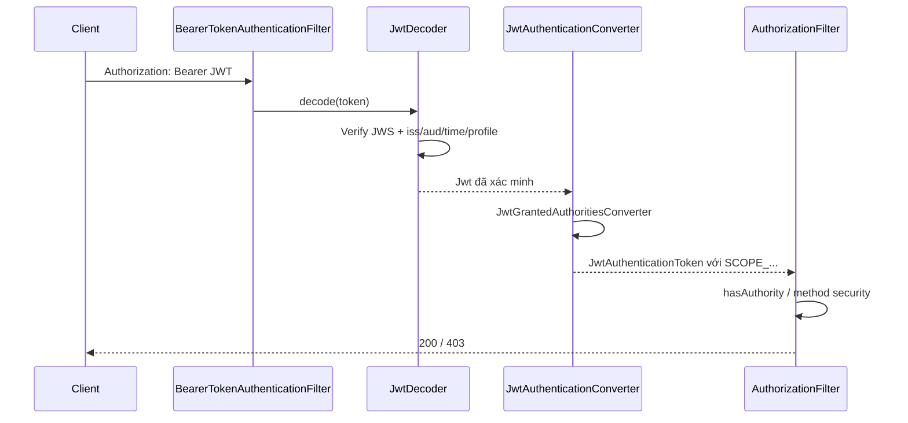

# Claims `scope`, `scp` và các dạng dữ liệu từ nhà phát hành

Trong **Spring Security OAuth 2.0 / OIDC Resource Server**, một access token không chỉ cần có chữ ký hợp lệ: nó còn phải mô tả **những quyền mà Authorization Server đã cấp** để API biết request nào được phép thực hiện. Với OAuth 2.0, khái niệm phổ biến nhất là **scope**. Trong JWT access token, scope có thể được đưa vào claim `scope`, claim `scp`, hoặc một cấu trúc riêng của nhà phát hành. Khi Spring Security nhận token, nó có thể chuyển dữ liệu đó thành các **`GrantedAuthority`**, rồi dùng `hasAuthority(...)`, `hasRole(...)`, method security và chính sách nghiệp vụ để bảo vệ endpoint.

Điểm dễ sai không nằm ở câu lệnh kiểm tra quyền mà ở **hợp đồng dữ liệu**:

- `scope` là một chuỗi phân tách bằng dấu cách hay một mảng?
- `scp` là chuỗi hay danh sách? Có cả `scope` và `scp` thì xử lý thế nào?
- `roles`, `permissions`, `groups`, `realm_access` hoặc `resource_access` có cùng nghĩa với scope hay không?
- Spring Security có tự kết hợp các claim này không, hay cần cấu hình converter?
- Token đã hợp lệ về chữ ký và scope thì có được phép thao tác trên mọi bản ghi không?

Bài học này giải thích cách hiểu các trường theo **hồ sơ token của issuer**, hành vi ánh xạ mặc định của Spring Security, cấu hình mapping rõ ràng, ví dụ Java và cách kiểm thử những trường hợp quan trọng.

> **Phạm vi:** Ví dụ dùng Java 17+, Spring Boot 3.x, Spring Security 6.x và API giả định `orders-api`. Claim JSON minh họa không phải JWT đã ký hợp lệ. Các tên scope, issuer và endpoint chỉ phục vụ học tập; khi áp dụng phải đối chiếu tài liệu của Authorization Server thực tế.

## 1. Scope là gì và nó khác authority như thế nào?

Trong OAuth 2.0, scope là cách **client yêu cầu và Authorization Server cấp một phạm vi truy cập**. Ví dụ client xin khả năng đọc và tạo đơn hàng, nhưng Authorization Server có thể chỉ cấp quyền đọc:

```text
Requested scopes: orders:read orders:write
Granted scopes:   orders:read
```

Với OAuth 2.0, giá trị scope theo biểu diễn tiêu chuẩn là **danh sách các scope token phân tách bằng dấu cách**, trong đó bản thân mỗi scope token không chứa dấu cách. Tên scope do Authorization Server và resource định nghĩa, ví dụ `orders:read`, `orders:write`, `profile` hoặc `inventory.read`.

**Scope không phải cùng một thứ với `GrantedAuthority`.** Scope là dữ liệu của giao thức/quyết định cấp token; `GrantedAuthority` là đối tượng của **Spring Security** biểu diễn một quyền mà code ứng dụng có thể kiểm tra.

| Khái niệm | Được tạo/định nghĩa bởi | Ví dụ | Vai trò |
|---|---|---|---|
| **OAuth scope** | Authorization Server và hợp đồng API | `orders:read` | Phạm vi thao tác được cấp cho access token. |
| **JWT claim** | Issuer theo token profile | `"scope":"orders:read"` | Cách chuyên chở phạm vi trong token. |
| **Spring authority** | Resource Server / converter | `SCOPE_orders:read` | Tên quyền trong `Authentication.getAuthorities()`. |
| **Spring role** | Quy ước ứng dụng | `ROLE_ADMIN` | Một dạng authority với tiền tố `ROLE_` trong nhiều biểu thức `hasRole`. |
| **Business permission** | Chính sách nghiệp vụ | “Chỉ đọc đơn của chính mình” | Có thể cần tra DB/tenant; không tự bảo đảm bởi scope. |

Một scope có thể thể hiện quyền **loại thao tác**, ví dụ “đọc đơn”, nhưng nó **không tự cấp** quyền đọc đơn của mọi khách hàng. Đối với API đa tenant hoặc API chứa dữ liệu cá nhân, thường cần kết hợp scope với chủ sở hữu, tenant, trạng thái tài nguyên và các quy tắc bổ sung.

### 1.1. Quyết định phân quyền gồm nhiều lớp



**Không ánh xạ authorities từ payload JWT chưa xác minh.** Hai phần đầu của JWS Compact chỉ được mã hóa Base64URL; client có thể tự tạo chuỗi JSON có `"scope":"admin"` nhưng không thể vượt qua xác minh chữ ký bằng khóa tin cậy.

## 2. Claim `scope`: biểu diễn được chuẩn hóa

OAuth 2.0 định nghĩa scope như một chuỗi các scope token cách nhau bằng dấu cách. Với **JWT Profile for OAuth 2.0 Access Tokens (RFC 9068)**, claim `scope` là claim tùy chọn để biểu diễn những OAuth scopes được gán cho token; khi có, nó là **chuỗi scope values phân tách bằng dấu cách**.

Ví dụ JWT access token (payload đã decode):

```json
{
  "iss": "https://auth.example.test/realms/orders",
  "sub": "alice",
  "aud": ["orders-api"],
  "client_id": "web-portal",
  "scope": "orders:read orders:write",
  "iat": 1890000000,
  "exp": 1890003600
}
```

Đối với API `orders-api`, sau khi token hợp lệ, hai scope có thể được ánh xạ:

```text
scope = "orders:read orders:write"
        │             │
        ▼             ▼
SCOPE_orders:read  SCOPE_orders:write
```

Những quy tắc cần nhớ:

1. **`scope` là tên claim; `orders:read` là một scope value.** `scope` không phải tên của quyền trong Spring.
2. Tên scope có ý nghĩa trong **hợp đồng giữa issuer và Resource Server**. `read` không có nghĩa chung là đọc mọi dữ liệu trên mọi API.
3. Tên scope thường **phân biệt chữ hoa/chữ thường**. `orders:read`, `Orders:Read` và `ORDERS:READ` không tự tương đương.
4. Dấu cách là **phần tử phân tách** của biểu diễn chuẩn. Dấu phẩy không phải dấu phân tách scope chuẩn trong RFC 6749; `"orders:read,orders:write"` không có cùng nghĩa với `"orders:read orders:write"`.
5. Không cho rằng mọi access token đều có `scope`: Authorization Server có thể cấp token không có scopes, dùng opaque token, hoặc dùng profile khác. Hành vi khi claim vắng mặt phải do policy quy định.
6. `openid`, `profile` và `email` thường xuất hiện trong yêu cầu OIDC của client; không đồng nghĩa chúng cấp quyền đọc dữ liệu của `orders-api`. Một scope dành cho OIDC không phải permission nghiệp vụ nếu API không định nghĩa như vậy.

### 2.1. Requested scopes và granted scopes là hai sự kiện khác nhau

Client có thể gửi authorization request:

```text
scope=openid%20profile%20orders%3Aread%20orders%3Awrite
```

Authorization Server có thể quyết định chỉ cấp `orders:read` cùng các phạm vi OIDC phù hợp. API phải dựa vào **các quyền thực sự được cấp và được issuer cam kết trong access token/introspection response**, không dựa trên scope mà client đã tự yêu cầu ở URL trước đó.

Một access token đã được ký đúng vẫn không cấp quyền nào ngoài những gì chính token, issuer và policy tài nguyên cho phép. Không tin vào query parameter `scope` do client gửi đến API để tăng quyền.

### 2.2. Claim vắng mặt, rỗng và dữ liệu sai kiểu

| Payload | Ý nghĩa đối với profile `scope` kiểu chuỗi | Xử lý an toàn |
|---|---|---|
| `"scope": "orders:read"` | Một scope đã được cấp. | Chuyển sang `SCOPE_orders:read` nếu profile/API chấp nhận. |
| `"scope": "orders:read orders:write"` | Hai scopes. | Tách theo biểu diễn chuẩn. |
| `"scope": ""` | Không có scope khả dụng. | Không tự tạo authority. |
| Không có `scope` | Không có thông tin trong claim này. | Không cấp quyền cần scope; có thể áp dụng claim profile khác khi có hợp đồng. |
| `"scope": ["orders:read","orders:write"]` | **Không đúng kiểu của claim `scope` trong RFC 9068.** | Nếu issuer dùng profile riêng, phải ghi rõ và parser tương ứng; không gọi đó là biểu diễn RFC 9068 chuẩn. |
| `"scope": "orders:read,orders:write"` | Không phải danh sách phân tách bằng dấu cách. | Không tự chuyển dấu phẩy thành dấu cách trừ khi issuer contract quy định. |
| `"scope": {"read":true}` | Không phải chuỗi scope chuẩn. | Fail closed hoặc không cấp authority; cân nhắc từ chối token theo contract. |

**Vị trí từ chối quan trọng:** một token có `scope` sai kiểu có thể bị xem là token vi phạm profile ngay trong JWT validation (thường `401`); nếu token vẫn hợp lệ theo profile nhưng không có authority tương ứng, endpoint cần scope sẽ từ chối phân quyền (thường `403`). Hai chính sách khác nhau nhưng **đều không được cấp thêm quyền**.

## 3. Claim `scp` và các biến thể issuer-specific

`scp` là một tên claim được nhiều nhà phát hành access token sử dụng để diễn đạt scopes. Nó **không phải tên claim chuẩn bắt buộc của mọi JWT access token OAuth 2.0**. Phổ biến có hai cách biểu diễn, tùy issuer và phiên bản token:

**Dạng chuỗi:**

```json
{
  "iss": "https://identity.example.test/",
  "aud": ["orders-api"],
  "sub": "alice",
  "scp": "orders:read orders:write"
}
```

**Dạng mảng:**

```json
{
  "iss": "https://identity.example.test/",
  "aud": ["orders-api"],
  "sub": "alice",
  "scp": ["orders:read", "orders:write"]
}
```

Cả hai là **dạng có thể gặp trong các hệ thống khác nhau**, không phải cam kết rằng một issuer cụ thể sẽ phát hành cả hai. Ví dụ, với Microsoft identity platform/Entra ID, claim `scp` trong nhiều access token được dùng cho **delegated permissions**, thường ở dạng chuỗi phân tách bằng dấu cách; application permissions thường được biểu diễn khác, chẳng hạn qua `roles`. Không áp quy tắc này cho một IdP khác nếu chưa đọc tài liệu của chính họ.

### 3.1. Bảng so sánh nhanh

| Dữ liệu đầu vào | Nơi thường gặp | Có thể ánh xạ về |
|---|---|---|
| `"scope": "orders:read orders:write"` | OAuth token / JWT access token RFC 9068. | `SCOPE_orders:read`, `SCOPE_orders:write`. |
| `"scp": "orders:read orders:write"` | Access token của một số IdP. | Các authority `SCOPE_...` nếu contract nói đây là scopes. |
| `"scp": ["orders:read", "orders:write"]` | Một số token profile tùy biến. | Các authority `SCOPE_...` nếu converter hỗ trợ mảng. |
| `"scope": ["orders:read","orders:write"]` | Vendor-specific, **khác biểu diễn RFC 9068**. | Phải có thỏa thuận rõ trước khi đọc như danh sách scopes. |
| `"permissions": ["read:orders"]` | Hồ sơ permission tùy biến. | `PERM_read:orders` hoặc quyền khác theo policy; không nhất thiết là scope. |
| `"roles": ["orders-admin"]` | Application roles hoặc vendor-defined roles. | Có thể thành `ROLE_...` nếu định nghĩa ánh xạ an toàn. |
| `"resource_access": {"orders-api":{"roles":["viewer"]}}` | Một số issuer có claim phân quyền theo resource/client. | Chỉ vai trò dành cho `orders-api`, với converter riêng. |
| `"realm_access": {"roles":["user","admin"]}` | Một số issuer sử dụng realm-level roles. | Không tự coi mọi realm role là quyền admin của API. |

Nên định nghĩa **một token contract cho mỗi issuer/profile**: claim được đọc, kiểu dữ liệu được hỗ trợ, cú pháp scope token, ý nghĩa của từng giá trị, chính sách khi không có/không hợp lệ. “Có tên giống nhau” không chứng minh “có quyền giống nhau”.

### 3.2. Khi có cả `scope` và `scp`

Ví dụ:

```json
{
  "iss": "https://auth.example.test/realms/orders",
  "aud": ["orders-api"],
  "scope": "orders:read",
  "scp": ["orders:write"]
}
```

Có ít nhất ba chính sách khả dĩ — nhưng phải được **quy định trước**:

- **Profile A:** chỉ `scope` là nguồn chuẩn; `scp` không có ý nghĩa phân quyền của API.
- **Profile B:** chỉ `scp` là nguồn chuẩn; `scope` chỉ tồn tại vì tương thích nhưng không dùng.
- **Profile C:** cả hai được issuer bảo đảm có quan hệ rõ ràng; ứng dụng kiểm tra chúng nhất quán trước khi chuyển authorities.

**Không tự động hợp nhất** thành `orders:read + orders:write` chỉ vì hai tên claim cùng tồn tại. Việc hợp nhất có thể nâng quyền ngoài ý muốn khi một claim là metadata hoặc thuộc resource khác. Nếu một issuer thay đổi schema từ `scope` sang `scp`, nên tạo kế hoạch migration có phiên bản/profile, test token cũ và mới, thay vì làm fallback âm thầm trong mọi trường hợp.

## 4. Spring Security nhìn scopes thành authorities như thế nào?

Một luồng JWT Resource Server điển hình:



Spring Security có lớp **`JwtGrantedAuthoritiesConverter`** để chuyển một claim chứa scopes thành tập `GrantedAuthority`. Với cấu hình mặc định trong Spring Security 6.x, converter thường:

1. Tìm một claim authorities được biết, theo danh sách **`scope` rồi `scp`**.
2. Đọc dữ liệu dạng chuỗi scope tách bởi delimiter hoặc dạng collection tương thích.
3. Tạo authority có tiền tố **`SCOPE_`** với mỗi giá trị.
4. Đưa tập authorities vào **`JwtAuthenticationToken`**.

Ví dụ với:

```json
{"scope": "orders:read orders:write"}
```

Kết quả logic:

```text
Authentication.getAuthorities():
  SCOPE_orders:read
  SCOPE_orders:write
```

Đây là **authority names trong ứng dụng Spring**, không phải claim mới được ghi vào JWT. Resource Server không ký lại token chỉ vì đã ánh xạ scopes.

### 4.1. Default converter không tự động tổng hợp mọi claim

Điều đáng chú ý: `JwtGrantedAuthoritiesConverter` mặc định **chọn một claim** trong các tên claim quen thuộc; nó **không hứa gộp `scope` và `scp`**, không tự đọc `roles`, `permissions`, `groups` hay các role lồng bên trong `resource_access`.

Nếu token có cả `scope` và `scp`, cấu hình mặc định có thể đọc `scope` trước. Đừng dùng điều này làm một quy tắc bảo mật không được viết trong hợp đồng; hãy cấu hình claim nguồn rõ ràng nếu issuer của bạn có profile riêng.

Các giá trị được converter chuyển thành authority **không tự xác minh** rằng scope có hợp lệ cho API hiện tại hay không. Việc đó phụ thuộc JWT decoder (issuer/audience/token type) và hợp đồng authorization của ứng dụng.

### 4.2. Quy ước tiền tố `SCOPE_`, `ROLE_`

Spring Security phân biệt:

```java
.hasAuthority("SCOPE_orders:read")
.hasRole("ADMIN")
```

Với quy ước mặc định, `hasRole("ADMIN")` thường tìm authority **`ROLE_ADMIN`**. Nó **không tìm `SCOPE_ADMIN`**.

| JWT claim và converter | Authority tạo ra | Cách kiểm tra đúng |
|---|---|---|
| `"scope":"orders:read"` + mặc định | `SCOPE_orders:read` | `hasAuthority("SCOPE_orders:read")` |
| `"scp":["orders:read"]` + mặc định | `SCOPE_orders:read` | `hasAuthority("SCOPE_orders:read")` |
| `"roles":["ADMIN"]` + custom role converter | `ROLE_ADMIN` | `hasRole("ADMIN")` hoặc `hasAuthority("ROLE_ADMIN")` |
| `"permissions":["approve:order"]` + custom converter | `PERM_approve:order` | `hasAuthority("PERM_approve:order")` |

**Không đổi tiền tố `SCOPE_` thành `ROLE_` chỉ để các biểu thức `hasRole` chạy được**, nếu scope và role thực sự có ý nghĩa khác nhau. Tốt hơn là giữ chúng phân biệt để reviewer nhìn vào code biết quyền đến từ đâu.

## 5. Thiết lập một JWT Resource Server cơ bản

Ví dụ API `orders-api` yêu cầu access token có audience `orders-api` và scope `orders:read` cho endpoint đọc đơn hàng.

### 5.1. Dependencies Maven

Trong dự án Spring Boot 3.x dùng Boot parent/BOM quản lý version:

```xml
<dependencies>
    <dependency>
        <groupId>org.springframework.boot</groupId>
        <artifactId>spring-boot-starter-web</artifactId>
    </dependency>
    <dependency>
        <groupId>org.springframework.boot</groupId>
        <artifactId>spring-boot-starter-security</artifactId>
    </dependency>
    <dependency>
        <groupId>org.springframework.boot</groupId>
        <artifactId>spring-boot-starter-oauth2-resource-server</artifactId>
    </dependency>
    <dependency>
        <groupId>org.springframework.boot</groupId>
        <artifactId>spring-boot-starter-test</artifactId>
        <scope>test</scope>
    </dependency>
    <dependency>
        <groupId>org.springframework.security</groupId>
        <artifactId>spring-security-test</artifactId>
        <scope>test</scope>
    </dependency>
</dependencies>
```

### 5.2. Cấu hình issuer và audience

```yaml
spring:
  security:
    oauth2:
      resourceserver:
        jwt:
          issuer-uri: https://auth.example.test/realms/orders
          audiences:
            - orders-api
```

Với issuer/JWKS được cấu hình phù hợp, Spring Security dùng `JwtDecoder` kiểm tra chữ ký và các validator JWT. Audience là **resource mà token phải dành cho**, không phải client ID đã xin token. Nếu ID Token có audience là client của frontend, API phải từ chối ID Token đó thay vì xem nó là access token.

**Lưu ý về token profile:** JWT access token theo RFC 9068 có thêm yêu cầu về loại token (`typ=at+jwt` hoặc giá trị tương ứng) và các claims bắt buộc. Cấu hình issuer/audience ở trên không nhất thiết tự thực thi toàn bộ profile RFC 9068 trong mọi phiên bản Spring. Nếu hệ thống tuyên bố tuân RFC 9068, cần thiết lập validator cho profile tương ứng (ví dụ `JwtValidators.createAtJwtValidator()` ở những phiên bản hỗ trợ) và kiểm thử token substitution.

### 5.3. Security filter chain dùng mặc định scopes

```java
package com.example.orders.security;

import org.springframework.context.annotation.Bean;
import org.springframework.context.annotation.Configuration;
import org.springframework.http.HttpMethod;
import org.springframework.security.config.Customizer;
import org.springframework.security.config.annotation.web.builders.HttpSecurity;
import org.springframework.security.config.annotation.web.configurers.AbstractHttpConfigurer;
import org.springframework.security.config.http.SessionCreationPolicy;
import org.springframework.security.web.SecurityFilterChain;

@Configuration
public class ApiSecurityConfig {

    @Bean
    SecurityFilterChain apiSecurity(HttpSecurity http) throws Exception {
        return http
            // Chỉ phù hợp API stateless không xác thực bằng session cookie.
            .csrf(AbstractHttpConfigurer::disable)
            .sessionManagement(session -> session
                .sessionCreationPolicy(SessionCreationPolicy.STATELESS))
            .authorizeHttpRequests(auth -> auth
                .requestMatchers(HttpMethod.GET, "/api/public/ping")
                    .permitAll()
                .requestMatchers(HttpMethod.GET, "/api/orders/**")
                    .hasAuthority("SCOPE_orders:read")
                .requestMatchers(HttpMethod.POST, "/api/orders")
                    .hasAuthority("SCOPE_orders:write")
                .anyRequest().denyAll())
            .oauth2ResourceServer(oauth ->
                oauth.jwt(Customizer.withDefaults()))
            .build();
    }
}
```

Tại đây:

- `GET /api/orders/42` đòi `SCOPE_orders:read`.
- `POST /api/orders` đòi `SCOPE_orders:write`.
- Token valid nhưng chỉ có `orders:read` vẫn không thể `POST`.
- Không có token hoặc token không qua authentication/validation: thường `401`.
- Token hợp lệ nhưng thiếu authority: thường `403`.
- `GET /api/orders/42` còn phải kiểm tra chủ sở hữu/tenant nếu đây là dữ liệu cá nhân.

Không copy `csrf(...disable)` sang ứng dụng có cookie/session authentication mà không có đánh giá CSRF riêng.

## 6. Cấu hình `JwtGrantedAuthoritiesConverter` theo issuer

Nếu issuer dùng đúng `scope` chuỗi phân tách bằng dấu cách, cấu hình mặc định có thể đã đủ. Tuy nhiên khi contract quy định `scp` hoặc một claim khác, nên cấu hình **tên claim chính xác**.

### 6.1. Chỉ đọc `scp`

Ví dụ issuer cam kết:

```json
{
  "iss": "https://identity.example.test",
  "aud": ["orders-api"],
  "scp": ["orders:read", "orders:write"]
}
```

Cấu hình converter rõ ràng:

```java
package com.example.orders.security;

import org.springframework.context.annotation.Bean;
import org.springframework.context.annotation.Configuration;
import org.springframework.security.oauth2.server.resource.authentication.JwtAuthenticationConverter;
import org.springframework.security.oauth2.server.resource.authentication.JwtGrantedAuthoritiesConverter;

@Configuration
class JwtAuthorityConfig {

    @Bean
    JwtAuthenticationConverter jwtAuthenticationConverter() {
        JwtGrantedAuthoritiesConverter scopes =
            new JwtGrantedAuthoritiesConverter();

        scopes.setAuthoritiesClaimName("scp");
        scopes.setAuthorityPrefix("SCOPE_");

        JwtAuthenticationConverter authenticationConverter =
            new JwtAuthenticationConverter();
        authenticationConverter.setJwtGrantedAuthoritiesConverter(scopes);

        return authenticationConverter;
    }
}
```

Sau đó gắn bean vào JWT Resource Server:

```java
@Bean
SecurityFilterChain apiSecurity(
        HttpSecurity http,
        JwtAuthenticationConverter jwtAuthenticationConverter
) throws Exception {
    return http
        .authorizeHttpRequests(auth -> auth
            .requestMatchers("/api/orders/**")
                .hasAuthority("SCOPE_orders:read")
            .anyRequest().denyAll())
        .oauth2ResourceServer(oauth -> oauth
            .jwt(jwt -> jwt
                .jwtAuthenticationConverter(jwtAuthenticationConverter)))
        .build();
}
```

Hai đoạn là **ví dụ các phần cần ghép vào một cấu hình SecurityFilterChain**; không tạo hai bean filter chain cạnh tranh cho cùng tập đường dẫn. Đoạn thứ hai đơn giản hóa policy route để tập trung vào converter; khi triển khai thực hãy giữ các điều kiện HTTP method, stateless/CSRF và deny-by-default phù hợp.

### 6.2. Nếu issuer dùng claim tên khác

Ví dụ một nhà phát hành định nghĩa:

```json
{
  "authorities": ["orders:read", "orders:write"]
}
```

Có thể đọc claim đó bằng:

```java
JwtGrantedAuthoritiesConverter converter =
    new JwtGrantedAuthoritiesConverter();

converter.setAuthoritiesClaimName("authorities");
converter.setAuthorityPrefix("SCOPE_");
```

Tuy nhiên chỉ làm như vậy nếu issuer **cam kết `authorities` thực sự có ngữ nghĩa scope của API này**. Tên `authorities` là tên kỹ thuật phổ biến, không bảo đảm dữ liệu chứa OAuth scopes. Nếu nó chứa roles hoặc permissions khác, nên ánh xạ với tiền tố phù hợp và policy rõ ràng hơn.

### 6.3. Delimiter cho claim dạng chuỗi

Spring Security 6.1+ hỗ trợ phương thức `setAuthoritiesClaimDelimiter(String)` của `JwtGrantedAuthoritiesConverter`, nhận **regex** dùng để tách chuỗi claim. Ví dụ, nếu một issuer được xác nhận trả chuỗi scope có nhiều loại whitespace:

```java
JwtGrantedAuthoritiesConverter converter =
    new JwtGrantedAuthoritiesConverter();

converter.setAuthoritiesClaimName("scp");
converter.setAuthorityPrefix("SCOPE_");
converter.setAuthoritiesClaimDelimiter("\\s+");
```

**Không tự áp dụng regex tách cả dấu phẩy** như `[,\\s]+` nếu issuer không định nghĩa dấu phẩy là delimiter. Với OAuth chuẩn, scope list dùng dấu cách; parser rộng hơn có thể diễn giải sai một chuỗi được cấp thành nhiều quyền mà issuer không hề cam kết.

Phương thức thay delimiter dành cho **giá trị chuỗi**; với claim là mảng/collection, converter xử lý các phần tử theo code path riêng. Kiểu dữ liệu thực tế phải được kiểm tra trong token contract và test.

### 6.4. Không dùng đổi `authorityPrefix` để sửa lỗi role

Có thể đặt:

```java
converter.setAuthorityPrefix("");
```

Khi đó authority là `orders:read` thay vì `SCOPE_orders:read`. Đây là lựa chọn kỹ thuật, không sai nếu toàn hệ thống chủ động áp dụng. Tuy nhiên việc bỏ prefix làm khó nhận ra quyền lấy từ scope hay role/custom permission, và có thể tạo xung đột tên.

Nếu thay prefix, phải sửa **toàn bộ** kiểm tra `hasAuthority`, method security, test, docs và policy tương ứng. Không đổi prefix cục bộ chỉ để một endpoint bắt đầu trả `200`.

## 7. Dạng dữ liệu từ nhà phát hành: thiết kế mapper theo profile

Một số issuer dùng claims có cấu trúc sâu hơn, ví dụ:

```json
{
  "iss": "https://auth.example.test/realms/orders",
  "aud": ["orders-api"],
  "sub": "alice",
  "scope": "orders:read",
  "permissions": ["approve:order", "export:orders"],
  "realm_access": {
    "roles": ["user", "auditor"]
  },
  "resource_access": {
    "orders-api": {
      "roles": ["VIEWER", "SUPPORT"]
    },
    "payments-api": {
      "roles": ["ADMIN"]
    }
  }
}
```

Những cấu trúc này là **ví dụ vendor/application-specific**, không phải hình thức JWT chuẩn bắt buộc. Đặc biệt, `resource_access.payments-api.roles = ["ADMIN"]` **không thể tự biến thành quyền quản trị của `orders-api`**. Phải chọn đúng resource và hiểu ý nghĩa của từng role.

Có ba chiến lược thường gặp:

1. **Chỉ dùng scope** từ `scope`/`scp`: đơn giản, bảo đảm route dựa trên quyền OAuth, role/permission tùy biến chưa tham gia phân quyền.
2. **Chỉ dùng một claim riêng** được issuer bảo đảm: ví dụ token profile dành cho một API có `permissions` độc lập; converter và policy phải khớp schema.
3. **Kết hợp có chủ đích** scope + roles/permissions: chỉ khi issuer và hợp đồng quy định quan hệ giữa các loại quyền, nguồn đáng tin và cách giải quyết xung đột.

Không có nguyên tắc phổ quát rằng scope phải luôn được cộng với roles, hoặc roles phải được ưu tiên scope. Quyết định tùy mô hình quyền của API.

### 7.1. Ví dụ converter kết hợp `scope` và danh sách permissions được phép

Giả sử **một issuer tin cậy duy nhất** phát hành:

- `scope` là chuỗi scope chuẩn, dùng cho quyền HTTP-level.
- `permissions` là **mảng các chuỗi**, chỉ dùng để cấp quyền tác vụ ứng dụng với **danh sách tên đã định nghĩa**.

Một converter minh họa cách diễn giải hai nguồn **sau khi JWT đã được xác minh**:

```java
package com.example.orders.security;

import java.util.Collection;
import java.util.LinkedHashSet;
import java.util.Set;
import java.util.stream.Collectors;

import org.springframework.core.convert.converter.Converter;
import org.springframework.security.core.GrantedAuthority;
import org.springframework.security.core.authority.SimpleGrantedAuthority;
import org.springframework.security.oauth2.jwt.Jwt;
import org.springframework.security.oauth2.server.resource.authentication.JwtGrantedAuthoritiesConverter;

public final class OrdersAuthoritiesConverter
        implements Converter<Jwt, Collection<GrantedAuthority>> {

    private static final Set<String> ALLOWED_PERMISSIONS = Set.of(
        "approve:order",
        "export:orders"
    );

    private final JwtGrantedAuthoritiesConverter scopes =
        new JwtGrantedAuthoritiesConverter();

    public OrdersAuthoritiesConverter() {
        // Contract của issuer này: OAuth scope nằm ở claim "scope".
        scopes.setAuthoritiesClaimName("scope");
        scopes.setAuthorityPrefix("SCOPE_");
    }

    @Override
    public Collection<GrantedAuthority> convert(Jwt jwt) {
        Set<String> authorityNames = new LinkedHashSet<>();

        Collection<GrantedAuthority> scopeAuthorities = scopes.convert(jwt);
        if (scopeAuthorities != null) {
            for (GrantedAuthority authority : scopeAuthorities) {
                authorityNames.add(authority.getAuthority());
            }
        }

        Object rawPermissions = jwt.getClaim("permissions");
        if (rawPermissions instanceof Collection<?> values) {
            for (Object value : values) {
                if (value instanceof String permission
                        && ALLOWED_PERMISSIONS.contains(permission)) {
                    authorityNames.add("PERM_" + permission);
                }
            }
        }

        return authorityNames.stream()
            .map(SimpleGrantedAuthority::new)
            .collect(Collectors.toList());
    }
}
```

Gắn vào `JwtAuthenticationConverter`:

```java
JwtAuthenticationConverter authenticationConverter =
    new JwtAuthenticationConverter();
authenticationConverter.setJwtGrantedAuthoritiesConverter(
    new OrdersAuthoritiesConverter());
```

Và áp dụng:

```java
@PreAuthorize("hasAuthority('PERM_approve:order')")
public void approveOrder(String orderId) {
    // Còn kiểm tra owner, tenant, trạng thái đơn và hạn mức.
}
```

**Ý nghĩa của allowlist trong ví dụ:** issuer có thể gửi thêm permissions mới khi nâng cấp, nhưng API chỉ cấp authorities mà ứng dụng đã biết và cho phép. Điều này tránh việc mọi chuỗi bất kỳ trong một claim trở thành quyền đặc biệt trong ứng dụng.

Mẫu trên **không tự thực thi schema validation** cho `permissions`: nếu claim không phải collection hoặc chứa phần tử không phải string, ví dụ sẽ không ánh xạ chúng. Khi hợp đồng yêu cầu claim bắt buộc/đúng kiểu để token hợp lệ, hãy bổ sung validator cho token profile và từ chối ngay ở authentication thay vì chỉ im lặng không cấp quyền.

Bảo đảm bean converter này chỉ được dùng cho issuer/profile mà `permissions` có ý nghĩa đã cam kết. Nếu phục vụ nhiều issuer, không dùng một mapper cho mọi JWT chỉ vì chúng tình cờ có field cùng tên.

### 7.2. Ví dụ định hướng với roles lồng theo resource

Giả sử issuer dùng claim `resource_access` và yêu cầu API chỉ đọc roles trong key `orders-api`. Các bước thiết kế converter:

```text
resource_access
  └─ orders-api
      └─ roles
          ├─ VIEWER
          └─ SUPPORT

=> Mapping đã định:
   VIEWER  -> ROLE_ORDERS_VIEWER
   SUPPORT -> ROLE_ORDERS_SUPPORT

Không đọc roles từ payments-api.
Không tự đổi ADMIN của resource khác thành ROLE_ADMIN.
```

Một helper Java minh họa cách đọc có kiểm tra kiểu:

```java
private static Set<String> extractOrdersRoles(Jwt jwt) {
    Object raw = jwt.getClaim("resource_access");
    if (!(raw instanceof java.util.Map<?, ?> resources)) {
        return Set.of();
    }

    Object rawOrders = resources.get("orders-api");
    if (!(rawOrders instanceof java.util.Map<?, ?> orders)) {
        return Set.of();
    }

    Object rawRoles = orders.get("roles");
    if (!(rawRoles instanceof java.util.Collection<?> roles)) {
        return Set.of();
    }

    Set<String> mapped = new java.util.HashSet<>();
    for (Object role : roles) {
        if ("VIEWER".equals(role)) {
            mapped.add("ROLE_ORDERS_VIEWER");
        } else if ("SUPPORT".equals(role)) {
            mapped.add("ROLE_ORDERS_SUPPORT");
        }
    }
    return mapped;
}
```

Helper này có thể được gọi **bên trong một custom converter đã xác định issuer**. Nó chỉ trả về tên authority; để dùng với Spring cần tạo các `SimpleGrantedAuthority`. Không nên viết một converter “đệ quy qua mọi field tên `roles`” vì có thể nhặt phải quyền của resource khác.

### 7.3. Claim khác không tự động là authority

Một số nhóm dữ liệu thường có trong token:

| Claim | Thường nói về | Không nên giả định |
|---|---|---|
| `sub` | Subject/user hoặc service tùy grant. | Mọi `sub` đều là user có quyền truy cập dữ liệu. |
| `client_id` | OAuth client đã yêu cầu access token theo profile tương ứng. | Client ID tự cấp quyền quản trị hoặc chứng minh bên trình Bearer token hiện tại là client gốc. |
| `azp` | *Authorized party* trong OIDC ID Token; issuer-specific nếu có trong access token. | `azp` luôn đồng nghĩa scope/client role. |
| `aud` | Resource/API được phép nhận token. | Audience là scope hoặc role. |
| `groups` | Nhóm ở IdP. | Nhóm “admins” tự là admin của mọi API. |
| `roles` | Role do issuer/application định nghĩa. | Role luôn có `ROLE_` prefix hoặc áp dụng cho mọi resource. |
| `tenant_id` | Tenant/organization theo hợp đồng. | Có tenant ID thì truy cập được mọi dữ liệu trong tenant. |
| `act` | Actor trong token exchange theo RFC 8693. | Actor luôn được thừa hưởng mọi quyền của subject. |
| `cnf` | Ràng buộc proof-of-possession trong một số token. | Chỉ nhìn thấy `cnf` là đã kiểm tra DPoP/mTLS. |

Nếu dữ liệu cấp quyền thay đổi liên tục (user bị thu hồi role, tenant chuyển chủ sở hữu, hợp đồng bị tắt), một JWT còn hạn có thể chứa quyền cũ. Hệ thống cần chiến lược token TTL, token refresh/reauthorization hoặc tra cứu trạng thái nghiệp vụ để đáp ứng yêu cầu cập nhật quyền của sản phẩm.

## 8. Scope trong các grant khác nhau

Dù cùng một tên scope, ý nghĩa kết hợp với `sub` và `client_id` có thể khác nhau.

### 8.1. Authorization Code + PKCE: user và client

```json
{
  "iss": "https://auth.example.test/realms/orders",
  "sub": "alice",
  "client_id": "web-portal",
  "aud": ["orders-api"],
  "scope": "orders:read"
}
```

Token minh họa:

- `sub=alice`: user được đại diện.
- `client_id=web-portal`: OAuth client xin token.
- `scope=orders:read`: phạm vi thao tác đã cấp.
- `aud=orders-api`: API dự kiến nhận token.

API chỉ cho phép Alice đọc **đơn thuộc Alice** hoặc đơn mà chính sách nghiệp vụ xác nhận Alice có quyền. `orders:read` không chứng minh Alice sở hữu đơn `42`.

### 8.2. Client Credentials: service-to-service

```json
{
  "iss": "https://auth.example.test/realms/orders",
  "sub": "partner-batch-subject",
  "client_id": "partner-batch",
  "aud": ["orders-api"],
  "scope": "orders:import"
}
```

Trong grant này thường không có user đăng nhập. `sub` có thể là định danh của workload, không nên biến thành user. `orders:import` có thể cho phép import dữ liệu theo hợp đồng đối tác, nhưng cần kiểm tra client được phép, tenant/hạn mức, idempotency và các chính sách dữ liệu.

**Không dùng scope trong token của một service để suy ra rằng service được thay mặt mọi user** nếu không có mô hình delegation/token exchange rõ ràng.

### 8.3. Delegated permissions và application permissions

Một số nhà phát hành, ví dụ Microsoft identity platform, phân biệt:

- **Delegated access**: token đại diện user + client, có thể mang `scp`.
- **Application access**: client/service tự gọi không có user, thường mang `roles` cho application permissions.

Đây là một ví dụ **vendor-specific**. Không đưa quy tắc “token không có `scp` luôn là service token” vào hệ thống đa issuer. Token thiếu `scp` cũng có thể là token không có permission hoặc một profile khác; phải kết hợp issuer, grant/context và hợp đồng token.

### 8.4. Token Exchange và scope attenuation

Trong một chuỗi nhiều dịch vụ, API Gateway có thể đổi token để gọi backend. Token mới có thể chứa scope **hẹp hơn**, audience khác hoặc claim actor (`act`) theo RFC 8693. Backend phải kiểm tra **scope trên token mới mà nó nhận**, không lấy danh sách scopes của token ban đầu từ client hoặc gateway một cách mặc định.

Ví dụ:

```text
Frontend token:
  aud = gateway-api
  scope = orders:read orders:write

Exchanged token for orders-api:
  aud = orders-api
  scope = orders:read
  sub = alice
  act = gateway-service
```

`orders-api` chỉ nên nhận quyền `orders:read` từ token thứ hai đã xác minh và đánh giá delegation theo policy. Không cho phép `orders:write` chỉ vì client ban đầu từng xin nó.

## 9. Scope và role có thể kết hợp, nhưng phải rõ thứ tự tin cậy

Một hệ thống có thể thiết kế:

- **Scope**: client được cấp loại thao tác OAuth, ví dụ `orders:write`.
- **Role**: chủ thể có vai trò trong tổ chức, ví dụ `ROLE_ORDERS_MANAGER`.
- **Ownership/tenant**: đối tượng chịu trách nhiệm và phạm vi dữ liệu cụ thể.

Ví dụ kiểm tra hai điều kiện độc lập:

```java
@PreAuthorize(
    "hasAuthority('SCOPE_orders:write') " +
    "and hasAuthority('ROLE_ORDERS_MANAGER')")
public void changeOrderStatus(String orderId, String newStatus) {
    // Kiểm tra thêm tenant, transition hợp lệ, quyền trên đơn cụ thể.
}
```

Điều kiện trên yêu cầu **cả scope và role**. Đó là chính sách ứng dụng, không phải quy tắc mặc định của OAuth.

Nếu API cho phép **một trong hai** quyền, dùng biểu thức `or` có chủ đích; nhưng phải đánh giá liệu một role có thực sự thay thế scope vốn ràng buộc quyền client. Một tài khoản user có role manager không nhất thiết làm một OAuth client bất kỳ được phép lấy token với `orders:write`.

### 9.1. Kích hoạt method security

```java
import org.springframework.context.annotation.Configuration;
import org.springframework.security.config.annotation.method.configuration.EnableMethodSecurity;

@Configuration
@EnableMethodSecurity
class MethodSecurityConfig {
}
```

Ví dụ service:

```java
import org.springframework.security.access.prepost.PreAuthorize;
import org.springframework.stereotype.Service;

@Service
public class OrderService {

    @PreAuthorize("hasAuthority('SCOPE_orders:read')")
    public OrderDto getOrder(String orderId) {
        // Ví dụ minh họa; API thực cần kiểm tra owner/tenant.
        return loadAndAuthorizeOrder(orderId);
    }

    private OrderDto loadAndAuthorizeOrder(String orderId) {
        throw new UnsupportedOperationException("Implement domain policy");
    }
}
```

Đoạn service chỉ là skeleton để trình bày method security, chưa phải một ứng dụng hoàn chỉnh. Không nên chỉ dùng `@PreAuthorize("hasAuthority('SCOPE_orders:read')")` để trả mọi đơn trong database. Cần kiểm tra owner/tenant **trong cùng đường xử lý nghiệp vụ** trước khi trả dữ liệu.

### 9.2. Đừng nhầm tên principal với tên client

`JwtAuthenticationToken#getName()` mặc định thường dựa vào `sub`. Nó không mặc định là `client_id`, `azp` hoặc scope. Nếu policy cần biết **client nào được cấp token**, phải đọc đúng claim đã xác minh theo token profile và kiểm tra kiểu dữ liệu.

Một request có:

```text
sub       = alice
client_id = mobile-app
scope     = orders:read
```

thì principal vẫn có thể là Alice, còn client là mobile app. Không lấy `client_id` làm owner ID của đơn hàng.

## 10. Opaque access token: scopes nằm trong introspection response

Không phải mọi access token đều là JWT. Với **opaque token**, Resource Server thường gọi OAuth 2.0 Token Introspection endpoint của Authorization Server và nhận kết quả ví dụ:

```json
{
  "active": true,
  "iss": "https://auth.example.test/realms/orders",
  "sub": "alice",
  "aud": ["orders-api"],
  "client_id": "web-portal",
  "scope": "orders:read",
  "exp": 1890003600
}
```

Theo RFC 7662, `active` là trường bắt buộc; `scope` là một trường tùy chọn nếu AS cung cấp. Mặc dù access token không đọc trực tiếp được, Resource Server vẫn có thể chuyển scopes trong kết quả introspection thành Spring authorities, thường có tiền tố `SCOPE_` trong cấu hình mặc định.

Điều quan trọng:

- **Chỉ tin kết quả introspection từ Authorization Server đáng tin cậy** với kết nối HTTPS và client authentication phù hợp.
- `active=true` không tự động cấp quyền mọi endpoint. Cần kiểm tra scope/roles và ràng buộc resource/audience theo hợp đồng.
- Response `scope` có thể vắng mặt. Không tự thêm `orders:read` nếu introspection không trả thông tin quyền.
- Custom introspection principal không nhất thiết là `JwtAuthenticationToken`. Với opaque token, logic đọc claim phải phù hợp loại `Authentication`/principal và hợp đồng introspection.
- Không dùng ``JwtGrantedAuthoritiesConverter`` như thể nó luôn tự chạy cho opaque token; converter này dành cho JWT. Nếu cần mapping riêng với opaque token, tùy chỉnh `OpaqueTokenIntrospector` hoặc lớp chuyển đổi authentication phù hợp.

Ví dụ DSL (một **phương án khác**, không đồng thời bật vô điều kiện JWT và opaque token):

```java
.oauth2ResourceServer(oauth ->
    oauth.opaqueToken(Customizer.withDefaults()))
```

Khi ứng dụng thực sự cần hỗ trợ cả JWT và opaque token, phải thiết kế **policy chọn cơ chế xác thực** rõ ràng, không thử tùy tiện nhiều decoder rồi chấp nhận cái nào không báo lỗi.

## 11. Các yêu cầu an toàn khi xử lý dữ liệu scope

### 11.1. Chỉ chuyển claims của token đã xác minh

Không dùng đoạn code kiểu:

```java
// KHÔNG DÙNG: chỉ decode JWT payload thành JSON rồi tạo quyền.
String payload = base64UrlDecode(rawJwt.split("\\.")[1]);
String scope = parseJson(payload).get("scope");
grantAuthority("SCOPE_" + scope);
```

Dữ liệu payload chưa được xác minh có thể do kẻ tấn công sửa tùy ý. Spring Security phải giải mã/xác minh JWT bằng public key/JWKS được tin cậy, kiểm tra issuer/audience/time, sau đó mới chạy converter để tạo `Authentication`.

### 11.2. Không nhận ID Token thay access token

Trong OIDC, **ID Token** phục vụ OIDC client xác thực thông tin đăng nhập, thường có audience là **client ID**. **Access token** được dùng để gọi Resource Server và phải có audience/token type phù hợp.

Một ID Token có thể được ký bởi cùng issuer và chứa `sub`, `email`, `azp` hoặc thông tin user. Nếu Resource Server không kiểm tra audience và loại token, có thể gặp **cross-JWT confusion**. Không suy ra rằng vì token có chữ ký hợp lệ và nhìn giống JWT nên được nhận làm API credential. Nếu dùng RFC 9068, thực thi hồ sơ access token phù hợp, gồm `typ` và các claim bắt buộc.

### 11.3. Không dùng tất cả claims làm quyền

Hãy giới hạn quyền với các giá trị đã được định nghĩa:

- Đúng issuer và token profile.
- Đúng audience của API.
- Claim được lựa chọn có schema/kiểu dữ liệu được cam kết.
- Authority name có tiền tố/tên hợp đồng nhất quán.
- Trường hợp role/permission custom, chỉ lấy các giá trị được cấp cho resource/tenant thích hợp.
- Nếu cần phân biệt client/user, kiểm tra `client_id`/`sub` theo grant và issuer.
- Dữ liệu quyền chưa xuất hiện hoặc mơ hồ: **không cấp thêm quyền**.

Nếu dùng enum/allowlist quyền, hãy thiết kế lộ trình cập nhật khi bổ sung scope mới: API chỉ bật sử dụng sau khi code/policy/test sẵn sàng. Không chấp nhận các tên privilege mới trong token thành authority “mặc định có hiệu lực” trên những endpoint có role rộng.

### 11.4. Authority prefix và mâu thuẫn tên

Giả sử issuer có scope tên `ADMIN`. Với converter mặc định, authority là **`SCOPE_ADMIN`**, không phải **`ROLE_ADMIN`**. Nếu một custom converter vô tình bỏ prefix rồi mọi route sử dụng `hasRole("ADMIN")`, tác giả có thể vô tình nhầm quyền OAuth với role ứng dụng.

Giữ namespace rõ ràng:

```text
SCOPE_orders:read
SCOPE_orders:write
ROLE_ORDERS_MANAGER
PERM_approve:order
```

Không để cùng một tên authority được sinh ra từ hai nguồn có ý nghĩa khác nhau mà không có hợp đồng cụ thể.

## 12. Kiểm thử mapping trong Spring Security

Với converter, nên tách kiểm thử thành các lớp:

1. **Unit test converter**: JSON claim dạng chuỗi, mảng, thiếu, sai kiểu, case-sensitive, claim ưu tiên.
2. **Web/method authorization test**: token đã được mock là hợp lệ nhưng thiếu/đủ authorities.
3. **JwtDecoder integration test**: chữ ký, issuer, audience, token type và validator hoạt động đúng với JWT được ký bằng key test.
4. **Authorization Server contract test**: lấy token thử nghiệm từ issuer thật, xác nhận claim shape cho từng grant/client/token profile.

### 12.1. Unit test `JwtGrantedAuthoritiesConverter`

Ví dụ JUnit 5:

```java
package com.example.orders.security;

import static org.junit.jupiter.api.Assertions.assertEquals;

import java.util.List;
import java.util.Set;
import java.util.stream.Collectors;

import org.junit.jupiter.api.Test;
import org.springframework.security.core.GrantedAuthority;
import org.springframework.security.oauth2.jwt.Jwt;
import org.springframework.security.oauth2.server.resource.authentication.JwtGrantedAuthoritiesConverter;

class ScopeAuthoritiesTest {

    private final JwtGrantedAuthoritiesConverter converter =
        new JwtGrantedAuthoritiesConverter();

    @Test
    void mapsSpaceDelimitedScopeToAuthorities() {
        Jwt jwt = tokenWith("scope", "orders:read orders:write");

        assertEquals(Set.of(
            "SCOPE_orders:read",
            "SCOPE_orders:write"
        ), names(converter.convert(jwt)));
    }

    @Test
    void mapsScpCollectionWhenScopeIsMissing() {
        Jwt jwt = tokenWith("scp",
            List.of("orders:read", "orders:write"));

        assertEquals(Set.of(
            "SCOPE_orders:read",
            "SCOPE_orders:write"
        ), names(converter.convert(jwt)));
    }

    @Test
    void doesNotInventAuthoritiesFromMissingScope() {
        Jwt jwt = Jwt.withTokenValue("test")
            .header("alg", "RS256")
            .claim("sub", "alice")
            .build();

        assertEquals(Set.of(), names(converter.convert(jwt)));
    }

    private static Jwt tokenWith(String claimName, Object value) {
        return Jwt.withTokenValue("test")
            .header("alg", "RS256")
            .claim(claimName, value)
            .build();
    }

    private static Set<String> names(
        java.util.Collection<? extends GrantedAuthority> values) {
        return values.stream()
            .map(GrantedAuthority::getAuthority)
            .collect(Collectors.toSet());
    }
}
```

Các unit tests này kiểm tra **chuyển claims thành authorities**, không chứng minh JWT đã được ký và xác minh. Khi test claim sai kiểu theo issuer profile, cần bổ sung kịch bản validator được thiết kế cho profile đó và xác nhận token bị từ chối đúng lớp.

### 12.2. Test với `scope` và `scp` cùng tồn tại

Nếu ứng dụng nhận một token có cả hai:

```json
{
  "scope": "orders:read",
  "scp": ["orders:write"]
}
```

Thử nghiệm phải trả lời rõ:

- Nếu policy đọc **`scope`**, API không được bất ngờ cấp `orders:write` từ `scp`.
- Nếu policy đọc **`scp`**, API không được bất ngờ cấp `orders:read` từ `scope`.
- Nếu token contract yêu cầu hai claim giống nhau hoặc loại trừ nhau, validator phải từ chối trường hợp bất nhất.

Không viết test giả định Spring tự union hai danh sách nếu chính sách ứng dụng không định nghĩa như vậy.

### 12.3. Test HTTP authorization với MockMvc

Spring Security Test cung cấp `jwt()` để giả lập authenticated JWT. Ví dụ route `GET /api/orders/{id}` yêu cầu `SCOPE_orders:read`:

```java
import static org.springframework.security.test.web.servlet.request
    .SecurityMockMvcRequestPostProcessors.jwt;
import static org.springframework.test.web.servlet.request.MockMvcRequestBuilders.get;
import static org.springframework.test.web.servlet.result.MockMvcResultMatchers.status;

import org.junit.jupiter.api.Test;
import org.springframework.beans.factory.annotation.Autowired;
import org.springframework.boot.test.autoconfigure.web.servlet.AutoConfigureMockMvc;
import org.springframework.boot.test.context.SpringBootTest;
import org.springframework.security.core.authority.SimpleGrantedAuthority;
import org.springframework.test.web.servlet.MockMvc;

@SpringBootTest
@AutoConfigureMockMvc
class OrdersRoutePolicyTest {

    @Autowired
    MockMvc mvc;

    @Test
    void readScopePermitsOrderRoute() throws Exception {
        mvc.perform(get("/api/orders/42")
            .with(jwt().authorities(
                new SimpleGrantedAuthority("SCOPE_orders:read"))))
            // Giả sử test fixture có controller trả 200 cho order 42.
            .andExpect(status().isOk());
    }

    @Test
    void writeScopeAloneDoesNotGrantRead() throws Exception {
        mvc.perform(get("/api/orders/42")
            .with(jwt().authorities(
                new SimpleGrantedAuthority("SCOPE_orders:write"))))
            .andExpect(status().isForbidden());
    }
}
```

Mẫu test giả định một controller fixture tồn tại cho `/api/orders/42` và không có rule owner/tenant khác làm thay đổi kết quả. `jwt().authorities(...)` cung cấp authorities giả, vì vậy **không kiểm tra `JwtGrantedAuthoritiesConverter` thật, không kiểm tra chữ ký/JWKS hay audience**. Dùng unit test converter ở phần trước và integration test bằng JWT ký thật để bổ sung.

Nếu muốn test converter trong request post-processor, Spring Security Test còn có overload cấu hình authorities converter theo version phù hợp; tuy nhiên kết quả vẫn là mock authentication, không thay thế cryptographic validation.

### 12.4. Ma trận negative tests

| Token / claim | Kỳ vọng |
|---|---|
| JWT giả có `scope=orders:read` nhưng chữ ký sai | Không tạo authentication hợp lệ; thường `401`. |
| JWT chữ ký đúng nhưng `aud` không chứa `orders-api` | Không chấp nhận làm credential của API; thường `401`. |
| JWT ký đúng nhưng `exp` hết hạn | Không chấp nhận; thường `401`. |
| JWT đúng nhưng không có `scope`/`scp` | Không có authority scope mặc định; route cần scope bị từ chối. |
| `scope="orders:read"` | Route đọc được phép nếu policy khác cũng đạt. |
| `scope="orders:write"` | Route đọc cần `orders:read` bị `403`; không tự suy luận write bao hàm read. |
| `scope="orders:read,orders:write"` | Không tự coi là hai scopes khi profile dùng dấu cách. |
| `scp=["orders:read","orders:write"]` | Đọc được nếu contract và converter hỗ trợ dạng mảng. |
| `scp` là object sai schema | Không tạo authorities ngoài ý muốn; nên từ chối profile nếu trường bắt buộc bị sai kiểu. |
| Có cả `scope` và `scp` bất nhất | Xử lý theo contract, không tự union. |
| `roles=["ADMIN"]` nhưng audience dành API khác | Bị từ chối bởi audience validator trước khi role có ý nghĩa. |
| `resource_access.payments-api.roles=["ADMIN"]` | Không cấp quyền admin của `orders-api`. |
| Scope đủ nhưng user không sở hữu order | Từ chối ở business authorization. |
| Access token Client Credentials đủ scope nhưng endpoint yêu cầu user | Từ chối theo chính sách subject/grant của API. |
| OIDC ID Token chỉ dành cho frontend | Không chấp nhận thay Bearer access token. |

Một bộ test đủ tốt phải phân biệt **401 (credential không hợp lệ)** với **403 (credential hợp lệ nhưng quyền không đủ)**. Không thay một bài test `403` bằng token có chữ ký sai rồi kết luận scope policy hoạt động.

## 13. Nhiều issuer, nhiều hồ sơ token

Một Resource Server có thể được cấu hình chấp nhận access token từ nhiều nhà phát hành, nhưng mỗi issuer có thể có cách thể hiện quyền khác nhau:

| Issuer/profile | Claim biểu diễn scope | Định dạng được cam kết | Mapper |
|---|---|---|---|
| `Issuer A / RFC9068` | `scope` | String phân tách bằng dấu cách. | `JwtGrantedAuthoritiesConverter` đọc `scope`. |
| `Issuer B / vendor delegated` | `scp` | String phân tách bằng dấu cách. | Converter đọc `scp`. |
| `Issuer C / custom JSON` | `scp` | Array of strings. | Converter/schema validator theo issuer C. |
| `Issuer D / application roles` | `roles` | Array of strings, không phải scope. | Map vào namespace role riêng, nếu contract cho phép. |

Một sai lầm là cố gắng làm **một converter đọc tất cả claim rồi gộp tất cả quyền**. Khi một issuer dùng `scp` để diễn đạt delegated scopes và issuer khác dùng `permissions` cho quyền nghiệp vụ, việc gộp không có ranh giới có thể tạo privilege escalation.

Một thiết kế an toàn:

```text
Token chưa xác minh
    ↓
Chỉ định issuer trong allowlist cố định
    ↓
Xác minh chữ ký bằng JWKS/khóa của issuer tương ứng
    ↓
Validate iss, aud, exp, nbf, token profile
    ↓
Chọn converter theo issuer/profile đã xác minh
    ↓
Chuẩn hóa authorities vào namespace của orders-api
    ↓
Áp dụng endpoint + business authorization
```

Không dùng `iss` chưa xác minh để tự tải một JWKS URL bất kỳ, và không cho header `jku`/`x5u` trong JWT quyết định nguồn key. Nếu dùng `JwtIssuerAuthenticationManagerResolver` cho multi-issuer, phải giới hạn issuer vào danh sách tin cậy và bảo đảm từng AuthenticationManager có decoder/validators/authority converter tương ứng.

### 13.1. Migrations giữa `scope` và `scp`

Khi tổ chức đổi nhà phát hành hoặc nâng phiên bản token profile, nên thực hiện:

1. **Ghi hợp đồng hiện hành**: claim, kiểu dữ liệu, tên scope và nơi sử dụng.
2. **Định nghĩa hợp đồng mới**: ví dụ từ `scope` string sang `scp` array.
3. **Xác định điều kiện tương thích**: phiên bản token/issuer nào dùng claim nào; có overlap không.
4. **Thực thi converter theo profile**, không fallback theo “claim nào có thì tin”.
5. **Viết test bằng token fixture** cho cả profile cũ/mới, gồm trường hợp hai claim bất nhất.
6. **Triển khai consumer trước khi producer đổi** nếu cần tương thích trong thời gian token cũ còn hạn.
7. **Quan sát lỗi 401/403** và cảnh báo bất nhất, tránh log raw tokens.
8. **Kết thúc migration** và loại logic legacy đúng lịch.

Không đợi production bắt đầu trả `403` rồi tạm thời bỏ kiểm tra scope để giữ chức năng. Hãy dùng chính sách version/issuer đã được thỏa thuận.

## 14. Những sai lầm phổ biến và cách sửa

### Sai lầm 1: Dùng `hasRole("orders:read")` cho OAuth scope

Nếu converter tạo `SCOPE_orders:read`, biểu thức `hasRole("orders:read")` mặc định tìm `ROLE_orders:read` và sẽ không khớp. Sử dụng:

```java
.hasAuthority("SCOPE_orders:read")
```

hoặc định nghĩa converter/policy riêng nhất quán, thay vì đổi toàn bộ prefix chỉ vì lỗi tên.

### Sai lầm 2: Coi dấu phẩy là delimiter OAuth chuẩn

```json
{"scope":"orders:read,orders:write"}
```

Trong profile dùng scope chuỗi cách nhau bằng dấu cách, đây không phải hai scope riêng. Không cấu hình split dấu phẩy trừ khi issuer định nghĩa rõ rằng claim cụ thể đó là một định dạng riêng khác.

### Sai lầm 3: Nghĩ `scope` và `scp` sẽ luôn được gộp

Spring Security `JwtGrantedAuthoritiesConverter` mặc định đọc một claim quen thuộc; không tự biến tất cả claim mang tên gần giống thành danh sách quyền hợp nhất. Chọn nguồn chuẩn theo issuer/profile và kiểm thử trường hợp cả hai xuất hiện.

### Sai lầm 4: Lấy mọi `roles` trong JWT làm admin của API

Role có thể thuộc realm, client hoặc API khác. Chỉ map role nằm trong đường dẫn/namespace của resource hiện tại, với allowlist quyền mà API thực sự hiểu.

### Sai lầm 5: Tin scopes từ payload chưa xác minh

Giải mã JWT không đồng nghĩa xác minh JWT. Cần signature check, issuer/audience/time/token type trước khi converter tạo authorities.

### Sai lầm 6: Coi scope quyền cao hơn tự bao hàm quyền thấp hơn

Có `orders:write` không tự động bao hàm `orders:read`. Nếu API muốn quan hệ bao hàm, phải định nghĩa role hierarchy/policy cụ thể và chứng minh được nó phù hợp cách AS cấp scope. Không suy diễn từ tên scope.

### Sai lầm 7: Dùng access token cho user và service như nhau

Grant Client Credentials thường không có user tương tác. Không dùng `sub` của service làm user ID để suy ra ownership; hãy tạo chính sách riêng cho workload và kiểm tra client/tenant phù hợp.

### Sai lầm 8: Xóa quyền khi converter không đọc được claim rồi cho request qua `authenticated()`

Nếu endpoint cần `orders:read`, phải yêu cầu authority đó. `authenticated()` chỉ đảm bảo request có authentication hợp lệ; nó **không** bảo đảm token có scope đọc đơn hàng. Khi chưa định nghĩa quyền mặc định, nên bảo vệ route bằng deny-by-default.

### Sai lầm 9: Dựa vào MockMvc `jwt()` để chứng minh signature validation

Mock JWT hỗ trợ test authorization, không tạo bằng chứng rằng JWKS và chữ ký thật được xác minh. Cần test converter, test decoder với keypair test và test contract với issuer.

### Sai lầm 10: Cho phép tên authority do issuer thay đổi tự động điều khiển toàn bộ ứng dụng

Thêm role/permission mới từ IdP mà không có quy trình review có thể thay đổi hành vi API ngoài ý muốn. Nên duy trì danh sách quyền được hiểu rõ, chính sách phân quyền có phiên bản và test âm tính.

## 15. Thiết kế hợp đồng scope có thể bàn giao

Trước khi dùng claims trong code, hãy cùng đội Identity/API thống nhất một hợp đồng:

| Mục | Cần quyết định |
|---|---|
| **Issuer** | URI tin cậy và phương án xác minh chữ ký/introspection. |
| **Audience** | Tên resource hợp lệ, ví dụ `orders-api`. |
| **Loại token** | JWT access token RFC 9068, JWT vendor-specific hoặc opaque token. |
| **Grant** | Authorization Code, Client Credentials, Token Exchange; ý nghĩa của `sub`/`client_id`. |
| **Claim nguồn** | `scope`, `scp` hoặc claim khác — chỉ định rõ theo profile. |
| **Schema** | String hay array; delimiter nào; case sensitivity; xử lý null/rỗng/sai kiểu. |
| **Scope vocabulary** | Danh sách `orders:read`, `orders:write`, `orders:import`... và ý nghĩa. |
| **Spring mapping** | Tiền tố `SCOPE_` hoặc quy ước khác; có mapping role/permission custom không. |
| **Endpoint policy** | Route nào cần quyền nào; điều kiện AND/OR; method security. |
| **Business policy** | Ownership, tenant, client allowlist, trạng thái bản ghi và hạn mức. |
| **Failure behavior** | Token sai profile → authentication failure; token hợp lệ thiếu quyền → forbidden. |
| **Migration** | Cách xử lý khi issuer đổi `scope` ↔ `scp`, đổi kiểu dữ liệu hoặc bổ sung roles. |
| **Testing** | Unit converter, signed JWT integration, MockMvc route, contract test với AS. |

Một hợp đồng endpoint cụ thể có thể được diễn đạt:

```text
GET /api/orders/{id} được phép khi:
  - Bearer access token được xác minh bởi issuer được tin cậy.
  - Token còn hiệu lực, thuộc token profile được phép.
  - audience chứa orders-api.
  - Claim scope theo profile chứa đúng orders:read.
  - Principal được phép đọc đơn {id} trong tenant tương ứng.
Nếu thiếu credential hợp lệ -> từ chối authentication.
Nếu credential hợp lệ nhưng không đủ quyền -> từ chối authorization.
```

Cách diễn đạt này giúp tách **xác minh token**, **chuyển claims thành authorities** và **phân quyền nghiệp vụ** thành các trách nhiệm rõ ràng, có thể test độc lập.

## 16. Ghi nhớ

`scope` và `scp` đều có thể là nguồn quyền của JWT access token, nhưng không phải những tên claim có ý nghĩa và kiểu dữ liệu giống nhau trong mọi nhà phát hành:

- **`scope` theo OAuth/RFC 9068**: chuỗi danh sách scope token phân tách bằng dấu cách.
- **`scp`**: tên claim thường gặp ở một số issuer, có thể là chuỗi hoặc collection tùy token contract.
- **`JwtGrantedAuthoritiesConverter` mặc định**: đọc claim scope quen thuộc rồi tạo authorities có tiền tố `SCOPE_`; nó không tự biết roles/permissions custom và không tự union mọi claim.
- **Spring authorization**: `hasAuthority("SCOPE_orders:read")` kiểm tra một authority của ứng dụng; `hasRole("ADMIN")` dùng quy ước role khác.
- **Không có quyền mặc định** từ việc thấy một claim tên hấp dẫn, một `kid` hợp lệ hoặc JSON decode được. Chỉ sau khi token vượt qua trust/claim validators và converter đọc đúng schema thì authority mới có thể tham gia policy.

Sơ đồ ngắn:

```text
Issuer xác thực + phát hành access token
         │
         ▼
scope / scp / roles / permissions (theo token profile)
         │
         ▼
Resource Server xác minh token, issuer, aud, time
         │
         ▼
Converter theo profile
   ├── scope  -> SCOPE_orders:read
   ├── scp    -> SCOPE_orders:write
   ├── roles  -> ROLE_ORDERS_MANAGER (nếu được định nghĩa)
   └── perms  -> PERM_approve:order (nếu được định nghĩa)
         │
         ▼
HTTP/method authorization + owner/tenant policy
         │
         ▼
Cho phép hoặc từ chối
```

### Tài liệu kỹ thuật tham khảo

- [RFC 6749 — The OAuth 2.0 Authorization Framework, Section 3.3](https://www.rfc-editor.org/rfc/rfc6749.html#section-3.3): định nghĩa cú pháp và ý nghĩa của scope.
- [RFC 9068 — JSON Web Token (JWT) Profile for OAuth 2.0 Access Tokens](https://www.rfc-editor.org/rfc/rfc9068.html): `scope` và các claims của JWT access token profile.
- [RFC 7662 — OAuth 2.0 Token Introspection](https://www.rfc-editor.org/rfc/rfc7662.html): `scope` trong phản hồi introspection.
- [RFC 7519 — JSON Web Token (JWT)](https://www.rfc-editor.org/rfc/rfc7519.html): issuer, audience, subject và registered claims.
- [RFC 8725 — JWT Best Current Practices](https://www.rfc-editor.org/rfc/rfc8725.html): ranh giới tin cậy và chống nhầm token.
- [Spring Security — OAuth 2.0 Resource Server JWT](https://docs.spring.io/spring-security/reference/servlet/oauth2/resource-server/jwt.html): decoder, authority mapping và custom converter.
- [Spring Security API — JwtGrantedAuthoritiesConverter](https://docs.spring.io/spring-security/site/docs/current/api/org/springframework/security/oauth2/server/resource/authentication/JwtGrantedAuthoritiesConverter.html): tên claim, prefix, delimiter và cách chuyển authorities.
- [Spring Security — Method Security](https://docs.spring.io/spring-security/reference/servlet/authorization/method-security.html): `@EnableMethodSecurity` và `@PreAuthorize`.
- [Spring Security — Opaque Token Resource Server](https://docs.spring.io/spring-security/reference/servlet/oauth2/resource-server/opaque-token.html): introspection và scope authorities.

**Kết luận thực hành:** trước khi viết `hasAuthority(...)`, hãy xác định **issuer đã phát hành token theo hồ sơ nào, claim nào thực sự chứa quyền và từng giá trị scope áp dụng cho resource nào**. Đó là cơ sở để Spring Security tạo authorities đúng và tránh cấp quyền ngoài ý muốn.
