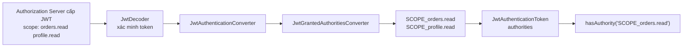

# Quy ước SCOPE_ và kiểm tra authority tương ứng

## 1. Bài toán: access token đã hợp lệ, API biết người gọi được làm gì bằng cách nào?

Một ứng dụng Spring Boot đóng vai trò **OAuth 2.0 Resource Server** nhận yêu cầu đọc đơn hàng:

```http
GET /api/orders/42 HTTP/1.1
Host: orders.example.com
Authorization: Bearer <access-token>
```

Access token có thể mang scope được Authorization Server cấp:

```json
{
  "iss": "https://id.example.com/realms/shop",
  "sub": "user-417",
  "aud": ["orders-api"],
  "scope": "orders.read profile.read",
  "exp": 1893456000
}
```

Sau khi Resource Server xác minh token, nó phải xác định **quyền nào trong token tương ứng với quyền mà endpoint yêu cầu**. Với cấu hình mặc định phổ biến của Spring Security Resource Server JWT, scope `orders.read` được chuyển thành một `GrantedAuthority` có tên:

```text
SCOPE_orders.read
```

Vì vậy, rule:

```java
.hasAuthority("SCOPE_orders.read")
```

có thể bảo vệ endpoint đọc đơn hàng. Một token có scope `profile.read` nhưng không có `orders.read` sẽ không đáp ứng rule này, dù chữ ký và issuer của JWT hoàn toàn hợp lệ.

Bài học này giải thích **quy ước `SCOPE_`**, nơi chuyển đổi scope thành authority trong Spring Security, cách viết rule đúng, cách tùy chỉnh khi issuer dùng claim khác và cách nhận biết lỗi quyền trong Resource Server.

### Mục tiêu học tập

Sau bài học, bạn có thể:

1. Phân biệt **OAuth 2.0 scope**, **Spring Security GrantedAuthority**, **role** và **quyền đối với tài nguyên cụ thể**.
2. Giải thích tại sao mặc định `orders.read` trở thành `SCOPE_orders.read`.
3. Cấu hình `hasAuthority(...)`, `hasAnyAuthority(...)` và `@PreAuthorize(...)` phù hợp.
4. Sử dụng `JwtGrantedAuthoritiesConverter` và `JwtAuthenticationConverter` khi hợp đồng token dùng tên claim hoặc tiền tố khác.
5. Phân biệt **401 Unauthorized** với **403 Forbidden** trong các tình huống thiếu token, token không hợp lệ và thiếu scope.
6. Kiểm tra hành vi bằng `curl`, Spring Security Test và quan sát authorities đã được tạo từ JWT.
7. Tránh việc xem một scope ở mức API là quyền xem mọi đơn hàng, mọi người dùng hoặc mọi tenant.

## 2. OAuth 2.0 scope là gì?

Trong OAuth 2.0, **scope** là cách biểu diễn phạm vi quyền truy cập được yêu cầu và được Authorization Server cấp cho access token. Nó có thể thể hiện loại thao tác mà Client hoặc chủ thể được phép thực hiện với một tài nguyên/API.

Ví dụ:

| Scope minh họa | Ý nghĩa do ứng dụng định nghĩa |
|---|---|
| `orders.read` | Đọc thông tin đơn hàng trong phạm vi được phép |
| `orders.write` | Tạo/chỉnh sửa đơn hàng trong phạm vi được phép |
| `orders.cancel` | Yêu cầu hủy đơn hàng khi đạt điều kiện nghiệp vụ |
| `profile.read` | Đọc thông tin hồ sơ được phép |
| `reports.export` | Xuất báo cáo theo chính sách |
| `inventory.read` | Đọc thông tin tồn kho |

Tên scope và ý nghĩa cụ thể được xác định trong **hợp đồng giữa Authorization Server và Resource Server**. Không có quy tắc rằng mọi hệ thống phải sử dụng các scope ví dụ nêu trên.

Đặc biệt:

- Scope không đồng nghĩa với quyền truy cập một bản ghi bất kỳ.
- Scope không tự xác định tenant hoặc chủ sở hữu tài nguyên.
- Scope không phải role `ADMIN` hay `USER`, dù hệ thống có thể ánh xạ role thành những quyền khác trong lớp authorization.
- Scope trong **access token** đã phát hành có thể nhỏ hơn scope mà Client từng yêu cầu, tùy chính sách cấp quyền.
- Scope phải được nhận từ access token/nguồn introspection **đã xác thực**, không phải từ một header như `X-Scope` do Client tự gửi.

Ví dụ, có `orders.read` vẫn không cho phép `user-417` đọc một đơn hàng của người dùng khác nếu nghiệp vụ giới hạn theo owner hoặc tenant.

### 2.1. Scope do Authorization Server cấp, Resource Server thực thi

Hai bên có trách nhiệm khác nhau:

**Authorization Server**:

- Đăng ký Client và các scope Client được yêu cầu.
- Xác định scope được phép cấp cho Client/chủ thể.
- Cấp access token với thông tin scope theo profile của mình.
- Bảo đảm những claim được phát hành phản ánh chính sách của nó.

**Resource Server**:

- Xác minh access token hoặc introspect token.
- Đọc scope đã xác thực và ánh xạ thành authority phù hợp.
- Yêu cầu đúng authority tại URL/method.
- Thực hiện quyền nghiệp vụ trên từng tài nguyên, tenant hoặc chủ sở hữu.

Resource Server **không tự cấp scope** chỉ vì request có parameter `scope=orders.read`. Nếu Client thiếu quyền, cần điều chỉnh quá trình cấp quyền/token ở Authorization Server hoặc chính sách API theo thiết kế được phê duyệt, không bypass authorization.

## 3. GrantedAuthority là gì, và `SCOPE_` xuất hiện từ đâu?

Trong Spring Security, một đối tượng `Authentication` thường mang:

- `principal`: chủ thể đã được xác thực.
- `credentials`: thông tin xác thực, nếu còn lưu.
- `authorities`: tập `GrantedAuthority` mô tả các quyền dùng trong authorization.

`GrantedAuthority` có một tên dạng chuỗi; các rule như `hasAuthority(...)` so sánh tên này với chuỗi được yêu cầu.

Đối với Resource Server JWT, Spring Security sử dụng các thành phần như:

- `JwtDecoder`: giải mã và xác minh JWT.
- `JwtAuthenticationProvider`: xác thực Bearer token dựa trên JWT.
- `JwtAuthenticationConverter`: chuyển `Jwt` đã xác minh thành một `AbstractAuthenticationToken`, thường là `JwtAuthenticationToken`.
- `JwtGrantedAuthoritiesConverter`: trích scope từ claims và tạo `GrantedAuthority`.

Trong cấu hình mặc định phổ biến, `JwtGrantedAuthoritiesConverter` tìm scope từ một trong những claim thường gặp như **`scope`** hoặc **`scp`**, rồi thêm tiền tố **`SCOPE_`** cho từng giá trị scope.



### 3.1. Ví dụ ánh xạ mặc định

JWT payload:

```json
{
  "sub": "user-417",
  "scope": "orders.read orders.write profile.read"
}
```

Các authority thường được tạo:

```text
SCOPE_orders.read
SCOPE_orders.write
SCOPE_profile.read
```

Khi gọi:

```java
.hasAuthority("SCOPE_orders.read")
```

Spring Security kiểm tra xem `Authentication.getAuthorities()` có authority tương ứng không.

**Tiền tố `SCOPE_` không nằm trong `scope` do OAuth bắt buộc.** Nó là **quy ước ánh xạ ở phía Spring Security**, nhằm phân biệt scope với những nhóm authority khác, chẳng hạn `ROLE_...` hoặc các quyền tùy biến.

### 3.2. Claim `scope` dạng chuỗi

Nhiều JWT access token biểu diễn scope bằng một chuỗi phân tách bởi dấu cách:

```json
{
  "scope": "orders.read orders.write"
}
```

Trong quy ước này, chuỗi trên có **hai scope riêng biệt**:

```text
orders.read
orders.write
```

Nó không phải một scope duy nhất mang toàn bộ nội dung `"orders.read orders.write"`.

Nếu API yêu cầu `SCOPE_orders.read`, token này đáp ứng. Nếu API yêu cầu `SCOPE_reports.export`, token này **không đáp ứng**.

### 3.3. Claim `scp` dạng mảng

Một số nhà phát hành dùng `scp`:

```json
{
  "scp": ["orders.read", "orders.write"]
}
```

Với những phiên bản Spring Security hỗ trợ ánh xạ mặc định phổ biến, `JwtGrantedAuthoritiesConverter` có thể đọc một claim `scp` kiểu collection và tạo các authority tương ứng:

```text
SCOPE_orders.read
SCOPE_orders.write
```

**Không giả định mọi issuer phát hành cùng claim hoặc cùng kiểu dữ liệu.** Nếu token chỉ có `permissions`, `authorities` hoặc một object quyền lồng nhau, bộ converter mặc định có thể không tạo authority bạn mong đợi.

### 3.4. Nếu token có cả `scope` và `scp`?

Bộ converter mặc định tìm một claim scope theo các tên mà nó nhận diện; không nên mặc định rằng tất cả giá trị ở cả hai claim sẽ được tự động gộp.

Ví dụ:

```json
{
  "scope": "orders.read",
  "scp": ["orders.write"]
}
```

Hợp đồng phải xác định claim nào là nguồn quyền. Nếu hệ thống cần gộp chúng, phải cấu hình converter riêng theo quy tắc rõ ràng và hiểu hậu quả bảo mật. Việc gộp tự động có thể vô tình cấp quyền rộng hơn dự kiến nếu hai claim có ý nghĩa khác nhau.

## 4. `hasAuthority` kiểm tra chính xác điều gì?

Một rule:

```java
.hasAuthority("SCOPE_orders.read")
```

tương đương câu hỏi logic:

```text
Authentication hiện tại có GrantedAuthority
với getAuthority() == "SCOPE_orders.read" hay không?
```

Không có cơ chế tự hiểu `orders.read` bao gồm `orders.write` hoặc ngược lại. Mọi quan hệ kế thừa giữa scope, nếu có, phải được định nghĩa tường minh.

| Authorities của request | Rule | Kết quả |
|---|---|---|
| `SCOPE_orders.read` | `hasAuthority("SCOPE_orders.read")` | Cho phép ở lớp rule này |
| `SCOPE_orders.write` | `hasAuthority("SCOPE_orders.read")` | Từ chối |
| `SCOPE_orders.read` và `SCOPE_orders.write` | `hasAuthority("SCOPE_orders.write")` | Cho phép ở lớp rule này |
| `ROLE_ADMIN` | `hasAuthority("SCOPE_orders.read")` | Từ chối, trừ khi policy ánh xạ thêm scope |
| `orders.read` | `hasAuthority("SCOPE_orders.read")` | Từ chối do khác chuỗi |
| Không có authority | `hasAuthority("SCOPE_orders.read")` | Từ chối |

Ở đây “cho phép” chỉ có nghĩa **đạt điều kiện authority nêu trong bảng**. Các kiểm tra khác như issuer, audience, tenant, ownership và trạng thái nghiệp vụ vẫn có thể từ chối request.

### 4.1. Vì sao không dùng `hasAuthority("orders.read")` theo mặc định?

Với token:

```json
{
  "scope": "orders.read"
}
```

Spring Security thường tạo authority **`SCOPE_orders.read`**, không phải `orders.read`.

Vì vậy:

```java
// Phù hợp mặc định
.hasAuthority("SCOPE_orders.read")

// Không khớp nếu không có converter tùy biến
.hasAuthority("orders.read")
```

Nếu token hợp lệ nhưng endpoint luôn trả `403`, đây là điểm đầu tiên nên kiểm tra.

### 4.2. `hasAnyAuthority` là điều kiện OR

Khi chấp nhận một trong hai scope:

```java
.hasAnyAuthority(
    "SCOPE_orders.read",
    "SCOPE_orders.admin"
)
```

Rule trên cho phép nếu Authentication có **ít nhất một** trong hai authority.

Nó không yêu cầu cả hai cùng có mặt. Nếu cần **AND** giữa hai authority, sử dụng biểu thức/một authorization manager kết hợp rõ ràng, ví dụ tại method security:

```java
@PreAuthorize(
    "hasAuthority('SCOPE_orders.read') " +
    "and hasAuthority('SCOPE_orders.audit')"
)
```

Không nên ghi `hasAnyAuthority` khi nghiệp vụ cần cả hai quyền.

### 4.3. Scope là chuỗi có ý nghĩa chính xác

Theo quy tắc thông dụng, tên authority được so khớp chính xác:

```text
SCOPE_orders.read
SCOPE_Orders.Read
SCOPE_orders.READ
```

là những chuỗi khác nhau. Không tự chuyển tất cả scope sang chữ thường hoặc làm phép khớp prefix/hậu tố để “tiện dùng” nếu hợp đồng không quy định.

Ví dụ `orders.*` không tự khớp `orders.read` trong `hasAuthority`. Nếu cần wildcard hoặc quyền theo mẫu, phải thiết kế `AuthorizationManager` hoặc permission evaluator có chủ đích, thay vì giả định tính năng đó đã có.

## 5. Đừng nhầm `hasAuthority` với `hasRole`

Spring Security có hai nhóm helper thường gặp:

- `hasAuthority("SCOPE_orders.read")`: so khớp authority chính xác.
- `hasRole("ADMIN")`: theo quy ước mặc định, tìm authority có tiền tố **`ROLE_`**, tức `ROLE_ADMIN`.

Ví dụ:

```java
.hasAuthority("SCOPE_orders.read")
.hasRole("ADMIN")
```

Hai rule **không tương đương**.

| Rule | Authority được mong đợi theo quy ước thông dụng |
|---|---|
| `hasAuthority("SCOPE_orders.read")` | `SCOPE_orders.read` |
| `hasAuthority("ROLE_ADMIN")` | `ROLE_ADMIN` |
| `hasRole("ADMIN")` | `ROLE_ADMIN` |
| `hasAuthority("orders.read")` | `orders.read` |

JWT mang claim:

```json
{
  "scope": "orders.read",
  "roles": ["ADMIN"]
}
```

**không tự động** có `ROLE_ADMIN` chỉ vì `roles` xuất hiện. Converter scope mặc định tập trung vào `scope`/`scp`; để dùng role claim, cần cấu hình cách ánh xạ vai trò theo hợp đồng issuer.

Một lỗi phổ biến là viết:

```java
.hasRole("orders.read")
```

và mong Spring Security kiểm tra OAuth scope. Với prefix role mặc định, code lại tìm `ROLE_orders.read`, không phải `SCOPE_orders.read`.

**Quy ước tốt:** Dùng `hasAuthority("SCOPE_...")` cho OAuth scope; dùng `hasRole("...")` khi bạn thực sự có mô hình role được mapping ra `ROLE_...`.

## 6. Cấu hình SecurityFilterChain theo scope

### 6.1. Dependency

Ví dụ với Spring Boot REST API và Gradle:

```groovy
dependencies {
    implementation 'org.springframework.boot:spring-boot-starter-web'
    implementation 'org.springframework.boot:spring-boot-starter-security'
    implementation 'org.springframework.boot:spring-boot-starter-oauth2-resource-server'
}
```

Project cần cấu hình Spring Boot plugin/dependency management phù hợp với phiên bản Spring Security sử dụng.

### 6.2. Issuer tin cậy

Trong `src/main/resources/application.yml`:

```yaml
server:
  port: 8080

spring:
  security:
    oauth2:
      resourceserver:
        jwt:
          issuer-uri: https://id.example.com/realms/shop
```

Địa chỉ issuer là ví dụ; phải thay bằng issuer thực tế đã được API phê duyệt. Spring Security có thể lấy thông tin khóa/metadata thích hợp và xác minh JWT.

**Chỉ cấu hình issuer không tự bảo đảm token được phát hành cho đúng audience của API.** Trong ứng dụng thực tế nên ràng buộc `aud` và token profile theo hợp đồng. Phần chính của bài này tập trung vào ánh xạ scope/authority, không bỏ qua yêu cầu xác minh token.

### 6.3. SecurityFilterChain cho API đơn hàng

```java
package com.example.orders;

import org.springframework.context.annotation.Bean;
import org.springframework.context.annotation.Configuration;
import org.springframework.http.HttpMethod;
import org.springframework.security.config.Customizer;
import org.springframework.security.config.annotation.web.builders.HttpSecurity;
import org.springframework.security.config.http.SessionCreationPolicy;
import org.springframework.security.web.SecurityFilterChain;

@Configuration
public class ApiSecurityConfig {

    @Bean
    SecurityFilterChain apiSecurity(HttpSecurity http) throws Exception {
        return http
            .csrf(csrf -> csrf.disable())
            .sessionManagement(session ->
                session.sessionCreationPolicy(
                    SessionCreationPolicy.STATELESS))
            .authorizeHttpRequests(authorize -> authorize
                .requestMatchers("/api/public/**").permitAll()

                .requestMatchers(HttpMethod.GET, "/api/orders/**")
                    .hasAuthority("SCOPE_orders.read")

                .requestMatchers(HttpMethod.POST, "/api/orders")
                    .hasAuthority("SCOPE_orders.write")

                .requestMatchers(HttpMethod.DELETE, "/api/orders/**")
                    .hasAuthority("SCOPE_orders.cancel")

                .anyRequest().denyAll()
            )
            .oauth2ResourceServer(oauth2 ->
                oauth2.jwt(Customizer.withDefaults()))
            .build();
    }
}
```

Giải thích:

1. `GET /api/public/**` hoặc các method công khai khác phù hợp matcher `/api/public/**` không cần Authentication.
2. `GET /api/orders/{id}` yêu cầu `SCOPE_orders.read`.
3. `POST /api/orders` yêu cầu `SCOPE_orders.write`.
4. `DELETE /api/orders/{id}` yêu cầu `SCOPE_orders.cancel`.
5. Request không khớp rule cho phép bị từ chối với `anyRequest().denyAll()`.
6. `oauth2ResourceServer(...jwt(...))` bật xác thực Bearer JWT.

Các matcher có thứ tự; rule cụ thể nên đứng trước rule tổng quát. Hãy tránh `requestMatchers("/api/**").permitAll()` nếu hệ thống có endpoint bảo vệ dưới `/api/**`.

Đoạn `csrf.disable()` phù hợp với REST API **thuần Bearer token gửi trong Authorization header**, không dùng cookie để tự động xác thực request. Nếu ứng dụng dùng session/cookie trình duyệt, cần thiết kế CSRF theo kiến trúc thật.

### 6.4. Một Controller minh họa

```java
package com.example.orders;

import java.util.Map;
import org.springframework.security.core.annotation.AuthenticationPrincipal;
import org.springframework.security.oauth2.jwt.Jwt;
import org.springframework.web.bind.annotation.GetMapping;
import org.springframework.web.bind.annotation.PathVariable;
import org.springframework.web.bind.annotation.RestController;

@RestController
public class OrderController {

    @GetMapping("/api/public/ping")
    public Map<String, String> ping() {
        return Map.of("status", "ok");
    }

    @GetMapping("/api/orders/{orderId}")
    public Map<String, String> getOrder(
            @PathVariable String orderId,
            @AuthenticationPrincipal Jwt jwt) {

        return Map.of(
            "orderId", orderId,
            "requestedBy", jwt.getSubject()
        );
    }
}
```

Controller trên minh họa đường đi của Authentication sau khi scope được chấp nhận. Nó **không phải API đơn hàng production**, vì chưa đọc cơ sở dữ liệu và chưa kiểm tra người gọi có quyền với đơn hàng `orderId` hay không.

Trong hệ thống thật, Controller nên gọi Service được bảo vệ bằng ownership/tenant checks và truy vấn dữ liệu theo phạm vi người dùng.

## 7. Xác minh đúng authority của JWT đã xác thực

Để học và chẩn đoán mapping, có thể xem danh sách authority sau khi Resource Server xác thực token:

```java
package com.example.orders;

import java.util.List;
import java.util.Map;
import org.springframework.security.core.Authentication;
import org.springframework.web.bind.annotation.GetMapping;
import org.springframework.web.bind.annotation.RestController;

@RestController
public class AuthoritiesController {

    @GetMapping("/api/debug/authorities")
    public Map<String, Object> authorities(Authentication authentication) {
        List<String> values = authentication.getAuthorities().stream()
            .map(granted -> granted.getAuthority())
            .sorted()
            .toList();

        return Map.of("authorities", values);
    }
}
```

Nếu muốn thử trong môi trường phát triển, phải **cấp riêng rule bảo vệ cho endpoint này**, ví dụ:

```java
.requestMatchers(HttpMethod.GET, "/api/debug/authorities")
    .hasAuthority("SCOPE_debug.read")
```

đặt trước `anyRequest().denyAll()`. Đây chỉ là endpoint **chẩn đoán**; không nên tự động mở hoặc công khai trong production vì danh sách authority có thể tiết lộ thông tin phân quyền.

Nếu JWT có:

```json
{
  "scope": "orders.read orders.write"
}
```

với converter mặc định, danh sách thường thấy là:

```json
{
  "authorities": [
    "SCOPE_orders.read",
    "SCOPE_orders.write"
  ]
}
```

Dù vậy, đọc danh sách authority **không chứng minh** token được phát hành đúng audience, còn hạn hay có quyền với một đơn hàng cụ thể; những lớp đó cần kiểm tra riêng.

## 8. Method security: dùng `@PreAuthorize` với `SCOPE_`

Ngoài request matcher tại `SecurityFilterChain`, Spring Security có thể áp dụng authorization trên method.

### 8.1. Bật method security

Với cấu hình phù hợp Spring Security hiện đại:

```java
package com.example.orders;

import org.springframework.context.annotation.Configuration;
import org.springframework.security.config.annotation.method.configuration.EnableMethodSecurity;

@Configuration
@EnableMethodSecurity
public class MethodSecurityConfig {
}
```

Khi method security được bật, có thể viết:

```java
package com.example.orders;

import org.springframework.security.access.prepost.PreAuthorize;
import org.springframework.stereotype.Service;

@Service
public class OrderService {

    @PreAuthorize("hasAuthority('SCOPE_orders.read')")
    public OrderDto getVisibleOrder(String orderId) {
        // Truy vấn và kiểm tra quyền với bản ghi thực tế.
        throw new UnsupportedOperationException("Demo only");
    }

    @PreAuthorize("hasAuthority('SCOPE_orders.write')")
    public OrderDto createOrder(CreateOrderRequest request) {
        // Lưu bản ghi trong tenant đã xác thực.
        throw new UnsupportedOperationException("Demo only");
    }
}
```

Các kiểu `OrderDto` và `CreateOrderRequest` là lớp domain minh họa của project, không phải lớp có sẵn trong Spring Security.

`@PreAuthorize` trên Service giúp chính sách quyền được áp dụng khi method được gọi qua cơ chế method security của Spring. Nó không tự thay thế kiểm tra tài nguyên ở bên trong Service.

### 8.2. Điều kiện AND và OR

Dùng một trong hai authority:

```java
@PreAuthorize(
    "hasAnyAuthority('SCOPE_orders.read', 'SCOPE_orders.admin')"
)
```

Đòi cả hai authority:

```java
@PreAuthorize(
    "hasAuthority('SCOPE_orders.read') " +
    "and hasAuthority('SCOPE_orders.audit')"
)
```

Cho phép đọc khi có scope và bản ghi thuộc tenant được phép có thể yêu cầu một authorization service:

```java
@PreAuthorize(
    "hasAuthority('SCOPE_orders.read') " +
    "and @orderPermission.canRead(authentication, #orderId)"
)
public OrderDto getOrder(String orderId) {
    // ...
}
```

`orderPermission` là bean do ứng dụng định nghĩa, có nhiệm vụ xác minh `orderId`, tenant và các quan hệ nghiệp vụ. Ví dụ chỉ minh họa cấu trúc expression; không tự động tồn tại bean này trong project.

**Cẩn thận:** Expression method security có thể sử dụng parameter `#orderId` khi Spring biết tên tham số; môi trường build cần cấu hình giữ tên tham số hoặc cách bind phù hợp nếu không có thông tin tên ở runtime.

## 9. Tùy chỉnh scope claim bằng JwtGrantedAuthoritiesConverter

Không phải Authorization Server nào cũng dùng `scope` hoặc `scp`. Giả sử issuer cấp JWT:

```json
{
  "sub": "user-417",
  "permissions": ["orders.read", "orders.write"]
}
```

Nếu hợp đồng nói `permissions` là nguồn quyền của access token, Resource Server phải cấu hình converter để trích đúng claim đó.

### 9.1. Đặt tên claim và prefix

Ví dụ muốn giữ quy ước `SCOPE_` ngay cả khi claim mang tên `permissions`:

```java
package com.example.orders;

import org.springframework.context.annotation.Bean;
import org.springframework.context.annotation.Configuration;
import org.springframework.security.oauth2.server.resource.authentication.JwtAuthenticationConverter;
import org.springframework.security.oauth2.server.resource.authentication.JwtGrantedAuthoritiesConverter;

@Configuration
public class JwtAuthorityMappingConfig {

    @Bean
    JwtAuthenticationConverter jwtAuthenticationConverter() {
        JwtGrantedAuthoritiesConverter scopeConverter =
            new JwtGrantedAuthoritiesConverter();

        // Chỉ dùng nếu issuer thực sự phát claim "permissions"
        // và contract định nghĩa các phần tử như OAuth scope.
        scopeConverter.setAuthoritiesClaimName("permissions");
        scopeConverter.setAuthorityPrefix("SCOPE_");

        JwtAuthenticationConverter converter =
            new JwtAuthenticationConverter();

        converter.setJwtGrantedAuthoritiesConverter(scopeConverter);
        return converter;
    }
}
```

Trong `SecurityFilterChain`, sử dụng converter này:

```java
private final JwtAuthenticationConverter jwtAuthenticationConverter;

// Constructor injection trong class @Configuration
public SecurityConfig(
        JwtAuthenticationConverter jwtAuthenticationConverter) {
    this.jwtAuthenticationConverter = jwtAuthenticationConverter;
}

// Trong cấu hình HttpSecurity:
.oauth2ResourceServer(oauth2 -> oauth2
    .jwt(jwt -> jwt
        .jwtAuthenticationConverter(jwtAuthenticationConverter)))
```

Đoạn trên minh họa cách kết nối converter vào DSL; hãy đặt nó trong một lớp `@Configuration` có constructor/bean hoàn chỉnh theo tổ chức project. Không khai báo đồng thời hai `SecurityFilterChain` trùng matcher một cách vô tình.

Với claim:

```json
{
  "permissions": ["orders.read", "orders.write"]
}
```

converter tạo:

```text
SCOPE_orders.read
SCOPE_orders.write
```

**Rủi ro cần hiểu:** Khi gọi `setAuthoritiesClaimName("permissions")`, converter dùng nguồn `permissions` theo cấu hình thay vì tự động kết hợp với mọi claim khác. Nếu API cần tiếp tục dùng `scope`/`scp`, hãy thiết kế converter gộp một cách tường minh và chỉ khi hợp đồng xác định hợp lệ.

### 9.2. Thay đổi tiền tố

Một hệ thống có thể muốn thể hiện permission không phải OAuth scope:

```java
JwtGrantedAuthoritiesConverter converter =
    new JwtGrantedAuthoritiesConverter();

converter.setAuthoritiesClaimName("permissions");
converter.setAuthorityPrefix("PERMISSION_");
```

Khi đó:

```text
permissions: ["orders.read"]
    ↓
PERMISSION_orders.read
```

Rule phải đổi tương ứng:

```java
.hasAuthority("PERMISSION_orders.read")
```

Nếu vẫn viết `hasAuthority("SCOPE_orders.read")`, authorization sẽ thất bại vì chuỗi không khớp.

**Nên thống nhất tiền tố trên toàn dự án**: tránh đổi prefix ở một filter chain nhưng quên các `@PreAuthorize`, integration test hoặc documentation.

### 9.3. Khi issuer dùng scope dạng chuỗi với delimiter khác

Ví dụ một hệ thống riêng biểu diễn:

```json
{
  "permissions": "orders.read,orders.write"
}
```

Bộ converter mặc định có thể không tách đúng theo dấu phẩy. Trong những phiên bản Spring Security hỗ trợ `JwtGrantedAuthoritiesConverter#setAuthoritiesClaimDelimiter(...)`, có thể thiết lập regex delimiter thích hợp:

```java
JwtGrantedAuthoritiesConverter converter =
    new JwtGrantedAuthoritiesConverter();

converter.setAuthoritiesClaimName("permissions");
converter.setAuthorityPrefix("PERMISSION_");
converter.setAuthoritiesClaimDelimiter(",");
```

Đây là cấu hình **tùy biến cho một hợp đồng khác chuẩn scope dạng space-delimited**; không áp dụng mặc định cho mọi OAuth access token. API setter và cách chuyển đổi chi tiết phụ thuộc phiên bản Spring Security, nên sử dụng API tương ứng với version dự án.

Nếu claim đã là collection, không cần xử lý delimiter như chuỗi. Không nên dùng `String.split(...)` tùy ý trên một object JSON không có kiểu đã được định nghĩa.

### 9.4. Gộp nhiều claim phải có chủ đích

Giả sử JWT có:

```json
{
  "scope": "orders.read",
  "roles": ["TENANT_ADMIN"]
}
```

Muốn tạo cả `SCOPE_orders.read` và `ROLE_TENANT_ADMIN`, cần một converter tổng hợp **theo quy tắc issuer**. Về mặt ý tưởng:

```text
source scope:
  "orders.read"
  → SCOPE_orders.read

source roles:
  ["TENANT_ADMIN"]
  → ROLE_TENANT_ADMIN

result authorities:
  [SCOPE_orders.read, ROLE_TENANT_ADMIN]
```

Không nên lấy mọi chuỗi xuất hiện trong JWT làm authority. `roles` có thể là role ở một tenant cụ thể, còn `scope` có thể áp dụng ở tài nguyên được chỉ định. Bỏ qua ngữ nghĩa đó dễ dẫn đến **privilege escalation**.

Nếu dùng một converter tổng hợp, phải bảo đảm mỗi claim được kiểm tra đúng kiểu và namespace, không trùng lặp bất ngờ và chỉ dùng những claim đáng tin theo hợp đồng nhà phát hành.

## 10. Scope trong opaque access token

OAuth access token không bắt buộc là JWT. Một Authorization Server có thể cấp **opaque token**; Resource Server gọi introspection endpoint để xác định token đang hoạt động và lấy scope.

Ví dụ cấu hình Spring Boot:

```yaml
spring:
  security:
    oauth2:
      resourceserver:
        opaque-token:
          introspection-uri: https://id.example.com/oauth2/introspect
          client-id: resource-server
          client-secret: REPLACE_WITH_SECRET_FROM_ENV
```

`REPLACE_WITH_SECRET_FROM_ENV` chỉ là placeholder; không để secret thực trong file source được commit. Ứng dụng thật cần biến môi trường/secret manager phù hợp.

Một phản hồi introspection minh họa:

```json
{
  "active": true,
  "client_id": "shop-web",
  "sub": "user-417",
  "scope": "orders.read profile.read",
  "aud": ["orders-api"],
  "exp": 1893456000
}
```

Với hỗ trợ Resource Server opaque token thông dụng, thông tin scope được ánh xạ thành authorities có tiền tố **`SCOPE_`** tương tự theo hợp đồng.

Do đó, endpoint rule:

```java
.hasAuthority("SCOPE_orders.read")
```

có thể được sử dụng cho cả JWT và opaque token khi cả hai cách xác thực tạo authority giống nhau.

Nhưng **`JwtGrantedAuthoritiesConverter` dành cho JWT**, không tự động sửa cách introspector opaque token tạo authorities. Nếu nhà phát hành opaque token dùng claim khác, ứng dụng phải tùy chỉnh introspection/principal/authority mapping tương ứng, chẳng hạn qua một `OpaqueTokenIntrospector` thích hợp với phiên bản Spring Security.

Đừng đọc opaque token bằng Base64URL để tự lấy scope, và đừng gửi token đến introspection endpoint do Client chỉ định. Nguồn introspection phải nằm trong cấu hình tin cậy.

## 11. Đừng nhầm scope với issuer, audience hoặc loại token

Một access token có:

```json
{
  "iss": "https://id.example.com/realms/shop",
  "aud": ["billing-api"],
  "scope": "orders.read"
}
```

không nên được `orders-api` chấp nhận nếu audience chỉ định `billing-api`, dù `orders.read` trùng tên authority API yêu cầu.

**Thứ tự logic phải rõ:**

1. Token được phát hành bởi issuer tin cậy?
2. Chữ ký/khóa/thuật toán hợp lệ?
3. Token còn hạn và chưa bị chặn bởi các validator?
4. Token được cấp cho **đúng Resource Server**?
5. Token đúng loại access token/profile theo hợp đồng?
6. Scope được cấp tương ứng authority nào?
7. Quyền đối với endpoint, tenant và tài nguyên có đạt không?

Header `typ=JWT` hoặc claim `scope` không thay thế xác minh loại token. **ID token OIDC** được cấp cho Client không thể tự biến thành access token cho API chỉ vì cũng có `iss` và chữ ký hợp lệ.

### 11.1. Ví dụ audience validator

Trên những phiên bản Spring Security phù hợp, có thể thêm audience validator mà vẫn giữ issuer/time validation:

```java
import org.springframework.context.annotation.Bean;
import org.springframework.context.annotation.Configuration;
import org.springframework.security.oauth2.core.DelegatingOAuth2TokenValidator;
import org.springframework.security.oauth2.core.OAuth2Error;
import org.springframework.security.oauth2.core.OAuth2TokenValidator;
import org.springframework.security.oauth2.core.OAuth2TokenValidatorResult;
import org.springframework.security.oauth2.jwt.Jwt;
import org.springframework.security.oauth2.jwt.JwtDecoder;
import org.springframework.security.oauth2.jwt.JwtDecoders;
import org.springframework.security.oauth2.jwt.JwtValidators;
import org.springframework.security.oauth2.jwt.NimbusJwtDecoder;

@Configuration
public class JwtValidationConfig {

    @Bean
    JwtDecoder jwtDecoder() {
        String issuer = "https://id.example.com/realms/shop";

        NimbusJwtDecoder decoder =
            (NimbusJwtDecoder) JwtDecoders.fromIssuerLocation(issuer);

        OAuth2TokenValidator<Jwt> audience = jwt ->
            jwt.getAudience().contains("orders-api")
                ? OAuth2TokenValidatorResult.success()
                : OAuth2TokenValidatorResult.failure(
                    new OAuth2Error(
                        "invalid_token", "Invalid audience", null));

        decoder.setJwtValidator(
            new DelegatingOAuth2TokenValidator<>(
                JwtValidators.createDefaultWithIssuer(issuer),
                audience
            ));

        return decoder;
    }
}
```

Ý nghĩa quan trọng: **quy ước `SCOPE_` chỉ xử lý phần mapping quyền**, không tự kiểm tra `aud`. Một `SecurityFilterChain` có `hasAuthority("SCOPE_orders.read")` vẫn cần JWT validator phù hợp để ngăn token của API khác được chấp nhận.

## 12. Scope không phải quyền trên từng đơn hàng hay tenant

Giả sử hai tenant Alpha và Beta cùng sử dụng `orders-api`:

```text
Tenant Alpha:
  order-101 của user-417

Tenant Beta:
  order-202 của user-902
```

Token của user-417:

```json
{
  "sub": "user-417",
  "scope": "orders.read",
  "tenant_id": "tenant-alpha"
}
```

Spring Security tạo `SCOPE_orders.read`. Rule endpoint `hasAuthority("SCOPE_orders.read")` cho phép tiếp tục, nhưng Service phải kiểm tra đơn hàng thuộc Alpha và đúng người/role được phép.

Truy vấn sai:

```sql
SELECT * FROM orders
WHERE id = :order_id;
```

Truy vấn phù hợp hơn với tenant và owner:

```sql
SELECT id, tenant_id, owner_subject, status
FROM orders
WHERE id = :order_id
  AND tenant_id = :verified_tenant_id
  AND owner_subject = :verified_subject;
```

Các giá trị `verified_tenant_id` và `verified_subject` phải lấy từ principal/nguồn quyền đã xác minh và quy ước token của hệ thống. Không sử dụng `X-Tenant-ID` hoặc `userId` từ query string như chứng cứ quyền truy cập nếu Client được tự ý sửa.

Nếu role được phép đọc mọi đơn hàng **trong cùng tenant**, Service có thể có một nhánh policy riêng cho role đó, nhưng điều kiện tenant vẫn phải được thực thi. Không cho rằng `SCOPE_orders.read` đồng nghĩa với “đọc tất cả đơn hàng của mọi tenant”.

### 12.1. Client Credentials cũng có scope

Một token được cấp qua Client Credentials có thể mang:

```json
{
  "sub": "billing-worker",
  "client_id": "billing-worker",
  "aud": ["orders-api"],
  "scope": "orders.read"
}
```

Nếu issuer và Resource Server đã thỏa thuận, scope này cũng có thể được map thành `SCOPE_orders.read`.

Tuy nhiên, `sub` của service token có thể là Client identity chứ không phải user ID. Tầng nghiệp vụ cần phân biệt loại principal và phạm vi tenant/đối tượng của dịch vụ. **Có scope không chứng minh token đại diện cho một người dùng đã đăng nhập.**

### 12.2. Scope không chứng minh bên gửi HTTP chính là Client được cấp token

OAuth Bearer token có thể bị người nắm giữ trình lại trong thời hạn hiệu lực. `client_id` hoặc scope trong token cho biết điều được Authorization Server cấp, không tự chứng minh người gọi hiện tại đang sở hữu key/chứng thư của Client.

Nếu cần ràng buộc người trình token với khóa/chứng thư, cần thiết kế **sender-constrained token** và xác minh cơ chế đó theo hợp đồng, không chỉ thêm một authority `SCOPE_...`.

## 13. Xác nhận kết quả bằng curl

Giả sử ứng dụng đang chạy tại `http://localhost:8080`, issuer thật được cấu hình và đã có những JWT access token phù hợp.

### 13.1. Gọi endpoint công khai

```bash
curl -i http://localhost:8080/api/public/ping
```

Nếu Controller và policy đúng, response có thể là:

```http
HTTP/1.1 200 OK
Content-Type: application/json

{"status":"ok"}
```

Đây chỉ là xác nhận route public, không chứng minh endpoint protected đã được bảo vệ.

### 13.2. Gọi endpoint đọc đơn hàng không token

```bash
curl -i http://localhost:8080/api/orders/42
```

Thường trả:

```http
HTTP/1.1 401 Unauthorized
WWW-Authenticate: Bearer
```

Request chưa có thông tin xác thực được chấp nhận. Nó chưa đi đến giai đoạn có scope authority hợp lệ.

### 13.3. Gửi token không hợp lệ

```bash
curl -i \
  -H 'Authorization: Bearer not-a-valid-jwt' \
  http://localhost:8080/api/orders/42
```

Thường trả `401 Unauthorized` với Bearer challenge, có thể chứa `error="invalid_token"`.

Đây là **authentication failure**, khác với việc một token được xác thực thành công nhưng thiếu `SCOPE_orders.read`.

### 13.4. Token hợp lệ nhưng thiếu scope

Giả sử `ACCESS_TOKEN_WITHOUT_READ_SCOPE` là token được Authorization Server thực sự ký, có issuer và audience hợp lệ, chỉ mang `profile.read`.

```bash
curl -i \
  -H "Authorization: Bearer $ACCESS_TOKEN_WITHOUT_READ_SCOPE" \
  http://localhost:8080/api/orders/42
```

Kết quả thường:

```http
HTTP/1.1 403 Forbidden
WWW-Authenticate: Bearer error="insufficient_scope"
```

Chi tiết header có thể thay đổi theo handler; điều quan trọng là token được xác thực nhưng không đủ quyền endpoint.

**Không tự sửa scope trong payload một JWT có sẵn rồi giữ chữ ký cũ để thử nhánh 403.** Sửa payload làm chữ ký không còn hợp lệ và thường dẫn tới 401. Cần token thật được issuer cấp với scope thiếu, hoặc dùng Security Test giả lập Authentication cho bài kiểm thử phân quyền.

### 13.5. Token hợp lệ và có scope

Giả sử `ACCESS_TOKEN_WITH_READ_SCOPE` có `scope=orders.read` và các điều kiện issuer/audience/thời hạn đều đúng:

```bash
curl -i \
  -H "Authorization: Bearer $ACCESS_TOKEN_WITH_READ_SCOPE" \
  http://localhost:8080/api/orders/42
```

Với Controller minh họa ở mục 6.4, nếu không có rule khác, API có thể trả:

```http
HTTP/1.1 200 OK
Content-Type: application/json

{"orderId":"42","requestedBy":"user-417"}
```

Token thật có thể mang subject khác. Trong API nghiệp vụ, còn phải kiểm tra `orderId` thực sự thuộc quyền người gọi.

### 13.6. Ma trận kết quả mong đợi

| Request | Token | Authority sau xác thực | Kết quả điển hình |
|---|---|---|---|
| `GET /api/public/ping` | Không có | Không cần | `200` |
| `GET /api/orders/42` | Không có | Không có Authentication phù hợp | `401` |
| `GET /api/orders/42` | Token sai chữ ký | Không tạo Authentication hợp lệ | `401` |
| `GET /api/orders/42` | Token đúng issuer nhưng sai audience | Bị JWT validator từ chối | `401` |
| `GET /api/orders/42` | Token hợp lệ chỉ có `profile.read` | `SCOPE_profile.read` | `403` |
| `GET /api/orders/42` | Token hợp lệ có `orders.read` | `SCOPE_orders.read` | `200` nếu các điều kiện khác đạt |
| `POST /api/orders` | Token chỉ có `orders.read` | `SCOPE_orders.read` | `403` |
| `POST /api/orders` | Token có `orders.write` | `SCOPE_orders.write` | Cho phép vào Controller nếu các điều kiện khác đạt |
| `DELETE /api/orders/42` | Token chỉ có `orders.write` | `SCOPE_orders.write` | `403` |
| `DELETE /api/orders/42` | Token có `orders.cancel` | `SCOPE_orders.cancel` | Cho phép vào Controller nếu policy khác đạt |

Lưu ý: Ví dụ Controller ở mục 6.4 chỉ khai báo `GET`; muốn thực sự xác nhận `POST`/`DELETE` xử lý thành công, project phải có handler và kiểm tra nghiệp vụ tương ứng. `SecurityFilterChain` có rule không tự tạo REST endpoint.

## 14. Kiểm thử authorization bằng Spring Security Test

### 14.1. Dependency

```groovy
dependencies {
    testImplementation 'org.springframework.boot:spring-boot-starter-test'
    testImplementation 'org.springframework.security:spring-security-test'
}
```

### 14.2. MockMvc xác nhận authority cần thiết

Ví dụ dùng JUnit 5 và MockMvc:

```java
package com.example.orders;

import org.junit.jupiter.api.Test;
import org.springframework.beans.factory.annotation.Autowired;
import org.springframework.boot.test.autoconfigure.web.servlet.AutoConfigureMockMvc;
import org.springframework.boot.test.context.SpringBootTest;
import org.springframework.security.core.authority.SimpleGrantedAuthority;
import org.springframework.test.web.servlet.MockMvc;

import static org.springframework.security.test.web.servlet.request.SecurityMockMvcRequestPostProcessors.jwt;
import static org.springframework.test.web.servlet.request.MockMvcRequestBuilders.get;
import static org.springframework.test.web.servlet.result.MockMvcResultMatchers.jsonPath;
import static org.springframework.test.web.servlet.result.MockMvcResultMatchers.status;

@SpringBootTest
@AutoConfigureMockMvc
class ScopeAuthorizationTest {

    @Autowired
    MockMvc mvc;

    @Test
    void publicRouteWorksWithoutToken() throws Exception {
        mvc.perform(get("/api/public/ping"))
            .andExpect(status().isOk());
    }

    @Test
    void protectedRouteRequiresAuthentication() throws Exception {
        mvc.perform(get("/api/orders/42"))
            .andExpect(status().isUnauthorized());
    }

    @Test
    void protectedRouteRejectsMissingScope() throws Exception {
        mvc.perform(get("/api/orders/42")
                .with(jwt()
                    .jwt(token -> token.subject("user-417"))
                    .authorities(
                        new SimpleGrantedAuthority("SCOPE_profile.read"))))
            .andExpect(status().isForbidden());
    }

    @Test
    void protectedRouteAcceptsMatchingScope() throws Exception {
        mvc.perform(get("/api/orders/42")
                .with(jwt()
                    .jwt(token -> token.subject("user-417"))
                    .authorities(
                        new SimpleGrantedAuthority("SCOPE_orders.read"))))
            .andExpect(status().isOk())
            .andExpect(jsonPath("$.orderId").value("42"));
    }
}
```

Các test này kiểm tra **policy dựa trên authority** khi đã có JWT Authentication giả lập. Khi dùng `with(jwt()).authorities(...)`, chúng **đặt authorities trực tiếp**, không tự xác nhận rằng `JwtGrantedAuthoritiesConverter` đã đọc đúng claim trong token thật.

Nếu muốn kiểm tra cách converter chuyển `scope` thành `SCOPE_`, cần kiểm tra trực tiếp converter hoặc chạy kiểm thử tích hợp qua `JwtDecoder`/token được ký thật phù hợp. Không kết luận chữ ký, issuer, audience hay JWK rotation đã đúng chỉ vì test dùng `with(jwt())` thành công.

### 14.3. Ví dụ kiểm tra converter trực tiếp

Trong một unit test đơn giản, có thể tạo `Jwt` test với claim scope và gọi `JwtGrantedAuthoritiesConverter`:

```java
import java.time.Instant;
import java.util.List;
import org.junit.jupiter.api.Test;
import org.springframework.security.oauth2.jwt.Jwt;
import org.springframework.security.oauth2.server.resource.authentication.JwtGrantedAuthoritiesConverter;

import static org.assertj.core.api.Assertions.assertThat;

class ScopeMappingTest {

    @Test
    void mapsScopeIntoPrefixedAuthority() {
        Instant now = Instant.now();

        Jwt jwt = Jwt.withTokenValue("fake-for-unit-test")
            .header("alg", "RS256")
            .subject("user-417")
            .claim("scope", "orders.read orders.write")
            .issuedAt(now)
            .expiresAt(now.plusSeconds(60))
            .build();

        JwtGrantedAuthoritiesConverter converter =
            new JwtGrantedAuthoritiesConverter();

        List<String> actual = converter.convert(jwt).stream()
            .map(authority -> authority.getAuthority())
            .toList();

        assertThat(actual).contains(
            "SCOPE_orders.read",
            "SCOPE_orders.write"
        );
    }
}
```

Đây chỉ là **kiểm thử ánh xạ claim đã có trong object `Jwt`**. `Jwt.withTokenValue(...)` tạo một đối tượng test, không tạo token có chữ ký mật mã hợp lệ. Với yêu cầu kiểm tra token thực, cần decoder/key/issuer test phù hợp.

## 15. Chẩn đoán khi token hợp lệ nhưng API trả 403

Khi gặp 403 ở endpoint bảo vệ, hãy xét từng lớp:

### 15.1. Có đủ quyền trong token thật chưa?

Decode token **chỉ trong môi trường đáng tin để quan sát**, không lấy kết quả decode làm bằng chứng xác thực. Kiểm tra:

- `scope` hay `scp` có tồn tại không?
- Scope chính xác có đúng `orders.read` hay không?
- Claim dạng chuỗi space-delimited hay collection?
- Authorization Server có thực sự cấp scope, hay Client chỉ **yêu cầu** scope nhưng không được cấp?

Đừng dán Bearer token thật vào dịch vụ giải mã công khai hoặc ghi raw token vào ticket/log.

### 15.2. Converter có tạo authority như rule yêu cầu không?

Nếu token có:

```json
{"scope":"orders.read"}
```

nhưng ứng dụng cấu hình converter chỉ đọc `permissions`, có thể không có `SCOPE_orders.read`.

Nếu converter prefix đã đổi sang `PERMISSION_`, rule `hasAuthority("SCOPE_orders.read")` cũng không còn khớp.

### 15.3. Có dùng nhầm `hasRole` không?

`hasRole("orders.read")` thường tìm `ROLE_orders.read`, không phải `SCOPE_orders.read`. Với OAuth scope nên dùng `hasAuthority("SCOPE_orders.read")` theo mặc định.

### 15.4. Matcher có đúng HTTP method và path không?

`GET /api/orders/42` và `POST /api/orders` cần scope khác nhau theo cấu hình ví dụ. Một rule wildcard đứng trước có thể làm request áp dụng policy không như dự kiến.

### 15.5. Có method security hoặc domain policy khác từ chối không?

Endpoint có `SCOPE_orders.read` nhưng Service có `@PreAuthorize` đòi thêm quyền, hoặc query tenant/ownership không trả bản ghi, vẫn có thể từ chối. Đừng chỉ nhìn authority endpoint rồi kết luận mọi thứ phải thành công.

### 15.6. Đừng biến 403 thành 200 bằng cách bỏ rule

Nếu Client thực sự thiếu `orders.read`, quy trình sửa đúng là xem hợp đồng cấp quyền ở AS/Client và quyết định API. Thay `hasAuthority(...)` bằng `permitAll()` để “sửa lỗi 403” có thể làm lộ dữ liệu.

## 16. Những sai lầm thường gặp

| Sai lầm | Hệ quả | Cách xử lý |
|---|---|---|
| Dùng `hasAuthority("orders.read")` với converter mặc định | 403 do thiếu tiền tố | Dùng `SCOPE_orders.read` |
| Dùng `hasRole("orders.read")` | Spring tìm `ROLE_orders.read` | Dùng `hasAuthority("SCOPE_orders.read")` |
| Nghĩ scope `orders.write` tự bao gồm `orders.read` | Cấp hoặc từ chối quyền sai kỳ vọng | Định nghĩa quan hệ quyền tường minh |
| Dùng `hasAnyAuthority` khi cần cả hai scope | Cho phép khi chỉ có một quyền | Dùng điều kiện AND phù hợp |
| Đọc sai claim `scope`/`scp` | Token hợp lệ nhưng không có authorities | Cấu hình converter theo issuer contract |
| Đổi prefix nhưng không đổi matcher | 403 trên nhiều endpoint | Đồng bộ prefix trong converter và policy |
| Tự gộp mọi role/permission thành authority | Có nguy cơ nâng quyền | Mapping claim theo hợp đồng, từng namespace |
| Chấp nhận claim `X-Scope` từ request | Client tự khai quyền | Chỉ dùng access token đã xác thực |
| Chỉ kiểm tra scope, bỏ `aud` | Token API khác có thể bị chấp nhận | Thêm audience validation |
| Dùng ID token như access token | Sai mục đích và đối tượng nhận | Chỉ chấp nhận access token dành cho API |
| Có `orders.read` rồi đọc mọi order | Broken Object Level Authorization | Kiểm tra owner/tenant và query theo phạm vi |
| Giả định `sub` luôn là user | Service token bị hiểu là user token | Dùng hợp đồng principal/grant phù hợp |
| Chỉ dùng `with(jwt())` để xác nhận decoder | Không kiểm tra chữ ký hoặc JWT parsing | Test decoder/validator và token thật riêng |
| Log access token khi debug 403 | Rò rỉ Bearer token | Log authorities/mã lỗi có kiểm soát |
| Tắt CSRF cho mọi web app | Có thể tạo nguy cơ khi dùng cookie/session | Đánh giá theo cơ chế xác thực thực tế |

### 16.1. Điểm cần nhớ về 401 và 403

**401 Unauthorized** thường xuất hiện khi:

- Endpoint cần Authentication nhưng request không có Bearer token.
- Bearer token sai chữ ký/issuer, hết hạn hoặc không đạt validator bắt buộc.
- Token sai audience nếu Resource Server cấu hình audience validator.

**403 Forbidden** thường xuất hiện khi:

- Token hợp lệ nhưng thiếu `SCOPE_orders.read`.
- Principal đã xác thực không được phép gọi thao tác hoặc không có role yêu cầu.
- Quyền đối với tenant/tài nguyên cụ thể không đạt, nếu ứng dụng chọn phản hồi 403.

Một API có thể dùng 404 thay vì 403 cho tài nguyên mà người gọi không được phép biết đến. Nhưng không nên nhầm việc API trả 404 với việc kiểm tra scope đã được cấu hình đúng.

## 17. Thiết kế scope và authority có chủ đích

Khi thiết kế scope cho một hệ thống mới, các nguyên tắc hữu ích gồm:

1. **Đặt tên theo hành động và tài nguyên** — `orders.read`, `orders.write` dễ diễn giải hơn một scope quá tổng quát như `all`.
2. **Cấp ít quyền cần thiết** — Client chỉ đọc dữ liệu không cần `orders.write`.
3. **Giữ scope trong đúng audience/API** — cùng issuer không khiến mọi scope phù hợp mọi Resource Server.
4. **Phân biệt Client và user** — Client Credentials có thể mang scope nhưng không có user owner.
5. **Tách quyền trên bản ghi** — scope endpoint đi cùng tenant/ownership/permission checks.
6. **Thống nhất tiền tố** — nếu dùng `SCOPE_`, tất cả rules và converter cần tuân thủ.
7. **Thể hiện AND/OR rõ ràng** — tránh `hasAnyAuthority` cho thao tác cần nhiều điều kiện.
8. **Quản trị mapping theo issuer** — đặc biệt khi nhiều AS phát token khác nhau.
9. **Kiểm thử cả nhánh từ chối** — thiếu token, sai token, thiếu scope, đúng scope nhưng sai tenant/owner.
10. **Không tự động mở rộng quyền từ claim lạ** — chỉ dùng những claim được hợp đồng định nghĩa.

Một hệ thống tốt thường có tài liệu ngắn cho từng scope:

```text
Scope: orders.read

Issuer: https://id.example.com/realms/shop
Audience: orders-api
Allowed operations: GET /api/orders/{id}
Resource restriction: current user's orders within verified tenant
Default Spring authority: SCOPE_orders.read
```

Khi đó nhóm viết API, nhóm cấu hình Authorization Server và nhóm kiểm thử cùng hiểu **scope được cấp nghĩa là gì** và **Resource Server thực thi như thế nào**.

## 18. Câu hỏi tự kiểm tra

**Câu 1.** JWT access token có `scope="orders.read profile.read"`. Với converter mặc định, Resource Server thường có authorities nào?

**Đáp án:** `SCOPE_orders.read` và `SCOPE_profile.read`.

**Câu 2.** Vì sao `hasAuthority("orders.read")` có thể trả 403 dù JWT có scope `orders.read`?

**Đáp án:** Vì converter mặc định thêm tiền tố `SCOPE_`, nên authority thực tế là `SCOPE_orders.read`.

**Câu 3.** `hasRole("ADMIN")` có kiểm tra `SCOPE_ADMIN` không?

**Đáp án:** Không. Với quy ước role mặc định, nó kiểm tra `ROLE_ADMIN`. Scope authority cần `hasAuthority("SCOPE_...")`.

**Câu 4.** Token có `orders.read` nhưng không có `orders.write`. Request `POST /api/orders` cần `SCOPE_orders.write` có được phép không?

**Đáp án:** Không. Token có thể xác thực thành công nhưng endpoint sẽ từ chối quyền, thường bằng 403.

**Câu 5.** `hasAnyAuthority("SCOPE_orders.read", "SCOPE_orders.admin")` yêu cầu cả hai scope không?

**Đáp án:** Không. Nó là điều kiện OR, chỉ cần một authority khớp.

**Câu 6.** Khi issuer dùng claim `permissions` thay `scope`, nên làm gì?

**Đáp án:** Định nghĩa hợp đồng claim rõ ràng và cấu hình `JwtGrantedAuthoritiesConverter#setAuthoritiesClaimName("permissions")`, chọn prefix tương ứng; không mặc nhiên tin mọi claim chứa danh sách chuỗi.

**Câu 7.** Có `SCOPE_orders.read` thì người dùng được đọc đơn hàng của tenant khác không?

**Đáp án:** Không mặc định. Phải kiểm tra tenant và owner/role của bản ghi bên cạnh authority endpoint.

**Câu 8.** Token sai audience nhưng có `SCOPE_orders.read` thì API có nên chấp nhận không?

**Đáp án:** Không. Audience phải được xác minh độc lập, token cần được cấp cho đúng Resource Server.

**Câu 9.** Dùng `with(jwt()).authorities(...)` trong MockMvc đã kiểm tra JWT thật được ký đúng chưa?

**Đáp án:** Chưa. Nó giả lập Authentication/authorities để kiểm tra authorization. Cần test decoder/validator hoặc tích hợp với token được ký thật để xác nhận JWT validation.

**Câu 10.** `JwtGrantedAuthoritiesConverter` có tự xử lý opaque access token không?

**Đáp án:** Không trực tiếp. Nó dành cho JWT; opaque token dùng cơ chế introspection/authority mapping tương ứng.

## 19. Kết luận

Quy ước **`SCOPE_`** là cầu nối giữa **OAuth 2.0 scope** đã được cấp trong access token và **`GrantedAuthority`** được Spring Security dùng để phân quyền. Với mapping mặc định phổ biến, scope `orders.read` trở thành authority `SCOPE_orders.read`, và API kiểm tra bằng `hasAuthority("SCOPE_orders.read")`.

Để triển khai đúng, cần thống nhất nguồn claim `scope`/`scp`, tiền tố của converter và chuỗi authority trong `SecurityFilterChain` hoặc `@PreAuthorize`. Nếu issuer có claim khác, cấu hình `JwtGrantedAuthoritiesConverter` và `JwtAuthenticationConverter` theo hợp đồng đã xác định; không đổi prefix tùy tiện hoặc nhầm `hasRole` với OAuth scope.

Cuối cùng, **scope không thay thế xác thực token, audience validation hoặc phân quyền trên dữ liệu**. Resource Server phải xác minh token trước, kiểm tra authority tương ứng cho thao tác, rồi ràng buộc tenant, owner và quy tắc nghiệp vụ trước khi trả tài nguyên.
