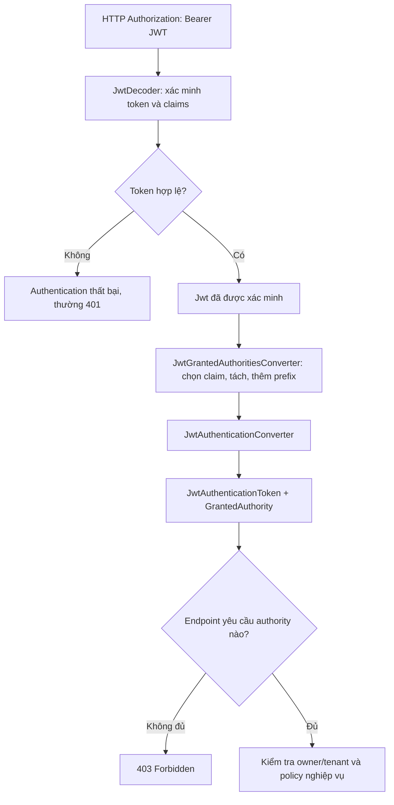
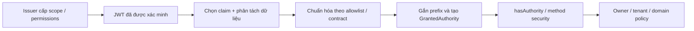

# Đổi tiền tố, phân tách giá trị và chuẩn hóa tên quyền

Trong **Spring Security OAuth 2.0 Resource Server**, access token có thể chứa các scope hoặc quyền mà Authorization Server đã cấp. Tuy nhiên, **claim trong JWT không tự động là `GrantedAuthority`**. Sau khi JWT được xác minh, Spring Security dùng một bộ chuyển đổi để lấy dữ liệu quyền từ token, phân tách các giá trị và gắn tiền tố phù hợp. Kết quả là danh sách authority mà `hasAuthority(...)`, `hasAnyAuthority(...)` hoặc method security có thể kiểm tra.

Ba thao tác tưởng như đơn giản — **đổi tiền tố**, **đổi dấu phân tách** và **chuẩn hóa tên quyền** — có thể làm thay đổi toàn bộ kết quả phân quyền. Ví dụ, nếu token chứa scope `orders.read` nhưng ứng dụng chuyển nó thành `PERM_orders.read`, một rule vẫn kiểm tra `SCOPE_orders.read` sẽ từ chối request dù JWT có chữ ký hợp lệ. Ngược lại, nếu chuẩn hóa quá rộng và vô tình biến một scope yếu thành authority mạnh, API có thể cấp quyền quá mức.

Bài học tập trung vào cách kiểm soát quá trình này trong **Spring Boot 3 / Spring Security 6**, đặc biệt qua `JwtGrantedAuthoritiesConverter` và `JwtAuthenticationConverter`. Cú pháp delimiter tùy chỉnh qua `setAuthoritiesClaimDelimiter` áp dụng cho Spring Security **6.1 trở lên**; phiên bản cũ cần cách chuyển đổi tùy chỉnh hoặc nâng cấp phù hợp.

## 1. Vị trí của authority mapping trong luồng Resource Server

Một JWT hợp lệ có thể chứa payload minh họa:

```json
{
  "iss": "https://identity.example.com/realms/shop",
  "sub": "user-123",
  "aud": ["orders-api"],
  "scope": "orders.read orders.write",
  "exp": 1900000000
}
```

Payload ở trên **không phải JWT đã được ký**. Resource Server chỉ tin claim sau khi decoder xác minh token theo issuer, chữ ký, thời gian, audience và các ràng buộc bắt buộc khác.

Luồng chính:



`JwtDecoder` trả lời câu hỏi **token có được chấp nhận không**. `JwtGrantedAuthoritiesConverter` trả lời **từ token hợp lệ, tạo các authority nào**. `authorizeHttpRequests` và method security trả lời **authority đó có đủ để dùng endpoint này không**.

Việc JWT đã hợp lệ **không có nghĩa** người gọi được phép làm mọi thứ được đề cập trong claim. Resource Server phải cấu hình cách hiểu scope rõ ràng, sau đó vẫn kiểm tra quyền đối với tài nguyên cụ thể.

## 2. `scope`, `scp` và `GrantedAuthority` không phải cùng một thứ

Trong OAuth 2.0, scope là một chuỗi thể hiện phạm vi quyền được cấp. Một Authorization Server thường đưa scope vào access token theo một trong các định dạng như:

```json
{
  "scope": "orders.read orders.write"
}
```

hoặc:

```json
{
  "scp": ["orders.read", "orders.write"]
}
```

Spring Security cung cấp `JwtGrantedAuthoritiesConverter`, mặc định thường tìm một claim scope được nhận biết (`scope` hoặc `scp`) rồi tạo authorities có tiền tố `SCOPE_`:

```text
JWT claim: scope = "orders.read orders.write"
                 |
                 v
Authorities:
  SCOPE_orders.read
  SCOPE_orders.write
```

Ví dụ kiểm tra quyền:

```java
.requestMatchers(HttpMethod.GET, "/api/orders/**")
    .hasAuthority("SCOPE_orders.read")
.requestMatchers(HttpMethod.POST, "/api/orders")
    .hasAuthority("SCOPE_orders.write")
```

| Khái niệm | Ví dụ | Nguồn |
| --- | --- | --- |
| Scope trong access token | `orders.read` | Authorization Server cấp theo hợp đồng token. |
| Claim mang scope | `scope`, `scp` | Token profile của issuer. |
| Authority sau chuyển đổi | `SCOPE_orders.read` | Spring Security converter. |
| Quy tắc tại endpoint | `hasAuthority("SCOPE_orders.read")` | Resource Server tự định nghĩa. |
| Quyền trên một bản ghi | Đơn hàng 42 có thuộc user/tenant này không? | Service/domain policy, thường có dữ liệu bổ sung. |

**Tiền tố `SCOPE_` là quy ước của Spring Security**, không phải một phần bắt buộc của mọi giá trị scope mà Authorization Server phải phát hành. Đừng yêu cầu issuer thêm `SCOPE_` vào claim chỉ vì mặc định ứng dụng dùng tiền tố này; nếu muốn đổi quy ước, hãy đặt mapping rõ ràng trong Resource Server.

## 3. Ba nút cấu hình cốt lõi của `JwtGrantedAuthoritiesConverter`

Đối tượng này hỗ trợ ba tùy chỉnh có mục đích riêng:

| Method | Thay đổi | Ví dụ |
| --- | --- | --- |
| `setAuthorityPrefix(String)` | Tiền tố ghép trước **mỗi quyền** sau khi tách. | `SCOPE_` → `PERM_` hoặc chuỗi rỗng. |
| `setAuthoritiesClaimName(String)` | Claim nào được đọc để tạo authorities. | `scope` → `permissions`. |
| `setAuthoritiesClaimDelimiter(String)` | **Regex** phân tách khi giá trị claim là **chuỗi**. | Khoảng trắng → dấu phẩy. Spring Security 6.1+. |

Ba thao tác này độc lập:

```text
1. Chọn claim: "permissions"
2. Đọc giá trị: "orders.read,orders.write"
3. Tách theo regex ","
4. Ghép prefix "PERM_"
5. Tạo GrantedAuthority:
   PERM_orders.read
   PERM_orders.write
```

Không nên nhầm `setAuthoritiesClaimDelimiter` với việc phân tách **toàn bộ** JWT payload hoặc header. Nó chỉ ảnh hưởng cách converter đọc một claim quyền dạng chuỗi. Khi issuer phát hành claim dưới dạng danh sách, cách lấy phần tử do converter xử lý theo kiểu collection, không có một chuỗi duy nhất cần `split`.

## 4. Đổi tiền tố: từ `SCOPE_` sang `PERM_`

Giả sử hệ thống có quy ước nội bộ tất cả quyền API được gọi là `PERM_*`, còn access token vẫn phát hành scope chuẩn:

```json
{
  "scope": "orders.read orders.write"
}
```

Ta tạo `JwtAuthenticationConverter`:

```java
import org.springframework.context.annotation.Bean;
import org.springframework.context.annotation.Configuration;
import org.springframework.security.oauth2.server.resource.authentication.JwtAuthenticationConverter;
import org.springframework.security.oauth2.server.resource.authentication.JwtGrantedAuthoritiesConverter;

@Configuration
public class AuthorityMappingConfig {

    @Bean
    JwtAuthenticationConverter jwtAuthenticationConverter() {
        JwtGrantedAuthoritiesConverter scopes =
            new JwtGrantedAuthoritiesConverter();

        scopes.setAuthorityPrefix("PERM_");

        JwtAuthenticationConverter converter =
            new JwtAuthenticationConverter();
        converter.setJwtGrantedAuthoritiesConverter(scopes);
        return converter;
    }
}
```

Kết quả mong đợi:

```text
scope = "orders.read orders.write"

PERM_orders.read
PERM_orders.write
```

Đồng thời, rule phải dùng **cùng một hệ tên**:

```java
.requestMatchers(HttpMethod.GET, "/api/orders/**")
    .hasAuthority("PERM_orders.read")
.requestMatchers(HttpMethod.POST, "/api/orders")
    .hasAuthority("PERM_orders.write")
```

Đổi prefix trên converter nhưng giữ rule cũ `hasAuthority("SCOPE_orders.read")` sẽ khiến caller có quyền phù hợp **vẫn bị 403**. Không được sửa bằng cách cho phép `.authenticated()` rộng hơn để “hết lỗi”; cần khôi phục sự thống nhất giữa converter và policy.

### Có thể đặt prefix rỗng không?

Có:

```java
scopes.setAuthorityPrefix("");
```

Khi đó authority chính là `orders.read`, không có `SCOPE_`. Nhưng thay đổi này đòi hỏi tất cả policy liên quan kiểm tra `hasAuthority("orders.read")`; nếu còn dùng prefix ở method security, chúng sẽ không khớp. Cũng cần tránh **xung đột namespace** giữa scope và role khi bỏ prefix.

Ví dụ, một issuer phát scope tên `ADMIN`, còn hệ thống cũng có role `ADMIN`. Nếu chuẩn hóa cả hai thành authority `ADMIN` không có ngữ cảnh, có thể làm lẫn quyền đến từ hai nguồn khác nhau. Prefix riêng theo nguồn và semantics quyền giúp ranh giới rõ hơn.

## 5. `hasAuthority(...)` không đồng nghĩa với `hasRole(...)`

Spring Security có hai cách kiểm tra thường gặp:

```java
hasAuthority("SCOPE_orders.read")
hasAuthority("PERM_orders.read")
hasRole("ADMIN")
```

`hasAuthority(...)` kiểm tra **đúng chuỗi authority** mà authentication có. `hasRole("ADMIN")` theo quy ước phổ biến của Spring Security kiểm tra authority `ROLE_ADMIN`, tức có prefix dành cho **role**. Tùy cấu hình framework và cách viết authorization API, role prefix có thể được tùy biến riêng.

| Token/converter tạo ra | Kiểm tra khớp | Kiểm tra không tự khớp |
| --- | --- | --- |
| `SCOPE_orders.read` | `hasAuthority("SCOPE_orders.read")` | `hasRole("orders.read")`. |
| `PERM_orders.read` | `hasAuthority("PERM_orders.read")` | `hasAuthority("SCOPE_orders.read")`. |
| `ROLE_ADMIN` | `hasRole("ADMIN")`, hoặc `hasAuthority("ROLE_ADMIN")` với mặc định. | `hasAuthority("ADMIN")`. |
| `orders.read` | `hasAuthority("orders.read")` | `hasAuthority("SCOPE_orders.read")`. |

**Thay `JwtGrantedAuthoritiesConverter#setAuthorityPrefix` không có nghĩa bạn đã thay role prefix của toàn Spring Security.** Cấu hình liên quan `GrantedAuthorityDefaults` hoặc những cơ chế role khác giải quyết một lớp riêng, và ảnh hưởng cụ thể có thể tùy API/version. Khi ánh xạ OAuth scopes, cách dễ dự đoán nhất là dùng `hasAuthority` với tên chính xác.

## 6. Đổi dấu phân tách: mặc định khoảng trắng và trường hợp dấu phẩy

Đối với một scope string theo quy ước OAuth phổ biến:

```json
{
  "scope": "orders.read orders.write"
}
```

Các giá trị được phân tách bởi khoảng trắng. Spring Security thường dùng regex khoảng trắng theo converter mặc định để lấy hai authority độc lập:

```text
SCOPE_orders.read
SCOPE_orders.write
```

Nhưng một issuer tùy biến có thể phát hành claim:

```json
{
  "permissions": "orders.read,orders.write"
}
```

Nếu vẫn dùng delimiter khoảng trắng, converter có thể hiểu **cả chuỗi** `orders.read,orders.write` như **một giá trị**, và tạo authority không khớp với rule `orders.read` hoặc `orders.write`.

Với **Spring Security 6.1+**, có thể đặt regex delimiter:

```java
JwtGrantedAuthoritiesConverter permissions =
    new JwtGrantedAuthoritiesConverter();

permissions.setAuthoritiesClaimName("permissions");
permissions.setAuthorityPrefix("PERM_");
permissions.setAuthoritiesClaimDelimiter(",");
```

Kết quả:

```text
permissions = "orders.read,orders.write"

PERM_orders.read
PERM_orders.write
```

Nếu issuer cho phép khoảng trắng quanh dấu phẩy:

```json
{
  "permissions": "orders.read, orders.write ,reports.export"
}
```

thì dùng regex phân tách:

```java
permissions.setAuthoritiesClaimDelimiter("\\s*,\\s*");
```

Trong Java string, `\\s` biểu diễn regex `\s`, nghĩa là một ký tự whitespace. Vì đây là **biểu thức chính quy**, ký tự `.` hoặc `|` nếu được dùng làm delimiter cần được escape phù hợp, thay vì truyền thẳng rồi nghĩ nó là ký tự thông thường.

### Delimiter không tự chuẩn hóa mọi dữ liệu

| Claim đầu vào | Delimiter | Ý nghĩa cần chú ý |
| --- | --- | --- |
| `"orders.read orders.write"` | `"\\s+"` | Tách thành hai scope, khi dữ liệu theo whitespace. |
| `"orders.read,orders.write"` | `","` | Tách thành hai giá trị khi issuer dùng dấu phẩy. |
| `"orders.read, orders.write"` | `"\\s*,\\s*"` | Tách dấu phẩy và khoảng trắng liền kề. |
| `"orders.read;orders.write"` | `";"` | Chỉ dùng nếu contract issuer định nghĩa dấu chấm phẩy. |
| `"orders.read|orders.write"` | `"\\|"` | Ký tự `|` của regex phải escape; không mặc nhiên là delimiter chuẩn. |

Không cần biến mọi dấu câu thành dấu phân tách để “linh hoạt”. Một scope có thể chứa dấu `:` hoặc `.` **như một phần tên quyền hợp lệ**. Cần tuân theo hợp đồng phát hành token của issuer, không đoán từ hình thức string.

## 7. Claim dạng danh sách: không ép nó thành chuỗi rồi tách

Một issuer khác có thể phát hành:

```json
{
  "permissions": [
    "orders.read",
    "orders.write",
    "reports.export"
  ]
}
```

Đây đã là **danh sách ba giá trị**. `JwtGrantedAuthoritiesConverter` hỗ trợ nguồn dữ liệu kiểu collection trong JWT và tạo authority theo các phần tử, thay vì yêu cầu nối chúng thành một string dấu phẩy rồi split.

```java
JwtGrantedAuthoritiesConverter permissions =
    new JwtGrantedAuthoritiesConverter();

permissions.setAuthoritiesClaimName("permissions");
permissions.setAuthorityPrefix("PERM_");
```

Kết quả:

```text
PERM_orders.read
PERM_orders.write
PERM_reports.export
```

Việc đặt `setAuthoritiesClaimDelimiter(",")` chủ yếu dành cho **claim là string**. Nó không nên được xem như lệnh buộc collection chuyển đổi format.

Trong thực tế, API cần xác nhận contract về kiểu dữ liệu: `permissions` có thể là chuỗi, mảng chuỗi hoặc hoàn toàn không có. **Nếu quyền bắt buộc mà claim sai kiểu**, cách an toàn là không cấp authority ngoài dự kiến, hoặc từ chối token qua validator tùy policy, thay vì tự ép mọi object JSON thành một chuỗi quyền.

## 8. Đổi tên claim: `scope`, `scp`, `permissions` và vendor-specific claim

`JwtGrantedAuthoritiesConverter` mặc định biết các claim scope thông dụng như `scope`/`scp`. Với token do một provider phát hành, tên claim có thể khác:

```json
{
  "authorities": ["orders.read", "orders.write"]
}
```

hoặc:

```json
{
  "https://api.example.com/permissions": [
    "orders.read"
  ]
}
```

Tên claim tùy biến có thể được chọn bằng:

```java
JwtGrantedAuthoritiesConverter granted =
    new JwtGrantedAuthoritiesConverter();

granted.setAuthoritiesClaimName("authorities");
```

Chú ý, khi gọi `setAuthoritiesClaimName("authorities")`, converter này **chỉ lấy claim được chỉ định** thay vì tự động gộp `scope`, `scp` và `authorities`. Nếu cả ba nguồn đều cần, phải xây một **composite converter** với quy tắc gộp rõ ràng.

Các câu hỏi trước khi tùy chỉnh:

1. Claim này do **issuer đáng tin** cấp hay đến từ một nguồn do caller tự kiểm soát?
2. Claim chứa quyền OAuth, role nghiệp vụ, entitlement theo tenant hay một thông tin không có ý nghĩa authorization?
3. Tên và kiểu claim có cố định giữa các token profile/user/client-credentials không?
4. Có quyền nào phải **bỏ qua** vì API không hiểu hoặc issuer không được phép cấp không?
5. Có cần kiểm tra `aud` đúng API trước khi dùng claim làm authority không?

Đổi tên claim không thay thế việc xác minh chữ ký, issuer, audience, thời gian hoặc phân loại quyền theo domain. Nếu ứng dụng chấp nhận nhiều issuer, cùng một claim `permissions` có thể mang **ngữ nghĩa khác nhau**; không gộp không điều kiện.

## 9. Gắn `JwtAuthenticationConverter` vào `SecurityFilterChain`

Định nghĩa một bean converter **không nên được hiểu là mọi chain tự động sử dụng nó**. Với JWT Resource Server, hãy gắn converter cần dùng vào DSL.

Một ví dụ đầy đủ với claim `permissions` là chuỗi dấu phẩy:

```gradle
dependencies {
    implementation 'org.springframework.boot:spring-boot-starter-security'
    implementation 'org.springframework.boot:spring-boot-starter-oauth2-resource-server'
}
```

```yaml
spring:
  security:
    oauth2:
      resourceserver:
        jwt:
          issuer-uri: https://identity.example.com/realms/shop
```

```java
import org.springframework.context.annotation.Bean;
import org.springframework.context.annotation.Configuration;
import org.springframework.http.HttpMethod;
import org.springframework.security.config.Customizer;
import org.springframework.security.config.annotation.web.builders.HttpSecurity;
import org.springframework.security.config.http.SessionCreationPolicy;
import org.springframework.security.oauth2.server.resource.authentication.JwtAuthenticationConverter;
import org.springframework.security.oauth2.server.resource.authentication.JwtGrantedAuthoritiesConverter;
import org.springframework.security.web.SecurityFilterChain;

@Configuration
public class ApiSecurityConfig {

    @Bean
    JwtAuthenticationConverter jwtAuthenticationConverter() {
        JwtGrantedAuthoritiesConverter permissions =
            new JwtGrantedAuthoritiesConverter();
        permissions.setAuthoritiesClaimName("permissions");
        permissions.setAuthorityPrefix("PERM_");
        permissions.setAuthoritiesClaimDelimiter("\\s*,\\s*");

        JwtAuthenticationConverter converter =
            new JwtAuthenticationConverter();
        converter.setJwtGrantedAuthoritiesConverter(permissions);
        return converter;
    }

    @Bean
    SecurityFilterChain apiChain(
            HttpSecurity http,
            JwtAuthenticationConverter jwtAuthenticationConverter)
            throws Exception {

        return http
            .securityMatcher("/api/**")
            .csrf(csrf -> csrf.disable())
            .sessionManagement(session -> session
                .sessionCreationPolicy(SessionCreationPolicy.STATELESS))
            .authorizeHttpRequests(auth -> auth
                .requestMatchers(HttpMethod.GET, "/api/orders/**")
                    .hasAuthority("PERM_orders.read")
                .requestMatchers(HttpMethod.POST, "/api/orders")
                    .hasAuthority("PERM_orders.write")
                .anyRequest().denyAll())
            .oauth2ResourceServer(oauth2 -> oauth2
                .jwt(jwt -> jwt.jwtAuthenticationConverter(
                    jwtAuthenticationConverter)))
            .build();
    }
}
```

Trong cấu hình này:

- JWT được xác minh theo `JwtDecoder` do Boot hoặc ứng dụng cung cấp.
- Converter chỉ đọc claim `permissions`, tách theo regex dấu phẩy và gắn prefix `PERM_`.
- `SecurityFilterChain` áp dụng authority đúng như converter tạo ra.
- `/api/**` là phạm vi chain; các URL khác cần chính sách/chain phù hợp để không bị bỏ lọt.
- `csrf.disable()` giả định API stateless dùng Bearer token truyền rõ trong header, không dựa vào cookie tự gửi của browser. Với session/cookie login, cần thiết kế CSRF khác.

Ví dụ đặt delimiter custom yêu cầu Spring Security **6.1+**. Nếu ứng dụng dùng Spring Security 6.0 hoặc 5.x, cần kiểm tra API phiên bản và viết converter tương ứng thay vì copy method không tồn tại.

## 10. Chuẩn hóa tên quyền: xác định một vocabulary nội bộ

Trong kiến trúc nhiều service và nhiều Authorization Server, quyền có thể được đặt tên theo các quy ước khác nhau:

```text
orders:read
orders.read
read:orders
ORDER_READ
order.read
```

Các giá trị này **không tự động tương đương**. Nếu API muốn dùng một tên canonical, ví dụ `orders.read`, phải có **hợp đồng ánh xạ được xem xét rõ**:

| Tên issuer phát hành | Tên authority nội bộ | Cách diễn giải |
| --- | --- | --- |
| `orders:read` | `PERM_orders.read` | Alias đã được phê duyệt. |
| `orders.read` | `PERM_orders.read` | Tên canonical. |
| `read:orders` | `PERM_orders.read` | Chỉ map nếu issuer thực sự định nghĩa cùng quyền. |
| `orders:write` | `PERM_orders.write` | Khác quyền đọc. |
| `orders.admin` | Không tự map sang `orders.write`. | Quyền quản trị có thể rộng hơn, cần policy riêng. |
| `*` | Không cấp quyền mặc định. | Wildcard cần hợp đồng và xử lý đặc biệt, không mở rộng tùy tiện. |

Một **permission vocabulary** nên trả lời:

- Tên quyền là case-sensitive hay case-insensitive?
- Dấu phân cách trong tên quyền có ý nghĩa gì? `orders.read` khác `orders:read` ở đâu?
- Prefix `PERM_`, `SCOPE_`, `ROLE_` có dùng để phân biệt loại quyền không?
- Quyền có gắn tenant, resource type hoặc actor type không?
- Ai sở hữu danh sách tên canonical và phiên bản hóa thay đổi?
- Quyền cũ được chuyển sang quyền mới theo kế hoạch tương thích nào?

Mục tiêu của chuẩn hóa là **giảm nhầm lẫn**, không phải biến những scope không quen thuộc thành quyền quen thuộc bằng một phép xử lý string quá rộng.

## 11. Không nên chuẩn hóa tự động bằng các phép thay ký tự tùy ý

Một cám dỗ thường gặp:

```java
String normalized = rawPermission
    .trim()
    .toLowerCase()
    .replace(':', '.')
    .replace('_', '.');
```

Đoạn này là **phản ví dụ** nếu chưa có hợp đồng. Nó có thể làm hai quyền có semantics khác nhau bị gộp lại. Ví dụ `orders:admin` và `orders.admin` có thể không tương đương; `READ` có thể không trùng `read` theo issuer; dấu gạch dưới có thể là một phần tên chính thức.

Những rủi ro cụ thể:

| Cách làm | Nguy cơ |
| --- | --- |
| Tự chuyển mọi quyền thành chữ thường | Gộp hai giá trị mà issuer xem là khác nhau. |
| Thay mọi `:`/`_`/`-` bằng `.` | Làm mất phân biệt namespace hoặc cấp quyền nhầm. |
| Tự thêm `ROLE_` cho bất kỳ claim `roles` | Cho phép một claim không có thẩm quyền trở thành role ứng dụng. |
| Bỏ prefix khỏi mọi authority | Trộn role và OAuth scope trong cùng namespace. |
| Dùng `contains("admin")` để phân loại quyền | Gán admin cho những chuỗi không phải quyền admin. |
| Chấp nhận wildcard bằng `startsWith` | Cấp quyền rộng hơn giá trị token cho phép. |

Hướng an toàn hơn là **allowlist hoặc bảng ánh xạ tường minh theo issuer và token profile**. Nếu một quyền không được nhận diện, không tạo authority tương ứng; nếu claim bắt buộc sai định dạng, ứng dụng có thể từ chối JWT ngay tại token validation theo policy.

## 12. Ví dụ custom converter chuẩn hóa bằng allowlist

Giả sử API muốn chấp nhận claim `permissions` là mảng chuỗi, với các tên có thể là `orders:read`, `orders:write` hoặc tên canonical. API định nghĩa mapping:

```text
orders:read   -> PERM_orders.read
orders.read   -> PERM_orders.read
orders:write  -> PERM_orders.write
orders.write  -> PERM_orders.write
```

Thay vì tự sửa mọi dấu câu, ta chỉ cấp authority cho giá trị có trong allowlist:

```java
import java.util.ArrayList;
import java.util.Collection;
import java.util.LinkedHashSet;
import java.util.List;
import java.util.Map;
import java.util.Set;

import org.springframework.context.annotation.Bean;
import org.springframework.core.convert.converter.Converter;
import org.springframework.security.core.GrantedAuthority;
import org.springframework.security.core.authority.SimpleGrantedAuthority;
import org.springframework.security.oauth2.jwt.Jwt;
import org.springframework.security.oauth2.server.resource.authentication.JwtAuthenticationConverter;

@Bean
JwtAuthenticationConverter canonicalPermissionConverter() {
    Map<String, String> allowedAliases = Map.of(
        "orders:read", "orders.read",
        "orders.read", "orders.read",
        "orders:write", "orders.write",
        "orders.write", "orders.write"
    );

    Converter<Jwt, Collection<GrantedAuthority>> canonical =
        jwt -> {
            Object raw = jwt.getClaim("permissions");
            if (!(raw instanceof Collection<?> entries)) {
                return List.of();
            }

            Set<GrantedAuthority> result = new LinkedHashSet<>();
            for (Object entry : entries) {
                if (!(entry instanceof String value)) {
                    continue;
                }
                String normalized = allowedAliases.get(value);
                if (normalized != null) {
                    result.add(
                        new SimpleGrantedAuthority("PERM_" + normalized));
                }
            }
            return new ArrayList<>(result);
        };

    JwtAuthenticationConverter result =
        new JwtAuthenticationConverter();
    result.setJwtGrantedAuthoritiesConverter(canonical);
    return result;
}
```

Đây là một **bean minh họa** đặt trong class cấu hình có các import phù hợp; nó cần được gắn vào DSL bằng `.jwtAuthenticationConverter(canonicalPermissionConverter)`. Token đã phải đi qua `JwtDecoder` trước khi converter được dùng.

Một số tính chất hữu ích:

- Chỉ hai quyền canonical được phép cấp ở API này.
- `orders:read` và `orders.read` được hợp nhất **vì có mapping tường minh**.
- Quyền khác, `null` hoặc phần tử không phải chuỗi không tạo authority ngoài ý muốn.
- Dùng `Set` để tránh lặp authority khi token chứa cả alias và tên canonical.
- Không tự biến `orders.admin` hoặc một wildcard thành quyền write.

Nếu token profile của issuer xem **kiểu claim không đúng** là một lỗi bắt buộc, có thể thiết kế JWT validator từ chối token thay vì chỉ chuyển thành tập authorities rỗng. Dù chọn cách nào, không cấp authority dựa trên giá trị chưa hiểu.

### Khi muốn giữ OAuth scopes và thêm permissions

Converter trên chỉ ánh xạ claim `permissions`. Nếu vẫn cần `scope`/`scp`, hãy chủ động **gộp** kết quả của converter scope mặc định và converter tùy chỉnh theo chính sách:

```java
JwtGrantedAuthoritiesConverter scopes =
    new JwtGrantedAuthoritiesConverter();

Converter<Jwt, Collection<GrantedAuthority>> combined =
    jwt -> {
        Set<GrantedAuthority> result = new LinkedHashSet<>();
        result.addAll(scopes.convert(jwt));
        result.addAll(canonical.convert(jwt));
        return new ArrayList<>(result);
    };
```

Đoạn code này nằm trong cùng ngữ cảnh phương thức có biến `canonical`, cần thêm import `JwtGrantedAuthoritiesConverter`; sau đó truyền `combined` vào `JwtAuthenticationConverter#setJwtGrantedAuthoritiesConverter`. `LinkedHashSet` giúp loại trùng, nhưng **không tự giải quyết xung đột semantics**. Nếu issuer không được phép cấp một nhóm role/permission, không nên gộp chúng chỉ vì chúng xuất hiện trong JWT.

## 13. Chuẩn hóa theo issuer khi hệ thống dùng nhiều Authorization Server

Một API có thể tin hơn một issuer:

```text
https://identity-a.example.com
https://identity-b.example.com
```

Hai issuer cùng dùng claim `"permissions": ["admin"]` chưa chắc đều có quyền cấp `ROLE_ADMIN` tại API. Hợp đồng của issuer A có thể định nghĩa `admin` là quyền quản trị toàn hệ thống; issuer B có thể dùng `admin` cho một bảng điều khiển riêng của chính provider.

Ví dụ nguyên tắc mapping:

| Issuer | Giá trị trong token | Authority API cho phép |
| --- | --- | --- |
| Issuer A đã được phê duyệt cấp quyền quản trị API | `orders:manage` | `PERM_orders.manage`. |
| Issuer A | `orders:read` | `PERM_orders.read`. |
| Issuer B chỉ được cấp quyền báo cáo | `reports:view` | `PERM_reports.read`. |
| Issuer B | `orders:manage` | **Không cấp**, nếu ngoài hợp đồng issuer B. |

Không nên lấy claim `iss` từ JWT **chưa xác minh** rồi tự truy vấn một JWKS URL tùy ý để chấp nhận token. Resource Server phải xác thực issuer thuộc danh sách tin cậy, dùng decoder/AuthenticationManager tương ứng rồi mới áp dụng mapping theo issuer.

Với nhiều tenant, còn cần phân biệt quyền toàn hệ thống và quyền phạm vi tenant. Ví dụ `PERM_orders.read` không tự cho phép đọc đơn của mọi tenant; policy cần kiểm tra tenant được yêu cầu và quan hệ của caller với tenant đó.

## 14. Quy tắc đặt tên: permission, scope, role và entitlement

Một dự án lớn nên quyết định **kiểu quyền nào được biểu diễn ở lớp nào**, thay vì đặt tên tùy tiện trong mọi API:

| Loại thông tin | Ví dụ | Vai trò |
| --- | --- | --- |
| **OAuth scope** | `orders.read` | Quyền hạn được cấp cho access token theo hợp đồng Authorization Server. |
| **Application permission** | `PERM_orders.read` | Authority chuẩn hóa cho chính sách API. |
| **Role** | `ROLE_SUPPORT` | Nhóm quyền/vai trò trong ứng dụng; có thể cần ánh xạ đáng tin. |
| **Resource entitlement** | “Được xem đơn hàng của chi nhánh X”. | Policy theo dữ liệu, không nhất thiết gói hết trong JWT. |
| **Identity metadata** | `sub`, `client_id`, `tenant_id`. | Giải thích caller là ai/bối cảnh nào, không tự là quyền. |

Một vocabulary dễ bảo trì có thể áp dụng dạng:

```text
<resource>.<action>

orders.read
orders.write
reports.export
inventory.sync
```

Nó giúp tránh tên quá mơ hồ như `read`, `edit` hoặc `admin` khi API có nhiều resource. Tuy nhiên đây **chỉ là ví dụ thiết kế**, không phải định dạng scope do OAuth 2.0 bắt buộc. Nếu hệ thống đã có hợp đồng scope ổn định, nên cân nhắc tính tương thích khi thay đổi.

Với quyền cần phân biệt loại caller, có thể thiết kế policy riêng cho **user** và **service**. `scope` giống nhau không tự làm service token trở thành đại diện người dùng; cũng không tự cho phép user token chạy batch job dành riêng cho service.

## 15. Cách xử lý scope có khoảng trắng thừa, trống, trùng lặp và sai kiểu

Trong thực tế, các issuer hoặc adapter có thể trả dữ liệu không nhất quán:

```json
{
  "permissions": "orders.read, orders.write, orders.read"
}
```

Hoặc:

```json
{
  "permissions": ["orders.read", "", "orders.write", 123]
}
```

Với nguồn phát hành đáng tin nhưng dữ liệu đầu vào không đúng contract, có những quyết định cần rõ:

**Giá trị trống:** Không tạo `PERM_` như một authority vô nghĩa. Nếu dùng converter tiêu chuẩn, kiểm tra hành vi khi delimiter tạo phần tử rỗng; với dữ liệu bất thường, cân nhắc custom converter/validator.

**Khoảng trắng quanh delimiter:** Dùng regex phù hợp với **hợp đồng** của issuer; không trim rồi sửa mọi ký tự mà không có lý do.

**Quyền lặp:** Về logic, cùng một authority lặp lại không cấp thêm quyền; có thể dùng tập hợp để tránh lặp và giảm nhiễu log/test.

**Sai kiểu:** Không tự biến số `123` hoặc object JSON thành chuỗi permission. Nếu quyền là bắt buộc đối với token profile, áp dụng validator nghiêm ngặt; nếu tùy chọn, bỏ qua và **không cấp quyền ngầm**.

**Sai case:** Không tự gọi `.toLowerCase()` hoặc `.toUpperCase()` trừ khi issuer contract quy định cách chuẩn hóa tương ứng.

**Quyền chưa biết:** Bỏ qua hoặc từ chối theo chính sách; không tạo authority mang tên không được Resource Server hiểu rồi để một rule rộng vô tình chấp nhận nó.

Tách **normalization về cú pháp** (ví dụ trim quanh dấu phẩy được định nghĩa trong token contract) khỏi **normalization về semantics** (xác định hai tên quyền có tương đương hay không). Phần thứ hai đòi hỏi mapping được phê duyệt.

## 16. Thay đổi prefix là thay đổi hợp đồng nội bộ của API

Giả sử trước đây API dùng:

```text
JWT scope: orders.read
GrantedAuthority: SCOPE_orders.read
Rule: hasAuthority("SCOPE_orders.read")
```

Sau khi đổi:

```text
JWT scope: orders.read
GrantedAuthority: PERM_orders.read
Rule: hasAuthority("PERM_orders.read")
```

**Access token không nhất thiết cần đổi**, nhưng tất cả nơi tham chiếu authority trong ứng dụng có thể cần cập nhật:

- `authorizeHttpRequests()` tại `SecurityFilterChain`.
- `@PreAuthorize`, `@PostAuthorize`, method security expression.
- Custom `AuthorizationManager` hoặc chính sách ở service.
- Các test mong đợi chuỗi authority cụ thể.
- Những component đọc `Authentication.getAuthorities()` để ra quyết định.

Trong hệ thống có nhiều service, nếu mỗi service tự chọn prefix, cùng một token có thể tạo authority khác nhau tại các API. Điều đó có thể chấp nhận nếu **mỗi Resource Server có hợp đồng riêng**, nhưng cần document rõ để tránh copy rule của service này sang service khác.

### Migrations nên có trạng thái chuyển tiếp rõ ràng

Một chiến lược chuyển đổi có thể là:

1. Định nghĩa bộ tên canonical và mapping của từng issuer/token profile.
2. Kiểm kê các rule `SCOPE_*`/`ROLE_*` hiện có.
3. Viết converter và test để ánh xạ đúng authority mới, không mở rộng quyền.
4. Cập nhật rule cùng lúc với converter trong một rollout kiểm soát.
5. Nếu phải hỗ trợ hai tên authority tạm thời, giới hạn giai đoạn, phạm vi và trường hợp tương thích.
6. Sau cutover, bỏ alias/quyền cũ không cần thiết để tránh chính sách phân quyền khó hiểu.

Không nên dùng `hasAnyAuthority("SCOPE_orders.write", "PERM_orders.write")` vô thời hạn chỉ vì chuyển đổi chưa xong; cấu hình hai namespace kéo dài có thể che khuất nguồn quyền thực tế.

## 17. Method security và consistency với filter chain

Một số ứng dụng dùng cả luật trên HTTP và luật tại service:

```java
@EnableMethodSecurity
```

```java
@PreAuthorize("hasAuthority('PERM_orders.read')")
public OrderDto findOrder(long orderId) {
    return orderQuery.findVisibleOrder(orderId);
}
```

Nếu converter đã đổi thành `PERM_*`, nhưng web layer yêu cầu `SCOPE_orders.read` còn service yêu cầu `PERM_orders.read`, request có thể bị chặn sớm bởi filter chain. Ngược lại, nếu web layer chỉ `.authenticated()` và service kiểm tra `PERM_orders.read`, service vẫn có thể từ chối, nhưng **chỉ những đường gọi đi qua method bảo vệ mới được kiểm tra**.

Hãy xác định rõ:

```text
Authentication: JWT có hợp lệ không?
Authority mapping: Tên quyền được sinh theo contract nào?
Web authorization: Endpoint này cần authority nào?
Method authorization: Operation này cần authority nào?
Domain authorization: Caller được xem/sửa bản ghi nào?
```

Đó là các tầng bổ sung nhau. Một authority `PERM_orders.read` không có nghĩa caller có quyền xem tất cả đơn hàng; service cần kiểm tra owner, tenant hoặc chính sách phân quyền đối tượng.

## 18. Test chuyển đổi quyền độc lập với test xác minh JWT

Khi thay đổi prefix/delimiter, nên kiểm tra **converter** trực tiếp bằng một `Jwt` giả lập trong unit test, rồi kiểm tra authorization qua Spring Security Test.

Ví dụ kiểm thử converter dấu phẩy:

```java
import static org.assertj.core.api.Assertions.assertThat;

import java.time.Instant;
import java.util.List;

import org.junit.jupiter.api.Test;
import org.springframework.security.core.GrantedAuthority;
import org.springframework.security.oauth2.jwt.Jwt;
import org.springframework.security.oauth2.server.resource.authentication.JwtGrantedAuthoritiesConverter;

class PermissionConversionTest {

    @Test
    void splitsCsvClaimAndAddsPrefix() {
        JwtGrantedAuthoritiesConverter converter =
            new JwtGrantedAuthoritiesConverter();

        converter.setAuthoritiesClaimName("permissions");
        converter.setAuthorityPrefix("PERM_");
        converter.setAuthoritiesClaimDelimiter("\\s*,\\s*");

        Jwt jwt = Jwt.withTokenValue("test-value")
            .header("alg", "RS256")
            .claim("permissions", "orders.read, orders.write")
            .issuedAt(Instant.parse("2026-01-01T00:00:00Z"))
            .expiresAt(Instant.parse("2030-01-01T00:00:00Z"))
            .build();

        List<String> names = converter.convert(jwt).stream()
            .map(GrantedAuthority::getAuthority)
            .sorted()
            .toList();

        assertThat(names).containsExactly(
            "PERM_orders.read",
            "PERM_orders.write"
        );
    }
}
```

Test này cho thấy converter sinh đúng authority từ một JWT object có claim giả lập. **Nó không kiểm tra chữ ký JWT**, vì `Jwt.withTokenValue(...)` chỉ tạo đối tượng phục vụ kiểm thử, không gọi `JwtDecoder`.

Một test policy với MockMvc:

```java
import static org.springframework.security.test.web.servlet.request.SecurityMockMvcRequestPostProcessors.jwt;
import static org.springframework.test.web.servlet.request.MockMvcRequestBuilders.get;
import static org.springframework.test.web.servlet.result.MockMvcResultMatchers.status;

// Ví dụ trong một @SpringBootTest có MockMvc và endpoint /api/orders/42.
mvc.perform(get("/api/orders/42").with(jwt()
        .authorities(() -> "PERM_orders.read")))
    .andExpect(status().isOk());
```

Phần trên giả định endpoint và dữ liệu test cho phép caller xem đơn hàng 42; trong ứng dụng thực cần fixture đúng, controller/service thật hoặc mock theo mục tiêu test. `jwt().authorities(...)` **gán trực tiếp authorities giả lập**, nên cũng **không chứng minh custom `JwtGrantedAuthoritiesConverter` đã được Spring Security DSL sử dụng đúng**.

Để kiểm chứng đường đi end-to-end, cần gửi JWT thực được ký bằng test key/JWK Set qua Resource Server có decoder và converter đang cấu hình, rồi xác minh HTTP status/authorities. Không thay việc xác minh decoder bằng test chỉ dùng mock `Jwt`.

## 19. Bảng tình huống kiểm thử khi đổi tiền tố và delimiter

| Token/claim | Converter/policy | Kỳ vọng |
| --- | --- | --- |
| `scope = "orders.read orders.write"` | Mặc định prefix `SCOPE_`. | Có hai authority `SCOPE_orders.read`, `SCOPE_orders.write`. |
| Claim trên | Đổi prefix `PERM_`. | Có hai authority `PERM_orders.read`, `PERM_orders.write`. |
| `permissions = "orders.read,orders.write"` | Claim `permissions`, delimiter dấu phẩy, prefix `PERM_`. | Có hai authority độc lập. |
| `permissions = "orders.read, orders.write"` | Delimiter `"\\s*,\\s*"`. | Không giữ khoảng trắng làm một phần permission. |
| `permissions = ["orders.read","orders.write"]` | Claim dạng collection. | Mỗi phần tử thành authority tương ứng. |
| Claim `permissions` không có | Chỉ chọn `permissions` bằng setter. | Không tự lấy scope từ claim khác. |
| `scope` và `permissions` đều có | Chỉ custom `JwtGrantedAuthoritiesConverter`. | Không tự gộp cả hai nguồn. |
| `scope` và `permissions` đều có | Composite converter rõ ràng. | Gộp theo allowlist/policy được xác định. |
| `orders:read` và `orders.read` | Allowlist alias tường minh. | Cùng canonical `PERM_orders.read` nếu contract cho phép. |
| `orders.admin` chưa biết | Allowlist chỉ cho quyền đọc/ghi. | Không tạo authority admin ngoài ý muốn. |
| `permissions` sai kiểu | Policy yêu cầu mảng chuỗi. | Bỏ quyền không hợp lệ hoặc từ chối token theo validator. |
| JWT đúng quyền nhưng sai `aud` | Decoder có audience validator. | Bị từ chối ở authentication trước mapping. |
| JWT đúng authority nhưng sai owner | Service owner/tenant policy. | Bị từ chối ở domain authorization. |

Một bộ test hữu ích cần có cả **quyền được cấp** và **quyền phải bị từ chối**. Nếu chỉ test token có quyền đọc và API trả 200, bạn chưa biết các scope rộng, sai claim hoặc tên quyền lạ có thể bị mapping thành quyền không dự kiến hay không.

## 20. Các lỗi cấu hình hay gặp

### 20.1. Thêm prefix ở cả issuer và converter

Nếu token chứa:

```json
{ "scope": "SCOPE_orders.read" }
```

và converter vẫn thêm `SCOPE_`, authority sẽ trở thành:

```text
SCOPE_SCOPE_orders.read
```

Theo hợp đồng thông dụng, issuer nên phát scope `orders.read`, còn `SCOPE_` là tên authority do Resource Server tạo. Nếu contract thực sự dùng giá trị token có prefix, cần thống nhất cách mapping tương ứng, không thêm hai lần.

### 20.2. Đổi prefix nhưng quên `@PreAuthorize`

Converter tạo `PERM_orders.write` nhưng method vẫn dùng:

```java
@PreAuthorize("hasAuthority('SCOPE_orders.write')")
```

Kết quả là request hợp lệ có thể bị 403. Cần cập nhật cả security chain lẫn method-level policy; không nới quyền sang `.permitAll()` để che lỗi mapping.

### 20.3. Chọn claim tùy chỉnh và làm mất scope mặc định

Khi gọi `setAuthoritiesClaimName("permissions")`, converter không còn tự đọc `scope`/`scp` trong cùng cấu hình converter đó. Nếu muốn cả hai, phải gộp bằng một converter rõ ràng hoặc giữ riêng hai nguồn authority theo hợp đồng.

### 20.4. Đổi delimiter mà chưa xét định dạng danh sách

Nếu issuer đã phát `scp` dạng array, delimiter dấu phẩy không cần thiết. Nếu claim là string theo OAuth có khoảng trắng nhưng converter được cấu hình chỉ tách dấu phẩy, toàn bộ chuỗi scope có thể thành **một authority sai**.

### 20.5. Ghép quyền từ nhiều issuer không phân biệt nguồn

Hai provider cùng phát `admin` không đảm bảo cùng một quyền. Mapping cần giới hạn theo issuer đã được xác minh và token profile được API cho phép.

### 20.6. Tin role claim từ header hoặc ID Token sai mục đích

Đừng biến `X-Role: ADMIN` từ HTTP request thành `ROLE_ADMIN`. Resource Server phải dùng access token phù hợp, đã xác minh chữ ký, issuer, audience và mục đích; **OIDC ID Token dành cho Client không tự động là access token dành cho API**.

### 20.7. Giả định `getAuthorities()` luôn phản ánh quyền mới nhất

`JwtAuthenticationToken.getAuthorities()` thường được tạo từ claims tại thời điểm JWT được xác thực. Nếu permission của người dùng bị thay đổi ngay sau khi token được phát hành, JWT cũ có thể chưa phản ánh thay đổi đó. Khi cần thu hồi quyền tức thời, phải thiết kế token lifetime, introspection/revocation, kiểm tra online hoặc policy riêng; đổi prefix không giải quyết tính cập nhật.

## 21. Cách chẩn đoán 401, 403 và authority trống

Nếu API trả lỗi, nên xác định **lỗi ở tầng nào**:

| Hiện tượng | Có thể đang xảy ra | Cần kiểm tra |
| --- | --- | --- |
| `401 Unauthorized` | JWT sai chữ ký, issuer, thời gian, audience hoặc thiếu/không hợp lệ credential. | `JwtDecoder`, token validators, cơ chế Bearer. |
| `403 Forbidden` | JWT đã hợp lệ nhưng authority không khớp hoặc policy tài nguyên từ chối. | Converter, prefix, delimiter, claim name, rule và owner/tenant. |
| `getAuthorities()` rỗng | Claim được chọn không có, sai kiểu hoặc converter không đọc được. | Token profile, `setAuthoritiesClaimName`, loại claim. |
| Một authority chứa cả chuỗi dấu phẩy | Dấu phân tách không khớp. | `setAuthoritiesClaimDelimiter` và dạng string thực tế. |
| Authority có `SCOPE_SCOPE_...` | Prefix đã tồn tại trong token nhưng converter thêm lần nữa. | Contract issuer và prefix mapping. |
| `hasRole` không khớp | Đang có `PERM_*` hoặc `SCOPE_*`, không phải `ROLE_*`. | Dùng `hasAuthority` đúng tên hoặc thiết kế role mapping riêng. |
| Pod A được phép, pod B bị từ chối | Có thể khác version converter, cấu hình rollout, token validation hoặc dữ liệu quyền. | So sánh config theo instance, không mặc định chỉ do JWKS. |

Khi log, có thể ghi **tên authority sau mapping** và issuer alias theo chính sách, nhưng tránh ghi raw access token, header `Authorization` hoặc toàn bộ claim nhạy cảm. Thận trọng với chuỗi quyền do token khai báo chưa được validate kiểu dữ liệu, để tránh log injection hoặc metric cardinality quá cao.

Một đoạn code quan sát authority của authenticated caller:

```java
Collection<String> names = authentication.getAuthorities()
    .stream()
    .map(GrantedAuthority::getAuthority)
    .toList();
```

Đây là authority **sau khi chuyển đổi**. Nếu mục tiêu là tìm lỗi delimiter, có thể kiểm tra token profile được issuer phát hành và converter đã kết nối trong JWT DSL, thay vì in nguyên JWT vào log.

## 22. Khi nhận opaque access token, không dùng `JwtGrantedAuthoritiesConverter`

Với JWT Resource Server:

```text
JwtDecoder
 -> Jwt
 -> JwtGrantedAuthoritiesConverter / JwtAuthenticationConverter
 -> JwtAuthenticationToken
```

Với **opaque token** qua introspection:

```text
OpaqueTokenIntrospector
 -> OAuth2AuthenticatedPrincipal + attributes/authorities
 -> BearerTokenAuthentication
```

Vì vậy, đổi `JwtGrantedAuthoritiesConverter` **không tự thay đổi authorities của opaque token**. Với opaque token, cần tùy chỉnh mapping trong introspector hoặc cơ chế authentication/provider tương ứng, tùy phiên bản Spring Security và hợp đồng introspection.

Điểm chung vẫn là **nguồn quyền phải đáng tin và tên authority phải khớp policy**. Một ứng dụng hỗ trợ cả JWT lẫn opaque không nên giả định hai đường xử lý tự sinh cùng prefix chỉ vì client đều gửi Bearer token.

## 23. Nguyên tắc thiết kế authority mapping lâu dài

Đối với một Resource Server có nhiều endpoint, cách làm dễ kiểm soát là:

1. **Định nghĩa rõ hợp đồng với issuer:** claim name, định dạng string/array, delimiter và semantics từng scope.
2. **Chọn một authority vocabulary nội bộ:** `SCOPE_*`, `PERM_*` hoặc cấu trúc khác; tránh trộn role và scope thiếu ngữ cảnh.
3. **Áp dụng converter rõ ràng:** `JwtGrantedAuthoritiesConverter` khi chỉ cần đổi claim/prefix/delimiter; custom converter khi cần alias hoặc nhiều nguồn quyền.
4. **Chỉ cho phép normalization đã được phê duyệt:** mapping tường minh, không “tự sửa mọi dấu” cho tiện.
5. **Giữ xác thực token độc lập:** `JwtDecoder` vẫn phải kiểm tra issuer, chữ ký, thời gian, audience và token profile.
6. **Đồng bộ rule theo authority thực tế:** `hasAuthority`, method security, test và service policy.
7. **Không bỏ kiểm tra dữ liệu:** scope `orders.read` không thay owner/tenant authorization.
8. **Kiểm thử cả các trường hợp từ chối:** claim thiếu, delimiter sai, prefix lặp, quyền lạ, nhiều issuer, sai audience và token hết hạn.
9. **Quản lý phiên bản/rà soát khi thay đổi:** đổi tên authority là thay đổi hành vi bảo mật, cần migration và rollback rõ ràng.

Tóm tắt ranh giới trách nhiệm:



**Điểm cốt lõi:** Đổi tiền tố là đổi **tên authority**, đổi delimiter là đổi **cách đọc một claim dạng chuỗi**, còn chuẩn hóa tên quyền là đổi **cách diễn giải semantics**. `JwtGrantedAuthoritiesConverter` hỗ trợ tốt các tùy chỉnh cú pháp thông dụng; khi cần alias, nhiều issuer hoặc nhiều nguồn quyền, hãy dùng converter có mapping tường minh và fail closed với giá trị không hiểu. Sau cùng, mọi authority chỉ có giá trị trong phạm vi JWT đã được xác minh và chính sách authorization của Resource Server.
