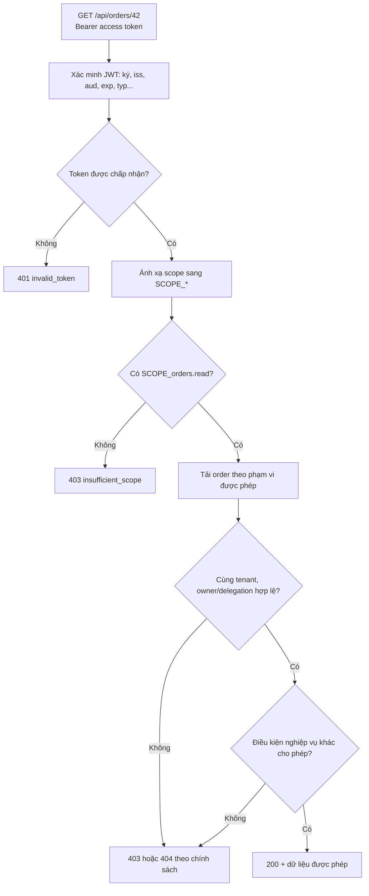

# Scope chỉ là một phần của điều kiện truy cập tài nguyên

Trong **Spring Security OAuth 2.0 / OIDC Resource Server**, access token có thể chứa các scope như `orders.read` hoặc `orders.write`. Spring Security thường chuyển những scope này thành authorities có tiền tố `SCOPE_`, nhờ đó chúng ta có thể cấu hình:

```java
.requestMatchers(HttpMethod.GET, "/api/orders/**")
    .hasAuthority("SCOPE_orders.read")
```

Cấu hình này hữu ích nhưng **chưa có nghĩa mọi chủ thể có `orders.read` đều được xem mọi đơn hàng**. Nó mới trả lời một phần câu hỏi: *token có được cấp quyền thực hiện nhóm thao tác “đọc đơn hàng” hay không?* Một API an toàn còn phải xác định **đơn hàng nào**, **thuộc tenant nào**, **ai là chủ thể**, **ai đang sử dụng token**, **trạng thái tài nguyên ra sao** và **chính sách nghiệp vụ hiện hành có cho phép truy cập không**.

Ví dụ, một JWT access token đã được xác minh có:

```json
{
  "iss": "https://login.example.com",
  "sub": "customer-42",
  "aud": ["orders-api"],
  "client_id": "storefront-web",
  "scope": "orders.read",
  "exp": 2000000000
}
```

Token có `orders.read` không có nghĩa `customer-42` được đọc đơn hàng `order-9001` thuộc `customer-99`. Nếu API kiểm tra scope rồi dùng mọi `orderId` do client gửi để truy vấn và trả dữ liệu, nó có thể gặp lỗ hổng **Broken Object Level Authorization (BOLA)**, còn gọi là một dạng **Insecure Direct Object Reference (IDOR)**.

**Thông điệp chính:** scope là **một ràng buộc ủy quyền ở cấp token và API**, không phải lời tuyên bố đầy đủ về quyền trên từng đối tượng dữ liệu.

> **Ngữ cảnh bài học:** Authorization Server ở `https://login.example.com`; Orders API là Resource Server có audience `orders-api`; OAuth clients gồm `storefront-web` và `nightly-worker`. Ví dụ Java hướng tới Spring Boot 3.x / Spring Security 6.x trên Servlet stack. Các định danh và mã chỉ dùng để minh họa hợp đồng, không phải token hoặc hệ thống triển khai thật.

## 1. Hiểu đúng “scope” trong OAuth 2.0

OAuth 2.0 cho phép client yêu cầu phạm vi quyền truy cập bằng tham số `scope`. Authorization Server quyết định những scope nào được cấp, dựa trên client, grant, quyền người dùng và chính sách của hệ thống.

Ví dụ client xin:

```http
GET /authorize?response_type=code&
  client_id=storefront-web&
  redirect_uri=https%3A%2F%2Fapp.example.com%2Fcallback&
  scope=orders.read&
  state=RANDOM_STATE&
  code_challenge=PKCE_CHALLENGE&
  code_challenge_method=S256 HTTP/1.1
Host: login.example.com
```

Sau một luồng cấp quyền OAuth hợp lệ, token được phát hành có thể có:

```json
{
  "scope": "orders.read"
}
```

**Giá trị `orders.read` không phải một permission chuẩn được mọi API hiểu giống nhau.** Đây là tên quyền do hệ thống xác định. Authorization Server và Orders API phải cùng thống nhất ý nghĩa, ví dụ “cho phép client gọi chức năng đọc những đơn hàng mà chủ thể thực sự có quyền xem”.

### 1.1. Scope mô tả phạm vi quyền *được cấp cho access token*

Một số mệnh đề cần phân biệt:

- **Client yêu cầu scope:** client muốn có quyền trong một phạm vi nhất định.
- **Authorization Server cấp scope:** AS thực sự chấp nhận tập quyền phù hợp với client, subject, grant và policy.
- **Resource Server kiểm tra scope:** API bảo đảm token được cấp quyền cần thiết cho endpoint đang gọi.
- **Nghiệp vụ kiểm tra tài nguyên:** API xem subject có thực sự được thực hiện hành động đó trên **đối tượng cụ thể** hay không.

Đây là bốn trách nhiệm liên quan nhưng **không đồng nhất**. Token không nên bị coi là “giấy phép chung” chỉ vì claim `scope` chứa một chuỗi đúng.

### 1.2. Scope không đồng nghĩa role, permission theo đối tượng hay ownership

| Khái niệm | Câu hỏi mà nó trả lời | Ví dụ |
|---|---|---|
| **Scope** | Access token được cấp cho loại thao tác/API nào? | `orders.read` |
| **Authority của Spring** | Spring Security biểu diễn scope/role thành quyền nào? | `SCOPE_orders.read` |
| **Role** | Chủ thể có vai trò nào trong hệ thống/ngữ cảnh? | `ORDER_MANAGER` |
| **Resource ownership** | Đơn hàng thuộc hoặc được chia sẻ với ai? | `ownerSub=customer-42` |
| **Tenant boundary** | Đối tượng nằm trong phạm vi tenant nào? | `tenantId=tenant-a` |
| **Attribute-based policy** | Thuộc tính của subject, resource, action và bối cảnh có cho phép không? | Chỉ xem đơn đã thanh toán của chính mình |
| **Audience** | Token được cấp cho Resource Server nào? | `aud=orders-api` |
| **Authentication context** | Chủ thể đã được xác thực theo cách và thời điểm nào? | `auth_time`, `acr`, `amr` theo hợp đồng |

Scope là **một đầu vào của quyết định truy cập**, không phải kết quả cuối cùng.

## 2. Phép giao của nhiều điều kiện tạo ra quyền truy cập

Một mô hình đơn giản, hữu ích cho thiết kế:

```text
ALLOW(request, token, resource) =
    token_cryptographically_valid
AND token_issuer_trusted
AND token_audience_matches_api
AND token_not_expired
AND token_type_and_claims_accepted
AND required_scope_present
AND subject_or_client_authorized
AND resource_belongs_to_allowed_tenant
AND subject_has_permission_on_resource
AND business_policy_allows_action
```

Đây là **mô hình quyết định**, không phải đặc tả cứng của OAuth hay tên hàm Spring Security. Một hệ thống có thể thêm hoặc bớt các điều kiện tùy mục tiêu bảo mật. Điểm cốt lõi là **điều kiện scope chỉ là một phần trong nhiều điều kiện cần thỏa đồng thời**.

### 2.1. Ba tầng kiểm tra

Có thể hình dung quyết định truy cập qua ba tầng:

| Tầng | Ví dụ câu hỏi | Thành phần điển hình |
|---|---|---|
| **Xác thực token** | Chữ ký đúng? Issuer/audience đúng? Token còn hiệu lực? | `BearerTokenAuthenticationFilter`, `JwtAuthenticationProvider`, `JwtDecoder`, validators |
| **Phân quyền chức năng** | Token có `orders.read`? Client hoặc principal thuộc nhóm cho phép không? | `AuthorizationFilter`, `hasAuthority`, `@PreAuthorize` |
| **Phân quyền tài nguyên** | Người này được xem **đơn hàng 42**? Có đúng tenant/owner? Đơn có bị khóa không? | Domain service, policy service, repository queries, method security |

**Lỗi thường gặp:** cấu hình tầng 1 và tầng 2 khá đầy đủ nhưng thiếu tầng 3. Đây là nguồn của nhiều lỗ hổng đọc/sửa dữ liệu của người khác bằng cách thay ID trong URL.

### 2.2. Một request đi qua các tầng



Trong ứng dụng thật, có thể kiểm tra tenant/ownership ngay trong truy vấn database thay vì tải đối tượng rồi kiểm tra. Cách nào phù hợp tùy yêu cầu bảo mật, hiệu năng và quản trị dữ liệu.

## 3. Spring Security chuyển scope thành authority như thế nào?

Với JWT Resource Server, các scope thường nằm trong claim `scope` hoặc `scp`. Ví dụ:

```json
{
  "scope": "orders.read orders.write"
}
```

hoặc:

```json
{
  "scp": ["orders.read", "orders.write"]
}
```

Khi decoder đã xác minh JWT, `JwtAuthenticationConverter` sử dụng cơ chế chuyển đổi authorities; cấu hình mặc định thường tạo:

```text
JWT scope:        orders.read
Spring authority: SCOPE_orders.read
```

Có thể dùng:

```java
.hasAuthority("SCOPE_orders.read")
```

để yêu cầu scope đó.

### 3.1. Authentication có gì sau bước mapping?

Giả sử token được chấp nhận, kết quả thường là `JwtAuthenticationToken`:

```text
Authentication:
  principal  = Jwt đã xác minh
  name       = sub (theo mặc định)
  authorities:
    - SCOPE_orders.read
```

Điều này có nghĩa **token đã được xác thực** và được ánh xạ scope, nhưng đối tượng `Authentication` chưa tự mang toàn bộ quyền trên từng đơn hàng.

Các API ứng dụng cần sử dụng thêm:

- `Jwt#getIssuer()` hoặc issuer đã xác minh.
- `Jwt#getSubject()` (với ngữ nghĩa subject đúng theo grant/profile).
- `Jwt#getAudience()` (đã được validator kiểm tra).
- `Jwt#getClaimAsString("tenant_id")` **nếu** hợp đồng xác định đó là claim đáng tin và issuer được phép cấp.
- Dữ liệu từ cơ sở dữ liệu nghiệp vụ: owner, tenant, trạng thái đơn, quan hệ được ủy quyền.

### 3.2. Role không tự đi kèm scope

JWT có thể chứa `roles` hoặc `groups`, nhưng Spring Security không tự hiểu mọi claim role tùy chỉnh. Nếu API muốn sử dụng roles, phải thiết kế **converter có kiểm soát**, định nghĩa namespace và ý nghĩa theo issuer/resource.

Không nên biến mọi chuỗi `ADMIN` từ mọi issuer thành `ROLE_ADMIN` rồi cho phép truy cập mọi tenant. **Role là một điều kiện thêm**, không làm biến mất yêu cầu audience, scope và quyền ở đối tượng.

### 3.3. Scope của token khác quyền trực tiếp của user

Một user có thể có quyền nội bộ xem đơn hàng của mình nhưng token hiện tại **không được cấp** `orders.read`. Khi đó API có thể từ chối vì thiếu scope.

Ngược lại, token có `orders.read` nhưng user không sở hữu đơn hàng 42 thì API cũng từ chối.

Có thể hiểu quyết định cuối cùng như **giao của quyền đã cấp cho token và quyền thực tế của chủ thể**, không lấy hợp của hai loại quyền để “nới rộng” quyền truy cập.

## 4. Ví dụ BOLA/IDOR: chỉ kiểm tra scope rồi đọc theo ID

Giả sử endpoint:

```http
GET /api/orders/42 HTTP/1.1
Host: api.example.com
Authorization: Bearer <VALID_ACCESS_TOKEN>
```

Token có `scope=orders.read`, thuộc chủ thể `customer-42`. Nhưng đơn hàng 42 thuộc `customer-99`.

### 4.1. Mẫu xử lý chưa đủ an toàn

```java
@GetMapping("/api/orders/{orderId}")
@PreAuthorize("hasAuthority('SCOPE_orders.read')")
public OrderDto getOrder(@PathVariable String orderId) {
    // Không kiểm tra owner hoặc tenant của đơn hàng.
    return orderService.findById(orderId);
}
```

Đây là ví dụ **cố ý thiếu kiểm tra tài nguyên**, không phải code nên dùng. Nếu `orderService.findById` chỉ truy vấn theo ID và trả bản ghi, người có `orders.read` có thể thay `orderId` để lấy đơn hàng của người khác.

Những ID dạng UUID khó đoán **không giải quyết vấn đề phân quyền**. Khi một ID bị lộ qua URL, log, email hoặc referer, API vẫn phải quyết định request có quyền với ID đó hay không.

### 4.2. Yêu cầu đúng

Endpoint phải đáp ứng đồng thời:

1. Token hợp lệ, dành cho Orders API.
2. Token có `orders.read`.
3. Subject/client được phép thực hiện loại truy cập này.
4. Order thuộc tenant mà subject được phép hoạt động.
5. Subject sở hữu order, được chia sẻ/ủy quyền hợp lệ hoặc có vai trò quản trị **đúng tenant và phạm vi**.
6. Mọi chính sách nghiệp vụ khác được thỏa.

Nếu điều kiện 1–2 đạt nhưng 4–5 không đạt, API **không được trả dữ liệu** chỉ vì endpoint đã được `@PreAuthorize` bảo vệ.

## 5. Ví dụ Spring Security: kết hợp scope với quyền trên order

Ta xây dựng ví dụ đơn giản cho access token **user-delegated**, trong đó issuer đảm bảo:

```json
{
  "iss": "https://login.example.com",
  "sub": "customer-42",
  "aud": ["orders-api"],
  "client_id": "storefront-web",
  "tenant_id": "tenant-a",
  "scope": "orders.read"
}
```

**Giả định quan trọng:** `tenant_id` là claim do Authorization Server đáng tin phát hành sau khi kiểm tra membership/tenant context của chủ thể. Nó **không phải** một header hoặc query parameter do client tự khai rồi được Resource Server tin theo.

### 5.1. Dependencies

Ví dụ Gradle Groovy DSL cho Spring MVC:

```groovy
dependencies {
    implementation 'org.springframework.boot:spring-boot-starter-web'
    implementation 'org.springframework.boot:spring-boot-starter-security'
    implementation 'org.springframework.boot:spring-boot-starter-oauth2-resource-server'
}
```

### 5.2. Resource Server xác minh issuer/audience và scope route

```yaml
spring:
  security:
    oauth2:
      resourceserver:
        jwt:
          issuer-uri: https://login.example.com
          audiences:
            - orders-api
```

`audiences` được hỗ trợ trong các phiên bản Spring Boot tương ứng; nếu phiên bản dự án chưa hỗ trợ hoặc có custom decoder, cần cấu hình audience validator riêng. Khi API yêu cầu **RFC 9068 JWT access token**, còn phải kiểm tra JOSE `typ=at+jwt` và các claim bắt buộc theo hồ sơ. **Không coi chỉ có `issuer-uri` là đầy đủ mọi kiểm tra token**.

Cấu hình Servlet SecurityFilterChain:

```java
package com.example.orders.security;

import org.springframework.context.annotation.Bean;
import org.springframework.context.annotation.Configuration;
import org.springframework.http.HttpMethod;
import org.springframework.security.config.Customizer;
import org.springframework.security.config.annotation.web.builders.HttpSecurity;
import org.springframework.security.web.SecurityFilterChain;

@Configuration
public class ApiSecurityConfiguration {

    @Bean
    SecurityFilterChain apiChain(HttpSecurity http) throws Exception {
        return http
            .securityMatcher("/api/**")
            .authorizeHttpRequests(auth -> auth
                .requestMatchers(HttpMethod.GET, "/api/orders/**")
                    .hasAuthority("SCOPE_orders.read")
                .requestMatchers(HttpMethod.POST, "/api/orders/**")
                    .hasAuthority("SCOPE_orders.write")
                .anyRequest().authenticated()
            )
            .oauth2ResourceServer(oauth2 ->
                oauth2.jwt(Customizer.withDefaults())
            )
            .build();
    }
}
```

Cấu hình này **chỉ kiểm soát quyền chức năng** và chỉ bảo vệ URL thuộc matcher `/api/**`; ứng dụng cần chính sách riêng cho các URL còn lại. Bước phân quyền trên từng đơn hàng sẽ nằm trong service.

### 5.3. Mô hình dữ liệu tối thiểu

Ví dụ domain model rút gọn:

```java
package com.example.orders.domain;

public record Order(
    String id,
    String tenantId,
    String ownerIssuer,
    String ownerSubject,
    String status
) {}
```

Trong đó:

- `id`: định danh đơn hàng.
- `tenantId`: tenant sở hữu dữ liệu.
- `ownerIssuer` và `ownerSubject`: cặp định danh chủ thể sở hữu để không nhầm `sub` giống nhau từ hai issuer khác nhau.
- `status`: trạng thái nghiệp vụ; có thể tác động điều kiện sửa/hủy/hoàn tiền.

Ở hệ thống thật, ownership có thể là customer ID nội bộ, mối quan hệ đại lý, đơn vị tổ chức hoặc ACL nhiều bên. Record trên chỉ minh họa **nơi phải áp đặt policy**, không phải đề xuất schema bắt buộc.

Repository:

```java
package com.example.orders.domain;

import java.util.Optional;

public interface OrderRepository {
    Optional<Order> findById(String orderId);
}
```

### 5.4. Xây dựng quyết định quyền trên một đối tượng

```java
package com.example.orders.security;

import com.example.orders.domain.Order;
import org.springframework.security.oauth2.jwt.Jwt;
import org.springframework.stereotype.Component;

@Component
public class OrderAccessPolicy {

    public boolean canRead(Jwt jwt, Order order) {
        if (jwt == null || order == null) {
            return false;
        }

        String subject = jwt.getSubject();
        String tenant = jwt.getClaimAsString("tenant_id");

        if (subject == null || subject.isBlank()
                || tenant == null || tenant.isBlank()
                || jwt.getIssuer() == null) {
            return false;
        }

        // JWT issuer và audience đã được JwtDecoder/validator kiểm tra.
        boolean sameTenant = tenant.equals(order.tenantId());
        boolean sameOwner =
            jwt.getIssuer().toString().equals(order.ownerIssuer())
            && subject.equals(order.ownerSubject());

        return sameTenant && sameOwner;
    }
}
```

Mẫu này theo chính sách **“khách hàng chỉ xem đơn hàng của mình trong tenant đang hoạt động”**. Nếu ứng dụng có quản trị viên hoặc agent được ủy quyền, cần mở rộng policy **có kiểm soát**, không mặc định “role admin thì bỏ qua mọi tenant”.

**Tại sao kiểm tra cả issuer và subject?** `sub` chỉ có ý nghĩa trong phạm vi issuer; hai issuer có thể dùng cùng chuỗi `customer-42` cho các chủ thể khác nhau. Dùng cặp `(iss, sub)` giúp tránh nhầm định danh khi một hệ thống tích hợp nhiều issuer.

**Vì sao kiểm tra tenant khác owner?** Một người có thể sở hữu/được gắn với tài nguyên nhưng thao tác phải nằm trong tenant đang truy cập. Mô hình đa tenant thường cần kiểm tra cả membership/tenant context lẫn quyền đối tượng, không chỉ `sub`.

### 5.5. Service áp dụng policy sau khi qua scope

```java
package com.example.orders.domain;

import com.example.orders.security.OrderAccessPolicy;
import org.springframework.security.access.AccessDeniedException;
import org.springframework.security.core.Authentication;
import org.springframework.security.oauth2.server.resource.authentication.JwtAuthenticationToken;
import org.springframework.stereotype.Service;

@Service
public class OrderQueryService {

    private final OrderRepository repository;
    private final OrderAccessPolicy policy;

    public OrderQueryService(
            OrderRepository repository,
            OrderAccessPolicy policy) {
        this.repository = repository;
        this.policy = policy;
    }

    public Order getOrder(String orderId, Authentication authentication) {
        if (!(authentication instanceof JwtAuthenticationToken jwtAuth)) {
            throw new AccessDeniedException("JWT identity required");
        }

        Order order = repository.findById(orderId)
            .orElseThrow(() -> new OrderNotFoundException(orderId));

        if (!policy.canRead(jwtAuth.getToken(), order)) {
            throw new AccessDeniedException("Not allowed to read order");
        }

        return order;
    }
}
```

`OrderNotFoundException` là exception domain do ứng dụng định nghĩa, được ánh xạ sang HTTP 404. Các lớp dịch vụ thật thường còn dùng transaction/repository/mapper và có thể **chỉ trả DTO với các trường cần thiết** thay vì trả thẳng entity.

Code mẫu chú ý:

- `JwtAuthenticationToken` đã được tạo **sau khi JWT decoder xác minh token**.
- Không lấy subject từ tham số `userId` trên URL để thay thế principal.
- Không cho client tự chỉ định `tenant_id` rồi coi đó là quyền.
- Việc kiểm tra ownership diễn ra trong **service**, không phụ thuộc controller duy nhất nào gọi nó.
- Throw `AccessDeniedException` cho trường hợp thiếu quyền; API có thể chọn phản hồi `403`, hoặc thiết kế cách trả `404` để giảm rò rỉ tồn tại của tài nguyên.

### 5.6. Controller nhận Authentication

```java
package com.example.orders.api;

import com.example.orders.domain.Order;
import com.example.orders.domain.OrderQueryService;
import org.springframework.security.core.Authentication;
import org.springframework.web.bind.annotation.GetMapping;
import org.springframework.web.bind.annotation.PathVariable;
import org.springframework.web.bind.annotation.RequestMapping;
import org.springframework.web.bind.annotation.RestController;

@RestController
@RequestMapping("/api/orders")
public class OrdersController {

    private final OrderQueryService queries;

    public OrdersController(OrderQueryService queries) {
        this.queries = queries;
    }

    @GetMapping("/{orderId}")
    public Order getOrder(
            @PathVariable String orderId,
            Authentication authentication) {
        return queries.getOrder(orderId, authentication);
    }
}
```

Trong ứng dụng thật, nên map `Order` sang `OrderDto` và chỉ trả thuộc tính được phép công khai. Nếu thiếu scope, request sẽ thường bị chặn trước controller. Nếu scope đủ nhưng ownership/tenant sai, service từ chối.

## 6. Phân quyền ngay tại truy vấn để giảm BOLA

Cách “tải order → kiểm tra owner → trả/deny” giúp giải thích logic, nhưng nhiều hệ thống lớn muốn bảo đảm rằng **ngay cả truy vấn database cũng đã giới hạn theo scope tài nguyên**.

Thay vì:

```sql
SELECT * FROM orders WHERE id = :order_id;
```

có thể dùng truy vấn dạng:

```sql
SELECT *
FROM orders
WHERE id = :order_id
  AND tenant_id = :tenant_id
  AND owner_issuer = :issuer
  AND owner_subject = :subject;
```

Các tham số `:tenant_id`, `:issuer`, `:subject` phải được lấy từ **security context đã xác minh và định danh domain đã được kiểm soát**, không lấy trực tiếp từ header/query do client tự chọn.

Ưu điểm của scoped query:

- Giảm khả năng vô tình trả dữ liệu trước khi chạy policy.
- Có thể trả “không thấy tài nguyên trong phạm vi truy cập”, giảm rò rỉ về sự tồn tại của ID.
- Thường dễ kết hợp với phân trang và bộ lọc dữ liệu.
- Có thể tận dụng index phù hợp và database row-level security nếu hạ tầng hỗ trợ.

Nhưng scoped query **không tự bảo đảm** mọi nghiệp vụ đều an toàn: một số hành động cần trạng thái giao dịch, quyền được ủy quyền, phiên bản bản ghi, kiểm soát chuyển trạng thái và tenant membership từ nguồn khác.

### 6.1. Quan trọng với endpoint danh sách

`GET /api/orders/42` cần kiểm tra một ID; `GET /api/orders` còn phải giới hạn **toàn bộ kết quả trả về**.

Sai:

```java
return orderRepository.findAll();
```

rồi cho mọi người có `SCOPE_orders.read` xem toàn bộ danh sách.

Đúng hơn là query có điều kiện truy cập:

```text
findOrdersVisibleTo(issuer, subject, tenant, filters, pagination)
```

Ứng dụng phải xử lý phân trang, sắp xếp, lọc và thống kê trong cùng phạm vi quyền. **Không chỉ lọc các bản ghi trên trang kết quả đã tải** nếu total count, pagination hoặc aggregate vẫn vô tình tiết lộ dữ liệu ngoài phạm vi.

### 6.2. Cần bảo vệ quan hệ tài nguyên, không chỉ tài nguyên gốc

Ví dụ:

```http
GET /api/orders/42/items/7
```

Nếu xác minh owner của order 42 nhưng truy vấn item 7 theo ID độc lập mà không kiểm tra item thuộc order 42, người dùng có thể xem item của order khác.

Hợp đồng truy vấn nên ràng buộc:

```sql
SELECT i.*
FROM order_items i
JOIN orders o ON o.id = i.order_id
WHERE o.id = :order_id
  AND i.id = :item_id
  AND o.tenant_id = :tenant_id
  AND o.owner_issuer = :issuer
  AND o.owner_subject = :subject;
```

Đây là nguyên tắc kiểm tra **object-level authorization trên cả resource và quan hệ resource**.

## 7. Scope kết hợp RBAC và ABAC

### 7.1. RBAC: Role-Based Access Control

Một ứng dụng có vai trò `ORDER_MANAGER` có thể cho phép xử lý đơn hàng được phân công. Khi đó:

```text
ALLOW_DELETE =
  token_has_scope("orders.delete")
  AND principal_has_role("ORDER_MANAGER")
  AND manager_assigned_to_order
  AND same_tenant
  AND order_status_allows_delete
```

Role giúp phân nhóm trách nhiệm; điều kiện “được phân công vào đơn này” và “đúng tenant” vẫn thuộc policy tài nguyên.

### 7.2. ABAC: Attribute-Based Access Control

ABAC xét các thuộc tính của:

- **Subject:** user ID, client ID, tenant membership, bộ phận, mức xác thực.
- **Resource:** owner, tenant, trạng thái, mức nhạy cảm, region.
- **Action:** read, update, delete, refund, export.
- **Environment/context:** mốc thời gian, workflow state, nguồn request, mức rủi ro theo chính sách.

Ví dụ để hoàn tiền:

```text
ALLOW_REFUND =
  token_has_scope("orders.refund")
  AND user_has_role("FINANCE_OPERATOR")
  AND user_assigned_to_same_tenant
  AND order.status == "PAID"
  AND order.refundAmountWithinOperatorLimit
  AND transaction_not_already_refunded
```

Scope `orders.refund` chỉ là **cửa đầu tiên**. Nếu thiếu các điều kiện tiếp theo, một operator có scope hợp lệ có thể hoàn tiền sai đối tượng hoặc sai quy trình.

### 7.3. Policy nên tập trung ở đâu?

Tùy mức phức tạp, có thể đặt policy trong:

- **Domain/service layer:** phù hợp cho ownership, tenant, trạng thái nghiệp vụ, dữ liệu nằm sẵn trong DB.
- **Method security:** dùng `@PreAuthorize` hoặc `AuthorizationManager` để ràng buộc quyền trong service, khi biểu thức có thể gọi policy an toàn.
- **Policy engine/PDP:** khi nhiều dịch vụ cùng chia sẻ quy tắc phức tạp cần quản lý tập trung.
- **Database row-level security:** bổ sung một lớp bảo vệ truy vấn dữ liệu, không thay toàn bộ authorization ứng dụng.

Điều cần giữ là **một nguồn chính sách rõ ràng**, tránh mỗi controller tự viết một phép so owner khác nhau.

## 8. Method security để kết hợp scope và policy

Spring Security hỗ trợ `@EnableMethodSecurity` và `@PreAuthorize`. Có thể kiểm tra scope tại phương thức:

```java
package com.example.orders.security;

import org.springframework.context.annotation.Configuration;
import org.springframework.security.config.annotation.method.configuration.EnableMethodSecurity;

@Configuration
@EnableMethodSecurity
public class MethodSecurityConfiguration {
}
```

Và:

```java
@PreAuthorize("hasAuthority('SCOPE_orders.read')")
public Order getOrder(String id, Authentication authentication) {
    // Bên trong service tiếp tục kiểm tra owner/tenant/status.
}
```

Hoặc khi có bean policy xử lý tài nguyên rõ ràng:

```java
@PreAuthorize(
    "hasAuthority('SCOPE_orders.read') " +
    "and @ordersAuthorization.canReadOrder(authentication, #orderId)"
)
public OrderDto getOrder(String orderId) {
    // Đọc dữ liệu sau khi kiểm tra quyền ở method interceptor.
}
```

Trong cách thứ hai, `ordersAuthorization` phải là bean được đăng ký, chịu trách nhiệm truy vấn/đánh giá owner/tenant bằng dữ liệu đáng tin và trả boolean. Cần chú ý:

- Nếu policy đã truy vấn DB và service lại truy vấn lần nữa, có thể có **race condition** hoặc kiểm tra trên trạng thái khác nhau.
- Với hành động thay đổi trạng thái, thực thi policy và cập nhật dữ liệu trong **cùng transaction/locking hoặc điều kiện update an toàn**, thay vì TOCTOU: “check lúc A nhưng update trên trạng thái B”.
- Spring method security hoạt động qua proxy/interceptor theo cấu hình, nên **self-invocation** nội bộ cùng bean có thể không chạy interceptor như kỳ vọng.
- Logic quan trọng vẫn cần được gọi trong đúng đường truy cập; không chỉ dựa vào một annotation ở controller nếu service có thể bị gọi từ scheduled job, message consumer hoặc GraphQL.

Với policy đối tượng phức tạp, nhiều đội chọn giữ phần scope ở `@PreAuthorize` và phần object access trong service/repository để có transaction và dữ liệu đầy đủ.

## 9. Audience và resource indicators: token chỉ dành cho API nào?

Trước khi đọc scope, Resource Server phải biết token có được phát hành **cho mình** không.

Ví dụ token:

```json
{
  "iss": "https://login.example.com",
  "aud": ["billing-api"],
  "scope": "orders.read"
}
```

Dù scope ghi `orders.read`, Orders API vẫn **phải từ chối** vì `aud` không chứa `orders-api`. Scope không thay thế audience.

Theo RFC 8707, client có thể chỉ định resource đích thông qua tham số `resource`; Authorization Server quyết định audience và scope tương ứng. Với JWT access token theo RFC 9068, hồ sơ còn quy định token type `at+jwt` và các required claims.

### 9.1. Một scope có nghĩa trong nhiều API không?

Tên scope giống nhau không bảo đảm cùng ý nghĩa. Ví dụ `read` ở Billing API có thể là đọc hóa đơn, còn `read` ở Orders API là đọc đơn hàng.

Vì vậy:

- Thống nhất namespace như `orders.read`, `billing.read`.
- Yêu cầu `aud` đúng Resource Server.
- Không suy ra mọi API được phép chỉ vì client nhận token từ cùng issuer.
- Nếu access token chứa nhiều audience, phải có **hợp đồng scope–resource rõ ràng**; tránh `read` mơ hồ cho nhiều API.

Scope chỉ an toàn khi **gắn với ngữ cảnh issuer, audience, client và chính sách resource**.

## 10. Client credentials: không phải lúc nào cũng có người dùng

Với `authorization_code`, access token có thể đại diện cho một user theo mô hình delegated access. Nhưng với `client_credentials`, token thường đại diện cho **ứng dụng hoặc service**:

```json
{
  "iss": "https://login.example.com",
  "sub": "nightly-worker",
  "client_id": "nightly-worker",
  "aud": ["orders-api"],
  "scope": "orders.read"
}
```

Không thể dùng quy tắc “ownerSubject == sub” của user-delegated token cho mọi loại token, vì `nightly-worker` có thể cần truy cập tập đơn được phép phục vụ công việc batch.

Cần thiết kế riêng policy:

```text
ALLOW_M2M_ORDER_EXPORT =
  token_is_valid
  AND aud == "orders-api"
  AND scope_contains("orders.export")
  AND client_id IN approved_batch_clients
  AND client_can_access_requested_tenant
  AND requested_dataset_matches_job_contract
```

**`scope=orders.read` không chứng minh service được xem tất cả tenant.** Nếu service batch chỉ được xử lý tenant A, Resource Server phải kiểm tra tenant A từ cấu hình/phân quyền được quản lý, thay vì nhận `tenant=A` do client tùy chọn.

### 10.1. Đừng nhầm `sub` với `client_id`

| Claim | User-delegated token | Machine-to-machine token |
|---|---|---|
| `sub` | Thường đại diện user/subject theo issuer | Có thể đại diện service/client |
| `client_id` | OAuth client nhận token | Ứng dụng thực hiện client_credentials |
| `scope` | Phạm vi quyền token được cấp | Phạm vi quyền token của service được cấp |
| Resource policy | Owner, membership, delegation, tenant | Allowed clients, jobs, tenants, data domains |

Một `JwtAuthenticationToken.getName()` mặc định thường dựa vào `sub`, nhưng điều này **không bảo đảm principal là người dùng cuối**.

### 10.2. Nếu một API hỗ trợ cả user và service tokens

Không nên quyết định “token nào là của service” chỉ vì `sub` trông giống tên ứng dụng. Nên có hợp đồng được issuer bảo đảm, ví dụ loại grant, client, token class hoặc issuer riêng, rồi Resource Server kiểm tra theo chính sách.

Quan trọng: một claim `grant_type` tự đặt **không mặc nhiên** được mọi Authorization Server chuẩn hóa và phát hành. Chỉ dựa vào nó khi hợp đồng issuer bảo đảm tính đúng và Resource Server kiểm tra nguồn phát hành.

## 11. Tenant isolation: scope đúng vẫn có thể rò dữ liệu

Giả sử doanh nghiệp cung cấp SaaS cho nhiều tenant:

- `tenant-a` có order 42.
- `tenant-b` có order 9001.
- Một user thuộc tenant A có `orders.read`.

Nếu endpoint dùng:

```sql
SELECT * FROM orders WHERE id = :orderId;
```

mà không giới hạn tenant, user A có thể đọc order của tenant B nếu biết ID. Đây là dạng phá vỡ **tenant isolation** dù access token hợp lệ.

Chính sách tối thiểu:

```text
token valid
AND scope includes orders.read
AND subject has active membership in requested tenant
AND order.tenantId == authorized tenant
AND subject has access to that order
```

### 11.1. Claim tenant có đủ không?

Claim `tenant_id` trong JWT có thể giúp xác định tenant context, **nếu Authorization Server bảo đảm claim đó chính xác, cập nhật phù hợp và được ký**.

Nhưng nếu user vừa bị xóa khỏi tenant, JWT cũ vẫn có thể chứa membership/tenant claim cho tới khi hết hạn. Nếu hệ thống yêu cầu thu hồi ngay, phải dùng cơ chế bổ sung như trạng thái membership hiện hành trong DB/PDP, introspection, session/token revocation hoặc token lifetime ngắn.

**Claim ký bảo vệ tính toàn vẹn kể từ lúc phát hành, không tự bảo đảm dữ liệu trong claim còn mới ở thời điểm request.**

### 11.2. Tenant từ URL hoặc header là lựa chọn mục tiêu, không tự là quyền

Ví dụ:

```http
GET /api/tenants/tenant-b/orders/9001
X-Tenant-Id: tenant-b
Authorization: Bearer ...
```

URL/header có thể chỉ định **tenant mà client muốn thao tác**. Resource Server phải đối chiếu lựa chọn này với tập tenant chủ thể được phép truy cập; không coi header hoặc path parameter là bằng chứng membership.

## 12. Scope “read” và “write” chưa mô tả chính sách trạng thái

Một token có `orders.write` vẫn có thể bị từ chối:

- Đơn hàng đã bị hủy hoặc khóa.
- Đơn hàng thuộc người dùng/tenant khác.
- Hành động sửa vượt hạn mức.
- Workflow yêu cầu phê duyệt riêng.
- Client không thuộc loại được phép cho hành động.
- Số dư, tồn kho hoặc trạng thái giao dịch không đáp ứng điều kiện.

Ví dụ:

```text
ALLOW_CANCEL(order) =
    token_has_scope("orders.write")
    AND current_subject_can_manage(order)
    AND order.status IN {"NEW", "CONFIRMED"}
    AND order.hasNoNonRefundableShipment()
```

Những điều kiện này **không nên** được biến thành hàng trăm scope như `orders.cancel.new.tenantA.limit100` nếu chúng thực chất là thuộc tính động của resource. Scope phù hợp để giới hạn **nhóm chức năng**; policy nghiệp vụ xử lý quyền chi tiết theo dữ liệu.

## 13. Những giới hạn của role và các claims được nhúng trong JWT

### 13.1. Roles có thể bị lỗi thời

Giả sử JWT có:

```json
{
  "roles": ["ORDER_MANAGER"],
  "scope": "orders.read orders.write"
}
```

Sau khi token được phát hành, user bị thu hồi vai trò quản lý. JWT ký cục bộ vẫn có thể hợp lệ cho tới khi hết hạn.

Nếu nghiệp vụ cho phép độ trễ cập nhật quyền theo TTL của token, có thể chấp nhận rủi ro này. Nếu việc thu hồi phải có hiệu lực ngay, Resource Server cần lấy trạng thái quyền cập nhật từ nguồn đáng tin hoặc thiết kế cơ chế thu hồi phù hợp.

### 13.2. Không chỉ dựa vào tên role

Một role `ADMIN` trong issuer/tenant A không tự có quyền quản trị tenant B. Cần xác minh:

- Issuer nào cấp role?
- Role áp dụng cho Resource Server nào?
- Role thuộc tenant hoặc tổ chức nào?
- Role có được AS cấp cho đúng subject/client không?
- Role có còn hiệu lực và có đúng phạm vi hành động không?

### 13.3. Nguyên tắc từ chối mặc định

Nếu thiếu các thuộc tính bắt buộc để xác định quyền như tenant ID, issuer/subject mapping hoặc ownership record, không nên chọn “cho phép vì scope đúng”. Hãy **deny by default** theo policy cụ thể, ghi nhận lỗi phù hợp và điều tra vấn đề dữ liệu/hợp đồng.

Tránh so sánh `null == null` rồi kết luận tenant/owner khớp. Kiểm tra sự hiện diện, kiểu và giá trị hợp lệ của các thuộc tính bắt buộc.

## 14. 401, 403 và 404: trả lỗi ở đúng tầng

| Tình huống | Ý nghĩa | Phản hồi thường gặp |
|---|---|---|
| Không có Bearer token ở endpoint cần xác thực | Chưa có Authentication | **401 Unauthorized** |
| JWT sai chữ ký, issuer, audience, hết hạn hoặc sai token type | Token không hợp lệ | **401** / `invalid_token` |
| Token hợp lệ nhưng thiếu `orders.read` | Không đủ quyền chức năng | **403 Forbidden** / `insufficient_scope` khi phù hợp |
| Token hợp lệ, scope đủ nhưng khác tenant | Bị policy tài nguyên từ chối | **403** hoặc **404** theo chính sách |
| Token hợp lệ, scope đủ nhưng không sở hữu order | Bị policy tài nguyên từ chối | **403** hoặc **404** theo chính sách |
| Token hợp lệ, đủ mọi điều kiện nhưng order không tồn tại | Không tìm thấy tài nguyên | **404 Not Found** |
| Đủ quyền route, nhưng order đã khóa không cho sửa | Chính sách trạng thái/miền nghiệp vụ | Có thể **403** hoặc **409 Conflict** tùy hợp đồng |

**Vì sao đôi khi dùng 404 thay vì 403?** Trả `404` cho resource ngoài phạm vi truy cập có thể giảm tiết lộ việc một ID tồn tại. Tuy vậy phải thiết kế nhất quán với API semantics, audit log và lựa chọn bảo mật của sản phẩm; không phải mọi lỗi thiếu quyền đều buộc đổi thành `404`.

Nếu một API phân biệt 403 và 404 bằng cách kiểm tra sự tồn tại trước, cần đánh giá nguy cơ **resource enumeration** qua mã lỗi, timing, count hoặc thông báo khác nhau.

### 14.1. Challenge Bearer ở lớp xác thực

Một token không hợp lệ thường dẫn đến:

```http
HTTP/1.1 401 Unauthorized
WWW-Authenticate: Bearer error="invalid_token"
```

Token hợp lệ nhưng thiếu scope có thể tạo:

```http
HTTP/1.1 403 Forbidden
WWW-Authenticate: Bearer error="insufficient_scope"
```

Thông tin header cụ thể phụ thuộc Spring Security, `AuthenticationEntryPoint` và `AccessDeniedHandler` được cấu hình. Không trả raw JWT, claims nhạy cảm hoặc thông tin khóa vào error response.

## 15. Một ma trận minh họa cho API Orders

Giả sử Orders API yêu cầu:

- Issuer: `https://login.example.com`.
- Audience: `orders-api`.
- Scope đọc: `orders.read`.
- Khách hàng chỉ được xem order thuộc cùng tenant và chính mình.
- Operator có quyền được phân công quản lý một số order theo chính sách riêng.

| Token / Request | Scope | Đối tượng yêu cầu | Các điều kiện khác | Kết quả |
|---|---|---|---|---|
| JWT sai chữ ký | Có thể có `orders.read` trong payload | Order 42 | Token không đáng tin | **401** |
| JWT sai audience | `orders.read` | Order 42 | Token cấp cho Billing API | **401** |
| JWT hợp lệ không có `orders.read` | Không đủ | Order của chính mình | Thiếu quyền cấp cho token | **403** |
| JWT hợp lệ `customer-42` | `orders.read` | Order do `customer-42` sở hữu, cùng tenant | Đủ điều kiện | Có thể **200** |
| JWT hợp lệ `customer-42` | `orders.read` | Order do `customer-99` sở hữu | Sai owner | **403/404** |
| JWT hợp lệ `customer-42` | `orders.read` | Order của chính mình nhưng thuộc tenant đang không được phép truy cập | Sai tenant/membership | **403/404** |
| JWT hợp lệ `nightly-worker` | `orders.read` | Order tenant chưa được cấp cho job | Client M2M không có quyền tenant | **403/404** |
| JWT hợp lệ operator | `orders.write` | Order được giao, trạng thái cho phép sửa | Đủ role/phân công/tenant | Có thể cập nhật |
| JWT hợp lệ operator | `orders.write` | Order không được giao | Sai phân công | **403** |

Dòng “có thể 200” vẫn phụ thuộc resource thực sự tồn tại và các điều kiện nghiệp vụ khác. Quyền truy cập không thể được quyết định chỉ bằng một ô scope trong ma trận.

## 16. Kiểm thử: phải có ca “scope đúng nhưng object sai”

Kiểm thử auth/authorization không nên dừng ở trường hợp “thiếu scope bị 403”. Với endpoint theo ID, các trường hợp **có scope nhưng không có quyền trên dữ liệu** đặc biệt quan trọng.

### 16.1. Bộ tình huống tối thiểu

| Test case | Dữ liệu | Mong đợi |
|---|---|---|
| Không token | GET đơn hàng bảo vệ | 401 |
| Token sai issuer/audience/chữ ký | Dù payload có `orders.read` | 401 |
| Token hợp lệ thiếu scope | Đọc đơn hàng của chính mình | 403 |
| Token hợp lệ có scope, đúng owner/tenant | Đọc đơn của chính mình | Thành công |
| Token hợp lệ có scope, **khác owner** | Đọc đơn hàng người khác | 403/404 |
| Token hợp lệ có scope, **khác tenant** | Đọc đơn hàng tenant khác | 403/404 |
| Token M2M có scope nhưng client không được phép dùng endpoint | Job không được cấp quyền | 403 |
| Có scope và role, nhưng sai workflow state | Hủy đơn đã hoàn tất | Bị policy nghiệp vụ từ chối |
| Danh sách/aggregate | Token tenant A | Không có bản ghi, tổng số hay thống kê tenant B |
| Nested resource | Order 42, item thuộc order 99 | Không cho truy cập |
| Membership bị thu hồi | JWT cũ còn hạn | Theo hợp đồng revocation phải bị từ chối nếu yêu cầu tức thì |

### 16.2. Unit test cho policy đối tượng

Ví dụ tập trung vào `OrderAccessPolicy`, tạo đối tượng `Jwt` thử nghiệm:

```java
package com.example.orders.security;

import com.example.orders.domain.Order;
import org.junit.jupiter.api.Test;
import org.springframework.security.oauth2.jwt.Jwt;

import static org.assertj.core.api.Assertions.assertThat;

class OrderAccessPolicyTest {

    private final OrderAccessPolicy policy = new OrderAccessPolicy();

    @Test
    void deniesOtherOwnerEvenWhenTokenHasReadScope() {
        Jwt jwt = Jwt.withTokenValue("test-only")
            .header("alg", "RS256")
            .claim("iss", "https://login.example.com")
            .claim("sub", "customer-42")
            .claim("tenant_id", "tenant-a")
            .claim("scope", "orders.read")
            .build();

        Order otherOwner = new Order(
            "order-9001",
            "tenant-a",
            "https://login.example.com",
            "customer-99",
            "CONFIRMED"
        );

        assertThat(policy.canRead(jwt, otherOwner)).isFalse();
    }

    @Test
    void deniesOtherTenantEvenWhenOwnerMatches() {
        Jwt jwt = Jwt.withTokenValue("test-only")
            .header("alg", "RS256")
            .claim("iss", "https://login.example.com")
            .claim("sub", "customer-42")
            .claim("tenant_id", "tenant-a")
            .build();

        Order otherTenant = new Order(
            "order-9001",
            "tenant-b",
            "https://login.example.com",
            "customer-42",
            "CONFIRMED"
        );

        assertThat(policy.canRead(jwt, otherTenant)).isFalse();
    }
}
```

Đây là **unit test policy**: `Jwt.withTokenValue(...)` tạo JWT thử nghiệm mà không xác minh chữ ký thật. Việc claim `scope` xuất hiện trong unit test chỉ giúp mô tả ngữ cảnh; `OrderAccessPolicy` cố ý kiểm tra **object-level attributes**, còn yêu cầu scope được thực thi tại SecurityFilterChain. Cần có test cho **cả hai lớp**.

### 16.3. Spring Security Test và MockMvc

Có thể dùng `jwt()` của Spring Security Test để tạo authentication giả lập cho các test authorization:

```java
import static org.springframework.security.test.web.servlet.request
    .SecurityMockMvcRequestPostProcessors.jwt;
import static org.springframework.test.web.servlet.request
    .MockMvcRequestBuilders.get;
import static org.springframework.test.web.servlet.result
    .MockMvcResultMatchers.status;

import org.springframework.security.core.authority.SimpleGrantedAuthority;

mvc.perform(get("/api/orders/order-9001")
    .with(jwt()
        .jwt(token -> token
            .subject("customer-42")
            .claim("tenant_id", "tenant-a")
            .claim("iss", "https://login.example.com"))
        .authorities(
            new SimpleGrantedAuthority("SCOPE_orders.read")
        )))
    .andExpect(status().isForbidden());
```

Ví dụ trên **chỉ đúng kỳ vọng `403` khi database/service thử nghiệm có order-9001 thuộc subject khác và exception được ứng dụng ánh xạ thành Forbidden**. Nếu ứng dụng chủ động che giấu tồn tại tài nguyên bằng 404, kỳ vọng phải theo hợp đồng 404. Để có test executable, cần đặt trong test class, inject `MockMvc`, cấu hình dữ liệu và imports thích hợp.

**Quan trọng:** `jwt()` tạo principal/authorities test; nó không xác minh chữ ký thật và không chứng minh BearerTokenAuthenticationFilter đã lấy token đúng từ HTTP header. Muốn test end-to-end xác thực token, phải gửi header Bearer đến filter chain thật và dùng issuer/JWKS hoặc `JwtDecoder` thử nghiệm được kiểm soát.

### 16.4. Kiểm tra cross-tenant và danh sách kết quả

Nếu dùng paginated endpoint, test cần bảo đảm:

- Mọi record thuộc tenant được phép.
- `totalElements` và aggregate không tiết lộ tenant khác.
- Bộ lọc `ownerId`, `tenantId` do client gửi không làm vượt quyền.
- Export/background job không trả phạm vi rộng hơn endpoint thông thường.
- Hành vi với ID không tồn tại và ID không có quyền phù hợp chính sách thông báo lỗi.

## 17. Cẩn trọng khi dùng custom JwtAuthenticationConverter

Nhiều ứng dụng có claim riêng:

```json
{
  "scope": "orders.read",
  "roles": ["ORDER_MANAGER"],
  "tenant_id": "tenant-a"
}
```

Nếu tạo converter để biến `roles` thành `ROLE_*`, phải có rule rõ:

- Chỉ nhận role theo issuer và audience đáng tin.
- Giới hạn role theo resource/tenant hoặc ánh xạ qua policy domain.
- Không biến mọi chuỗi role tùy ý thành quyền quản trị.
- Không vô tình **đánh mất scope authorities** khi thay converter mặc định.
- Không coi `tenant_id` là bằng chứng membership không bao giờ thay đổi.
- Không dùng claim do client tự gửi ngoài token đã verify để tạo quyền.

Một `JwtAuthenticationToken` có `SCOPE_orders.read` và `ROLE_ORDER_MANAGER` vẫn cần policy đối tượng. **Càng nhiều authorities không làm mất yêu cầu kiểm tra đúng dữ liệu**.

## 18. Thiết kế lại scope để tránh quá rộng

Một scope `orders.read` có thể mang nhiều ý nghĩa không rõ:

- Xem đơn hàng của chính tôi?
- Xem đơn của nhóm hỗ trợ được phân công?
- Xem mọi đơn trong tenant?
- Xuất toàn bộ đơn ở tất cả tenant?

Nếu một scope được dùng cho cả bốn trường hợp, authorization policy sẽ trở nên khó hiểu.

Một cách tổ chức hợp đồng:

| Scope | Loại thao tác | Các điều kiện bổ sung |
|---|---|---|
| `orders.read` | Đọc đơn hàng | Owner, delegation hoặc quyền được phân công |
| `orders.write` | Tạo/sửa đơn hàng | Tenant, owner/role, trạng thái workflow |
| `orders.export` | Xuất tập dữ liệu | Client/role được duyệt, tenant, giới hạn dữ liệu, audit |
| `orders.refund` | Hoàn tiền | Role, hạn mức, trạng thái thanh toán, step-up khi cần |

Không cần tạo scope riêng cho từng `orderId`; các ràng buộc động theo bản ghi nên được biểu diễn bằng ACL/ownership/policy.

Đồng thời không nên dựa **hoàn toàn** vào role thay vì scope: nếu một user có role manager nhưng OAuth client chỉ được cấp `orders.read`, API không nên tự mở hành động refund nằm ngoài scope của access token.

## 19. Nguyên tắc least privilege trên cả token và dữ liệu

**Least privilege** có hai chiều:

1. **Quyền token:** cấp scope tối thiểu, audience đúng, TTL hợp lý, hạn chế client/grant.
2. **Quyền đối tượng:** truy vấn và trả dữ liệu tối thiểu, chỉ trong tenant/owner/delegation được phép, kiểm tra mọi thao tác thay đổi trạng thái.

Nếu chỉ tối thiểu hóa scope mà không kiểm tra quyền bản ghi, kẻ tấn công vẫn có thể đọc dữ liệu của nhiều người bằng một scope chung. Nếu chỉ kiểm tra owner mà cho token thiếu scope đi qua, Resource Server bỏ qua giới hạn đã được Authorization Server cấp cho client.

**Cần cả hai.**

## 20. Những sai lầm thiết kế phổ biến

### Sai lầm 1 — “Có `orders.read` thì được đọc tất cả đơn hàng”

Scope cho phép nhóm thao tác, **không tự tạo quyền ownership**. Thêm kiểm tra tenant, owner hoặc delegation ở service/repository.

### Sai lầm 2 — “ID là UUID khó đoán nên không cần kiểm tra object policy”

ID có thể lộ qua link, log, email, event, referer, cache hoặc giao diện người dùng. UUID là identifier, **không phải capability token** trừ khi được thiết kế và bảo vệ rõ như credential.

### Sai lầm 3 — “Đã có `@PreAuthorize` ở controller nên service an toàn”

Service có thể được gọi từ controller khác, scheduled job, event consumer hoặc đường nội bộ. Các invariants quan trọng nên nằm trong service/policy hoặc database security phù hợp, không dựa vào một điểm entry duy nhất.

### Sai lầm 4 — “JWT có claim tenant ký rồi, không cần kiểm tra membership hiện tại”

Claim ký là dữ liệu tại lúc token phát hành. Nếu yêu cầu thu hồi membership gần thời gian thực, cần cơ chế kiểm tra/cập nhật state phù hợp; claim không tự đổi khi người dùng rời tenant.

### Sai lầm 5 — “Role ADMIN của bất kỳ issuer nào đều là quản trị toàn hệ thống”

Role cần scope issuer/audience/resource/tenant cụ thể. Không ghép quyền giữa các tenant hoặc các issuer chỉ theo chuỗi tên giống nhau.

### Sai lầm 6 — “HTTP 403 là lỗi scope nên tăng scope cho client”

`403` có thể đến từ ownership, tenant, business state hoặc method policy. Phải phân biệt đúng tầng trước khi cấp thêm quyền; không “chữa” 403 bằng cách phát hành `orders.*` hoặc super-admin.

### Sai lầm 7 — “Token của batch service cũng là token người dùng”

Client credentials có thể không có end-user; policy subject/client khác user-delegated. Không lấy `sub` của service rồi đối chiếu giả với user row để cấp quyền.

### Sai lầm 8 — “Kiểm tra trên GET là đủ, POST/DELETE tương tự”

Mỗi action có thể có policy khác nhau. Đặc biệt với thay đổi trạng thái, phải xem state machine, tenant, role, idempotency và TOCTOU; không dùng chung một boolean `canAccess` mơ hồ cho mọi hành động.

## 21. Một sơ đồ trách nhiệm đầy đủ

```text
OAuth Client
   |
   | Authorization: Bearer <access_token>
   v
Spring Security Resource Server
   |
   +--> BearerTokenAuthenticationFilter
   |        |
   |        +--> Lấy chuỗi access token
   |
   +--> JwtAuthenticationProvider / JwtDecoder
   |        |
   |        +--> Signature, trusted issuer, audience,
   |             exp/nbf, token type, các claim bắt buộc
   |
   +--> JwtAuthenticationConverter
   |        |
   |        +--> scope/scp -> SCOPE_*
   |        +--> claims được kiểm soát -> role/authority khi cần
   |
   +--> AuthorizationFilter / @PreAuthorize
   |        |
   |        +--> Endpoint yêu cầu SCOPE_orders.read
   |
   +--> Domain Service / Object Policy
            |
            +--> Subject / client / tenant membership
            +--> Owner hoặc delegation hợp lệ
            +--> Resource state và điều kiện nghiệp vụ
            +--> Query lọc theo quyền / transaction an toàn
            |
            +--> ALLOW: trả dữ liệu được phép
            +--> DENY: 403/404 theo chính sách
```

**Kết luận:** Trong Spring Security OAuth 2.0 Resource Server, scope là một ranh giới quan trọng giữa **quyền đã được cấp cho access token** và **những chức năng API cho phép gọi**. Nhưng scope **không biết đơn hàng nào thuộc ai**, không xác nhận tenant membership hiện thời, không phản ánh toàn bộ quy tắc workflow và không thay thế phân quyền trên từng đối tượng. Hệ thống an toàn phải kết hợp **token validation + scope/authorities + subject/client policy + tenant/ownership/resource authorization**, và áp dụng điều kiện đó trên mọi con đường đọc hoặc sửa dữ liệu.

## 22. Tài liệu tham khảo

- [RFC 6749 — The OAuth 2.0 Authorization Framework](https://www.rfc-editor.org/rfc/rfc6749): ý nghĩa của scope và quyết định cấp quyền.
- [RFC 6750 — OAuth 2.0 Bearer Token Usage](https://www.rfc-editor.org/rfc/rfc6750): sử dụng bearer access token và các lỗi `invalid_token` / `insufficient_scope`.
- [RFC 8707 — Resource Indicators for OAuth 2.0](https://www.rfc-editor.org/rfc/rfc8707): resource indicator giúp xác định audience của access token.
- [RFC 9068 — JWT Profile for OAuth 2.0 Access Tokens](https://www.rfc-editor.org/rfc/rfc9068): access-token claims, `aud` và `scope` trong hồ sơ JWT.
- [Spring Security — OAuth 2.0 Resource Server JWT](https://docs.spring.io/spring-security/reference/servlet/oauth2/resource-server/jwt.html): `JwtDecoder`, scope mapping, `JwtAuthenticationConverter`.
- [Spring Security — Authorize HTTP Requests](https://docs.spring.io/spring-security/reference/servlet/authorization/authorize-http-requests.html): `authorizeHttpRequests`, `hasAuthority` và cơ chế authorization của Servlet.
- [Spring Security — Method Security](https://docs.spring.io/spring-security/reference/servlet/authorization/method-security.html): `@EnableMethodSecurity`, `@PreAuthorize` và chính sách trên phương thức.
- [OWASP API Security Top 10 — Broken Object Level Authorization](https://owasp.org/API-Security/editions/2023/en/0xa1-broken-object-level-authorization/): rủi ro kiểm tra quyền không đầy đủ ở cấp đối tượng.

Khi thiết kế một endpoint, hãy đặt hai câu hỏi **riêng**: **“Token có được cấp scope cho thao tác này không?”** và **“Chủ thể cụ thể có được thực hiện thao tác ấy trên tài nguyên cụ thể này không?”** Chỉ khi cả hai câu trả lời đều được xác minh theo nguồn tin cậy, Resource Server mới nên cho phép truy cập.
