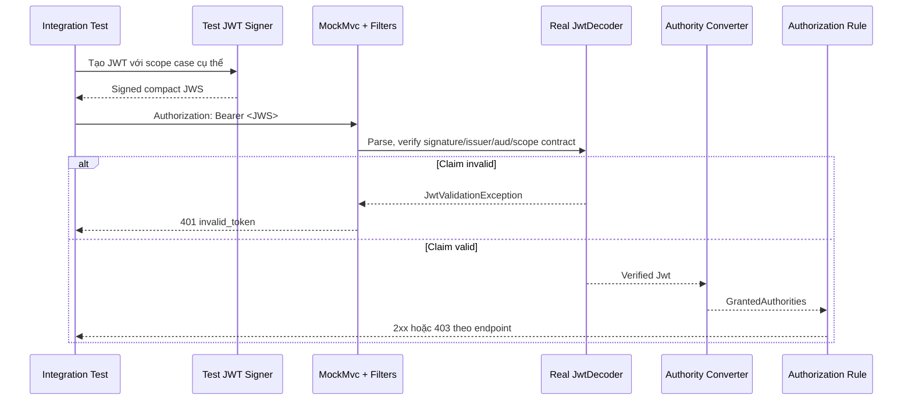
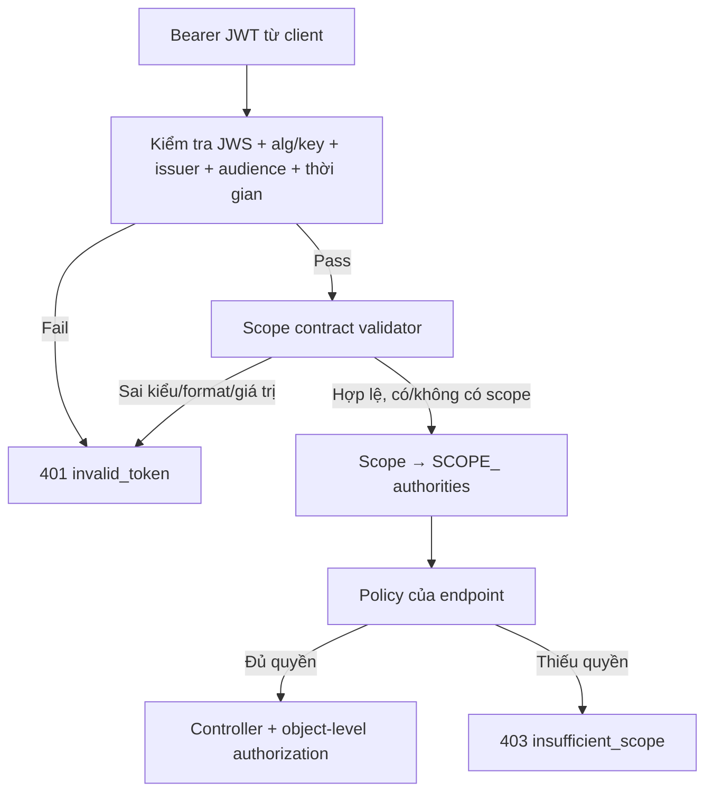

# Kiểm thử ánh xạ quyền với token thiếu scope, nhiều scope và scope không hợp lệ

## 1. Tại sao cần kiểm thử ánh xạ scope thành authorities?

Trong **Spring Security OAuth 2.0/OIDC Resource Server**, một HTTP request có thể mang Bearer access token dưới dạng JWT. Sau khi xác minh token, Spring Security tạo `Authentication` chứa các `GrantedAuthority` để quyết định request có được phép truy cập endpoint hay không.

Ví dụ một JWT access token có payload:

```json
{
  "iss": "https://login.example.test/realms/shop",
  "sub": "user-123",
  "aud": ["orders-api"],
  "scope": "orders:read orders:write",
  "exp": 1893456000
}
```

Đây là **payload minh họa**, không phải JWT có chữ ký sử dụng được. Với converter thông dụng, claim `scope` ở trên được biến thành hai Spring Security authorities:

```text
SCOPE_orders:read
SCOPE_orders:write
```

Endpoint có thể yêu cầu:

```java
.requestMatchers(HttpMethod.GET, "/api/orders/**")
    .hasAuthority("SCOPE_orders:read")
.requestMatchers(HttpMethod.POST, "/api/orders/**")
    .hasAuthority("SCOPE_orders:write")
```

Điều cần kiểm thử không chỉ là “token có scope thì cho qua”, mà là **mối quan hệ chính xác giữa claim được phát hành, authority được tạo ra và quyền được API yêu cầu**.

Ba nhóm token đặc biệt quan trọng:

1. **Thiếu scope:** access token không có claim scope/scp hoặc chỉ có danh sách quyền rỗng. Hệ thống có tạo ra authority ngoài ý muốn không?
2. **Nhiều scope:** token có vài quyền độc lập. Converter có tách đúng từng scope, không gộp nhầm hoặc cấp thêm quyền không?
3. **Scope không hợp lệ:** claim sai kiểu dữ liệu, chứa tên quyền không được hỗ trợ, sai delimiter, chứa giá trị trùng/mâu thuẫn hoặc có chuỗi trông gần giống scope được phép. API sẽ từ chối đúng lớp hay vô tình tạo authority nguy hiểm?

> **Nguyên tắc bảo mật:** Ánh xạ scope phải được xác định bởi **hợp đồng access token của issuer và API**, không đoán từ bất kỳ trường nào có vẻ là “quyền”. Với scope thiếu, mặc định không cấp quyền đó. Với claim sai hợp đồng, phải có chính sách **fail-closed** tường minh.

## 2. Phân biệt scope, authority và authorization

Ba khái niệm liên quan nhưng không đồng nhất:

| Khái niệm | Nằm ở đâu? | Ví dụ | Vai trò |
| --- | --- | --- | --- |
| **Scope** | Access token hoặc introspection response do Authorization Server cấp | `orders:read` | Phạm vi ủy quyền được phát hành theo hợp đồng OAuth 2.0. |
| **GrantedAuthority** | Đối tượng trong Spring Security `Authentication` | `SCOPE_orders:read` | Biểu diễn quyền đã được chuẩn hóa cho các expression/authorization managers. |
| **Authorization rule** | Cấu hình endpoint, method security hoặc policy nghiệp vụ | `hasAuthority("SCOPE_orders:read")` | Quyết định có cho request đã xác thực truy cập chức năng/tài nguyên hay không. |

Quá trình điển hình:

```mermaid
flowchart LR
    C["HTTP client<br/>Bearer access token"] --> F["BearerTokenAuthenticationFilter"]
    F --> P["JwtAuthenticationProvider"]
    P --> D["JwtDecoder<br/>chữ ký, iss, aud, thời hạn, contract"]
    D --> CONV["JwtAuthenticationConverter"]
    CONV --> S["JwtGrantedAuthoritiesConverter<br/>scope/scp → authorities"]
    S --> CTX["SecurityContext<br/>Authentication"]
    CTX --> AUTH["AuthorizationFilter / Method Security"]
    AUTH --> RESULT["Cho phép hoặc từ chối"]
```



Resource Server phải **xác thực JWT trước**; converter ánh xạ claims trong một JWT đã được decoder chấp nhận. Nếu chỉ Base64URL-decode payload rồi gán authority, attacker có thể tự thêm `scope: "orders:write"` vào một token giả.

**Quan trọng:** Token có thể được xác thực thành công **nhưng không có authority nào**. Điều này khác với việc chữ ký hoặc issuer không hợp lệ. Do đó, test cần phân biệt lỗi **authentication (thường 401)** với lỗi **authorization (thường 403)**.

## 3. Spring Security mặc định ánh xạ scope như thế nào?

Với JWT Resource Server, `JwtAuthenticationProvider` thường sử dụng `JwtAuthenticationConverter`. Converter này có thể dùng `JwtGrantedAuthoritiesConverter` để đọc những claim quyền phổ biến.

Trong cấu hình Spring Security thông dụng:

- Claim `scope` hoặc `scp` được xem là nguồn của các scope.
- Với `scope` là **string**, các tên scope được tách theo dấu phân cách được converter cấu hình, mặc định thường là dấu cách.
- Với một claim được biểu diễn dưới dạng **collection of strings**, converter có thể xử lý từng phần tử như một scope; hợp đồng thực tế của issuer vẫn phải được xét.
- Mỗi tên scope được thêm tiền tố **`SCOPE_`** để thành một `GrantedAuthority`.
- Nếu không có claim nào được converter nhận diện, kết quả thường là **danh sách authorities rỗng**.

Ví dụ:

| Claims trong JWT đã xác minh | Authorities thường thu được |
| --- | --- |
| `{"scope":"orders:read"}` | `SCOPE_orders:read` |
| `{"scope":"orders:read orders:write"}` | `SCOPE_orders:read`, `SCOPE_orders:write` |
| `{"scp":["orders:read","orders:write"]}` | `SCOPE_orders:read`, `SCOPE_orders:write` |
| Không có `scope` hoặc `scp` | Không có authority từ scope converter. |
| `{"scope":"orders:read,orders:write"}` | **Không tự động thành hai quyền** khi dấu phẩy không phải delimiter. |
| `{"scope":"orders:Read"}` | Không giống `SCOPE_orders:read` vì tên authority được so khớp chính xác. |

Thứ tự ưu tiên claim, cách tách chuỗi và hành vi trước dữ liệu sai kiểu phụ thuộc implementation/phiên bản Spring Security và tùy chỉnh converter. Đặc biệt, với `JwtGrantedAuthoritiesConverter` chuẩn thường ưu tiên claim `scope` nếu cả `scope` và `scp` có mặt; **đừng giả định hai claim được tự động hợp nhất**.

### 3.1. `SCOPE_` và `ROLE_` không thay thế nhau

`hasAuthority("SCOPE_orders:read")` so chính xác với authority đã tạo. `hasRole("ADMIN")` có quy ước tiền tố `ROLE_`, không mặc nhiên suy ra từ `scope: "ADMIN"`.

Ví dụ:

```text
scope = "admin"
→ SCOPE_admin
≠ ROLE_ADMIN
```

Một mapping tùy chỉnh biến mọi scope thành `ROLE_ADMIN` có thể thay đổi ý nghĩa quyền một cách nguy hiểm. Phân quyền theo scope cần được thiết kế tách biệt với role từ hệ thống người dùng/tenant.

### 3.2. Tránh hiểu sai dấu phân cách

Trong OAuth 2.0, một chuỗi `scope` thông dụng là danh sách **các scope-token phân cách bằng dấu cách**:

```text
orders:read orders:write
```

Không nên coi chuỗi sau tương đương nếu issuer không có hợp đồng riêng:

```text
orders:read,orders:write
```

Chuỗi có dấu phẩy có thể bị converter xem thành **một tên scope duy nhất**. Dấu phẩy bản thân có thể nằm trong tập ký tự được phép cho `scope-token` theo cú pháp OAuth, nên vấn đề cốt lõi là **không có scope đó trong hợp đồng quyền của API**, không phải mọi dấu phẩy đều là lỗi cú pháp chuẩn. Hãy phân biệt **đúng grammar** và **được nhận diện bởi API**.

## 4. Thiết kế quy tắc trước khi viết test

Trước khi tạo test, đội Authorization Server và API nên chốt:

| Câu hỏi hợp đồng | Ví dụ quy ước cho `orders-api` |
| --- | --- |
| Claim nào mang quyền? | `scope` dưới dạng string, tách bằng một dấu cách ASCII. |
| Claim có bắt buộc xuất hiện không? | **Không bắt buộc ở cấp token**; endpoint cần quyền sẽ từ chối token không scope. |
| Tên scope được phép là gì? | `orders:read`, `orders:write`, `orders:export`. |
| Viết hoa/thường có phân biệt không? | Có: `orders:Read` không bằng `orders:read`. |
| Có cho phép scope trùng không? | Ví dụ quy ước: **không**; coi là lỗi hợp đồng. |
| Có cho phép delimiter lạ không? | Không: không nhận dấu phẩy như dấu phân cách, không nhận tab hoặc hai space liên tiếp. |
| Có nhận `scp` dạng mảng không? | Trong hợp đồng ví dụ: **không**; provider dùng `scp` cần validator/converter khác. |
| Nếu scope không hợp lệ? | Từ chối token bằng claim validator trước khi tạo principal. |
| Nếu scope hợp lệ nhưng thiếu quyền cần gọi endpoint? | Authentication thành công, authorization trả 403. |

Đây là **một hợp đồng ví dụ có chủ đích nghiêm ngặt**, không phải quy tắc mà mọi Authorization Server phải áp dụng. Một số issuer phát nhiều scope ngoài những scope của `orders-api` (ví dụ `openid` hoặc scope dùng cho tài nguyên khác); nếu muốn chấp nhận token như vậy, cần mô tả rõ cách xử lý **scope lạ** thay vì áp dụng allowlist của ví dụ một cách máy móc.

### 4.1. Hai chính sách cho “scope không hợp lệ”

Không phải mọi trường hợp “không tạo ra authority dùng được” đều cần trả 401.

**Chính sách A — Validator từ chối claim sai hợp đồng.** Ví dụ `scope` là number, object, chứa delimiter không được chấp nhận hoặc tên scope bị cấm. API xem access token **không hợp lệ** và trả **401 invalid_token** trong luồng JWT Resource Server.

**Chính sách B — Chỉ cấp authority cho scope được nhận diện.** API có thể cho token vẫn authenticated nhưng bỏ qua scope lạ; nếu endpoint đòi một quyền chưa có, trả **403 Forbidden**. Cách này đôi khi cần khi issuer phát scope cho nhiều dịch vụ, nhưng phải có allowlist rõ ràng và không được tự mở rộng quyền.

Để tránh nhập nhằng, bài học dùng **chính sách A trong đoạn validator nghiêm ngặt** và test riêng việc **thiếu scope**. Khi triển khai hệ thống thực tế, chọn một chính sách theo hợp đồng issuer/token profile và áp dụng nhất quán.

## 5. Ma trận kiểm thử căn bản

Giả sử endpoint `GET /api/orders` yêu cầu `SCOPE_orders:read`, còn `POST /api/orders` yêu cầu `SCOPE_orders:write`.

| Token/case | Các authority sau mapping | GET | POST |
| --- | --- | --- | --- |
| Token hợp lệ, **không có `scope`/`scp`** | Rỗng | 403 | 403 |
| Token hợp lệ, `scope="orders:read"` | `SCOPE_orders:read` | Có thể 200 | 403 |
| Token hợp lệ, `scope="orders:write"` | `SCOPE_orders:write` | 403 | Có thể 2xx |
| Token hợp lệ, `scope="orders:read orders:write"` | Cả hai authorities | Có thể 200 | Có thể 2xx |
| Token hợp lệ, `scope="orders:read orders:export"` | Read + export | Có thể 200 | 403 |
| Token đúng chữ ký nhưng claim scope sai kiểu | Không đi qua converter nếu validator chặn | 401 | 401 |
| Token có scope lạ, bị validator hợp đồng từ chối | Không tạo Authentication | 401 | 401 |
| Token có `aud` sai | Không tạo Authentication | 401 | 401 |
| Token hết hạn hoặc sai chữ ký | Không tạo Authentication | 401 | 401 |

“Có thể 200/2xx” nghĩa là **vượt qua điều kiện scope của endpoint**; controller vẫn có thể từ chối do ownership, tenant, input không hợp lệ hoặc các quy tắc nghiệp vụ khác.

### 5.1. Ba tầng test phải tách biệt

| Tầng | Điều được kiểm tra | Không thể thay thế |
| --- | --- | --- |
| **Unit test converter** | Claim `scope`/`scp` trở thành những `GrantedAuthority` nào. | Không chứng minh chữ ký JWT hoặc HTTP status. |
| **Unit test validator** | Scope thiếu, sai kiểu, sai format hoặc không được phép có bị từ chối theo contract không. | Không chứng minh filter chain hoặc signature verification đã chạy. |
| **Security/integration test** | Resource Server xử lý Bearer JWT, mapping authorities và HTTP 401/403/2xx theo policy. | Không thể chỉ dựa vào `jwt()` mock khi muốn kiểm tra decoder/chữ ký thật. |

Tách tầng giúp tìm nguyên nhân đúng: lỗi parsing, mapping, endpoint authorization hay JWT decoder.

## 6. Unit test JwtGrantedAuthoritiesConverter với token thiếu scope

`JwtGrantedAuthoritiesConverter` có thể được kiểm thử trực tiếp mà không cần khởi động Spring Boot, database hoặc HTTP server.

Ví dụ JUnit Jupiter:

```java
import static org.junit.jupiter.api.Assertions.assertEquals;
import static org.junit.jupiter.api.Assertions.assertTrue;

import java.util.Collection;
import java.util.Map;
import java.util.Set;
import java.util.stream.Collectors;

import org.junit.jupiter.api.Test;
import org.springframework.security.core.GrantedAuthority;
import org.springframework.security.oauth2.jwt.Jwt;
import org.springframework.security.oauth2.server.resource.authentication.JwtGrantedAuthoritiesConverter;

class JwtScopeMappingTest {

    private final JwtGrantedAuthoritiesConverter converter =
            new JwtGrantedAuthoritiesConverter();

    private Jwt jwt(Map<String, Object> claims) {
        return Jwt.withTokenValue("unit-test-only")
                .header("alg", "RS256")
                .claims(map -> map.putAll(claims))
                .build();
    }

    private Set<String> names(Jwt jwt) {
        Collection<GrantedAuthority> authorities = converter.convert(jwt);
        return authorities.stream()
                .map(GrantedAuthority::getAuthority)
                .collect(Collectors.toSet());
    }

    @Test
    void noScopeOrScpDoesNotGrantAuthorities() {
        Jwt token = jwt(Map.of(
                "sub", "user-123",
                "aud", java.util.List.of("orders-api")));

        assertTrue(names(token).isEmpty());
    }

    @Test
    void singleScopeCreatesOnlyOneAuthority() {
        Jwt token = jwt(Map.of("scope", "orders:read"));

        assertEquals(Set.of("SCOPE_orders:read"), names(token));
    }

    @Test
    void severalScopesCreateSeveralAuthorities() {
        Jwt token = jwt(Map.of(
                "scope", "orders:read orders:write orders:export"));

        assertEquals(Set.of(
                "SCOPE_orders:read",
                "SCOPE_orders:write",
                "SCOPE_orders:export"),
                names(token));
    }

    @Test
    void scpCollectionCanBeReadByDefaultConverter() {
        Jwt token = jwt(Map.of(
                "scp", java.util.List.of("orders:read", "orders:write")));

        assertEquals(Set.of(
                "SCOPE_orders:read",
                "SCOPE_orders:write"), names(token));
    }

    @Test
    void similarScopeNameDoesNotBecomeAnotherAuthority() {
        Jwt token = jwt(Map.of("scope", "orders:read-admin"));

        assertEquals(Set.of("SCOPE_orders:read-admin"), names(token));
        assertTrue(!names(token).contains("SCOPE_orders:read"));
    }
}
```

Code trên minh họa API Spring Security thường dùng cùng JUnit 5; `Jwt.withTokenValue(...)` tạo JWT object cho unit test, **không ký token** và không xác minh chữ ký.

Những điểm cần rút ra:

- Token không có `scope`/`scp` **không tự tạo quyền mặc định**.
- Nhiều scope tạo thành nhiều authority độc lập, không phải một chuỗi authority ghép.
- Scope tên gần giống không được coi là trùng tên.
- `scp` dạng collection có thể được converter mặc định xử lý, nhưng **contract validation** vẫn cần quyết định issuer có được phép phát định dạng này hay không.
- Dùng `Set` trong assertion tập trung vào tên authority; test khác có thể dùng `List` khi thứ tự thật sự là một phần contract của custom mapper.

### 6.1. Đừng viết assertion chỉ kiểm tra số lượng

Test như sau còn yếu:

```java
assertEquals(2, converter.convert(jwt).size());
```

Nó có thể pass khi converter tạo hai authority **sai tên**. Cần kiểm tra **toàn bộ tên quyền**, chẳng hạn tập `{"SCOPE_orders:read","SCOPE_orders:write"}`, và kiểm tra **không tồn tại** quyền ngoài mong muốn.

### 6.2. Token thiếu scope có thể vẫn authenticated

Nếu JWT đúng chữ ký, issuer, audience, thời hạn và không có quy tắc bắt buộc scope toàn cục, thiếu `scope` không nhất thiết khiến `JwtDecoder` từ chối. Sau xác thực:

```text
Authentication.isAuthenticated() = true
Authentication.getAuthorities() = []
```

Endpoint `.authenticated()` có thể cho request qua dù không có scope; endpoint `.hasAuthority("SCOPE_orders:read")` sẽ từ chối. Vì vậy **test token thiếu scope cần chạy ít nhất một endpoint yêu cầu authority**, chứ chỉ gọi endpoint `authenticated()` là chưa đủ.

## 7. Nhiều scope: kiểm tra OR, AND, tên chính xác và không leo thang quyền

Một JWT access token có:

```json
{
  "scope": "orders:read orders:export"
}
```

Converter tạo:

```text
SCOPE_orders:read
SCOPE_orders:export
```

API có thể có ba dạng yêu cầu:

**Yêu cầu một authority duy nhất:**

```java
.requestMatchers(HttpMethod.GET, "/api/orders/**")
    .hasAuthority("SCOPE_orders:read")
```

**Yêu cầu ít nhất một trong các authorities:**

```java
.requestMatchers("/api/orders/reports/**")
    .hasAnyAuthority("SCOPE_orders:read", "SCOPE_orders:export")
```

**Yêu cầu đồng thời nhiều authorities:**

```java
@PreAuthorize("""
    hasAuthority('SCOPE_orders:read')
    and hasAuthority('SCOPE_orders:export')
    """)
public Report exportOrders() {
    // ...
}
```

Ví dụ method security cần được bật bằng `@EnableMethodSecurity` và thiết kế authorization phù hợp. `hasAnyAuthority` là quan hệ **OR**, còn biểu thức `and` là quan hệ **AND**. Test không chỉ kiểm tra mapping mà phải kiểm tra cả cách policy sử dụng tập quyền.

| Token scopes | `hasAuthority(read)` | `hasAnyAuthority(read, export)` | `read AND export` |
| --- | --- | --- | --- |
| Không có | Không | Không | Không |
| `orders:read` | Có | Có | Không |
| `orders:export` | Không | Có | Không |
| `orders:read orders:export` | Có | Có | Có |
| `orders:write` | Không | Không | Không |

**Không mặc định suy luận quyền phân cấp từ tên scope.** `orders:write` không tự động bao gồm `orders:read`; `orders:read:all` không tự động tương đương `orders:read`. Nếu API cần hierarchy, hãy định nghĩa và kiểm thử quy tắc hierarchy riêng theo chính sách nghiệp vụ.

### 7.1. Kiểm tra scope trùng

Ví dụ:

```json
{ "scope": "orders:read orders:read" }
```

Về quyền thực tế, cả hai giá trị biểu diễn cùng một scope. Tuy nhiên duplicate có thể báo hiệu issuer phát token sai contract hoặc bug serialization. Trong một thiết kế:

- Converter/`Set` có thể chuẩn hóa authority thành một giá trị khi dùng tập hợp.
- Validator contract nghiêm ngặt có thể **từ chối token lặp scope**.
- Một hệ thống khác có thể chấp nhận duplicate như dữ liệu dư thừa nhưng không cấp thêm quyền.

Không có lý do hợp lệ để duplicate làm quyền mạnh hơn. Bài học tiếp theo minh họa **validator từ chối duplicate**, vì đây là hợp đồng ví dụ đã chọn.

## 8. Scope không hợp lệ: cần phân loại trước khi viết kỳ vọng

“Invalid scope” có thể chỉ nhiều vấn đề khác nhau:

| Loại | Ví dụ | Vì sao quan trọng |
| --- | --- | --- |
| Thiếu claim | Không có `scope` và `scp`. | Có thể hợp lệ khi optional; không cấp authority yêu cầu. |
| Có claim nhưng rỗng | `"scope": ""` | Contract có thể cấm claim rỗng và yêu cầu bỏ claim nếu không có quyền. |
| Sai kiểu | `"scope": 42` hoặc `"scope": {"name":"orders:read"}` | Không đáp ứng hợp đồng string; parser/converter có thể xử lý khác nhau. |
| Collection sai hợp đồng | `"scope": ["orders:read"]` khi issuer cam kết string. | Converter có thể map được nhưng contract vẫn bị vi phạm. |
| Delimiter sai | `"scope": "orders:read,orders:write"` | Không phải hai scope khi hợp đồng phân cách bằng dấu cách. |
| Khoảng trắng bất thường | `"scope": "orders:read  orders:write"` hoặc tab | Có thể tạo phần tử rỗng/sai tokenizer; contract phải quy định. |
| Scope ngoài allowlist | `"scope": "orders:admin"` | Không được tự cấp admin chỉ từ tên do token mang. |
| Tên gần giống | `"scope": "orders:Read"` hoặc `"scope": "orders:read-all"` | So sánh quyền phân biệt chữ hoa/thường, không tìm chuỗi con. |
| Chứa cả `scope` và `scp` mâu thuẫn | `scope=orders:read`, `scp=[orders:write]` | Không được tự union hai nguồn quyền. |
| Phần tử list sai kiểu | `"scp": ["orders:read", 7]` | Mapper custom có thể lỗi runtime hoặc cast sai. |
| Scope lặp | `"scope": "orders:read orders:read"` | Cần quy tắc normalization/reject rõ. |

**Không nên thử đoán cách sửa token sai format ngay trong converter**, ví dụ chuyển number thành string, tự tách bằng mọi dấu câu hoặc đổi chữ hoa/thường. Việc đó có thể biến dữ liệu bị lỗi thành một authority hợp lệ ngoài dự kiến.

### 8.1. Xử lý khác nhau giữa “không nhận ra quyền” và “token không hợp lệ”

Nếu validator cho phép token có scope lạ, converter vẫn có thể tạo authority `SCOPE_orders:admin`; điều đó **không tự cấp quyền** nếu endpoint không bao giờ yêu cầu authority này. Tuy nhiên một policy rộng hoặc dynamic có thể vô tình cho phép.

Để giữ ranh giới rõ trong API nhạy cảm, có thể:

1. Xác định **allowlist các scope issuer được phép phát cho API này**.
2. Từ chối JWT khi claim scope sai kiểu/format/giá trị ngoài hợp đồng.
3. Chỉ sau đó để converter tạo authorities.
4. Test chắc chắn không có `ROLE_ADMIN` hoặc `SCOPE_orders:write` xuất hiện từ claim không tương đương.

Nếu issuer phát nhiều scope hợp lệ không liên quan đến `orders-api`, allowlist phải được thiết kế cho **toàn bộ token profile mà API được phép nhận**, hoặc dùng chiến lược bỏ qua scope không liên quan một cách xác định. Không dùng allowlist quá hẹp gây từ chối token hợp lệ trong production.

## 9. Viết claim validator fail-closed cho hợp đồng scope-string

Ví dụ này giả định Authorization Server chỉ dùng claim `scope` kiểu **string**, chỉ phát ba scope `orders:read`, `orders:write`, `orders:export` cho `orders-api`:

- Không có `scope`/**`scp`**: **hợp lệ ở cấp token**, nhưng không cấp authority nào.
- Nếu có `scope`: phải là string không rỗng, các tên được phân cách bằng **một dấu cách ASCII**.
- Mọi tên scope phải nằm trong allowlist; tên trùng bị từ chối theo hợp đồng của ví dụ.
- `scp` không được xuất hiện: đây là một format khác không thuộc hợp đồng đang áp dụng.
- Dữ liệu sai contract trở thành lỗi validation JWT để dừng authentication.

Ví dụ Java:

```java
import java.util.HashSet;
import java.util.Map;
import java.util.Set;

import org.springframework.security.oauth2.core.OAuth2Error;
import org.springframework.security.oauth2.core.OAuth2TokenValidator;
import org.springframework.security.oauth2.core.OAuth2TokenValidatorResult;
import org.springframework.security.oauth2.jwt.Jwt;

public final class StrictScopeClaimValidator
        implements OAuth2TokenValidator<Jwt> {

    private static final Set<String> ALLOWED = Set.of(
            "orders:read", "orders:write", "orders:export");

    @Override
    public OAuth2TokenValidatorResult validate(Jwt jwt) {
        Map<String, Object> claims = jwt.getClaims();

        // Hợp đồng này chỉ hỗ trợ "scope", không hỗ trợ "scp".
        if (claims.containsKey("scp")) {
            return failure("Unsupported scp claim");
        }

        // Thiếu scope: hợp lệ ở token layer, không sinh quyền.
        if (!claims.containsKey("scope")) {
            return OAuth2TokenValidatorResult.success();
        }

        Object raw = claims.get("scope");
        if (!(raw instanceof String scopes) || scopes.isEmpty()) {
            return failure("scope must be a nonempty string");
        }

        // split(..., -1) giữ phần rỗng, phát hiện hai space liên tiếp.
        String[] names = scopes.split(" ", -1);
        Set<String> seen = new HashSet<>();

        for (String name : names) {
            if (!ALLOWED.contains(name)) {
                return failure("Unknown or malformed scope");
            }
            if (!seen.add(name)) {
                return failure("Duplicate scope");
            }
        }

        return OAuth2TokenValidatorResult.success();
    }

    private static OAuth2TokenValidatorResult failure(String reason) {
        return OAuth2TokenValidatorResult.failure(
                new OAuth2Error("invalid_token", reason, null));
    }
}
```

Ở ví dụ này, `"orders:read  orders:write"` có phần tử rỗng nên bị từ chối; `"orders:read\torders:write"` không khớp allowlist; `"orders:read,orders:write"` là một token-name không được công nhận; `"orders:Read"` cũng bị từ chối. Chọn quy tắc nghiêm ngặt như vậy khi **issuer đã cam kết canonical format**.

### 9.1. Dùng validator trong NimbusJwtDecoder

```java
@Configuration
class OrdersJwtValidationConfig {

    private static final String ISSUER =
            "https://login.example.test/realms/shop";
    private static final String AUDIENCE = "orders-api";

    @Bean
    JwtDecoder jwtDecoder() {
        NimbusJwtDecoder decoder =
                NimbusJwtDecoder.withIssuerLocation(ISSUER).build();

        OAuth2TokenValidator<Jwt> defaults =
                JwtValidators.createDefaultWithIssuer(ISSUER);

        OAuth2TokenValidator<Jwt> audience = jwt ->
                jwt.getAudience().contains(AUDIENCE)
                        ? OAuth2TokenValidatorResult.success()
                        : OAuth2TokenValidatorResult.failure(
                                new OAuth2Error(
                                        "invalid_token",
                                        "Unexpected audience",
                                        null));

        OAuth2TokenValidator<Jwt> scope =
                new StrictScopeClaimValidator();

        decoder.setJwtValidator(
                new DelegatingOAuth2TokenValidator<>(
                        defaults, audience, scope));

        return decoder;
    }
}
```

Các import cho `@Configuration`, `@Bean`, `JwtDecoder`, `NimbusJwtDecoder`, `JwtValidators` và `DelegatingOAuth2TokenValidator` được lược bớt để làm nổi bật logic. API builder và behavior mặc định cần khớp phiên bản Spring Security thực tế.

**Điểm thiết kế:** Converter chịu trách nhiệm **biến các scope hợp lệ thành authorities**; validator chịu trách nhiệm **bác bỏ token sai hợp đồng trước khi tạo Authentication**. Đừng dùng một converter “rộng lượng” để thay thế validation.

### 9.2. Nếu hợp đồng issuer dùng scp array thì sao?

Một số Authorization Server phát:

```json
{
  "scp": ["orders:read", "orders:write"]
}
```

Đây có thể là một hợp đồng hợp lệ của issuer khác. Khi đó:

- Định nghĩa validator **riêng** cho `scp` là list of nonempty strings.
- Từ chối phần tử không phải string, phần tử rỗng, quyền ngoài allowlist hoặc trường mâu thuẫn theo policy.
- Cấu hình converter đọc `scp`, có thể dùng `setAuthoritiesClaimName("scp")`.
- Test tất cả phiên bản token mà issuer còn phát hành trong cửa sổ migration.

Không dùng nguyên `StrictScopeClaimValidator` ở trên cho issuer cố ý phát `scp`, vì nó **chủ động từ chối** định dạng đó.

## 10. Unit test validator với thiếu, nhiều và malformed scope

Nhóm test sau trực tiếp chạy `StrictScopeClaimValidator`; nó kiểm tra **hợp đồng claim** mà không dùng JWT signature.

```java
import static org.junit.jupiter.api.Assertions.assertFalse;
import static org.junit.jupiter.api.Assertions.assertTrue;

import java.util.List;
import java.util.Map;

import org.junit.jupiter.api.Test;
import org.springframework.security.oauth2.core.OAuth2TokenValidatorResult;
import org.springframework.security.oauth2.jwt.Jwt;

class StrictScopeClaimValidatorTest {

    private final StrictScopeClaimValidator validator =
            new StrictScopeClaimValidator();

    private Jwt token(Map<String, Object> claims) {
        return Jwt.withTokenValue("unit-test-only")
                .header("alg", "RS256")
                .claims(map -> map.putAll(claims))
                .build();
    }

    private boolean accepted(Map<String, Object> claims) {
        OAuth2TokenValidatorResult result =
                validator.validate(token(claims));
        return result.getErrors().isEmpty();
    }

    @Test
    void missingScopeIsAllowedAtTokenLevel() {
        assertTrue(accepted(Map.of("sub", "user-123")));
    }

    @Test
    void knownSingleAndMultipleScopesAreAccepted() {
        assertTrue(accepted(Map.of("scope", "orders:read")));
        assertTrue(accepted(Map.of(
                "scope", "orders:read orders:write")));
    }

    @Test
    void emptyScopeIsRejectedWhenClaimIsPresent() {
        assertFalse(accepted(Map.of("scope", "")));
        assertFalse(accepted(Map.of("scope", " ")));
    }

    @Test
    void invalidTypeIsRejected() {
        assertFalse(accepted(Map.of("scope", 42)));
        assertFalse(accepted(Map.of(
                "scope", List.of("orders:read"))));
        assertFalse(accepted(Map.of(
                "scope", Map.of("name", "orders:read"))));
    }

    @Test
    void wrongDelimiterOrUnknownScopeIsRejected() {
        assertFalse(accepted(Map.of(
                "scope", "orders:read,orders:write")));
        assertFalse(accepted(Map.of(
                "scope", "orders:read  orders:write")));
        assertFalse(accepted(Map.of(
                "scope", "orders:read\torders:write")));
        assertFalse(accepted(Map.of(
                "scope", "orders:admin")));
        assertFalse(accepted(Map.of(
                "scope", "orders:Read")));
    }

    @Test
    void duplicateScopeIsRejected() {
        assertFalse(accepted(Map.of(
                "scope", "orders:read orders:read")));
    }

    @Test
    void scpIsRejectedInThisScopeOnlyContract() {
        assertFalse(accepted(Map.of(
                "scp", List.of("orders:read"))));
        assertFalse(accepted(Map.of(
                "scope", "orders:read",
                "scp", List.of("orders:write"))));
    }
}
```

`Map.of(...)` không cho giá trị `null`; muốn test `scope: null`, dùng `HashMap` để tạo claim null theo dữ liệu thử nghiệm hoặc kiểm tra ngay tại tầng JSON parser/decoder. Dù claim null bị decoder từ chối trước hoặc validator nhận được, kỳ vọng quan trọng là **không tạo authority và không coi token đúng hợp đồng**.

### 10.1. Tại sao validator test không chứng minh token thật bị HTTP 401?

`Jwt.withTokenValue("unit-test-only")` chỉ tạo đối tượng `Jwt` trong bộ nhớ. Nó không có chữ ký JWS hợp lệ, không đi qua `BearerTokenAuthenticationFilter` và không gọi `JwtDecoder.decode(String)`.

Unit test trên chứng minh hàm validator **đưa ra kết quả success/failure cho claim**, chứ chưa chứng minh decoder đã đăng ký validator hoặc ứng dụng trả đúng HTTP status. Cần thêm test kết nối cấu hình và test HTTP.

## 11. MockMvc: kiểm tra endpoint khi authorities đã được tạo

Giả sử API có cấu hình:

```java
@Configuration
class OrdersSecurityConfig {

    @Bean
    SecurityFilterChain apiSecurity(HttpSecurity http) throws Exception {
        return http
                .authorizeHttpRequests(auth -> auth
                        .requestMatchers(HttpMethod.GET, "/api/orders/**")
                            .hasAuthority("SCOPE_orders:read")
                        .requestMatchers(HttpMethod.POST, "/api/orders/**")
                            .hasAuthority("SCOPE_orders:write")
                        .anyRequest().authenticated())
                .oauth2ResourceServer(oauth2 ->
                        oauth2.jwt(Customizer.withDefaults()))
                .build();
    }
}
```

Ví dụ MockMvc với `spring-security-test`:

```java
import static org.springframework.security.test.web.servlet.request
        .SecurityMockMvcRequestPostProcessors.jwt;
import static org.springframework.test.web.servlet.request
        .MockMvcRequestBuilders.get;
import static org.springframework.test.web.servlet.result
        .MockMvcResultMatchers.status;

import org.junit.jupiter.api.Test;
import org.springframework.beans.factory.annotation.Autowired;
import org.springframework.boot.test.autoconfigure.web.servlet.AutoConfigureMockMvc;
import org.springframework.boot.test.context.SpringBootTest;
import org.springframework.security.core.GrantedAuthority;
import org.springframework.security.core.authority.SimpleGrantedAuthority;
import org.springframework.security.oauth2.server.resource.authentication
        .JwtGrantedAuthoritiesConverter;
import org.springframework.test.web.servlet.MockMvc;

@SpringBootTest
@AutoConfigureMockMvc
class OrdersAuthorizationTest {

    @Autowired
    MockMvc mockMvc;

    @Test
    void validAuthenticationWithoutScopeCannotReadOrders()
            throws Exception {
        mockMvc.perform(get("/api/orders")
                .with(jwt().authorities(new GrantedAuthority[0])))
                .andExpect(status().isForbidden());
    }

    @Test
    void readScopeAllowsReadEndpoint() throws Exception {
        mockMvc.perform(get("/api/orders")
                .with(jwt().authorities(
                        new SimpleGrantedAuthority("SCOPE_orders:read"))))
                .andExpect(status().isOk());
    }

    @Test
    void wrongScopeIsForbidden() throws Exception {
        mockMvc.perform(get("/api/orders")
                .with(jwt().authorities(
                        new SimpleGrantedAuthority("SCOPE_orders:write"))))
                .andExpect(status().isForbidden());
    }

    @Test
    void mockJwtCanUseARealScopeConverter() throws Exception {
        JwtGrantedAuthoritiesConverter scopeConverter =
                new JwtGrantedAuthoritiesConverter();

        mockMvc.perform(get("/api/orders")
                .with(jwt()
                        .jwt(jwt -> jwt.claim(
                                "scope", "orders:read orders:write"))
                        .authorities(scopeConverter)))
                .andExpect(status().isOk());
    }
}
```

Đây là ví dụ **test về nguyên tắc**, giả định dự án có endpoint `GET /api/orders` trả 200 khi đã qua security và dữ liệu hợp lệ, có Spring Security Test/JUnit và cấu hình ứng dụng đủ để khởi động context. Trong ứng dụng thật, cần bổ sung test fixtures/service mocks, CSRF nếu kiểm tra POST theo mô hình cookie/session, và các phụ thuộc của controller.

**Điểm cực kỳ quan trọng:** `jwt()` trong Spring Security Test có thể **bơm một `JwtAuthenticationToken` giả lập** vào request. Điều này hữu ích để kiểm tra `hasAuthority` và có thể dùng converter thật để kiểm tra mapping. Nhưng nó **không tự chứng minh** issuer, chữ ký, audience hoặc `StrictScopeClaimValidator` đã được gọi qua decoder.

Nếu muốn test **scope malformed phải nhận 401**, không thể chỉ gọi:

```java
mockMvc.perform(get("/api/orders")
        .with(jwt().jwt(jwt -> jwt.claim("scope", 42))));
```

rồi kết luận converter/decoder production đã kiểm tra claim hợp lệ. Cách giả lập authentication có thể bỏ qua những bước đó.

## 12. Integration test: đi qua JwtDecoder thật và filter chain

Một bài kiểm thử tích hợp có ý nghĩa cần dùng **Bearer token được ký trong môi trường test** và đi qua security chain đầy đủ:

```http
GET /api/orders HTTP/1.1
Authorization: Bearer <test-jws-signed-by-test-private-key>
```

Quy trình:

1. Trong test, tạo một RSA/EC key pair riêng cho môi trường kiểm thử (không dùng production secret).
2. Cấu hình `JwtDecoder` thật để chỉ chấp nhận test public key/JWKS và thuật toán được phép.
3. Gắn `JwtValidators.createDefaultWithIssuer(...)`, audience validator và `StrictScopeClaimValidator` giống production.
4. Dùng JOSE encoder/test Authorization Server ký token có issuer, audience, `exp` hợp lệ và những biến thể `scope` được muốn thử.
5. Gửi chuỗi JWS Compact thật trong header `Authorization: Bearer ...` qua `MockMvc` với Spring Security filters bật.
6. Assert HTTP status và, khi phù hợp, authorities/principal được tạo trong luồng đã xác thực.

Sơ đồ kiểm thử:



### 12.1. Các trường hợp integration bắt buộc trong ví dụ

| JWS được ký hợp lệ (trừ khi có ghi khác) | Kỳ vọng với `GET /api/orders` |
| --- | --- |
| Không có `scope`/`scp` | JWT được xác thực, thiếu authority → **403**. |
| `scope="orders:read"` | Qua scope rule → endpoint xử lý (thường 200). |
| `scope="orders:write"` | Đúng token nhưng thiếu quyền read → **403**. |
| `scope="orders:read orders:write"` | Qua scope rule → endpoint xử lý. |
| `scope=""` | Validator hợp đồng từ chối → **401 invalid_token**. |
| `scope=42` | Sai kiểu/decoder hoặc validator từ chối → **401 invalid_token**. |
| `scope=["orders:read"]` | Bị validator scope-string của ví dụ từ chối → **401**. |
| `scope="orders:read,orders:write"` | Không nằm trong allowlist → **401**. |
| `scope="orders:admin"` | Không nằm trong allowlist → **401**. |
| Có `scp` khi contract chỉ nhận `scope` | Validator từ chối → **401**. |
| `scope="orders:read"` nhưng `aud=["payments-api"]` | Audience validator từ chối → **401**. |
| `scope="orders:read"` nhưng `iss` sai | Issuer validator từ chối → **401**. |
| `scope="orders:read"` nhưng chữ ký bị sửa | Signature verification từ chối → **401**. |

Không dùng một token mock `jwt()` để thay toàn bộ danh sách trên nếu mục tiêu là xác minh **lỗi thuộc authentication layer**.

### 12.2. Có thể kiểm tra trực tiếp JwtDecoder khi không cần HTTP

Một bước giữa unit test và end-to-end là:

```java
Jwt parsed = jwtDecoder.decode(signedAccessToken);
```

Với scope hợp lệ, decoder trả `Jwt`. Với claim sai hợp đồng, `JwtDecoder` nên ném exception JWT validation; test cần assert đúng kỳ vọng. Cách này kiểm tra decoder wiring + claim validator, nhưng không kiểm tra `BearerTokenAuthenticationFilter`, `SecurityContext` hay HTTP 403.

## 13. Thiết kế custom converter cho claim khác

Nếu issuer không dùng `scope`/`scp` mà phát:

```json
{
  "permissions": ["orders.read", "orders.write"]
}
```

Resource Server không nên tự suy diễn permission thành scope hợp lệ. Cần bản đồ ánh xạ rõ ràng theo hợp đồng, ví dụ:

```java
public final class OrdersPermissionsConverter
        implements Converter<Jwt, Collection<GrantedAuthority>> {

    private static final Map<String, String> MAPPING = Map.of(
            "orders.read", "SCOPE_orders:read",
            "orders.write", "SCOPE_orders:write");

    @Override
    public Collection<GrantedAuthority> convert(Jwt jwt) {
        Object raw = jwt.getClaims().get("permissions");

        if (raw == null) {
            return List.of();
        }

        // Validator riêng cần bảo đảm đúng kiểu và giá trị.
        if (!(raw instanceof Collection<?> items)) {
            return List.of();
        }

        Set<GrantedAuthority> result = new LinkedHashSet<>();
        for (Object item : items) {
            if (item instanceof String name
                    && MAPPING.containsKey(name)) {
                result.add(new SimpleGrantedAuthority(
                        MAPPING.get(name)));
            }
        }
        return result;
    }
}
```

Đây là **mẫu mapper giới hạn authority theo allowlist**. Nó không nhận tên bất kỳ, không nối chuỗi một cách máy móc và không tạo `ROLE_ADMIN` từ dữ liệu ngoài hợp đồng. Khi dùng trong ứng dụng thật:

- Đăng ký validator riêng cho `permissions` để **từ chối sai kiểu và permission không được công nhận** theo chính sách, thay vì chỉ dựa vào việc converter bỏ qua giá trị.
- Cấu hình `JwtAuthenticationConverter.setJwtGrantedAuthoritiesConverter(...)` bằng converter này.
- Test cả token thiếu permissions, nhiều permissions, quyền lạ và phần tử sai kiểu.
- Nếu issuer vừa phát `scope` vừa phát `permissions`, quy định **nguồn sự thật nào ưu tiên** và test trường hợp hai nguồn mâu thuẫn. Không tự động union hai nguồn quyền.

### 13.1. Cấu hình JwtAuthenticationConverter

```java
@Bean
JwtAuthenticationConverter jwtAuthenticationConverter() {
    JwtAuthenticationConverter converter =
            new JwtAuthenticationConverter();
    converter.setJwtGrantedAuthoritiesConverter(
            new OrdersPermissionsConverter());
    return converter;
}
```

Và kết nối vào Resource Server:

```java
.oauth2ResourceServer(oauth2 ->
        oauth2.jwt(jwt ->
                jwt.jwtAuthenticationConverter(
                        jwtAuthenticationConverter())))
```

Hai ví dụ mang tính minh họa kiến trúc; có thể inject bean `JwtAuthenticationConverter` vào cấu hình `SecurityFilterChain` thay vì tự gọi phương thức bean. Quan trọng là **converter được dùng thật trong chain xử lý Bearer JWT**.

## 14. Những trường hợp tinh vi cần thêm vào bộ test

### 14.1. Scope có tên tương tự nhưng không bằng

```text
Expected authority = SCOPE_orders:read

JWT scope = "orders:Read"      → không bằng
JWT scope = "orders:read-all"  → không bằng
JWT scope = "orders:reader"    → không bằng
JWT scope = "orders:read "     → tùy grammar; contract ví dụ từ chối
```

Không viết:

```java
// SAI: so sánh tiền tố hoặc chuỗi con để quyết định scope.
if (authority.getAuthority().startsWith("SCOPE_orders:read")) {
    allowRead();
}
```

`hasAuthority` thực hiện so sánh authority chính xác, giảm rủi ro nhận nhầm.

### 14.2. Cả scope và scp cùng xuất hiện

Ví dụ:

```json
{
  "scope": "orders:read",
  "scp": ["orders:write"]
}
```

Không được giả định converter mặc định cộng hai claim thành `read + write`. Nếu một implementation chọn `scope` trước `scp`, token có thể chỉ tạo `SCOPE_orders:read`. Nếu tự viết converter union, token lại có `SCOPE_orders:write`; cả hai hành vi có thể khác hợp đồng mong đợi.

Trong hợp đồng scope-string nghiêm ngặt của ví dụ, **validator từ chối toàn bộ token** để tránh nguồn quyền mâu thuẫn. Hệ thống khác có thể cho phép song song trong giai đoạn migration, nhưng phải so sánh **ngữ nghĩa tương đương** và xác định precedence, không cộng quyền một cách mù quáng.

### 14.3. Scope ở dạng collection hỗn hợp

```json
{
  "scp": ["orders:read", 123, null]
}
```

Tùy library/converter và phiên bản, một số path có thể bỏ qua, ném exception khi cast hoặc thất bại khi tạo authority. **Đừng viết test với giả định sai kiểu luôn được chuyển thành no authorities.** Đặt validator hợp đồng yêu cầu mọi phần tử là string không rỗng trước mapping.

### 14.4. Scope trống nhưng token vẫn chứa role khác

Ví dụ:

```json
{
  "scope": "",
  "roles": ["ADMIN"]
}
```

Nếu API chỉ tin `scope` theo hợp đồng, claim `roles` không được tự động biến thành `ROLE_ADMIN`. Khi một API có custom converter xử lý cả scope/roles, cần test **nguồn dữ liệu**, **mapping** và **policy** độc lập để chặn leo thang quyền.

### 14.5. Duplicate và ordering

Scope là các tên quyền, không phải chuỗi lệnh theo thứ tự. Không nên dựa vào việc `orders:read` đứng trước hay sau `orders:write` để quyết định “ưu tiên”. Nếu converter cho phép duplicate, kết quả có thể chứa lặp authority hoặc được chuẩn hóa thành set; test theo **chính sách đã chọn** thay vì phụ thuộc thứ tự không có ý nghĩa.

### 14.6. Scope Unicode hoặc khoảng trắng không chuẩn

Ví dụ chuỗi có non-breaking space hoặc ký tự nhìn giống dấu hai chấm ASCII có thể khiến mắt người thấy “đúng” nhưng matcher không khớp. Không tự đổi Unicode theo cách làm scope lạ biến thành quyền hợp lệ trừ khi issuer và API có hợp đồng canonicalization cụ thể.

### 14.7. Token cũ và token mới trong migration

Nếu trước đây issuer phát `permissions` array, sau đó chuyển sang `scope` string, API có thể cần hỗ trợ hai định dạng tạm thời. Test phải bao gồm:

- Token phiên bản cũ còn hạn và đúng issuer/audience.
- Token phiên bản mới.
- Token mang cả hai nguồn quyền mâu thuẫn.
- Token thiếu quyền.
- Token có quyền lạ.
- Thời điểm gỡ nhánh legacy sau khi token cũ và cơ chế phát hành v1 đã kết thúc.

Không để quá trình migration làm API vô tình **union nhiều quyền hơn** cho một actor.

## 15. Trạng thái HTTP: thiếu quyền khác token sai hợp đồng

Trong OAuth2 Resource Server dùng JWT Bearer:

| Input | Authentication | Authorization | Phản hồi thông dụng |
| --- | --- | --- | --- |
| Không có Bearer token | Chưa có principal được xác thực | Endpoint cần xác thực | **401**, Bearer challenge. |
| Token sai chữ ký, hết hạn, sai issuer hoặc audience | **Thất bại** | Không vào bước phân quyền có principal tin cậy | **401 invalid_token**. |
| Token hợp lệ, thiếu `scope` (claim optional), endpoint cần scope | **Thành công** với authorities rỗng | **Thất bại** | **403 Forbidden**, có thể `insufficient_scope`. |
| Token hợp lệ, có `orders:read`, endpoint đòi `orders:write` | **Thành công** | **Thất bại** | **403**, có thể `insufficient_scope`. |
| Token có claim `scope` sai kiểu và validator từ chối | **Thất bại** | Không tạo principal tin cậy | **401 invalid_token**. |
| Token không có scope nhưng API **bắt buộc** claim này ở cấp token | **Thất bại** nếu validator cấu hình như vậy | Không vào bước phân quyền | **401 invalid_token**. |
| Token có quyền đúng nhưng đối tượng dữ liệu không thuộc actor | **Thành công** | Domain authorization thất bại | **403 hoặc 404** theo chính sách. |

Ví dụ HTTP khi token sai hợp đồng scope:

```http
HTTP/1.1 401 Unauthorized
WWW-Authenticate: Bearer error="invalid_token"
```

Ví dụ HTTP khi token đã hợp lệ nhưng thiếu scope:

```http
HTTP/1.1 403 Forbidden
WWW-Authenticate: Bearer error="insufficient_scope"
```

Phản hồi chi tiết có thể khác nếu ứng dụng tùy chỉnh `AuthenticationEntryPoint`, `AccessDeniedHandler` hoặc chạy qua gateway. Mã lỗi bên ngoài nên tránh tiết lộ toàn bộ claim, scope và rule nội bộ.

**`permitAll()` không tự động bỏ qua xử lý token hỏng:** Nếu request vào một chain có Bearer filter và client gửi JWT sai hợp đồng, filter có thể trả 401 trước khi đến authorization rule cho endpoint công khai.

## 16. Kiểm thử endpoint với thiếu scope mà không bị nhầm vì URL/CSRF

Một test `POST` có thể bị **403 do CSRF**, không phải do thiếu `SCOPE_orders:write`, nếu ứng dụng có session/cookie và CSRF protection đang bật. Với API JWT Bearer-only stateless, có thể có chính sách CSRF khác; nhưng khi viết test phải hiểu chính xác security chain.

Nếu mục tiêu là kiểm tra **scope mapping**, nên:

1. Bắt đầu bằng endpoint `GET` yêu cầu một authority để tránh nhiễu do CSRF.
2. Bảo đảm test gửi request vào đúng `SecurityFilterChain`.
3. Với `POST`, điều chỉnh CSRF/test request theo mô hình ứng dụng thật, không tắt bảo vệ chỉ để test pass một cách thiếu cân nhắc.
4. Kiểm tra HTTP status **và** authorities nếu có cách quan sát an toàn trong test.
5. Tách lỗi ownership, validation body và service exceptions khỏi lỗi security.

### 16.1. Nhiều SecurityFilterChain

Một ứng dụng có cả OIDC web login và Bearer API có thể định nghĩa:

```java
@Bean
@Order(1)
SecurityFilterChain apiChain(HttpSecurity http) throws Exception {
    return http
            .securityMatcher("/api/**")
            .authorizeHttpRequests(auth -> auth
                    .requestMatchers("/api/public/**").permitAll()
                    .anyRequest().hasAuthority("SCOPE_orders:read"))
            .oauth2ResourceServer(oauth2 ->
                    oauth2.jwt(Customizer.withDefaults()))
            .build();
}
```

Khi test sai URL hoặc chain có matcher rộng đứng trước API chain, kết quả 401/403 có thể đến từ **một security policy khác**, không phản ánh scope converter mà bạn muốn kiểm tra. Trong Spring Security Servlet, `FilterChainProxy` dùng **chain đầu tiên khớp request**.

## 17. Không kết luận quyền chỉ từ JWT payload chưa xác minh

Các unit tests ở mục trên chủ động tạo `Jwt` object trực tiếp để kiểm tra mapping. Chúng **không** chứng minh token có chữ ký thật. Khi ứng dụng chạy production:



**Không** tự:

```java
// SAI: chỉ lấy claims bằng Base64URL decode rồi tự cấp quyền.
String scope = claimsFromUnverifiedPayload.get("scope");
grantAuthoritiesFrom(scope);
```

Một attacker có thể tự thay `scope` trong payload JWT. `JwtDecoder` và validator đáng tin cậy là ranh giới xác thực trước khi cấp authorities.

## 18. Gỡ lỗi khi test không ra kết quả mong đợi

| Triệu chứng | Nguyên nhân có thể | Cách xác định |
| --- | --- | --- |
| Token có `scope="orders:read"` nhưng GET trả 403 | Chưa nối custom converter, authority prefix khác, API yêu cầu role/scope khác. | Inspect authorities của `Authentication` trong môi trường test, xác nhận matcher. |
| Token có nhiều scope nhưng chỉ sinh một authority | Delimiter không đúng, claim là một chuỗi phân cách dấu phẩy, converter đọc claim khác. | Kiểm tra claim format, `JwtGrantedAuthoritiesConverter` config và expected authority set. |
| Token không có scope nhưng GET trả 200 | Endpoint chỉ yêu cầu `authenticated()`, có quyền từ nguồn khác, hoặc test mock đã gắn authority. | Kiểm tra `hasAuthority` thực, test postprocessor và converter. |
| Token sai kiểu scope vẫn trả 200 | Decoder chưa đăng ký validator, `jwt()` mock bypass validator, hoặc custom mapper bỏ qua kiểu sai. | Test trực tiếp validator/decoder và integration Bearer JWS thật. |
| Test token thiếu scope trả 401 thay vì 403 | API cấu hình validator bắt buộc scope hoặc JWT test thiếu issuer/audience/chữ ký. | Phân biệt contract failure với authorization failure. |
| Test `POST` luôn trả 403 | Có thể CSRF, không chỉ scope. | Kiểm tra CSRF policy và security matcher trước khi kết luận scope sai. |
| Token có `scp` list nhưng authorities rỗng | Converter được cấu hình chỉ đọc `scope` hoặc validator từ chối `scp`. | Xác nhận hợp đồng claim và cấu hình converter thực. |
| Scope sai chữ hoa vẫn được chấp nhận | Custom normalization hoặc matcher `startsWith`/substring. | So khớp chính xác, viết negative tests cho tên gần giống. |
| Token có `scope` và `scp` nhưng được cấp quyền ngoài ý muốn | Converter merge claim, precedence sai hoặc validator không chặn mâu thuẫn. | Test cả hai claim cùng hiện diện, quy định một nguồn sự thật. |
| 401 sau thay đổi issuer/JWKS | Signature, issuer, key rotation hoặc token profile, không phải scope mapping. | Kiểm tra decoder và validation trước converter. |

Có thể bật log kiểm soát ở môi trường phát triển:

```yaml
logging:
  level:
    org.springframework.security: DEBUG
```

Tránh log nguyên access token, refresh token, client secret hoặc toàn bộ JWT claims chứa dữ liệu nhạy cảm. Khi chẩn đoán, dùng request ID, mã lỗi, issuer đã xác minh, expected resource và tên authorities được phép log theo chính sách. Không dùng raw unverified scope làm nhãn metric không giới hạn cardinality.

### 18.1. Câu hỏi cần hỏi trước khi sửa code

- Issuer đang phát `scope` dạng string, `scp` dạng collection hay claim tùy chỉnh?
- Tên claim có viết hoa/thường chính xác không?
- Delimiter được thỏa thuận là gì?
- Có claim quyền khác mà converter đang đọc không?
- Quy tắc endpoint đòi **một**, **bất kỳ** hay **tất cả** authorities?
- Token đã qua chữ ký/issuer/audience validation chưa?
- Có validator contract cho scope không và được nối vào decoder thật chưa?
- Test dùng `jwt()` giả lập hay Bearer JWS thật?
- Security chain, CSRF, session, method security và object-level policy có ảnh hưởng test không?

## 19. Các tình huống thực hành

### Tình huống A — Thiếu scope nhưng user đã đăng nhập

Client gửi access token hợp lệ cho `orders-api`, không có claim `scope`. `JwtDecoder` xác minh thành công, `JwtGrantedAuthoritiesConverter` không tạo authority. Nếu API yêu cầu `hasAuthority("SCOPE_orders:read")`, request bị **403**. Tên user hay trạng thái đăng nhập không thay thế quyền được cấp.

### Tình huống B — Nhiều scope, chỉ một scope phù hợp

JWT hợp lệ chứa `scope="orders:read profile:read"`. Nếu contract chấp nhận cả hai tên, converter tạo hai authorities. GET orders có thể được phép, POST orders vẫn bị chặn. Không được tự suy luận `profile:read` bao gồm `orders:write`.

### Tình huống C — Scope phân cách dấu phẩy

JWT chứa `scope="orders:read,orders:write"`. Nếu converter mặc định tách theo khoảng trắng, nó không tạo hai authorities đúng tên. Theo hợp đồng scope-string/allowlist chặt của ví dụ, validator từ chối **401**. Nếu một issuer khác định nghĩa format đặc biệt, phải có converter/validator hợp đồng riêng thay vì dùng parser đoán.

### Tình huống D — Token có hai nguồn quyền trái nhau

JWT chứa `scope="orders:read"` và `scp=["orders:write"]`. Nếu API lấy union, nó có thể cấp write ngoài dự kiến; nếu converter ưu tiên `scope`, kết quả là read. Hợp đồng ví dụ từ chối token này **trước khi cấp quyền**, buộc issuer sửa format hoặc dùng migration được định nghĩa rõ.

### Tình huống E — MockMvc pass nhưng production trả 401

Test `jwt().authorities("SCOPE_orders:read")` vượt qua authorization, nhưng token thật sai audience và bị `JwtDecoder` từ chối. Test mock đã bỏ qua signature/claim validation. Cần integration test với JWT ký thật và audience validator.

### Tình huống F — Scope lạ nhưng controller vẫn chạy

Endpoint chỉ yêu cầu `authenticated()`, token chứa `scope="orders:admin"` được decoder chấp nhận mà không có validator allowlist. Request có thể đi vào controller dù scope này không được API nhận diện. Đây là lý do các endpoint có nghiệp vụ nhạy cảm cần rule quyền cụ thể, và nếu hợp đồng yêu cầu, validator phải chặn claim lạ ngay ở authentication.

### Tình huống G — Scope đúng nhưng không sở hữu dữ liệu

JWT có `orders:read`, user truy cập đơn hàng của người khác. Converter và URL authority rule đều pass, nhưng service phải kiểm tra `owner_user_id` hoặc tenant membership. Scope không thay thế object-level authorization.

## 20. Câu hỏi tự kiểm tra

**1. Token thiếu scope có nhất thiết là JWT không hợp lệ không?** Không. Nếu contract cho phép thiếu claim, token có thể được xác thực nhưng không nhận authority từ scope converter; endpoint yêu cầu scope thường trả 403.

**2. Token có scope sai kiểu nên trả 401 hay 403?** Nếu validator coi sai kiểu là lỗi hợp đồng JWT, thường 401 invalid_token. Nếu không có validator, hành vi tùy converter và policy; không nên để vấn đề này không được định nghĩa.

**3. `scope="orders:read orders:write"` tạo một hay hai authorities?** Với converter thông dụng tách dấu cách, tạo `SCOPE_orders:read` và `SCOPE_orders:write`.

**4. `scope="orders:read,orders:write"` có tự thành hai quyền không?** Không nếu converter dùng delimiter dấu cách; theo allowlist của ví dụ, đây là scope name không được công nhận.

**5. `hasRole("orders:read")` có tương đương `hasAuthority("SCOPE_orders:read")` không?** Không. `hasRole` thường tìm authority với tiền tố `ROLE_`, trong khi scope converter dùng `SCOPE_`.

**6. Token có nhiều scope có tự cho phép tất cả endpoint không?** Không. Mỗi endpoint có rule cụ thể, cùng kiểm tra tenant và sở hữu tài nguyên.

**7. Vì sao test converter riêng vẫn cần integration test?** Unit converter không chứng minh decoder, signature, issuer, audience, token profile và HTTP filter chain đã được nối đúng.

**8. `MockMvc jwt()` có chứng minh chữ ký JWT hợp lệ không?** Không. Nó có thể bơm authentication mock, bỏ qua decoder thật.

**9. Nếu issuer phát cả `scope` và `scp`, nên tự union quyền không?** Không mặc định. Phải có hợp đồng precedence/equivalence và test mâu thuẫn; union tùy tiện có thể leo thang quyền.

**10. Scope khác nhau chỉ ở chữ hoa/thường có được coi giống nhau không?** Không nên. Tên scope/authority cần được so chính xác theo hợp đồng.

**11. Token có đủ `SCOPE_orders:read` thì tự đọc được đơn hàng người khác không?** Không. Scope thường là điều kiện cấp quyền chức năng, còn object-level authorization phải kiểm tra ownership/tenant.

**12. Khi POST trả 403, có thể chắc chắn thiếu scope không?** Chưa. CSRF, method security và policy nghiệp vụ cũng có thể dẫn đến 403.

## 21. Tài liệu chuẩn và API liên quan

- **RFC 6749 — OAuth 2.0 Authorization Framework:** `scope`, cú pháp danh sách scope-token và ý nghĩa phạm vi ủy quyền.
- **RFC 6750 — OAuth 2.0 Bearer Token Usage:** cách gửi Bearer credential, phân biệt `invalid_token` và `insufficient_scope`.
- **RFC 7519 — JSON Web Token (JWT):** cấu trúc JWT và các claim tiêu chuẩn.
- **RFC 8725 — JWT Best Current Practices:** xác minh token trước khi dùng claim, ràng buộc issuer/audience và ngăn nhầm token.
- **RFC 9068 — JWT Profile for OAuth 2.0 Access Tokens:** hợp đồng scope/access token JWT khi profile này được áp dụng.
- **RFC 7662 — OAuth 2.0 Token Introspection:** nơi Resource Server có thể nhận `scope` cùng metadata khi access token là opaque.
- **Spring Security — OAuth 2.0 Resource Server JWT:** `JwtDecoder`, `JwtAuthenticationConverter`, `JwtGrantedAuthoritiesConverter`, `OAuth2TokenValidator` và `SecurityFilterChain`.
- **Spring Security Test — Servlet MockMvc:** `SecurityMockMvcRequestPostProcessors.jwt()` để kiểm tra authorization có authentication giả lập.
- **JUnit Jupiter:** `@Test`, assertions và cách tổ chức các trường hợp tích cực/tiêu cực.

**Kết luận:** Kiểm thử scope trong Resource Server phải bao phủ **thiếu claim**, **nhiều scope** và **claim sai hợp đồng** ở đúng tầng. `JwtGrantedAuthoritiesConverter` ánh xạ những scope được công nhận thành `SCOPE_...`; validator quyết định token có đáp ứng contract không; policy quyết định principal đã xác thực có đủ quyền endpoint không. Hãy dùng **unit test converter**, **unit test validator** và **integration test Bearer JWT thật** để phân biệt đúng 401 và 403, đồng thời bảo đảm scope lạ, scope gần giống hoặc hai nguồn quyền mâu thuẫn không tạo ra quyền ngoài dự kiến.
