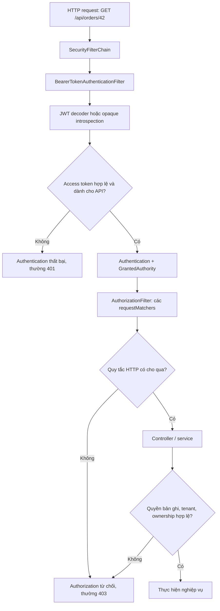

# requestMatchers theo đường dẫn, phương thức và nhu cầu nghiệp vụ

Khi một ứng dụng Spring Security đóng vai trò **OAuth 2.0 Resource Server**, access token hợp lệ chưa có nghĩa người gọi được thực hiện mọi hành động. API cần quyết định **request này được đi tới chức năng nào** dựa trên HTTP method, URL path và quyền đã được cấp. Trong Servlet stack của Spring Security, một công cụ cốt lõi là **`requestMatchers(...)` trong `authorizeHttpRequests(...)`**.

Ví dụ Orders API có các thao tác:

- Khách hàng đọc đơn hàng của mình.
- Khách hàng tạo đơn hàng mới.
- Nhân viên hỗ trợ xem đơn hàng theo chính sách.
- Quản trị viên xem báo cáo hệ thống.
- Một tích hợp máy–máy đồng bộ đơn hàng.
- Khách chưa đăng nhập chỉ truy cập được health/public endpoints cho phép.

Không thể đáp ứng những nhu cầu này bằng một dòng `anyRequest().authenticated()`. Ta cần lập bản đồ đường dẫn, phương thức, authority và các kiểm tra dữ liệu tương ứng.

> **Nguyên tắc trung tâm:** `requestMatchers` xác định **request HTTP nào** được áp một quy tắc; `hasAuthority`, `hasRole`, `authenticated`, `access`... xác định **điều kiện phân quyền** cho request đó. Quyền truy cập **bản ghi cụ thể** thường còn phải được kiểm tra ở method/service layer.

Bài này dùng ngữ cảnh Spring Security Servlet hiện đại với cấu hình bean `SecurityFilterChain` và lambda DSL. Đây là cấu hình định hướng cho **JWT/opaque bearer token Resource Server**; những khác biệt giữa phiên bản Spring Security, Servlet mappings và matcher implementation cần được đối chiếu với môi trường triển khai thực tế.

## 1. Nhìn toàn bộ hành trình xác thực và phân quyền

Một request tới API:

```http
GET /api/orders/42 HTTP/1.1
Host: api.example.test
Authorization: Bearer <ACCESS_TOKEN>
```

Đi qua các bước logic:



Với JWT access token:

```json
{
  "iss": "https://login.example.test/realms/shop",
  "sub": "user-123",
  "aud": ["orders-api"],
  "scope": "orders.read orders.write",
  "exp": 1900000000
}
```

Spring Security thường ánh xạ mỗi scope thành `GrantedAuthority` với tiền tố `SCOPE_`:

```text
scope:
  orders.read
  orders.write

GrantedAuthority:
  SCOPE_orders.read
  SCOPE_orders.write
```

Sau đó `requestMatchers(HttpMethod.GET, "/api/orders/**").hasAuthority("SCOPE_orders.read")` có thể kiểm tra **scope đọc** cho các GET routes tương ứng. Nhưng quyền đọc đơn hàng số 42 thuộc người khác không thể được suy ra chỉ từ scope.

### 1.1. Hai tầng quyết định

| Tầng | Câu hỏi | Ví dụ |
|---|---|---|
| **Authentication** | Token có được issuer tin cậy cấp, còn hiệu lực và dành cho API này không? | Kiểm tra chữ ký/issuer/audience/expiry hoặc introspection |
| **HTTP authorization** | Loại HTTP request này có yêu cầu scope/role nào? | `GET /api/orders/**` cần `SCOPE_orders.read` |
| **Object/business authorization** | Caller có quyền với đơn hàng/tenant cụ thể không? | `user-123` có sở hữu hoặc được chia sẻ order 42? |

Ba tầng này bổ trợ nhau, không thay nhau.

## 2. `authorizeHttpRequests` và `requestMatchers` giải quyết gì?

Spring Security Servlet có DSL:

```java
http.authorizeHttpRequests(authorize -> authorize
    .requestMatchers(HttpMethod.GET, "/api/orders/**")
        .hasAuthority("SCOPE_orders.read")
    .requestMatchers(HttpMethod.POST, "/api/orders")
        .hasAuthority("SCOPE_orders.write")
    .anyRequest().denyAll()
);
```

Cách đọc từng dòng:

1. Nếu request khớp **method GET** và **path pattern `/api/orders/**`**, yêu cầu authority `SCOPE_orders.read`.
2. Nếu request khớp **method POST** và **path `/api/orders`**, yêu cầu authority `SCOPE_orders.write`.
3. Những request không khớp quy tắc nào phía trên **bị từ chối**.

`requestMatchers` nhận các matcher để chọn request; phần phía sau, như `permitAll()`, `authenticated()`, `hasAuthority(...)`, là điều kiện authorization.

### 2.1. Authorization không phải authentication

Một rule:

```java
.anyRequest().authenticated()
```

chỉ yêu cầu request có một `Authentication` đạt điều kiện authenticated theo Spring Security. Nó **không tương đương** “có scope phù hợp” hoặc “có quyền trên mọi dữ liệu”.

Trong API có nhiều endpoint nhạy cảm, nên mô tả tường minh các quyền và có fallback phù hợp:

```java
.anyRequest().denyAll()
```

Điều này biến một endpoint mới chưa được đưa vào chính sách thành **bị chặn theo mặc định**. Khi thêm API route, người phát triển phải chủ động quyết định rule phân quyền của route đó.

### 2.2. HTTP method và path là hai trục

Cùng path `/api/orders/42` có thể phục vụ nhiều hành động:

| HTTP method | Ví dụ | Nhu cầu nghiệp vụ | Authority minh họa |
|---|---|---|---|
| `GET` | `GET /api/orders/42` | Xem đơn hàng | `SCOPE_orders.read` |
| `PATCH` | `PATCH /api/orders/42` | Sửa thông tin đơn hàng | `SCOPE_orders.write` |
| `DELETE` | `DELETE /api/orders/42` | Xóa/hủy theo chính sách | `SCOPE_orders.delete` |
| `POST` | `POST /api/orders/42/cancel` | Yêu cầu hủy đơn hàng | `SCOPE_orders.cancel` |

Nếu chỉ dùng:

```java
.requestMatchers("/api/orders/**")
    .hasAuthority("SCOPE_orders.read")
```

thì rule bao phủ **nhiều phương thức HTTP**, trong đó có thể cả thao tác ghi/hủy. Đây là lỗi thiết kế thường gặp: *đường dẫn giống nhau nhưng mức độ rủi ro của từng method khác nhau*.

**Khi quyền đọc và quyền ghi khác nhau, hãy biểu diễn cả HTTP method lẫn path.**

## 3. Phương thức `requestMatchers(...)` theo HTTP method

Đối với những API REST thông dụng, các đối số cơ bản:

```java
.requestMatchers(HttpMethod.GET, "/api/orders/**")
.requestMatchers(HttpMethod.POST, "/api/orders")
.requestMatchers(HttpMethod.PUT, "/api/orders/**")
.requestMatchers(HttpMethod.PATCH, "/api/orders/**")
.requestMatchers(HttpMethod.DELETE, "/api/orders/**")
```

Các quy tắc nghiệp vụ có thể khác nhau:

- `GET`: đọc dữ liệu, thường ít đặc quyền hơn.
- `POST`: tạo tài nguyên, submit hành động hoặc khởi động workflow.
- `PUT`: cập nhật/thay thế tài nguyên.
- `PATCH`: cập nhật một phần, có thể tác động những trường nhạy cảm.
- `DELETE`: xóa/vô hiệu hóa, thường cần quyền chặt hơn.
- `HEAD`: trả metadata; vẫn phải xét tính nhạy cảm của thông tin và mapping của framework.
- `OPTIONS`: thường xuất hiện trong CORS preflight; cần xử lý theo chính sách CORS, không cho phép vô điều kiện mọi request trên hệ thống.

**HTTP method chỉ là tín hiệu của contract API**, không tự mang nghĩa an toàn. Một endpoint `GET` có side effect là thiết kế API đáng xem lại; một endpoint `POST` xuất báo cáo chỉ đọc dữ liệu nhưng có thể lộ thông tin nhạy cảm. Authorization phải dựa trên nghiệp vụ thực tế chứ không chỉ tên method.

### 3.1. Phân biệt POST tạo tài nguyên và POST hành động

Hai endpoint có thể đều dùng `POST` nhưng cần quyền riêng:

```http
POST /api/orders
POST /api/orders/42/cancel
```

Ta có thể tách:

```java
.requestMatchers(HttpMethod.POST, "/api/orders")
    .hasAuthority("SCOPE_orders.write")
.requestMatchers(HttpMethod.POST, "/api/orders/*/cancel")
    .hasAuthority("SCOPE_orders.cancel")
```

Pattern `*` trong ví dụ minh họa khớp một phần path theo cơ chế matching tương ứng. Cần xác nhận ý nghĩa wildcard theo matcher được chọn và routing của ứng dụng; không giả định mọi engine matcher có cùng quy tắc.

Nếu hành động hủy có điều kiện “chỉ người tạo đơn hoặc nhân viên được ủy quyền mới hủy”, thêm một kiểm tra nghiệp vụ tại service sau khi đã có scope.

## 4. Path pattern và độ cụ thể

Trong Spring Security, có thể thấy các pattern như:

```text
/api/orders
/api/orders/*
/api/orders/**
/api/admin/**
/public/**
```

Ý nghĩa trực giác:

| Pattern | Dùng để mô tả | Điểm cần cẩn trọng |
|---|---|---|
| `/api/orders` | Endpoint collection đúng path | Không mặc định bao gồm mọi item con |
| `/api/orders/*` | Một phần path con theo matcher | Không nên giả định khớp nhiều tầng path |
| `/api/orders/**` | Các path trong nhánh Orders API | Có thể bao trùm route đặc biệt như export/admin nếu đặt cấu trúc URL không tốt |
| `/api/admin/**` | Nhánh quản trị | Không có nghĩa tự động yêu cầu role nếu chưa gắn rule |
| `/public/**` | Nhánh được coi là công khai | Phải có quyết định nghiệp vụ rằng mọi route mới trong nhánh có thể public |

**Cơ chế cụ thể phụ thuộc loại `RequestMatcher`.** Spring Security phiên bản hiện đại có thể chọn matcher theo Spring MVC, path patterns hoặc implementation tương ứng; điều này ảnh hưởng cú pháp, trailing slash, servlet path, encoded path và những trường hợp đặc biệt. Không trộn quy tắc của `AntPathRequestMatcher`, `MvcRequestMatcher` hay `PathPatternRequestMatcher` như thể chúng luôn giống nhau.

Ví dụ, `/api/orders/**` là một mẫu rộng, phù hợp cho quyền đọc chung của Orders API, nhưng nếu trong nhánh đó có `/api/orders/admin/export` cần quyền đặc biệt thì phải ưu tiên rule cụ thể hơn.

### 4.1. Đường dẫn quan trọng hơn cách đặt tên controller

Một method Java:

```java
@GetMapping("/api/orders/{orderId}")
public OrderDto findById(@PathVariable String orderId) {
    // ...
}
```

được bảo vệ bởi chính sách HTTP thông qua path request, không phải tự động theo tên method `findById`.

Nếu controller đổi path từ `/api/orders/{orderId}` sang `/api/v2/orders/{orderId}`, rule matcher cũ có thể không còn bảo vệ route mới theo ý định. Vì vậy, đường dẫn trong controller và chính sách phân quyền cần được duy trì đồng bộ.

## 5. **Thứ tự khai báo quy tắc quyết định kết quả**

Một điểm dễ gây lỗi trong `authorizeHttpRequests` là **quy tắc đầu tiên khớp request sẽ được dùng để quyết định authorization** trong danh sách rule tương ứng.

Ví dụ sai:

```java
.authorizeHttpRequests(auth -> auth
    .requestMatchers("/api/orders/**").authenticated()
    .requestMatchers(HttpMethod.GET, "/api/orders/admin/export")
        .hasAuthority("SCOPE_orders.export")
    .anyRequest().denyAll()
)
```

Request:

```http
GET /api/orders/admin/export
```

đã khớp `/api/orders/**`. Quy tắc thứ hai chặt hơn không còn cơ hội quyết định request theo cách dự kiến. Một token đã xác thực nhưng không có `orders.export` có thể vượt qua **HTTP authorization** của route này, nếu không có kiểm tra khác.

Cách tốt hơn:

```java
.authorizeHttpRequests(auth -> auth
    .requestMatchers(HttpMethod.GET, "/api/orders/admin/export")
        .hasAuthority("SCOPE_orders.export")
    .requestMatchers(HttpMethod.GET, "/api/orders/**")
        .hasAuthority("SCOPE_orders.read")
    .anyRequest().denyAll()
)
```

**Đặt rule cụ thể/nhạy cảm trước, rule bao phủ rộng hơn sau**, rồi đến fallback.

### 5.1. Không có cơ chế tự ưu tiên pattern “đặc biệt nhất”

Đừng dựa trên giả định Spring Security sẽ luôn phân tích mọi rules, tự chọn pattern cụ thể nhất và bỏ qua thứ tự do developer viết. Trong DSL authorization theo request matchers, **thứ tự của các entry là một phần của chính sách**.

Vì vậy:

```java
.requestMatchers("/api/**").permitAll()
.requestMatchers("/api/admin/**").hasRole("ADMIN")
```

là một lỗi nghiêm trọng: rule public quá rộng có thể chặn mọi cơ hội áp role admin phía dưới.

### 5.2. Bảng ví dụ thứ tự matcher

| Request | Rule đầu tiên khớp | Quyết định |
|---|---|---|
| `GET /api/orders/admin/export` | `GET /api/orders/admin/export` | Yêu cầu `SCOPE_orders.export` |
| `GET /api/orders/42` | `GET /api/orders/**` | Yêu cầu `SCOPE_orders.read` |
| `POST /api/orders` | `POST /api/orders` | Yêu cầu `SCOPE_orders.write` |
| `DELETE /api/orders/42` | `DELETE /api/orders/**` | Yêu cầu `SCOPE_orders.delete` |
| `GET /api/unknown` | `anyRequest().denyAll()` | Từ chối |

Thứ tự có ảnh hưởng bảo mật ngay cả khi cùng một URL được mô tả bởi nhiều patterns.

## 6. Thiết kế chính sách từ nhu cầu nghiệp vụ trước khi viết Java

Hãy xác định **ai có thể thực hiện hành động nào** bằng bảng contract API.

Giả sử Shop API có các nhóm caller:

- **Khách hàng đã đăng nhập:** đọc và tạo đơn của chính họ.
- **Nhân viên hỗ trợ:** đọc những đơn được phép hỗ trợ, không được sửa thanh toán.
- **Nhân viên kho:** xem đơn để giao hàng và cập nhật trạng thái giao.
- **Dịch vụ đồng bộ:** đọc danh sách phục vụ tích hợp.
- **Quản trị viên:** quản lý nghiệp vụ được phân quyền riêng, không mặc định “làm mọi thứ”.
- **Khách không đăng nhập:** chỉ truy cập tài nguyên đã xác định là public.

Bảng yêu cầu mẫu:

| Route và method | Mục đích | Quyền HTTP tối thiểu | Điều kiện nghiệp vụ bổ sung |
|---|---|---|---|
| `GET /public/catalog` | Xem catalog công khai | `permitAll` | Dữ liệu trả về thật sự public |
| `GET /api/orders` | Liệt kê đơn | `SCOPE_orders.read` | Chỉ trả đơn caller được phép xem |
| `GET /api/orders/{id}` | Xem đơn | `SCOPE_orders.read` | Ownership/tenant/chia sẻ |
| `POST /api/orders` | Tạo đơn | `SCOPE_orders.write` | Kiểm tra customer, hàng hóa, giới hạn |
| `PATCH /api/orders/{id}` | Sửa đơn | `SCOPE_orders.write` | Chỉ sửa field và trạng thái được phép |
| `POST /api/orders/{id}/cancel` | Hủy đơn | `SCOPE_orders.cancel` | Quyền với đơn, trạng thái còn được hủy |
| `GET /api/orders/admin/export` | Xuất dữ liệu hàng loạt | `SCOPE_orders.export` | Giới hạn tenant/dữ liệu và audit |
| `DELETE /api/orders/{id}` | Xóa/vô hiệu hóa | `SCOPE_orders.delete` | Chỉ vai trò/chủ thể được duyệt |
| `POST /api/shipments/{id}/dispatch` | Xác nhận giao hàng | `SCOPE_shipments.dispatch` | Kiểm tra quyền kho và trạng thái |
| `GET /internal/health` | Health endpoint | `permitAll` hoặc chính sách riêng | Tách liveness public khỏi thông tin nội bộ |

Bảng này không khẳng định mọi ứng dụng phải dùng những scopes trên. Tên scope là **hợp đồng với Authorization Server**. AS phải cấp scope theo quyền client và user; Resource Server mới kiểm tra authority tương ứng.

### 6.1. Phân biệt “được cấp scope” với “được sở hữu dữ liệu”

Access token:

```json
{
  "sub": "customer-123",
  "aud": ["orders-api"],
  "scope": "orders.read"
}
```

và request:

```http
GET /api/orders/987
```

không chứng minh order 987 thuộc customer-123. `hasAuthority("SCOPE_orders.read")` kiểm tra **loại quyền**. Service phải kiểm tra quan hệ giữa chủ thể và bản ghi.

Nếu quên bước này, rất dễ gặp lỗi **IDOR/BOLA** (*insecure direct object reference/broken object level authorization*): đổi ID trên URL là đọc được dữ liệu của người khác.

## 7. Ví dụ `SecurityFilterChain` cho Orders API

Một cấu hình tham khảo với JWT Resource Server:

```java
@Configuration
@EnableMethodSecurity
public class ApiSecurityConfig {

    @Bean
    SecurityFilterChain apiSecurity(HttpSecurity http) throws Exception {
        return http
            .sessionManagement(session ->
                session.sessionCreationPolicy(
                    SessionCreationPolicy.STATELESS
                )
            )
            .authorizeHttpRequests(auth -> auth
                // Công khai có chủ đích:
                .requestMatchers(HttpMethod.GET, "/public/catalog")
                    .permitAll()
                .requestMatchers(HttpMethod.GET, "/public/health")
                    .permitAll()

                // Chức năng nhạy cảm, đặt trước wildcard:
                .requestMatchers(
                    HttpMethod.GET, "/api/orders/admin/export"
                ).hasAuthority("SCOPE_orders.export")

                .requestMatchers(
                    HttpMethod.POST, "/api/orders/*/cancel"
                ).hasAuthority("SCOPE_orders.cancel")

                .requestMatchers(
                    HttpMethod.DELETE, "/api/orders/**"
                ).hasAuthority("SCOPE_orders.delete")

                .requestMatchers(
                    HttpMethod.GET, "/api/shipments/**"
                ).hasAuthority("SCOPE_shipments.read")

                .requestMatchers(
                    HttpMethod.POST, "/api/shipments/*/dispatch"
                ).hasAuthority("SCOPE_shipments.dispatch")

                // Thao tác Orders thông thường:
                .requestMatchers(
                    HttpMethod.GET, "/api/orders/**"
                ).hasAuthority("SCOPE_orders.read")

                .requestMatchers(
                    HttpMethod.POST, "/api/orders"
                ).hasAuthority("SCOPE_orders.write")

                .requestMatchers(
                    HttpMethod.PUT, "/api/orders/**"
                ).hasAuthority("SCOPE_orders.write")

                .requestMatchers(
                    HttpMethod.PATCH, "/api/orders/**"
                ).hasAuthority("SCOPE_orders.write")

                // Không tự mở route mới:
                .anyRequest().denyAll()
            )
            .oauth2ResourceServer(oauth2 ->
                oauth2.jwt(Customizer.withDefaults())
            )
            .build();
    }
}
```

Các import:

```java
import org.springframework.context.annotation.Bean;
import org.springframework.context.annotation.Configuration;
import org.springframework.http.HttpMethod;
import org.springframework.security.config.Customizer;
import org.springframework.security.config.annotation.method.configuration.EnableMethodSecurity;
import org.springframework.security.config.annotation.web.builders.HttpSecurity;
import org.springframework.security.config.http.SessionCreationPolicy;
import org.springframework.security.web.SecurityFilterChain;
```

Ở đây `STATELESS` là một lựa chọn phổ biến khi API chỉ dùng bearer token qua header. Ví dụ **chưa mô tả toàn bộ chính sách CORS, CSRF, actuator, error dispatch, gateway và các yêu cầu triển khai khác**. Chúng cần được cấu hình theo cách ứng dụng thật nhận credentials.

### 7.1. Tại sao không kết thúc bằng `anyRequest().authenticated()`?

Nếu thêm một endpoint mới:

```http
POST /api/admin/refund-all
```

mà chưa có matcher riêng, fallback `authenticated()` có thể cho qua bất kỳ caller đã xác thực nào, thiếu quyền hoàn tiền. Với fallback `denyAll()`, endpoint này bị chặn ở HTTP authorization cho đến khi có quyết định quyền rõ ràng.

Trong môi trường yêu cầu quản trị chặt, **deny-by-default giúp giảm rủi ro mở quyền khi bổ sung route mới**.

### 7.2. Vì sao route export cần được đặt trước GET wildcard?

Nếu `GET /api/orders/admin/export` khớp `GET /api/orders/**` và rule wildcard đứng trước, caller chỉ cần §orders.read§. Đặt `SCOPE_orders.export` trước giúp áp quyền nhạy cảm dành riêng cho xuất hàng loạt.

Dù vậy, nếu endpoint `/api/orders/admin/export` mang dữ liệu rất nhạy cảm, có thể cần giới hạn quyền tenant, audit, số lượng và chính sách export ngay ở service. Scope một mình không giải quyết hết rủi ro.

### 7.3. Endpoint chưa được liệt kê sẽ như thế nào?

Với `anyRequest().denyAll()`, các route khác như:

```http
POST /api/orders/42/approve
GET  /api/admin/config
PATCH /api/users/123
```

sẽ bị từ chối ở authorization nếu không khớp entry được phép trước đó. Điều này không đảm bảo mọi route đã có chính sách đúng, nhưng giữ mặc định đóng thay vì mở.

## 8. Phân biệt `hasAuthority`, `hasRole`, `authenticated` và `permitAll`

Các method thường dùng trong `authorizeHttpRequests`:

| Method | Ý nghĩa | Dùng khi nào |
|---|---|---|
| `permitAll()` | Cho phép request ở bước HTTP authorization | Tài nguyên được chủ đích công khai |
| `authenticated()` | Yêu cầu caller có Authentication phù hợp | Endpoint chỉ cần người dùng/app đã xác thực |
| `hasAuthority("SCOPE_x")` | Yêu cầu đúng một authority | OAuth 2.0 scope hoặc permission được chuyển thành authority |
| `hasAnyAuthority("A", "B")` | Chấp nhận ít nhất một authority trong tập | Nhiều quyền tương đương đủ để gọi endpoint |
| `hasRole("ADMIN")` | Yêu cầu role theo convention §ROLE_ADMIN§ | Khi hệ thống đã map role vào Spring Security đúng |
| `hasAnyRole("A", "B")` | Cho phép một trong các roles | Hệ thống role-based |
| `access(customAuthorizationManager)` | Áp logic tùy chỉnh | Rule HTTP phức tạp, cần context request |
| `denyAll()` | Từ chối request | Mặc định đóng hoặc route bị cấm |

### 8.1. Scope không tự là role

Token có:

```json
{
  "scope": "orders.read",
  "roles": ["ORDER_MANAGER"]
}
```

Cấu hình JWT mặc định thường chuyển scope thành:

```text
SCOPE_orders.read
```

nhưng **không tự tạo §ROLE_ORDER_MANAGER§ từ claim §roles§** trừ khi có converter phù hợp.

Vì thế:

```java
.hasAuthority("SCOPE_orders.read")
```

thường đúng cho scope đọc, còn:

```java
.hasRole("ORDER_MANAGER")
```

chỉ hoạt động khi §GrantedAuthority=ROLE_ORDER_MANAGER§ đã được tạo từ nguồn claim được issuer tin cậy.

Không trộn:

```java
.hasRole("SCOPE_orders.read")
```

vì §hasRole§ dùng quy ước role prefix chứ không mang ý nghĩa kiểm tra scope một cách trực tiếp.

### 8.2. §authenticated()§ không đủ cho dữ liệu nhạy cảm

Với:

```java
.requestMatchers("/api/orders/**").authenticated()
```

API chỉ yêu cầu một người/app đã xác thực. Nó không ràng buộc quyền đọc hay ghi, và càng không kiểm tra ownership. Đối với nghiệp vụ có quyền rõ, hãy dùng authority cụ thể và kiểm tra đối tượng.

### 8.3. §permitAll()§ không có nghĩa bypass toàn bộ filter

`permitAll()` cho phép request tại bước authorization. Nó **không nhất thiết bỏ qua mọi security filter**: ví dụ BearerTokenAuthenticationFilter vẫn có thể thấy một bearer token không hợp lệ và xử lý lỗi tùy cấu hình, dù path được xem là public.

Không nên dùng `web.ignoring()` để “đỡ lỗi” ở endpoint công khai nếu vẫn cần headers bảo mật, quan sát và các filter liên quan. `permitAll` thường là lựa chọn phù hợp hơn khi route vẫn đi qua SecurityFilterChain.

## 9. `hasAnyAuthority`: nhiều quyền có cùng khả năng thực hiện

Giả sử endpoint đọc đơn hàng cho phép **khách hàng có scope đọc** hoặc **tích hợp hỗ trợ được cấp quyền hỗ trợ**:

```java
.requestMatchers(HttpMethod.GET, "/api/orders/**")
    .hasAnyAuthority(
        "SCOPE_orders.read",
        "SCOPE_support.orders.read"
    )
```

Đây là logic **OR** tại HTTP authorization: caller chỉ cần một trong hai authorities.

Nhưng endpoint vẫn phải kiểm tra ai được xem **đơn hàng cụ thể**:

- Khách hàng chỉ xem đơn của mình hoặc đơn được chia sẻ.
- Nhân viên hỗ trợ chỉ xem dữ liệu trong tenant/phạm vi được phân công.
- Dịch vụ đồng bộ có thể cần giới hạn tổ chức hoặc purpose.

Một quyền §support.orders.read§ không mặc nhiên cho xem mọi đơn hàng trong tất cả tenants. Nếu scope dự kiến rất rộng, cần chính sách dữ liệu và audit tương ứng.

### 9.1. Khi cần yêu cầu đồng thời nhiều authority

Nếu thao tác đòi **cả** hai quyền, dùng một cơ chế kiểm tra AND thích hợp; `hasAnyAuthority` không đủ.

Ví dụ ở method security:

```java
@PreAuthorize(
    "hasAuthority('SCOPE_orders.read') and " +
    "hasAuthority('SCOPE_reports.export')"
)
public byte[] exportOrders() {
    // ...
}
```

Hoặc cấu hình `AuthorizationManager` kết hợp các điều kiện tương ứng ở HTTP layer theo API của phiên bản Spring Security. Không hiểu `hasAnyAuthority(A, B)` là “phải có A và B”.

## 10. `requestMatchers` không thay quyền trên bản ghi

Xét hai requests cùng route pattern:

```http
GET /api/orders/42
GET /api/orders/99
```

Cả hai có thể khớp `GET /api/orders/**` và caller có §SCOPE_orders.read§. Nhưng đơn 42 thuộc caller, đơn 99 thuộc tenant khác.

**HTTP matcher không tự hiểu ID 42/99 thuộc ai.** Cần một lớp kiểm tra nghiệp vụ.

### 10.1. Ví dụ method security với `@PreAuthorize`

Bật method security:

```java
@Configuration
@EnableMethodSecurity
public class MethodSecurityConfiguration {
}
```

Trong service:

```java
@Service
public class OrderService {

    private final OrderRepository repository;
    private final OrderAccessPolicy accessPolicy;

    public OrderService(
            OrderRepository repository,
            OrderAccessPolicy accessPolicy) {
        this.repository = repository;
        this.accessPolicy = accessPolicy;
    }

    @PreAuthorize(
        "hasAuthority('SCOPE_orders.read') and " +
        "@orderAccessPolicy.canRead(authentication, #orderId)"
    )
    public OrderDto getOrder(String orderId) {
        Order order = repository.findById(orderId)
            .orElseThrow(OrderNotFoundException::new);

        return OrderDto.from(order);
    }
}
```

Ví dụ bean policy:

```java
@Component("orderAccessPolicy")
public class OrderAccessPolicy {

    private final OrderRepository repository;

    public OrderAccessPolicy(OrderRepository repository) {
        this.repository = repository;
    }

    public boolean canRead(
            Authentication authentication,
            String orderId) {

        if (authentication == null ||
                !authentication.isAuthenticated()) {
            return false;
        }

        String subject = authentication.getName();

        return repository.existsReadableBySubject(
            orderId,
            subject
        );
    }
}
```

Đây là ví dụ **mô hình nghiệp vụ**, không phải lớp repository có sẵn của Spring. §existsReadableBySubject(...)§ cần được triển khai theo schema thật; phải bảo đảm kiểm tra tenant, quan hệ sở hữu, chia sẻ hoặc quyền hỗ trợ theo đúng contract. Tên principal không phải lúc nào cũng là user ID; nếu JWT mapping dùng claim khác, policy phải lấy **định danh subject đáng tin** phù hợp.

Với SpEL tham số `#orderId`, cần bảo đảm Spring Security nhìn thấy tên tham số (ví dụ biên dịch với `-parameters` hoặc chỉ định tham số theo cơ chế được hỗ trợ). Không dùng biểu thức không tìm ra tên tham số rồi bỏ kiểm tra quyền để giải quyết lỗi.

### 10.2. Tránh truy vấn thiếu tenant

Giả sử Order ID chỉ duy nhất trong từng tenant:

```text
tenant A, order 42
tenant B, order 42
```

Một truy vấn chỉ dùng §id=42§ có thể tìm nhầm bản ghi của tenant khác. Quy tắc an toàn thường cần tổ hợp:

```text
orderId
+ tenant được phép
+ subject/client service principal
+ vai trò/chính sách sharing
+ trạng thái nghiệp vụ
```

Đối với multi-tenant system, nên đưa điều kiện tenant vào truy vấn dữ liệu hoặc policy gắn với repository/service, thay vì chỉ so sánh ID path sau khi đã tải mọi dữ liệu.

### 10.3. Khi kiểm tra HTTP bằng custom AuthorizationManager

Ngoài `@PreAuthorize`, Spring Security có thể dùng `access(...)` với một `AuthorizationManager<RequestAuthorizationContext>`. Cách này phù hợp nếu chính sách thật sự thuộc **request layer** và cần khai thác path variables hoặc những thuộc tính HTTP đáng tin đã được diễn giải.

Ví dụ khái niệm:

```java
.requestMatchers(HttpMethod.GET, "/api/tenants/{tenantId}/orders/**")
    .access(tenantAuthorizationManager)
```

Manager được xây dựng để đánh giá `Authentication` cùng context của request. Tuy nhiên, không phải mọi request matcher đều cung cấp variables theo cùng cách; implementation và phiên bản Spring Security quyết định khả năng trích xuất. Với quyền sở hữu bản ghi phụ thuộc DB, phương án **service/method authorization** thường rõ ràng hơn.

## 11. Matcher precedence khi có nhiều nhóm URL

Một hệ thống có thể có các nhánh:

```text
/api/orders/**
/api/orders/admin/**
/api/reports/**
/api/admin/**
/public/**
/internal/**
```

Với phạm vi rộng, có nhiều cách tổ chức. Nguyên tắc:

1. Rule public **chỉ dành cho endpoint thật sự public**.
2. Rule admin/export/cancel/delete **đặt trước** rule wildcard cùng nhánh.
3. Quyền ghi và quyền đọc **tách theo method**.
4. Fallback toàn hệ thống **denyAll** khi không có lý do mở route mới.
5. Không cho path chứa tên “admin” tự động được bảo vệ nếu không có matcher/policy tương ứng.

Ví dụ:

```java
.authorizeHttpRequests(auth -> auth
    .requestMatchers(HttpMethod.GET, "/public/catalog")
        .permitAll()
    .requestMatchers(HttpMethod.GET, "/api/orders/admin/export")
        .hasAuthority("SCOPE_orders.export")
    .requestMatchers(HttpMethod.GET, "/api/orders/**")
        .hasAuthority("SCOPE_orders.read")
    .requestMatchers(HttpMethod.POST, "/api/orders")
        .hasAuthority("SCOPE_orders.write")
    .anyRequest().denyAll()
)
```

Không viết:

```java
.authorizeHttpRequests(auth -> auth
    .requestMatchers("/api/**").permitAll()
    .requestMatchers("/api/admin/**").hasRole("ADMIN")
    .anyRequest().authenticated()
)
```

Vì rule public ở đầu có thể bao phủ cả admin branch trước khi rule role được xét.

### 11.1. Request pattern thay đổi theo base path/deployment

Một số ứng dụng chạy sau gateway:

```text
Public URL:
  https://gateway.example.test/shop/api/orders/42

Internal Servlet route:
  /api/orders/42
```

HTTP request mà Spring Security thấy phụ thuộc context path, servlet path, forward headers và cấu hình gateway. **Không tự thêm prefix `/shop` vào matcher chỉ vì URL public có prefix đó**, nếu gateway đã strip nó trước khi gửi vào Servlet container.

Ngược lại, không viết matcher bỏ qua servlet path khi ứng dụng có nhiều servlets với các mapping khác nhau. Hãy hiểu đường dẫn được parser/matcher tương ứng sử dụng, thay vì dựa vào cảm giác từ URL ngoài trình duyệt.

### 11.2. Query parameters không thay thế path/method authorization

Hai URLs:

```http
GET /api/orders/42?format=short
GET /api/orders/42?format=full
```

thường cùng được chọn bởi matcher path/method. Nếu `format=full` làm lộ dữ liệu bổ sung nhạy cảm, một rule chung `GET /api/orders/**` không tự kiểm tra quyền phụ. Cần policy nghiệp vụ hoặc custom AuthorizationManager/endpoint riêng, vì query parameters có thể do caller chọn.

Tương tự, `?admin=true` không nên trở thành cách bật quyền admin trong code service.

## 12. `securityMatcher` khác `requestMatchers` như thế nào?

Một nhầm lẫn rất phổ biến là xem hai API này như một.

- **`http.securityMatcher(...)`**: xác định **request nào thuộc về cả SecurityFilterChain** này.
- **`authorizeHttpRequests(...).requestMatchers(...)`**: xác định **quy tắc authorization bên trong chain đã được chọn**.

Ví dụ một hệ thống có API bearer và giao diện web dùng session:

```java
@Bean
@Order(1)
SecurityFilterChain apiChain(HttpSecurity http) throws Exception {
    return http
        .securityMatcher("/api/**")
        .authorizeHttpRequests(auth -> auth
            .requestMatchers(HttpMethod.GET, "/api/orders/**")
                .hasAuthority("SCOPE_orders.read")
            .anyRequest().denyAll()
        )
        .oauth2ResourceServer(oauth2 ->
            oauth2.jwt(Customizer.withDefaults()))
        .build();
}
```

Chain này chỉ áp cho các request được matcher `/api/**` chọn. Rule `anyRequest().denyAll()` ở đây **chỉ là fallback trong phạm vi chain API**. Nó không tự bảo vệ `/admin/**` hoặc `/public/**` nếu những request đó đi vào chain khác hoặc không được chain nào bảo vệ.

Có thể có chain thứ hai cho web UI:

```java
@Bean
@Order(2)
SecurityFilterChain webChain(HttpSecurity http) throws Exception {
    return http
        .authorizeHttpRequests(auth -> auth
            .requestMatchers("/login", "/assets/**").permitAll()
            .anyRequest().authenticated()
        )
        .formLogin(Customizer.withDefaults())
        .build();
}
```

Các import liên quan:

```java
import org.springframework.core.annotation.Order;
import org.springframework.context.annotation.Bean;
import org.springframework.http.HttpMethod;
import org.springframework.security.config.Customizer;
import org.springframework.security.config.annotation.web.builders.HttpSecurity;
import org.springframework.security.web.SecurityFilterChain;
```

Đây là hai cấu hình **minh họa cho các chains khác nhau**. Trong app thật cần xét session, CSRF, CORS, endpoints, authentication provider, exception handling và những servlet paths đặc thù. Không ghép rời rạc các snippets này vào cùng một class mà quên các dependency/bean cần thiết.

### 12.1. Chain selection cũng có thứ tự

Với nhiều `SecurityFilterChain`, Spring Security sẽ chọn chain **đầu tiên có matcher phù hợp** theo thứ tự được cấu hình. Nếu chain tổng quát đứng trước chain chuyên biệt, chain chuyên biệt có thể không được áp cho request mong muốn.

Một lỗi:

```text
Chain A: match mọi request, @Order(1)
Chain B: match /api/**,    @Order(2)
```

Các request `/api/**` có thể bị Chain A bắt trước, khiến JWT Resource Server rules trong B không chạy.

Vì vậy, ở cả cấp **chọn filter chain** lẫn cấp **chọn authorization rule trong một chain**, precedence đều rất quan trọng.

### 12.2. Không có chain nào match thì sao?

Nếu một request không được SecurityFilterChain nào chọn, nó có thể **không nhận được biện pháp bảo vệ của Spring Security**. Do đó, khi dùng nhiều chain, cần rà phạm vi toàn bộ routes và thiết kế fallback tổng quát phù hợp.

Đừng nghĩ `anyRequest().denyAll()` của chain chỉ bảo vệ `/api/**` sẽ từ chối mọi path của toàn ứng dụng.

## 13. Kết hợp JWT Resource Server với phân quyền HTTP

Một cấu hình JWT Resource Server có thể dùng:

```yaml
spring:
  security:
    oauth2:
      resourceserver:
        jwt:
          issuer-uri: https://login.example.test/realms/shop
          audiences:
            - orders-api
```

Ở những phiên bản Spring Boot hỗ trợ property audience, đây là ràng buộc token **được cấp cho API này**. Trong filter chain:

```java
.oauth2ResourceServer(oauth2 ->
    oauth2.jwt(Customizer.withDefaults()))
```

giúp Spring Security xác thực JWT rồi tạo `Authentication`.

**Tách hai việc:**

- `audiences: orders-api`: Access token dành cho Resource Server này.
- `hasAuthority("SCOPE_orders.read")`: Access token được cấp quyền đọc Orders API.

Một token có chữ ký và audience hợp lệ nhưng thiếu scope vẫn không vượt qua HTTP authorization của endpoint đọc.

### 13.1. Opaque token cũng dùng được cùng HTTP rules

Nếu Authorization Server phát hành opaque token, Resource Server có thể dùng introspection:

```java
.oauth2ResourceServer(oauth2 ->
    oauth2.opaqueToken(Customizer.withDefaults()))
```

Khi introspection thành công và scope được ánh xạ thành authorities, những `requestMatchers(...).hasAuthority("SCOPE_orders.read")` vẫn có thể áp dụng. Tuy nhiên, contract introspection phải xác định đúng issuer/resource binding, scope và principal.

Không nên giả định tất cả opaque token đều có cùng attributes hoặc authority mapping với JWT. Cần thiết kế theo metadata mà Authorization Server thực sự cung cấp.

## 14. Ánh xạ scope và role trước khi đặt matcher rules

Nếu Spring Security mặc định tạo §SCOPE_...§ từ claim §scope§ hoặc §scp§, quy tắc sau phù hợp:

```java
.requestMatchers(HttpMethod.GET, "/api/orders/**")
    .hasAuthority("SCOPE_orders.read")
```

Nếu issuer phát hành claim khác:

```json
{
  "permissions": ["orders:read", "orders:export"]
}
```

có thể cần `JwtGrantedAuthoritiesConverter` tùy biến:

```java
JwtGrantedAuthoritiesConverter grantedAuthorities =
    new JwtGrantedAuthoritiesConverter();

grantedAuthorities.setAuthoritiesClaimName("permissions");
grantedAuthorities.setAuthorityPrefix("PERM_");

JwtAuthenticationConverter converter =
    new JwtAuthenticationConverter();

converter.setJwtGrantedAuthoritiesConverter(grantedAuthorities);
```

Rồi đặt quy tắc:

```java
.requestMatchers(HttpMethod.GET, "/api/orders/**")
    .hasAuthority("PERM_orders:read")
```

Các import:

```java
import org.springframework.security.oauth2.server.resource.authentication.JwtAuthenticationConverter;
import org.springframework.security.oauth2.server.resource.authentication.JwtGrantedAuthoritiesConverter;
```

**Không gọi `hasRole("orders:read")` khi authority thực tế là `PERM_orders:read`.** Tên trong matcher rule phải khớp authority do converter tạo.

### 14.1. Tránh tin role tự khai trong body/query

Không được dùng:

```http
POST /api/orders
Content-Type: application/json

{"role":"ADMIN","order":{...}}
```

để kết luận caller có quyền quản trị. Role/scope dùng authorization phải đến từ §Authentication§ được xác thực hoặc nguồn quyền server-side đáng tin cậy.

### 14.2. Scope trong token không thay issuer/audience validation

Nếu JWT có:

```json
"scope": "orders.read"
```

nhưng audience chỉ là `payments-api`, Orders API phải từ chối token ở bước xác thực token, trước khi cấp quyền dựa trên scope. Không xây dựng HTTP matcher logic để “bù” cho việc decoder bỏ issuer/audience validation.

## 15. CORS preflight và HTTP OPTIONS

Frontend trên domain khác có thể cần CORS preflight:

```http
OPTIONS /api/orders
Origin: https://app.example.test
Access-Control-Request-Method: POST
Access-Control-Request-Headers: authorization,content-type
```

Preflight thường **không mang access token**. Nếu backend buộc preflight phải authenticated trước khi áp CORS, browser có thể bị chặn và báo lỗi CORS.

Một hướng cấu hình Servlet:

```java
http.cors(Customizer.withDefaults());
```

với một `CorsConfigurationSource` có chính sách rõ:

```java
@Bean
UrlBasedCorsConfigurationSource corsConfigurationSource() {
    CorsConfiguration config = new CorsConfiguration();

    config.setAllowedOrigins(
        List.of("https://app.example.test")
    );
    config.setAllowedMethods(
        List.of("GET", "POST", "PUT", "PATCH", "DELETE")
    );
    config.setAllowedHeaders(
        List.of("Authorization", "Content-Type")
    );

    UrlBasedCorsConfigurationSource source =
        new UrlBasedCorsConfigurationSource();

    source.registerCorsConfiguration("/api/**", config);
    return source;
}
```

Imports minh họa:

```java
import java.util.List;
import org.springframework.context.annotation.Bean;
import org.springframework.web.cors.CorsConfiguration;
import org.springframework.web.cors.UrlBasedCorsConfigurationSource;
```

Tùy phiên bản Spring Security, cách khai báo bean CORS/đấu nối cho filter chain có thể thay đổi. Cần xác minh CORS thực sự được xử lý **trước khi cơ chế xác thực yêu cầu bearer token**.

### 15.1. Không đơn giản là “cho phép tất cả OPTIONS”

Rule:

```java
.requestMatchers(HttpMethod.OPTIONS, "/**").permitAll()
```

có thể làm thay đổi authorization cho mọi OPTIONS request, không chỉ CORS preflight hợp lệ. Nếu có endpoint OPTIONS mang nghiệp vụ hoặc nhiều vùng bảo mật, cần chính sách tương ứng. Ưu tiên cấu hình CORS được kiểm soát đúng origin, method và headers thay vì mở rộng toàn cục chỉ để xử lý lỗi frontend.

CORS **không thay authorization của API**. Một browser origin được phép gửi request vẫn phải cung cấp access token hợp lệ và đủ scope cho request thực tế, ví dụ POST sau preflight.

### 15.2. Phân biệt CORS và CSRF

CORS kiểm soát chính sách truy cập cross-origin từ trình duyệt; CSRF liên quan các request có thể tự mang thông tin xác thực (ví dụ cookie). Nếu Resource Server **chỉ nhận bearer token được client chủ động đưa vào Authorization header** và không dùng session/cookie authentication, có thể có lý do cấu hình CSRF phù hợp với API stateless.

Tuy nhiên, **đừng tắt CSRF mặc định chỉ vì ứng dụng có Spring Security**, nếu vẫn có cookie/session hoặc endpoint browser-authenticated. `requestMatchers` không thay cho chính sách CSRF.

## 16. Dispatcher types, error handling và đường dẫn đặc biệt

Trong Servlet container, request còn có §DispatcherType§, ví dụ §REQUEST§, §ERROR§, §FORWARD§, §ASYNC§. Một số nội dung có thể được forward đến error endpoint hoặc thực hiện dispatch nội bộ.

Khi dùng fallback `denyAll()`, một error dispatch đến `/error` có thể bị từ chối và khiến response lỗi khó quan sát hơn tùy cấu hình filter chain.

Spring Security có khả năng kiểm soát dispatcher types, ví dụ theo phiên bản:

```java
.authorizeHttpRequests(auth -> auth
    .dispatcherTypeMatchers(
        DispatcherType.FORWARD,
        DispatcherType.ERROR
    ).permitAll()
    .requestMatchers(HttpMethod.GET, "/api/orders/**")
        .hasAuthority("SCOPE_orders.read")
    .anyRequest().denyAll()
)
```

Import:

```java
import jakarta.servlet.DispatcherType;
```

**Đây là quyết định chính sách, không phải đoạn bắt buộc mọi dự án phải chép nguyên.** Cho phép toàn bộ ERROR/FORWARD dispatch có thể không phù hợp nếu một forward dẫn tới route nhạy cảm và cách filter/controller được tổ chức đặc biệt. Cần hiểu Servlet dispatcher mapping và nội bộ ứng dụng trước khi áp dụng.

Tương tự, actuator endpoints, static resources, health checks, API docs và H2 console không nên bị mở quyền theo pattern rộng chỉ để tránh lỗi 401. Mỗi nhóm có nhu cầu vận hành và rủi ro riêng.

## 17. Rule nào bảo vệ endpoint health, docs và actuator?

Hệ thống có thể cần:

```text
GET /actuator/health/liveness
GET /actuator/health/readiness
GET /actuator/metrics
GET /v3/api-docs
GET /swagger-ui/index.html
```

Đừng dùng một rule:

```java
.requestMatchers("/actuator/**").permitAll()
```

nếu actuator còn có metrics, env, configprops hoặc endpoints nhạy cảm. Chỉ mở đúng health endpoints được vận hành yêu cầu, và để các endpoint còn lại sau authentication/authorization.

Ví dụ khái niệm:

```java
.requestMatchers(
    HttpMethod.GET,
    "/actuator/health/liveness",
    "/actuator/health/readiness"
).permitAll()
```

Đường dẫn actuator có thể khác nếu cấu hình management port, base-path hoặc endpoint exposure. Không mặc định mọi path ở trên đều có mặt hoặc dùng đúng pattern giống nhau ở mọi Spring Boot application.

API docs cũng có thể công khai trong môi trường dev nhưng phải giới hạn ở production. Mức công khai là **quyết định nghiệp vụ/vận hành**, không tự động vì endpoint là tài liệu.

## 18. Quy tắc theo role và scope khi nghiệp vụ nhiều cấp

Giả sử:

- Khách hàng: scope §orders.read§.
- Nhân viên hỗ trợ: authority §ROLE_SUPPORT§ được ánh xạ theo chính sách.
- Quản trị viên: authority §ROLE_ADMIN§.

Một endpoint đọc có thể cho phép cả khách hàng và hỗ trợ:

```java
.requestMatchers(HttpMethod.GET, "/api/orders/**")
    .hasAnyAuthority(
        "SCOPE_orders.read",
        "ROLE_SUPPORT"
    )
```

Nhưng nếu hỗ trợ và khách hàng có **quyền bản ghi khác nhau**, method/service policy cần biết caller thuộc nhóm nào và áp đúng quy tắc:

```text
Nếu scope orders.read dành cho customer:
  chỉ đọc đơn do customer sở hữu/được chia sẻ

Nếu ROLE_SUPPORT:
  đọc đơn trong tenant và nhóm hỗ trợ được phân công

Nếu ROLE_ADMIN:
  chỉ đọc theo quyền quản trị được cấp, có audit và ranh giới tenant
```

Không mặc định §ROLE_ADMIN§ có tất cả các quyền trong mọi bounded context nếu mô hình nghiệp vụ không cho phép.

### 18.1. Chọn role hay scope?

Scope OAuth 2.0 thường biểu diễn quyền được Authorization Server cấp cho token; role có thể biểu diễn vai trò trong tổ chức hoặc ứng dụng. Có thể dùng cả hai, nhưng phải có hợp đồng:

| Loại | Ví dụ | Khi nào hữu ích |
|---|---|---|
| OAuth scope | `orders.read` | Access token đã được cấp loại thao tác nào |
| Spring authority | `SCOPE_orders.read` | Cách Spring Security biểu diễn scope |
| Role | `ROLE_SUPPORT` | Vai trò hỗ trợ theo chính sách tin cậy |
| Business permission | `CAN_EXPORT_TENANT_42` | Quyền đặc thù do service/policy xác nhận |

Không suy luận role từ tên URL hoặc từ field do client gửi mà không có nguồn xác thực.

## 19. Kiểm tra request method với HEAD, PUT, PATCH, DELETE

Một ứng dụng REST có thể quên bảo vệ các method ít dùng:

```java
.requestMatchers(HttpMethod.GET, "/api/orders/**")
    .hasAuthority("SCOPE_orders.read")
```

Rule GET không nên được hiểu là đã có chính sách đúng cho mọi method khác. Việc HEAD request được Spring MVC hỗ trợ tự động cho GET mapping trong một số trường hợp **không có nghĩa phải giả định Security matcher HTTP method xử lý hoàn toàn giống như vậy trong mọi phiên bản**. Nếu metadata cũng cần quyền đọc, hãy định nghĩa/test chính sách HEAD thích hợp theo contract API.

Tương tự, `PUT` và `PATCH` có thể yêu cầu quyền khác nhau:

```java
.requestMatchers(HttpMethod.PUT, "/api/orders/**")
    .hasAuthority("SCOPE_orders.replace")
.requestMatchers(HttpMethod.PATCH, "/api/orders/**")
    .hasAuthority("SCOPE_orders.edit")
```

Nếu ứng dụng cho phép PATCH thay field nhạy cảm như thông tin thanh toán, mức quyền có thể cao hơn các field thông thường. Không nên gom tất cả mutations vào một scope chung khi nghiệp vụ yêu cầu phân cấp.

### 19.1. Ngăn phương thức ngoài contract

Khi API chỉ định nghĩa GET và POST cho `/api/orders`, fallback `denyAll()` giúp những method không được đưa vào rule không tự được phép.

Việc controller không có mapping cho một method thường dẫn đến §405 Method Not Allowed§, nhưng nếu security layer từ chối trước, client có thể nhận §401/403§. **Mã HTTP cụ thể phụ thuộc thứ tự xử lý và policy**, không nhất thiết là một chỉ báo chính xác endpoint có được triển khai hay không.

## 20. Quyết định policy theo dữ liệu nghiệp vụ

Một tình huống hủy đơn:

```http
POST /api/orders/42/cancel
Authorization: Bearer <ACCESS_TOKEN>
```

Có ít nhất bốn câu hỏi:

1. **Token hợp lệ?** Issuer, thời gian, audience, chữ ký/introspection đúng không?
2. **HTTP authority phù hợp?** Caller có §SCOPE_orders.cancel§ không?
3. **Quyền với đơn 42?** Caller có sở hữu đơn, nằm trong tenant được phép hoặc có quyền hỗ trợ hợp lệ không?
4. **Đơn có còn được hủy?** Nếu đã giao hàng hoặc có trạng thái cấm hủy thì nghiệp vụ phải từ chối, ngay cả caller có quyền.

`requestMatchers` giải quyết trực tiếp **câu 2** theo method/path, còn câu 3 và 4 thuộc chính sách dữ liệu/workflow. Phân biệt này ngăn lỗi “có scope là hủy được đơn của bất kỳ ai ở bất kỳ trạng thái nào”.

### 20.1. Quyền theo thuộc tính resource và trạng thái

Ví dụ contract:

```text
cancel(orderId, caller) allowed if:
  token valid for orders-api
  AND authority includes SCOPE_orders.cancel
  AND (caller owns order OR caller is authorized support)
  AND caller and order are in an allowed tenant relationship
  AND order.status is CANCELLABLE
```

Policy này thuộc mô hình kết hợp **RBAC/ABAC và kiểm soát đối tượng**, không thể biểu diễn đầy đủ chỉ bằng một path matcher.

Nên bố trí các điều kiện ở nơi có quyền truy cập dữ liệu đáng tin, thường là service/domain layer. Nếu mỗi nhánh controller tự viết một điều kiện khác nhau, rất dễ bỏ sót khi thêm endpoints.

## 21. AuthorizationManager với RequestAuthorizationContext

Khi thực sự cần phân quyền HTTP dựa trên request context, có thể sử dụng `access(...)` và một `AuthorizationManager<RequestAuthorizationContext>`.

Ví dụ mức API:

```java
.requestMatchers(
    HttpMethod.GET,
    "/api/tenants/{tenantId}/reports/**"
).access(tenantReportsAuthorizationManager)
```

Một manager tùy biến có thể đọc `Authentication` hiện tại và context match được Spring Security cung cấp, sau đó đánh giá quyền theo tenant. Tuy nhiên:

- Việc có sẵn path variables trong context phụ thuộc matcher implementation.
- Không dùng tenant ID từ path như **bằng chứng tự thân** caller thuộc tenant đó.
- Nếu cần truy vấn DB và chính sách phức tạp, authorization ở service thường rõ và dễ quản lý hơn.
- Một custom manager không được coi là đủ nếu token chưa được Resource Server xác thực đúng.

### 21.1. Ví dụ khái niệm về quyết định authorization

```text
HTTP request:
  GET /api/tenants/shop/orders/42

requestMatchers:
  GET /api/tenants/{tenantId}/orders/**
  -> áp AuthorizationManager tùy biến

AuthorizationManager:
  đọc authenticated principal
  lấy tenantId từ context đã được matcher parse
  kiểm tra principal được phép hoạt động tại tenant shop
  -> grant hoặc deny

Business service:
  kiểm tra principal còn có quyền với order 42
  -> cho phép hoặc từ chối
```

Đây là sơ đồ nghiệp vụ; không nên bỏ kiểm tra bản ghi chỉ vì manager đã kiểm tra tenant path.

## 22. Đối chiếu `requestMatchers` với `@PreAuthorize`

| Thuộc tính | `requestMatchers` | `@PreAuthorize` và method security |
|---|---|---|
| Phạm vi | HTTP request, method và URL | Lời gọi method Java |
| Dữ liệu ngữ cảnh | HTTP method/path, `Authentication`, matcher context | Tham số method, `Authentication`, beans/policies |
| Phù hợp với | Bảo vệ route bằng scope/role, mặc định deny | Quyền bản ghi, tenant, ownership, nghiệp vụ |
| Rủi ro thường gặp | Wildcard quá rộng; thứ tự matcher sai | Self-invocation/proxy limitations; SpEL parameter mapping sai |
| Có nên dùng cùng nhau? | Có | Có |

Ví dụ:

```java
.requestMatchers(HttpMethod.GET, "/api/orders/**")
    .hasAuthority("SCOPE_orders.read")
```

và:

```java
@PreAuthorize("@orderAccessPolicy.canRead(authentication, #orderId)")
public OrderDto getOrder(String orderId) {
    // ...
}
```

Ở method security, cần chú ý cơ chế proxy: **lời gọi nội bộ cùng instance có thể không đi qua proxy**, nên annotation có thể không được áp nếu thiết kế sai. Các entrypoints/service boundaries và điều kiện SQL/repository vẫn cần được tổ chức để không vô tình bypass authorization.

Nếu API có nhiều cách truy cập dữ liệu cùng một service, đặt policy ở service thường giúp kiểm tra nhất quán hơn so với mỗi controller tự suy luận ownership.

## 23. Kiểm tra chính sách requestMatchers bằng MockMvc

Khi thiết kế security rules, có thể viết test HTTP-level bằng Spring Security Test và MockMvc. Mục tiêu của các test dạng này là xác minh **route/method nào yêu cầu authority nào**, không mặc định xác minh cả chữ ký JWT.

Ví dụ:

```java
@SpringBootTest
@AutoConfigureMockMvc
class OrderHttpAuthorizationTests {

    @Autowired
    MockMvc mockMvc;

    @Test
    void getOrdersRequiresReadScope() throws Exception {
        mockMvc.perform(get("/api/orders/42")
                .with(jwt().authorities(
                    new SimpleGrantedAuthority("SCOPE_orders.read")
                )))
            .andExpect(status().isOk());
    }

    @Test
    void getOrdersRejectsTokenWithoutReadScope() throws Exception {
        mockMvc.perform(get("/api/orders/42")
                .with(jwt().authorities(
                    new SimpleGrantedAuthority("SCOPE_profile")
                )))
            .andExpect(status().isForbidden());
    }
}
```

Các imports minh họa:

```java
import static org.springframework.security.test.web.servlet.request.SecurityMockMvcRequestPostProcessors.jwt;
import static org.springframework.test.web.servlet.request.MockMvcRequestBuilders.get;
import static org.springframework.test.web.servlet.result.MockMvcResultMatchers.status;

import org.junit.jupiter.api.Test;
import org.springframework.beans.factory.annotation.Autowired;
import org.springframework.boot.test.autoconfigure.web.servlet.AutoConfigureMockMvc;
import org.springframework.boot.test.context.SpringBootTest;
import org.springframework.security.core.authority.SimpleGrantedAuthority;
import org.springframework.test.web.servlet.MockMvc;
```

**Lưu ý:** Test thành công §200§ chỉ đúng nếu endpoint/controller, dữ liệu test và các dependencies nghiệp vụ được chuẩn bị để trả thành công; nếu không, test có thể ra §404§ hoặc status khác. Ví dụ nhằm làm rõ cách dùng `jwt()` để mô phỏng một caller đã xác thực với authorities.

Với §SecurityMockMvcRequestPostProcessors.jwt()§, Spring Security Test thường tạo/mô phỏng Authentication cho request **mà không đi qua toàn bộ bước JWT signature verification bằng public key**. Vì vậy:

- Dùng `jwt()` để kiểm tra logic HTTP authorization và method security.
- Không dùng nó làm bằng chứng `JwtDecoder` kiểm tra đúng §iss§, §aud§, §exp§, JWKS/key rotation.
- Nếu cần kiểm tra decoder thật, phải dùng token test được ký hợp lệ hoặc giả lập decoder một cách có chủ đích và test riêng các validators.

### 23.1. Test thứ tự rule

Giả sử đã định nghĩa:

```java
.requestMatchers(HttpMethod.GET, "/api/orders/admin/export")
    .hasAuthority("SCOPE_orders.export")
.requestMatchers(HttpMethod.GET, "/api/orders/**")
    .hasAuthority("SCOPE_orders.read")
```

Các trường hợp nên thể hiện:

| Request | Authorities test | Kết quả authorization kỳ vọng |
|---|---|---|
| `GET /api/orders/42` | §SCOPE_orders.read§ | Được phép qua HTTP authorization |
| `GET /api/orders/42` | §SCOPE_profile§ | Bị từ chối |
| `GET /api/orders/admin/export` | §SCOPE_orders.read§ | Bị từ chối vì thiếu export |
| `GET /api/orders/admin/export` | §SCOPE_orders.export§ | Được phép qua HTTP authorization |
| `POST /api/orders` | §SCOPE_orders.read§ | Bị từ chối |
| `POST /api/orders` | §SCOPE_orders.write§ | Được phép qua HTTP authorization |
| `DELETE /api/orders/42` | §SCOPE_orders.read§ | Bị từ chối |
| `GET /api/unknown` | Mọi scope không có rule | Bị từ chối bởi fallback |

Chú ý: “Được phép qua HTTP authorization” không có nghĩa controller trả 200 nếu service còn đòi quyền với bản ghi hoặc có lỗi nghiệp vụ.

### 23.2. Không quên các request không có token

Với API protected, nên mô phỏng request không có token:

```java
mockMvc.perform(get("/api/orders/42"))
    .andExpect(status().isUnauthorized());
```

Status cụ thể còn phụ thuộc chain, anonymous authentication, entry points và exception handling. Với JWT Resource Server thông dụng, endpoint được bảo vệ thiếu token thường dẫn đến §401 Unauthorized§.

## 24. Phân biệt 401, 403 và 404

Khi caller báo “token còn hạn nhưng endpoint bị lỗi”, cần xem lớp nào từ chối.

| Trường hợp | Lớp xử lý | HTTP thường gặp |
|---|---|---|
| Không gửi bearer token ở endpoint bảo vệ | Authentication/entry point | `401` |
| JWT sai chữ ký, hết hạn, sai issuer/audience | Token validation | `401` |
| Token hợp lệ, nhưng thiếu authority theo requestMatcher | HTTP authorization | `403` |
| Token hợp lệ và scope đúng, nhưng không có quyền với order ID | Business authorization | `403` hoặc `404` theo chính sách |
| Caller có quyền, nhưng order ID thực sự không tồn tại | Nghiệp vụ/resource lookup | `404` |
| Path/method không được controller hỗ trợ | Spring MVC mapping | Có thể `404` hoặc `405`, nếu security không chặn trước |
| Request thuộc route denyAll | HTTP authorization | Thường `403` với caller đã xác thực |

Một số hệ thống trả `404` cho tài nguyên mà caller không có quyền xem để tránh lộ sự tồn tại; đây là quyết định có chủ ý của API chứ không được “mặc định hóa” cho mọi trường hợp.

Đừng cố biến một token thiếu quyền thành token “không hợp lệ” ở JwtDecoder chỉ để có §401§. Một token có thể hợp lệ cho Orders API nhưng không có §orders.export§ — đó là **thiếu quyền**.

## 25. Một số cấu hình rủi ro

### 25.1. Cho phép mọi request đã xác thực

```java
.anyRequest().authenticated()
```

Rủi ro: endpoint mới nhạy cảm vẫn có thể được gọi bởi caller chỉ có token hợp lệ. Dùng policy tường minh hoặc fallback `denyAll()` ở những nhánh cần quản lý chặt.

### 25.2. Matcher quá rộng đứng trước matcher nhạy cảm

```java
.requestMatchers("/api/**").authenticated()
.requestMatchers("/api/admin/**").hasRole("ADMIN")
```

Rủi ro: rule đầu đã khớp admin path.

### 25.3. Dùng `permitAll()` cho nhánh chứa thông tin nội bộ

```java
.requestMatchers("/internal/**").permitAll()
```

Rủi ro: metrics, jobs, config hoặc diagnostic endpoints có thể bị công khai theo wildcard mà người viết không nhận ra.

### 25.4. Coi query parameter là quyền

```http
GET /api/orders/42?isAdmin=true
```

Rủi ro: caller tự chọn §isAdmin§; nếu service tin dữ liệu đó, authorization trở nên vô nghĩa.

### 25.5. Dùng scope đọc cho HTTP mutations

```java
.requestMatchers("/api/orders/**")
    .hasAuthority("SCOPE_orders.read")
```

Rủi ro: method POST/PATCH/DELETE trong cùng nhánh có thể vượt HTTP authorization với scope đọc.

### 25.6. Cho phép GET route mà không kiểm tra ownership

```java
.requestMatchers(HttpMethod.GET, "/api/orders/**")
    .hasAuthority("SCOPE_orders.read")
```

Không sai ở tầng HTTP, nhưng **chưa đủ** nếu dữ liệu riêng tư. Phải thêm policy bản ghi.

### 25.7. Nhầm authorization rule với JWT claim validation

Nếu token có §aud=payments-api§ và §scope=orders.read§, Orders API phải từ chối token ở validator audience. Scope route không thể bù cho việc nhận token dành cho API khác.

### 25.8. Chỉ bảo vệ một chain, bỏ trống chain khác

Một `securityMatcher("/api/**")` không tự bảo vệ §/admin/**§. Khi dùng nhiều chains, cần rõ request nào được chain nào tiếp nhận, thứ tự `@Order` và fallback.

### 25.9. Mở CORS quá rộng vì preflight lỗi

```java
.requestMatchers(HttpMethod.OPTIONS, "/**").permitAll()
```

Nếu áp không có mục đích rõ, có thể cho phép những OPTIONS endpoints khác ngoài preflight. Cấu hình CORS đúng origin/method/headers và bảo đảm preflight được xử lý phù hợp.

### 25.10. Tin client_id thay cho bằng chứng quyền

OAuth `client_id` cho biết ứng dụng nhận token theo hợp đồng, không tự chứng minh token dành cho API hay caller có quyền với dữ liệu. Phải xác thực token, audience, scope và policy liên quan.

## 26. Kịch bản lập bản đồ từ nhu cầu nghiệp vụ

Để triển khai một API mới, có thể đi theo các bước.

### Bước 1 — Ghi bảng thao tác

Ví dụ tính năng “đơn hàng”:

```text
GET    /api/orders
GET    /api/orders/{id}
POST   /api/orders
PATCH  /api/orders/{id}
POST   /api/orders/{id}/cancel
GET    /api/orders/admin/export
```

### Bước 2 — Xác định loại caller

```text
customer
support agent
warehouse operator
batch integration
administrator
anonymous visitor
```

Không tự đồng nhất caller với user. Với client credentials, principal có thể là service account chứ không phải người dùng đăng nhập.

### Bước 3 — Xác định authority cho từng hành động

```text
GET list/detail       -> SCOPE_orders.read
POST create           -> SCOPE_orders.write
PATCH update          -> SCOPE_orders.write
POST cancel           -> SCOPE_orders.cancel
GET admin export      -> SCOPE_orders.export
```

### Bước 4 — Thiết kế ownership và business rules

```text
getOrder(orderId):
  require order visible to caller

cancelOrder(orderId):
  require order cancelable
  require order tenant allowed
  require owner or authorized support
```

### Bước 5 — Sắp xếp matcher theo precedence

Đặt route admin/export/cancel trước wildcard, tách method, fallback denyAll.

### Bước 6 — Rà nhiều filter chains và CORS/CSRF

Xác nhận request thực sự đi qua đúng SecurityFilterChain. Nếu có frontend cross-origin, xử lý CORS preflight. Nếu có cookie/session, xem lại chính sách CSRF.

### Bước 7 — Thể hiện các trường hợp cho phép và từ chối

Kiểm tra ít nhất: không token, sai scope, đúng scope, route nhạy cảm có wildcard chồng lấn, quyền bản ghi sai, endpoint mới chưa liệt kê.

### Bước 8 — Theo dõi chính sách khi API thay đổi

Khi thêm route mới hoặc thay HTTP method, cập nhật matcher và policy cùng thay đổi nghiệp vụ. Một route được thêm ngoài nhánh được bảo vệ có thể nguy hiểm hơn một sai lỗi Java thông thường.

## 27. Bài tập tình huống và cách suy luận

**Tình huống A — Rule public đứng trước rule admin.**

```java
.requestMatchers("/api/**").permitAll()
.requestMatchers("/api/admin/**").hasRole("ADMIN")
```

Kết luận: rule đầu bao phủ cả admin path, làm rule sau không hoạt động theo ý định. Phải bỏ hoặc thu hẹp public matcher, đặt điều kiện đặc biệt trước wildcard.

**Tình huống B — GET và DELETE cùng URL.**

```text
GET    /api/orders/42
DELETE /api/orders/42
```

Kết luận: không dùng một rule chỉ cần quyền đọc cho cả hai; kiểm tra method, quyền xóa và policy bản ghi tương ứng.

**Tình huống C — Caller có §orders.read§, truy cập đơn của người khác.**

Kết luận: có thể qua HTTP authorization nhưng phải bị service/method policy từ chối nếu không có quyền với đơn đó.

**Tình huống D — JWT đúng issuer nhưng audience là Payments API.**

Kết luận: Orders Resource Server phải từ chối token ở validation, trước khi requestMatchers kiểm tra scope.

**Tình huống E — Không có token gọi §/public/catalog§.**

Kết luận: §permitAll` cho phép ở bước authorization nếu route thật sự public và các security filters không phát sinh lỗi khác.

**Tình huống F — GET export admin với scope orders.read.**

Kết luận: route export đặt trước GET wildcard và yêu cầu §orders.export§; không nên để `orders.read` đủ quyền xuất dữ liệu hàng loạt.

**Tình huống G — Chain API đứng sau chain match-all.**

Kết luận: API requests có thể bị chain trước chọn, khiến bearer resource server rules không chạy. Phải kiểm tra `@Order` và `securityMatcher`.

**Tình huống H — OPTIONS preflight thiếu token.**

Kết luận: CORS phải xử lý preflight theo origin/method/headers trước các kiểm tra bearer phù hợp, không tự mở mọi OPTIONS route không có lý do.

**Tình huống I — Frontend đổi URL từ §/api/orders§ sang §/api/v2/orders§.**

Kết luận: cập nhật matcher theo request path thực tế. Fallback denyAll có thể khiến version mới bị từ chối cho đến khi policy được định nghĩa, đó là hành vi bảo vệ mong muốn.

**Tình huống J — Batch integration có quyền đọc nhưng cần lọc dữ liệu theo tenant.**

Kết luận: Scope đọc chỉ là một điều kiện. Service phải giới hạn dữ liệu theo tenant/purpose của integration, không cho phép batch xem mọi dữ liệu chỉ vì đã xác thực bằng client credentials.

## 28. Gợi ý quan sát lỗi mà không lộ bearer token

Một log nội bộ có thể chứa:

```text
request_id=req-123
http_method=GET
route=/api/orders/{id}
authentication=SUCCESS
authorization=DENIED
reason=MISSING_SCOPE
required_authority=SCOPE_orders.read
```

Hoặc:

```text
request_id=req-124
http_method=GET
route=/api/orders/{id}
authentication=SUCCESS
http_authorization=ALLOWED
business_authorization=DENIED
reason=ORDER_NOT_VISIBLE
```

Không ghi raw access token, refresh token, private keys hoặc dữ liệu cá nhân nhạy cảm vào log. Khi xuất log theo roles/tenant, chỉ giữ metadata cần thiết để chẩn đoán và bảo vệ truy cập log.

Điểm quan trọng là biết **lỗi nằm ở authentication, HTTP authorization hay object authorization**. Một request bị 403 không tự nói “token hết hạn”; một request 401 do sai audience không nên được sửa bằng cách mở quyền cho path.

## 29. Hợp đồng bảo vệ API nên mô tả ra sao?

Một bảng thiết kế có thể ghi:

| Thành phần hợp đồng | Điều cần quyết định |
|---|---|
| **Trusted issuer** | Access token nào được AS tin cậy cấp? |
| **Audience** | Token phải dành cho Resource Server nào? |
| **Scope/authorities** | Mỗi chức năng API cần quyền gì? |
| **HTTP methods** | GET/POST/PUT/PATCH/DELETE/HEAD/OPTIONS được hỗ trợ thế nào? |
| **Path matchers** | Pattern nào đại diện cho endpoint? Có route chồng lấn không? |
| **Matcher order** | Rule cụ thể đứng trước wildcard chưa? |
| **Filter chains** | Request thuộc chain nào? Chain khác có bảo vệ phần còn lại không? |
| **Fallback** | Endpoint chưa liệt kê được deny hay mở? |
| **Object permissions** | Caller được thao tác bản ghi/tenant nào? |
| **CORS/CSRF** | Browser credentials, preflight và session được xử lý ra sao? |
| **Error behavior** | Lỗi token, thiếu quyền và thiếu bản ghi được phân biệt ra sao? |
| **Observability** | Làm sao kiểm tra quyết định mà không lộ credentials? |

Đặt contract ở mức hành động nghiệp vụ giúp team tránh thiết kế security rules chỉ bằng tên URL. Ví dụ “xuất toàn bộ đơn hàng” có thể là một GET request, nhưng vì có tác động lộ dữ liệu lớn nên cần authority, tenant restrictions, rate limit và audit riêng.

## 30. Tài liệu tham khảo

- [Spring Security Reference — Authorize HTTP Requests](https://docs.spring.io/spring-security/reference/servlet/authorization/authorize-http-requests.html): cấu hình `authorizeHttpRequests`, request matching, thứ tự rule và `AuthorizationManager`.
- [Spring Security Reference — Java Configuration / Multiple HttpSecurity Instances](https://docs.spring.io/spring-security/reference/servlet/configuration/java.html): `SecurityFilterChain`, `securityMatcher` và nhiều chains.
- [Spring Security Reference — OAuth 2.0 Resource Server JWT](https://docs.spring.io/spring-security/reference/servlet/oauth2/resource-server/jwt.html): JWT Authentication và ánh xạ scopes thành authorities.
- [Spring Security Reference — Method Security](https://docs.spring.io/spring-security/reference/servlet/authorization/method-security.html): `@EnableMethodSecurity`, `@PreAuthorize` và method-level authorization.
- [Spring Security Reference — CORS](https://docs.spring.io/spring-security/reference/servlet/integrations/cors.html): xử lý preflight và tích hợp CORS với Spring Security.
- [Spring Security Reference — CSRF](https://docs.spring.io/spring-security/reference/servlet/exploits/csrf.html): lựa chọn CSRF phù hợp với phương thức xác thực.
- [RFC 6750 — OAuth 2.0 Bearer Token Usage](https://www.rfc-editor.org/rfc/rfc6750): sử dụng bearer token qua HTTP và lỗi truy cập.
- [RFC 9068 — JWT Profile for OAuth 2.0 Access Tokens](https://www.rfc-editor.org/rfc/rfc9068): ý nghĩa access token, audience và scope.

**Kết luận:** `requestMatchers` cho phép Spring Security áp chính sách HTTP theo **đường dẫn, HTTP method và thứ tự rule**. Quyết định chính xác phải bắt đầu từ nhu cầu nghiệp vụ: route public nào, thao tác nào cần scope/role nào, route nhạy cảm nào phải đứng trước wildcard, và bản ghi nào cần kiểm tra ownership/tenant tại service. Kết hợp **token validation đúng + request matchers tường minh + default deny + object-level authorization** mới tạo được ranh giới bảo vệ thực tế cho OAuth 2.0 Resource Server.
