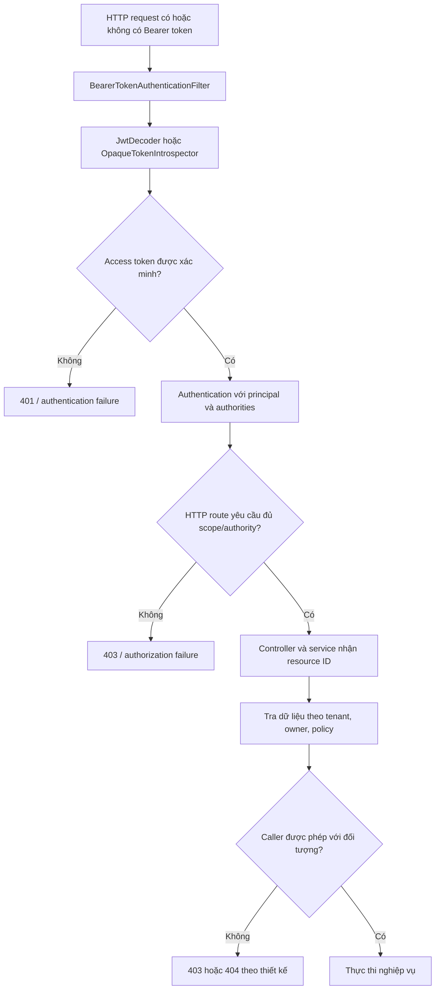
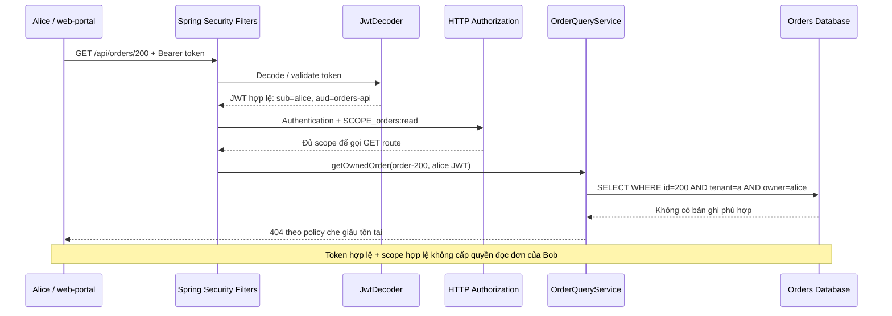

# Authenticated không đồng nghĩa đủ scope hoặc được sở hữu tài nguyên

## 1. Ba câu hỏi phải trả lời riêng khi bảo vệ API

Trong **Spring Security OAuth 2.0 / OIDC Resource Server**, việc một request chứa Bearer access token hợp lệ chỉ giải quyết bước đầu tiên của an ninh API. Một ứng dụng bán hàng có thể xác minh JWT của Alice thành công, nhưng vẫn không nên cho Alice cập nhật đơn hàng của Bob chỉ vì Alice đã đăng nhập và token có scope `orders:write`.

Ba câu hỏi cần tách biệt:

1. **Authentication — Ai hoặc cái gì đang gọi?** Access token có hợp lệ, đúng issuer, đúng audience, còn hạn và đã được xác minh bằng chữ ký hoặc introspection hay chưa? Hệ thống có tạo được một `Authentication` đáng tin hay không?
2. **Authorization ở mức thao tác — Được phép làm loại việc gì?** Token đã được cấp scope/authority nào, ví dụ `orders:read`, `orders:write` hoặc quyền ứng dụng tương đương? Route hoặc method yêu cầu quyền nào?
3. **Authorization ở mức đối tượng — Được phép làm việc đó trên tài nguyên nào?** Đơn `42` có thực sự thuộc người dùng, tenant hoặc tổ chức mà caller được phép thao tác không? Có quy tắc trạng thái, hạn mức, ủy quyền hoặc quyền quản trị riêng không?

Chỉ khi ba câu hỏi cần thiết đều được trả lời thỏa đáng, nghiệp vụ mới được thực thi.

> **Nguyên tắc chính:** `authenticated()` chỉ chứng minh một request có principal đã được xác thực theo cơ chế Spring Security. `hasAuthority("SCOPE_orders:read")` chỉ kiểm tra một quyền gắn với principal. **Cả hai không tự động chứng minh caller sở hữu hoặc được phép truy cập một bản ghi cụ thể.**

Bài học nằm trong chương **Phân quyền HTTP** của mô-đun **Spring Security OAuth 2.0 OIDC Resource Server**. Các ví dụ dùng Java 17+, Spring Boot 3.x, Spring Security 6.x, một Authorization Server giả định và API `orders-api`. Tên miền, JWT và dữ liệu đơn hàng chỉ phục vụ minh họa, không phải token thực có thể sử dụng.

## 2. Mô hình người dùng, token và đơn hàng

Giả sử có các thành phần:

- **Authorization Server** tại `https://auth.example.test/realms/orders`.
- **Resource Server** `orders-api` cung cấp `GET /api/orders/{id}` và `PATCH /api/orders/{id}`.
- **Alice** có subject `alice-123`, thuộc tenant `tenant-a`.
- **Bob** có subject `bob-456`, cũng thuộc `tenant-a` nhưng sở hữu những đơn khác.
- **Carol** có subject `carol-789`, thuộc `tenant-b`.
- **Batch worker** `orders-importer` sử dụng Client Credentials, không đại diện một người dùng đang đăng nhập.

Đơn hàng lưu trong database:

| Đơn | Tenant | Chủ sở hữu | Trạng thái |
|---|---|---|---|
| `order-100` | `tenant-a` | `alice-123` | `DRAFT` |
| `order-200` | `tenant-a` | `bob-456` | `PAID` |
| `order-300` | `tenant-b` | `carol-789` | `DRAFT` |

Access token minh họa của Alice sau khi đã giải mã:

```json
{
  "iss": "https://auth.example.test/realms/orders",
  "sub": "alice-123",
  "aud": ["orders-api"],
  "client_id": "web-portal",
  "tenant_id": "tenant-a",
  "scope": "orders:read orders:write",
  "iat": 1890000000,
  "exp": 1890003600
}
```

Nếu token này thực sự được issuer đáng tin ký, còn hiệu lực, có audience đúng và đáp ứng hồ sơ access token của API, Spring Security có thể tạo một `JwtAuthenticationToken` với các authorities:

```text
SCOPE_orders:read
SCOPE_orders:write
```

Nhưng đây mới là quyền **đọc và ghi đơn hàng theo phạm vi mà API định nghĩa**, chưa cấp quyền đối với mọi đơn.

| Request của Alice | Token hợp lệ? | Scope phù hợp? | Quyền trên đối tượng? | Kết quả nên có |
|---|---:|---:|---:|---|
| `GET /api/orders/order-100` | Có | Có `orders:read` | Alice sở hữu | Cho phép. |
| `GET /api/orders/order-200` | Có | Có `orders:read` | Bob sở hữu | Từ chối hoặc trả 404 theo chính sách. |
| `GET /api/orders/order-300` | Có | Có `orders:read` | Khác tenant | Từ chối hoặc trả 404 theo chính sách. |
| `PATCH /api/orders/order-100` | Có | Có `orders:write` | Alice sở hữu; còn cần rule trạng thái | Có thể cho phép nếu nghiệp vụ hợp lệ. |
| `DELETE /api/orders/order-100` | Có | Không có quyền xóa đã quy định | Chưa cần xét ownership | Từ chối. |
| `GET /api/orders/order-100` bằng token hết hạn | Không | Không xét | Không xét | Từ chối ở authentication. |

Trường hợp `GET order-200` là ví dụ điển hình của **Broken Object Level Authorization (BOLA)**, còn thường được gọi là **Insecure Direct Object Reference (IDOR)** trong nhiều tài liệu: caller sửa ID của đối tượng trong URL và API trả dữ liệu dù không có quyền trên đối tượng đó.

## 3. Authentication, scope và ownership nằm ở những tầng khác nhau

Luồng xử lý minh họa:



Tùy cách viết chương trình, kiểm tra object-level authorization có thể xảy ra trong `@PreAuthorize`, service, repository hoặc một **domain authorization service** dùng chung. Điều quan trọng không phải vị trí tên lớp, mà là **mọi đường truy cập đều đi qua kiểm tra đó**, không có đường vòng ở controller khác, batch endpoint, export API hoặc GraphQL resolver.

### 3.1. `authenticated()` trả lời điều gì?

Ví dụ:

```java
.authorizeHttpRequests(auth -> auth
    .requestMatchers("/api/orders/**").authenticated()
    .anyRequest().denyAll())
```

Quy tắc này về cơ bản yêu cầu request có authentication đáp ứng điều kiện của Spring Security. Trong Resource Server, đó thường là một access token được xác minh. Nó **không kiểm tra `orders:read` hay `orders:write`**. Alice có token hợp lệ chỉ chứa `profile` hoặc một service có token dành cho thao tác khác vẫn có thể vượt qua điều kiện `authenticated()` nếu những điều kiện xác minh token khác đều đạt.

Không nên hiểu `authenticated()` là “user đã được phân quyền đầy đủ”. Tên gọi của nó chỉ ra rõ phạm vi: **đã xác thực**.

### 3.2. `hasAuthority(...)` trả lời điều gì?

Ví dụ:

```java
.authorizeHttpRequests(auth -> auth
    .requestMatchers(HttpMethod.GET, "/api/orders/**")
        .hasAuthority("SCOPE_orders:read")
    .requestMatchers(HttpMethod.PATCH, "/api/orders/**")
        .hasAuthority("SCOPE_orders:write")
    .anyRequest().denyAll())
```

Đây là một bước tiến: token phải có authority phù hợp với loại thao tác. Tuy nhiên, nếu Alice có `SCOPE_orders:read`, điều đó vẫn **không phân biệt** `order-100` của Alice và `order-200` của Bob.

Spring Security không tự biết bảng database nào chứa owner hay cột tenant nào tương ứng với subject. Chính ứng dụng phải định nghĩa và kiểm tra quan hệ đó.

### 3.3. Object-level authorization trả lời điều gì?

Ví dụ chính sách:

```text
Permit GET /api/orders/{orderId} if:
    access token is valid for orders-api
AND authorities include SCOPE_orders:read
AND requested order exists
AND order.tenant_id equals trusted tenant context
AND order.owner_issuer equals token.iss
AND order.owner_subject equals token.sub

Otherwise deny or conceal existence according to API policy.
```

Nếu API hỗ trợ người quản lý hoặc nhân viên hỗ trợ xem đơn của người khác, phải mô tả **quyền ngoại lệ cụ thể**, ví dụ `orders:read:any` trong một tenant và `ROLE_ORDERS_SUPPORT`, đồng thời kiểm tra tenant/trạng thái/audit. Không nên biến mọi user có `orders:read` thành người đọc tất cả đơn.

## 4. Bản chất của OAuth scopes trong access token

Trong OAuth 2.0, **scope** diễn tả phạm vi truy cập đã được cấp cho client/token. Với JWT access token theo RFC 9068, `scope` thường là chuỗi các scope token ngăn bằng dấu cách:

```json
{
  "scope": "orders:read orders:write"
}
```

Một số nhà phát hành sử dụng `scp` (dạng chuỗi hoặc mảng theo profile). Trong Spring Security Resource Server JWT, `JwtGrantedAuthoritiesConverter` mặc định thường đọc claim `scope`/`scp` và tạo authorities với tiền tố `SCOPE_`.

| Claim đã xác minh | Authority ứng dụng thường nhận | Điều kiện code |
|---|---|---|
| `"scope":"orders:read"` | `SCOPE_orders:read` | `hasAuthority("SCOPE_orders:read")` |
| `"scope":"orders:write"` | `SCOPE_orders:write` | `hasAuthority("SCOPE_orders:write")` |
| `"scp":["orders:read","orders:write"]` | `SCOPE_orders:read`, `SCOPE_orders:write` nếu profile/converter hỗ trợ | Kiểm tra chính xác từng authority. |
| `"roles":["ADMIN"]` | Không tự được map bởi scope converter mặc định | Cần mapping role có chủ đích. |

Scope `orders:write` **không đương nhiên bao hàm** `orders:read`. Việc scope này có quan hệ thứ bậc hay không do Authorization Server và hợp đồng API xác định, không thể suy ra chỉ từ chữ “write”.

### 4.1. Các scope nên có ý nghĩa nghiệp vụ cụ thể

Ví dụ danh mục cho `orders-api`:

| Scope | Ý nghĩa đề xuất | Ràng buộc ngoài scope |
|---|---|---|
| `orders:read` | Đọc đơn hàng được phép truy cập. | Owner/tenant/role phù hợp. |
| `orders:write` | Tạo/sửa đơn trong phạm vi được giao. | Owner, tenant, trạng thái đơn, hạn mức. |
| `orders:cancel` | Hủy đơn nếu thỏa chính sách. | Ai được hủy, đơn đang ở trạng thái nào, giới hạn thời gian. |
| `orders:read:any` | Đọc đơn trong phạm vi quản lý được quy định. | Tenant/đơn vị được quản lý, audit; không tự mở toàn hệ thống. |
| `orders:import` | Nhập đơn bằng workload được cấp quyền. | Định danh client, hợp đồng đối tác, idempotency, tenant. |

Tên scope chỉ là ví dụ, không phải một danh mục chuẩn. Nếu hệ thống quyết định `orders:read:any` cho phép đọc mọi đơn của **chỉ tenant A**, điều kiện tenant phải được kiểm tra ở service/repository, không chỉ trong tên scope.

### 4.2. “Có authority” không đồng nghĩa claim của token đã được tin

Mọi authority dùng cho JWT phải xuất phát từ JWT đã được **JwtDecoder** xác minh. Payload JWT chỉ Base64URL encoded, không được coi là tin cậy nếu chỉ decode chuỗi.

Một Resource Server JWT cần:

- Xác minh chữ ký JWS với khóa công khai/JWKS thuộc issuer đã tin.
- Chỉ chấp nhận thuật toán được cho phép và loại token phù hợp.
- Kiểm tra `iss`, `aud`, `exp`, `nbf` và claims bắt buộc theo token profile.
- Ánh xạ `scope`/`scp` hoặc claims quyền được chấp nhận sau validation.
- Áp dụng HTTP, method và object-level authorization.

Nếu dùng opaque access token, bước đầu tương ứng là introspection với Authorization Server đáng tin cậy và xử lý `active`, audience/scope theo hợp đồng. Opaque token không đồng nghĩa có thể bỏ bước object authorization.

## 5. JWT hợp lệ nhưng không dành cho API vẫn bị từ chối

Đây là một trường hợp quan trọng khi nói “authenticated”: token phải **được xác thực đúng ngữ cảnh**. Không phải mọi JWT ký bởi cùng nhà phát hành đều được nhận vào `orders-api`.

Một OIDC **ID Token** thường có `aud` trỏ tới client đăng nhập, ví dụ `web-portal`. Nó dùng cho OIDC client xác thực người dùng, không phải access token dành cho API đơn hàng. Một access token khác có thể có `aud = payments-api` dù cùng issuer. Cả hai phải bị từ chối khi gọi `orders-api` nếu không đáp ứng hợp đồng.

Ví dụ token sai audience:

```json
{
  "iss": "https://auth.example.test/realms/orders",
  "sub": "alice-123",
  "aud": ["payments-api"],
  "scope": "orders:read",
  "exp": 1890003600
}
```

Ngay cả khi chữ ký còn hợp lệ, `orders-api` **không thể chấp nhận token này chỉ vì có `orders:read`**.

Trong ứng dụng Spring Boot:

```yaml
spring:
  security:
    oauth2:
      resourceserver:
        jwt:
          issuer-uri: https://auth.example.test/realms/orders
          audiences:
            - orders-api
```

Cấu hình này cho biết issuer và audience phải được kiểm tra. Nếu issuer phát hành JWT access token theo **RFC 9068**, còn cần thực thi các yêu cầu token profile tương ứng, ví dụ `typ=at+jwt` và claims bắt buộc theo phiên bản Spring Security/decoder đang sử dụng; không mặc định chỉ cấu hình issuer/audience là đã hoàn chỉnh RFC 9068.

### 5.1. Token của Client Credentials không phải user token

Một batch client có thể có token:

```json
{
  "iss": "https://auth.example.test/realms/orders",
  "sub": "service-orders-importer",
  "client_id": "orders-importer",
  "aud": ["orders-api"],
  "scope": "orders:import",
  "exp": 1890003600
}
```

Token này có thể vượt qua authentication. Nếu endpoint chỉ dùng `authenticated()`, service có thể đi vào đường xử lý user, bất kể không có người dùng nào sở hữu đơn. Với Client Credentials, `sub` có thể là **service subject**, không phải user tương tác. API nên có chính sách rõ cho workload và các scope riêng như `orders:import`; không dùng `sub` của service như user ID nếu chưa được định nghĩa trong hợp đồng nghiệp vụ.

Trong các mô hình token exchange/delegation, có thể có claim `act` đại diện actor; cần phân biệt subject, actor, OAuth client và ownership. Không tự suy ra quyền đại diện user từ việc token có scope lớn.

## 6. Cấu hình HTTP authorization theo nguyên tắc tối thiểu

Đối với API stateless, Spring Security cung cấp DSL `authorizeHttpRequests` và các điều kiện như `permitAll`, `authenticated`, `hasAuthority`, `hasAnyAuthority` và `access`.

### 6.1. Dependency cơ bản

Với Java 17+, Spring Boot 3.x và Maven dùng Boot dependency management:

```xml
<dependencies>
    <dependency>
        <groupId>org.springframework.boot</groupId>
        <artifactId>spring-boot-starter-web</artifactId>
    </dependency>
    <dependency>
        <groupId>org.springframework.boot</groupId>
        <artifactId>spring-boot-starter-security</artifactId>
    </dependency>
    <dependency>
        <groupId>org.springframework.boot</groupId>
        <artifactId>spring-boot-starter-oauth2-resource-server</artifactId>
    </dependency>
    <dependency>
        <groupId>org.springframework.boot</groupId>
        <artifactId>spring-boot-starter-test</artifactId>
        <scope>test</scope>
    </dependency>
    <dependency>
        <groupId>org.springframework.security</groupId>
        <artifactId>spring-security-test</artifactId>
        <scope>test</scope>
    </dependency>
</dependencies>
```

### 6.2. SecurityFilterChain yêu cầu scope theo HTTP method

```java
package com.example.orders.security;

import org.springframework.context.annotation.Bean;
import org.springframework.context.annotation.Configuration;
import org.springframework.http.HttpMethod;
import org.springframework.security.config.Customizer;
import org.springframework.security.config.annotation.web.builders.HttpSecurity;
import org.springframework.security.config.annotation.web.configurers.AbstractHttpConfigurer;
import org.springframework.security.config.http.SessionCreationPolicy;
import org.springframework.security.web.SecurityFilterChain;

@Configuration
public class ApiSecurityConfig {

    @Bean
    SecurityFilterChain apiSecurity(HttpSecurity http) throws Exception {
        return http
            // Phù hợp API stateless chỉ dùng Bearer header, không dùng
            // session-cookie để xác thực. Ứng dụng cookie cần xem xét CSRF riêng.
            .csrf(AbstractHttpConfigurer::disable)
            .sessionManagement(session -> session
                .sessionCreationPolicy(SessionCreationPolicy.STATELESS))
            .authorizeHttpRequests(auth -> auth
                .requestMatchers(HttpMethod.GET, "/api/public/ping")
                    .permitAll()

                .requestMatchers(HttpMethod.GET, "/api/orders/**")
                    .hasAuthority("SCOPE_orders:read")

                .requestMatchers(HttpMethod.POST, "/api/orders")
                    .hasAuthority("SCOPE_orders:write")

                .requestMatchers(HttpMethod.PATCH, "/api/orders/**")
                    .hasAuthority("SCOPE_orders:write")

                .requestMatchers(HttpMethod.POST, "/api/orders/*/cancel")
                    .hasAuthority("SCOPE_orders:cancel")

                .anyRequest().denyAll())
            .oauth2ResourceServer(oauth -> oauth
                .jwt(Customizer.withDefaults()))
            .build();
    }
}
```

Các quy tắc trên minh họa ý tưởng nhưng có một chi tiết dễ bỏ qua: **Spring Security xét các request matcher theo thứ tự khai báo và dùng quy tắc khớp đầu tiên**. Trong ví dụ trên, `PATCH /api/orders/**` không đè lên `POST /api/orders/*/cancel` vì khác phương thức HTTP. Nếu có hai matcher **cùng method và chồng lấn đường dẫn**, phải đặt matcher cụ thể trước matcher tổng quát.

Ví dụ lỗi về thứ tự:

```java
// CHỈ MINH HỌA LỖI — matcher tổng quát che matcher cụ thể.
.requestMatchers(HttpMethod.GET, "/api/orders/**")
    .authenticated()
.requestMatchers(HttpMethod.GET, "/api/orders/export")
    .hasAuthority("SCOPE_orders:export")
```

Khi `GET /api/orders/export` khớp matcher đầu tiên, điều kiện export ở dưới không được áp dụng. Giải pháp là đặt rule cụ thể trước hoặc thiết kế route không mơ hồ, đồng thời có test kiểm tra chúng.

### 6.3. Một cấu hình đúng hơn cho route export

```java
.authorizeHttpRequests(auth -> auth
    .requestMatchers(HttpMethod.GET, "/api/orders/export")
        .hasAuthority("SCOPE_orders:export")
    .requestMatchers(HttpMethod.GET, "/api/orders/**")
        .hasAuthority("SCOPE_orders:read")
    .anyRequest().denyAll())
```

Ngay cả khi export đã có `SCOPE_orders:export`, service xuất dữ liệu vẫn phải lọc theo tenant, owner hoặc phạm vi quản lý. Không được hiểu “export scope” là “xuất toàn bộ đơn của mọi tenant” nếu hợp đồng không quy định như vậy.

### 6.4. `anyRequest().authenticated()` có thể mở rộng hơn bạn tưởng

Một cấu hình tiện tay:

```java
.authorizeHttpRequests(auth -> auth
    .requestMatchers("/api/orders/**").hasAuthority("SCOPE_orders:read")
    .anyRequest().authenticated())
```

có thể cho phép mọi token hợp lệ truy cập các route mới `/api/payments/**`, `/api/admin/**` hoặc `/api/reports/**` chưa được bảo vệ bằng authority riêng, nếu controller tồn tại. Dùng **`denyAll()` làm mặc định** đối với endpoint chưa được liệt kê thường là chính sách thận trọng hơn cho API cần cấp quyền tường minh.

Mặt khác, `permitAll()` chỉ nên áp dụng với endpoint thực sự công khai, ví dụ health/public catalog được thiết kế không chứa dữ liệu nhạy cảm. Không đặt `/api/**` thành `permitAll()` trong lúc debug rồi quên khôi phục.

## 7. Quyền sở hữu không nằm trong URL, mà nằm trong quan hệ dữ liệu

Xét request:

```http
GET /api/orders/200 HTTP/1.1
Host: orders.example.test
Authorization: Bearer <valid-token-for-alice>
```

Dù Alice tự nhập `200` hay frontend lấy ID từ một đường link, **ID trong URL chỉ là đối tượng được yêu cầu**, không phải bằng chứng quyền. Client có thể thay path variable, query parameter, JSON body, GraphQL node ID hoặc file ID tùy ý.

Điều này cũng đúng khi ID là UUID rất dài hoặc khó đoán:

- **Không thể đoán** không đồng nghĩa **được phép**.
- `UUID.randomUUID()` giúp giảm khả năng liệt kê nhưng không thay object-level authorization.
- URL được ký bởi client, được lưu trong bookmark hoặc được gửi qua email không tự bảo đảm quyền sau khi trạng thái user/tenant thay đổi.
- “Ẩn nút sửa” trên frontend không bảo vệ backend; API phải tự từ chối request không đủ quyền.

### 7.1. Một mô hình dữ liệu đơn giản

Giả sử bảng `orders` có:

```text
orders
------
id            UUID PRIMARY KEY
tenant_id     VARCHAR NOT NULL
owner_issuer  VARCHAR NOT NULL
owner_subject VARCHAR NOT NULL
status        VARCHAR NOT NULL
amount        DECIMAL NOT NULL
```

Tại sao lưu cả `owner_issuer` và `owner_subject`?

Trong hệ nhiều issuer, subject `"123"` của issuer A có thể không phải subject `"123"` của issuer B. **`sub` chỉ nên được hiểu trong namespace của issuer**. Khóa định danh hợp thành `(iss, sub)` thường an toàn hơn so với chỉ lưu `sub` nếu sản phẩm có nhiều nguồn danh tính. Có thể cần thêm tenant/business membership theo mô hình ứng dụng.

Không dùng `email` hoặc `preferred_username` làm owner ID ổn định vì chúng có thể thay đổi, tái sử dụng hoặc không được xác minh theo nhu cầu. Nếu tổ chức có internal user ID ánh xạ từ `(iss, sub)`, việc ánh xạ phải qua nguồn tin cậy được quản lý.

### 7.2. Tenant ID cũng không phải quyền truy cập tự thân

Nếu JWT chứa:

```json
{
  "sub": "alice-123",
  "tenant_id": "tenant-a",
  "scope": "orders:read"
}
```

thì `tenant_id` có thể cho biết tenant đang hoạt động của user **nếu issuer cam kết ý nghĩa đó**. Tuy nhiên API không được tự kết luận mọi bản ghi `tenant-a` đều thuộc Alice. Có thể cần xác nhận:

- User có phải thành viên tenant hiện tại không?
- User được xem mọi đơn hay chỉ đơn của chính mình?
- Role hoặc quyền delegation có giới hạn theo bộ phận/dự án không?
- Một user có thể thuộc nhiều tenant; tenant được chọn có khớp context đã xác minh không?
- Quyền đã bị thu hồi sau khi token được cấp chưa?

Đặc biệt không tin `X-Tenant-Id` do client tự gửi, hoặc trường `tenantId` trong JSON body, **như nguồn phân quyền duy nhất**. Nếu API cho phép client chọn tenant, giá trị yêu cầu phải được đối chiếu với membership/entitlements đã xác minh.

## 8. Áp dụng object-level authorization trong Spring Service và Repository

Có hai cách triển khai phổ biến:

1. **Tải bản ghi rồi kiểm tra** owner/tenant trước khi trả hoặc thay đổi.
2. **Đưa điều kiện quyền vào query** để database chỉ trả bản ghi nằm trong phạm vi được phép.

Cách thứ hai đặc biệt hữu ích với API đọc dữ liệu cá nhân, vì tránh giai đoạn service vô tình đưa bản ghi chưa được kiểm quyền đến các phần xử lý khác. Dù vậy, nó vẫn phải đi cùng kiểm tra quy tắc nghiệp vụ và phạm vi dữ liệu đầy đủ.

### 8.1. Repository query chỉ tìm đơn Alice có quyền xem

Giả sử có entity JPA `OrderEntity` với các trường `id`, `tenantId`, `ownerIssuer`, `ownerSubject` và `status`. Repository có thể định nghĩa:

```java
package com.example.orders.persistence;

import java.util.Optional;
import java.util.UUID;

import org.springframework.data.jpa.repository.JpaRepository;

public interface OrderRepository
        extends JpaRepository<OrderEntity, UUID> {

    Optional<OrderEntity> findByIdAndTenantIdAndOwnerIssuerAndOwnerSubject(
        UUID id,
        String tenantId,
        String ownerIssuer,
        String ownerSubject
    );
}
```

Spring Data JPA sẽ tạo query có đủ điều kiện owner và tenant khi tên thuộc tính khớp entity:

```sql
SELECT *
FROM orders
WHERE id = :id
  AND tenant_id = :tenantId
  AND owner_issuer = :ownerIssuer
  AND owner_subject = :ownerSubject;
```

SQL ở trên chỉ minh họa logic; cú pháp bind và query thực tế do JPA provider tạo. Điểm quan trọng là **không tìm chỉ theo `id` rồi vô tình trả mọi bản ghi**.

### 8.2. Dịch vụ đọc đơn từ token đã xác minh

Ví dụ `OrderQueryService` lấy subject, issuer và tenant từ đối tượng `Jwt` đã qua xác minh của Spring Security:

```java
package com.example.orders.service;

import java.util.UUID;

import org.springframework.http.HttpStatus;
import org.springframework.security.access.AccessDeniedException;
import org.springframework.security.oauth2.jwt.Jwt;
import org.springframework.stereotype.Service;
import org.springframework.web.server.ResponseStatusException;

import com.example.orders.persistence.OrderEntity;
import com.example.orders.persistence.OrderRepository;

@Service
public class OrderQueryService {

    private final OrderRepository orders;

    public OrderQueryService(OrderRepository orders) {
        this.orders = orders;
    }

    public OrderView getOwnedOrder(UUID orderId, Jwt jwt) {
        String issuer = jwt.getIssuer() == null
            ? null
            : jwt.getIssuer().toString();
        String subject = jwt.getSubject();
        Object tenantValue = jwt.getClaim("tenant_id");

        if (issuer == null || issuer.isBlank()
                || subject == null || subject.isBlank()
                || !(tenantValue instanceof String tenantId)
                || tenantId.isBlank()) {
            // Nếu trường hợp thiếu claim vi phạm token profile,
            // tốt hơn validator tại JwtDecoder từ chối sớm.
            throw new AccessDeniedException(
                "Required identity context missing");
        }

        OrderEntity order = orders
            .findByIdAndTenantIdAndOwnerIssuerAndOwnerSubject(
                orderId, tenantId, issuer, subject)
            .orElseThrow(() ->
                new ResponseStatusException(HttpStatus.NOT_FOUND));

        return new OrderView(
            order.getId(),
            order.getStatus(),
            order.getAmount()
        );
    }
}
```

`OrderView` là DTO trả về API:

```java
package com.example.orders.service;

import java.math.BigDecimal;
import java.util.UUID;

public record OrderView(
    UUID id,
    String status,
    BigDecimal amount
) { }
```

Đây là các mảnh code minh họa giả định `OrderEntity` có getters phù hợp, database đã được cấu hình và mapping JPA tồn tại. Chúng không phải một ứng dụng hoàn chỉnh sao chép một lần là chạy.

Một số quyết định đáng chú ý:

- `Jwt` đã được Spring Security decoder xác minh **trước** khi controller gọi service. Service không tự parse Bearer token từ chuỗi raw.
- `iss` và `sub` xác định danh tính của subject trong namespace issuer.
- `tenant_id` được đọc đúng kiểu dữ liệu mà hồ sơ token quy định. Nếu claim bắt buộc, nên có validator schema tại authentication layer để từ chối token sai profile.
- Repository query yêu cầu **đúng owner và tenant**, không chỉ đúng `id`.
- Nếu không có bản ghi phù hợp, service trả **404**. Cách này có thể giúp không tiết lộ liệu ID có tồn tại ở tenant/user khác hay không. Một API khác có thể dùng `403`, nhưng phải chọn nhất quán theo mô hình che giấu tồn tại.
- DTO không trả toàn bộ entity, hạn chế rò rỉ thuộc tính nội bộ như owner identifiers, giá vốn, ghi chú quản trị hoặc thông tin payment.

### 8.3. Controller gọi service, không tự tin vào ID

```java
package com.example.orders.api;

import java.util.UUID;

import org.springframework.security.core.annotation.AuthenticationPrincipal;
import org.springframework.security.oauth2.jwt.Jwt;
import org.springframework.web.bind.annotation.GetMapping;
import org.springframework.web.bind.annotation.PathVariable;
import org.springframework.web.bind.annotation.RequestMapping;
import org.springframework.web.bind.annotation.RestController;

import com.example.orders.service.OrderQueryService;
import com.example.orders.service.OrderView;

@RestController
@RequestMapping("/api/orders")
public class OrderController {

    private final OrderQueryService service;

    public OrderController(OrderQueryService service) {
        this.service = service;
    }

    @GetMapping("/{orderId}")
    public OrderView getOrder(
        @PathVariable UUID orderId,
        @AuthenticationPrincipal Jwt jwt
    ) {
        return service.getOwnedOrder(orderId, jwt);
    }
}
```

HTTP authorization trước đó yêu cầu `SCOPE_orders:read`. Controller giao object-level authorization cho service. **Không có bước “nếu đã authenticated thì lấy theo ID và return”**.

Nếu endpoint dùng **opaque token introspection**, principal có thể không phải `Jwt`. Khi ấy cần một abstraction identity được tạo từ `Authentication` đã được xác minh, tránh cast mù `JwtAuthenticationToken` cho mọi loại token. Quy tắc owner/tenant vẫn giữ nguyên.

### 8.4. Đừng lấy user ID từ request body

Một anti-pattern:

```java
// KHÔNG DÙNG — ownerId do client tự khai báo.
@GetMapping("/{orderId}")
public OrderView getOrder(
    @PathVariable UUID orderId,
    @RequestParam String ownerId
) {
    return service.getOrder(orderId, ownerId);
}
```

Nếu service chỉ kiểm tra `order.ownerId == ownerId` và không so với subject đã xác minh, client có thể đặt `ownerId=bob-456` để lấy đơn của Bob. **Owner ID dùng cho phân quyền phải bắt nguồn từ authentication/nguồn membership được tin cậy**, không phải giá trị do client tự chọn.

Tương tự, JSON body có trường `"ownerId":"alice-123"` khi tạo đơn không được coi là bằng chứng rằng caller là Alice. Server nên tự gán owner dựa trên authenticated principal hoặc kiểm tra quyền tạo thay người khác bằng policy tường minh.

## 9. Kiểm tra quyền trước khi sửa hoặc xóa bản ghi

Đọc dữ liệu đã có rủi ro BOLA; thao tác sửa/xóa còn có thể thay đổi tiền, trạng thái, địa chỉ giao hàng hoặc quyền của người khác.

### 9.1. Dòng xử lý sửa đơn cần nhiều điều kiện

Giả sử endpoint:

```http
PATCH /api/orders/100
Authorization: Bearer <alice-access-token>
Content-Type: application/json

{"shippingAddress":"..."}
```

Quy trình nên kiểm tra:

1. JWT hợp lệ cho `orders-api`.
2. Có `SCOPE_orders:write`.
3. Order thuộc tenant và subject được phép sửa; hoặc caller có delegation/role cụ thể.
4. Order đang trong trạng thái cho phép sửa (ví dụ `DRAFT`, chưa giao hàng).
5. Field được phép sửa được allowlist, không cho cập nhật `tenantId`, `ownerSubject` hay `status` tùy ý.
6. Các bất biến nghiệp vụ/phiên bản giao dịch được giữ, tránh lost updates/race conditions.

Không lấy JSON từ client rồi tự động map tất cả fields vào entity:

```java
// KHÔNG DÙNG: client có thể gửi cả ownerSubject, tenantId, status...
objectMapper.updateValue(orderEntity, requestBody);
```

Thay bằng DTO chỉ chứa những thuộc tính được phép sửa và thao tác cập nhật đã được kiểm soát. Ví dụ:

```java
public record UpdateShippingAddressRequest(
    String line1,
    String city,
    String postalCode
) { }
```

### 9.2. Kiểm tra trong transaction

Một flow cập nhật có thể dùng service method được đánh dấu `@Transactional`:

```java
@Transactional
public void updateOwnedOrder(
        UUID orderId,
        String tenantId,
        String issuer,
        String subject,
        UpdateShippingAddressRequest request
) {
    OrderEntity order = orders
        .findByIdAndTenantIdAndOwnerIssuerAndOwnerSubject(
            orderId, tenantId, issuer, subject)
        .orElseThrow(() ->
            new ResponseStatusException(HttpStatus.NOT_FOUND));

    if (!"DRAFT".equals(order.getStatus())) {
        throw new ResponseStatusException(
            HttpStatus.CONFLICT, "Order can no longer be edited");
    }

    order.setShippingLine1(request.line1());
    order.setShippingCity(request.city());
    order.setPostalCode(request.postalCode());
}
```

Đoạn này chỉ là ví dụ tập trung vào đường đi, giả định các field/setters của entity có tồn tại. Trong hệ thống có concurrency, cần cân nhắc `@Version` (optimistic locking), khóa bản ghi hoặc conditional update để trạng thái không thay đổi giữa lúc kiểm tra và lúc ghi. Quyền của subject/tenant phải được lấy từ authentication hoặc service tin cậy, **không nhận các tham số identity tùy ý từ client**.

Để tránh bug khi developer gọi `updateOwnedOrder` từ một job nội bộ với `tenantId` và `subject` tự đặt, nên tạo một kiểu `AuthenticatedActor` hoặc `AccessContext` mà boundary security tạo ra có kiểm soát, và định nghĩa đường riêng cho workload/trusted administration.

### 9.3. Service-to-service và admin không phải ngoại lệ mặc định

Một API có thể cho nhân viên hỗ trợ sửa đơn mà họ không sở hữu. Nhưng phải thiết kế chính sách:

```text
Owner path:
    SCOPE_orders:write
    AND same tenant
    AND same owner identity
    AND editable status

Support path:
    SCOPE_orders:support
    AND ROLE_ORDERS_SUPPORT
    AND caller assigned to target tenant
    AND purpose/audit requirement satisfied
    AND action is permitted for that order
```

Không viết `if (hasRole("ADMIN")) return true` mà bỏ qua tenant, mục đích truy cập hay business constraints nếu quyền quản trị không được định nghĩa là toàn hệ thống. Đặc biệt với multi-tenant, một admin của `tenant-a` không mặc nhiên là admin của `tenant-b`.

## 10. Cách phối hợp HTTP security với method-level authorization

**HTTP rule** bảo vệ theo tuyến và phương thức; **method security** có thể kiểm tra quy tắc được chia sẻ ở service layer. Hai lớp bổ sung cho nhau nhưng không thay thế tự động.

### 10.1. Kích hoạt method security

```java
package com.example.orders.security;

import org.springframework.context.annotation.Configuration;
import org.springframework.security.config.annotation.method.configuration.EnableMethodSecurity;

@Configuration
@EnableMethodSecurity
public class MethodSecurityConfig {
}
```

Khi kích hoạt, Spring Security có thể áp dụng `@PreAuthorize`, `@PostAuthorize` và các method-level annotations phù hợp trên các bean được quản lý.

### 10.2. Kiểm tra scope tại method

```java
@PreAuthorize("hasAuthority('SCOPE_orders:read')")
public OrderView getOwnedOrder(UUID orderId, Jwt jwt) {
    // Service vẫn kiểm tra owner/tenant như phần trên.
}
```

Tầng method bảo vệ nếu một caller code khác lỡ bỏ qua HTTP route rule. Nhưng `hasAuthority` tại method vẫn chưa phân biệt Alice/Bob, nên **logic object-level authorization vẫn cần có**.

### 10.3. Dùng authorization component với object ID

Có thể viết một thành phần chuyên kiểm tra quyền:

```java
package com.example.orders.security;

import java.util.UUID;

import org.springframework.security.core.Authentication;
import org.springframework.security.oauth2.server.resource.authentication.JwtAuthenticationToken;
import org.springframework.stereotype.Component;

@Component("orderAccess")
public class OrderAccess {

    private final OrderAccessRepository repository;

    public OrderAccess(OrderAccessRepository repository) {
        this.repository = repository;
    }

    public boolean canRead(Authentication authentication, UUID orderId) {
        if (!(authentication instanceof JwtAuthenticationToken jwtAuth)
                || !authentication.isAuthenticated()) {
            return false;
        }

        boolean hasScope = authentication.getAuthorities().stream()
            .anyMatch(authority ->
                "SCOPE_orders:read".equals(authority.getAuthority()));

        if (!hasScope) {
            return false;
        }

        var jwt = jwtAuth.getToken();
        String issuer = jwt.getIssuer() == null
            ? null
            : jwt.getIssuer().toString();
        String subject = jwt.getSubject();
        Object rawTenant = jwt.getClaim("tenant_id");

        if (issuer == null || subject == null
                || !(rawTenant instanceof String tenantId)
                || tenantId.isBlank()) {
            return false;
        }

        return repository.existsByIdAndTenantIdAndOwnerIssuerAndOwnerSubject(
            orderId, tenantId, issuer, subject);
    }
}
```

Repository cần định nghĩa phương thức tương ứng:

```java
boolean existsByIdAndTenantIdAndOwnerIssuerAndOwnerSubject(
    UUID id,
    String tenantId,
    String ownerIssuer,
    String ownerSubject
);
```

Method sử dụng:

```java
@PreAuthorize("@orderAccess.canRead(authentication, #orderId)")
public OrderView loadOrder(UUID orderId) {
    // Chỉ sau kiểm tra trên.
}
```

Ví dụ này thể hiện khả năng dùng Spring Expression Language (SpEL) kết hợp authentication và object ID. **Không nên mặc định đây là giải pháp tối ưu cho mọi hệ thống**:

- Có thể gây **hai query** (`exists` để kiểm tra, sau đó `find` để tải), làm tăng chi phí và tạo khoảng thời gian trạng thái thay đổi.
- Nếu method `loadOrder` chỉ tìm theo ID không kèm tenant/owner, cần đánh giá kỹ trạng thái giữa check và use (**TOCTOU**) và đường gọi không đi qua proxy/method security.
- Spring method security dựa trên proxy; self-invocation nội bộ cùng bean có thể không đi qua interceptor theo cấu hình proxy thông thường.
- Để mạnh hơn, có thể giữ **query được lọc theo identity ngay tại repository** như mục 8, hoặc đặt check và thao tác trong cùng transaction với biện pháp concurrency phù hợp.

Vì vậy, `@PreAuthorize("@orderAccess.canRead(...)")` là một kỹ thuật khả dụng, **không phải lý do để service bỏ hẳn object-level constraints trong truy vấn/ghi**.

### 10.4. Quyền quản trị phức tạp nên có domain policy

Khi có nhiều điều kiện như tenant membership, delegation, owner, trạng thái đơn và scope, việc nhồi toàn bộ logic vào một biểu thức SpEL dài có thể khó kiểm thử và bảo trì. Nên đặt policy trong một service/class có tên rõ:

```text
OrderAuthorizationPolicy
  canRead(actor, order)
  canEdit(actor, order)
  canCancel(actor, order)
  canExport(actor, tenantId)
```

Method security có thể gọi policy đó, nhưng bản thân service/repository vẫn cần bảo đảm dữ liệu được lọc/kiểm quyền đúng. Policy nên dùng đầu vào là **principal đã xác minh** và **đối tượng/trạng thái đã được lấy từ nguồn đáng tin**, không phải chỉ dựa vào field owner trong request body.

## 11. Phân quyền khi liệt kê, tìm kiếm và xuất dữ liệu

BOLA không chỉ xảy ra với `GET /api/orders/{id}`. Các endpoint danh sách, search, export, aggregation và batch update cũng có thể lộ dữ liệu.

### 11.1. Danh sách phải được lọc từ phía server

Ví dụ:

```http
GET /api/orders?tenantId=tenant-b&owner=bob-456
Authorization: Bearer <alice-token>
```

Nếu API có scope `orders:read` nhưng chuyển nguyên query params vào DB, Alice có thể lấy danh sách đơn của tenant/user khác. Cách an toàn là phân biệt:

- **Bộ lọc do caller yêu cầu:** trạng thái, khoảng ngày, mã đơn, trang, sắp xếp… được phép trong giới hạn.
- **Bộ lọc phân quyền bắt buộc:** tenant và owner/assigned accounts được xác minh từ token/membership/policy.

Ví dụ query:

```sql
SELECT id, status, amount
FROM orders
WHERE tenant_id = :trusted_tenant_id
  AND owner_issuer = :trusted_issuer
  AND owner_subject = :trusted_subject
  AND status = :requested_status
ORDER BY created_at DESC
LIMIT :page_size OFFSET :offset;
```

Các giá trị `trusted_*` được tạo từ identity context, không phải từ query params. `requested_status` là filter thông thường và phải được validate để tránh SQL injection nếu dùng dynamic query; nên dùng parameter binding.

Đối với phân trang, không được lấy `SELECT COUNT(*) FROM orders` không lọc nếu count có thể tiết lộ số liệu của tenant khác. Filter authorization phải được áp dụng nhất quán cho kết quả, tổng số bản ghi, facets, search suggestions và aggregations.

### 11.2. Export và bulk operations cần xét từng đối tượng

Một scope `orders:export` có thể cho phép **bắt đầu hành động xuất**, nhưng danh sách bản ghi được xuất phải nằm trong phạm vi user/tenant được phép.

Với bulk update:

```json
{
  "orderIds": ["order-100", "order-200", "order-300"],
  "operation": "CANCEL"
}
```

Không kiểm tra chỉ một order đầu tiên rồi áp dụng cho cả mảng. Mỗi ID cần xác nhận quyền tương ứng hoặc dùng query/update có điều kiện authorization bao phủ toàn bộ tập. Hệ thống phải quyết định rõ **all-or-nothing** hay partial success, xử lý ID không tồn tại/không được phép theo cách không rò rỉ thông tin và bảo đảm transaction/idempotency.

### 11.3. Lưu trữ file đính kèm và tài nguyên con

Nếu order có file hóa đơn:

```http
GET /api/orders/200/invoice.pdf
```

Endpoint download cũng phải kiểm tra quyền trên **đơn cha** và loại file. Không dựa vào việc đã chặn `GET /api/orders/200`; đường tải file có thể được gọi trực tiếp. Với object storage/signed URL, cần xác thực quyền trước khi phát URL, đặt TTL và phạm vi truy cập phù hợp. Kiểm tra các API tương tự: comments, attachments, payment details, shipping addresses, event history.

## 12. Multi-tenant: scope đúng nhưng sai tenant vẫn là sai quyền

Trong hệ đa tenant, mỗi tenant có dữ liệu và quy tắc truy cập riêng. Token có `SCOPE_orders:read` nói caller được phép loại thao tác “đọc đơn” trong phạm vi được giao; không phải “đọc mọi tenant”.

### 12.1. Ma trận quyết định

Giả sử Alice thuộc `tenant-a`, scope `orders:read`:

| Đơn | Cùng tenant? | Cùng owner? | Policy read-own | Policy read-all-in-tenant |
|---|---|---|---|---|
| `order-100` (Alice, tenant-a) | Có | Có | Cho phép | Cho phép nếu role quản lý phù hợp. |
| `order-200` (Bob, tenant-a) | Có | Không | Từ chối | Chỉ cho phép nếu đã có quyền `read:any`/role tương ứng. |
| `order-300` (Carol, tenant-b) | Không | Không | Từ chối | Từ chối dù có vai trò quản lý tenant-a. |

**Cùng tenant vẫn chưa đồng nghĩa cùng owner.** Ngược lại, với một ứng dụng công ty, các role có thể được cấp quyền đọc dữ liệu của phòng ban/đơn vị khác trong tenant; điều đó phải được mô hình hóa thành permission, không dùng logic so owner cứng nhắc cho mọi endpoint.

### 12.2. Tenant context lấy từ đâu?

Một số lựa chọn thiết kế:

- Token có claim tenant rõ ràng, issuer cam kết user/token đang hoạt động trong tenant đó.
- Token có tổ chức/tenant memberships; caller yêu cầu chọn tenant, server kiểm tra tenant đó thuộc memberships và role hiện có.
- API dùng internal entitlement service đáng tin cậy để tra memberships mới nhất.
- Một client service-to-service được gán scope/tenant trong hồ sơ khách hàng nội bộ.

Không mặc định JWT claim `tenant_id` của mọi issuer có cùng ý nghĩa. Nếu token thiếu tenant mà route buộc tenant, phải fail closed hoặc từ chối token theo profile. Nếu caller có thể tự đặt `tenantId` trong HTTP header, giá trị đó chỉ là **đích yêu cầu**, không phải quyền truy cập.

### 12.3. Cần phân quyền cả ở dữ liệu và truy vấn

Bảo vệ trong controller mà bỏ qua service khác có thể tạo đường vòng. Một pattern tốt là tenant-aware query hoặc security predicate được sử dụng nhất quán. Với PostgreSQL Row Level Security (RLS) hoặc cơ chế database tương tự, có thể thêm một lớp bảo vệ dữ liệu; nhưng phải cấu hình connection/session context đúng theo request/transaction và không coi RLS là thay thế hoàn toàn cho scope, owner và policy ứng dụng.

## 13. 401, 403 và 404 phải được hiểu đúng

HTTP status giúp client biết loại thất bại. Tuy nhiên, **mã chính xác phụ thuộc authentication provider, exception handler và chính sách API**; không ép mọi lỗi vào một trạng thái duy nhất.

| Trường hợp | Lớp từ chối | Trạng thái thường gặp |
|---|---|---|
| Không có Bearer token ở route cần xác thực | Authentication | **401 Unauthorized** |
| Bearer token sai chữ ký, hết hạn, sai issuer/audience | Authentication | **401 Unauthorized** |
| JWT hợp lệ nhưng không có `orders:read` | Authorization | **403 Forbidden** |
| JWT hợp lệ, có scope nhưng không sở hữu đơn | Object authorization | **403** hoặc **404** theo chính sách không tiết lộ sự tồn tại |
| ID đơn không tồn tại thật | Resource lookup | **404 Not Found** |
| Caller có quyền nhưng trạng thái đơn không cho sửa | Business rule | Có thể **409 Conflict** hoặc mã nghiệp vụ khác phù hợp |
| JWKS/introspection unavailable | Dependency failure | Không cấp quyền; HTTP status phụ thuộc cách xử lý lỗi, có thể thiết kế **503** nếu phân biệt được lỗi upstream. |

### 13.1. Tại sao object ownership có thể trả 404?

Nếu Bob sở hữu `order-200`, việc Alice nhận `403` có thể tiết lộ rằng `order-200` tồn tại. Một API có thể trả **404** cho cả hai trường hợp “không tồn tại” và “có nhưng caller không được phép biết”, để hạn chế lộ thông tin. Tuy nhiên đây là **quyết định thiết kế**, không phải quy tắc chung bắt buộc.

Nếu API cần trả 403 cho user cùng tenant nhưng thiếu quyền, hãy làm nhất quán và xem xét khả năng enumeration. Không ghi vào response những thông tin như “order thuộc Bob ở tenant B” trừ khi caller được phép biết.

### 13.2. `WWW-Authenticate` khi quyền thiếu

Theo OAuth 2.0 Bearer Token Usage (RFC 6750), lỗi trên protected resource có thể dùng HTTP `WWW-Authenticate: Bearer` để chỉ rõ thông tin như `invalid_token` hoặc `insufficient_scope`. Ví dụ minh họa:

```http
HTTP/1.1 403 Forbidden
WWW-Authenticate: Bearer error="insufficient_scope"
```

Không cần tiết lộ chi tiết nhạy cảm như owner user ID hoặc internal permission topology trong error body. Với Spring Security, tùy authorization handler, Bearer token entry point và access denied handler quyết định header/status. Cần kiểm thử thực tế thay vì mặc định mọi 403 đều có cùng header.

### 13.3. Không biến mọi exception thành 401

Lỗi `JwtDecoder` khác với lỗi database, role permission hoặc downstream outage. Nếu ứng dụng bắt `Exception` rồi trả 401 cho tất cả, client sẽ hiểu sai là token hết hạn, đồng thời làm hệ thống khó quan sát. Phân biệt authentication, authorization, business validation và dependency failure theo đúng responsibility.

## 14. Quyền yêu cầu phải được đặt ở đúng tất cả lối vào

Không phải chỉ có `GET /api/orders/{id}`:

| Loại endpoint | Cần kiểm tra |
|---|---|
| `GET /api/orders/{id}` | Scope đọc + owner/tenant. |
| `GET /api/orders` | Scope đọc + filter tenant/owner trên toàn bộ query, tổng count và pagination. |
| `GET /api/orders/{id}/events` | Scope đọc lịch sử + quyền xem order cha. |
| `POST /api/orders` | Scope tạo + tenant được phép + owner gán từ trusted context. |
| `PATCH /api/orders/{id}` | Scope ghi + quyền sửa order + trạng thái + field allowlist. |
| `POST /api/orders/{id}/cancel` | Scope hủy + policy hủy + transaction/state check. |
| `DELETE /api/orders/{id}` | Scope xóa nếu API cho phép + owner/admin policy đặc biệt. |
| `GET /api/orders/export` | Scope export + filter toàn bộ dữ liệu trong tenant/owner. |
| `POST /api/orders/bulk` | Scope bulk + kiểm tra quyền với mỗi ID/bản ghi. |
| GraphQL `order(id)` / gRPC `GetOrder` | Quy tắc object authorization tương đương, không phụ thuộc REST matcher. |
| Background job hoặc message handler | Principal/service identity và phạm vi được ủy quyền của job, không dựa vào HTTP `authenticated()`. |

Mọi lối vào có thể gọi một service dùng chung; nếu chỉ bảo vệ controller bằng annotations mà service dễ bị gọi từ nơi khác không có method security, hãy đặt **domain policy** tại tầng service/core hoặc tạo các operation có điều kiện quyền rõ ràng.

## 15. Kiểm thử để phân biệt authenticated, đủ scope và ownership

Một bộ kiểm thử tốt không chỉ có “token hợp lệ thì 200” và “không token thì 401”. Phải chứng minh đúng **ranh giới quyền trên từng đối tượng**.

### 15.1. Ma trận kiểm thử

Giả sử test fixture:

- Alice: `iss=A`, `sub=alice-123`, `tenant=tenant-a`; sở hữu `order-100`.
- Bob: `iss=A`, `sub=bob-456`, `tenant=tenant-a`; sở hữu `order-200`.
- Carol: `iss=A`, `sub=carol-789`, `tenant=tenant-b`; sở hữu `order-300`.
- Tất cả request trong bảng đi tới `orders-api`, trừ khi ghi rõ.

| Actor/token | Scope | Resource | Kỳ vọng |
|---|---|---|---|
| Không có token | — | `order-100` | 401. |
| Token hết hạn | `orders:read` | `order-100` | 401. |
| Token sai audience | `orders:read` | `order-100` | 401. |
| Token giả với chữ ký sai | `orders:read` | `order-100` | 401. |
| Alice, token hợp lệ | Không có `orders:read` | `order-100` | 403 dù Alice sở hữu. |
| Alice, token hợp lệ | `orders:read` | `order-100` | Cho phép nếu không có điều kiện phụ khác. |
| Alice, token hợp lệ | `orders:read` | `order-200` (Bob) | 403/404. |
| Alice, token hợp lệ | `orders:read` | `order-300` (tenant-b) | 403/404. |
| Bob, token hợp lệ | `orders:read` | `order-200` | Cho phép. |
| Carol, token hợp lệ | `orders:read` | `order-100` | 403/404. |
| Alice, token hợp lệ | `orders:write` | `GET order-100` | 403 nếu write không bao hàm read. |
| Alice, token hợp lệ | `orders:read` | `PATCH order-100` | 403 vì thiếu write. |
| Alice, token hợp lệ | `orders:write` | `PATCH order-100` | Chỉ cho nếu owner và trạng thái cho phép. |
| Alice, token hợp lệ | `orders:write` | `PATCH order-200` | 403/404 dù đủ scope. |
| Service Client Credentials | `orders:import` | Endpoint đọc đơn user | Từ chối nếu profile/route không cho workload đọc. |
| Support tenant-a | Scope/role hỗ trợ | `order-200` | Cho phép chỉ nếu có quyền support, tenant và audit hợp lệ. |
| Support tenant-a | Scope/role hỗ trợ | `order-300` | Từ chối vì khác tenant. |

### 15.2. HTTP authorization test với MockMvc

`spring-security-test` có `jwt()` để tạo authenticated principal giả cho kiểm thử route/method policy.

Giả sử ứng dụng có `GET /api/orders/{id}` và có dữ liệu/fixture phù hợp:

```java
package com.example.orders;

import static org.springframework.security.test.web.servlet.request
    .SecurityMockMvcRequestPostProcessors.jwt;
import static org.springframework.test.web.servlet.request.MockMvcRequestBuilders.get;
import static org.springframework.test.web.servlet.result.MockMvcResultMatchers.status;

import org.junit.jupiter.api.Test;
import org.springframework.beans.factory.annotation.Autowired;
import org.springframework.boot.test.autoconfigure.web.servlet.AutoConfigureMockMvc;
import org.springframework.boot.test.context.SpringBootTest;
import org.springframework.security.core.authority.SimpleGrantedAuthority;
import org.springframework.test.web.servlet.MockMvc;

@SpringBootTest
@AutoConfigureMockMvc
class OrderHttpAuthorizationTest {

    @Autowired
    MockMvc mvc;

    @Test
    void missingTokenIsUnauthorized() throws Exception {
        mvc.perform(get("/api/orders/100"))
            .andExpect(status().isUnauthorized());
    }

    @Test
    void authenticatedWithoutReadScopeIsForbidden() throws Exception {
        mvc.perform(get("/api/orders/100")
                .with(jwt()
                    .jwt(token -> token
                        .subject("alice-123")
                        .claim("tenant_id", "tenant-a"))
                    .authorities(
                        new SimpleGrantedAuthority("SCOPE_profile"))))
            .andExpect(status().isForbidden());
    }

    @Test
    void readScopeDoesNotGrantAccessToAnotherOwner() throws Exception {
        mvc.perform(get("/api/orders/200")
                .with(jwt()
                    .jwt(token -> token
                        .issuer("https://auth.example.test/realms/orders")
                        .subject("alice-123")
                        .claim("tenant_id", "tenant-a"))
                    .authorities(
                        new SimpleGrantedAuthority("SCOPE_orders:read"))))
            // Theo thiết kế bài học: query ẩn order không thuộc owner.
            .andExpect(status().isNotFound());
    }
}
```

Lưu ý:

- Ví dụ giả định dữ liệu `order-200` thuộc Bob tồn tại trong test database hoặc test fixture và các beans/controller đã được cấu hình.
- `jwt().authorities(...)` gán authorities giả; nó **không gọi `JwtGrantedAuthoritiesConverter` thật**.
- `jwt()` của Spring Security Test **bỏ qua giải mã/chữ ký JWS và JWKS**. Do đó test này chứng minh route và object-level behavior, **không chứng minh JWT validation**.
- Nếu authentication principal test thiếu issuer hoặc trường bắt buộc theo logic service, test có thể bị từ chối vì identity context không đủ; cần tạo các fixture nhất quán.
- Kiểm thử xâm nhập object-level nên có cả **cùng tenant khác owner** và **khác tenant**, không chỉ một trường hợp.

### 15.3. Unit test service kiểm tra query bị giới hạn

Unit test độc lập với HTTP có thể kiểm tra service truyền đúng identity từ token đến repository:

```java
import static org.junit.jupiter.api.Assertions.assertThrows;
import static org.mockito.Mockito.verify;
import static org.mockito.Mockito.when;

import java.util.Optional;
import java.util.UUID;

import org.junit.jupiter.api.Test;
import org.junit.jupiter.api.extension.ExtendWith;
import org.mockito.InjectMocks;
import org.mockito.Mock;
import org.mockito.junit.jupiter.MockitoExtension;
import org.springframework.security.oauth2.jwt.Jwt;
import org.springframework.web.server.ResponseStatusException;

@ExtendWith(MockitoExtension.class)
class OrderQueryServiceTest {

    @Mock
    OrderRepository orders;

    @InjectMocks
    OrderQueryService service;

    @Test
    void lookupContainsIssuerSubjectAndTenant() {
        UUID id = UUID.randomUUID();

        Jwt jwt = Jwt.withTokenValue("test-only")
            .header("alg", "RS256")
            .issuer("https://auth.example.test/realms/orders")
            .subject("alice-123")
            .claim("tenant_id", "tenant-a")
            .build();

        when(orders.findByIdAndTenantIdAndOwnerIssuerAndOwnerSubject(
            id,
            "tenant-a",
            "https://auth.example.test/realms/orders",
            "alice-123"
        )).thenReturn(Optional.empty());

        assertThrows(ResponseStatusException.class,
            () -> service.getOwnedOrder(id, jwt));

        verify(orders).findByIdAndTenantIdAndOwnerIssuerAndOwnerSubject(
            id,
            "tenant-a",
            "https://auth.example.test/realms/orders",
            "alice-123"
        );
    }
}
```

Test tập trung chứng minh repository được gọi với các điều kiện tin cậy; nó không thay thế test database/JPA query thật. Khi dùng `Jwt.withTokenValue(...)` trong unit test, đối tượng JWT do test tạo ra **không được ký và chưa đi qua decoder**. Đây là kỹ thuật chỉ dùng ở test service, không có đường tương tự trong code production để chấp nhận token chưa xác minh.

### 15.4. Integration test với token ký thật

Để kiểm tra authentication end-to-end, dùng Authorization Server test hoặc tự sinh keypair RSA/EC thử nghiệm rồi phát JWT đã ký chứa issuer/audience/scope/exp khác nhau. Cấu hình `JwtDecoder` tin đúng public key/JWKS test. Sau đó gửi request thật qua Spring Security FilterChain.

Các trường hợp cần kiểm tra:

1. Token đúng chữ ký/issuer/audience còn hạn đi qua authentication.
2. Token khác issuer bị từ chối dù chữ ký có thể dùng một khóa được cấu hình thử.
3. Token sai audience không được nhận vào API.
4. Token hết hạn hoặc chưa đến `nbf` bị từ chối.
5. Token bị chỉnh payload `scope` nhưng không ký lại bị từ chối.
6. ID Token có audience dành cho frontend bị từ chối làm API access token.
7. Token có scope hợp lệ nhưng sai owner vẫn bị từ chối ở object authorization.

Không sử dụng private signing key production trong bộ test. Tạo keypair test riêng và tách rõ test decoder khỏi test business ownership.

### 15.5. Test truy cập chéo theo nhiều cơ chế định danh

Ngoài endpoint REST, cần thử:

- ID theo UUID, số tăng dần, composite key.
- Query parameter `?ownerId=...`, `?tenantId=...`.
- JSON body chứa `orderId`, `ownerId`, `tenantId` hoặc array IDs.
- Batch/export endpoints, pagination và count.
- Nested resources như file, comments, status history.
- Người dùng đã chuyển tenant, mất role hoặc bị khóa.
- Service token Client Credentials thay vì user token.
- Token từ issuer thứ hai có cùng `sub` như issuer thứ nhất.

Đừng chỉ thử thay một ký tự cuối của URL. Một policy có thể đúng cho read-by-ID nhưng sai với list/export hoặc update-by-ID.

## 16. Những lỗi thiết kế thường gặp

### Lỗi 1 — Chỉ dùng `authenticated()` cho toàn bộ API

```java
.requestMatchers("/api/**").authenticated()
```

Chỉ yêu cầu token hợp lệ, không xác định loại thao tác hay đối tượng. Cần đặt scope/authority cho từng nhóm route và object-level authorization trong service/repository.

### Lỗi 2 — Dùng `hasAuthority` rồi cho mọi ID đi qua

```java
.requestMatchers(HttpMethod.GET, "/api/orders/**")
    .hasAuthority("SCOPE_orders:read")
```

Quy tắc này cần thiết nhưng chưa đủ. Nếu controller dùng `orders.findById(id)` rồi return, Alice có thể đọc đơn Bob. Cần owner/tenant query hoặc policy đáng tin.

### Lỗi 3 — Lấy owner từ request body

```json
{
  "orderId": "order-200",
  "ownerId": "bob-456"
}
```

`ownerId` do client nhập không phải bằng chứng phân quyền. Server phải xác định actor từ token hoặc entitlement service và so sánh với quan hệ dữ liệu thật.

### Lỗi 4 — Chỉ so tenant, bỏ qua owner

Trong `tenant-a` có cả Alice và Bob. Query chỉ lọc `tenant_id='tenant-a'` có thể làm user này đọc đơn của user kia nếu policy là read-own. Cần xác định cụ thể “mọi người trong tenant được thấy gì”.

### Lỗi 5 — Chỉ so `sub` mà bỏ issuer

`sub=123` ở issuer A có thể không tương ứng `sub=123` ở issuer B. Nếu chấp nhận nhiều issuer, cần namespace danh tính theo issuer hoặc internal user ID được ánh xạ tin cậy.

### Lỗi 6 — Chặn ở frontend

Frontend ẩn nút “Xóa” hoặc không hiển thị order ID không tạo ra security boundary. Request HTTP có thể được gửi thủ công hoặc từ ứng dụng khác. API vẫn phải xác thực và kiểm quyền độc lập.

### Lỗi 7 — Thử danh sách ID bằng query trước khi phân quyền

Nếu API đọc entity đầy đủ, ghi log hoặc tính toán nhạy cảm trước khi check owner, thông tin có thể rò qua log, timing hoặc exception. Đặt phân quyền gần đường truy cập dữ liệu, tránh dùng entity chưa được xác thực quyền ở nơi không cần.

### Lỗi 8 — Quyền admin không có phạm vi

Một `ROLE_ADMIN` ở IdP có thể là role của ứng dụng khác hoặc chỉ có quyền trong tenant cụ thể. Không mặc định mọi role “admin” cho phép truy cập toàn bộ dữ liệu. Mapping authorities cần ràng buộc resource và role semantics.

### Lỗi 9 — Coi scope write bao hàm read

Không tự suy ra `SCOPE_orders:write` cho phép `SCOPE_orders:read`. Điều này phải là quy tắc được Authorization Server và API thống nhất, được kiểm thử và công bố rõ.

### Lỗi 10 — Không bảo vệ các endpoint phụ

Đã chặn `GET /api/orders/{id}` nhưng quên `/invoice`, `/export`, `/events`, `/bulk`. Tất cả đường lấy dữ liệu từ cùng đối tượng phải dùng policy tương đương.

### Lỗi 11 — Chỉ dùng `@PreAuthorize` rồi bỏ qua self-invocation

Khi Spring method security dùng proxy, method trong cùng bean tự gọi method được gắn `@PreAuthorize` có thể không đi qua proxy như kỳ vọng. Đừng dựa hoàn toàn vào annotation mà không hiểu đường gọi. Các truy vấn giới hạn theo owner/tenant ở service/repository giúp giảm nguy cơ một code path bỏ qua method interceptor.

### Lỗi 12 — Dùng `@PostAuthorize` để thay mọi kiểm tra trước thao tác

`@PostAuthorize` có thể phù hợp một số trường hợp **đọc** và kiểm tra đối tượng trả về. Nhưng nếu method đã ghi database, gửi message, gọi payment API hoặc tiết lộ dữ liệu qua side effect **trước khi `@PostAuthorize` kiểm tra**, từ chối sau đó có thể quá muộn. Với thao tác có side effect, ưu tiên kiểm tra quyền **trước khi thực thi** và sử dụng transaction/locking phù hợp.

### Lỗi 13 — Test chỉ có người dùng hợp lệ

Một test “Alice đọc đơn Alice thành công” chưa chứng minh API an toàn. Phải thử Alice đọc đơn Bob trong cùng tenant, đơn Carol ở tenant khác, user thiếu scope và token không hợp lệ.

### Lỗi 14 — Biến 404 thành chứng minh security

Trả 404 chỉ là **biểu hiện response**. Nếu trước khi trả 404 API đã truy xuất/sử dụng dữ liệu trái quyền, gửi event, ghi log PII hoặc cập nhật bản ghi, vẫn có lỗ hổng. Quy tắc authorization phải bảo vệ cả hành vi lẫn thông tin trả về.

## 17. Vận hành: logging, audit và cập nhật quyền

Khi một request bị từ chối, hệ thống cần đủ tín hiệu để điều tra mà không ghi raw token hoặc dữ liệu nhạy cảm.

### 17.1. Ghi log có kiểm soát

Có thể ghi:

- Request ID/correlation ID.
- Endpoint chuẩn hóa, HTTP method, mã trạng thái.
- Loại failure: `invalid_token`, `insufficient_scope`, `object_not_authorized`, `tenant_mismatch`.
- Issuer ID trong allowlist, client ID hoặc subject pseudonymized khi có cơ sở pháp lý/chính sách phù hợp.
- Tenant ID được chuẩn hóa nếu hệ thống cho phép lưu thông tin đó trong audit.
- Thời gian/đường dẫn business operation và quyết định policy.

Không log:

- `Authorization: Bearer <token>`.
- Toàn bộ JWT payload/claims.
- Private keys, introspection client secrets hoặc refresh tokens.
- Nội dung đơn hàng, địa chỉ, email hay thông tin payment không cần thiết cho audit.
- Tên user khác chỉ để giải thích lỗi “order belongs to Bob” cho client.

### 17.2. Scope trong JWT có thể trở nên cũ

Một access token phát hành lúc 10:00 có thể vẫn còn hạn trong lúc user bị gỡ khỏi tenant vào 10:05. Nếu API chỉ tin `tenant_id` và `roles` tại thời điểm token phát hành, quyền có thể không được cập nhật ngay.

Tùy yêu cầu sản phẩm, có thể dùng:

- Access token ngắn hạn và chính sách refresh phù hợp.
- Tra cứu membership/entitlement hiện tại từ service tin cậy cho thao tác nhạy cảm.
- Opaque token introspection hoặc phương án revocation nếu cần kiểm soát gần thời gian thực.
- Phiên bản quyền/trạng thái phiên và cơ chế invalidation do hệ thống định nghĩa.
- Kiểm tra trực tiếp trạng thái business object ở database trước khi ghi.

Không tự tin rằng token còn hạn nghĩa là mọi membership/role nghiệp vụ cũng đang còn hiệu lực. Nhưng cũng không thể tùy tiện gọi database/microservice quyền trên mọi endpoint mà không cân nhắc độ trễ, cache, lỗi mạng và fail-closed behavior.

### 17.3. Không đánh đồng bảo vệ tài nguyên với sở hữu

Một số resource **không có owner đơn giản**. Ví dụ:

- Báo cáo tài chính của một phòng ban.
- Đơn thuộc dự án chung.
- Hồ sơ dịch vụ được ủy quyền cho support.
- File chia sẻ trong nhóm.
- Hệ thống log nhiều tenant.
- Một giao dịch cần hai người phê duyệt.

Khi đó object-level authorization vẫn cần, nhưng policy có thể là `canRead(actor, report)` dựa trên membership, role, organization, delegation, project ACL hoặc ABAC, chứ không chỉ `resource.owner == actor.sub`. **BOLA là lỗi thiếu kiểm tra quyền trên đối tượng; không có nghĩa mọi object phải có một owner duy nhất.**

## 18. Quy trình xây dựng một endpoint an toàn

Khi thêm endpoint mới, một chuỗi bước triển khai rõ ràng sẽ giúp không quên lớp object authorization.

**Bước 1 — Xác định tài nguyên và hành động.** Ví dụ `GET /api/orders/{id}` đọc dữ liệu đơn, `PATCH /api/orders/{id}` sửa địa chỉ giao hàng, `POST /api/orders/{id}/cancel` hủy đơn.

**Bước 2 — Xác định loại token.** JWT access token hay opaque? Issuer/audience/token type đúng không? Có cho phép user token, workload token hoặc cả hai? Cần khai báo rõ.

**Bước 3 — Định nghĩa scope/authority.** Route cần `orders:read`, `orders:write` hay một quyền cụ thể khác? Claim nguồn là `scope`, `scp` hoặc role của issuer? Có mapper phù hợp không?

**Bước 4 — Định nghĩa object policy.** Ai được đọc/sửa/xóa đúng ID này? Theo owner, tenant, organization, delegated agent, customer account, project membership hay permission riêng? Quy tắc trạng thái tài nguyên thế nào?

**Bước 5 — Đặt HTTP rule đúng thứ tự.** Matcher cụ thể trước matcher chung, deny-by-default cho route chưa được định nghĩa. Tránh `authenticated()` thay quyền cần thiết.

**Bước 6 — Áp dụng policy gần dữ liệu.** Repository query gắn scope dữ liệu vào điều kiện truy xuất, service xác minh chủ thể/tenant và bảo vệ side effects. Tạo DTO explicit thay vì trả entity tùy ý.

**Bước 7 — Viết test âm tính.** Token thiếu, scope thiếu, ID thuộc user khác cùng tenant, ID thuộc tenant khác, service token, admin sai tenant, token sai issuer/audience, token hết hạn và endpoint lân cận.

**Bước 8 — Chọn lỗi có chủ đích.** 401 cho authentication failure, 403 cho thiếu quyền, 404 khi muốn không tiết lộ tồn tại; xác định rõ hợp đồng API và không làm rò thông tin.

**Bước 9 — Quan sát và audit.** Log reason/category và correlation ID vừa đủ; không log raw Bearer token hoặc thông tin cá nhân không cần thiết.

**Bước 10 — Đánh giá thay đổi quyền.** Khi role, tenant, ownership hoặc trạng thái đơn thay đổi, endpoint có phản ánh chính sách mới đúng thời điểm mong muốn không? Cần điều kiện giao dịch, cache invalidation hay truy vấn entitlement nào?

### 18.1. Bảng quyết định cho đội API

| Câu hỏi | Nếu chưa có câu trả lời |
|---|---|
| Token được xác minh bởi issuer nào, dành cho audience nào? | Không triển khai route được bảo vệ bằng cách chỉ decode JWT. |
| Scope cần thiết là gì, claim nào mang scope? | Không thay bằng `authenticated()` vì dễ mở rộng quyền. |
| Định danh caller là user hay workload? | Không áp dụng owner logic cho service token một cách mù quáng. |
| Resource thuộc tenant/owner/ACL nào? | Không viết `findById(id)` rồi return. |
| Điều kiện quyền được thực thi ở lớp nào? | Không coi frontend hoặc URL khó đoán là ranh giới an toàn. |
| Ai được phép thao tác thay người khác? | Không cho `ADMIN` bypass toàn hệ thống mặc định. |
| Các endpoint list/export/bulk được lọc thế nào? | Không chỉ bảo vệ route đọc một bản ghi. |
| Lỗi không có quyền trả 403 hay 404? | Chốt chính sách để tránh rò rỉ tồn tại và không nhất quán. |
| Test nào chứng minh caller không đọc được dữ liệu của user khác? | Chưa đủ bằng chứng về object-level authorization. |

## 19. Minh họa tổng hợp từ Bearer token tới dữ liệu



Đối chiếu với request của Alice cho `order-100`:

```text
JwtDecoder: valid signature, iss, aud, exp        -> PASS
HTTP rule: hasAuthority(SCOPE_orders:read)       -> PASS
Service query: order.owner == Alice, tenant == a -> PASS
Business state and response DTO                   -> RETURN permitted data
```

Và request Alice cho `order-200`:

```text
JwtDecoder: valid signature, iss, aud, exp        -> PASS
HTTP rule: hasAuthority(SCOPE_orders:read)       -> PASS
Service query: order.owner == Alice, tenant == a -> NO MATCH
Response                                        -> 404/403, no order data
```

Đây là sự khác biệt cốt lõi giữa **authentication** và **authorization ở mức tài nguyên**. Cả hai request đều có thể đến từ một người dùng hợp lệ với cùng access token, nhưng chỉ một request đáp ứng quyền trên đối tượng được yêu cầu.

## 20. Tài liệu tham khảo và thuật ngữ

| Thuật ngữ | Giải thích |
|---|---|
| **Authentication** | Xác nhận token/principal có hợp lệ theo cơ chế Resource Server. |
| **Authorization** | Quyết định principal đã xác thực có quyền thực hiện hành động nào. |
| **Scope** | Phạm vi truy cập được cấp trong OAuth 2.0; cần hiểu theo hợp đồng resource. |
| **GrantedAuthority** | Đại diện một quyền/role ở Spring Security, ví dụ `SCOPE_orders:read`. |
| **Object-level authorization** | Kiểm tra quyền trên bản ghi hoặc đối tượng cụ thể. |
| **BOLA** | Broken Object Level Authorization: thiếu/không đủ kiểm tra quyền với object được yêu cầu. |
| **IDOR** | Insecure Direct Object Reference: truy cập đối tượng qua tham chiếu trực tiếp nhưng thiếu kiểm tra quyền phù hợp. |
| **Tenant isolation** | Bảo đảm người dùng/tổ chức này không truy cập dữ liệu của tenant khác khi không được phép. |
| **Fail closed** | Khi không đủ bằng chứng quyền truy cập, từ chối thay vì mặc định cho phép. |
| **Principal** | Chủ thể được ứng dụng nhận diện sau authentication; với JWT thường gắn `sub`. |
| **Client Credentials** | Grant OAuth cho client/service, không mặc nhiên có user tương tác. |

Các tài liệu kỹ thuật nên đối chiếu:

- [RFC 6749 — The OAuth 2.0 Authorization Framework](https://www.rfc-editor.org/rfc/rfc6749.html): access tokens, scope và các luồng cấp quyền.
- [RFC 6750 — The OAuth 2.0 Authorization Framework: Bearer Token Usage](https://www.rfc-editor.org/rfc/rfc6750.html): Bearer token, lỗi `invalid_token`, `insufficient_scope` và `WWW-Authenticate`.
- [RFC 9068 — JWT Profile for OAuth 2.0 Access Tokens](https://www.rfc-editor.org/rfc/rfc9068.html): cách xác minh JWT access token đúng mục đích.
- [RFC 7519 — JSON Web Token (JWT)](https://www.rfc-editor.org/rfc/rfc7519.html): `iss`, `sub`, `aud` và các claims.
- [RFC 8725 — JWT Best Current Practices](https://www.rfc-editor.org/rfc/rfc8725.html): ranh giới tin cậy, loại token và thuật toán ký.
- [Spring Security — Authorize HTTP Requests](https://docs.spring.io/spring-security/reference/servlet/authorization/authorize-http-requests.html): `authorizeHttpRequests`, matchers và authorization rules.
- [Spring Security — Method Security](https://docs.spring.io/spring-security/reference/servlet/authorization/method-security.html): `@EnableMethodSecurity` và `@PreAuthorize`.
- [Spring Security — OAuth 2.0 Resource Server JWT](https://docs.spring.io/spring-security/reference/servlet/oauth2/resource-server/jwt.html): JWT validation, claim-to-authority mapping.
- [OWASP API Security Top 10 (2023) — API1 Broken Object Level Authorization](https://owasp.org/API-Security/editions/2023/en/0xa1-broken-object-level-authorization/): rủi ro BOLA và kiểm tra quyền trên từng đối tượng.
- [OWASP Authorization Cheat Sheet](https://cheatsheetseries.owasp.org/cheatsheets/Authorization_Cheat_Sheet.html): least privilege, deny-by-default và kiểm tra quyền ở mọi request.

**Kết luận:** *Authenticated* chỉ trả lời “token/principal đã được xác minh chưa?”. *Scope/authority* trả lời “token được cấp quyền làm loại thao tác gì?”. *Object-level authorization* trả lời “caller có được phép thao tác trên **chính tài nguyên này** không?”. Một API an toàn cần kiểm tra đầy đủ các tầng phù hợp và kiểm thử những trường hợp token hợp lệ nhưng quyền không đủ, đặc biệt là truy cập ID của người khác hoặc tenant khác.
