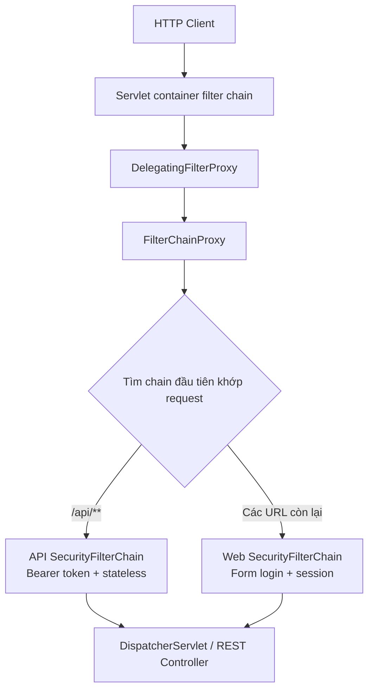

# Nhiều SecurityFilterChain, securityMatcher và thứ tự @Order

## 1. Bài toán: cùng ứng dụng nhưng API và website cần cơ chế bảo vệ khác nhau

Giả sử một ứng dụng Spring Boot vừa phục vụ REST API cho ứng dụng di động, vừa có giao diện quản trị được truy cập bằng trình duyệt:

- `GET /api/public/ping`: API công khai, không yêu cầu access token.
- `GET /api/orders/42`: API yêu cầu OAuth 2.0 Bearer JWT với scope `orders.read`.
- `POST /api/orders`: API yêu cầu scope `orders.write`.
- `GET /web/dashboard`: trang web chỉ dành cho người dùng đã đăng nhập bằng form.
- `GET /login` và `POST /login`: đường dẫn của cơ chế form login.

Các nhóm request này có đặc tính khác nhau:

| Nhóm | Kiểu xác thực | Khi chưa xác thực | Quản lý phiên | CSRF |
|---|---|---|---|---|
| REST API `/api/**` | Bearer access token | Thường trả `401` và `WWW-Authenticate: Bearer` | Thường stateless | Có thể tắt trong API thuần Bearer header, tùy kiến trúc |
| Website quản trị | Form login | Thường redirect `302` tới `/login` | Thường dùng HTTP session | Nên giữ bảo vệ CSRF cho các thao tác thay đổi trạng thái |
| Tài nguyên công khai | Không cần xác thực | Cho phép | Phụ thuộc chain được chọn | Phụ thuộc cơ chế xác thực/request |

Có thể dùng **một** `SecurityFilterChain` với nhiều `requestMatchers` để xử lý những yêu cầu đơn giản. Nhưng khi từng vùng URL cần **cơ chế xác thực, filter, cách báo lỗi, session hoặc CSRF khác nhau**, sử dụng **nhiều `SecurityFilterChain`** giúp tách cấu hình rõ ràng.

Vấn đề cốt lõi không phải “một request chạy qua tất cả các chain”, mà là:

> **Spring Security chọn `SecurityFilterChain` khớp đầu tiên theo thứ tự ưu tiên. Request chỉ đi qua các filter của chain được chọn.**

Nếu không hiểu quy tắc này, một chain tổng quát có thể che mất chain chuyên biệt, hoặc một nhóm URL có thể không được bảo vệ bởi Spring Security vì không khớp chain nào.

### Mục tiêu bài học

Sau bài học, bạn có thể:

1. Giải thích vai trò của `DelegatingFilterProxy`, `FilterChainProxy` và từng `SecurityFilterChain`.
2. Phân biệt `securityMatcher(...)` dùng **chọn chain** với `requestMatchers(...)` trong `authorizeHttpRequests` dùng **chọn quy tắc phân quyền**.
3. Dùng `@Order` để thiết lập thứ tự ưu tiên giữa các chain.
4. Tách API Bearer JWT stateless và website form login stateful.
5. Hiểu tại sao chỉ **chain đầu tiên khớp** có hiệu lực, không cộng dồn rule từ các chain.
6. Nhận diện rủi ro khi một request không khớp chain nào, khi `/login` nằm ngoài phạm vi chain hoặc khi chain rộng đứng trước chain hẹp.
7. Viết các request/test để quan sát 200, 401, 403, 302 và kiểm tra chain nào xử lý URL.

## 2. Kiến trúc Servlet: FilterChainProxy chọn SecurityFilterChain

Spring Security Servlet tích hợp với Servlet container thông qua `DelegatingFilterProxy`. Proxy này thường chuyển request đến bean Spring Security `springSecurityFilterChain`, thường được xây dựng dưới dạng `FilterChainProxy`.

`FilterChainProxy` quản lý một danh sách `SecurityFilterChain`. Mỗi chain gồm:

- Một **`RequestMatcher`** để quyết định chain có áp dụng cho request hay không.
- Một danh sách **security filters** để xử lý request, ví dụ security context, CSRF, Bearer token authentication, exception handling và authorization.

Sơ đồ khái quát:



Đây là mô hình minh họa. Trong ứng dụng thực tế có thể có nhiều Servlet filter ở ngoài Spring Security, nhiều DispatcherServlet hoặc các cơ chế bảo mật khác.

### 2.1. Không phải request đi qua mọi SecurityFilterChain

Giả sử có ba chain:

```text
@Order(1)  securityMatcher("/api/admin/**")
@Order(2)  securityMatcher("/api/**")
@Order(3)  securityMatcher(any request)
```

Với request `GET /api/admin/users`:

1. `FilterChainProxy` kiểm tra chain ưu tiên 1.
2. URL khớp `/api/admin/**`.
3. **Chain 1 được chọn ngay.**
4. Chain 2 và 3 không được thực thi cho request đó.

Điểm này rất quan trọng: nếu chain 1 chỉ yêu cầu `authenticated()`, còn chain 2 yêu cầu scope quản trị nghiêm ngặt, **scope ở chain 2 không được kiểm tra**. Không có thao tác lấy giao hoặc hợp các rule của hai chain.

### 2.2. Thứ tự ưu tiên là một phần của chính sách bảo mật

Tập matcher sau có các vùng chồng nhau:

```text
/api/**
/api/admin/**
/api/public/**
```

Một URL như `/api/admin/users` đồng thời khớp `/api/**` và `/api/admin/**`. Vì chỉ chain đầu tiên khớp được chọn, thứ tự phải phản ánh **độ đặc hiệu và ý định bảo vệ**.

Thông thường:

```text
Ưu tiên cao: /api/admin/**
Ưu tiên kế:  /api/**
Ưu tiên cuối: catch-all
```

Không nên coi Spring Security sẽ tự chọn chain có URL dài nhất hoặc matcher “đặc hiệu nhất”. **Thứ tự danh sách chain mới quyết định việc chọn trước.**

### 2.3. Nếu không có chain nào khớp thì sao?

Ví dụ ứng dụng chỉ khai báo:

```text
@Order(1) /api/**
@Order(2) /web/**
```

Request tới `/actuator/info` hoặc `/internal/diagnostics` không khớp hai chain trên.

Trong trường hợp này, **`FilterChainProxy` không áp dụng các filter bảo mật của hai chain cho request đó**. Điều đó không chứng minh endpoint chắc chắn có thể truy cập — nó còn có thể bị giới hạn bởi Servlet container, reverse proxy, Controller hoặc cơ chế khác — nhưng **không được giả định Spring Security đang bảo vệ endpoint bằng các rule của hai chain**.

Với API cần mặc định từ chối, nên có một **catch-all chain** được đặt cuối cùng hoặc một thiết kế matcher bao phủ đầy đủ những request dự kiến. Rule `anyRequest().denyAll()` chỉ có tác dụng **bên trong chain đã được chọn**, không bảo vệ URL nằm ngoài matcher của chain đó.

## 3. `securityMatcher(...)` và `requestMatchers(...)` khác nhau thế nào?

Đây là hai API dễ nhầm nhất khi viết nhiều `SecurityFilterChain`.

### 3.1. `securityMatcher(...)` chọn phạm vi của toàn bộ chain

Ví dụ:

```java
http
    .securityMatcher("/api/**")
    .oauth2ResourceServer(oauth2 ->
        oauth2.jwt(Customizer.withDefaults()));
```

Ý nghĩa: SecurityFilterChain được xây từ `http` này **chỉ được xem xét cho các request khớp `/api/**`**.

Khi một request khớp, các filter của chain mới được dùng, gồm Bearer authentication, authorization, exception handling và những filter khác được cấu hình trong chain.

Nếu request là `GET /web/dashboard`, API chain không khớp; `FilterChainProxy` sẽ thử chain tiếp theo.

### 3.2. `requestMatchers(...)` trong `authorizeHttpRequests` chọn rule sau khi chain đã được chọn

Ví dụ:

```java
http
    .securityMatcher("/api/**")
    .authorizeHttpRequests(auth -> auth
        .requestMatchers("/api/public/**").permitAll()
        .requestMatchers(HttpMethod.GET, "/api/orders/**")
            .hasAuthority("SCOPE_orders.read")
        .anyRequest().denyAll()
    );
```

Ở đây:

- `securityMatcher("/api/**")`: **chain selection**.
- `requestMatchers("/api/public/**")`: **authorization rule** cho request đã nằm trong API chain.
- `requestMatchers(HttpMethod.GET, "/api/orders/**")`: rule cho HTTP GET đọc đơn hàng.
- `anyRequest().denyAll()`: rule mặc định từ chối những request **đã vào chain này** nhưng chưa được cho phép.

### 3.3. Bảng so sánh

| Đặc điểm | `securityMatcher(...)` | `requestMatchers(...)` trong authorization |
|---|---|---|
| Được gọi ở đâu? | Trên `HttpSecurity` khi xây chain | Bên trong `authorizeHttpRequests` |
| Câu hỏi | “Chain này có áp dụng cho request không?” | “Sau khi vào chain, request cần quyền gì?” |
| Khi không khớp | `FilterChainProxy` thử chain tiếp theo | Thử rule tiếp theo trong chain được chọn |
| Ảnh hưởng tới authentication filter | Có; xác định request có đi qua filter này của chain hay không | Không loại Bearer filter khỏi chain chỉ vì rule `permitAll` |
| Rủi ro khi hiểu sai | URL có thể lọt ra ngoài toàn bộ các chain | Rule quá rộng có thể cho phép hoặc từ chối sai |
| Ví dụ | `securityMatcher("/api/**")` | `requestMatchers("/api/public/**").permitAll()` |

Lưu ý rằng Spring Security còn có những API `RequestMatcher` khác được dùng ở CSRF, CORS hoặc exception handling; vai trò của chúng phụ thuộc nơi được cấu hình. Ở đây, so sánh tập trung vào **matcher chọn chain** và **matcher chọn rule HTTP authorization**.

### 3.4. Ví dụ dễ nhầm: thiếu `securityMatcher`

```java
@Bean
@Order(1)
SecurityFilterChain apiChain(HttpSecurity http) throws Exception {
    return http
        .authorizeHttpRequests(auth -> auth
            .requestMatchers("/api/**").authenticated()
            .anyRequest().permitAll())
        .oauth2ResourceServer(oauth2 ->
            oauth2.jwt(Customizer.withDefaults()))
        .build();
}
```

Nhìn qua có vẻ đây là “API chain”, nhưng không có `securityMatcher(...)`. Theo mặc định, chain có thể có matcher **mọi request**.

Nếu chain này đứng đầu, nó sẽ được chọn cả với `/web/dashboard`. Một web form-login chain ở dưới **không còn cơ hội xử lý** request. Hơn nữa, `anyRequest().permitAll()` ở chain đầu tiên có thể mở quyền không dự kiến cho phần web.

**Sửa đúng:** thêm `securityMatcher("/api/**")` nếu thực sự muốn API chain chỉ bảo vệ `/api/**`; sau đó khai báo các rule của vùng API ở bên trong.

### 3.5. `permitAll` không có nghĩa bỏ qua filter xác thực

Nếu request `GET /api/public/ping` khớp API chain có Bearer authentication filter nhưng rule `permitAll()`:

- **Không gửi Authorization header:** request thường được phép.
- **Gửi Bearer token hợp lệ:** token có thể được xử lý rồi endpoint vẫn được phép.
- **Gửi Bearer token không hợp lệ:** authentication filter có thể từ chối bằng `401` **trước khi** authorization rule `permitAll` được áp dụng.

Vì vậy, nếu muốn public route hoàn toàn không đi qua Bearer filter, có thể thiết kế **một chain public riêng** đứng trước API chain, nhưng phải hiểu sự khác biệt về security headers, CSRF, CORS và authentication context trong chain public.

## 4. `@Order` quyết định ưu tiên chain

### 4.1. Cách dùng cơ bản

Spring Security có thể thu thập nhiều bean kiểu `SecurityFilterChain` và sắp xếp theo order:

```java
@Bean
@Order(1)
SecurityFilterChain apiSecurity(HttpSecurity http) throws Exception {
    // ...
}

@Bean
@Order(2)
SecurityFilterChain webSecurity(HttpSecurity http) throws Exception {
    // ...
}
```

`@Order(1)` có **ưu tiên cao hơn** `@Order(2)`, tức được xem xét trước khi tìm chain khớp.

Có thể dùng các giá trị thứ tự khác; giá trị số nhỏ hơn thường được sắp trước. Nếu có nhiều chain chồng nhau, nên gán thứ tự minh bạch thay vì dựa vào thứ tự khai báo method trong file Java.

### 4.2. Chain đầu tiên khớp thắng

Giả sử:

```text
Chain A: @Order(1), matcher /api/**
Chain B: @Order(2), matcher /api/admin/**
Chain C: @Order(3), matcher any request
```

Request `/api/admin/users` sẽ vào **chain A**, không vào chain B.

Đây là cấu hình sai nếu B được tạo để bảo vệ admin chặt hơn. Muốn B thắng, đặt:

```text
Chain B: @Order(1), matcher /api/admin/**
Chain A: @Order(2), matcher /api/**
Chain C: @Order(3), matcher any request
```

Rule cụ thể đứng trước matcher rộng hơn.

### 4.3. `@Order` trên chain khác thứ tự filter bên trong chain

Hai khái niệm không được trộn lẫn:

1. **Chain order:** `@Order` quyết định `SecurityFilterChain` nào được xét trước.
2. **Filter order:** Trong chain đã chọn, các filter được sắp theo thứ tự phù hợp của Spring Security. Có thể bổ sung filter bằng `addFilterBefore`, `addFilterAfter` hoặc API liên quan khi cần.

Đổi `@Order(1)` thành `@Order(2)` **không** làm `AuthorizationFilter` chạy trước `BearerTokenAuthenticationFilter` trong cùng một chain. Ngược lại, `addFilterBefore` không quyết định chain nào được chọn.

### 4.4. Chỉ đặt `@Order` chưa đủ

Một method `@Bean @Order(1)` vẫn có thể match mọi URL nếu không có `securityMatcher`.

Một chain khác `@Order(2)` dù cấu hình rất chặt cũng không giúp được request đã khớp chain 1. Điều cần có đồng thời là:

- Matcher của từng chain rõ ràng.
- Thứ tự ưu tiên phản ánh cấu trúc URL.
- Rule authorization bên trong chain được thiết kế đầy đủ.
- Có cách xử lý những URL không thuộc vùng chuyên biệt.

## 5. Ví dụ hoàn chỉnh: API Bearer JWT và web form login trong cùng ứng dụng

Bây giờ xây dựng một ứng dụng Spring Boot để thấy rõ cách hai chain độc lập hoạt động.

### 5.1. Dependency

Ví dụ `build.gradle`:

```groovy
dependencies {
    implementation 'org.springframework.boot:spring-boot-starter-web'
    implementation 'org.springframework.boot:spring-boot-starter-security'
    implementation 'org.springframework.boot:spring-boot-starter-oauth2-resource-server'

    testImplementation 'org.springframework.boot:spring-boot-starter-test'
    testImplementation 'org.springframework.security:spring-security-test'
}
```

Giả định project đã cấu hình Spring Boot plugin và dependency management tương thích với Java/Spring Security đang dùng. Ví dụ tiếp theo sử dụng lambda DSL và `SecurityFilterChain` theo các phiên bản Spring Security hiện đại.

### 5.2. Cấu hình issuer của Resource Server

Trong `src/main/resources/application.yml`:

```yaml
server:
  port: 8080

spring:
  security:
    oauth2:
      resourceserver:
        jwt:
          issuer-uri: https://id.example.com/realms/shop
```

Địa chỉ là **placeholder**. Muốn dùng Bearer JWT thật, phải thay bằng issuer tin cậy thực tế và có access token do Authorization Server phát hành cho API.

`issuer-uri` cho phép Resource Server xác minh issuer và dùng cơ chế khám phá nguồn khóa phù hợp. Trong ứng dụng thực tế, cần ràng buộc thêm **audience của API** nếu chưa có validator tương ứng. Chỉ kiểm tra chữ ký/issuer và scope không tự đảm bảo token được cấp cho đúng Resource Server.

### 5.3. SecurityConfig có hai SecurityFilterChain

```java
package com.example.multichain;

import org.springframework.context.annotation.Bean;
import org.springframework.context.annotation.Configuration;
import org.springframework.core.annotation.Order;
import org.springframework.http.HttpMethod;
import org.springframework.security.config.Customizer;
import org.springframework.security.config.annotation.web.builders.HttpSecurity;
import org.springframework.security.config.http.SessionCreationPolicy;
import org.springframework.security.web.SecurityFilterChain;

@Configuration
public class SecurityConfig {

    // Ưu tiên 1: mọi request /api/** đi qua JWT Resource Server.
    @Bean
    @Order(1)
    SecurityFilterChain apiSecurity(HttpSecurity http) throws Exception {
        return http
            .securityMatcher("/api/**")
            .csrf(csrf -> csrf.disable())
            .sessionManagement(session -> session
                .sessionCreationPolicy(SessionCreationPolicy.STATELESS))
            .authorizeHttpRequests(auth -> auth
                .requestMatchers(HttpMethod.GET, "/api/public/ping")
                    .permitAll()

                .requestMatchers(HttpMethod.GET, "/api/orders/**")
                    .hasAuthority("SCOPE_orders.read")

                .requestMatchers(HttpMethod.POST, "/api/orders")
                    .hasAuthority("SCOPE_orders.write")

                .anyRequest().denyAll()
            )
            .oauth2ResourceServer(oauth2 ->
                oauth2.jwt(Customizer.withDefaults()))
            .build();
    }

    // Ưu tiên 2: catch-all cho các request không thuộc /api/**.
    @Bean
    @Order(2)
    SecurityFilterChain webSecurity(HttpSecurity http) throws Exception {
        return http
            .authorizeHttpRequests(auth -> auth
                .requestMatchers("/assets/**", "/favicon.ico")
                    .permitAll()
                .anyRequest().authenticated()
            )
            .formLogin(Customizer.withDefaults())
            .build();
    }
}
```

**Đây là hai bean `SecurityFilterChain` thực sự khác nhau**, không phải hai phương thức bổ sung rule cho cùng một chain.

Những điểm quan trọng:

- API chain được xét trước vì `@Order(1)`.
- `securityMatcher("/api/**")` giới hạn **toàn bộ API chain**.
- Những đường dẫn khác đi đến web chain.
- Web chain **không có `securityMatcher`**, nên dùng matcher mặc định bao phủ mọi request còn lại; nó là **catch-all chain**.
- API chain sử dụng Bearer JWT và session stateless.
- Web chain sử dụng form login và các mặc định phù hợp với ứng dụng trình duyệt, gồm hỗ trợ session và bảo vệ CSRF theo cấu hình.
- `anyRequest().denyAll()` trong API chain từ chối những request API chưa được khai báo quyền cụ thể.
- `anyRequest().authenticated()` ở web chain yêu cầu đăng nhập cho phần web và các URL khác không được permit.
- `/login` nằm trong phạm vi web chain catch-all, giúp cơ chế form login mặc định có thể hoạt động.

Ví dụ chỉ mô tả cơ chế bảo vệ. Để đăng nhập được qua form trong ứng dụng thật, phải có cơ chế user authentication như `UserDetailsService`, identity provider hoặc cơ chế phù hợp; cấu hình form login tự nó không tạo hệ thống quản lý user production.

### 5.4. Tại sao tắt CSRF ở API nhưng giữ tại web?

REST API trong ví dụ nhận Bearer token qua header do Client chủ động gửi, không sử dụng cookie làm cơ chế tự động xác thực. Vì thế ví dụ tắt CSRF **chỉ trong API chain**.

Trái lại, website dùng form login và session cookie có thể bị tấn công CSRF nếu bỏ bảo vệ. **Không áp dụng `csrf.disable()` vào web chain chỉ để cho request POST dễ chạy hơn.**

Nếu ứng dụng thực tế dùng cookie để xác thực API hoặc dùng một cơ chế credential được trình duyệt tự động gửi, cần đánh giá CSRF riêng; không phải mọi endpoint có chữ “API” đều an toàn khi tắt CSRF.

### 5.5. Web chain có cần `sessionCreationPolicy` riêng không?

Web chain trong ví dụ không đặt `STATELESS` nên có thể dùng chính sách session phù hợp cơ chế form login. API chain đặt `STATELESS` để không sử dụng HTTP session cho việc xác thực Bearer token.

**Cấu hình session là thuộc tính từng chain**, không được suy luận rằng việc đặt stateless ở API chain khiến toàn bộ ứng dụng không thể dùng session. Trình duyệt đăng nhập web vẫn cần cơ chế lưu và truy xuất Authentication theo thiết kế.

### 5.6. Controller tối thiểu

```java
package com.example.multichain;

import java.util.Map;
import org.springframework.security.core.Authentication;
import org.springframework.security.core.annotation.AuthenticationPrincipal;
import org.springframework.security.oauth2.jwt.Jwt;
import org.springframework.web.bind.annotation.GetMapping;
import org.springframework.web.bind.annotation.PathVariable;
import org.springframework.web.bind.annotation.RestController;

@RestController
public class DemoController {

    @GetMapping("/api/public/ping")
    public Map<String, String> ping() {
        return Map.of("status", "ok", "surface", "api-public");
    }

    @GetMapping("/api/orders/{orderId}")
    public Map<String, String> getOrder(
            @PathVariable String orderId,
            @AuthenticationPrincipal Jwt jwt) {

        return Map.of(
            "orderId", orderId,
            "subject", jwt.getSubject());
    }

    @GetMapping("/web/dashboard")
    public Map<String, String> dashboard(Authentication authentication) {
        return Map.of(
            "surface", "web",
            "user", authentication.getName());
    }
}
```

Demo có thể dùng `@SpringBootApplication` thông thường tại cùng package gốc. Nó không khai báo `POST /api/orders`, vì mục đích là mô tả rule phân quyền; nếu muốn thử POST thành công, phải bổ sung handler và nghiệp vụ. Trong môi trường thực tế, phải kiểm tra ownership/tenant trước khi trả đơn hàng.

### 5.7. Vì sao form-login không xuất hiện ở API?

Request `GET /api/orders/42` khớp API chain **đầu tiên**. Do đó nó dùng Bearer authentication entry point, không đi vào web chain để redirect tới `/login`.

Request `GET /web/dashboard` không khớp API chain, nên được xử lý bởi web chain và cơ chế form login. Người dùng chưa đăng nhập sẽ thường nhận redirect tới `/login`.

Đây là lợi ích cụ thể của việc tách chain: **cùng ứng dụng nhưng mỗi vùng URL có trải nghiệm xác thực phù hợp**.

## 6. Quy trình chọn chain trên từng request

Với ví dụ ở mục 5, xét các request:

### 6.1. `GET /api/public/ping`

```text
1. Kiểm tra API chain @Order(1):
   /api/public/ping khớp /api/** → chọn API chain.

2. Bearer token filter không thấy token → tiếp tục.

3. Authorization rule khớp GET /api/public/ping → permitAll.

4. Controller trả 200 OK.
```

Không có bước chuyển sang web chain sau khi API chain đã được chọn.

### 6.2. `GET /api/orders/42` không có token

```text
1. API chain @Order(1) khớp /api/**.
2. Không có Bearer token hợp lệ.
3. Rule yêu cầu SCOPE_orders.read.
4. Chưa có Authentication đáp ứng.
5. Bearer entry point thường trả 401 Unauthorized.
```

Không có redirect tới `/login` vì web chain không chạy.

### 6.3. `GET /api/orders/42` có token hợp lệ nhưng thiếu scope

```text
1. API chain khớp.
2. JwtDecoder xác minh token thành công.
3. GrantedAuthority không chứa SCOPE_orders.read.
4. Authorization từ chối.
5. Thường trả 403 Forbidden.
```

`403` không phải dấu hiệu token sai issuer hoặc hết hạn; nó thường có nghĩa **token đã được chấp nhận nhưng không đủ quyền**.

### 6.4. `GET /web/dashboard` không có session đăng nhập

```text
1. API chain @Order(1) không khớp /api/**.
2. Web chain @Order(2) khớp vì catch-all.
3. Rule anyRequest().authenticated() yêu cầu đăng nhập.
4. Form login entry point thường redirect tới /login.
5. Client nhận 302 Found (hoặc redirect 3xx thích hợp).
```

### 6.5. `GET /login`

```text
1. API chain không khớp.
2. Web chain catch-all khớp.
3. Form login filter/page generator xử lý endpoint login theo cấu hình.
```

Nếu web chain bị giới hạn thành `securityMatcher("/web/**")` mà không xử lý thêm `/login`, đường dẫn login mặc định có thể **không nằm trong chain chứa formLogin**. Khi đó phải điều chỉnh matcher hoặc cấu hình login endpoint một cách nhất quán.

### 6.6. `GET /unlisted-path`

```text
1. API chain không khớp.
2. Web chain catch-all khớp.
3. Rule authenticated() được áp dụng.
4. Người dùng chưa đăng nhập thường bị redirect /login.
```

Sau khi xác thực, URL có thể vẫn không có Controller mapping và trả 404. Đó là vấn đề routing HTTP, khác với việc request có được Spring Security bảo vệ hay không.

## 7. Ma trận securityMatcher, @Order và kết quả lựa chọn

Với cấu hình:

```text
@Order(1)   API chain: /api/**
@Order(2)   Web chain: any request
```

| Request | Chain được chọn | Quy tắc quan trọng | Kết quả điển hình nếu chưa xác thực |
|---|---|---|---|
| `GET /api/public/ping` | API | `permitAll` | 200 |
| `GET /api/orders/42` | API | `SCOPE_orders.read` | 401 |
| `POST /api/orders` | API | `SCOPE_orders.write` | 401 |
| `PATCH /api/orders/42` | API | `denyAll` | Từ chối; mã cụ thể tùy authentication/handler |
| `GET /web/dashboard` | Web | `authenticated` | Redirect tới login |
| `GET /login` | Web | Form login infrastructure | Hiển thị/điều hướng trang login theo cấu hình |
| `GET /assets/app.css` | Web | `permitAll` | Được phép qua authorization; cần file thật để trả 200 |
| `GET /unknown` | Web | `authenticated` | Redirect tới login |

Cần phân biệt:

- **Chain selection:** chain nào xử lý request?
- **Authorization:** request có quyền theo rule chain không?
- **Endpoint mapping:** nếu qua Security, có Controller hoặc static resource tương ứng không?
- **Business authorization:** nếu controller chạy, dữ liệu có thực sự thuộc quyền caller không?

Không thể kết luận HTTP status hoàn toàn chỉ từ matcher; request có thể bị từ chối trước Controller hoặc trả 404/405 sau khi authorization đã qua.

## 8. Khi có ba chain: API admin, API thường và web

Một kiến trúc lớn có thể cần vùng API quản trị có cơ chế bảo vệ khác vùng API còn lại.

Ví dụ:

```text
@Order(1)  /api/admin/**  → yêu cầu quyền admin chuyên biệt
@Order(2)  /api/**        → yêu cầu scope của API bình thường
@Order(3)  catch-all      → web form login
```

Cần đặc biệt cẩn trọng vì `/api/admin/**` cũng khớp `/api/**`.

### 8.1. Code minh họa thứ tự đúng

```java
@Configuration
public class ThreeChainSecurityConfig {

    @Bean
    @Order(1)
    SecurityFilterChain adminApi(HttpSecurity http) throws Exception {
        return http
            .securityMatcher("/api/admin/**")
            .csrf(csrf -> csrf.disable())
            .sessionManagement(s -> s
                .sessionCreationPolicy(SessionCreationPolicy.STATELESS))
            .authorizeHttpRequests(auth -> auth
                .anyRequest()
                    .hasAuthority("SCOPE_api.admin"))
            .oauth2ResourceServer(oauth2 ->
                oauth2.jwt(Customizer.withDefaults()))
            .build();
    }

    @Bean
    @Order(2)
    SecurityFilterChain generalApi(HttpSecurity http) throws Exception {
        return http
            .securityMatcher("/api/**")
            .csrf(csrf -> csrf.disable())
            .sessionManagement(s -> s
                .sessionCreationPolicy(SessionCreationPolicy.STATELESS))
            .authorizeHttpRequests(auth -> auth
                .requestMatchers("/api/public/**").permitAll()
                .requestMatchers(HttpMethod.GET, "/api/orders/**")
                    .hasAuthority("SCOPE_orders.read")
                .anyRequest().denyAll())
            .oauth2ResourceServer(oauth2 ->
                oauth2.jwt(Customizer.withDefaults()))
            .build();
    }

    @Bean
    @Order(3)
    SecurityFilterChain web(HttpSecurity http) throws Exception {
        return http
            .authorizeHttpRequests(auth -> auth
                .anyRequest().authenticated())
            .formLogin(Customizer.withDefaults())
            .build();
    }
}
```

Đoạn code minh họa giả định đã có imports tương tự mục 5.3 và được dùng **thay thế**, không khai báo cùng lúc với cấu hình hai chain cũ. Ứng dụng thực tế còn phải bổ sung audience validators và quyền nghiệp vụ.

### 8.2. Chỉ khớp chain đầu tiên, không cộng quyền

Request `GET /api/admin/reports` vào `adminApi`, nên bắt buộc `SCOPE_api.admin`. Nó **không** đồng thời kiểm tra `SCOPE_orders.read` từ `generalApi`.

Nếu endpoint admin cần **cả** `SCOPE_api.admin` và `SCOPE_reports.read`, phải khai báo cả hai điều kiện **trong admin chain** hoặc method/business authorization tương ứng. Không dựa vào việc general API chain ở phía sau.

### 8.3. Cùng authentication mechanism không bắt buộc cần nhiều chain

Nếu API admin và API thường đều dùng JWT stateless, cùng issuer và cùng chính sách filter, có thể đơn giản hơn khi chỉ dùng một API chain:

```java
.securityMatcher("/api/**")
.authorizeHttpRequests(auth -> auth
    .requestMatchers("/api/admin/**")
        .hasAuthority("SCOPE_api.admin")
    .requestMatchers(HttpMethod.GET, "/api/orders/**")
        .hasAuthority("SCOPE_orders.read")
    .anyRequest().denyAll()
)
```

Trong tình huống này, thứ tự **authorization rules** cũng quan trọng: rule `/api/admin/**` cần đứng trước những rule API tổng quát chồng lấn.

**Nên dùng nhiều chain khi cần tách cơ chế filter/security behavior rõ ràng**, không phải cứ có hai loại scope là bắt buộc tạo hai `SecurityFilterChain`.

## 9. Tách một public chain riêng: khi nào hợp lý?

Trong ví dụ hai chain ban đầu, `/api/public/ping` dùng `permitAll()` **bên trong API Resource Server chain**. Bearer authentication filter vẫn có thể xử lý token được gửi, kể cả token không hợp lệ.

Nếu yêu cầu sản phẩm là `/api/public/**` **không thử xác thực Bearer token**, có thể tạo chain riêng:

```java
@Bean
@Order(1)
SecurityFilterChain publicApi(HttpSecurity http) throws Exception {
    return http
        .securityMatcher("/api/public/**")
        .authorizeHttpRequests(auth -> auth
            .anyRequest().permitAll())
        .build();
}

@Bean
@Order(2)
SecurityFilterChain protectedApi(HttpSecurity http) throws Exception {
    return http
        .securityMatcher("/api/**")
        .csrf(csrf -> csrf.disable())
        .sessionManagement(s -> s
            .sessionCreationPolicy(SessionCreationPolicy.STATELESS))
        .authorizeHttpRequests(auth -> auth
            .anyRequest().authenticated())
        .oauth2ResourceServer(oauth2 ->
            oauth2.jwt(Customizer.withDefaults()))
        .build();
}
```

Đây là **ví dụ thay thế để giải thích chain selection**, chưa bao gồm catch-all web chain hoặc các scope rule cho mọi endpoint. Nếu dùng trong ứng dụng thực tế, cần bổ sung các phần đó và xác định CSRF/session/CORS/headers của public chain.

### 9.1. Điểm khác biệt với `permitAll` trong API chain

**Public rule nằm trong API chain:**

```text
/api/public/ping
    → API chain
    → BearerTokenAuthenticationFilter có mặt
    → AuthorizationFilter permitAll
```

**Public route có chain riêng:**

```text
/api/public/ping
    → Public chain
    → Không cấu hình oauth2ResourceServer ở chain này
    → AuthorizationFilter permitAll
```

Nếu Client gửi Bearer token sai vào public route:

- Trong API chain có Bearer filter, token sai có thể khiến response `401`.
- Trong public chain không có Bearer filter, token sai có thể không bị xử lý tại lớp Bearer authentication và route vẫn được cho phép, trừ các filter/quy định khác.

Đây là **lựa chọn kiến trúc**, không phải lỗi của `permitAll`. Nếu public endpoint không nên nhận hoặc giải thích token, tách chain có thể phù hợp. Tuy nhiên, nó cũng không có `Jwt` principal để sử dụng ở Controller trong các request được xử lý bởi public chain.

### 9.2. Không dùng `web.ignoring()` thay cho mọi public chain

Spring Security có cơ chế cấu hình bỏ qua một số request khỏi security filter chain. Điều đó khác `permitAll`:

- `permitAll`: request vẫn đi qua SecurityFilterChain được chọn, nên những filter như security headers có thể còn áp dụng.
- Bỏ qua Spring Security hoàn toàn: request có thể không đi qua các filter bảo mật đó.

Với HTTP endpoint công khai thông thường, `permitAll` thường là lựa chọn phù hợp để vẫn giữ các biện pháp bảo vệ ở tầng filter. Chỉ bỏ qua toàn bộ Spring Security khi hiểu rõ lý do và hậu quả; không dùng bỏ qua như cách “sửa nhanh” một lỗi 401/403.

## 10. Form login, login endpoint và việc chọn chain

### 10.1. Một lỗi kinh điển: chain giới hạn `/web/**` nhưng login ở `/login`

Giả sử:

```java
@Bean
@Order(2)
SecurityFilterChain webSecurity(HttpSecurity http) throws Exception {
    return http
        .securityMatcher("/web/**")
        .authorizeHttpRequests(auth -> auth
            .anyRequest().authenticated())
        .formLogin(Customizer.withDefaults())
        .build();
}
```

Khi user gọi `/web/dashboard`, form login có thể cố redirect tới `/login`, nhưng **`/login` không khớp `/web/**`**. Nếu không có chain khác phù hợp, filter/page generator liên quan login có thể không xử lý URL đó, dẫn đến lỗi hoặc luồng đăng nhập không hoạt động.

Có hai hướng thiết kế:

1. Dùng **catch-all web chain** đứng cuối, như ví dụ mục 5.
2. Cấu hình login URL và các endpoint cần thiết nằm trong vùng matcher của web chain, hoặc tạo matcher bao phủ cả `/web/**`, `/login`, trang lỗi/tài nguyên liên quan một cách chính xác.

Một chain có thể phát sinh các endpoint của filter như login/logout, không chỉ Controller mapping. Khi thu hẹp matcher, cần rà soát cả **URL mà security filters tự xử lý**.

### 10.2. Login không nên bị Bearer chain chặn nhầm

Nếu API chain thiếu `securityMatcher("/api/**")`, request `GET /login` có thể bị chain đầu tiên chiếm, làm form login chain không chạy. Điều này giải thích vì sao có ứng dụng “cấu hình form login rồi” nhưng `/login` vẫn 401/403/404.

Đừng chỉ thay `permitAll` trong web chain khi request **không bao giờ được chọn vào web chain**. Cần xác định chain selection trước.

### 10.3. CORS cũng là cấu hình theo chain

REST API được gọi từ frontend khác origin có thể cần CORS và xử lý preflight `OPTIONS`. Khi dùng nhiều chain, hãy bảo đảm request preflight được chain thích hợp xử lý với cấu hình CORS tương ứng, trước khi áp đặt yêu cầu Bearer authentication gây lỗi.

Ví dụ ý tưởng:

```java
http
    .securityMatcher("/api/**")
    .cors(Customizer.withDefaults())
    .authorizeHttpRequests(auth -> auth
        // Các rule phù hợp sau khi CORS/preflight được xử lý.
        .anyRequest().authenticated())
    .oauth2ResourceServer(oauth2 ->
        oauth2.jwt(Customizer.withDefaults()));
```

Cần cung cấp `CorsConfigurationSource` hoặc cấu hình MVC/CORS phù hợp để `cors()` có hiệu lực đúng yêu cầu. Không giải quyết lỗi CORS bằng `permitAll` cho toàn bộ API.

## 11. Exception handling khác nhau theo chain

Mỗi `SecurityFilterChain` có thể có cơ chế xác thực và error response riêng.

### 11.1. API Bearer

Với OAuth 2.0 Resource Server:

- Thiếu token khi endpoint yêu cầu Authentication → thường `401 Unauthorized`.
- Token JWT không hợp lệ → thường `401 Unauthorized` với Bearer challenge.
- Token hợp lệ nhưng thiếu scope → thường `403 Forbidden`.

Response có thể gồm:

```http
HTTP/1.1 401 Unauthorized
WWW-Authenticate: Bearer
```

hoặc:

```http
HTTP/1.1 403 Forbidden
WWW-Authenticate: Bearer error="insufficient_scope"
```

Header chi tiết tùy lỗi và cấu hình `AuthenticationEntryPoint`/`AccessDeniedHandler`.

### 11.2. Website form login

Với web chain và form login, truy cập protected page chưa đăng nhập thường được chuyển hướng:

```http
HTTP/1.1 302 Found
Location: http://localhost:8080/login
```

URL thực tế phụ thuộc host, port, context path, redirect strategy và cấu hình login. Sau đăng nhập bằng session, user có thể truy cập trang theo policy.

### 11.3. Một URL bị chain “sai” chọn có thể trả status “sai”

Nếu `/api/orders/42` trả `302` tới `/login` thay vì `401`, hãy kiểm tra nó có vào web chain không.

Nếu `/web/dashboard` trả `401` với `WWW-Authenticate: Bearer`, hãy kiểm tra API chain có đang match quá rộng không.

**Không sửa HTTP status một cách tùy tiện bằng custom exception handler khi nguyên nhân là chain selection sai.** Xác định matcher và `@Order` trước.

## 12. Ví dụ đường đi HTTP và kết quả mong đợi

Giả sử dùng cấu hình hai chain ở mục 5, ứng dụng chạy tại `http://localhost:8080` và Authorization Server đã cấp JWT access token có đúng scope.

### 12.1. API public không token

```bash
curl -i http://localhost:8080/api/public/ping
```

Kết quả dự kiến:

```http
HTTP/1.1 200 OK
Content-Type: application/json

{"status":"ok","surface":"api-public"}
```

Response minh họa; thứ tự field JSON có thể thay đổi.

### 12.2. API protected không token

```bash
curl -i http://localhost:8080/api/orders/42
```

Kết quả thường:

```http
HTTP/1.1 401 Unauthorized
WWW-Authenticate: Bearer
```

Nếu trả `302` tới `/login`, cần kiểm tra API chain có đang được chọn không.

### 12.3. API có token không hợp lệ

```bash
curl -i \
  -H 'Authorization: Bearer this-is-not-a-jwt' \
  http://localhost:8080/api/orders/42
```

Kết quả thường là `401`. Đây là failure khi xác thực token, không phải thiếu authority đã xác minh.

### 12.4. API có token hợp lệ, thiếu scope

Giả sử biến `ACCESS_TOKEN_WITHOUT_READ` chứa access token thật, còn hạn, đúng issuer/audience nhưng không có scope `orders.read`:

```bash
curl -i \
  -H "Authorization: Bearer $ACCESS_TOKEN_WITHOUT_READ" \
  http://localhost:8080/api/orders/42
```

Kết quả thường `403 Forbidden`. Token phải được phát hành thật với scope thiếu; tự sửa payload JWT đã ký sẽ phá chữ ký và nhiều khả năng trả `401`.

### 12.5. API có token hợp lệ, đủ scope

```bash
curl -i \
  -H "Authorization: Bearer $ACCESS_TOKEN_WITH_READ" \
  http://localhost:8080/api/orders/42
```

Nếu token hợp lệ và có `orders.read`, Controller demo có thể trả:

```http
HTTP/1.1 200 OK
Content-Type: application/json

{"orderId":"42","subject":"user-417"}
```

`subject` phụ thuộc token thật. Trong ứng dụng production, vẫn cần kiểm tra quyền trên bản ghi.

### 12.6. Website chưa đăng nhập

```bash
curl -i http://localhost:8080/web/dashboard
```

Thường nhận redirect:

```http
HTTP/1.1 302 Found
Location: http://localhost:8080/login
```

Không dùng `curl -L` nếu đang muốn **quan sát status redirect ban đầu**; `-L` sẽ theo redirect và có thể hiển thị response cuối của trang login thay vì 302.

### 12.7. Website login page

```bash
curl -i http://localhost:8080/login
```

Với form login mặc định được hỗ trợ và web chain catch-all, có thể nhận `200 OK` với trang login. Với project có login page tùy biến, cần có Controller/template và matcher tương ứng.

### 12.8. Bảng tổng hợp

| Request | Chain | Authentication | Kết quả thường gặp |
|---|---|---|---|
| `GET /api/public/ping` | API | Không token | 200 |
| `GET /api/orders/42` | API | Không token | 401 |
| `GET /api/orders/42` | API | JWT sai | 401 |
| `GET /api/orders/42` | API | JWT đúng, thiếu `orders.read` | 403 |
| `GET /api/orders/42` | API | JWT đúng, có `orders.read` | 200 ở demo |
| `GET /web/dashboard` | Web | Chưa login | 302 tới login |
| `GET /web/dashboard` | Web | Có session Authentication hợp lệ | 200 ở demo |
| `GET /login` | Web | Chưa login | Form login page hoặc response phù hợp |
| `GET /assets/app.css` | Web | Không login | Được phép về security; response file tùy có tồn tại |
| `GET /unknown` | Web | Chưa login | 302 tới login, không phải bỏ qua security |

## 13. MockMvc kiểm tra lựa chọn chain và rule phân quyền

Có thể viết Spring Security Test để xác nhận behavior ở lớp web/security. Giả sử project đã có dependency `spring-security-test` và Controller ở mục 5.6.

### 13.1. Ví dụ test

```java
package com.example.multichain;

import org.junit.jupiter.api.Test;
import org.springframework.beans.factory.annotation.Autowired;
import org.springframework.boot.test.autoconfigure.web.servlet.AutoConfigureMockMvc;
import org.springframework.boot.test.context.SpringBootTest;
import org.springframework.security.core.authority.SimpleGrantedAuthority;
import org.springframework.test.web.servlet.MockMvc;

import static org.springframework.security.test.web.servlet.request
    .SecurityMockMvcRequestPostProcessors.jwt;
import static org.springframework.test.web.servlet.request
    .MockMvcRequestBuilders.get;
import static org.springframework.test.web.servlet.result
    .MockMvcResultMatchers.*;

@SpringBootTest
@AutoConfigureMockMvc
class MultiChainSecurityTest {

    @Autowired
    MockMvc mvc;

    @Test
    void publicApiIsAccessibleWithoutToken() throws Exception {
        mvc.perform(get("/api/public/ping"))
            .andExpect(status().isOk())
            .andExpect(jsonPath("$.surface").value("api-public"));
    }

    @Test
    void apiWithoutTokenReturns401NotLoginRedirect() throws Exception {
        mvc.perform(get("/api/orders/42"))
            .andExpect(status().isUnauthorized());
    }

    @Test
    void validJwtPrincipalWithoutScopeReturns403() throws Exception {
        mvc.perform(get("/api/orders/42")
                .with(jwt()
                    .jwt(token -> token.subject("user-417"))
                    .authorities(new SimpleGrantedAuthority(
                        "SCOPE_profile.read"))))
            .andExpect(status().isForbidden());
    }

    @Test
    void jwtPrincipalWithScopeCanReadDemoOrder() throws Exception {
        mvc.perform(get("/api/orders/42")
                .with(jwt()
                    .jwt(token -> token.subject("user-417"))
                    .authorities(new SimpleGrantedAuthority(
                        "SCOPE_orders.read"))))
            .andExpect(status().isOk())
            .andExpect(jsonPath("$.orderId").value("42"));
    }

    @Test
    void webWithoutLoginRedirectsToLogin() throws Exception {
        mvc.perform(get("/web/dashboard"))
            .andExpect(status().is3xxRedirection())
            .andExpect(redirectedUrlPattern("**/login"));
    }
}
```

Ví dụ sử dụng `MockMvc` với JWT principal giả lập. `with(jwt())` **không ký token thật và không chạy đầy đủ quá trình `JwtDecoder`/JWK/issuer validation**. Nó phù hợp để kiểm tra các nhánh authorization và cách API/web route khác nhau được bảo vệ.

Nếu test context cố tải metadata từ issuer ví dụ hoặc thiếu cấu hình decoder, cần cung cấp test issuer/JWKS hoặc một `JwtDecoder` mock/bean phù hợp. Test JWT thật cần thiết lập bộ khóa thử nghiệm hoặc tích hợp với Authorization Server, không dùng `with(jwt())` để khẳng định xác minh chữ ký production đã đúng.

### 13.2. Kiểm tra điều ngược lại

Ngoài các test trên, cần biết khi nào cấu hình có vấn đề:

- API protected trả 302 → có khả năng web chain đang được chọn.
- Web protected trả 401 Bearer → có khả năng API chain đang match quá rộng.
- Endpoint lạ trả 200 không cần auth → có thể rule quá rộng hoặc URL không khớp bất kỳ chain nào.
- API có JWT đúng nhưng trả 403 → kiểm tra scope, matcher trong API chain và method security khác.
- Form login redirect loop hoặc login 404 → kiểm tra `/login` có thuộc chain chứa form login không.
- URL có HTTP method khác đi vào rule không mong muốn → kiểm tra method-specific matchers.

Đây là những điểm để người học chủ động xác minh trong môi trường của mình. Việc viết test mẫu không đồng nghĩa chúng đã được chạy hoặc đã chứng minh cấu hình production.

## 14. Theo dõi chain được chọn khi debug

Khi gặp 401, 403, 302 hoặc endpoint không được bảo vệ, cần xác định **chain nào thật sự được chọn** thay vì đoán từ tên bean.

Trong môi trường phát triển, có thể bật log phù hợp:

```yaml
logging:
  level:
    org.springframework.security.web.FilterChainProxy: TRACE
    org.springframework.security: DEBUG
```

Log của framework có thể hiển thị quá trình đánh giá matcher/filter và chi tiết chẩn đoán khác tùy phiên bản. Dùng mức log vừa đủ, không để log chi tiết vô hạn ở production.

### 14.1. Những câu hỏi hữu ích khi chẩn đoán

1. Request path và HTTP method thực tế là gì?
2. Có context path, servlet path hoặc reverse proxy rewrite không?
3. Những bean `SecurityFilterChain` nào được tạo?
4. Thứ tự `@Order` hiện tại?
5. `securityMatcher` của mỗi chain có khớp request không?
6. Chain đầu tiên khớp có những filter/cơ chế xác thực nào?
7. Rule `authorizeHttpRequests` nào được áp dụng?
8. Exception entry point/access denied handler nào trả response?
9. Request có đến DispatcherServlet/Controller không?
10. Có method security hoặc kiểm tra quyền nghiệp vụ bổ sung không?

Log có thể chứa đường dẫn, tên quyền hoặc thông tin về principal. **Không ghi nguyên Bearer access token, session secret, password hay khóa bí mật**.

### 14.2. Khi ứng dụng chạy sau reverse proxy

Một request bên ngoài:

```http
GET /shop/api/orders/42 HTTP/1.1
Host: public.example.com
```

có thể được proxy chuyển tới ứng dụng dưới đường dẫn `/api/orders/42` hoặc giữ nguyên `/shop/api/orders/42`, tùy cách rewrite và context path.

Vì vậy, nếu matcher `/api/**` không khớp khi chạy qua gateway nhưng khớp ở localhost, cần xem đường dẫn **Servlet request thực sự nhận** và cách framework ánh xạ path. Không vội nới `securityMatcher("/**")` để sửa lỗi vì có thể khiến một chain chiếm các vùng không dự kiến.

## 15. Những lỗi cấu hình thường gặp

### 15.1. Chain đầu tiên không có `securityMatcher`

**Lỗi:** `@Order(1)` mặc định match mọi request, làm những chain bên dưới không được chọn.

**Hậu quả:** API/web trả sai kiểu 401/302 hoặc áp dụng chính sách không đúng vùng URL.

**Khắc phục:** Dùng `securityMatcher` rõ ràng cho chain chuyên biệt; để catch-all cuối.

### 15.2. Chain tổng quát đứng trước chain đặc biệt

**Lỗi:**

```text
@Order(1) /api/**
@Order(2) /api/admin/**
```

**Hậu quả:** Admin chain không được chọn với `/api/admin/**`.

**Khắc phục:** Đưa matcher hẹp hơn lên trước hoặc gộp rule admin vào cùng API chain với thứ tự rule chính xác.

### 15.3. Không có catch-all chain

**Lỗi:** Chỉ có `/api/**` và `/web/**`; một endpoint mới nằm ngoài hai vùng.

**Hậu quả:** Endpoint có thể không được Spring Security bảo vệ do không khớp chain nào.

**Khắc phục:** Dùng catch-all chain hoặc đảm bảo toàn bộ request nhạy cảm được bao phủ; chọn rule mặc định chặt.

### 15.4. Chỉ thêm `anyRequest().denyAll()` vào một chain hẹp

**Lỗi:** Cho rằng `denyAll` bảo vệ mọi URL toàn ứng dụng.

**Hậu quả:** URL ngoài `securityMatcher` không đi qua rule đó.

**Khắc phục:** Hiểu rằng `anyRequest` áp dụng trong **chain đang xử lý**, không thay thế phạm vi chain.

### 15.5. Bật form login ở API chain mà không chủ ý

**Lỗi:** API thiếu token trả 302 tới `/login`.

**Hậu quả:** Client REST không nhận Bearer challenge đúng như hợp đồng.

**Khắc phục:** Tách API JWT chain hoặc cấu hình entry point riêng; xem chain selection trước khi sửa exception handler.

### 15.6. Tắt CSRF ở web chain

**Lỗi:** Sao chép cấu hình `csrf.disable()` của API stateless sang chain dùng session cookie.

**Hậu quả:** Có thể làm yếu bảo vệ trước cross-site request forgery.

**Khắc phục:** Chỉ tắt CSRF ở những phần có căn cứ kiến trúc; giữ CSRF cho web form login khi phù hợp.

### 15.7. Web login URL nằm ngoài web chain

**Lỗi:** `securityMatcher("/web/**")` nhưng form login dùng `/login`.

**Hậu quả:** Login page/login-processing filter không xử lý endpoint mong đợi.

**Khắc phục:** Dùng catch-all web chain hoặc matcher bao trùm đúng các URL login.

### 15.8. JWT đã hợp lệ nhưng vẫn trả 403

**Lỗi khả dĩ:** Rule yêu cầu `SCOPE_orders.read` nhưng converter tạo `SCOPE_profile.read` hoặc một chain khác có rule khác được chọn.

**Khắc phục:** Xem authorities sau xác thực, thứ tự matcher và các lớp method/business authorization.

### 15.9. Nhầm `@Order` với order của filter

**Lỗi:** Đổi thứ tự chain nhưng mong một custom filter chuyển trước JWT filter trong cùng chain.

**Khắc phục:** Để đổi filter order trong một chain, dùng cơ chế bổ sung/sắp filter tương ứng; `@Order` chỉ sắp ưu tiên các chain.

### 15.10. Cấu hình cùng URL ở nhiều chain và nghĩ rule được cộng dồn

**Lỗi:** API admin được bảo vệ ở hai chain, nhưng chỉ rule của chain đầu chạy.

**Khắc phục:** Đặt đầy đủ rule cần thiết trong chain đầu tiên phù hợp hoặc bố trí các chain loại trừ nhau rõ ràng.

### 15.11. Dùng `web.ignoring` cho nhiều endpoint công khai

**Lỗi:** Bỏ qua Spring Security hoàn toàn để request khỏi bị 401.

**Hậu quả:** Những filter về security headers/CSRF hoặc cơ chế khác có thể không còn áp dụng.

**Khắc phục:** Ưu tiên `permitAll` bên trong chain phù hợp; chỉ sử dụng ignore với hiểu biết đầy đủ.

### 15.12. Không xét `OPTIONS` và CORS preflight

**Lỗi:** Browser gửi preflight request không mang token nhưng bị API chain yêu cầu Authentication mà chưa có CORS handling phù hợp.

**Hậu quả:** Browser thấy lỗi CORS hoặc HTTP 401/403 trước request thật.

**Khắc phục:** Cấu hình CORS cho chain tương ứng; kiểm tra origin, methods, allowed headers và xử lý preflight, không mở toàn bộ API.

## 16. Vận dụng: chọn một chain hay nhiều chain?

Không có quy tắc “càng nhiều `SecurityFilterChain` càng bảo mật”. Chọn theo nhu cầu:

| Tình huống | Thiết kế thường phù hợp |
|---|---|
| Chỉ có một REST API dùng JWT, khác nhau theo scope | **Một chain** với `requestMatchers` |
| API JWT và website form login cùng ứng dụng | **Hai chain** để tách authentication/session/entry point |
| API admin có policy/filter thực sự khác API thường | Có thể dùng **chain admin trước chain API chung** |
| Cần public API không xử lý Bearer token | Có thể dùng **public chain riêng** với matcher hẹp |
| Có nhiều issuer nhưng cùng bề mặt API | Có thể cần resolver/decoder multi-issuer trong **một chain**; không nhất thiết mỗi issuer một chain |
| Cần giới hạn URL kỹ thuật và fallback an toàn | Dùng chain matcher chính xác và **catch-all cuối** |
| Chỉ muốn cho phép `/api/public/ping` | `permitAll` trong API chain thường đủ |

### 16.1. Nguyên tắc thiết kế thứ tự

Một cách nhìn dễ nhớ:

```text
@Order(1)  matcher rất cụ thể, cơ chế rất riêng
@Order(2)  matcher bao phủ nhóm rộng hơn
@Order(3)  catch-all (không giới hạn hoặc matcher mọi request)
```

Sau đó kiểm tra từng URL mẫu và xác định chain đầu tiên khớp. Nếu hai chain chồng lấn, phải biết rõ chain trước có thực hiện **đủ** chính sách cho vùng chồng lấn không.

### 16.2. Nên bảo vệ mặc định những endpoint mới

Khi team thêm route `/api/v2/orders`, một chain `securityMatcher("/api/**")` sẽ vẫn xử lý route mới; nếu `anyRequest().denyAll()` trong API chain, route mới không được phép truy cập trước khi có rule rõ ràng.

Ngược lại, một route mới `/internal/metrics` nằm ngoài `/api/**` phải được catch-all chain xử lý theo chính sách hoặc được bảo vệ bởi vùng chuyên biệt. Nếu không có catch-all, route mới có thể trở thành lỗ hổng.

## 17. Câu hỏi tự kiểm tra

**Câu 1.** Có hai chain: `@Order(1) /api/**` và `@Order(2) /api/admin/**`. Request `/api/admin/users` đi qua chain nào?

**Đáp án:** Chain `/api/**` ở thứ tự 1, vì nó đã khớp. Chain admin ở thứ tự 2 không chạy.

**Câu 2.** `securityMatcher("/api/**")` và `requestMatchers("/api/public/**").permitAll()` thực hiện cùng chức năng không?

**Đáp án:** Không. `securityMatcher` quyết định chain có được chọn không; `requestMatchers` quyết định rule authorization trong chain được chọn.

**Câu 3.** Một API chain có `anyRequest().denyAll()` nhưng chỉ `securityMatcher("/api/**")`. Nó có bảo vệ `/internal/metrics` không?

**Đáp án:** Không bằng rule đó, vì `/internal/metrics` nằm ngoài matcher của API chain. Cần một chain khác phù hợp, thường là catch-all hoặc chain nội bộ.

**Câu 4.** Vì sao `GET /api/orders/42` thiếu token lại redirect `/login` dù đã cấu hình Bearer JWT ở một bean `SecurityFilterChain`?

**Đáp án:** Có thể request bị một web/form-login chain đứng trước hoặc một chain rộng khác chọn. Cần xem thứ tự `@Order` và matcher của từng chain.

**Câu 5.** Có `@Order(1)` trên API chain đã đủ giới hạn chain cho URL `/api/**` chưa?

**Đáp án:** Chưa. Phải khai báo `securityMatcher("/api/**")` hoặc một matcher tương đương; `@Order` chỉ sắp thứ tự.

**Câu 6.** API public `permitAll` có Bearer token không hợp lệ thì chắc chắn trả 200 không?

**Đáp án:** Không. Nếu API chain có Bearer authentication filter, token không hợp lệ có thể bị từ chối trước bước authorization. Một public chain không có Bearer filter có thể có hành vi khác.

**Câu 7.** Vì sao form login có thể lỗi khi web chain chỉ match `/web/**`?

**Đáp án:** Vì login page/process URL mặc định như `/login` có thể nằm ngoài chain chứa form-login filters. Cần mở rộng matcher hoặc điều chỉnh endpoint login.

**Câu 8.** `@Order` có thay đổi thứ tự `BearerTokenAuthenticationFilter` và `AuthorizationFilter` bên trong chain không?

**Đáp án:** Không. `@Order` sắp các `SecurityFilterChain`, còn thứ tự filter trong một chain do cơ chế quản lý filter order quyết định.

**Câu 9.** Dùng nhiều chain có tự động cộng các scope rule của những chain trùng URL không?

**Đáp án:** Không. Chỉ chain đầu tiên khớp được chọn. Mọi điều kiện bắt buộc của URL phải nằm trong chain đó hoặc lớp authorization được thực thi khi request đi qua.

**Câu 10.** Tại sao không nên bỏ catch-all khi triển khai ứng dụng nhiều vùng URL?

**Đáp án:** Vì một route mới nằm ngoài mọi `securityMatcher` có thể không được Spring Security áp dụng bảo vệ. Catch-all ở cuối giúp có policy mặc định minh bạch.

## 18. Kết luận

**`SecurityFilterChain` là tập filter bảo mật áp dụng cho một nhóm request; `securityMatcher(...)` xác định phạm vi nhóm đó; `@Order` xác định chain nào được xem xét trước.** `FilterChainProxy` chọn **chain đầu tiên khớp** và không cộng dồn rule từ các chain phía sau.

Bên trong chain được chọn, `requestMatchers(...)` của `authorizeHttpRequests` mới quyết định request cần `permitAll`, `authenticated`, `hasAuthority` hay chính sách khác. Vì vậy, một cấu hình nhiều chain đúng cần **cả ba yếu tố**: phạm vi matcher rõ ràng, thứ tự ưu tiên đúng và rule authorization đầy đủ trong từng chain.

Với ứng dụng kết hợp OAuth 2.0 Resource Server và website, tách **API Bearer JWT stateless** khỏi **web form login stateful** là một ví dụ điển hình. Hãy đặt matcher hẹp trước matcher rộng, giữ các URL do login filters xử lý trong đúng chain, quản lý CSRF/CORS/session theo từng vùng, và dùng catch-all ở cuối khi cần bảo vệ mặc định. Quan trọng nhất, luôn xác nhận **chain nào thực sự xử lý từng request**, thay vì chỉ đọc tên bean hoặc giả định mọi chain đều áp dụng.
