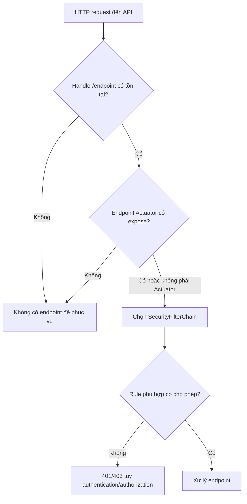
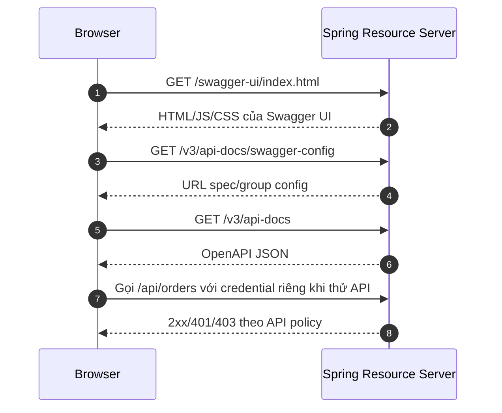
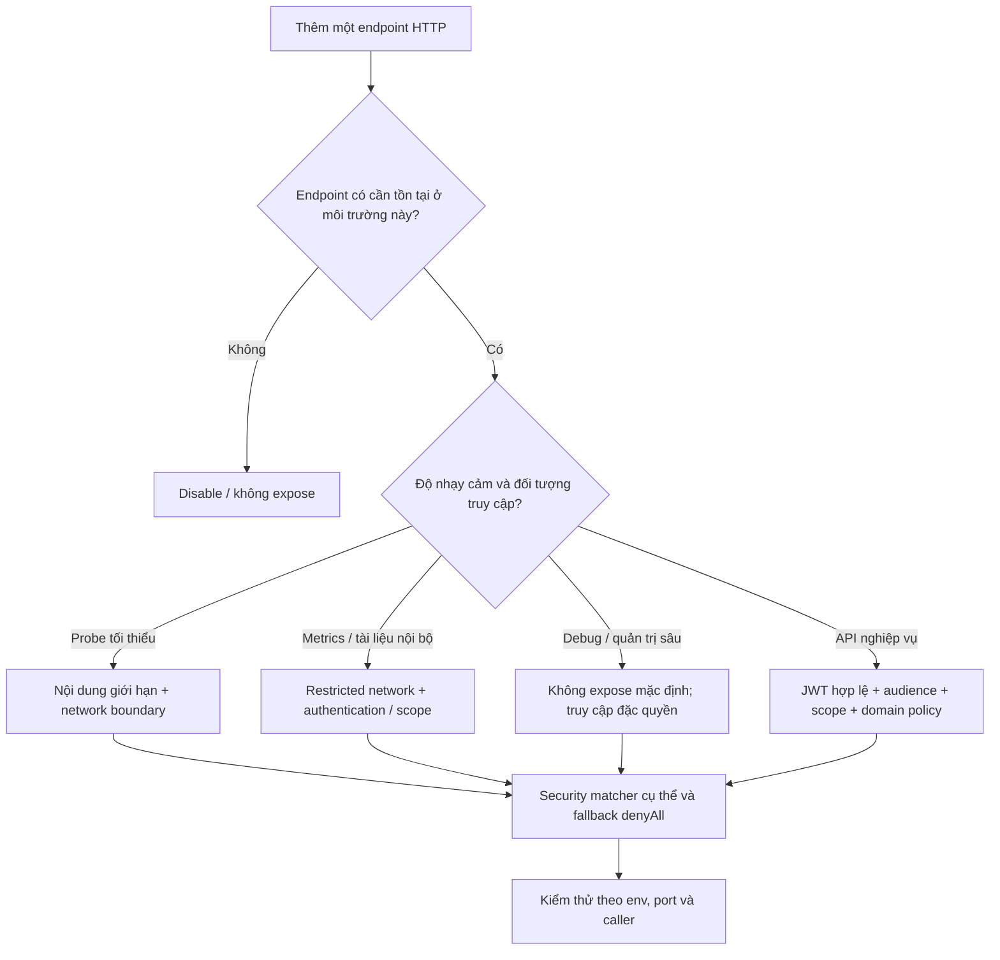

# Endpoint giám sát, tài liệu API và cấu hình quyền theo môi trường

Một **Spring Security OAuth 2.0 Resource Server** không chỉ cung cấp các API nghiệp vụ như `/api/orders` hay `/api/payments`. Trong quá trình phát triển và vận hành, ứng dụng còn có những đường dẫn phục vụ **health check, readiness/liveness probe, metrics, Prometheus, thông tin hệ thống, OpenAPI specification và Swagger UI**. Những endpoint này có mức độ nhạy cảm khác nhau và không thể áp dụng một quy tắc duy nhất như “mọi URL dưới `/actuator` đều công khai” hoặc “tất cả tài liệu API đều phải tắt ở production”.

Điều khó nằm ở chỗ **endpoint có được tạo, có được HTTP expose, có đi qua SecurityFilterChain nào và có được caller cho phép truy cập** là bốn quyết định khác nhau. Một URL có thể không tồn tại dù Security cho phép; hoặc tồn tại nhưng bị từ chối vì thiếu scope. Khi chạy nhiều môi trường `dev`, `staging`, `prod`, một cấu hình thiếu nhất quán có thể vô tình mở `env`, `heapdump` hay tài liệu nội bộ ra Internet.

Bài học hướng dẫn thiết kế **phân quyền HTTP có chủ đích** cho các đường dẫn vận hành và tài liệu trong ứng dụng **Spring Boot 3 / Spring Security 6**, theo vai trò Resource Server nhận **Bearer access token**. Ví dụ tập trung vào Servlet stack, Spring Boot Actuator và springdoc-openapi. Tên đường dẫn và thuộc tính cụ thể có thể được tùy chỉnh theo phiên bản và kiến trúc triển khai; phải kiểm tra cấu hình thật trước khi áp dụng.

## 1. Tại sao health, metrics và Swagger không nên có chung quyền?

Ba nhóm endpoint phục vụ những đối tượng truy cập khác nhau:

| Nhóm | Ví dụ đường dẫn thường gặp | Caller hợp lệ | Độ nhạy cảm |
| --- | --- | --- | --- |
| **Probe tối thiểu** | `/actuator/health/liveness`, `/actuator/health/readiness` | Kubelet, load balancer, bộ kiểm tra vận hành được tin cậy | Thấp nếu chỉ trả trạng thái cần thiết. |
| **Giám sát và chẩn đoán** | `/actuator/prometheus`, `/actuator/metrics`, `/actuator/info` | Prometheus, agent hoặc đội vận hành được cấp quyền | Trung bình đến cao, tùy nội dung/nhãn metric. |
| **Quản trị và debug sâu** | `/actuator/env`, `/actuator/configprops`, `/actuator/heapdump`, `/actuator/loggers`, `/actuator/beans`, `/actuator/mappings` | Nhân sự/hạ tầng vận hành có thẩm quyền đặc biệt | Cao hoặc rất cao. |
| **Tài liệu API** | `/v3/api-docs`, `/swagger-ui/index.html`, `/swagger-ui.html` | Developer, tester, đối tác hoặc người dùng được cho phép | Phụ thuộc nội dung và môi trường. |
| **API nghiệp vụ** | `/api/orders/**`, `/api/admin/**` | Người dùng hoặc ứng dụng có access token đúng audience/scope | Theo quyền dữ liệu/nghiệp vụ. |

Sự khác nhau này dẫn đến chính sách thường gặp:

- **Probe tối thiểu** có thể cho phép truy cập **không cần Bearer token**, nhưng giới hạn mạng và nội dung trả về.
- **Metrics** thường chỉ mở cho hệ thống thu thập metrics qua network/mTLS và/hoặc token có quyền chuyên biệt.
- **Các endpoint chẩn đoán nguy hiểm** thường **không expose trên HTTP** ở production; khi thực sự cần, chỉ mở tạm và bảo vệ nhiều lớp.
- **Swagger UI/OpenAPI** có thể public cho API công khai, restricted với API nội bộ, hoặc tắt ở production theo nhu cầu sản phẩm.
- **API nghiệp vụ** yêu cầu JWT hợp lệ, audience đúng, scope phù hợp và kiểm tra owner/tenant khi cần.

Không được dùng `permitAll()` chỉ vì “đường dẫn này không phải business API”.

## 2. Bốn câu hỏi bắt buộc khi một endpoint nhận request

Khi kiểm tra quyền với một URL, hãy trả lời theo thứ tự:

1. **Endpoint có được đăng ký không?** Ví dụ springdoc đã được thêm dependency và có bật `springdoc.api-docs.enabled` không?
2. **Endpoint có được expose qua HTTP không?** Ví dụ Actuator `prometheus` có nằm trong `management.endpoints.web.exposure.include` không?
3. **Security chain nào nhận request?** `securityMatcher` và `@Order` quyết định `SecurityFilterChain` nào được chọn.
4. **Authorization rule nào cho phép hoặc từ chối?** `requestMatchers`, `hasAuthority`, `permitAll`, `denyAll` và những lớp policy nghiệp vụ liên quan.



Sơ đồ là cách phân tích chức năng, không mô tả chính xác thứ tự chạy filter và tìm handler của Spring MVC. Trong thực tế **Security filter có thể từ chối request trước khi framework xác định endpoint có tồn tại hay không**. Do đó endpoint bị tắt/exposure bị chặn không phải lúc nào cũng trả ngay `404`; một rule `denyAll` có thể khiến caller thấy `403` trước.

**Một rule `permitAll` không tự tạo endpoint**; một endpoint đã được expose cũng **không tự có quyền truy cập** nếu Spring Security chặn.

## 3. Spring Boot Actuator: exposure và security là hai lớp khác nhau

Để có Actuator, thêm dependency:

```gradle
dependencies {
    implementation 'org.springframework.boot:spring-boot-starter-security'
    implementation 'org.springframework.boot:spring-boot-starter-oauth2-resource-server'
    implementation 'org.springframework.boot:spring-boot-starter-actuator'
}
```

Ví dụ cấu hình Actuator:

```yaml
management:
  endpoints:
    web:
      exposure:
        include: health,info,prometheus
  endpoint:
    health:
      probes:
        enabled: true
      show-details: never
```

Đây là lớp **công bố endpoint qua web**:

- `management.endpoints.web.exposure.include` chọn những endpoint Actuator được expose qua HTTP.
- `health` cung cấp trạng thái sức khỏe.
- `info` cung cấp thông tin ứng dụng nếu được cấu hình.
- `prometheus` chỉ hoạt động khi có Actuator cùng registry/điều kiện tích hợp cần thiết, ví dụ Micrometer Prometheus registry.
- `management.endpoint.health.probes.enabled=true` bật các health group cho liveness/readiness trong môi trường phù hợp.
- `show-details: never` hạn chế thông tin health detail trả ra công khai.

Với Prometheus, ví dụ dependency bổ sung:

```gradle
dependencies {
    implementation 'io.micrometer:micrometer-registry-prometheus'
}
```

**Exposure không đồng nghĩa authorization**: một `prometheus` endpoint được expose vẫn có thể yêu cầu access token hoặc bị chặn bởi network policy. Ngược lại, viết `permitAll("/actuator/prometheus")` không làm endpoint xuất hiện nếu `prometheus` chưa được bật và cấu hình đúng.

### Không expose toàn bộ Actuator để tiện debug

Một cấu hình rủi ro trong production:

```yaml
management:
  endpoints:
    web:
      exposure:
        include: "*"
```

Cấu hình này có thể mở rộng danh sách các endpoint HTTP được đăng ký, bao gồm những endpoint nhạy cảm nếu có và đang bật. Spring Security **vẫn cần phân quyền**, nhưng nguyên tắc an toàn hơn là **không tạo bề mặt HTTP không cần thiết ngay từ đầu**.

Ưu tiên allowlist những endpoint phục vụ vận hành. Khi cần debug sâu, dùng quy trình truy cập vận hành chuyên biệt, thời hạn mở giới hạn và audit.

## 4. Liveness và readiness: cùng là health nhưng mục đích khác nhau

Trong Kubernetes và các nền tảng orchestration, thường có hai loại probe:

**Liveness** trả lời: tiến trình hiện có còn hoạt động để tiếp tục chạy không? Liveness không nên phụ thuộc quá mức vào một dịch vụ bên ngoài tạm thời chậm, vì có thể tạo vòng lặp restart khi dependency gặp sự cố.

**Readiness** trả lời: instance đã sẵn sàng nhận traffic phục vụ nghiệp vụ chưa? Readiness có thể xét những điều kiện quan trọng để xử lý request, tùy kiến trúc và khả năng phục hồi.

Ví dụ đường dẫn phổ biến khi bật Actuator probes:

```text
GET /actuator/health/liveness
GET /actuator/health/readiness
```

Các response tối giản minh họa:

```json
{ "status": "UP" }
```

Khi trạng thái khác `UP`, mã HTTP có thể khác, chẳng hạn service đang không sẵn sàng trả `503 Service Unavailable` theo mapping trạng thái health. **Một health probe hợp lệ vẫn có thể trả non-2xx vì ứng dụng không khỏe**; đây không phải lỗi authentication.

| Đặc điểm | Liveness | Readiness |
| --- | --- | --- |
| Mục tiêu | Phát hiện instance cần được khởi động lại. | Quyết định có nên đưa traffic nghiệp vụ đến instance. |
| Nên phụ thuộc Authorization Server đang online? | Thường **không**, tránh restart loop vì outage của issuer. | Chỉ khi đó là điều kiện readiness được thiết kế rõ. |
| Có cần public Internet không? | Không. Chỉ cần hệ thống probe truy cập được. | Không. Chỉ cần hệ thống probe truy cập được. |
| Có cần Bearer token không? | Có thể không, nếu được giới hạn mạng và response an toàn. | Tùy kiến trúc; nếu không dùng token, phải giới hạn mạng/nội dung. |

**`permitAll()` chỉ xử lý phân quyền HTTP, không giới hạn ai trên Internet có thể gửi request.** Nếu probe không cần xác thực, nên sử dụng ingress/network policy, management network hoặc bind address phù hợp để giới hạn phạm vi truy cập.

### Probe chạy trên cổng management riêng

Nếu Actuator chạy trên cổng khác với cổng phục vụ nghiệp vụ, health tại cổng management có thể vẫn `UP` trong khi cổng ứng dụng chính có sự cố. Tùy phiên bản Boot, có hỗ trợ thêm health probe paths trên cổng chính để giảm khoảng trống này:

```yaml
management:
  endpoint:
    health:
      probes:
        enabled: true
        add-additional-paths: true
```

Các đường dẫn bổ sung thường là `/livez` và `/readyz` trên cổng chính khi cấu hình hỗ trợ. Hãy xác minh **đường dẫn và port thật** theo phiên bản/app trước khi cấu hình kubelet hoặc proxy; việc cho phép `/actuator/health/readiness` không tự động mở thêm `/readyz`.

## 5. Không nên mở công khai toàn bộ `/actuator/health/**`

Một rule quá rộng:

```java
.requestMatchers("/actuator/health/**").permitAll()
```

có thể mở thêm health group hoặc component detail mà dự án đã định nghĩa dưới đường dẫn `/actuator/health`. Nếu trong tương lai bổ sung health group nhạy cảm, phạm vi mở sẽ tăng mà không ai sửa rule.

Với yêu cầu chỉ cần hai probe cơ bản, nên cân nhắc:

```java
.requestMatchers(
    "/actuator/health/liveness",
    "/actuator/health/readiness"
).permitAll()
```

Nếu hạ tầng cần dùng `/actuator/health` làm probe, có thể **cho phép chính xác đường dẫn đó** và đảm bảo nội dung trả về đã được tối giản. Không có quy tắc cứng rằng `/actuator/health` luôn phải private; chính sách phụ thuộc mục đích, nội dung và vị trí mạng.

Đối với Spring Boot Actuator, chính sách hiển thị chi tiết có thể cấu hình bằng `management.endpoint.health.show-details` (`never`, `when-authorized`, `always` theo tính năng phiên bản) và những thiết lập authorization details. Không nên dùng `always` trên endpoint mà người ngoài truy cập được nếu chi tiết lộ tên service, database hoặc dependency nhạy cảm.

## 6. Metrics và Prometheus cần quyền riêng với API nghiệp vụ

Một hệ thống Prometheus có thể scrape:

```text
GET /actuator/prometheus
```

Thông tin metrics có thể tiết lộ lưu lượng, trạng thái JVM, tình trạng backend, tên URI, exception type hoặc nhãn service. Tùy hệ thống, đây là dữ liệu vận hành nội bộ, không nên tự động public.

Ví dụ policy có Bearer access token:

```java
.requestMatchers(HttpMethod.GET, "/actuator/prometheus")
    .hasAuthority("SCOPE_metrics.read")
```

Token của Prometheus scraper nên được phát hành theo **machine-to-machine / client credentials** khi phù hợp, với:

- Issuer đáng tin và audience đúng Resource Server đang nhận token.
- Scope chuyên biệt, chẳng hạn `metrics.read`, không dùng `orders.write`.
- Token lifetime/refresh và lưu trữ credential an toàn.
- Network policy hoặc mTLS nếu kiến trúc hỗ trợ.

**Không mặc định Prometheus sẽ tự gửi JWT.** Nếu endpoint yêu cầu Bearer token, phải cấu hình scrape job, agent hoặc proxy có khả năng cấp/gửi credential tương ứng. Trong một số hạ tầng, metrics chỉ mở trong management network với mTLS và không yêu cầu token OAuth trực tiếp; đó là một **mô hình bảo mật khác**, cần được thiết kế và kiểm chứng rõ.

### Phân biệt `/actuator/metrics` và `/actuator/prometheus`

`/actuator/metrics` thường phục vụ truy vấn các meter/metric theo giao diện Actuator; `/actuator/prometheus` cung cấp dữ liệu theo định dạng scrape của Prometheus khi registry được bật. Chúng không nhất thiết cần cùng quyền. Ví dụ production chỉ expose `prometheus` cho agent nhưng **không expose** metrics endpoint dùng để khám phá chi tiết các meter.

Không thêm `metrics` vào exposure chỉ vì đã dùng Prometheus. Hãy chọn endpoint phục vụ nhu cầu vận hành cụ thể.

## 7. Những endpoint Actuator nên được xem là nhạy cảm

Một số endpoint có thể tiết lộ hoặc thay đổi thông tin quan trọng:

| Endpoint | Rủi ro thường gặp | Chính sách gợi ý |
| --- | --- | --- |
| `env` | Thông tin môi trường, cấu hình và tên biến; cơ chế che secrets không thay thế kiểm soát truy cập. | Không expose ở production trừ quy trình rất hạn chế. |
| `configprops` | Thuộc tính đã bind, cấu trúc tích hợp hệ thống. | Không expose công khai. |
| `beans` / `conditions` | Kiến trúc nội bộ, auto-configuration, thông tin triển khai. | Chỉ phục vụ điều tra nội bộ. |
| `mappings` | Danh sách route và handler. | Không mở công khai nếu không cần. |
| `heapdump` / `threaddump` | Có thể chứa dữ liệu nhạy cảm trong bộ nhớ hoặc luồng xử lý. | Kiểm soát chặt; hạn chế exposure. |
| `loggers` | Có thể cho phép thay mức log khi hỗ trợ thao tác ghi. | Hạn chế quyền ghi, audit thay đổi. |
| `shutdown` | Có thể tác động trực tiếp vòng đời tiến trình khi bật. | Không bật cho HTTP bên ngoài. |
| `health` | Trạng thái dependency, tên component nếu show-details rộng. | Tối giản nội dung khi probe không xác thực. |
| `info` | Có thể chứa version, git commit, build metadata. | Rà soát nội dung trước khi công bố. |
| `prometheus` | Dữ liệu vận hành và labels. | Giới hạn mạng hoặc quyền scraper chuyên biệt. |

Một endpoint không expose thường sẽ không có mapping HTTP để gọi. Điều này tốt hơn việc expose toàn bộ rồi dựa hoàn toàn vào các rule Security.

**Bảo vệ nhiều lớp** là cách tiếp cận phù hợp: giới hạn exposure, xác định port/network, chính sách authentication/authorization và logging/audit. Không nên chỉ dựa vào việc tên path khó đoán.

## 8. OpenAPI specification khác Swagger UI

Trong các ứng dụng dùng springdoc-openapi, có thể gặp:

```text
/v3/api-docs
/v3/api-docs/swagger-config
/swagger-ui.html
/swagger-ui/index.html
```

Tùy phiên bản và cấu hình, có thể có các đường dẫn khác hoặc path đã được tùy biến qua properties.

**OpenAPI specification** là tài liệu có cấu trúc JSON/YAML về các endpoint, request/response, schema và yêu cầu bảo mật. **Swagger UI** là giao diện web đọc spec và cho developer thử API.

| Thành phần | Mục đích | Rủi ro nếu public |
| --- | --- | --- |
| OpenAPI JSON/YAML | Mô tả contract API, schema, operation. | Có thể lộ endpoint chưa công bố hoặc dữ liệu mô tả nội bộ. |
| Swagger UI | Trình xem và công cụ thử API trong browser. | Có thể giúp người ngoài khám phá/tra cứu toàn bộ contract. |
| Swagger config endpoint | Chỉ dẫn UI tìm spec và các nhóm URL. | Có thể chứa URL/spec server không nên công khai. |
| Endpoint API thật | Thực hiện nghiệp vụ. | Phải được bảo vệ độc lập với tài liệu. |

**Ẩn Swagger UI không đồng nghĩa đã ẩn OpenAPI JSON.** Nếu chỉ chặn `/swagger-ui/**` mà để `/v3/api-docs` công khai, client vẫn đọc được spec. Ngược lại, cho phép UI nhưng chặn spec có thể khiến giao diện hiện lên mà không tải được định nghĩa API.

Đặc biệt, việc thêm annotation OpenAPI như `@SecurityRequirement`, khai báo Bearer scheme trong tài liệu hoặc hiển thị nút **Authorize** của Swagger UI **không thay thế** `SecurityFilterChain`. Chúng mô tả và hỗ trợ thử API; việc HTTP request có được phép hay không vẫn do Spring Security và chính sách nghiệp vụ quyết định.

## 9. Đường dẫn tài liệu phụ thuộc phiên bản và cấu hình

Một ứng dụng có thể đặt:

```yaml
springdoc:
  api-docs:
    path: /internal/openapi
  swagger-ui:
    path: /developer-docs
```

Khi đó một matcher chỉ bảo vệ `/v3/api-docs` có thể **không còn khớp** đường dẫn mới. Swagger UI cũng có thể dùng những file static, redirect, cấu hình và group spec endpoint khác.

Trước khi viết rule, hãy xác nhận:

1. Đã thêm đúng thư viện springdoc cho Spring Boot/Servlet stack chưa?
2. OpenAPI endpoint thực tế là gì và có group-specific specs không?
3. UI được serve ở `/swagger-ui/index.html`, redirect từ `/swagger-ui.html` hay một path tùy chỉnh?
4. API gateway/ingress có thêm `context-path`, `servlet-path` hoặc reverse proxy prefix không?
5. Cấu hình `springdoc.api-docs.enabled` và `springdoc.swagger-ui.enabled` theo môi trường là gì?
6. UI có thể tải spec dưới cùng origin hay cần CORS và policy bổ sung?

Tránh công thức kiểu:

```java
.requestMatchers("/**").permitAll()
```

chỉ để làm Swagger UI hoạt động. Nếu UI không tải được một resource, hãy tìm **resource bị chặn cụ thể** và điều chỉnh policy trong phạm vi nhỏ nhất.

## 10. Một `SecurityFilterChain` thống nhất: probe, metrics, docs, API

Đây là ví dụ Servlet Resource Server nhận JWT, với các mục tiêu:

- Hai probe `liveness`/`readiness` được cho phép không cần JWT.
- Prometheus scrape yêu cầu `SCOPE_metrics.read`.
- OpenAPI/Swagger có thể public trong môi trường được cho phép, còn môi trường khác yêu cầu `SCOPE_docs.read` nếu tài liệu được bật.
- API đọc/ghi đơn hàng yêu cầu scope tương ứng.
- Những đường dẫn Actuator khác và mọi request chưa được liệt kê đều bị từ chối.

Dependencies minh họa:

```gradle
dependencies {
    implementation 'org.springframework.boot:spring-boot-starter-security'
    implementation 'org.springframework.boot:spring-boot-starter-oauth2-resource-server'
    implementation 'org.springframework.boot:spring-boot-starter-actuator'
    implementation 'io.micrometer:micrometer-registry-prometheus'
    // Bổ sung springdoc-openapi starter phiên bản tương thích nếu cần Swagger UI.
}
```

Ví dụ code:

```java
import org.springframework.beans.factory.annotation.Value;
import org.springframework.context.annotation.Bean;
import org.springframework.context.annotation.Configuration;
import org.springframework.http.HttpMethod;
import org.springframework.security.config.Customizer;
import org.springframework.security.config.annotation.web.builders.HttpSecurity;
import org.springframework.security.config.http.SessionCreationPolicy;
import org.springframework.security.web.SecurityFilterChain;

@Configuration
public class HttpAuthorizationConfig {

    private static final String[] DOC_PATHS = {
        "/v3/api-docs",
        "/v3/api-docs/**",
        "/swagger-ui.html",
        "/swagger-ui/**"
    };

    @Bean
    SecurityFilterChain securityFilterChain(
            HttpSecurity http,
            @Value("${app.security.public-api-docs:false}")
                boolean publicApiDocs) throws Exception {

        return http
            .csrf(csrf -> csrf.disable())
            .sessionManagement(session -> session
                .sessionCreationPolicy(SessionCreationPolicy.STATELESS))
            .authorizeHttpRequests(auth -> {
                auth.requestMatchers(
                    "/actuator/health/liveness",
                    "/actuator/health/readiness"
                ).permitAll();

                if (publicApiDocs) {
                    auth.requestMatchers(DOC_PATHS).permitAll();
                } else {
                    auth.requestMatchers(DOC_PATHS)
                        .hasAuthority("SCOPE_docs.read");
                }

                auth.requestMatchers(
                    HttpMethod.GET, "/actuator/prometheus"
                ).hasAuthority("SCOPE_metrics.read");

                auth.requestMatchers("/actuator/**").denyAll();

                auth.requestMatchers(
                    HttpMethod.GET, "/api/orders/**"
                ).hasAuthority("SCOPE_orders.read");

                auth.requestMatchers(
                    HttpMethod.POST, "/api/orders"
                ).hasAuthority("SCOPE_orders.write");

                auth.anyRequest().denyAll();
            })
            .oauth2ResourceServer(oauth2 -> oauth2
                .jwt(Customizer.withDefaults()))
            .build();
    }
}
```

Đây là **một chain bao phủ các request trong web application context thông thường**, không có `.securityMatcher("/api/**")` giới hạn phạm vi nên các đường dẫn monitoring/docs cũng nhận policy này trên cùng cổng/context. Nếu triển khai management endpoints trong **application context khác hoặc cổng quản trị riêng**, không nên mặc nhiên áp dụng cách wiring trên; phải kiểm tra security của management context và hạ tầng thật.

### Vì sao thứ tự rule trong ví dụ quan trọng?

Thứ tự được thiết kế như sau:

1. Các probe **chính xác** được `permitAll`.
2. Các đường dẫn tài liệu nhận rule theo cấu hình môi trường.
3. `/actuator/prometheus` có scope giám sát riêng.
4. `/actuator/**` còn lại bị từ chối.
5. Các endpoint nghiệp vụ kiểm tra quyền tương ứng.
6. `anyRequest().denyAll()` chặn tất cả URL chưa được quy định.

Nếu đặt `.requestMatchers("/actuator/**").denyAll()` lên **trước** probe và Prometheus, các rule riêng phía sau không còn cơ hội áp dụng với những request đã khớp. Đây là quy tắc về **thứ tự authorization matcher**, không phải bean được tạo trước hay sau.

**Không nên sao chép code này như cấu hình hoàn chỉnh cho mọi sản phẩm**. Cần thêm rule phù hợp nếu có web login, admin API, các nhóm tài liệu tùy chỉnh, endpoint `info`, webhook, internal service hoặc những đường dẫn khác.

### `permitAll` không có nghĩa filter sẽ bỏ qua token không hợp lệ

Một request probe bình thường không gửi header `Authorization`. Nếu caller vẫn gửi `Authorization: Bearer <invalid-token>`, Bearer authentication filter có thể thử xử lý credential đó và thất bại **trước khi** rule `permitAll` quyết định. Vì vậy đừng lấy việc một request probe có token lỗi trả `401` để kết luận rằng path chưa được permit.

Đối với probe không yêu cầu xác thực, kubelet/load balancer nên gọi **không có Bearer credential**, đồng thời đường mạng phải được bảo vệ phù hợp.

## 11. Tại sao không nên chỉ tạo một chain cho `/api/**`?

Một cấu hình thường được viết nhanh:

```java
@Bean
SecurityFilterChain apiChain(HttpSecurity http) throws Exception {
    return http
        .securityMatcher("/api/**")
        .authorizeHttpRequests(auth -> auth
            .anyRequest().authenticated())
        .oauth2ResourceServer(oauth2 -> oauth2
            .jwt(Customizer.withDefaults()))
        .build();
}
```

Chain này **chỉ khớp `/api/**`**. Nếu đây là bean `SecurityFilterChain` duy nhất và Boot đã back off default web security chain vì ứng dụng cung cấp custom chain, những URL như `/actuator/env` hoặc `/v3/api-docs` có thể **không khớp chain bảo mật nào**.

Đó là một lỗi có mức độ nghiêm trọng cao khi endpoint nhạy cảm đã được HTTP expose.

Muốn chia nhiều chain, phải thiết kế rõ:

```text
@Order(1)  /actuator/**     -> probe, metrics, deny các Actuator khác
@Order(2)  /swagger-ui/** và /v3/api-docs... -> tài liệu
@Order(3)  /api/**          -> API JWT/scope
@Order(99) mọi URL khác    -> fallback denyAll hoặc policy hợp lệ
```

Các dòng trên là sơ đồ phân chia logic; một `securityMatcher` của một chain có thể cần `OrRequestMatcher` khi bao phủ nhiều nhóm docs path. **Chain đầu tiên khớp được chọn**, không phải tất cả chain cùng chạy.

Với ứng dụng chỉ cần vài nhóm endpoint, **một chain có rule có thứ tự và deny-all fallback** thường dễ kiểm tra hơn nhiều chain trùng matcher.

## 12. `EndpointRequest` và matcher theo loại Actuator endpoint

Spring Boot Actuator cung cấp cơ chế tạo matcher theo endpoint, chẳng hạn `EndpointRequest` trong môi trường Servlet:

```java
import org.springframework.boot.actuate.autoconfigure.security.servlet.EndpointRequest;
import org.springframework.boot.actuate.health.HealthEndpoint;
```

Ở các cấu hình phù hợp, có thể dùng:

```java
http.securityMatcher(EndpointRequest.toAnyEndpoint());
```

hoặc dùng một matcher theo loại endpoint:

```java
.requestMatchers(EndpointRequest.to(HealthEndpoint.class))
    .permitAll()
```

Ưu điểm của matcher endpoint là bám theo endpoint mapping của Actuator, nhất là khi thay `management.endpoints.web.base-path`. **Nhưng mở toàn bộ `HealthEndpoint` là rộng hơn cho phép riêng hai probe**; có thể cho phép thêm health root/group tương ứng. Nếu yêu cầu chỉ cho phép liveness/readiness, cần xây rule đủ hẹp hoặc thiết kế nhóm health/network riêng.

Ngoài ra, khi **management server chạy ở port/context riêng**, tập filter chain, cách khởi tạo web security và request mapping có thể khác application context chính. `EndpointRequest` không phải lời bảo đảm rằng một bean chain bất kỳ khai báo trong context chính sẽ bảo vệ tất cả endpoint ở context con. Hãy xem kết quả thực của version và triển khai đang sử dụng.

## 13. Tách cổng management khỏi cổng API

Spring Boot có thể dùng:

```yaml
server:
  port: 8080

management:
  server:
    port: 9090
  endpoints:
    web:
      exposure:
        include: health,prometheus
```

Ví dụ:

```text
Port 8080: business API, có thể có docs
Port 9090: Actuator health và Prometheus
```

Việc dùng hai cổng có thể giúp:

- Đặt firewall/network policy riêng cho monitoring traffic.
- Không expose port 9090 qua public ingress.
- Quản lý rate limit hoặc routing riêng cho scrape/probes.
- Hạn chế người dùng Internet trực tiếp tới endpoint quản trị.

Nhưng **port khác không tự trở thành vùng tin cậy** nếu vẫn mở ra mọi nguồn. Cần xác minh firewall, service binding, management base path, authorization và cấu hình Spring Security trong context thực tế.

### Không giả định cùng một chain áp dụng mọi port

Khi management port khác application port, Spring Boot có thể xây dựng **management web application context riêng**. Điều kiện auto-configuration của Spring Boot và các bean Security được chia sẻ/đăng ký theo cách riêng của phiên bản/framework.

Vì vậy cần kiểm tra:

1. Những URL nào thật sự được expose trên 8080 và 9090?
2. Security filter chain nào đang xử lý request **trên từng port**?
3. Có default Actuator security auto-configuration hay custom chain trong management context không?
4. Probe và Prometheus có chính sách được kiểm tra bằng HTTP integration test trên **đúng cổng** không?
5. Port management có được bảo vệ bởi cluster network policy/ingress không?

Một cấu hình `denyAll("/actuator/**")` ở application port **không phải bằng chứng đầy đủ** rằng management port đã bị chặn.

## 14. Cấu hình theo môi trường: default an toàn trước

Trong nhiều dự án, yêu cầu môi trường là:

| Môi trường | Health probes | Metrics | OpenAPI/Swagger | Debug Actuator |
| --- | --- | --- | --- | --- |
| **Local development** | Có thể cho phép tối thiểu. | Tùy nhu cầu. | Thường bật để phát triển/test. | Có thể bật có kiểm soát trên máy local. |
| **CI/Integration test** | Bật theo test scenario. | Có thể không cần. | Bật nếu test contract/docs. | Tránh expose không cần thiết. |
| **Staging** | Cho probe hạ tầng. | Chỉ scraper/đội vận hành. | Thường restricted cho developer/QA. | Hạn chế, audit khi cần. |
| **Production** | Cho probe trên mạng vận hành. | Chỉ collector hoặc kết nối quản trị. | Public, restricted hoặc disabled theo sản phẩm. | Mặc định không expose. |

**Đừng đặt mặc định an toàn dựa trên việc “production profile chắc chắn sẽ được bật”.** Nếu quên kích hoạt profile, ứng dụng có thể chạy với cấu hình mở rộng của development.

Một pattern phù hợp là **deny by default** trong `application.yml`, rồi chỉ bật một số tính năng cho môi trường cụ thể:

```yaml
# application.yml — baseline
app:
  security:
    public-api-docs: false

spring:
  security:
    oauth2:
      resourceserver:
        jwt:
          issuer-uri: ${OAUTH2_ISSUER_URI}

management:
  endpoints:
    web:
      exposure:
        include: health,prometheus
  endpoint:
    health:
      probes:
        enabled: true
      show-details: never

springdoc:
  api-docs:
    enabled: false
  swagger-ui:
    enabled: false
```

Trong local development:

```yaml
# application-dev.yml
app:
  security:
    public-api-docs: true

springdoc:
  api-docs:
    enabled: true
  swagger-ui:
    enabled: true
```

Với production cần cung cấp docs **có xác thực**:

```yaml
# application-prod.yml — ví dụ nếu production cần docs nội bộ
app:
  security:
    public-api-docs: false

springdoc:
  api-docs:
    enabled: true
  swagger-ui:
    enabled: true
```

Khi đó security rule trong phần 10 yêu cầu `SCOPE_docs.read` cho docs. Nếu production **không cần docs**, giữ chúng disabled theo baseline, không override bật lên.

Các cấu hình là ví dụ độc lập phụ thuộc thư viện springdoc hiện diện. `enabled: false` chỉ có ý nghĩa khi đó là property mà phiên bản springdoc đang dùng hỗ trợ. Cần kiểm tra endpoint thật qua integration test.

## 15. `@Profile` cho các security chain có thể gây khoảng trống

Một cách phổ biến khác là tạo bean:

```java
@Bean
@Profile("dev")
SecurityFilterChain developmentSecurity(HttpSecurity http)
        throws Exception {
    // Chỉ minh họa: policy local development
    return http
        .authorizeHttpRequests(auth -> auth
            .anyRequest().permitAll())
        .build();
}
```

Đoạn trên là **phản ví dụ rủi ro** nếu được sao chép như cấu hình phát triển thật của Resource Server. Nó có thể làm mọi URL được phép nếu dev profile bật, đồng thời thiếu JWT Resource Server authentication. Nguy cơ lớn hơn là khi chạy profile sai ở staging/production hoặc có những bean chain khác bị back off theo điều kiện.

`@Profile` hữu ích khi cần enable một số bean theo môi trường, nhưng với HTTP security nên cân nhắc:

- Duy trì **một baseline filter chain nhất quán** với fallback deny-all.
- Thay đổi **rule nhỏ được chỉ định rõ** qua properties an toàn và kiểm tra startup.
- Không có profile nào vô tình bỏ toàn bộ authentication.
- Không dùng `@Profile("!prod")` làm bằng chứng bảo mật duy nhất; `prod` có thể bị đặt sai, hoặc môi trường mới không có tên đó.
- Tạo test/kiểm tra chính sách cho những tổ hợp profile thực tế.

Spring Boot có hệ thống cấu hình property và profile; người triển khai phải kiểm soát `SPRING_PROFILES_ACTIVE`, Kubernetes manifests, Helm values hoặc pipeline secrets theo môi trường. Cấu hình môi trường không phải credential của end user, nhưng vẫn là **đầu vào bảo mật của hệ thống**.

## 16. `permitAll` cho docs không cho phép gọi API thật

Một điểm dễ nhầm: trong Swagger UI, developer có thể nhấn “Try it out” rồi gọi `POST /api/orders`. Cho phép tải tài liệu không cấp scope nghiệp vụ:

```text
GET /swagger-ui/index.html
    -> có thể permitAll trong dev

GET /v3/api-docs
    -> có thể permitAll trong dev

POST /api/orders
    -> vẫn cần token hợp lệ có SCOPE_orders.write
```

OpenAPI/Swagger UI là **công cụ khách hàng** gọi API, không phải thành phần tự vượt qua Resource Server policy.

Nếu Swagger UI hỗ trợ nút **Authorize**, có thể mô tả security scheme Bearer hoặc OAuth 2.0:

- Bearer JWT: user có thể cung cấp access token **chỉ trong môi trường đáng tin và theo quy trình cho phép**.
- OAuth 2.0 Authorization Code + PKCE phù hợp hơn cho interactive browser client khi cần tích hợp đăng nhập.
- Không nhúng client secret của confidential client hoặc access token dài hạn vào JavaScript/static HTML/public docs.
- Giới hạn redirect URI và origin theo cấu hình của Authorization Server.

**Bảo vệ endpoint hiển thị Swagger UI không đồng nghĩa bảo vệ mọi lệnh thử API từ UI; và ngược lại.** Hai đường đi request có các chính sách độc lập.

## 17. Swagger UI cần tải spec trước khi hiển thị API

Một luồng trình duyệt phổ biến:



Nếu endpoint `/v3/api-docs/swagger-config` yêu cầu `SCOPE_docs.read` nhưng browser chưa có access token, UI có thể tải được HTML rồi báo lỗi không hiển thị spec. Việc này **không nên được sửa** bằng cách mở cả `/api/**` cho phép truy cập không xác thực.

Nếu production docs phải restricted, có thể dùng **SSO tại reverse proxy, VPN hoặc một cổng developer portal được bảo vệ** để bảo đảm browser được phép tải cả static UI và OpenAPI spec; hoặc thiết kế một luồng token phù hợp cho docs. Hãy đánh giá chính sách trình duyệt/cookie/CSRF và cơ chế authentication cụ thể thay vì chỉ thêm scope vào một URL rồi coi như hoàn tất.

## 18. CORS và CSRF: hai vấn đề khác authorization

Khi Swagger UI chạy tại origin khác Resource Server:

```text
Docs UI: https://developer.example.com
API:     https://api.example.com
```

trình duyệt có thể gửi **CORS preflight** (`OPTIONS`) trước request thực tế. Nếu Security chặn `OPTIONS` hoặc backend không cấu hình CORS đúng, developer có thể nhầm lỗi CORS với lỗi Bearer authentication/scope.

Một cấu hình cho API cần cho phép origin đã được phê duyệt:

```java
import java.util.List;

import org.springframework.context.annotation.Bean;
import org.springframework.web.cors.CorsConfiguration;
import org.springframework.web.cors.CorsConfigurationSource;
import org.springframework.web.cors.UrlBasedCorsConfigurationSource;

@Bean
CorsConfigurationSource corsConfigurationSource() {
    CorsConfiguration cors = new CorsConfiguration();
    cors.setAllowedOrigins(List.of(
        "https://developer.example.com"
    ));
    cors.setAllowedMethods(List.of(
        "GET", "POST", "PUT", "DELETE", "OPTIONS"
    ));
    cors.setAllowedHeaders(List.of(
        "Authorization", "Content-Type"
    ));

    UrlBasedCorsConfigurationSource source =
        new UrlBasedCorsConfigurationSource();
    source.registerCorsConfiguration("/api/**", cors);
    return source;
}
```

Trong `SecurityFilterChain`, tích hợp:

```java
.cors(Customizer.withDefaults())
```

Nếu Swagger UI và API cùng origin, có thể không cần cấu hình CORS đặc biệt. CORS **không phải cơ chế xác thực hoặc phân quyền backend**; một công cụ không bị ràng buộc bởi browser vẫn có thể gửi HTTP trực tiếp. Không nên dùng CORS thay `JwtDecoder`, scope, firewall hay network policy.

**CSRF** lại liên quan việc trình duyệt tự gửi credential như cookie/session. Với một API stateless chỉ nhận Bearer token trong header do client tự thêm, có thể cấu hình CSRF phù hợp với kiến trúc. Nhưng nếu Actuator hoặc trang docs sử dụng login/session/cookie, không nên tắt CSRF toàn ứng dụng một cách máy móc, đặc biệt với những endpoint có thao tác ghi.

## 19. Đúng audience và caller cho endpoint giám sát

Một lỗi thiết kế là dùng token người dùng có scope nghiệp vụ để scrape metrics:

```text
sub = user-123
scope = orders.write
```

Nên phân tách quyền giám sát:

```text
sub/client_id = prometheus-agent
scope = metrics.read
aud = orders-api (nếu orders-api là protected resource nhận token)
```

Hợp đồng token của hệ thống có thể chọn audience riêng cho management API hoặc chung cho một protected resource, nhưng **Resource Server phải kiểm tra audience thực tế phù hợp**. Không dùng token dành cho dịch vụ khác (`aud = payments-api`) để đọc metrics của `orders-api` chỉ vì chữ ký có cùng issuer.

Ngoài ra:

- `SCOPE_metrics.read` không tự động có quyền truy cập business API.
- `SCOPE_docs.read` không nên cấp quyền gọi `POST /api/orders`.
- `SCOPE_orders.read` không mặc định cho phép đọc `/actuator/metrics`.
- Service token từ Client Credentials không đại diện một End-User nếu contract không nói vậy.
- Scope là điều kiện ở mức endpoint, không tự thay thế chính sách network, tenant và owner.

Những quyền này cần được Authorization Server phát hành theo quy trình quản trị, không tạo bằng header như `X-Role: ADMIN` do client tự gửi.

## 20. Cấu hình theo môi trường phải được kiểm tra như một thay đổi bảo mật

Ví dụ một tổ chức đổi:

```yaml
app:
  security:
    public-api-docs: true
```

Đó **không chỉ là thay đổi giao diện**. Nó làm đường dẫn tài liệu từ restricted sang public theo code ở phần 10. Nếu spec chứa endpoint nội bộ hoặc schema chưa được công bố, tác động có thể lớn.

Tương tự:

```yaml
management:
  endpoints:
    web:
      exposure:
        include: "*"
```

không đơn thuần là “bật debug”; nó có thể tăng bề mặt tấn công. Các thay đổi này nên đi qua code review, kiểm tra môi trường và audit tương tự security policy.

Một số quy tắc hữu ích:

1. Dùng baseline đóng cho tài liệu và Actuator nhạy cảm.
2. Override tối thiểu theo môi trường thực tế.
3. Tránh quyết định dựa trên profile name dễ nhầm hoặc giá trị string được suy luận.
4. Kiểm thử profile `dev`, `staging`, `prod` và trường hợp **không có profile** nếu ứng dụng hỗ trợ.
5. Kiểm tra cấu hình thực tế trên deployment, không chỉ YAML trong repository.
6. Không để secrets/issuer URL nhạy cảm bị lộ qua docs, `info` hoặc log config.
7. Áp dụng network policy đúng theo port, namespace và ingress route.
8. Khi tắt/đổi docs path hoặc management path, cập nhật matcher, probes, scraper và test cùng lúc.

## 21. Endpoint không có mapping, 401, 403 và 503 cần được phân biệt

| Kết quả | Nguyên nhân có thể | Cách xác định |
| --- | --- | --- |
| `404 Not Found` | Tài liệu bị disabled, Actuator chưa expose, path bị đổi hoặc handler không tồn tại. | Kiểm tra dependency, endpoint mapping, exposure, path thực tế. |
| `401 Unauthorized` | Protected endpoint cần authentication, Bearer token thiếu hoặc không hợp lệ. | Xem chain có bật JWT/opaque không, issuer/audience/expiry và header. |
| `403 Forbidden` | Caller được xác thực nhưng thiếu scope, hoặc một rule `denyAll` chặn. | Kiểm tra matcher order và authorities. |
| `503 Service Unavailable` | Health endpoint phản ánh trạng thái readiness/liveness không tốt, hoặc hạ tầng thật sự gặp lỗi. | Xem health group/status và nguyên nhân ứng dụng. |
| `200 OK` | Endpoint được cho phép và trả thành công. | Không dùng riêng status 200 để chứng minh mọi quyền/endpoint khác cũng an toàn. |

Có một điểm tinh tế: URL không có handler vẫn có thể bị Security filter từ chối **trước khi routing tìm handler**, do đó `denyAll` có thể tạo `403` thay vì `404`. Vì vậy không nên áp một status code cố định cho mọi trường hợp disabled/exposure.

Ngoài HTTP status, với Bearer authentication lỗi có thể có header `WWW-Authenticate: Bearer`, trong khi lỗi thiếu scope có thể được phản ánh theo OAuth Bearer error response. Tránh trả chi tiết cấu hình issuer, JWKS, stack trace hay claims nhạy cảm cho caller không có quyền.

## 22. Kiểm thử phân quyền theo đường dẫn, phương thức và môi trường

Một ma trận kiểm thử có thể gồm:

| Request | Dev theo ví dụ | Prod theo ví dụ | Mục đích kiểm tra |
| --- | --- | --- | --- |
| `GET /actuator/health/liveness` không Bearer | Được phép tại security layer | Được phép tại security layer | Kubelet probe không cần user token. |
| `GET /actuator/health/readiness` không Bearer | Được phép | Được phép | Health status phản ánh khả năng nhận traffic. |
| `GET /actuator/prometheus` không Bearer | 401 nếu expose và rule yêu cầu JWT | 401 nếu expose và rule yêu cầu JWT | Scraper cần credential hoặc mô hình bảo vệ khác. |
| `GET /actuator/prometheus` với `metrics.read` | Được phép | Được phép | Scope chuyên biệt. |
| `GET /actuator/prometheus` với `orders.read` | 403 | 403 | Scope nghiệp vụ không đọc metrics. |
| `GET /actuator/env` | Không được truy cập khi không expose | Không được truy cập khi không expose | Debug endpoint không vô tình public. |
| `GET /swagger-ui/index.html` | Được phép nếu docs enabled và public | Docs thường disabled hoặc yêu cầu `docs.read` | Không nhầm access policy với docs enabled. |
| `GET /v3/api-docs` | Được phép nếu enabled và public | Disabled hoặc restricted | OpenAPI JSON cũng cần policy. |
| `GET /v3/api-docs/swagger-config` | Được phép nếu enabled và public | Disabled hoặc restricted | UI có thể tải cấu hình spec. |
| `GET /api/orders/42` không Bearer | 401 | 401 | Business API luôn có authentication. |
| `GET /api/orders/42` với `orders.read` | Được phép theo endpoint; còn xét owner | Tương tự | Scope và data policy độc lập. |
| `POST /api/orders` với `orders.read` | 403 | 403 | Quyền đọc không thành quyền ghi. |
| `GET /unknown` | Bị deny-all | Bị deny-all | Không có route bỏ lọt. |

Bảng diễn đạt **kỳ vọng của mô hình cấu hình đang minh họa**, không phải kết quả tự động có sẵn của mọi Spring Boot application. Với endpoint không được expose hoặc đã bị disable, status có thể là 404 hoặc bị Security chặn trước. Với `/actuator/health/readiness`, mã cuối có thể là 503 khi readiness không đạt.

### Kiểm thử `MockMvc` có phạm vi riêng

Ví dụ Spring Security Test với JWT authority giả lập:

```java
import static org.springframework.security.test.web.servlet.request.SecurityMockMvcRequestPostProcessors.jwt;
import static org.springframework.test.web.servlet.request.MockMvcRequestBuilders.get;
import static org.springframework.test.web.servlet.result.MockMvcResultMatchers.status;

// Trong test đã cấu hình MockMvc và endpoint thật:
mockMvc.perform(get("/api/orders/42")
        .with(jwt().authorities(() -> "SCOPE_orders.read")))
    .andExpect(status().isOk());
```

Đoạn trên giả định có dữ liệu/fixture cho phép caller truy cập đơn 42. Spring Security Test `jwt()` tạo authentication giả lập để thử authorization; **thường không xác minh chữ ký JWT thật qua `JwtDecoder` production**. Cần có kiểm thử tích hợp riêng cho issuer, audience, expiry và validation nếu muốn chứng minh đường đi Resource Server thực.

Ngoài test của web context chính, **management port riêng** cần kiểm thử bằng HTTP ở đúng port và với network policy tương ứng. Chỉ test controller bằng MockMvc ở app port chưa chứng minh Actuator management context được bảo vệ.

## 23. Test đặc biệt cho profile sai hoặc cấu hình thiếu

Ngoài những ca thông thường, nên kiểm thử cả **trạng thái không như dự kiến**:

1. Không bật profile nào: tài liệu có vô tình public không?
2. Vô tình bật `dev` ở staging: biến `public-api-docs` có bị kích hoạt ngoài ý muốn không?
3. Thêm springdoc dependency nhưng quên cập nhật matcher: OpenAPI spec và Swagger UI có lọt ra ngoài deny-all không?
4. Đổi `springdoc.api-docs.path`: policy có còn bảo vệ spec ở path mới không?
5. Đổi `management.endpoints.web.base-path`: probes, metrics, firewall, scraper có cùng cập nhật không?
6. Bật `management.server.port`: các bean chain và network policy ở cổng management có đúng không?
7. Bật `include: "*"` trong một cấu hình thử: các endpoint nhạy cảm có được phát hiện và ngăn publish không?
8. Thêm Actuator endpoint mới: policy mặc định có từ chối thay vì tự public không?
9. Thêm Swagger UI OAuth2 integration: có vô tình nhúng client secret/token vào static config không?
10. Health probe không có Bearer header: vẫn thực hiện được và chỉ trả nội dung an toàn không?

Các kiểm tra này có thể được tổ chức bằng integration test, cấu hình linting, security review của deployment manifests hoặc test trên staging. Không cần biến toàn bộ thành một test monolith; quan trọng là **có bằng chứng cho quyền HTTP thực tế của từng môi trường**.

## 24. Phân biệt network isolation với HTTP authorization

Một API có thể có hai tầng bảo vệ:

```text
Internet / internal network
          |
          v
Ingress / Firewall / Service Mesh / NetworkPolicy
          |
          v
Spring SecurityFilterChain
          |
          v
Actuator / OpenAPI / Business endpoint
```

Ví dụ Kubernetes:

- Business API port được public qua ingress theo định tuyến dịch vụ.
- Management port chỉ truy cập từ monitoring namespace hoặc nội bộ cluster.
- Prometheus scrape qua service account/mTLS hoặc credential chuyên dụng tùy kiến trúc.
- Spring Security vẫn dùng endpoint rule để không cho những caller khác truy cập quá quyền.

**Network isolation không thay thế authentication**, vì internal network vẫn có nguy cơ lateral movement, cấu hình sai hoặc service bị compromise. **HTTP authentication cũng không thay thế network isolation**, vì công khai một endpoint quản trị sẽ tăng bề mặt tấn công, dù chỉ caller có quyền mới truy cập được.

Tổ chức có thể chấp nhận `permitAll` cho liveness/readiness **chỉ trên management network**, nhưng không nên mặc định áp rule public cho cùng path khi gateway expose port đó ra Internet.

## 25. Cách chọn phạm vi truy cập cho tài liệu API

Không phải mọi API nên có cùng mô hình docs:

**API công khai cho developer bên ngoài**

- Có thể public OpenAPI contract đã được xét duyệt, gồm những endpoint được công bố.
- Có thể public Swagger UI nếu phù hợp sản phẩm.
- Business endpoints vẫn xác thực bằng OAuth access token và scope.
- Không trộn các endpoint nội bộ/không chính thức vào spec công khai.

**API nội bộ**

- Có thể tắt Swagger trên service production, đưa OpenAPI lên developer portal riêng có SSO.
- Nếu service vẫn expose docs, giới hạn bằng `docs.read`, VPN hoặc reverse proxy identity theo kiến trúc.
- Đảm bảo UI, swagger-config và group specs được bảo vệ nhất quán.

**API nhạy cảm hoặc chỉ phục vụ máy**

- Có thể chỉ phát hành OpenAPI artifact trong CI thay vì HTTP serve ở production.
- Tránh nội dung ví dụ chứa token, tài khoản, định danh thật hoặc dữ liệu khách hàng.
- Không để chức năng “Try it out” vô tình gọi thao tác ghi vào production từ một UI mở rộng.

Đây là quyết định về **sản phẩm, vận hành và threat model**, không phải quy tắc rằng “Swagger phải luôn bật ở dev và luôn tắt ở prod”. Điểm quan trọng là chính sách được chủ động chọn, triển khai nhất quán và có test.

## 26. Runbook khi health hoặc Swagger đột ngột bị 401/403

Khi liveness/readiness hoặc docs không hoạt động sau deployment, không nên lập tức thêm `permitAll("/**")`. Có thể theo trình tự:

**Bước 1 — Xác nhận URL/port thật.** Đang gọi app port hay management port? Có reverse proxy prefix không? Actuator và springdoc có path custom không?

**Bước 2 — Xác nhận endpoint tồn tại và expose.** Kiểm tra dependency, `management.endpoints.web.exposure.include`, probes enabled và springdoc enabled. Không nhầm 404 do endpoint chưa bật với 401 do Security.

**Bước 3 — Xác định chain được chọn.** Kiểm tra các bean `SecurityFilterChain`, `@Order`, `securityMatcher` và default chain của Boot có back off vì custom bean không.

**Bước 4 — Kiểm tra thứ tự rule.** Rule `"/actuator/**".denyAll()` có đứng trước rule Prometheus/probe không? `anyRequest().denyAll()` có nuốt paths tài liệu mới không?

**Bước 5 — Kiểm tra credential.** Với metrics/docs restricted, client có token đúng issuer, audience và scope không? Với probe permitAll, hạ tầng có vô tình gửi Bearer token không hợp lệ không?

**Bước 6 — Kiểm tra trạng thái nghiệp vụ của health.** Readiness có trả 503 do dependency không khỏe, không phải do auth, hay không?

**Bước 7 — Đối chiếu môi trường.** Profile và properties thực tế trên deployment có đúng không? Swagger disabled ở prod có phải chủ đích không?

**Bước 8 — Kiểm tra browser/CORS.** Nếu Swagger UI chỉ lỗi khi gọi API từ origin khác, xem preflight và chính sách CORS, không mở API không xác thực để sửa lỗi browser.

Trong môi trường phát triển có thể bật log Spring Security ở mức phù hợp:

```yaml
logging:
  level:
    org.springframework.security: DEBUG
```

Không ghi raw access token, `Authorization` header, client secret hoặc toàn bộ claims vào log. Nên lưu request ID, route, security chain, rule, loại lỗi và môi trường ở mức phù hợp.

## 27. Quy trình thiết kế phân quyền HTTP bền vững

Khi triển khai một Resource Server mới hoặc thay đổi môi trường, có thể đi theo trình tự:

1. **Liệt kê tất cả bề mặt HTTP:** API, probes, metrics, admin/debug, OpenAPI, Swagger UI và static resources thực sự cần.
2. **Đánh giá độ nhạy cảm:** phân biệt status tối thiểu, telemetry nội bộ, dữ liệu quản trị và mô tả contract API.
3. **Giảm exposure trước:** không đăng ký HTTP endpoint Actuator/springdoc nếu môi trường không cần.
4. **Xác định network boundary:** cổng chính/cổng management, ingress, firewall, VPN, mTLS và scrape network.
5. **Chọn authentication mechanism:** JWT/opaque token, SSO reverse proxy hoặc hạ tầng chuyên biệt theo caller.
6. **Định nghĩa authority tối thiểu:** `metrics.read`, `docs.read`, `orders.read`, `orders.write` là các quyền tách biệt.
7. **Cấu hình matcher từ hẹp đến rộng:** probes/docs/metrics cụ thể trước, sau đó Actuator deny-all và cuối cùng fallback rõ ràng.
8. **Giữ một baseline an toàn giữa các môi trường:** chỉ override tính năng cần thiết, không tạo profile mặc định quá rộng.
9. **Kiểm thử HTTP thật:** với/không token, đúng/sai scope, path được expose/không expose, management port và các profile thực tế.
10. **Theo dõi khi vận hành:** nhận diện 401/403/404/503 đúng tầng, thay đổi endpoint/config có audit và cơ chế rollback.

Sơ đồ quyết định:



**Điểm cốt lõi:** Health probes, metrics, OpenAPI/Swagger UI và business API là **những bề mặt HTTP có mục đích và mức độ tin cậy khác nhau**. Spring Boot quyết định endpoint nào tồn tại/được expose; Spring Security quyết định request qua chain và rule nào; hạ tầng quyết định ai có thể đến được port đó. Một thiết kế an toàn phải kết hợp **allowlist exposure, matcher hẹp, phân quyền theo scope tối thiểu, cấu hình môi trường mặc định đóng, bảo vệ network và kiểm thử trên đường đi thật** — không giải quyết mọi lỗi bằng cách `permitAll` toàn bộ.
