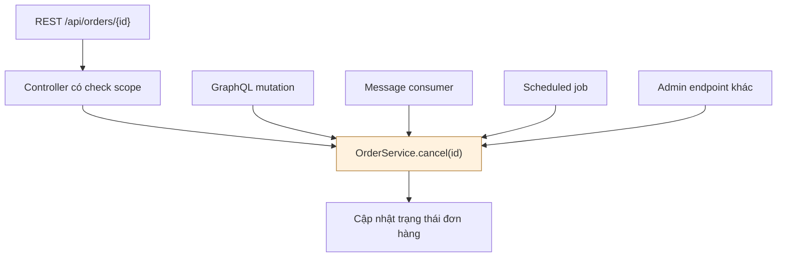
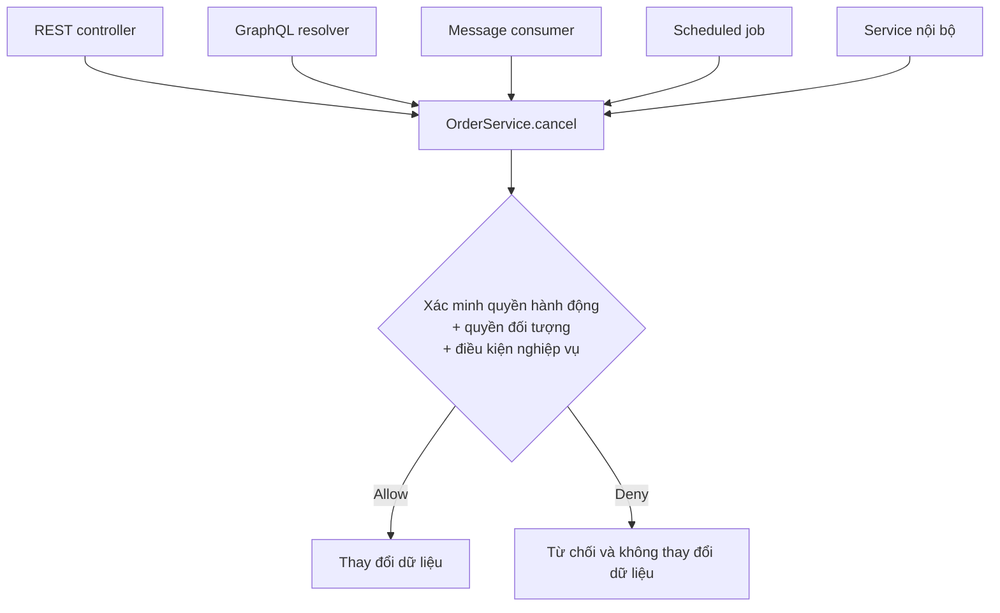

# Phân quyền lớp dịch vụ để bảo vệ hành vi vượt ra ngoài controller

Trong một ứng dụng **Spring Security OAuth 2.0 / OIDC Resource Server**, việc kiểm tra JWT và scope ở tầng HTTP là bước bảo vệ quan trọng, nhưng **không đủ để bảo đảm mọi hành vi nghiệp vụ được thực thi đúng quyền**. Cùng một phương thức tạo đơn, hủy đơn hoặc xuất dữ liệu có thể được gọi từ REST controller, GraphQL resolver, message consumer, job định kỳ, command nội bộ hoặc một service khác. Nếu chỉ viết điều kiện phân quyền ở controller, các đường gọi còn lại có thể đi vào cùng nghiệp vụ mà không đi qua điều kiện đó.

**Phân quyền lớp dịch vụ (service-layer authorization)** đưa các ràng buộc truy cập tới nơi hành động nghiệp vụ thực sự diễn ra. Nó phối hợp với xác thực token và phân quyền endpoint, không thay thế hai lớp ấy.

Ví dụ: một bearer access token chứa `scope=orders.cancel` có thể được phép gọi loại thao tác “hủy đơn”, nhưng không mặc nhiên được hủy **mọi** đơn hàng. Service cần kiểm tra chủ thể, tenant, quyền trên đơn cụ thể, trạng thái đơn và các quy tắc giao dịch. Việc kiểm tra phải tiếp tục đúng ngay cả khi phương thức được gọi từ một entry point không phải HTTP.

> **Bối cảnh minh họa:** Authorization Server có issuer `https://login.example.com`; Orders API là Servlet Resource Server có audience `orders-api`; Spring Boot 3.x / Spring Security 6.x. Ví dụ tập trung vào JWT access token và `@EnableMethodSecurity`. Đối tượng và URL chỉ dùng để giảng giải hợp đồng, không phải dữ liệu của môi trường đang chạy.

## 1. Vì sao phân quyền ở controller có thể để hở nghiệp vụ?

Xét một ứng dụng bắt đầu bằng REST endpoint:

```java
@RestController
@RequestMapping("/api/orders")
class OrdersController {

    private final OrderService orderService;

    OrdersController(OrderService orderService) {
        this.orderService = orderService;
    }

    @DeleteMapping("/{orderId}")
    @PreAuthorize("hasAuthority('SCOPE_orders.cancel')")
    void cancel(@PathVariable String orderId) {
        orderService.cancel(orderId);
    }
}
```

Nếu `OrderService.cancel(...)` không kiểm tra quyền, ứng dụng đang phụ thuộc vào việc **mọi lời gọi** của service đều đi qua `OrdersController.cancel(...)`.

Khi hệ thống lớn lên, các đường gọi có thể xuất hiện:

- Một **GraphQL mutation** trực tiếp gọi `orderService.cancel(id)`.
- Một **message consumer** xử lý event và gọi phương thức đó.
- Một **scheduled job** dọn các đơn tồn đọng.
- Một **admin controller** khác tái sử dụng service nhưng quên annotation.
- Một **service nội bộ** gọi `cancel(...)` để thực hiện workflow.
- Một **test/integration adapter** tạo code path mới mà nhóm phát triển không chú ý.

Nếu service không bảo vệ bất biến quyền, bất kỳ đường gọi nào bỏ qua controller ban đầu cũng có thể vượt điều kiện `SCOPE_orders.cancel`.

### 1.1. “HTTP đã được bảo vệ” không đồng nghĩa “mọi lời gọi nghiệp vụ đều được bảo vệ”

`SecurityFilterChain` bảo vệ các request HTTP **đi qua chain phù hợp**. Nó không tự chèn vào mọi lời gọi Java trong cùng tiến trình và không kiểm tra các event, scheduler hoặc command gọi service bên trong.

`@PreAuthorize` đặt trên controller bảo vệ **phương thức controller được proxy/interceptor xử lý**, chứ không mặc nhiên bảo vệ phương thức service riêng biệt ở mọi đường gọi.

Sơ đồ rủi ro:



Chỉ cạnh từ REST controller đi qua điều kiện scope. Các cạnh khác không tự thừa hưởng điều kiện đó.

### 1.2. Ranh giới được chuyển tới đâu?

Thiết kế mong muốn:



Các entry point cần đưa vào service **ngữ cảnh tác nhân đã được xác thực bằng cách phù hợp**, hoặc dùng service/application port riêng với chính sách của một tác nhân hệ thống. Không có nghĩa mọi job phải giả lập một end-user JWT. Mục tiêu là **không để nghiệp vụ chạy nếu thiếu một quyết định quyền hợp lệ cho chính đường gọi đó**.

## 2. Ba lớp trách nhiệm phải tách biệt

Trong OAuth 2.0 Resource Server, nên phân biệt:

| Lớp | Câu hỏi | Thành phần điển hình |
|---|---|---|
| **Authentication** | Access token có hợp lệ và đại diện cho chủ thể nào? | `BearerTokenAuthenticationFilter`, `JwtDecoder`, `JwtAuthenticationProvider` |
| **API / operation authorization** | Token được cấp scope/role cần thiết cho loại thao tác này không? | `AuthorizationFilter`, `hasAuthority`, `@PreAuthorize` |
| **Object / business authorization** | Chủ thể được thực hiện hành động này trên **đơn hàng cụ thể** trong trạng thái hiện tại không? | Domain policy, service, method security, repository, PDP |

JWT có chữ ký đúng nhưng `aud` sai vẫn phải bị từ chối tại **authentication**. JWT được xác minh hợp lệ mà thiếu `orders.cancel` thường bị từ chối ở **operation authorization**. JWT đủ scope nhưng cố hủy đơn của người khác phải bị từ chối ở **object/business authorization**.

### 2.1. Scope không phải quyền sở hữu tài nguyên

Một token có:

```json
{
  "iss": "https://login.example.com",
  "sub": "customer-42",
  "aud": ["orders-api"],
  "client_id": "storefront-web",
  "scope": "orders.cancel",
  "tenant_id": "tenant-a"
}
```

có thể được ánh xạ thành `SCOPE_orders.cancel`. Nhưng không có claim nào ở đây chứng minh rằng `order-9001` là của `customer-42`, rằng tenant còn hợp lệ hoặc đơn đang ở trạng thái cho phép hủy.

Các điều kiện được phép thường phải đồng thời đúng:

```text
ALLOW_CANCEL =
    token_valid
AND token_audience_is_orders_api
AND token_has_orders_cancel_scope
AND actor_is_allowed_to_cancel_orders
AND actor_belongs_to_resource_tenant
AND actor_owns_or_is_delegated_the_order
AND order_status_allows_cancellation
AND transaction_rules_are_satisfied
```

Đây là **mô hình chính sách minh họa**, không phải một biểu thức bắt buộc do OAuth định nghĩa. Điểm quan trọng: **sự hiện diện của scope chỉ là một phần của quyết định**.

### 2.2. Principal không nhất thiết là người dùng

Access token từ `authorization_code` có thể đại diện cho user đang ủy quyền cho client. Token từ `client_credentials` thường đại diện cho **ứng dụng/service**, không có end-user đang đăng nhập.

Vì vậy service không thể luôn giả định:

```text
authentication.getName() == userId trong database
```

Cần có hợp đồng nhận diện rõ `(iss, sub)`, `client_id`, tenant và loại tác nhân. Một job dùng service identity phải có quyền tương ứng, không được giả làm customer bằng cách tự điền `sub=customer-42`.

## 3. Spring Security Method Security là gì?

**Method Security** cho phép Spring chặn lời gọi tới **phương thức của bean được Spring quản lý** và đánh giá chính sách trước/sau khi phương thức chạy.

Công cụ phổ biến:

| Cơ chế | Vị trí kiểm tra | Công dụng | Hạn chế cần hiểu |
|---|---|---|---|
| `@PreAuthorize` | Trước khi phương thức thực thi | Kiểm tra scope, role, argument và policy bean | Không tự biết trạng thái database nếu policy không truy vấn/nhận dữ liệu |
| `@PostAuthorize` | Sau khi phương thức trả kết quả | Dùng `returnObject` để xét quyền với kết quả trả về | Phương thức **đã chạy**; không thích hợp để dựa vào cho write side effect |
| `@PreFilter` | Lọc collection argument trước khi xử lý | Loại phần tử không được xử lý | Không thay quyền tài nguyên trong repository, có chi phí/filter semantics cần kiểm soát |
| `@PostFilter` | Lọc collection result sau khi lấy | Một số kết quả đọc nhỏ | Không an toàn như giải pháp duy nhất cho pagination, total count, aggregate; có thể tải dữ liệu thừa |
| `@Secured` | Trước phương thức | Kiểm tra authority/role truyền thống | Cần bật nếu dùng; kém linh hoạt hơn biểu thức `@PreAuthorize` |
| `@RolesAllowed` | Trước phương thức | Mô hình JSR-250 role | Cần bật JSR-250 tương ứng; vẫn không tự hiểu ownership/tenant |
| `AuthorizationManager` tùy chỉnh | Trước hoặc sau method invocation theo interceptor | Policy phức tạp tái sử dụng | Cần hiểu proxy/AOP và contract dữ liệu |

Với Spring Security 6, sử dụng `@EnableMethodSecurity` để bật cấu hình method security theo mô hình hiện đại.

### 3.1. Bật method security

```java
package com.example.orders.security;

import org.springframework.context.annotation.Configuration;
import org.springframework.security.config.annotation.method.configuration.EnableMethodSecurity;

@Configuration
@EnableMethodSecurity
public class MethodSecurityConfiguration {
}
```

`@EnableMethodSecurity` bật hỗ trợ `@PreAuthorize` và `@PostAuthorize` theo mặc định trong cấu hình hiện đại. Nếu muốn dùng `@Secured` hoặc JSR-250 `@RolesAllowed`, cần bật các tùy chọn tương ứng, ví dụ `securedEnabled = true` hoặc `jsr250Enabled = true`.

**Không nên giả định rằng chỉ có `spring-boot-starter-security` là mọi annotation method security đều hoạt động.** Cần bảo đảm cấu hình bật method security và phương thức đi qua Spring-managed proxy/interceptor.

### 3.2. Ví dụ kiểm tra quyền ngay trên service

```java
package com.example.orders.application;

import org.springframework.security.access.prepost.PreAuthorize;
import org.springframework.stereotype.Service;

@Service
public class OrderReadService {

    @PreAuthorize("hasAuthority('SCOPE_orders.read')")
    public OrderDto getOrder(String orderId) {
        // Còn phải kiểm tra tenant và ownership trong policy bên dưới.
        return loadAuthorizedOrder(orderId);
    }
}
```

Đây là đoạn minh họa rút gọn: `OrderDto` và `loadAuthorizedOrder` tượng trưng cho các class/hàm ứng dụng. Ý chính là **kể cả khi service được gọi từ entry point khác**, method interceptor vẫn có cơ hội chặn lời gọi không đạt scope **nếu** invocation đi qua proxy và có authentication đúng trong context.

Nhưng `@PreAuthorize("hasAuthority(...)")` **chưa đủ** cho quyền trên từng đơn hàng. Phần tiếp theo sẽ đặt object policy tại service.

## 4. Quy tắc “deny by default” ở lớp nghiệp vụ

Một chính sách an toàn nên **từ chối** khi:

- Không có `Authentication` đã xác thực.
- Principal không thuộc loại token/hình thức định danh được action hỗ trợ.
- Thiếu scope/role cần thiết.
- Thiếu hoặc sai kiểu claim bắt buộc theo hợp đồng.
- Không xác định được tenant hoặc subject.
- Không tìm thấy thông tin quyền được phân công từ nguồn tin cậy.
- Không thể tải trạng thái tài nguyên cần đánh giá.
- Tài nguyên thuộc người/tenant khác.
- Trạng thái nghiệp vụ không cho phép hành động.

Không được mặc định cho phép khi một thuộc tính vắng mặt hoặc giá trị `null`. Ví dụ hai trường `tenantId` đều null **không** phải là bằng chứng hai bên cùng tenant hợp lệ.

### 4.1. Từ endpoint scope đến object policy

Ví dụ:

```text
Service.cancel(orderId)
    │
    ├─ Authentication hợp lệ?
    ├─ Có SCOPE_orders.cancel?
    ├─ Tác nhân thuộc mô hình được hỗ trợ?
    ├─ Order tồn tại trong phạm vi tenant?
    ├─ Actor được phép cancel chính order này?
    ├─ Order còn ở trạng thái có thể cancel?
    └─ Thực hiện mutation trong ranh giới giao dịch phù hợp
```

Với người dùng, actor có thể xác định bằng `issuer + subject` sau JWT verification. Với ứng dụng máy-máy, actor cần policy riêng theo `client_id` và nhiệm vụ được cấp; không tự gán quyền customer để dùng lại cùng hàm.

## 5. Ví dụ service đầy đủ: scope + tenant + owner + trạng thái đơn

Giả sử Orders API cho phép **khách hàng tự hủy đơn chưa xử lý**, khi họ có `orders.cancel` và token được phát hành trong ngữ cảnh user-delegated theo hợp đồng của Authorization Server.

### 5.1. Cấu hình Resource Server

```groovy
dependencies {
    implementation 'org.springframework.boot:spring-boot-starter-web'
    implementation 'org.springframework.boot:spring-boot-starter-security'
    implementation 'org.springframework.boot:spring-boot-starter-oauth2-resource-server'
    implementation 'org.springframework.boot:spring-boot-starter-data-jpa'
}
```

```yaml
spring:
  security:
    oauth2:
      resourceserver:
        jwt:
          issuer-uri: https://login.example.com
          audiences:
            - orders-api
```

`audiences` chỉ dùng trực tiếp nếu bản Spring Boot dự án hỗ trợ; với custom `JwtDecoder` hoặc phiên bản khác cần validator `aud` riêng. Nếu API chấp nhận hồ sơ RFC 9068, cần thêm kiểm tra token type và required claims phù hợp.

Spring Security chain:

```java
package com.example.orders.security;

import org.springframework.context.annotation.Bean;
import org.springframework.context.annotation.Configuration;
import org.springframework.http.HttpMethod;
import org.springframework.security.config.Customizer;
import org.springframework.security.config.annotation.web.builders.HttpSecurity;
import org.springframework.security.web.SecurityFilterChain;

@Configuration
public class ApiSecurityConfiguration {

    @Bean
    SecurityFilterChain apiChain(HttpSecurity http) throws Exception {
        return http
            .securityMatcher("/api/**")
            .authorizeHttpRequests(auth -> auth
                .requestMatchers(HttpMethod.GET, "/api/orders/**")
                    .hasAuthority("SCOPE_orders.read")
                .requestMatchers(HttpMethod.POST, "/api/orders/*/cancel")
                    .hasAuthority("SCOPE_orders.cancel")
                .anyRequest().authenticated()
            )
            .oauth2ResourceServer(oauth2 ->
                oauth2.jwt(Customizer.withDefaults())
            )
            .build();
    }
}
```

Ví dụ dùng `POST /api/orders/{orderId}/cancel` để biểu diễn action nghiệp vụ. Phân quyền ở route là lớp bổ sung; **service vẫn có chính sách của chính nó**.

### 5.2. Mô hình order và repository

Để tập trung vào authorization, dùng một domain model rút gọn:

```java
package com.example.orders.domain;

public enum OrderStatus {
    NEW,
    PROCESSING,
    SHIPPED,
    CANCELLED
}
```

```java
package com.example.orders.domain;

public record Order(
    String id,
    String tenantId,
    String ownerIssuer,
    String ownerSubject,
    OrderStatus status
) {

    public Order cancelled() {
        if (status != OrderStatus.NEW) {
            throw new IllegalStateException("Order cannot be cancelled");
        }

        return new Order(
            id,
            tenantId,
            ownerIssuer,
            ownerSubject,
            OrderStatus.CANCELLED
        );
    }
}
```

Repository port:

```java
package com.example.orders.domain;

import java.util.Optional;

public interface OrderRepository {

    // Adapter phải thực sự cài locking hoặc cơ chế concurrency control.
    Optional<Order> findByIdForUpdate(String orderId);

    void save(Order order);
}
```

`findByIdForUpdate(...)` là tên port nghiệp vụ, **không tự tạo khóa database chỉ nhờ tên method**. Adapter JPA có thể sử dụng `@Lock(PESSIMISTIC_WRITE)` hoặc concurrency control khác tùy database. Các ví dụ bỏ qua mapping entity/DTO và transaction adapter chi tiết để tập trung đúng vấn đề phân quyền.

### 5.3. Xác định quyền tác nhân đối với một order

```java
package com.example.orders.security;

import com.example.orders.domain.Order;
import com.example.orders.domain.OrderStatus;

import org.springframework.security.core.Authentication;
import org.springframework.security.oauth2.jwt.Jwt;
import org.springframework.security.oauth2.server.resource.authentication.JwtAuthenticationToken;
import org.springframework.stereotype.Component;

@Component
public final class OrderActionPolicy {

    public boolean canCancel(Authentication authentication, Order order) {
        if (!(authentication instanceof JwtAuthenticationToken jwtAuth)) {
            return false;
        }
        if (!jwtAuth.isAuthenticated() || order == null) {
            return false;
        }

        boolean hasCancelScope = jwtAuth.getAuthorities().stream()
            .anyMatch(authority ->
                "SCOPE_orders.cancel".equals(authority.getAuthority())
            );
        if (!hasCancelScope) {
            return false;
        }

        Jwt jwt = jwtAuth.getToken();
        if (jwt.getIssuer() == null || jwt.getSubject() == null) {
            return false;
        }

        String tenant = jwt.getClaimAsString("tenant_id");
        if (tenant == null || tenant.isBlank()) {
            return false;
        }

        // Chỉ dùng claim tenant nếu validator/hợp đồng issuer
        // bảo đảm ngữ nghĩa và nguồn phát hành của nó.
        boolean sameTenant = tenant.equals(order.tenantId());
        boolean sameOwner =
            jwt.getIssuer().toString().equals(order.ownerIssuer())
            && jwt.getSubject().equals(order.ownerSubject());

        boolean allowedState = order.status() == OrderStatus.NEW;

        return sameTenant && sameOwner && allowedState;
    }
}
```

Policy từ chối khi thiếu `JwtAuthenticationToken`, thiếu scope, thiếu issuer/subject/tenant, không đúng owner hoặc đơn hàng không ở trạng thái `NEW`.

**Giới hạn của ví dụ:** nó minh họa policy cho **user-delegated token**. Nếu AS có thể cấp token `client_credentials` với `sub` trùng một user ID hoặc claim `tenant_id` không được ràng buộc đúng chủ thể, phải bổ sung bước xác định **token class/client policy** bằng validator hoặc điều kiện độc lập. Không suy ra mọi JWT có `sub` đều là token người dùng.

### 5.4. Service bảo vệ chính hành vi mutation

```java
package com.example.orders.application;

import com.example.orders.domain.Order;
import com.example.orders.domain.OrderRepository;
import com.example.orders.security.OrderActionPolicy;

import org.springframework.security.access.AccessDeniedException;
import org.springframework.security.access.prepost.PreAuthorize;
import org.springframework.security.core.Authentication;
import org.springframework.security.core.context.SecurityContextHolder;
import org.springframework.stereotype.Service;
import org.springframework.transaction.annotation.Transactional;

@Service
public class OrderCommandService {

    private final OrderRepository repository;
    private final OrderActionPolicy policy;

    public OrderCommandService(
            OrderRepository repository,
            OrderActionPolicy policy) {
        this.repository = repository;
        this.policy = policy;
    }

    @PreAuthorize("hasAuthority('SCOPE_orders.cancel')")
    @Transactional
    public void cancelOrder(String orderId) {
        Authentication actor =
            SecurityContextHolder.getContext().getAuthentication();

        // Đọc bản ghi dưới concurrency control của adapter.
        Order order = repository.findByIdForUpdate(orderId)
            .orElseThrow(() -> new OrderNotFoundException(orderId));

        // Kiểm tra trên chính bản ghi sắp thay đổi.
        if (!policy.canCancel(actor, order)) {
            throw new AccessDeniedException(
                "Not allowed to cancel this order"
            );
        }

        repository.save(order.cancelled());
    }
}
```

Exception domain đơn giản:

```java
package com.example.orders.application;

public final class OrderNotFoundException extends RuntimeException {
    public OrderNotFoundException(String orderId) {
        super("Order not found");
    }
}
```

Cơ chế an toàn của service:

1. `@PreAuthorize` yêu cầu scope ngay **tại biên gọi service qua proxy**, kể cả caller không phải controller.
2. `SecurityContextHolder` đọc authentication thuộc ngữ cảnh thực thi hiện tại, không lấy principal tự khai từ HTTP header hoặc tham số `userId`.
3. Repository lấy order sắp sửa trong ranh giới giao dịch/concurrency control của adapter.
4. `OrderActionPolicy` kiểm tra scope, identity, tenant, ownership và trạng thái.
5. Mutation chỉ diễn ra sau khi các điều kiện đạt.
6. Nếu không đạt, ném `AccessDeniedException`, không lưu thay đổi.

**`@PreAuthorize` và kiểm tra thủ công trong service là hai lớp bổ sung.** Ngay cả khi lời gọi nội bộ bỏ qua proxy do sai thiết kế, việc kiểm tra `policy.canCancel(...)` trong thân service vẫn là một tuyến bảo vệ. Tuy nhiên không nên cố ý dựa vào bypass proxy; cần thiết kế đúng đường gọi và test cả hai lớp.

### 5.5. Controller trở nên mỏng

```java
package com.example.orders.api;

import com.example.orders.application.OrderCommandService;
import org.springframework.http.ResponseEntity;
import org.springframework.web.bind.annotation.PathVariable;
import org.springframework.web.bind.annotation.PostMapping;
import org.springframework.web.bind.annotation.RequestMapping;
import org.springframework.web.bind.annotation.RestController;

@RestController
@RequestMapping("/api/orders")
public class OrderCommandsController {

    private final OrderCommandService commands;

    public OrderCommandsController(OrderCommandService commands) {
        this.commands = commands;
    }

    @PostMapping("/{orderId}/cancel")
    public ResponseEntity<Void> cancel(@PathVariable String orderId) {
        commands.cancelOrder(orderId);
        return ResponseEntity.noContent().build();
    }
}
```

Controller không quyết định ownership, không lấy `ownerId` do client tự nhập và không có một bản sao policy phân tán. Service là nơi cuối cùng trước mutation, phù hợp để đặt bất biến quyền.

Trong ứng dụng thực tế, cần thêm xử lý HTTP exception, trạng thái domain, kiểm toán và hợp đồng API. Đoạn code tập trung vào **service-layer authorization**, không phải một project Spring Boot đầy đủ có thể chạy ngay.

## 6. Tại sao cần cả @PreAuthorize và policy trong thân service?

Hai cách có thế mạnh khác nhau:

| Vấn đề | Method security annotation | Policy trong service/domain |
|---|---|---|
| Kiểm tra scope/role cố định | Rất phù hợp với `hasAuthority`, `hasRole` | Có thể lặp lại như lớp bảo vệ |
| Kiểm tra tài nguyên trong DB | Có thể gọi bean policy qua SpEL | Phù hợp khi đã tải resource trong transaction |
| Bảo vệ lời gọi qua Spring proxy | Có | Kiểm tra trong thân method không phụ thuộc proxy |
| Dùng từ background job không có SecurityContext | Thường từ chối; phải thiết kế caller identity | Có thể dùng abstraction actor rõ ràng cho nhiều entrypoint |
| Kiểm soát nhất quán của mutation | Annotation kiểm tra trước invocation | Service có thể lock, kiểm tra rồi update nguyên tử |
| Dễ xác định nơi bảo vệ bất biến nghiệp vụ | Nằm ở entry của service | Nằm gần thao tác thay đổi dữ liệu |

Không có quy tắc bắt buộc mọi service đều phải chứa **cả hai** kiểu kiểm tra lặp chính xác. Tùy kiến trúc có thể dùng:

- `@PreAuthorize` cho scope và role; policy trong thân service cho owner/tenant/state.
- `@PreAuthorize` gọi bean policy đối với hành động đọc đơn giản và tương đối ổn định.
- Central `AuthorizationManager` hoặc PDP nếu cần nhiều quy tắc thống nhất.
- Application service dùng `ActorContext` rõ ràng và policy riêng cho hệ thống đa entrypoint.

**Điểm không được mất:** mọi đường có thể thực hiện mutation phải thực thi chính sách thực tế, không chỉ đường đi qua một controller nhất định.

## 7. Khi đặt policy trực tiếp trong @PreAuthorize

Có thể gọi một Spring bean từ biểu thức:

```java
@PreAuthorize(
    "hasAuthority('SCOPE_orders.read') " +
    "and @orderAuthorization.canRead(authentication, #orderId)"
)
public OrderDto readOrder(String orderId) {
    return loadOrderDto(orderId);
}
```

`orderAuthorization` là bean policy mà ứng dụng tự định nghĩa. Nó phải xác định order, tenant, owner và chủ thể từ dữ liệu được tin cậy. Tên `#orderId` cần được Spring phân giải từ tham số Java (ví dụ biên dịch với `-parameters` hoặc dùng annotation hỗ trợ tên tham số khi cần).

Có thể dùng một annotation tham số để bảo đảm tên khi môi trường build không giữ parameter names:

```java
import org.springframework.security.access.method.P;
import org.springframework.security.access.prepost.PreAuthorize;

@PreAuthorize(
    "hasAuthority('SCOPE_orders.read') " +
    "and @orderAuthorization.canRead(authentication, #orderId)"
)
public OrderDto readOrder(@P("orderId") String orderId) {
    return loadOrderDto(orderId);
}
```

Đây là một đoạn minh họa về binding argument; các class `OrderDto` và `loadOrderDto` thuộc ứng dụng cụ thể.

### 7.1. Hạn chế của “query policy trước, mutation sau”

Nếu annotation dùng policy bean để đọc order và chấp nhận, rồi thân method đọc order lần nữa để sửa:

```text
Time A: policy đọc order, status = NEW -> allow
Time B: service đọc order, status = SHIPPED -> cancel
```

Đây là nguy cơ **TOCTOU — Time Of Check To Time Of Use**. Trạng thái có thể thay đổi giữa hai thời điểm, nhất là khi nhiều request hoặc worker chạy đồng thời.

Vì vậy với mutation:

- Giữ kiểm tra đơn giản không phụ thuộc dữ liệu trong `@PreAuthorize`, ví dụ scope.
- Tải bản ghi dưới transaction/locking thích hợp.
- Kiểm tra **resource policy và trạng thái ngay trước mutation**.
- Bảo đảm ghi dữ liệu là atomic hoặc dùng optimistic locking/version check.
- Không cho một thao tác write tiếp tục chỉ vì một boolean được tính ở request trước.

Có thể dùng database update có điều kiện để bảo vệ invariant:

```sql
UPDATE orders
SET status = 'CANCELLED'
WHERE id = :order_id
  AND tenant_id = :tenant_id
  AND owner_issuer = :issuer
  AND owner_subject = :subject
  AND status = 'NEW';
```

Sau đó kiểm tra số bản ghi được cập nhật, thường phải là `1` để coi thao tác thành công; `0` có thể nghĩa order không tồn tại, không có quyền hoặc trạng thái không cho phép. Cần thiết kế thông báo lỗi phù hợp mà không tiết lộ dữ liệu ngoài phạm vi.

Với các điều kiện phức tạp, transaction, locks/versions và domain policy phải phối hợp chặt chẽ. `@Transactional` đơn thuần không biến mọi phép đọc-kiểm tra-ghi thành atomic trong mọi mức isolation.

## 8. @PostAuthorize và @PostFilter: hữu ích nhưng không phải lớp bảo vệ cuối cho write

### 8.1. @PostAuthorize với tài nguyên trả về

Một ví dụ về check sau khi đọc:

```java
@PostAuthorize(
    "returnObject == null or " +
    "returnObject.ownerSubject == authentication.name"
)
public OrderDto findOrder(String orderId) {
    return orderRepository.readDto(orderId);
}
```

`@PostAuthorize` có thể xem kết quả để quyết định có trả về caller không. Tuy nhiên cần hiểu:

- **Phương thức đã thực thi** trước khi policy sau method được đánh giá.
- Nếu method gửi email, ghi DB, chuyển tiền hoặc phát event, việc từ chối sau đó không nhất thiết hủy được mọi side effect.
- Biểu thức dựa vào `authentication.name` có thể thiếu issuer/tenant và không phù hợp khi subject không phải user.
- Nếu method trả null hay các dữ liệu lồng nhau, policy phải được thiết kế đúng kiểu.

**Không dùng `@PostAuthorize` như lớp duy nhất bảo vệ phương thức có side effect.** Với write, kiểm tra quyền trước khi thực hiện hành động và ràng buộc ngay trong transaction.

### 8.2. @PostFilter với danh sách

```java
@PostFilter("filterObject.ownerSubject == authentication.name")
public List<OrderDto> listOrders() {
    return orderRepository.findAllDtos();
}
```

Ví dụ trên dễ hiểu nhưng **không phù hợp làm cơ chế duy nhất** bảo vệ dữ liệu danh sách trong hệ thống lớn:

- Service có thể đã tải toàn bộ dữ liệu không cần thiết từ DB.
- `totalElements`, aggregate và pagination có thể vẫn phản ánh bản ghi không được phép.
- Các quan hệ lồng, export/file stream hoặc cache có thể được tạo trước khi filter.
- Một query `findAll` không giới hạn tenant có thể vi phạm yêu cầu data minimization.

Nên ưu tiên **query đã được ràng buộc quyền**:

```sql
SELECT *
FROM orders
WHERE tenant_id = :authorized_tenant
  AND owner_issuer = :issuer
  AND owner_subject = :subject
ORDER BY created_at DESC
LIMIT :limit OFFSET :offset;
```

Đồng thời bảo đảm count, filter, sort và export cũng được tính trên cùng tập dữ liệu được phép.

## 9. Spring AOP proxy: ranh giới kỹ thuật của method security

Method security thường được thực hiện bằng **Spring AOP/proxy/interceptors**. Vì vậy annotation trên method **không phải** lời hứa rằng bất kỳ câu lệnh Java nào gọi method đều được kiểm tra.

### 9.1. Self-invocation có thể bỏ qua interceptor

Ví dụ:

```java
@Service
public class OrderWorkflowService {

    public void process(String orderId) {
        cancelOrder(orderId); // this.cancelOrder(...): gọi nội bộ
    }

    @PreAuthorize("hasAuthority('SCOPE_orders.cancel')")
    public void cancelOrder(String orderId) {
        // Mutation
    }
}
```

Nếu `process` gọi `cancelOrder` bằng `this` bên trong cùng instance, lời gọi có thể **không đi qua Spring proxy**, dẫn tới `@PreAuthorize` không được thực thi cho lời gọi nội bộ đó.

**Cách thiết kế tốt:**

- Đưa phương thức được bảo vệ sang một **Spring bean riêng**, để các caller gọi qua bean/proxy.
- Hoặc đặt policy trong thân service/domain, không dựa vào annotation làm điểm kiểm soát duy nhất.
- Tránh các “mẹo” gọi lại proxy từ chính mình nếu có thể giải quyết bằng kiến trúc đơn giản, rõ ràng.

Ví dụ tách bean:

```java
@Service
public class OrderWorkflowService {

    private final OrderCommandService commandService;

    public OrderWorkflowService(OrderCommandService commandService) {
        this.commandService = commandService;
    }

    public void process(String orderId) {
        // Lời gọi sang bean khác, đi qua proxy service khi được cấu hình.
        commandService.cancelOrder(orderId);
    }
}
```

Tuy nhiên, nếu `process` được gọi từ scheduler không có Authentication, `cancelOrder` nên **từ chối** theo policy hiện tại. Không tạo một authentication user giả để ép nó qua interceptor.

### 9.2. Bean, method visibility và proxying

Những điều kiện cần hiểu:

| Trường hợp | Nguy cơ |
|---|---|
| Object được tạo bằng `new`, không do Spring quản lý | Không có Spring proxy/method interceptor |
| Phương thức `private` gọi nội bộ | Không được bảo vệ như lời gọi public qua proxy |
| Self-invocation cùng bean | Có thể bỏ qua interceptor |
| Class/method `final` trong một số mô hình CGLIB proxy | Không thể được override/intercept như kỳ vọng |
| Dùng interface/proxy khác loại | Cách proxy hoá và method được intercept phụ thuộc cấu hình |
| Annotation đặt trên method nhưng method security chưa bật | Annotation không có tác dụng như mong đợi |
| Gọi service từ async worker không có context | Annotation có thể từ chối hoặc logic đọc principal bị thiếu |
| Exception bị catch rồi bỏ qua | Caller có thể tiếp tục làm side effect dù bước auth bị từ chối |

Không phải annotation nào trên Java method cũng sẽ tạo một ranh giới an ninh trong mọi điều kiện. Với hành vi quan trọng, thiết kế nên có **đường gọi qua bean được kiểm soát**, đồng thời policy domain không thể bị bỏ qua khi thực thi mutation.

### 9.3. Method security trên controller và service có lặp không?

Có thể có cả hai:

```java
// Controller (guard ở HTTP boundary)
@PreAuthorize("hasAuthority('SCOPE_orders.cancel')")
public void cancelHttp(String id) {
    orderCommandService.cancelOrder(id);
}

// Service (guard ở nghiệp vụ)
@PreAuthorize("hasAuthority('SCOPE_orders.cancel')")
public void cancelOrder(String id) {
    // Object policy và mutation
}
```

Điều này tăng tính phòng thủ theo lớp nếu cấu hình rõ ràng. Tuy nhiên, khi cùng một rule xuất hiện ở nhiều nơi, cần tránh các biến thể khác nhau gây “controller cho phép, service từ chối” khó hiểu. Thông thường controller tập trung giao thức/định tuyến, service áp chính sách nghiệp vụ, và security filter chain bảo vệ HTTP ở mức endpoint.

## 10. Đường gọi vượt controller: GraphQL, gRPC, events, jobs

### 10.1. GraphQL resolver

GraphQL có thể triển khai bằng một HTTP endpoint chung `/graphql`, nhưng bên trong chứa nhiều query/mutation với quyền rất khác nhau.

Nếu chỉ yêu cầu `authenticated()` cho `/graphql`, cần bảo vệ từng hành vi:

```text
Mutation.cancelOrder
    → OrderCommandService.cancelOrder
        → Method security + object policy
```

Không nên coi việc toàn bộ GraphQL chạy qua một endpoint authenticated là đã thay thế authorization ở từng resolver/service.

### 10.2. gRPC hoặc RPC nội bộ

Nếu cùng service domain được gọi từ gRPC adapter, HTTP Servlet `SecurityFilterChain` **không mặc nhiên** xử lý request gRPC như REST endpoint. Cần xác thực workload/user ở ranh giới gRPC bằng cơ chế phù hợp, sau đó chuyển thành ngữ cảnh tác nhân tin cậy cho application service.

Không tin metadata `user-id` hoặc `roles` do một gRPC client tùy ý gửi nếu không có xác thực/ủy quyền ở kênh RPC.

### 10.3. Message consumer

Một message handler có thể nhận:

```json
{
  "eventType": "CancelOrderRequested",
  "orderId": "order-42",
  "requestedBy": "customer-42"
}
```

Claim `requestedBy` trong message body **không tự là Authentication của Spring Security**. Nếu publisher không được xác thực hoặc message bị thay đổi, việc dùng trường đó để cấp quyền sẽ tạo lỗ hổng.

Cần xác định:

- Ai được phép publish event/command vào queue?
- Publisher có danh tính service và scope/role thích hợp không?
- Message có đến qua broker, topic, ACL và transport được bảo vệ không?
- Những thuộc tính nào đáng tin, thuộc tính nào chỉ là **dữ liệu yêu cầu**?
- Service consumer cần xác thực **tác nhân hệ thống** hay quyết định quyền của end-user được ủy quyền?
- Có cần kiểm tra lại trạng thái đơn/tenant tại thời điểm tiêu thụ message không?

Với command thay đổi trạng thái, policy nên được kiểm tra tại thời điểm thực hiện, không chỉ dựa trên một quyết định cũ từ lúc message được gửi.

### 10.4. Scheduler/batch jobs

Scheduler thường không có incoming HTTP request hoặc user `SecurityContext`:

```java
@Scheduled(cron = "0 */15 * * * *")
public void expireOldOrders() {
    orderMaintenanceService.expireEligibleOrders();
}
```

**Không sửa lỗi “không có Authentication” bằng cách tự set `ROLE_ADMIN` hoặc `SCOPE_orders.cancel` cho một user giả.** Scheduler nên có use case/policy riêng cho tác nhân hệ thống:

```text
OrderMaintenanceService.expireEligibleOrders()
  → Allowed workload identity / trusted scheduler trigger
  → Chỉ các order đủ điều kiện theo thời hạn/trạng thái
  → Tenant/batch constraints
  → Transaction + audit
```

Một thao tác bảo trì tự động như “hết hạn đơn cũ” có ý nghĩa khác “người dùng chủ động hủy đơn của mình”. Chúng không nên bị ép qua cùng controller authorization chỉ vì cuối cùng đều cập nhật trạng thái order.

## 11. Thiết kế ngữ cảnh tác nhân cho nhiều entry point

Nếu hệ thống hỗ trợ cả request user, service account và job, một abstraction được quản lý rõ có thể giúp service độc lập với transport:

```java
package com.example.orders.security;

public record ActorContext(
    ActorKind kind,
    String issuer,
    String subject,
    String clientId,
    String tenantId
) {
    public enum ActorKind {
        END_USER,
        SERVICE
    }
}
```

**Điều kiện then chốt:** `ActorContext` không được xây tùy ý từ JSON body/header client mà không xác minh. Nó phải được **tạo từ credential đã xác thực tại trust boundary**, ví dụ:

- HTTP Resource Server: JWT/opaque token đã xác minh và chính sách issuer/claims.
- RPC: service identity đã được xác thực qua mTLS hoặc cơ chế RPC thích hợp.
- Message consumer: danh tính workload/producer và chứng cứ ủy quyền đáng tin theo kiến trúc.
- Scheduler: danh tính và quyền hạn workload được triển khai/kiểm soát.

Không nên coi record `ActorContext` tự nó là “chứng chỉ” hoặc cho bất kỳ caller không tin cậy nào tự tạo actor với `kind=SERVICE` để vượt kiểm tra.

### 11.1. Application service với actor tường minh

Một thiết kế tổng quát:

```java
public void cancelOrder(
        ActorContext actor,
        String orderId) {

    // 1. Đối chiếu quyền actor đối với loại hành động.
    // 2. Tải order đúng tenant, trong transaction phù hợp.
    // 3. Kiểm tra owner/delegation/state.
    // 4. Chỉ sau đó mới thay đổi dữ liệu.
}
```

Cần thêm một **adapter/application boundary** kiểm soát ai được tạo `ActorContext`. Nếu mọi bean nội bộ có thể truyền actor giả mà không có ràng buộc, việc đưa actor vào tham số chỉ thay đổi hình thức, không bảo đảm an ninh.

### 11.2. Tách command nghiệp vụ theo nguồn

Nhiều hệ thống sẽ an toàn và dễ hiểu hơn khi có hai use case:

```text
CustomerCancelOrder
  → yêu cầu access token user-delegated
  → scope orders.cancel
  → cùng tenant và chủ đơn
  → trạng thái cho phép user hủy

SystemExpireOrder
  → yêu cầu workload được tin cậy
  → batch policy riêng
  → đơn quá thời hạn và chưa xử lý
  → không giả lập customer principal
```

Hai use case có thể cùng gọi một domain transition nội bộ, nhưng **điều kiện được phép kích hoạt transition** phải khác nhau và được thực thi ở application/service layer.

## 12. SecurityContextHolder: giá trị và giới hạn

Trong Servlet Resource Server, sau khi JWT được xác minh, Spring đặt `Authentication` vào `SecurityContext` của request. Có thể đọc:

```java
Authentication authentication =
    SecurityContextHolder.getContext().getAuthentication();
```

Với JWT, authentication thường là `JwtAuthenticationToken`, principal là `Jwt` đã được xác minh. Scope có thể được chuyển thành `SCOPE_*` authorities.

Nhưng cần nhớ:

- `SecurityContextHolder` thường dùng chiến lược gắn context với **thread**; không tự lan truyền mọi nơi.
- Không mặc định có context trong `@Async`, `CompletableFuture`, executor tùy chỉnh, scheduled job, message listener hoặc callback chạy ở thread khác.
- Không dựa vào việc request trước đã authenticated để request sau tự có principal.
- Không lưu `Authentication` của một user ở singleton field hoặc static variable dùng chung.
- Với code ngoài request, thiếu context phải được xử lý như **chưa xác thực/không có actor**, không lấy “user gần nhất” hoặc tạo mặc định admin.
- Nếu cần truyền context qua async, sử dụng cơ chế Spring Security thích hợp như `DelegatingSecurityContextRunnable` hoặc `DelegatingSecurityContextExecutor` và xác định rõ thời gian sống/ranh giới của context.

### 12.1. Không truyền bearer token của người dùng vô hạn qua job

Một access token có thời hạn và audience cụ thể. Đưa nguyên token từ HTTP request vào queue để job chạy nhiều giờ sau có thể gặp hết hạn, nguy cơ rò token và sai ranh giới tin cậy.

Có thể tốt hơn là:

1. Xác thực user và kiểm tra quyền **khởi tạo job** ở thời điểm request.
2. Tạo một job record đáng tin, ghi rõ phạm vi được phép.
3. Khi worker chạy, xác thực workload bằng service identity riêng.
4. Kiểm tra lại các điều kiện nghiệp vụ có thể thay đổi, như tenant, ownership, trạng thái, chính sách hiện hành.
5. Ghi audit nguồn yêu cầu và actor thực hiện, không lưu raw access token nếu không thực sự cần.

Nếu nghiệp vụ đòi **delegation dài hạn** thay mặt user, cần cơ chế OAuth/authorization rõ ràng phù hợp, không tự coi một JWT access token là giấy phép vĩnh viễn.

## 13. Bảo vệ dữ liệu ở service không chỉ với một ID

### 13.1. Read by ID

Sai:

```java
@PreAuthorize("hasAuthority('SCOPE_orders.read')")
public OrderDto get(String orderId) {
    return repository.findDtoById(orderId);
}
```

Nếu repository đọc theo ID thuần, bất kỳ subject có scope đọc có thể truy cập bản ghi của người khác nếu đoán/biết ID. Đây là nguy cơ **Broken Object Level Authorization (BOLA/IDOR)**.

Giải pháp là đưa owner/tenant policy vào service hoặc query. Ví dụ query đã được ràng buộc:

```sql
SELECT *
FROM orders
WHERE id = :order_id
  AND tenant_id = :authorized_tenant
  AND owner_issuer = :issuer
  AND owner_subject = :subject;
```

Các tham số actor phải đến từ ngữ cảnh đã xác thực hoặc mapping domain tin cậy, **không** từ request client tự khai làm bằng chứng phân quyền.

### 13.2. Read list, pagination và aggregates

Một method:

```java
@PreAuthorize("hasAuthority('SCOPE_orders.read')")
public Page<OrderDto> list(Pageable pageable) {
    return repository.findAll(pageable);
}
```

vẫn có thể làm lộ đơn của tenant khác. Phải giới hạn tập bản ghi **trước khi** phân trang:

```text
findVisibleOrders(authorizedTenant, issuer, subject, filters, pageable)
```

Cả `totalElements`, các chỉ số thống kê, export và file download đều phải tuân theo cùng scope tài nguyên. Không chỉ lọc dữ liệu sau khi database đã tính tổng cho toàn hệ thống.

### 13.3. Nested resources

`GET /api/orders/42/items/7` cần xác minh item 7 **thuộc order 42** và order thuộc phạm vi được phép. Nếu kiểm tra order 42 rồi tải item 7 độc lập, có thể lộ item của order khác.

Với service-layer policy, quan hệ cha-con là một phần của resource authorization chứ không phải lỗi của controller routing.

### 13.4. File export và background report

Một method xuất CSV/PDF có thể được gọi bởi user, admin và scheduled job. Quyền xuất dữ liệu cần xét:

- Actor có scope `orders.export` hay quyền workload tương ứng?
- Tập tenant nào được phép?
- Dữ liệu nhạy cảm/PII nào được phép đưa vào file?
- Có giới hạn khối lượng, ngày, nhóm khách hàng?
- File được lưu ở đâu, ai được tải và trong bao lâu?
- Job chạy sau nhiều phút/hàng giờ có cần đánh giá lại quyền không?

Việc chỉ kiểm tra `SCOPE_orders.export` ở nút “Download” trên UI hay controller là không đủ nếu worker/service xuất file có thể được gọi từ nơi khác.

## 14. 401, 403, 404 và ứng xử ở ngoài HTTP

Trong REST API, mã trạng thái thông thường:

| Tình huống | Tầng | HTTP điển hình |
|---|---|---|
| Không gửi access token vào endpoint được bảo vệ | Authentication | **401 Unauthorized** |
| JWT sai chữ ký, issuer, audience, hết hạn hoặc sai token profile | Authentication | **401 / invalid_token** |
| Token hợp lệ nhưng thiếu `orders.cancel` | Operation authorization | **403 Forbidden**, có thể `insufficient_scope` |
| Token đủ scope nhưng order không thuộc actor | Object authorization | **403 hoặc 404** theo chính sách |
| Token đủ scope/owner nhưng order đã SHIPPED, không thể hủy | Business state policy | Có thể **409 Conflict**, **403** hoặc mã nghiệp vụ khác |
| Mọi điều kiện đạt | Application service | Thực thi mutation và trả phản hồi thích hợp |

**`404` thay `403`** có thể được lựa chọn để giảm khả năng suy ra sự tồn tại của order ngoài phạm vi, nhưng phải nhất quán và không gây rò rỉ qua thông báo, count hoặc timing. Phân biệt quyền và trạng thái tài nguyên theo hợp đồng API.

Ngoài HTTP, **không có lý do mọi exception phải được chuyển thành 403**:

- Trong message consumer, `AccessDeniedException` có thể dẫn tới message bị reject, gửi dead-letter queue hoặc ghi nhận lỗi không retry.
- Trong scheduled job, thiếu workload identity có thể là **sự cố cấu hình**, không phải một response cho user.
- Trong RPC, framework có mã lỗi “permission denied/unauthenticated” riêng.
- Khi policy thất bại vì dữ liệu tạm thời không truy cập được, phải phân biệt **deny thật** với lỗi hạ tầng, không vô hạn retry mọi trường hợp.
- Không catch `AccessDeniedException` rồi bỏ qua và vẫn thực hiện mutation.

### 14.1. Exception handling phải không tạo side effect sau từ chối

Ví dụ sai:

```java
try {
    orderService.cancelOrder(orderId);
} catch (AccessDeniedException denied) {
    log.warn("Permission denied");
}
sendCancellationEmail(orderId); // Vẫn chạy dù không có quyền!
```

Đây là lỗi điều phối. Sau khi policy từ chối, workflow phải dừng hoặc chuyển sang nhánh xử lý từ chối an toàn. Hành vi audit việc bị từ chối có thể cần ghi, nhưng **không** được chạy phần nghiệp vụ đang bị cấm.

## 15. Giao dịch, locking và tránh TOCTOU

Ngay cả khi policy đúng ở thời điểm kiểm tra, hệ thống có nhiều concurrent requests có thể làm trạng thái tài nguyên thay đổi.

Giả sử hai thao tác:

```text
T1: kiểm tra order.status = NEW
T2: order chuyển sang SHIPPED
T1: thực hiện cancel trên dữ liệu đã thay đổi
```

Nếu chính sách hủy chỉ cho phép trạng thái `NEW`, check ở controller hoặc pre-authorization bên ngoài transaction **không bảo đảm** điều kiện còn đúng tại lúc ghi.

Những công cụ cần phối hợp:

1. **Transaction boundary:** check và update trong một đơn vị nghiệp vụ.
2. **Pessimistic/optimistic locking:** ràng buộc version hoặc lock để tránh ghi trên dữ liệu thay đổi.
3. **Conditional write:** cập nhật chỉ nếu status/owner/tenant vẫn đúng.
4. **Domain invariants:** entity/domain service không cho transition trạng thái trái luật.
5. **Idempotency:** xử lý retry và duplicate messages một cách an toàn.
6. **Audit trail:** ghi lại actor, resource, quyết định và thay đổi theo chính sách bảo mật.

`@Transactional` hữu ích nhưng không thay thế việc kiểm tra isolation level, lock/version hoặc conditional update. An ninh nghiệp vụ cần đánh giá **tại thời điểm tác động tới tài nguyên**, không chỉ tại lúc nhận request HTTP.

## 16. Phân quyền cho admin và dịch vụ nội bộ

Một role `ROLE_ORDER_MANAGER` không nên trở thành “quyền vượt qua mọi tenant” nếu nó chỉ có ý nghĩa ở một bộ phận.

Ví dụ chính sách:

```text
CAN_CANCEL_AS_MANAGER =
  token_has_scope("orders.cancel")
  AND actor_has_role("ORDER_MANAGER")
  AND manager_is_assigned_to_order
  AND actor_tenant == order_tenant
  AND order_status == NEW
```

Với service account được phép làm việc xuyên tenant, phải có **quyền workload được cấp riêng**, giới hạn danh sách tenant, loại job, tập tài nguyên và khả năng truy cập data.

### 16.1. Scope của user và quyền của machine-to-machine

| Loại tác nhân | Authentication đầu vào | Quy tắc service cần xét |
|---|---|---|
| User qua OAuth authorization code | JWT/opaque token user-delegated | Scope, issuer/subject, tenant membership, ownership/delegation, trạng thái |
| Service qua client credentials | Access token gắn client/service | Scope, client allowlist, workload identity, tenant/resource limits, job contract |
| Scheduler nội bộ | Cơ chế workload identity hoặc trusted job boundary | Job type, maintenance policy, resource status, tenant constraints, audit |
| Message consumer | Broker/producer authentication + message integrity | Trusted publisher, authorized command scope, dữ liệu event, trạng thái tại lúc thực thi |
| Admin portal | JWT user-delegated hoặc session theo hợp đồng | Role/permission đúng tenant, step-up khi cần, object policy, audit |

Một service có thể tái sử dụng phần kiểm tra trạng thái nghiệp vụ, nhưng **không được tự cho mọi actor quyền cao nhất** chỉ để đi qua một phương thức chung.

### 16.2. “Internal” không đồng nghĩa “trusted”

Mạng nội bộ, tên service hoặc header `X-Internal-Call: true` không tự chứng minh quyền. Cần xác thực service identity, giới hạn quyền gọi service và không dùng một shared super-admin credential ở mọi microservice.

Đây là nguyên tắc **least privilege** ở cấp cả token và khả năng thực thi service.

## 17. Method-level policy và kiến trúc application/domain

Có thể tổ chức các lớp:

```text
Inbound adapters
  ├── REST Controller
  ├── GraphQL Resolver
  ├── Message Handler
  └── Scheduled Job
         │
         ▼
Application Service / Use Case
  ├── Xác định actor từ trust boundary tương ứng
  ├── Kiểm tra quyền hành động
  ├── Tải tài nguyên đúng phạm vi
  ├── Kiểm tra tenant/owner/delegation
  ├── Kiểm tra trạng thái và invariants
  └── Điều phối transaction, thay đổi và audit
         │
         ▼
Domain Model / Policy
         │
         ▼
Persistence / External effects
```

Một kiến trúc như vậy có lợi vì:

- Cùng một policy được dùng cho nhiều kênh giao tiếp.
- Hành vi quan trọng không phụ thuộc annotation của controller.
- Có thể unit test policy không cần HTTP.
- Có thể integration test phương thức application service và filter chain riêng.
- Quy tắc nghiệp vụ có thể thay đổi mà không phải sửa mọi controller.
- Dễ giải thích nguồn quyền trong audit.

Tuy nhiên, “policy tập trung” không có nghĩa đặt một class duy nhất hàng ngàn dòng với mọi `if`. Nên chia policy theo **hành động và resource domain** (ví dụ `OrderReadPolicy`, `OrderCancellationPolicy`), với interface và trách nhiệm rõ.

## 18. Kiểm thử service-layer authorization đúng mục đích

Một bộ test chỉ kiểm tra `GET /api/orders` trả 401 khi thiếu token **không chứng minh** service an toàn khi được gọi trực tiếp. Cần test những đường đi không qua controller và các case scope đúng nhưng object sai.

### 18.1. Unit test domain policy

Có thể tạo đối tượng `JwtAuthenticationToken` thử nghiệm **không dùng JWT thật** để kiểm tra `OrderActionPolicy`:

```java
package com.example.orders.security;

import com.example.orders.domain.Order;
import com.example.orders.domain.OrderStatus;

import java.util.List;

import org.junit.jupiter.api.Test;
import org.springframework.security.core.authority.SimpleGrantedAuthority;
import org.springframework.security.oauth2.jwt.Jwt;
import org.springframework.security.oauth2.server.resource.authentication.JwtAuthenticationToken;

import static org.assertj.core.api.Assertions.assertThat;

class OrderActionPolicyTest {

    private final OrderActionPolicy policy = new OrderActionPolicy();

    private JwtAuthenticationToken actor(String subject, String tenant) {
        Jwt jwt = Jwt.withTokenValue("test-only-not-real-jwt")
            .header("alg", "RS256")
            .claim("iss", "https://login.example.com")
            .claim("sub", subject)
            .claim("tenant_id", tenant)
            .claim("aud", List.of("orders-api"))
            .claim("scope", "orders.cancel")
            .build();

        return new JwtAuthenticationToken(
            jwt,
            List.of(new SimpleGrantedAuthority("SCOPE_orders.cancel"))
        );
    }

    @Test
    void rejectsOtherOwnerEvenWithCorrectScope() {
        Order order = new Order(
            "order-9001",
            "tenant-a",
            "https://login.example.com",
            "customer-99",
            OrderStatus.NEW
        );

        assertThat(policy.canCancel(
            actor("customer-42", "tenant-a"), order
        )).isFalse();
    }

    @Test
    void rejectsOtherTenantEvenWithCorrectOwner() {
        Order order = new Order(
            "order-9001",
            "tenant-b",
            "https://login.example.com",
            "customer-42",
            OrderStatus.NEW
        );

        assertThat(policy.canCancel(
            actor("customer-42", "tenant-a"), order
        )).isFalse();
    }

    @Test
    void rejectsShippedOrderEvenWithCorrectIdentity() {
        Order order = new Order(
            "order-9001",
            "tenant-a",
            "https://login.example.com",
            "customer-42",
            OrderStatus.SHIPPED
        );

        assertThat(policy.canCancel(
            actor("customer-42", "tenant-a"), order
        )).isFalse();
    }

    @Test
    void acceptsSameOwnerTenantAndAllowedState() {
        Order order = new Order(
            "order-9001",
            "tenant-a",
            "https://login.example.com",
            "customer-42",
            OrderStatus.NEW
        );

        assertThat(policy.canCancel(
            actor("customer-42", "tenant-a"), order
        )).isTrue();
    }
}
```

Test này chỉ kiểm tra **object policy** trên `Jwt`/`Authentication` được tạo trong test. Nó **không xác minh chữ ký JWT thật**, và không thay thế các test issuer/audience/token type.

### 18.2. Kiểm tra method security thật sự chặn lời gọi service

Ngoài unit test policy, cần kiểm tra **Spring-managed service bean** có bật `@EnableMethodSecurity`. Ví dụ kịch bản:

| Lời gọi | Context | Mong đợi |
|---|---|---|
| Gọi `orderCommandService.cancelOrder` qua bean proxy | Không có Authentication | Từ chối; không ghi dữ liệu |
| Gọi service qua bean proxy | Authentication thiếu `SCOPE_orders.cancel` | Từ chối; không ghi |
| Gọi service qua bean proxy | Đủ scope nhưng sai owner | `OrderActionPolicy` từ chối; không ghi |
| Gọi service qua bean proxy | Đủ scope nhưng sai tenant | Từ chối |
| Gọi service qua bean proxy | Đủ scope/owner/tenant nhưng `SHIPPED` | Từ chối |
| Gọi service qua bean proxy | Đủ mọi điều kiện và `NEW` | Hủy đơn trong transaction |
| Gọi service qua bean proxy từ một bean khác | Không đi qua controller | Vẫn được kiểm tra |
| Caller tự gọi method cùng bean bằng `this` | Self-invocation | Phát hiện thiết kế bypass proxy; policy trong thân service vẫn phải bảo vệ |
| Background job thiếu actor | Không có request security context | Không tự nhận quyền customer/admin |

Đối với test method security, `@WithMockUser` có thể tạo principal giả, nhưng trong ví dụ `OrderActionPolicy` yêu cầu `JwtAuthenticationToken`. Vì vậy test dùng `@WithMockUser` sẽ không qua được object policy dù có authority giống tên scope; cần tạo một SecurityContext có **đúng loại Authentication** hoặc dùng test support thích hợp.

Không sử dụng `@WithMockUser` thành bằng chứng JWT Resource Server sẽ tự nhận dạng user token đúng.

### 18.3. Khác biệt giữa MockMvc jwt() và kiểm thử JWT thật

`SecurityMockMvcRequestPostProcessors.jwt()` của Spring Security Test rất hữu ích để kiểm tra authorization vì nó tạo một JWT authentication thử nghiệm. Nhưng thông thường nó **bỏ qua việc gửi header Bearer cho decoder xác minh chữ ký thực tế**.

Cần hai nhóm test:

1. **Policy/method-security tests:** tạo authentication hợp lệ trong môi trường test; kiểm tra scope, owner, tenant, state, self-invocation và đường service.
2. **HTTP integration tests:** gửi `Authorization: Bearer ...` qua filter chain thật với issuer/JWKS/decoder được kiểm soát; kiểm tra token sai chữ ký, `iss`, `aud`, hết hạn, ID token lẫn access token.

### 18.4. Test cho hành vi đi ngoài controller

Đặc biệt cần kiểm tra:

- GraphQL mutation gọi service vẫn bị chặn.
- Message consumer nhận command giả hoặc publisher không được ủy quyền không sửa DB.
- Scheduled job không có security context không đi vào user cancellation service.
- Client credentials chỉ truy cập dữ liệu, tenant hoặc job được cấp.
- Trạng thái order đổi giữa kiểm tra và update không tạo mutation trái luật.
- Sau khi `AccessDeniedException` bị ném, email/event/payment side effects không tiếp tục.
- Method security vẫn hoạt động với bean proxy thật, không chỉ lời gọi trực tiếp tới object được tạo bằng `new`.

## 19. Các lỗi thường gặp

### 19.1. “Controller có @PreAuthorize nhưng gọi từ scheduler vẫn thực hiện được”

Method annotation ở controller chỉ bảo vệ controller. Scheduler gọi trực tiếp service, nên có thể không đi qua guard đó.

**Hướng xử lý:** đặt policy ở application service/domain, và định nghĩa riêng workload identity cùng use case cho scheduler.

### 19.2. “Service có @PreAuthorize nhưng gọi trong cùng bean vẫn qua được”

Đây có thể là **self-invocation bypass** của proxy. Tách service được bảo vệ sang bean khác hoặc đặt kiểm tra quan trọng trong thân service/policy.

### 19.3. “Đã hasAuthority(SCOPE_orders.write), sao vẫn có lỗ hổng đọc/sửa dữ liệu người khác?”

Scope chỉ bảo vệ **loại thao tác**. Phải kiểm tra tenant, owner/delegation và mọi quan hệ đối tượng. Sử dụng query giới hạn quyền và domain policy.

### 19.4. “Job không có Authentication nên tạo UsernamePasswordAuthenticationToken với ROLE_ADMIN cho nhanh?”

Làm như vậy tạo **identity giả** và phá audit/trust boundary. Phải dùng mô hình service identity/workload được xác thực hoặc application port riêng với quyền rõ.

### 19.5. “@PostAuthorize kiểm tra owner sau khi xóa order có an toàn không?”

Không. Nếu method đã xóa order, sự từ chối sau invocation không tự đảo ngược mọi side effect, đặc biệt với network/event/email. Dùng pre-check trong transaction và domain invariants.

### 19.6. “@PostFilter đã lọc list, nhưng thống kê tổng số vẫn lộ”

`@PostFilter` lọc kết quả sau khi truy vấn. Pagination/count/aggregate có thể được tạo trước. Áp scope quyền ngay vào query database.

### 19.7. “Có tenant_id trong JWT thì hoàn toàn không cần DB policy?”

Không hẳn. JWT claim có thể hợp lệ khi phát hành nhưng tenant membership/ownership có thể bị thay đổi. Nếu hệ thống yêu cầu cập nhật quyền gần thời gian thực, cần nguồn dữ liệu hiện hành hoặc cơ chế token revocation phù hợp.

### 19.8. “Một số pod trả 403, pod khác cho phép”

Có thể do khác security configuration, method security chưa bật ở một module, khác phiên bản/role converter, clock/token claims, cache policy hoặc dữ liệu tenant. Cần kiểm tra cùng một **hợp đồng quyền**, cấu hình deploy và sự nhất quán giữa các instance.

## 20. Thiết kế audit và khả năng giải thích quyết định

Khi service từ chối, audit có thể ghi:

- Mã hành động, ví dụ `ORDER_CANCEL`.
- Loại actor: user hoặc service.
- Issuer và định danh actor được phép ghi theo chính sách dữ liệu.
- Client ID và tenant ID đã xác minh.
- Resource ID hoặc định danh được tối thiểu hóa.
- Kết quả `ALLOW/DENY`, mã lý do nội bộ như `MISSING_SCOPE`, `OTHER_TENANT`, `NOT_OWNER`, `INVALID_STATUS`.
- Request ID/correlation ID, thời gian và version policy.

**Không log raw bearer token, refresh token, private key, session cookie hoặc toàn bộ JWT claims**. Nếu các trường actor/resource có thể là dữ liệu cá nhân, cần chính sách lưu trữ, kiểm soát truy cập và thời hạn giữ log phù hợp.

Đặc biệt với async workflow, phân biệt hai danh tính audit:

```text
requestedBy = user/service khởi tạo yêu cầu
executedBy  = workload/service thực hiện xử lý
```

Không lấy `requestedBy` do message khai báo làm credential xác thực để thực thi quyền. Cần liên kết nguồn yêu cầu và execution bằng dữ liệu audit bất biến hoặc bằng chứng ủy quyền phù hợp.

## 21. Quy tắc kiến trúc để tránh bypass trong tương lai

1. **Không đặt mọi điều kiện quyền chỉ ở controller.** Service/application use case phải bảo vệ hành vi quan trọng.
2. **Bật Spring Method Security chủ đích** với `@EnableMethodSecurity` khi sử dụng `@PreAuthorize`, `@PostAuthorize` và các interceptor liên quan.
3. **Hiểu giới hạn proxy.** Self-invocation, object không do Spring tạo, method private/final và async context có thể làm annotation không được áp dụng như mong đợi.
4. **Scope là điều kiện cần theo hợp đồng, không phải quyền trên mọi bản ghi.** Kiểm tra tenant/owner/delegation/state.
5. **Không tin dữ liệu nhận từ HTTP hoặc message như identity đã xác thực** nếu chưa đi qua trust boundary thích hợp.
6. **Thiết kế user action và system action theo chính sách riêng.** Scheduler không cần giả danh người dùng để cập nhật trạng thái hợp pháp.
7. **Kiểm tra ngay trước mutation và trong transaction/concurrency control phù hợp.** Tránh TOCTOU và side effects sau khi bị từ chối.
8. **Áp quyền ngay trong query** với list, nested resources, pagination và export khi phù hợp.
9. **Deny by default** khi thiếu actor, tenant, scope hoặc nguồn policy đáng tin.
10. **Test service trực tiếp qua Spring bean**, cùng HTTP integration tests, GraphQL/consumer/job scenarios và các case “scope đúng nhưng resource sai”.
11. **Ghi audit có ý nghĩa** nhưng tuyệt đối không ghi credential nhạy cảm.
12. **Không catch rồi bỏ qua access denied** để workflow tiếp tục mutation.

## 22. Tài liệu tham khảo

- [Spring Security Reference — Method Security](https://docs.spring.io/spring-security/reference/servlet/authorization/method-security.html): `@EnableMethodSecurity`, `@PreAuthorize`, `@PostAuthorize`, method authorization interceptors và proxy.
- [Spring Security Reference — Authorize HTTP Requests](https://docs.spring.io/spring-security/reference/servlet/authorization/authorize-http-requests.html): HTTP authorization và quan hệ với filter chain.
- [Spring Security Reference — OAuth 2.0 Resource Server JWT](https://docs.spring.io/spring-security/reference/servlet/oauth2/resource-server/jwt.html): JWT validation, `JwtAuthenticationToken` và mapping scope.
- [Spring Framework Reference — Proxying Mechanisms](https://docs.spring.io/spring-framework/reference/core/aop/proxying.html): proxy-based AOP và self-invocation.
- [RFC 6749 — OAuth 2.0 Authorization Framework](https://www.rfc-editor.org/rfc/rfc6749): scope và phạm vi ủy quyền.
- [RFC 6750 — OAuth 2.0 Bearer Token Usage](https://www.rfc-editor.org/rfc/rfc6750): Bearer access token và phản hồi thiếu quyền.
- [RFC 9068 — JWT Profile for OAuth 2.0 Access Tokens](https://www.rfc-editor.org/rfc/rfc9068): access-token claims và hợp đồng issuer/audience.
- [OWASP API Security Top 10 — Broken Object Level Authorization](https://owasp.org/API-Security/editions/2023/en/0xa1-broken-object-level-authorization/): hậu quả khi chỉ kiểm tra quyền chức năng mà bỏ object policy.

**Ghi nhớ:** controller là một điểm vào, **không phải ranh giới cuối** của nghiệp vụ. Trong Spring Security Resource Server, hãy xác minh token, kiểm tra scope/authorities, và đặt **quyết định truy cập đối với tài nguyên cụ thể ngay tại service/application use case** trước khi thay đổi dữ liệu. Khi nhiều đường gọi cùng dẫn tới một hành vi, chính hành vi đó phải tự bảo vệ bằng chính sách rõ ràng, actor đã được xác thực và ranh giới giao dịch thích hợp.
