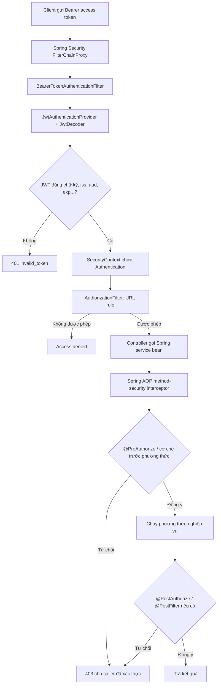
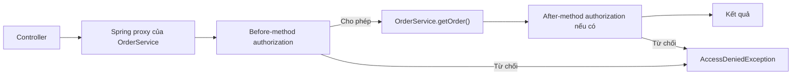

# @EnableMethodSecurity và các cơ chế phân quyền phương thức

## 1. Vì sao bảo vệ endpoint chưa đủ để bảo vệ nghiệp vụ?

Trong ứng dụng **Spring Security OAuth 2.0/OIDC Resource Server**, API thường nhận `Authorization: Bearer <access-token>`. Sau khi token đã được xác thực, một endpoint có thể chỉ cho người gọi mang `SCOPE_orders:read` đọc đơn hàng. Tuy nhiên, quyền **đọc đơn hàng** không đồng nghĩa với quyền đọc **mọi đơn hàng của mọi khách hàng hoặc tenant**.

Ví dụ một service:

```java
public OrderDto getOrder(UUID orderId) {
    return orderRepository.findById(orderId)
            .map(orderMapper::toDto)
            .orElseThrow(OrderNotFoundException::new);
}
```

Giả sử URL `GET /api/orders/{orderId}` được bảo vệ bằng `hasAuthority("SCOPE_orders:read")`. Người dùng A có scope này vẫn có thể truyền `orderId` của người dùng B. Nếu service chỉ gọi `findById`, việc kiểm soát quyền ở URL **không chứng minh A được phép xem chính bản ghi đó**.

**Method security** cho phép đặt quy tắc phân quyền tại **ranh giới phương thức** của service hoặc bean Spring, ví dụ:

```java
@PreAuthorize(
    "hasAuthority('SCOPE_orders:read') and "
    + "@orderAccess.canRead(authentication, #orderId)")
public OrderDto getOrder(@P("orderId") UUID orderId) {
    // ...
}
```

Trong đó:

- `hasAuthority('SCOPE_orders:read')` kiểm tra quyền chức năng.
- `@orderAccess.canRead(...)` kiểm tra quyền đối với **đối tượng nghiệp vụ cụ thể** bằng policy tin cậy.
- `@P("orderId")` giúp biểu thức tham chiếu tham số theo tên, ngay cả khi thông tin tên parameter không được giữ lại trong bytecode.

> **Mục đích:** Bảo vệ hành động nghiệp vụ **ngay tại nơi nó được gọi**, kể cả khi một service được tái sử dụng bởi nhiều controller hoặc luồng xử lý trong cùng application context. Tuy nhiên, method security **không thay** việc kiểm tra token, URL security, query-level data isolation và kiểm soát quyền tại những hệ thống bên ngoài.

## 2. Method security nằm ở đâu trong chuỗi xử lý Resource Server?

Một request Servlet điển hình có luồng:



Đây là sơ đồ khái niệm. Thứ tự các interceptor và việc dùng Spring Security `AuthorizationManager` phụ thuộc loại annotation và cấu hình cụ thể.

Ba lớp trách nhiệm cần phân biệt:

| Lớp bảo vệ | Công cụ điển hình | Câu hỏi |
| --- | --- | --- |
| **Authentication** | `JwtDecoder`, `JwtAuthenticationProvider`, `OpaqueTokenIntrospector` | Bearer token có được phát hành hợp lệ cho API này không? |
| **HTTP request authorization** | `SecurityFilterChain`, `authorizeHttpRequests` | Request có được gọi URL/method HTTP này không? |
| **Method/business authorization** | `@PreAuthorize`, `@PostAuthorize`, `@Secured`, custom policy | Chủ thể đã xác thực có quyền thực hiện thao tác nghiệp vụ này, trên tài nguyên này không? |

Trong Resource Server, token hợp lệ được chuyển thành `Authentication` cùng `GrantedAuthority`, thường từ claim `scope`/`scp`. Method security sử dụng **cùng security context** đó để đánh giá quyền, trừ khi một ứng dụng chủ động thay đổi chiến lược quản lý context.

## 3. Bật method security bằng @EnableMethodSecurity

Với Spring Security hiện đại, cách khai báo phổ biến:

```java
import org.springframework.context.annotation.Configuration;
import org.springframework.security.config.annotation.method.configuration.EnableMethodSecurity;

@Configuration
@EnableMethodSecurity
public class MethodSecurityConfig {
}
```

`@EnableMethodSecurity` bật hạ tầng authorization trên các phương thức của Spring-managed beans. Trong cấu hình điển hình, **`prePostEnabled` mặc định được bật**, cho phép sử dụng:

- `@PreAuthorize` — kiểm tra biểu thức **trước khi gọi** phương thức.
- `@PostAuthorize` — kiểm tra biểu thức **sau khi phương thức trả về**.
- `@PreFilter` — lọc đối số dạng tập hợp trước khi gọi phương thức.
- `@PostFilter` — lọc dữ liệu kết quả theo biểu thức.

Hai nhóm annotation khác thường **phải bật tường minh**:

```java
@Configuration
@EnableMethodSecurity(
        prePostEnabled = true,
        securedEnabled = true,
        jsr250Enabled = true)
public class MethodSecurityConfig {
}
```

- `securedEnabled = true` để dùng `@Secured`.
- `jsr250Enabled = true` để dùng những annotation tiêu chuẩn như `@RolesAllowed`, `@PermitAll` và `@DenyAll` của `jakarta.annotation.security` trong các phiên bản Spring hiện đại.

Nếu ứng dụng chỉ cần `@PreAuthorize`, thường **không cần bật tất cả loại annotation**. Cấu hình nhiều kiểu bảo vệ có thể hữu ích khi migration nhưng nên có quy ước nhất quán để tránh chính sách chồng chéo khó hiểu.

### 3.1. Dependencies và bối cảnh triển khai

Một dự án Spring Boot dùng Servlet OAuth2 Resource Server thường cần các starter/dependency thích hợp, ví dụ:

```xml
<dependency>
    <groupId>org.springframework.boot</groupId>
    <artifactId>spring-boot-starter-security</artifactId>
</dependency>
<dependency>
    <groupId>org.springframework.boot</groupId>
    <artifactId>spring-boot-starter-oauth2-resource-server</artifactId>
</dependency>
<dependency>
    <groupId>org.springframework.security</groupId>
    <artifactId>spring-security-test</artifactId>
    <scope>test</scope>
</dependency>
```

Method security sử dụng các thành phần **Spring AOP/proxy**; tùy dependency graph và kiểu xây dựng ứng dụng, cần bảo đảm Spring AOP có trên classpath. Với Gradle, cấu trúc dependency tương đương. Không cần chuyển sang reactive stack chỉ để dùng method security trong một Servlet application.

### 3.2. Cấu hình JWT Resource Server và URL authorization

Ví dụ:

```yaml
spring:
  security:
    oauth2:
      resourceserver:
        jwt:
          issuer-uri: https://login.example.test/realms/shop
```

```java
@Configuration
@EnableMethodSecurity
public class ApiSecurityConfig {

    @Bean
    SecurityFilterChain apiChain(HttpSecurity http) throws Exception {
        return http
                .securityMatcher("/api/**")
                .sessionManagement(session -> session
                        .sessionCreationPolicy(SessionCreationPolicy.STATELESS))
                .authorizeHttpRequests(auth -> auth
                        .requestMatchers("/api/public/**").permitAll()
                        .anyRequest().authenticated())
                .oauth2ResourceServer(oauth2 ->
                        oauth2.jwt(Customizer.withDefaults()))
                .build();
    }
}
```

Trong ví dụ, URL layer yêu cầu mọi API riêng tư có **Authentication** hợp lệ. Các quyền chi tiết như `orders:read` hoặc ownership được kiểm tra bằng annotations trên service. Ở kiến trúc khác có thể áp dụng cả URL authority rule và method authority rule để tạo **defense in depth**.

**Cần cấu hình JWT validation đầy đủ:** `issuer-uri` không có nghĩa mọi Resource Server đã mặc định ràng buộc audience/resource theo hợp đồng mong muốn. Cần xác minh `aud`, thuật toán, thời hạn, loại access token và claim bắt buộc qua `JwtDecoder`/validators tương ứng. Method security **không sửa được** việc API chấp nhận một token sai issuer, sai audience hay ID token thay access token.

### 3.3. CSRF trong API Bearer-only

`SessionCreationPolicy.STATELESS` và `oauth2ResourceServer().jwt()` mô tả cơ chế session và xác thực; chúng không có nghĩa mọi ứng dụng đều nên tắt CSRF bằng một lệnh rập khuôn. Nếu API chỉ sử dụng Bearer token gắn tường minh trong `Authorization` và không phụ thuộc cookie/session đăng nhập, chính sách CSRF có thể khác ứng dụng web dùng cookie. Hãy xác định các endpoint nào được browser tự động gắn credential trước khi quyết định điều chỉnh CSRF.

## 4. @PreAuthorize: kiểm tra quyền trước khi chạy nghiệp vụ

`@PreAuthorize` nhận một biểu thức Spring Expression Language (**SpEL**) trong bối cảnh Method Security. Đây là cơ chế phổ biến để bảo vệ **service layer**.

### 4.1. Kiểm tra một authority

```java
@Service
public class OrderReportService {

    @PreAuthorize("hasAuthority('SCOPE_orders:read')")
    public ReportDto getSummary() {
        return loadSummary();
    }
}
```

Nếu `Authentication` của request không có authority `SCOPE_orders:read`, lời gọi **không nên chạy body phương thức**. Người gọi đã xác thực nhưng thiếu quyền thường nhận `AccessDeniedException`, mà HTTP security layer có thể chuyển thành **403 Forbidden**.

### 4.2. Bất kỳ quyền hay tất cả quyền?

```java
@PreAuthorize(
    "hasAnyAuthority('SCOPE_orders:read', 'SCOPE_orders:export')")
public List<OrderDto> previewReport() {
    // Chỉ cần một trong hai authorities.
}

@PreAuthorize(
    "hasAuthority('SCOPE_orders:read') "
    + "and hasAuthority('SCOPE_orders:export')")
public byte[] exportReport() {
    // Phải có đồng thời read và export.
}
```

| Authorities của principal | `hasAnyAuthority(read, export)` | `read and export` |
| --- | --- | --- |
| Không có | Từ chối | Từ chối |
| Chỉ `SCOPE_orders:read` | Cho phép | Từ chối |
| Chỉ `SCOPE_orders:export` | Cho phép | Từ chối |
| Cả hai | Cho phép | Cho phép |
| Chỉ `SCOPE_orders:write` | Từ chối | Từ chối |

**Không suy luận thứ bậc quyền qua tên** nếu chính sách không quy định. `orders:write` không mặc nhiên bao gồm `orders:read`; `orders:read-all` không tự động bằng `orders:read`.

### 4.3. `hasRole` khác `hasAuthority`

Trong cấu hình Spring Security phổ biến:

```java
@PreAuthorize("hasRole('ADMIN')")
public void resetAllOrders() { }
```

`hasRole('ADMIN')` thường tìm authority **`ROLE_ADMIN`**. Trong khi converter scope JWT thông dụng tạo **`SCOPE_orders:read`**, không phải `ROLE_...`.

| Biểu thức | Authority được kiểm tra mặc định/thông dụng |
| --- | --- |
| `hasAuthority('SCOPE_orders:read')` | `SCOPE_orders:read` |
| `hasRole('ADMIN')` | `ROLE_ADMIN` |
| `hasAuthority('ROLE_ADMIN')` | `ROLE_ADMIN` |
| `hasAuthority('ADMIN')` | `ADMIN`, không tự thêm tiền tố. |

Tiền tố role có thể được tùy chỉnh bằng cấu hình ứng dụng. Nếu API nhận scope qua JWT, nên chọn `hasAuthority("SCOPE_...")` một cách tường minh để tránh nhầm `scope` với `role`. Không lấy một claim bất kỳ như `groups` rồi tự coi tất cả phần tử là quyền quản trị.

### 4.4. Những biểu thức hữu ích khác

```java
@PreAuthorize("isAuthenticated()")
public AccountSummary currentAccount() { }

@PreAuthorize("hasAuthority('SCOPE_orders:write') and #amount > 0")
public void requestRefund(@P("amount") BigDecimal amount) { }
```

Biểu thức truy cập tham số hữu ích để đặt **điều kiện bảo mật**, nhưng kiểm tra `amount > 0` thuộc dữ liệu đầu vào/nghiệp vụ và không thay bước xác thực quyền thực tế trên khoản hoàn tiền. Không nên nhồi mọi validation nghiệp vụ vào SpEL khi một service policy rõ ràng sẽ dễ bảo trì hơn.

## 5. Bảo vệ đối tượng nghiệp vụ: scope và ownership phải đi cùng nhau

Một endpoint đọc đơn hàng cần đồng thời biết:

1. Token hợp lệ và được cấp cho `orders-api`.
2. Principal có `SCOPE_orders:read`.
3. Principal được phép truy cập **đơn hàng cụ thể**, theo user/tenant/role.

Ví dụ service:

```java
@Service
public class OrderApplicationService {

    private final OrderRepository orders;
    private final OrderMapper mapper;

    public OrderApplicationService(
            OrderRepository orders,
            OrderMapper mapper) {
        this.orders = orders;
        this.mapper = mapper;
    }

    @PreAuthorize(
        "hasAuthority('SCOPE_orders:read') and "
        + "@orderAccess.canRead(authentication, #orderId)")
    public OrderDto getOrder(@P("orderId") UUID orderId) {
        Order order = orders.findById(orderId)
                .orElseThrow(OrderNotFoundException::new);
        return mapper.toDto(order);
    }
}
```

`@P` trong ví dụ là annotation `org.springframework.security.core.parameters.P`, giúp Method Security biết chính xác tên argument khi đánh giá `#orderId`. Những kiểu như `OrderRepository`, `OrderMapper`, `OrderDto` là domain types được dự án tự định nghĩa.

### 5.1. Một policy bean dùng dữ liệu đáng tin cậy

```java
@Component("orderAccess")
public class OrderAccessPolicy {

    private final CurrentActorService currentActorService;
    private final OrderRepository orders;

    public OrderAccessPolicy(
            CurrentActorService currentActorService,
            OrderRepository orders) {
        this.currentActorService = currentActorService;
        this.orders = orders;
    }

    public boolean canRead(
            Authentication authentication,
            UUID orderId) {

        if (orderId == null || authentication == null
                || !authentication.isAuthenticated()) {
            return false;
        }

        // Lấy internal user/tenant từ principal đã xác thực,
        // không lấy userId hoặc tenantId tùy ý từ HTTP request.
        AuthorizedActor actor =
                currentActorService.requireAuthorizedActor(authentication);

        return actor.canReadOwnOrders()
                && orders.existsByIdAndOwnerUserIdAndTenantId(
                        orderId,
                        actor.userId(),
                        actor.tenantId());
    }
}
```

Ví dụ này giả định `CurrentActorService` kiểm tra mapping danh tính và membership đáng tin cậy, còn `AuthorizedActor` là mô hình ứng dụng có `userId()`, `tenantId()` và `canReadOwnOrders()`. **Đây là những hợp đồng domain minh họa**, cần triển khai riêng trong dự án; không phải API mặc định có sẵn của Spring Security.

Điểm quan trọng: `@orderAccess.canRead(...)` không chỉ xem `orderId` có tồn tại mà phải kiểm tra **ai được đọc**, **tenant nào** và **chính sách nào**. Không dùng:

```java
// SAI: chỉ thấy request có orderId thì cho qua.
public boolean canRead(UUID orderId) {
    return orderId != null;
}
```

### 5.2. Kiểm soát ở truy vấn vẫn quan trọng

Giả sử policy kiểm tra quyền bằng một truy vấn `exists...`, rồi phương thức nghiệp vụ dùng `findById(orderId)` ở một thời điểm khác. Nếu ownership/tenant có thể thay đổi giữa hai bước, có thể phát sinh **time-of-check/time-of-use (TOCTOU)**. Đối với dữ liệu nhạy cảm, cân nhắc truy vấn đã ràng buộc quyền ngay khi lấy dữ liệu:

```java
@PreAuthorize("hasAuthority('SCOPE_orders:read')")
public OrderDto getOwnOrder(@P("orderId") UUID orderId) {
    AuthorizedActor actor = actorService.currentHumanActor();

    Order order = orders
            .findByIdAndOwnerUserIdAndTenantId(
                    orderId, actor.userId(), actor.tenantId())
            .orElseThrow(OrderNotFoundException::new);

    return mapper.toDto(order);
}
```

Phương thức `findByIdAndOwnerUserIdAndTenantId` là repository method của ứng dụng, không phải Spring Security API. Kết hợp **scope ở annotation** với **ràng buộc bản ghi trong query** là một mô hình rõ ràng: ngay cả khi mã phía trên đổi, truy vấn không lấy được đơn hàng ngoài phạm vi user/tenant đã được phân quyền.

Đối với thao tác ghi, các yêu cầu giao dịch/locking/concurrency cũng cần được bảo đảm trong domain layer. Method security là một lớp **ủy quyền**, không phải thay thế transaction isolation hoặc data access controls.

## 6. @PostAuthorize: phân quyền sau khi phương thức đã chạy

`@PostAuthorize` kiểm tra biểu thức **sau khi method hoàn tất** và có thể truy cập biến `returnObject`.

Ví dụ:

```java
@PostAuthorize(
    "returnObject == null "
    + "or @orderAccess.canRead(authentication, returnObject.id)")
public OrderDto findOrder(UUID id) {
    return orderRepository.findById(id)
            .map(orderMapper::toDto)
            .orElse(null);
}
```

Khi method trả một `OrderDto`, interceptor có thể kiểm tra quyền đối với `returnObject.id` trước khi đưa kết quả cho caller. Khi method trả `null`, biểu thức trên cho phép đi qua (tùy thiết kế response, controller sau đó quyết định 404 hay khác).

**Rủi ro quan trọng:** `@PostAuthorize` chạy **sau khi body method đã thực thi**. Nếu method đã chuyển tiền, xóa bản ghi, gửi email hoặc ghi side effect, một quyết định từ chối ở `@PostAuthorize` **không tự động hoàn tác** những gì đã xảy ra. Do vậy:

- Dùng `@PreAuthorize` hoặc policy kiểm tra bên trong giao dịch **trước khi ghi dữ liệu** cho thao tác có side effect.
- `@PostAuthorize` phù hợp hơn với một số use case đọc dữ liệu, nhưng vẫn phải hiểu cost và việc materialize kết quả.
- Đừng chỉ dựa vào `@PostAuthorize` để che dữ liệu nếu phương thức đã gửi dữ liệu đi nơi khác, log nhạy cảm hoặc tạo side effect ngoài transaction.

### 6.1. @PostAuthorize và dữ liệu ngoài phạm vi

Một truy vấn `findById` có thể đã đọc một bản ghi không thuộc user vào memory trước khi `@PostAuthorize` từ chối. Dù interceptor không đưa kết quả ra controller khi denied, nó vẫn có thể tiêu tốn tài nguyên, kích hoạt lazy loading hoặc side effect khi fetch. Với hệ thống nhiều tenant, **lọc ngay ở query** thường có tính dự đoán và bảo vệ tốt hơn.

### 6.2. Không đặt @PostAuthorize sai ngữ nghĩa

Ví dụ không tốt:

```java
@PostAuthorize("hasAuthority('SCOPE_orders:write')")
public void cancelOrder(UUID orderId) {
    // Đơn hàng có thể đã bị hủy trước khi quyền bị từ chối.
}
```

Với hành động hủy, hãy dùng `@PreAuthorize` cùng policy trên bản ghi và các kiểm tra transaction. **Thời điểm enforcement** quan trọng không kém nội dung biểu thức.

## 7. @PreFilter và @PostFilter: lọc collection

Spring Security hỗ trợ các annotation lọc dữ liệu khi hợp đồng phương thức cần xử lý một tập phần tử.

### 7.1. @PreFilter: lọc input trước khi chạy method

Ví dụ:

```java
@PreAuthorize("hasAuthority('SCOPE_orders:write')")
@PreFilter(
    value = "@orderAccess.canModify(authentication, filterObject)",
    filterTarget = "commands")
public void processBatch(
        @P("commands") List<OrderCommand> commands) {
    for (OrderCommand command : commands) {
        applyCommand(command);
    }
}
```

`filterObject` đại diện phần tử hiện tại khi biểu thức được đánh giá. `filterTarget` chỉ rõ tham số collection cần lọc, hữu ích khi method có nhiều tham số collection. `@orderAccess.canModify(...)` giả định được triển khai an toàn bằng policy đối tượng được lấy từ dữ liệu tin cậy; **không coi ownerId/tenantId do client tự ghi vào command là bằng chứng quyền**.

**Cảnh báo ngữ nghĩa:** `@PreFilter` có thể **loại bớt** phần tử không được phép thay vì từ chối **toàn bộ batch**. Với một yêu cầu tài chính hoặc thao tác ghi mang tính “all-or-nothing”, silent filtering thường **không phù hợp**. Khi nghiệp vụ đòi mọi phần tử đều hợp lệ, hãy xác thực tập đầu vào và từ chối cả request/giao dịch nếu có bất kỳ phần tử trái phép.

### 7.2. @PostFilter: lọc output sau khi method trả về

```java
@PreAuthorize("hasAuthority('SCOPE_orders:read')")
@PostFilter("@orderAccess.canRead(authentication, filterObject.id)")
public List<OrderDto> recentOrders() {
    return orderRepository.findRecentOrders()
            .stream()
            .map(orderMapper::toDto)
            .toList();
}
```

`@PostFilter` đánh giá `filterObject` trên từng phần tử kết quả để chỉ trả những phần tử qua phép kiểm tra. Nó có thể hữu ích cho tập nhỏ, nhưng **không phải lựa chọn tối ưu để phân tách tenant hoặc lọc dữ liệu khối lượng lớn**:

- Method đã tải tất cả bản ghi trước khi lọc, gây **overfetch**, memory/CPU lớn hoặc rủi ro lộ thông tin qua log/side effects.
- Nếu quyền cần truy vấn DB cho từng item, có thể dẫn đến **N+1 authorization queries**.
- Việc phân trang có thể sai: lấy trang gồm 20 item rồi lọc còn 3 item không đồng nghĩa “trang đúng có 20 item được phép”.
- Với dữ liệu cực kỳ nhạy cảm, cần lọc theo tenant/ownership **ngay trong truy vấn** và có policy ở tầng dữ liệu phù hợp.

### 7.3. Khi nào nên dùng filter annotations?

| Tình huống | Cơ chế nên cân nhắc |
| --- | --- |
| Kiểm tra quyền một hành động trước khi chạy | `@PreAuthorize`. |
| Quyết định dựa trên giá trị kết quả của một tác vụ đọc | `@PostAuthorize`, nếu đã đánh giá side effects. |
| Nhận collection nhỏ, cho phép xử lý **một phần** phần tử | `@PreFilter` nếu ngữ nghĩa lọc ngầm được chấp thuận. |
| Trả collection nhỏ, cần loại phần tử theo policy | `@PostFilter`, có lưu ý hiệu năng và leakage. |
| Danh sách lớn, phân trang, dữ liệu đa tenant | Query-level filtering kết hợp `@PreAuthorize`, không phụ thuộc `@PostFilter` làm lớp duy nhất. |
| Batch bắt buộc nguyên tử: hoặc toàn bộ, hoặc không gì cả | Validate và từ chối **toàn bộ batch** nếu bất kỳ item trái phép. |

Hành vi collection được hỗ trợ và kiểu trả về phải phù hợp Spring Security phiên bản đang chạy; không nên giả định mọi loại stream/reactive publisher đều được xử lý giống `List` trong Servlet method security.

## 8. @Secured và @RolesAllowed: các cơ chế khai báo vai trò

Ngoài các annotation SpEL, Spring Security còn hỗ trợ một số cơ chế role-based quen thuộc.

### 8.1. @Secured

Khi bật `securedEnabled = true`:

```java
@Secured("ROLE_ADMIN")
public void rebuildAllSearchIndexes() {
    // ...
}
```

`@Secured` tập trung vào kiểm tra authorities được chỉ định; nó **không cung cấp toàn bộ khả năng truy cập tham số, gọi policy bean hay đọc returnObject** như `@PreAuthorize`/`@PostAuthorize`.

### 8.2. @RolesAllowed, @PermitAll, @DenyAll

Khi bật `jsr250Enabled = true`:

```java
import jakarta.annotation.security.RolesAllowed;
import jakarta.annotation.security.PermitAll;
import jakarta.annotation.security.DenyAll;

@RolesAllowed("ADMIN")
public void deactivateAccount(UUID userId) {
    // ...
}

@PermitAll
public CatalogInfo publicCatalogInfo() {
    // ...
}

@DenyAll
public void unsupportedLegacyOperation() {
    // ...
}
```

`@RolesAllowed("ADMIN")` thường được diễn giải theo quy ước role authority `ROLE_ADMIN` của hệ thống. Tuy nhiên, prefix và xử lý role có thể được tùy chỉnh, nên test cần dựa trên cấu hình thực tế.

**`@PermitAll` ở service không vô hiệu hóa AuthenticationFilter, URL authorization hoặc quyền ở lớp khác.** Nếu `SecurityFilterChain` yêu cầu Bearer token trước khi request được chuyển đến controller, một `@PermitAll` trên method bên trong không tự biến URL thành công khai.

### 8.3. Chọn annotation phù hợp

| Cơ chế | Biểu thức/khả năng | Khi nào dùng |
| --- | --- | --- |
| `@PreAuthorize` | SpEL, authorities, role, tham số, custom bean. | Bảo vệ hành động trước khi chạy, rất phù hợp Resource Server. |
| `@PostAuthorize` | SpEL và `returnObject` sau khi chạy. | Một số use case kiểm tra dữ liệu trả về. |
| `@PreFilter` | Biểu thức trên từng phần tử đầu vào. | Collection cho phép lọc phần tử trước xử lý. |
| `@PostFilter` | Biểu thức trên từng phần tử đầu ra. | Collection nhỏ, khi đã chấp nhận chi phí và semantics. |
| `@Secured` | Kiểm tra authorities được khai báo, ít biểu đạt hơn SpEL. | Dự án có policy role đơn giản hoặc kế thừa legacy. |
| `@RolesAllowed` | JSR-250/Jakarta role-based. | Tích hợp theo quy ước role của dự án. |
| `@PermitAll`/`@DenyAll` | Cho phép/từ chối ở mức JSR-250 method. | Chính sách method đơn giản; không thay security ở lớp HTTP. |

Không nên trộn nhiều annotation với ý nghĩa mâu thuẫn trên cùng method rồi hy vọng một annotation “ưu tiên” mọi annotation khác. Hãy xác định **một nguồn sự thật cho rule**, test kỹ nếu đang migration từ `@Secured` sang `@PreAuthorize`.

## 9. SpEL: tham số, Authentication và policy bean

### 9.1. Lấy authority và thông tin principal

Một số biểu thức Method Security thường dùng:

```java
@PreAuthorize("isAuthenticated()")
public ProfileDto profile() { /* ... */ }

@PreAuthorize("hasAuthority('SCOPE_orders:export')")
public ExportDto export() { /* ... */ }

@PreAuthorize("@tenantPolicy.canAccess(authentication, #tenantId)")
public TenantDashboard dashboard(
        @P("tenantId") UUID tenantId) { /* ... */ }
```

`authentication` thường đại diện cho `Authentication` của người gọi. Không phải mọi `Authentication.getPrincipal()` đều là một `Jwt`: JWT Resource Server, opaque token, OIDC Login và username/password có principal types khác nhau. Custom policy nên **biết loại principal mà security chain của ứng dụng chấp nhận**, hoặc có abstraction để xử lý các kiểu được hỗ trợ một cách tường minh.

### 9.2. Vì sao @P hoặc thông tin tên tham số quan trọng?

`#orderId` là tên tham số trong biểu thức. Nếu class file không có metadata tên tham số, hoặc method được khai báo qua interface khác nhau, expression không nhận được tên như bạn mong đợi.

Ví dụ:

```java
@PreAuthorize("@orderAccess.canRead(authentication, #orderId)")
public OrderDto read(@P("orderId") UUID orderId) {
    // ...
}
```

Một số dự án bật compiler flag `-parameters` để giữ tên Java parameters. `@P` là cách tường minh giúp Method Security nhận diện tên theo cấu hình hỗ trợ của Spring Security. Khi sử dụng interfaces, hãy chú ý vị trí annotation và metadata trên phương thức được proxy nhìn thấy.

### 9.3. Custom policy bean dễ đọc hơn biểu thức SpEL quá dài

Thay vì:

```java
@PreAuthorize("""
    hasAuthority('SCOPE_orders:read')
    and principal.claims['tenant_id'] == #tenantId
    and principal.claims['account_type'] == 'human'
    and ...
    """)
```

nên cân nhắc:

```java
@PreAuthorize("@orderPolicy.canReadOrder(authentication, #orderId)")
public OrderDto read(@P("orderId") UUID orderId) {
    // ...
}
```

Policy bean có thể dùng data access, account mapping, role membership và validation rõ ràng, dễ unit test hơn một expression kết hợp nhiều claim tùy chỉnh. Nhưng policy bean vẫn phải **fail-closed**, tránh tin tenant/user ID do client tự gửi hoặc claim chưa được xác minh.

### 9.4. hasPermission và PermissionEvaluator

Spring Security còn có những biểu thức như `hasPermission(...)` khi hệ thống cấu hình `PermissionEvaluator` và Method Security expression handler phù hợp.

Ví dụ khái niệm:

```java
@PreAuthorize("hasPermission(#orderId, 'ORDER', 'read')")
public OrderDto read(@P("orderId") UUID orderId) {
    // ...
}
```

**Không coi `hasPermission` là một ACL database hoàn chỉnh tự hoạt động.** Ứng dụng phải triển khai/configure một evaluator có khả năng quyết định quyền đối với `ORDER`, mapping principal, tenant và owner, với chính sách fail-closed. Khi chỉ cần một policy domain cụ thể, một bean `@orderPolicy.canRead(...)` có thể rõ ràng hơn.

## 10. Tạo annotation dùng lại và giữ policy nhất quán

Khi nhiều service cùng cần `SCOPE_orders:read`, có thể tạo **meta-annotation** cho Method Security:

```java
import java.lang.annotation.ElementType;
import java.lang.annotation.Retention;
import java.lang.annotation.RetentionPolicy;
import java.lang.annotation.Target;
import org.springframework.security.access.prepost.PreAuthorize;

@Target({ElementType.METHOD, ElementType.TYPE})
@Retention(RetentionPolicy.RUNTIME)
@PreAuthorize("hasAuthority('SCOPE_orders:read')")
public @interface CanReadOrders {
}
```

Áp dụng:

```java
@CanReadOrders
public List<OrderDto> listVisibleOrders() {
    // ...
}
```

Ưu điểm:

- Bớt sao chép chuỗi authority sai chính tả.
- Có một tên nghiệp vụ dễ hiểu.
- Dễ tìm các method đang dùng một chính sách khi đổi hợp đồng scope.

Nhưng meta-annotation **không tự kiểm tra ownership** nếu biểu thức bên trong chỉ có `SCOPE_orders:read`. Với một method đọc một đối tượng cụ thể, cần thêm object-level policy hoặc query-level isolation.

Khi thay đổi một meta-annotation, ảnh hưởng có thể rất rộng; cần test regression cho mọi method áp dụng. Tránh tạo nhiều meta-annotations chồng chéo có semantics không rõ.

## 11. Cơ chế kỹ thuật: Spring AOP proxy và method interceptors

Method security trên Spring beans thường hoạt động nhờ **proxy/interceptor**. Hạ tầng do `@EnableMethodSecurity` kích hoạt sử dụng các Method Security authorization managers/interceptors để đánh giá annotations tại thời điểm gọi method qua Spring bean.

Sơ đồ:



Điều này tạo ra một giới hạn quan trọng: **phương thức phải được gọi qua đối tượng proxy mà Spring quản lý**. Không phải cứ viết annotation lên bất kỳ method Java nào cũng bảo đảm enforcement.

### 11.1. Self-invocation: gọi nội bộ có thể bỏ qua interceptor

Ví dụ:

```java
@Service
public class OrderService {

    public void process(UUID orderId) {
        // Gọi nội bộ bằng this thường không đi qua Spring proxy.
        approve(orderId);
    }

    @PreAuthorize("hasAuthority('SCOPE_orders:approve')")
    public void approve(UUID orderId) {
        // Thao tác nhạy cảm.
    }
}
```

Nếu controller gọi `orderService.process(...)` qua proxy, bên trong `process` gọi `approve(...)` trực tiếp trên `this`. Với cơ chế proxy-based mặc định, **annotation trên `approve` có thể không được áp dụng** cho lời gọi nội bộ đó.

Các cách xử lý:

- Tổ chức các hành động cần bảo vệ thành **Spring beans riêng**, gọi method qua bean được inject để đi qua proxy.
- Đặt chính sách tại **public entry point** có thể được gọi từ bên ngoài, và thực thi kiểm tra quyền trong domain service khi cần.
- Thiết kế service boundary rõ thay vì dựa vào self-invocation.
- Nếu có yêu cầu interception trong những trường hợp proxy không xử lý được, cân nhắc cơ chế weaving phù hợp và hiểu chi phí/độ phức tạp; không mặc định mọi dự án phải dùng AspectJ.

**Không nên chữa bằng cách tự gọi lại qua `ApplicationContext.getBean(...)` ở mọi nơi** nếu việc đó khiến kiến trúc rối và dễ tạo coupling. Tách service hoặc làm rõ policy boundary thường dễ bảo trì hơn.

### 11.2. Private, final và bean tự tạo

| Tình huống | Rủi ro |
| --- | --- |
| Gắn annotation lên `private method` | Proxy bên ngoài không intercept lời gọi nội bộ private method theo kiểu thông thường. |
| Class/method `final` trong cơ chế cần subclass proxy | Proxy có thể không override/intercept được. |
| Dùng `new OrderService(...)` tự tạo bên ngoài Spring context | Không đi qua Spring-managed proxy/method security. |
| Unit test instantiate class trực tiếp | Annotation không được Spring AOP thực thi. |
| Controller gọi service bean được Spring inject | Có khả năng đi qua proxy nếu cấu hình method security đúng. |
| Self-invocation trong cùng bean | Dễ bỏ qua interceptor do lời gọi không qua proxy. |

Spring có nhiều cơ chế proxy, gồm interface-based hoặc class-based proxy, với khả năng và giới hạn khác nhau. Điều cần kiểm chứng là **bean được gọi thực sự là bean đã được method-security infrastructure áp dụng**, không chỉ nhìn thấy annotation trong mã nguồn.

### 11.3. Annotations trên interface và class

Spring Security có thể tìm annotations trên methods/classes/interfaces theo cơ chế được hỗ trợ; nhưng annotation trùng lặp hoặc mâu thuẫn ở nhiều tầng có thể gây ambiguity. Cần thống nhất một vị trí khai báo nhất quán cho public method contract, và có integration tests gọi bean thật qua proxy. Đừng giả định annotation trên một method overload hay một interface không liên quan sẽ tự áp dụng cho mọi overload/implementation.

## 12. Method security và @Transactional: ai chạy trước, ai tạo side effect?

Một service nghiệp vụ có thể kết hợp:

```java
@Transactional
@PreAuthorize(
    "hasAuthority('SCOPE_orders:write') and "
    + "@orderPolicy.canChange(authentication, #orderId)")
public void changeOrder(@P("orderId") UUID orderId,
                        ChangeOrderCommand command) {
    // Ghi dữ liệu khi policy đã chấp thuận.
}
```

Spring AOP có thể có nhiều interceptors cho `@Transactional`, `@PreAuthorize`, logging hoặc custom aspects. **Không nên giả định một thứ tự interceptor cụ thể trong mọi cấu hình**; thứ tự có thể được cấu hình và ảnh hưởng thời điểm mở transaction hoặc đánh giá policy.

Những vấn đề cần thiết kế:

1. **Authorization trước side effects:** không dùng `@PostAuthorize` làm chốt duy nhất cho lệnh ghi.
2. **Consistency:** nếu policy đọc dữ liệu rồi nghiệp vụ ghi, phải xem xét trạng thái có thể thay đổi giữa hai thời điểm.
3. **Transaction boundary:** permission check cần dùng dữ liệu nhất quán có thể phải nằm trong transaction hoặc được kiểm soát bằng ràng buộc database/locking.
4. **Exception:** một method bị từ chối có thể ném `AccessDeniedException`; ở bối cảnh transaction, rollback behavior phụ thuộc exception/transaction config.
5. **External side effects:** gọi API bên ngoài, gửi message/email hoặc thanh toán không tự động rollback theo JDBC transaction.

Method security không thay các nguyên tắc **idempotency**, **optimistic/pessimistic locking**, kiểm soát dữ liệu và audit của domain.

## 13. Thread, async và lời gọi giữa các dịch vụ

`SecurityContextHolder` thường gắn với ngữ cảnh xử lý của thread/request theo chiến lược được cấu hình. Điều này cần đặc biệt lưu ý khi code chuyển sang thread hoặc executor khác:

```java
@Async
public void generateMonthlyReport() {
    // Không tự giả định SecurityContext từ HTTP thread luôn có ở đây.
}
```

Nếu background task vẫn cần danh tính người gọi, ứng dụng cần có **chính sách truyền ngữ cảnh bảo mật** hoặc truyền một `AuthorizedActor` đã được chuẩn hóa và có phạm vi rõ ràng. Spring Security có các giải pháp như `DelegatingSecurityContextExecutor` cho những mô hình cụ thể, nhưng cần bảo đảm không vô tình dùng lại security context của request trước hoặc kéo dài quyền của token quá hạn.

Đối với **message queue/scheduled jobs**, thường không có HTTP request và không có user `Authentication` mặc định. Phải định nghĩa actor/service identity, quyền và audit cho những hoạt động này; không tạm gán `ROLE_ADMIN` cho mọi job chỉ để vượt qua method security.

**Method security của một JVM không tự bảo vệ lời gọi HTTP tới JVM khác.** Mỗi Resource Server phải xác minh access token/credential và áp dụng security policy tại trust boundary của chính mình. Nếu service A gọi service B, B cần audience/token phù hợp; không thể chỉ tin method annotation bên A.

## 14. Phân biệt 401 và 403 ở method security

Trong một Servlet Resource Server, lỗi security thường xuất hiện ở hai thời điểm:

| Tình huống | Authentication | Method/URL authorization | Kết quả HTTP điển hình |
| --- | --- | --- | --- |
| Không có Bearer token vào API cần xác thực | Không có principal phù hợp | Không được vào API | **401**, Bearer challenge. |
| JWT sai chữ ký, issuer/audience hoặc hết hạn | Thất bại | Chưa có principal tin cậy | **401 invalid_token**. |
| JWT hợp lệ nhưng thiếu `SCOPE_orders:read` | Thành công | `@PreAuthorize` từ chối | **403 Forbidden**. |
| JWT hợp lệ, đủ scope nhưng không sở hữu order | Thành công | Custom policy từ chối | **403** hoặc ứng dụng cố tình chọn 404 phù hợp. |
| JWT hợp lệ, đủ quyền nhưng `@PostAuthorize` trả deny | Thành công | Chặn sau khi method chạy | Thường **403**, nhưng side effects đã phải được đánh giá riêng. |
| Method được gọi ngoài HTTP request với không có SecurityContext | Không có context | Có thể ném exception security | Không tự tồn tại HTTP status; caller phải xử lý exception. |

Khi Spring Security xử lý HTTP request:

```http
HTTP/1.1 401 Unauthorized
WWW-Authenticate: Bearer
```

hoặc:

```http
HTTP/1.1 403 Forbidden
WWW-Authenticate: Bearer error="insufficient_scope"
```

Phản hồi `insufficient_scope` không phải lúc nào cũng được tạo cho **mọi** `AccessDeniedException` từ method security; còn phụ thuộc loại handler, đối tượng `Authentication` và cấu hình `AccessDeniedHandler`. Nếu ứng dụng dùng entry point và exception handlers tùy chỉnh, HTTP status/challenge có thể khác. Không nên viết test so chuỗi description chi tiết phụ thuộc version khi mục tiêu là kiểm tra **đúng bước bị chặn**.

### 14.1. 404 để hạn chế tiết lộ tồn tại tài nguyên

Một API có thể chủ động trả **404 Not Found** cho tài nguyên không tồn tại **hoặc không thuộc phạm vi actor**, nhằm tránh tiết lộ resource ID của người khác. Nếu dùng cách này:

- Chính sách phải **nhất quán**.
- Query phải ràng buộc owner/tenant ngay từ đầu.
- Không làm rò rỉ thông tin qua timing, log, response detail hoặc endpoint liệt kê.
- Không để lỗi 404 che một lỗ hổng do thiếu authentication/audience validation.

Việc dùng 403 hay 404 là lựa chọn ở object-level authorization/domain contract, không phải một tính năng tự động của `@PreAuthorize`.

## 15. Kiểm thử method security: cần thật sự đi qua proxy

Test một method có annotation bằng cách tạo object trực tiếp sẽ **không chứng minh annotation được Spring enforce**:

```java
OrderService service = new OrderService(repository);
service.approve(orderId); // Không có Spring proxy.
```

Để kiểm thử enforcement, nên gọi **bean do Spring quản lý**, đồng thời tạo `SecurityContext` phù hợp.

### 15.1. Unit test policy bean

Giả sử có `OrderAccessPolicy`. Test độc lập cần xác minh:

- Principal thiếu hoặc token context không phù hợp → từ chối.
- User A có scope và sở hữu order A → cho phép.
- User A có scope nhưng truy vấn order B → từ chối.
- User A không thuộc tenant B → từ chối.
- Service principal không được phép xử lý user-owned order → từ chối.
- Ownership thay đổi giữa các bước → hệ thống giữ invariant bằng query/transaction.

Test này giúp bảo đảm **quy tắc nghiệp vụ** của policy, nhưng **không tự chứng minh `@PreAuthorize` gọi policy**.

### 15.2. Test annotation bằng @WithMockUser

Ví dụ một service đơn giản:

```java
@Service
public class SecureReportService {

    @PreAuthorize("hasAuthority('SCOPE_orders:export')")
    public String exportPreview() {
        return "report";
    }
}
```

Kiểm thử với Spring context thực:

```java
import static org.junit.jupiter.api.Assertions.assertEquals;
import static org.junit.jupiter.api.Assertions.assertThrows;

import org.junit.jupiter.api.Test;
import org.springframework.beans.factory.annotation.Autowired;
import org.springframework.boot.test.context.SpringBootTest;
import org.springframework.security.access.AccessDeniedException;
import org.springframework.security.test.context.support.WithMockUser;

@SpringBootTest
class SecureReportMethodSecurityTest {

    @Autowired
    SecureReportService service;

    @Test
    @WithMockUser(authorities = "SCOPE_orders:export")
    void rightAuthorityCanExecuteMethod() {
        assertEquals("report", service.exportPreview());
    }

    @Test
    @WithMockUser(authorities = "SCOPE_orders:read")
    void wrongAuthorityIsDeniedBeforeMethodRuns() {
        assertThrows(AccessDeniedException.class,
                () -> service.exportPreview());
    }

    @Test
    @WithMockUser(roles = "ADMIN")
    void roleAdminDoesNotAutomaticallyGrantExportScope() {
        assertThrows(AccessDeniedException.class,
                () -> service.exportPreview());
    }
}
```

Test giả định `@EnableMethodSecurity` đã được kích hoạt trong application context và `SecureReportService` là Spring bean được proxy đúng. `@WithMockUser(authorities="SCOPE_orders:export")` tạo Authentication giả lập trong test; nó **không có JWT thật**, không kiểm tra chữ ký hay audience.

Trường hợp `@WithMockUser(roles="ADMIN")` thường tạo `ROLE_ADMIN`, không tạo `SCOPE_orders:export`, nên rule `hasAuthority('SCOPE_orders:export')` vẫn từ chối. Nếu ứng dụng có RoleHierarchy/custom mapping đặc biệt, phải điều chỉnh kỳ vọng theo cấu hình.

### 15.3. Test HTTP bằng MockMvc và jwt()

Ví dụ kiểm tra URL → controller → proxied service:

```java
mockMvc.perform(get("/api/reports/export-preview")
        .with(jwt().authorities(
                new SimpleGrantedAuthority("SCOPE_orders:export"))))
        .andExpect(status().isOk());

mockMvc.perform(get("/api/reports/export-preview")
        .with(jwt().authorities(
                new SimpleGrantedAuthority("SCOPE_orders:read"))))
        .andExpect(status().isForbidden());
```

Ví dụ giả định có controller gọi `SecureReportService.exportPreview()`, URL được phép tới service và khi thành công controller trả HTTP 200. `jwt()` là test postprocessor của Spring Security Test; nó có thể gắn `JwtAuthenticationToken` giả lập nên **không chứng minh `JwtDecoder` đã xác minh JWS/issuer/audience**.

Một mock test đạt 200 dù service method-security annotation bị bỏ qua nếu test chỉ kiểm tra URL rule mà không có case thiếu authority. Vì vậy cần **negative tests** gọi đúng method qua proxy.

### 15.4. Integration test Bearer token có chữ ký

Để chứng minh toàn bộ luồng **OAuth2 Resource Server + Method Security**:

1. Chuẩn bị test issuer, public key/JWKS và một key pair riêng cho môi trường kiểm thử.
2. Ký các JWT test có `iss`, `aud`, `exp`, `sub` và `scope` phù hợp; tạo thêm token sai chữ ký/audience.
3. Cấu hình `JwtDecoder` thực cùng validator issuer, audience, thời hạn và access-token profile.
4. Gửi `Authorization: Bearer <signed-test-JWS>` qua MockMvc có Spring Security filters.
5. Assert 401 nếu JWT chưa vượt authentication; 403 nếu JWT hợp lệ nhưng thiếu scope/ownership; 2xx khi mọi policy cho phép.
6. Kiểm tra rằng **method body không chạy** khi `@PreAuthorize` từ chối, ví dụ qua mock của domain component hoặc kiểm tra dữ liệu không bị ghi.

Không dùng production access token, private key hoặc secret trong test fixtures. Nếu test cần HTTP và quyền trên bản ghi, dùng database riêng/hệ thống giả lập đáp ứng data isolation.

## 16. Ma trận test bảo vệ nghiệp vụ

Giả sử:

`GET /api/orders/{id}` gọi service gắn `@PreAuthorize("hasAuthority('SCOPE_orders:read') and @orderAccess.canRead(authentication, #orderId)")`.

| Tình huống | Kỳ vọng chính |
| --- | --- |
| Không có Bearer token | Không tạo principal tin cậy, thường **401**. |
| JWT sai chữ ký | **401 invalid_token**, method không chạy. |
| JWT có `aud` dành cho API khác | **401 invalid_token**, method không chạy. |
| JWT hợp lệ nhưng không có scope | **403**, method không chạy. |
| JWT hợp lệ chỉ có `orders:write` | **403** nếu không có `orders:read`; không tự suy luận write bao gồm read. |
| JWT hợp lệ có `orders:read`, order thuộc user hiện tại | Qua method rule, kết quả phụ thuộc nghiệp vụ. |
| JWT hợp lệ có `orders:read`, order thuộc user khác | **403 hoặc domain 404** theo policy, không trả dữ liệu người khác. |
| JWT hợp lệ, order cùng user nhưng khác tenant được phép | Không dùng subject một mình: kiểm tra membership/tenant, từ chối nếu trái policy. |
| Principal là M2M service không được phép đọc user-owned order | Policy fail-closed. |
| Cùng tên/email nhưng subject khác | Không được dùng email/name thay ownership identity key. |
| Gọi method có annotation qua proxy | Rule được áp dụng. |
| Gọi `this.method()` trong cùng class | Test phải bắt được nguy cơ bypass proxy. |
| Thao tác ghi có `@PostAuthorize` mà không có pre-check | Test phải phát hiện side effect xảy ra dù response bị từ chối. |
| `@PostFilter` trên danh sách 10.000 bản ghi | Đánh giá hiệu năng/data leakage, ưu tiên query-level isolation. |

### 16.1. Những assertion có giá trị hơn chỉ HTTP status

Trong test method-security:

- Kiểm tra **service method không được thực thi** khi thiếu quyền trước method.
- Kiểm tra **không có bản ghi bị sửa** khi request bị từ chối.
- Kiểm tra **không trả dữ liệu tenant/user khác** dù scope đúng.
- Kiểm tra quyền đúng tên, ví dụ `SCOPE_orders:read` chứ không chỉ “có ít nhất một authority”.
- Kiểm tra tên argument `#orderId` được resolution đúng, policy bean có được gọi hay không.
- Kiểm tra behavior khi external identity link hoặc tenant membership vắng mặt.

Status 403 có thể xuất phát từ **CSRF**, URL rule, method rule hoặc domain rule. Chỉ nhìn HTTP status không đủ để kết luận annotation nào đã được áp dụng.

## 17. HTTP security và Method Security bổ trợ nhau

Một lựa chọn kiến trúc tốt là:

**Ở URL layer:**

```java
.authorizeHttpRequests(auth -> auth
    .requestMatchers("/api/public/**").permitAll()
    .requestMatchers("/api/**").authenticated()
    .anyRequest().denyAll())
```

**Ở service layer:**

```java
@PreAuthorize("hasAuthority('SCOPE_orders:read')")
public List<OrderDto> listMyOrders() {
    // Query luôn giới hạn theo authenticated actor và tenant.
}

@PreAuthorize(
    "hasAuthority('SCOPE_orders:approve') "
    + "and @orderAccess.canApprove(authentication, #orderId)")
public void approve(@P("orderId") UUID orderId) {
    // ...
}
```

URL layer chặn request chưa xác thực hoặc đường dẫn ngoài phạm vi; method layer kiểm soát quyền theo hành động và đối tượng. Tuy nhiên:

- URL `permitAll()` không tự khiến service `@PreAuthorize` chấp nhận người dùng anonymous.
- Method `@PermitAll` không làm URL `authenticated()` biến thành public.
- Nếu controller gọi một service có annotation nhưng **không qua Spring proxy**, method security có thể bị bypass.
- Nếu một service method không có annotation và được tái sử dụng bởi đường đi mới, cần có policy ở tầng dữ liệu hoặc tại entry point thực tế.

**Defense in depth không phải phép cộng những quy tắc mâu thuẫn.** Hãy phân định ranh giới bảo mật của từng tầng và kiểm thử luồng từ token đến dữ liệu.

## 18. Những sai lầm phổ biến và cách xử lý

### 18.1. Đã bật @EnableMethodSecurity nhưng annotation không có hiệu lực

Các nguyên nhân thường gặp:

- Gọi method trên object tự `new` thay vì Spring bean.
- Self-invocation `this.securedMethod()` bypass proxy.
- Annotation nằm trên private/final method không được intercept theo proxy mode.
- Application context đang test không include cấu hình `@EnableMethodSecurity`.
- Method không nằm ở boundary thực tế mà request gọi.

Cách xử lý: kiểm tra Spring bean/proxy, đường gọi, configuration và viết **negative test** thiếu authority.

### 18.2. Token có scope nhưng hasRole() không cho phép

JWT converter thường tạo `SCOPE_orders:read`, còn `hasRole("ORDERS_READ")` tìm `ROLE_ORDERS_READ`. Sửa bằng **biểu thức kiểm tra đúng authority** hoặc mapping role/scope tường minh, không tự động cấp thêm role.

### 18.3. Expression không đọc được #orderId

Tên method parameter không được giữ lại hoặc annotation nằm ở vị trí khác. Dùng `@P("orderId")` hoặc compiler metadata phù hợp, rồi test lời gọi qua proxy.

### 18.4. Đặt @PostAuthorize trên lệnh chuyển tiền/xóa dữ liệu

Method đã chạy trước khi policy được đánh giá. Dùng pre-authorization và transaction/data policy trước side effect; test rollback và external side effects độc lập.

### 18.5. Chỉ dựa vào scope để đọc mọi bản ghi

Scope là quyền chức năng; không tự xác nhận tenant/ownership. Dùng policy đọc dữ liệu tin cậy hoặc query có điều kiện `tenantId`/`ownerId`.

### 18.6. Tạo policy SpEL dựa trên email hoặc username

Email và tên hiển thị có thể đổi hoặc bị tái sử dụng. Dùng subject/issuer đã xác minh liên kết tới internal user ID và membership theo hợp đồng IdP.

### 18.7. Trả dữ liệu rồi mới lọc khối lượng lớn bằng @PostFilter

Đã overfetch dữ liệu, có thể tạo N+1 policy queries và phân trang sai. Ưu tiên query-level filtering; `@PostFilter` chỉ nên dùng khi chấp nhận semantics và chi phí.

### 18.8. Gọi @PreFilter cho batch nhưng yêu cầu phải all-or-nothing

Annotation có thể loại phần tử không hợp lệ và xử lý phần còn lại, trái nghĩa vụ nguyên tử của nghiệp vụ. Nên reject cả batch nếu bất kỳ item trái phép.

### 18.9. Test @WithMockUser mà nghĩ đã kiểm tra JwtDecoder

`@WithMockUser` chỉ đặt Authentication giả lập. Muốn kiểm tra chữ ký, issuer, audience, token profile cần JWT integration tests với `JwtDecoder` thật.

### 18.10. Truyền SecurityContext tùy tiện qua @Async

Background jobs có thể không có đúng Authentication hoặc giữ quyền quá lâu. Dùng actor context/policy có vòng đời rõ; không tái sử dụng credential/token vô thời hạn.

### 18.11. Dùng request-supplied tenantId làm nguồn chân lý

`@PreAuthorize("#tenantId == principal.claims['tenant_id']")` có thể là một điều kiện khi claim đã được xác minh, nhưng chưa chứng minh membership thực tế hay quyền trên bản ghi. Nếu client kiểm soát cả resource ID và tenant field, cần kiểm tra ở data layer bằng identity và quyền từ nguồn đáng tin cậy.

## 19. Chẩn đoán theo triệu chứng

| Triệu chứng | Khả năng | Hướng điều tra |
| --- | --- | --- |
| 401 trước khi service chạy | Thiếu JWT, sai issuer/audience/expiry/chữ ký. | Kiểm tra `BearerTokenAuthenticationFilter`/decoder/validators trước Method Security. |
| 403 với token JWT hợp lệ | Thiếu authority, policy bean từ chối, CSRF, URL rule hoặc method rule. | Phân biệt stage xảy ra, kiểm tra scope mapping và logs có kiểm soát. |
| `@PreAuthorize` không chạy | Thiếu enable, method không qua proxy, self-invocation, final/private. | Kiểm tra bean wiring, method call path và integration test. |
| `hasRole('ADMIN')` không nhận `scope=admin` | Prefix `ROLE_` và `SCOPE_` khác nhau. | Xem authorities thật trong Authentication. |
| SpEL `#orderId` là null | Metadata tên tham số chưa được giữ. | Dùng `@P`/`-parameters`; kiểm tra signature phương thức. |
| Policy bean không tìm thấy | Tên bean trong SpEL không trùng tên đăng ký. | Kiểm tra `@Component("orderAccess")` và application context. |
| Mọi object cùng tenant đều đọc được | Policy chỉ kiểm tra tenant, không kiểm tra owner/role. | Bổ sung resource-specific rule hoặc query isolation. |
| 403 sau khi database đã sửa | Dùng post-authorize hoặc một interceptor chạy sau side effect. | Chuyển kiểm tra quyền trước method; kiểm tra transaction/rollback. |
| Trả ít item và phân trang sai | `@PostFilter` lọc sau query. | Đưa điều kiện quyền xuống truy vấn phân trang. |
| Test service pass khi instantiate bằng new | Test bypass proxy. | Dùng `@SpringBootTest` hoặc context có Method Security bean proxy. |
| Job scheduler/async bị denied | SecurityContext không có hoặc actor không phù hợp. | Thiết kế service identity và context propagation theo policy. |

Trong môi trường phát triển có thể dùng log Spring Security có kiểm soát:

```yaml
logging:
  level:
    org.springframework.security: DEBUG
```

Không log nguyên access token, refresh token, client secret hay toàn bộ claims chứa dữ liệu nhạy cảm. Nên lưu request ID, tên policy/operation, quyết định allow/deny, subject đã được xác minh và resource ID theo chính sách bảo vệ thông tin. Tránh đưa giá trị chưa xác thực vào metric label có cardinality vô hạn.

## 20. Tình huống áp dụng

### Tình huống A — API đọc đơn hàng

Token hợp lệ có `SCOPE_orders:read`; user muốn đọc đơn hàng của chính mình. `@PreAuthorize` kiểm tra scope; query `findByIdAndOwnerUserIdAndTenantId` bảo vệ ownership. Token cùng scope nhưng order thuộc người khác bị từ chối hoặc trả not found theo policy.

### Tình huống B — API hủy đơn hàng

Service có side effect. Dùng `@PreAuthorize` kiểm tra `orders:cancel` và trạng thái quyền trên order **trước** khi hủy, rồi transaction/data constraints bảo đảm không có race condition gây sai chính sách. Không chỉ dùng `@PostAuthorize`.

### Tình huống C — Xuất danh sách hàng nghìn đơn hàng

`@PostFilter` có thể lọc danh sách sau khi đã load toàn bộ, gây overfetch và sai phân trang. Hệ thống tốt hơn ràng buộc tenant/owner trong repository query, đồng thời bảo vệ `export` bằng `@PreAuthorize`.

### Tình huống D — Một service được gọi từ hai controllers

Cả REST controller và admin controller đều gọi `OrderApplicationService.approve(...)`. Method security trên service giúp giữ quy tắc quyền chung, nhưng policy cũng phải xét business role/tenant và các exceptions phù hợp. Nếu admin workflow có quyền đặc biệt, thể hiện trong policy/authority contract thay vì tự bỏ annotation ở controller.

### Tình huống E — Self-invocation khiến annotation bị bỏ qua

Controller gọi `processAll()`, bên trong service gọi `approve()` cùng class qua `this`. Annotation chỉ đặt trên `approve()` có thể không được intercept. Tách `approve()` ra Spring bean độc lập hoặc đưa rule vào method entry point thực; thêm integration test đường gọi đó.

### Tình huống F — M2M token truy cập service nghiệp vụ

Token Client Credentials có `client_id=batch-worker`, scope `orders:reconcile` nhưng không đại diện một End-User. Policy cần phân biệt human và service actor, không lấy `email` hay `sub` theo giả định user. Cấp đúng scope/resource cho workload, kiểm tra actor kind và dữ liệu liên quan.

### Tình huống G — Web OIDC Login và Bearer API cùng ứng dụng

Một web chain có OIDC session login, một API chain có JWT Bearer access token. Method Security áp dụng lên beans bên trong ứng dụng và nhìn vào `Authentication` do mỗi chain tạo. Policy phải xác định loại principal được hỗ trợ; không mặc định cast mọi principal sang `Jwt`. Nếu một service phục vụ cả hai luồng, tạo adapter `AuthorizedActor` đáng tin cậy trước khi đánh giá quyền.

## 21. Câu hỏi tự kiểm tra

**1. `@EnableMethodSecurity` dùng để làm gì?** Bật các cơ chế kiểm soát quyền ở mức method cho Spring-managed beans theo cấu hình.

**2. `@PreAuthorize` khác `@PostAuthorize` như thế nào?** `@PreAuthorize` đánh giá trước khi chạy method; `@PostAuthorize` đánh giá sau khi method trả kết quả và có thể dùng `returnObject`.

**3. Có nên dùng `@PostAuthorize` làm chốt duy nhất cho thao tác ghi không?** Không, vì side effects có thể đã xảy ra trước khi từ chối.

**4. Scope `orders:read` có tự thành `ROLE_ADMIN` không?** Không. Converter JWT thông dụng tạo `SCOPE_orders:read`; role và scope có quy ước khác.

**5. `@PreFilter` có luôn từ chối toàn bộ batch khi có một phần tử trái phép không?** Không. Nó có thể lọc bỏ phần tử; cần xử lý all-or-nothing riêng nếu nghiệp vụ yêu cầu.

**6. Khi nào `@PostFilter` không phù hợp?** Khi dữ liệu lớn, phân trang, nhạy cảm hoặc policy cần tránh đọc dữ liệu ngoài tenant từ DB.

**7. Một method được annotation nhưng gọi bằng `this.method()` có chắc được bảo vệ không?** Không với mô hình proxy-based thông dụng; self-invocation có thể bypass.

**8. Vì sao phải kiểm tra issuer/audience trước method security?** Method policy chỉ có ý nghĩa khi principal/authorities được lấy từ access token đã xác thực đúng trust domain.

**9. `@Secured` và `@RolesAllowed` có được bật chỉ bằng `@EnableMethodSecurity` mặc định không?** Thông thường cần bật `securedEnabled` và `jsr250Enabled` riêng khi sử dụng.

**10. `hasPermission(...)` có tự truy vấn database quyền nghiệp vụ không?** Không. Cần `PermissionEvaluator`/policy infrastructure được ứng dụng triển khai và cấu hình.

**11. JWT đúng scope nhưng không sở hữu đơn hàng có được phép truy cập không?** Không nếu policy yêu cầu ownership. Scope không thay object-level authorization.

**12. Vì sao test `@WithMockUser` không kiểm tra chữ ký JWT?** Vì nó tạo Authentication giả lập, không đi qua `JwtDecoder`.

**13. Method security có tự bảo vệ service ở JVM khác không?** Không. Resource Server bên kia phải có authentication/authorization riêng.

**14. Nếu `@PreAuthorize` bị từ chối trong HTTP request đã authenticated, mã thường là gì?** Thường 403; nhưng handler/config có thể thay đổi, còn token authentication thất bại thường 401.

**15. Có thể bảo vệ nghiệp vụ chỉ bằng URL matcher `/api/**` không?** URL rule chưa bảo đảm quyền trên từng object, tenant hoặc các lời gọi service khác; cần policy theo hành động và dữ liệu.

## 22. Tài liệu nên tham chiếu

- **Spring Security — Method Security:** `@EnableMethodSecurity`, `@PreAuthorize`, `@PostAuthorize`, `@PreFilter`, `@PostFilter`, `@Secured`, `@RolesAllowed`, `AuthorizationManager` và method interceptors.
- **Spring Security — Authorization Architecture:** `GrantedAuthority`, `Authentication`, `SecurityContextHolder`, `AuthorizationManager` và access-denied handling.
- **Spring Security — Servlet Security Architecture:** `FilterChainProxy`, `SecurityFilterChain`, `BearerTokenAuthenticationFilter` và `AuthorizationFilter`.
- **Spring Security — OAuth 2.0 Resource Server JWT:** `JwtDecoder`, `JwtAuthenticationConverter`, issuer/audience validators và scope mapping.
- **Spring Security Test:** `@WithMockUser`, `MockMvc`, `SecurityMockMvcRequestPostProcessors.jwt()` và kiểm thử Spring AOP method-security proxy.
- **Spring Framework — Spring AOP / Proxying Mechanisms:** self-invocation, JDK dynamic proxies, class-based proxies và giới hạn interception.
- **Spring Framework — Declarative Transaction Management:** sự phối hợp giữa transaction interceptors, authorization và consistency của dữ liệu.
- **RFC 6749 — OAuth 2.0 Authorization Framework:** các roles, grants và scopes.
- **RFC 6750 — OAuth 2.0 Bearer Token Usage:** xác thực Bearer, `invalid_token` và `insufficient_scope`.
- **RFC 7519 — JSON Web Token (JWT)**, **RFC 8725 — JWT Best Current Practices**, **RFC 9068 — JWT Profile for OAuth 2.0 Access Tokens:** nguồn danh tính, xác thực claims và access token profile khi áp dụng.

**Kết luận:** `@EnableMethodSecurity` đưa kiểm soát quyền xuống **phương thức nghiệp vụ** của các Spring beans. `@PreAuthorize` là công cụ chính để chặn thao tác trước khi chạy; `@PostAuthorize` kiểm tra kết quả nhưng không tự hoàn tác side effects; `@PreFilter`/`@PostFilter` giúp lọc collection trong những ngữ cảnh phù hợp; `@Secured` và `@RolesAllowed` hỗ trợ role-based policies. Với OAuth2 Resource Server, hãy kết hợp **JWT validation đúng issuer/audience**, **authorities đúng hợp đồng**, **method-level policy**, **data-level tenant/ownership checks** và **kiểm thử qua proxy thực sự**. Annotations chỉ bảo vệ nghiệp vụ khi chúng được áp dụng tại ranh giới gọi đúng và dựa trên principal đã được xác thực.
