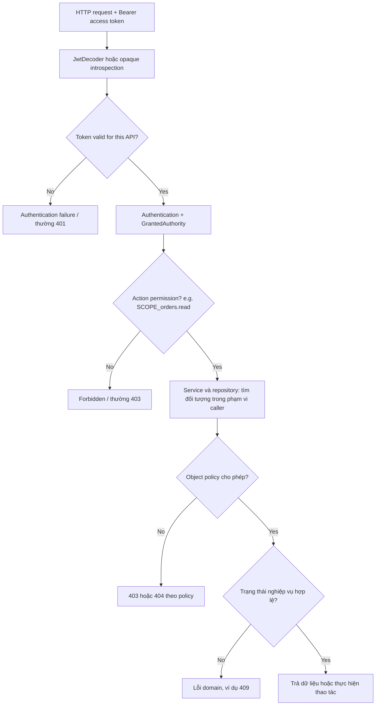

# Phân biệt quyền thao tác với quyền truy cập một đối tượng cụ thể

Trong **Spring Security OAuth 2.0 OIDC Resource Server**, việc một access token có chữ ký hợp lệ, đúng issuer, đúng audience và còn hạn mới chỉ cho API biết token đó có thể được chấp nhận. Nếu token chứa scope `orders.read`, Spring Security thường ánh xạ scope thành authority `SCOPE_orders.read`. Nhưng điều này **không chứng minh người gọi được đọc mọi đơn hàng trong cơ sở dữ liệu**.

Ví dụ người dùng `user-123` có token:

```json
{
  "iss": "https://login.example.test/realms/shop",
  "sub": "user-123",
  "aud": ["orders-api"],
  "tenant_id": "shop-a",
  "scope": "orders.read orders.cancel",
  "exp": 1900000000
}
```

Khi gọi `GET /api/orders/order-42`, có ít nhất ba câu hỏi:

1. Token có hợp lệ để sử dụng tại Orders API không?
2. Caller có **quyền thực hiện hành động đọc đơn hàng** không?
3. Caller có **quyền đọc chính đơn hàng `order-42`** không?

Hai câu hỏi đầu có thể được xử lý bằng token validation và HTTP authorization. Câu hỏi thứ ba cần **object-level authorization**, thường dựa vào owner, tenant, ACL, quan hệ chia sẻ, nhóm hỗ trợ hoặc chính sách nghiệp vụ ở service/repository.

Bài này tập trung vào ranh giới giữa **action-level permission** và **object-level authorization**, cách thực thi trong Spring Security Servlet, và cách tránh lỗ hổng **Broken Object Level Authorization (BOLA)** hay **IDOR**.

## 1. Phân biệt ba lớp bảo vệ

| Lớp | Câu hỏi được giải quyết | Ví dụ |
|---|---|---|
| **Authentication / token validation** | Token có đáng tin và dành cho API này không? | Xác minh chữ ký JWT, `iss`, `aud`, `exp`, hoặc opaque token introspection |
| **Action-level authorization** | Caller được yêu cầu loại hành động nào? | Có `SCOPE_orders.read` để đọc Orders |
| **Object-level authorization** | Caller được thao tác **tài nguyên cụ thể nào**? | `user-123` được đọc `order-42` nhưng không được đọc `order-99` của người khác |
| **Business-state restrictions** | Hành động còn hợp lệ tại thời điểm thực hiện không? | Đơn đã giao thì không được hủy |

Ba nhóm quyền sau thường phải kết hợp theo logic AND: một caller cần được phép thực hiện **hành động**, được phép tác động đến **đối tượng**, và đáp ứng **điều kiện nghiệp vụ**.



**Không nên tin rằng `authenticated()` hoặc `hasAuthority(...)` tự giải quyết quyền sở hữu đối tượng.** Spring Security không tự biết ID trong URL thuộc ai nếu ứng dụng chưa xây dựng chính sách và truy vấn phù hợp.

## 2. Quyền thao tác: scope, role và authority

Trong OAuth 2.0 Resource Server, Authorization Server có thể phát hành scopes:

```text
orders.read
orders.write
orders.cancel
orders.export
payments.refund
shipments.dispatch
```

Với cấu hình JWT Resource Server thường gặp, Spring Security chuyển scopes thành authorities:

```text
SCOPE_orders.read
SCOPE_orders.write
SCOPE_orders.cancel
...
```

Một số API có thể còn sử dụng roles đã được ánh xạ từ claim đáng tin:

```text
ROLE_CUSTOMER
ROLE_SUPPORT
ROLE_FINANCE
ROLE_ADMIN
```

Các tên trên chỉ là **hợp đồng minh họa**; Spring Security không tự hiểu nghĩa nghiệp vụ của `orders.cancel` hay `ROLE_SUPPORT`.

### 2.1. Quyền thao tác chỉ mô tả một nhóm năng lực

| Authority | Ý nghĩa ở mức action | Chưa chứng minh điều gì? |
|---|---|---|
| `SCOPE_orders.read` | Được yêu cầu đọc Orders | Không chứng minh được xem mọi order |
| `SCOPE_orders.write` | Được yêu cầu tạo/sửa Orders | Không chứng minh được sửa order của người khác |
| `SCOPE_orders.cancel` | Được yêu cầu hủy Orders | Không chứng minh được hủy mọi đơn ở mọi trạng thái |
| `SCOPE_orders.export` | Được yêu cầu export | Không chứng minh được export dữ liệu toàn hệ thống |
| `ROLE_SUPPORT` | Có vai trò hỗ trợ theo policy | Không chứng minh support được giao mọi customer |
| `ROLE_ADMIN` | Có vai trò quản trị theo policy | Không mặc định có quyền ở mọi tenant |

Một người có scope đọc và owner của đơn A chưa chắc là owner đơn B. Quyền thao tác giống nhau nhưng quyết định object-level khác nhau.

### 2.2. `requestMatchers` giải quyết phần nào?

Ví dụ Spring Security Servlet:

```java
@Bean
SecurityFilterChain apiSecurity(HttpSecurity http) throws Exception {
    return http
        .authorizeHttpRequests(auth -> auth
            .requestMatchers(HttpMethod.GET, "/api/orders/**")
                .hasAuthority("SCOPE_orders.read")
            .requestMatchers(HttpMethod.POST, "/api/orders")
                .hasAuthority("SCOPE_orders.write")
            .requestMatchers(HttpMethod.POST, "/api/orders/*/cancel")
                .hasAuthority("SCOPE_orders.cancel")
            .anyRequest().denyAll()
        )
        .oauth2ResourceServer(oauth2 ->
            oauth2.jwt(Customizer.withDefaults()))
        .build();
}
```

Imports chính:

```java
import org.springframework.context.annotation.Bean;
import org.springframework.http.HttpMethod;
import org.springframework.security.config.Customizer;
import org.springframework.security.config.annotation.web.builders.HttpSecurity;
import org.springframework.security.web.SecurityFilterChain;
```

Ở đây, route/method quyết định **loại quyền** cần có. Không có dòng nào kiểm tra owner/tenant của order ID. Phần đó phải được thực thi ở service hoặc cơ chế authorization truy cập object tương ứng.

**Lưu ý thứ tự rule:** Trong `authorizeHttpRequests`, rule đầu tiên khớp sẽ quyết định authorization. Route đặc biệt cần scope mạnh hơn như `GET /api/orders/admin/export` phải đứng trước wildcard `GET /api/orders/**` nếu hai pattern có thể chồng nhau.

## 3. Quyền đối tượng: actor, action, resource, context

Object-level authorization có thể được mô hình hóa như một hàm policy:

```text
canAccess(actor, action, resource, context) -> ALLOW / DENY
```

Ví dụ:

```text
actor:
  issuer   = https://login.example.test/realms/shop
  subject  = user-123
  tenant   = shop-a

action:
  READ_ORDER

resource:
  id       = order-99
  owner    = user-456
  tenant   = shop-a
  shared   = false

decision:
  DENY: có scope đọc nhưng không owner/không được share
```

Các yếu tố có thể tham gia:

- **Ownership:** user có phải chủ sở hữu object không?
- **Tenant isolation:** object có thuộc tenant được phép không?
- **ACL/share:** object đã được chia sẻ cho principal/nhóm không?
- **Assignment:** nhân viên hỗ trợ có được giao case, account hoặc order không?
- **Delegation:** principal có được phép thao tác thay người khác không?
- **Relationship:** user là thành viên team/project có quyền đối với object không?
- **Business state:** đơn còn được hủy, thanh toán còn được refund, hồ sơ đã được phê duyệt chưa?

### 3.1. RBAC, ABAC và ReBAC

| Mô hình | Cách quyết định | Ví dụ |
|---|---|---|
| RBAC | Quyền theo vai trò | `ROLE_SUPPORT` có thể xem case hỗ trợ |
| ABAC | Quyền theo thuộc tính principal/resource/context | `actor.tenant == order.tenant` |
| ReBAC | Quyền theo quan hệ | Actor là owner, assignee hoặc người được share |
| ACL | Danh sách quyền gắn trực tiếp object | Order 42 có permission read cho user-123 |
| Business policy | Quy tắc domain và trạng thái | Chỉ được cancel khi order chưa shipped |

Một ứng dụng thật thường kết hợp nhiều mô hình. Ví dụ support có role đúng **và** được assign đúng team **và** cùng tenant mới được đọc order.

## 4. Ví dụ lỗ hổng BOLA/IDOR

Giả sử API có endpoint:

```http
GET /api/orders/order-1
Authorization: Bearer <token-cua-user-123>
```

và user-123 có `SCOPE_orders.read`. Endpoint trả order-1 thuộc user-123.

Attacker đổi ID:

```http
GET /api/orders/order-2
Authorization: Bearer <token-cua-user-123>
```

Nếu order-2 thuộc user-456 nhưng API vẫn trả dữ liệu, lỗi là **Broken Object Level Authorization**.

Đoạn code rủi ro:

```java
@GetMapping("/api/orders/{orderId}")
public OrderDto getOrder(@PathVariable String orderId) {
    return repository.findById(orderId)
        .map(OrderDto::from)
        .orElseThrow(OrderNotFoundException::new);
}
```

Nếu chỉ có `hasAuthority("SCOPE_orders.read")` ở URL, controller trên vẫn có thể cho user-123 đọc order của user-456.

**Dùng UUID ngẫu nhiên không sửa lỗi này.** Object ID có thể lộ qua link, log, báo cáo, email hoặc dữ liệu khác. IDs khó đoán chỉ giảm khả năng đoán, không phải bằng chứng quyền.

## 5. Danh tính nào được dùng trong policy?

JWT access token có thể có:

```json
{
  "iss": "https://login.example.test/realms/shop",
  "sub": "user-123",
  "client_id": "web-portal",
  "tenant_id": "shop-a",
  "aud": ["orders-api"],
  "scope": "orders.read"
}
```

Cần phân biệt:

| Claim | Nghĩa | Lưu ý khi phân quyền object |
|---|---|---|
| `sub` | Subject do issuer xác nhận | Có thể là user hoặc service principal tùy token/grant |
| `iss` | Nhà phát hành | Multi-issuer có thể cần identity là cặp (issuer, subject) |
| `tenant_id` | Thuộc tính tenant nếu AS có contract | Cần xác định active tenant và chính sách membership |
| `client_id` | OAuth client xin token | Không tự chứng minh owner hoặc API audience |
| `aud` | Resource Server được phép nhận token | Phải được xác minh trước authorization |
| `scope` | Quyền thao tác | Không phải tập object mà caller sở hữu |

**Không lấy claim từ JWT payload chưa xác minh chữ ký**, vì attacker có thể tự khai báo `sub=user-admin`, `tenant_id=shop-b` và scope bất kỳ. Các thuộc tính dùng bởi policy phải lấy từ `Authentication`/principal **đã được decoder hoặc introspector xác thực**.

### 5.1. Lấy principal từ JWT được Spring Security xác thực

Ví dụ code policy:

```java
if (!(authentication instanceof JwtAuthenticationToken jwtAuth)) {
    return false;
}

Jwt jwt = jwtAuth.getToken();

String subject = jwt.getSubject();
String tenantId = jwt.getClaimAsString("tenant_id");
String issuer = jwt.getIssuer() == null
    ? null
    : jwt.getIssuer().toString();
```

Imports:

```java
import org.springframework.security.core.Authentication;
import org.springframework.security.oauth2.jwt.Jwt;
import org.springframework.security.oauth2.server.resource.authentication.JwtAuthenticationToken;
```

Ví dụ dành cho JWT Resource Server. Nếu dùng opaque token, principal có thể là `OAuth2AuthenticatedPrincipal` và Authentication có kiểu khác; object policy cần adapter trích danh tính theo nhánh xác thực thật, không ép kiểu JWT cho mọi request.

### 5.2. Không mặc định `authentication.getName()` là user ID bất biến

`JwtAuthenticationConverter` có thể được cấu hình đổi tên principal sang `preferred_username` hoặc claim khác. Username/email có thể thay đổi hoặc trùng giữa hai issuers.

Trong hệ thống đa issuer, một định danh tài khoản thường cần xét cả **`iss` và `sub`**, không dùng riêng một tên hiển thị khi policy cần tính duy nhất. Nếu ứng dụng có bảng ánh xạ nội bộ từ identity của issuer sang account ID, mapping đó phải được kiểm soát và tin cậy.

## 6. Thiết kế policy trong service và repository

Có thể cấu trúc:

```text
HTTP SecurityFilterChain
    └── check SCOPE_orders.read
            │
            ▼
OrderController
            │
            ▼
OrderService
    ├── xác định actor đã xác thực
    ├── check tenant/owner/share/assignment
    ├── query OrderRepository trong phạm vi hợp lệ
    └── trả DTO đã lọc field
```

Nếu nhiều controller hoặc jobs cùng dùng service, policy nên nằm tại **application/service boundary**, không chỉ được lặp lại rời rạc trong từng HTTP controller.

### 6.1. `@PreAuthorize` với policy bean

Ví dụ service:

```java
@Service
public class OrderService {

    private final OrderRepository repository;

    public OrderService(OrderRepository repository) {
        this.repository = repository;
    }

    @PreAuthorize(
        "hasAuthority('SCOPE_orders.read') and " +
        "@orderAccessPolicy.canRead(authentication, #orderId)"
    )
    @Transactional(readOnly = true)
    public OrderDto getOrder(String orderId) {
        Order order = repository.findById(orderId)
            .orElseThrow(OrderNotFoundException::new);

        return OrderDto.from(order);
    }
}
```

Policy bean:

```java
@Component("orderAccessPolicy")
public class OrderAccessPolicy {

    private final OrderRepository repository;

    public OrderAccessPolicy(OrderRepository repository) {
        this.repository = repository;
    }

    public boolean canRead(
            Authentication authentication,
            String orderId) {

        if (!(authentication instanceof JwtAuthenticationToken jwtAuth)) {
            return false;
        }

        Jwt jwt = jwtAuth.getToken();
        String subject = jwt.getSubject();
        String tenant = jwt.getClaimAsString("tenant_id");

        if (subject == null || tenant == null) {
            return false;
        }

        return repository.existsByIdAndTenantIdAndOwnerSubject(
            orderId, tenant, subject
        );
    }
}
```

Imports trọng tâm:

```java
import org.springframework.security.access.prepost.PreAuthorize;
import org.springframework.security.core.Authentication;
import org.springframework.security.oauth2.jwt.Jwt;
import org.springframework.security.oauth2.server.resource.authentication.JwtAuthenticationToken;
import org.springframework.stereotype.Component;
import org.springframework.stereotype.Service;
import org.springframework.transaction.annotation.Transactional;
```

`OrderRepository` và `OrderDto` là thành phần domain minh họa. Ví dụ chỉ cho phép owner đọc đơn trong tenant tương ứng; ứng dụng có support/share policy cần thêm các nhánh được định nghĩa rõ.

**Lưu ý:** Biểu thức `#orderId` cần metadata tên tham số khả dụng (chẳng hạn biên dịch `-parameters` hoặc dùng annotation thích hợp). Ngoài ra, method security thường dựa trên proxy: self-invocation trong cùng bean có thể không chạy annotation như dự kiến.

### 6.2. Ưu tiên truy vấn có giới hạn quyền trong DB

Ví dụ bên trên kiểm tra existence rồi gọi `findById`, gây hai truy vấn và có nguy cơ dữ liệu đổi giữa kiểm tra và sử dụng. Một cách thường rõ hơn là **chỉ truy vấn dữ liệu visible**:

```java
public interface OrderRepository extends JpaRepository<Order, String> {

    @Query("""
        select o from Order o
        where o.id = :orderId
          and o.tenantId = :tenantId
          and o.ownerSubject = :subject
        """)
    Optional<Order> findOwnedOrder(
        @Param("orderId") String orderId,
        @Param("tenantId") String tenantId,
        @Param("subject") String subject
    );
}
```

Từ service:

```java
@PreAuthorize("hasAuthority('SCOPE_orders.read')")
@Transactional(readOnly = true)
public OrderDto getOrder(String orderId, AuthenticatedActor actor) {
    Order order = repository.findOwnedOrder(
            orderId,
            actor.tenantId(),
            actor.subject()
        )
        .orElseThrow(OrderNotFoundException::new);

    return OrderDto.from(order);
}
```

`AuthenticatedActor` trong ví dụ là một value object **nội bộ được tạo từ Authentication đã xác thực**, không phải một DTO do client tự gửi. Nó cần chứa đúng issuer/subject/tenant theo hợp đồng khi multi-tenant.

Ưu điểm của filtered query: dữ liệu ngoài phạm vi không được tải ra chỉ để kiểm tra sau đó. Khi cần support/share, mở rộng policy và query theo quan hệ được cấp phép, **không bỏ tenant predicate**.

### 6.3. SQL theo owner/tenant

Minh họa:

```sql
SELECT *
FROM orders
WHERE id = :orderId
  AND tenant_id = :trustedTenant
  AND owner_subject = :trustedSubject;
```

Cả `trustedTenant` và `trustedSubject` phải đến từ identity/policy server-side. Nếu lấy từ query parameters do caller tùy chọn, câu SQL đẹp vẫn không bảo vệ được dữ liệu.

## 7. Phân quyền theo owner, share ACL và support assignment

Không phải mọi object chỉ có một chủ sở hữu. Một policy có thể cho phép:

```text
canReadOrder(actor, order):
  require SCOPE_orders.read
  require allowed tenant relationship

  if order.owner == actor.subject:
      ALLOW
  else if shareACL grants actor read:
      ALLOW
  else if supportAssignment grants actor read:
      ALLOW
  else:
      DENY
```

Một SQL minh họa:

```sql
SELECT o.*
FROM orders o
WHERE o.id = :orderId
  AND o.tenant_id = :tenantId
  AND (
        o.owner_subject = :subject
        OR EXISTS (
            SELECT 1 FROM order_shares s
            WHERE s.order_id = o.id
              AND s.tenant_id = o.tenant_id
              AND s.recipient_subject = :subject
              AND s.can_read = true
        )
      );
```

Trong hệ thống thật, policy support cần nhánh tương ứng với assignments được kiểm chứng.

### 7.1. Cẩn thận precedence của AND và OR

Sai:

```sql
WHERE tenant_id = :tenant
  AND owner_subject = :subject
   OR assigned_support = :subject
```

Nhánh `assigned_support` có thể không chịu ràng buộc tenant. Đúng hơn nếu ý định là cùng tenant:

```sql
WHERE tenant_id = :tenant
  AND (
       owner_subject = :subject
       OR assigned_support = :subject
  )
```

Khi có nhiều vai trò và nguồn quyền, **mỗi nhánh OR phải giữ các ranh giới bắt buộc**.

## 8. Object-level authorization không chỉ dành cho GET detail

Một điểm dễ bỏ sót là các APIs không có object ID trực tiếp:

```http
GET /api/orders
GET /api/orders/search?q=chair
GET /api/orders/count
GET /api/orders/stats
GET /api/orders/export
```

Nếu chỉ kiểm tra scope rồi thực hiện:

```sql
SELECT * FROM orders ORDER BY created_at DESC;
```

thì caller có thể xem mọi đơn.

### 8.1. List phải lọc theo phạm vi được phép

Ví dụ list của customer:

```sql
SELECT *
FROM orders
WHERE tenant_id = :trustedTenant
  AND owner_subject = :trustedSubject
ORDER BY created_at DESC
LIMIT :limit OFFSET :offset;
```

### 8.2. Count, aggregation và pagination cũng cần giới hạn

Không chỉ danh sách items; các giá trị sau cũng có thể tiết lộ dữ liệu:

- `totalElements` hoặc `totalPages`.
- Tổng tiền của tất cả đơn.
- Tỷ lệ đơn hủy/hoàn tiền.
- Thống kê theo trạng thái hoặc địa lý.
- Bộ lọc facets.
- Báo cáo CSV/Excel.
- Cached search results.

Nếu items đã lọc nhưng total count tính từ toàn bộ database, API vẫn có thể lộ thông tin tenant khác.

### 8.3. Export thường cần action permission mạnh hơn

```java
.requestMatchers(HttpMethod.GET, "/api/orders/export")
    .hasAuthority("SCOPE_orders.export")
.requestMatchers(HttpMethod.GET, "/api/orders/**")
    .hasAuthority("SCOPE_orders.read")
```

Rule export nên đứng trước wildcard nếu có khả năng chồng lấn. Nhưng `orders.export` **chỉ là quyền yêu cầu export**; nội dung export vẫn phải được giới hạn bởi object policy.

## 9. Tạo mới: object chưa tồn tại nhưng vẫn có policy đối tượng

Với:

```http
POST /api/orders
Authorization: Bearer <ACCESS_TOKEN>
Content-Type: application/json

{
  "customerId": "user-456",
  "tenantId": "shop-b",
  "items": [{"sku": "SKU-001", "quantity": 1}]
}
```

Caller có scope `orders.write` không có nghĩa được tạo đơn cho customer hoặc tenant bất kỳ.

Có hai nhóm điều kiện:

1. **Action permission:** token được yêu cầu tạo order?
2. **Creation policy:** caller được tạo **loại order nào, cho ai, trong tenant nào, với các thuộc tính nào**?

### 9.1. Không bind owner và tenant tùy ý từ request

Rủi ro:

```java
Order order = new Order();
order.setOwnerSubject(request.customerId());
order.setTenantId(request.tenantId());
repository.save(order);
```

Nếu endpoint dành cho “khách hàng tạo đơn của chính mình”, service nên gán owner/tenant từ `AuthenticatedActor` tin cậy:

```java
@Transactional
public OrderDto createOwnOrder(
        CreateOrderRequest request,
        AuthenticatedActor actor) {

    requireAuthority(actor, "SCOPE_orders.write");

    Order order = new Order();
    order.setOwnerSubject(actor.subject());
    order.setTenantId(actor.tenantId());
    order.setItems(validateItems(request.items()));

    return OrderDto.from(repository.save(order));
}
```

Đoạn này minh họa domain API; các helpers/value objects cần triển khai theo ứng dụng. Không phải mã hoàn chỉnh có thể dán độc lập.

### 9.2. Nếu được phép tạo hộ

Một endpoint hỗ trợ tạo hộ có thể cần:

- Scope riêng như `orders.create_for_customer`.
- Customer đích thuộc tenant/phạm vi được phân công.
- Actor có delegated permission hoặc vai trò hỗ trợ thực sự.
- Quy định chống tự tăng quyền/đổi owner trái phép.
- Audit “ai tạo hộ ai”, không giả mạo `sub` trong access token.

## 10. Update: kiểm tra cả object lẫn những field được sửa

Ví dụ:

```http
PATCH /api/orders/order-42
Content-Type: application/json
Authorization: Bearer <ACCESS_TOKEN>

{
  "shippingAddress": "New address",
  "ownerSubject": "user-456",
  "tenantId": "shop-b",
  "paymentStatus": "PAID"
}
```

Dù user có `SCOPE_orders.write` và là owner order-42, họ **không tự động được sửa mọi field**.

| Field | Ai có thể sửa? | Quy tắc minh họa |
|---|---|---|
| `shippingAddress` | Owner hoặc support được cấp quyền | Trước khi shipment dispatch |
| `internalNote` | Support được phân công | Đúng tenant |
| `paymentStatus` | Payment workflow được tin cậy | Không nhận trực tiếp từ customer |
| `ownerSubject` | Workflow chuyển owner được ủy quyền | Không mass-assign |
| `tenantId` | Thường bất biến sau tạo | Chỉ đổi qua nghiệp vụ riêng |
| `totalAmount` | Tính toán server-side | Không lấy giá tùy ý từ client |

Đừng bind JSON body trực tiếp lên entity rồi copy mọi field. Dùng request DTO chỉ khai báo trường được phép sửa và áp policy tương ứng.

### 10.1. Field-level authorization

Một customer được xem OrderDto nhưng có thể không được xem `internalFraudScore` hoặc `supportNotes`. Object-level permission cho phép xem **object**, còn field-level policy xác định **phần thông tin nào** được phép lộ.

Tránh trả JPA entity trực tiếp qua controller nếu entity chứa trường/quan hệ nhạy cảm. Dùng DTO theo role/use case.

## 11. Cancel, approve, refund: action + object + state

Ví dụ hủy đơn:

```text
cancelOrder(orderId, actor) allowed if:
  access token is valid for orders-api
  AND actor has SCOPE_orders.cancel
  AND order.tenant is allowed
  AND (actor owns order OR authorized support)
  AND order.status in [CREATED, CONFIRMED]
  AND shipment has not reached irreversible state
```

Tại đây:

- Scope xác định **loại hành động**.
- Owner/share/support/tenant xác định **đối tượng**.
- Status và shipment xác định **trạng thái nghiệp vụ**.

Một người sở hữu order vẫn có thể không được hủy đơn đã giao. Nếu bị từ chối do trạng thái, response có thể là `409 Conflict` hoặc domain error tương ứng, không nhất thiết là lỗi thiếu quyền.

### 11.1. Tránh TOCTOU khi kiểm tra rồi ghi

Một race condition:

```text
T1: canCancel(order) = true
T2: service khác chuyển order sang DISPATCHED
T3: cancel(order) vẫn cập nhật
```

Việc check rồi mutate tách rời có thể sai vì trạng thái đã đổi. Hướng khắc phục tùy DB/ORM:

- Transaction phù hợp.
- Optimistic locking với version column.
- Pessimistic lock khi cần.
- Conditional update có owner/tenant/status predicates.
- Idempotency và domain rules cho side effects.

Ví dụ SQL:

```sql
UPDATE orders
SET status = 'CANCELLED'
WHERE id = :orderId
  AND tenant_id = :trustedTenant
  AND owner_subject = :trustedSubject
  AND status IN ('CREATED', 'CONFIRMED');
```

Kiểm tra affected rows để biết mutation có thực hiện không. Với policy support, cần thêm nhánh được ủy quyền mà vẫn giữ tenant isolation.

**Chỉ đặt `@Transactional` không tự giải quyết mọi race.** Isolation level, locks và thứ tự side effects vẫn cần được thiết kế phù hợp.

## 12. Bulk operations: kiểm tra từng object trong danh sách

Ví dụ:

```http
POST /api/orders/bulk-cancel
Content-Type: application/json
Authorization: Bearer <ACCESS_TOKEN>

{"orderIds": ["order-1", "order-2", "order-3"]}
```

Scope `orders.cancel` chỉ cho phép **loại thao tác bulk cancel** nếu hệ thống định nghĩa vậy. Mỗi ID vẫn có thể thuộc owner/tenant khác hoặc trạng thái không hủy được.

Sai:

```java
if (canCancel(orderIds.get(0), actor)) {
    cancelAll(orderIds);
}
```

Không được chỉ kiểm tra phần tử đầu tiên rồi áp dụng cho toàn danh sách.

Các chính sách khả dĩ:

| Chính sách | Cách xử lý | Lưu ý |
|---|---|---|
| All-or-nothing | Tất cả items phải được phép mới commit | Dễ giữ transaction nhất quán nếu domain hỗ trợ |
| Partial success | Chỉ thao tác items hợp lệ | Response không làm lộ items invisible |
| Deny if any unauthorized | Từ chối toàn bộ request | Tránh side effects ngoài phạm vi |

Chọn theo contract nghiệp vụ. Câu UPDATE bulk phải chứa điều kiện tenant/owner/state, hoặc thực thi các mutation đã xác minh trong cùng ranh giới transactional phù hợp.

## 13. Nested resources: cần xác minh quan hệ parent–child

Endpoint:

```http
GET /api/projects/project-1/files/file-9
```

Tối thiểu cần xét:

1. Caller được đọc project-1 không?
2. File-9 có thực sự thuộc project-1 không?
3. File-9 có policy riêng không?
4. Project và file nằm trong tenant được phép không?

Nếu service chỉ làm:

```java
File file = fileRepository.findById(fileId).orElseThrow();
```

mà bỏ `projectId` thì caller có thể phối hợp parent ID hợp lệ với file ID ở nơi khác.

Một truy vấn minh họa:

```sql
SELECT f.*
FROM files f
JOIN projects p ON p.id = f.project_id
WHERE f.id = :fileId
  AND p.id = :projectId
  AND p.tenant_id = :trustedTenant
  AND p.owner_subject = :trustedSubject;
```

Đây là policy owner-only đơn giản; nếu file có ACL riêng thì thêm điều kiện quyền file. Được đọc project **không tự đồng nghĩa** được đọc mọi tài liệu thuộc project.

## 14. Cross-object operations: kiểm tra cả nguồn và đích

Một request gán nhân viên hỗ trợ:

```http
POST /api/orders/order-42/assignees
Content-Type: application/json

{"assigneeId": "support-9"}
```

Cần kiểm tra:

- Caller có quyền thay assignment không?
- Caller có quyền trên order-42 không?
- support-9 tồn tại và thuộc tenant/team phù hợp không?
- Caller có được gán role/nhóm đó không?
- Có nguy cơ self-escalation hoặc cross-tenant assignment không?

Tương tự với transfer ownership, share file, move project, gắn payment vào order hoặc chuyển shipment sang warehouse khác. **Có quyền trên object nguồn chưa chắc có quyền thao tác lên object đích.**

## 15. Multi-tenant: tenant trong path không chứng minh quyền

Ví dụ:

```http
GET /api/tenants/shop-b/orders/order-3
Authorization: Bearer <token-cua-shop-a>
```

String `shop-b` trong URL do caller chọn. Nó không chứng minh membership.

Các nguồn quyền đáng tin có thể gồm:

- Tenant claims đã được AS xác thực và định nghĩa rõ.
- Bảng membership/assignment server-side.
- Active tenant được xác định bằng một flow được kiểm soát.
- ACL hoặc delegated access record hợp lệ.

**Không cho phép query chọn tenant tùy ý rồi trực tiếp dùng nó làm điều kiện quyết định quyền.** Cần so với tập tenant caller thực sự được phép.

### 15.1. Chính sách khi user thuộc nhiều tenant

Nếu một user có membership ở shop-a và shop-b, token có thể đại diện active tenant hoặc chỉ subject chung. Thiết kế cần xác định:

- Ai được phép đổi active tenant?
- Có cần access token mới khi đổi tenant không?
- Scope áp dụng toàn tổ chức hay theo tenant?
- Membership bị thu hồi có cần hiệu lực tức thời không?
- Resource Server cần tra membership hiện hành không?

Một claim trong JWT có chữ ký là dữ liệu do issuer xác nhận **tại thời điểm phát hành**; khi membership thay đổi, object policy có thể cần trạng thái hiện tại từ DB/policy service.

## 16. Service principal và client credentials

OAuth 2.0 Client Credentials grant thường dùng cho máy–máy. Token có thể mang:

```json
{
  "iss": "https://login.example.test/realms/shop",
  "sub": "service-order-sync",
  "client_id": "order-sync-worker",
  "aud": ["orders-api"],
  "scope": "orders.read",
  "tenant_id": "shop-a"
}
```

Đối với service principal:

- Có thể không có end user.
- `sub` có thể là service ID.
- `client_id` mô tả OAuth client theo contract issuer.
- Scope `orders.read` không đồng nghĩa được đọc dữ liệu mọi tenant.

Một service policy có thể là:

```text
canSyncOrder(client, order):
  client has SCOPE_orders.read
  AND client_id in trusted integration allowlist
  AND order.tenant in client allowed tenants
  AND order.integration_enabled = true
```

Không dùng quy tắc “nếu client credentials thì admin toàn hệ thống” trừ khi có một contract bảo mật được phê duyệt thật sự, với ranh giới dữ liệu và audit tương ứng.

## 17. Async jobs và downstream APIs

Một endpoint export có thể tạo background job:

```http
POST /api/reports/export
Authorization: Bearer <ACCESS_TOKEN>
```

Job chạy sau vài phút, khi HTTP `SecurityContext` gốc không còn. Nếu worker có database account đọc toàn bảng và bỏ qua actor của request gốc, một export hợp lệ ban đầu có thể trở thành export toàn hệ thống.

Thiết kế cần xác định:

- Actor/tenant/scope được ghi nhận theo cách tin cậy.
- Object filter nào được lưu/áp khi job chạy.
- Có re-check quyền khi thực thi hay không.
- Không lưu raw bearer token vào queue nếu không cần.
- Không để service account kỹ thuật tự mở rộng quyền nghiệp vụ của user.

### 17.1. Quyền ở service A không tự chuyển sang service B

Orders API có thể cần gọi Inventory API. Dù Orders service có token kỹ thuật để gọi Inventory, nó vẫn phải duy trì các giới hạn tenant/object phù hợp theo business contract. Nếu gọi thay mặt user, có thể cần mô hình delegation/token exchange được AS hỗ trợ.

Một token audience `orders-api` không được tự forward sang `inventory-api` và coi là hợp lệ; từng Resource Server phải xác minh audience của mình.

## 18. Method security: `@PreAuthorize` và `@PostAuthorize`

`@PreAuthorize` thường phù hợp để từ chối **trước khi** service chạy:

```java
@PreAuthorize(
    "hasAuthority('SCOPE_orders.cancel') and " +
    "@orderAccessPolicy.canCancel(authentication, #orderId)"
)
public void cancelOrder(String orderId) {
    // ...
}
```

Nếu policy dựa vào DB state, cần cân nhắc TOCTOU/transactions như đã phân tích.

`@PostAuthorize` có thể kiểm tra kết quả method:

```java
@PostAuthorize(
    "returnObject == null or " +
    "@orderAccessPolicy.canReadReturned(authentication, returnObject)"
)
public OrderDto readOrder(String orderId) {
    // ...
}
```

Nhưng **đừng dùng post-authorization để bảo vệ các methods có side effects**. Nếu method đã chuyển tiền, ghi DB hay gửi email trước khi bị deny, hành động có thể đã xảy ra. Với read cũng cần cân nhắc việc dữ liệu đã được materialize/logged/cached trước kiểm tra; filtered query thường dễ kiểm soát hơn.

### 18.1. Proxy/self-invocation

Spring method security thường dựa trên AOP proxy. Method trong cùng bean gọi trực tiếp một method khác có annotation có thể **bypass proxy**, khiến annotation không được áp theo kỳ vọng.

Vì vậy, bảo vệ use case ở một entrypoint/service boundary nhất quán; không dựa duy nhất vào annotation ở method có thể bị gọi nội bộ mà không qua proxy.

## 19. 401, 403, 404 và lỗi nghiệp vụ

| Tình huống | Lỗi thuộc lớp nào? | HTTP thường gặp |
|---|---|---|
| Không có access token ở protected endpoint | Authentication | `401 Unauthorized` |
| JWT sai chữ ký, sai issuer/audience, hết hạn | Authentication | `401 invalid_token` |
| Token hợp lệ nhưng thiếu `SCOPE_orders.read` | Action authorization | `403 Forbidden` |
| Có scope nhưng không được xem order-42 | Object authorization | `403` hoặc `404` |
| Object thực sự không tồn tại | Resource lookup | `404 Not Found` |
| Có quyền cancel nhưng order không còn cancelable | Business state | `409 Conflict` hoặc mã domain phù hợp |

### 19.1. Vì sao trả 404 cho object không visible?

Nếu API trả 403 khi ID tồn tại nhưng không được phép và 404 khi ID không tồn tại, caller có thể suy ra object ID có thật. Một số API chọn cùng phản hồi 404 cho hai tình huống để tránh **object enumeration**.

Đây là một **quyết định policy**: cần áp dụng nhất quán và không lộ owner/tenant/trạng thái của object ngoài phạm vi trong response. Thiếu scope ở toàn endpoint thường vẫn là 403 với caller đã xác thực.

## 20. Cache và field-level permission

Nếu cache keyed chỉ bằng `orderId` và chứa một DTO admin gồm mọi fields, một caller khác có thể nhận bản cached trước khi quyền được đánh giá.

Nguyên tắc:

- Authorization phải được áp **trước khi trả dữ liệu cached**.
- Cache của dữ liệu phụ thuộc tenant/principal phải có ranh giới phù hợp.
- Không coi cache hit là bằng chứng quyền.
- Xét invalidation khi share ACL, membership hoặc owner đổi.
- Không trả entity có fields nhạy cảm chỉ vì user được xem object.

Ví dụ một customer được xem order status nhưng không được xem `internalFraudScore`. Cần một DTO chỉ chứa fields được phép. Object permission và field permission là hai mức có thể phải kết hợp.

## 21. Thử các ranh giới bằng data fixtures

Một bộ fixtures tối thiểu:

```text
tenant shop-a:
  user-123 owns order-1
  user-456 owns order-2

tenant shop-b:
  user-789 owns order-3
```

Thử user-123 với `SCOPE_orders.read`:

| Request | Action-level | Object-level | Kết quả |
|---|---|---|---|
| GET order-1 | Đạt | Owner trong tenant đúng | Cho phép |
| GET order-2 | Đạt | Không owner/không share | Từ chối |
| GET order-3 | Đạt | Khác tenant | Từ chối |
| GET order-1 với scope `profile` | Không đạt | Không cần xét tiếp | Từ chối |
| GET list | Đạt | Chỉ trả items visible | Chỉ thấy order-1 |
| Export orders | Cần export permission riêng | Chỉ export visible set | Không lộ order-2/3 |
| PATCH order-1 đổi tenantId | Có thể có write scope | Field update không được phép | Từ chối |
| Bulk cancel order-1 và order-3 | Có cancel scope | Một object ngoài tenant | Không được tác động order-3 |

### 21.1. Spring Security Test có phạm vi riêng

Trong MockMvc có thể dùng:

```java
mockMvc.perform(get("/api/orders/order-1")
        .with(jwt().authorities(
            new SimpleGrantedAuthority("SCOPE_orders.read")
        )))
    .andExpect(status().isOk());
```

Đây là ví dụ test HTTP authorization với `SecurityMockMvcRequestPostProcessors.jwt()` và một endpoint/fixture được chuẩn bị để thành công. `jwt()` thường mô phỏng principal đã xác thực, **không xác minh chữ ký JWT thật** qua `NimbusJwtDecoder`.

Do đó nên phân biệt:

- Tests HTTP scope/route.
- Tests service policy với owners/tenants khác nhau.
- Tests repository queries để chắc chắn giới hạn data.
- Tests tích hợp decoder cho issuer, signature, audience, expiry.
- Tests đồng thời nếu mutation phụ thuộc trạng thái.

Nếu toàn bộ test data chỉ có một user/tenant, một truy vấn thiếu tenant predicate có thể vẫn pass. Data fixtures nhiều tenants là thiết yếu cho bài toán object authorization.

## 22. Những lỗi phổ biến cần tránh

**1. Tin rằng token hợp lệ là đủ.** Token hợp lệ chỉ chứng minh identity/claims theo contract; không cho phép mọi object.

**2. Chỉ kiểm tra `hasAuthority("SCOPE_orders.read")`.** Nó phân quyền hành động, không tra owner/tenant.

**3. Dùng `userId` do client gửi làm principal.** Query/body/path do caller chọn; phải so với identity được xác thực và policy server-side.

**4. Dùng UUID khó đoán thay ACL.** IDs có thể lộ; quyền vẫn phải được xác minh.

**5. Bỏ tenant ở một nhánh OR.** Một nhánh support/share thiếu tenant condition có thể lộ dữ liệu xuyên tenant.

**6. Kiểm tra detail nhưng bỏ list/search/export/count.** BOLA có thể xảy ra cả khi response không gắn với một ID rõ ràng.

**7. Cho service accounts quyền toàn DB theo scope đọc chung.** Client credentials token cần giới hạn integration/tenant/object.

**8. Tin owner/tenant trong create request.** Không tự tạo object cho user/tenant khác nếu không có delegation.

**9. Bind PATCH trực tiếp vào entity.** Có thể đổi owner, tenant, payment status hoặc fields nhạy cảm.

**10. Bỏ trạng thái nghiệp vụ khi có owner + scope.** Có quyền trên đơn không nghĩa được hủy ở mọi trạng thái.

**11. Check rồi mutate ngoài transaction hoặc không có concurrency control.** Race có thể làm policy mất hiệu lực.

**12. Bảo vệ controller nhưng bỏ service, async jobs và GraphQL.** Các lối vào khác có thể bypass HTTP rule.

**13. Trả dữ liệu cached trước khi authorize.** Cache hit không chứng minh quyền.

**14. Dùng `Authentication.getName()` như ID bất biến khi ứng dụng đổi principal claim.** Với multi-issuer cần xem xét identity pair và mapping tin cậy.

**15. Dùng `@PostAuthorize` bảo vệ side effects.** Authorization sau method có thể đến quá muộn.

## 23. Hợp đồng use case nên mô tả rõ các quyền khác nhau

Một use case có thể được ghi:

```text
Use case:
  cancelOrder(orderId)

Authentication:
  - Access token valid for orders-api
  - Trusted issuer and unexpired token

Action-level:
  - Requires SCOPE_orders.cancel

Object-level:
  - Order belongs to an allowed tenant
  - Actor is owner OR authorized assigned support
  - No cross-tenant access without explicit delegation

Business state:
  - Order status in [CREATED, CONFIRMED]
  - Shipment has not reached irreversible state

Data access:
  - Query/update includes tenant and authorization predicates
  - Concurrency handled by transaction/lock/conditional update

Error behavior:
  - Invalid token: usually 401
  - Missing action permission: usually 403
  - Invisible object: 403 or 404 consistently
  - Invalid state: domain error such as 409

Audit:
  - Trusted actor identity, action, target ID, decision
  - Never raw bearer token
```

Bản hợp đồng này ngăn tình trạng cả nhóm phát triển gọi chung mọi thứ là “đã có scope” rồi bỏ qua câu hỏi **được thao tác object nào**.

## 24. Tài liệu tham khảo

- [Spring Security — Authorize HTTP Requests](https://docs.spring.io/spring-security/reference/servlet/authorization/authorize-http-requests.html): HTTP authorization, request matching, scope/authority checks.
- [Spring Security — Method Security](https://docs.spring.io/spring-security/reference/servlet/authorization/method-security.html): `@EnableMethodSecurity`, `@PreAuthorize` và `@PostAuthorize`.
- [Spring Security — OAuth 2.0 Resource Server JWT](https://docs.spring.io/spring-security/reference/servlet/oauth2/resource-server/jwt.html): tạo Authentication từ JWT, scope mapping.
- [Spring Security — Opaque Token Resource Server](https://docs.spring.io/spring-security/reference/servlet/oauth2/resource-server/opaque-token.html): introspection cho access token opaque.
- [OWASP API Security Top 10: API1:2023 Broken Object Level Authorization](https://owasp.org/API-Security/editions/2023/en/0xa1-broken-object-level-authorization/): BOLA và cách nhìn rủi ro đối tượng trong API.
- [OWASP Authorization Cheat Sheet](https://cheatsheetseries.owasp.org/cheatsheets/Authorization_Cheat_Sheet.html): kiểm soát quyền, default deny, least privilege.
- [RFC 6750 — OAuth 2.0 Bearer Token Usage](https://www.rfc-editor.org/rfc/rfc6750): bearer token qua HTTP.
- [RFC 9068 — JWT Profile for OAuth 2.0 Access Tokens](https://www.rfc-editor.org/rfc/rfc9068): access token JWT, audience và scope.

**Kết luận:** **Quyền thao tác** cho biết caller được yêu cầu loại hành động nào; **quyền truy cập đối tượng** quyết định caller được thực hiện hành động ấy với **đối tượng cụ thể nào**. Trong Spring Security Resource Server, kiểm tra scope/role ở HTTP chỉ là lớp đầu; phải kết hợp với policy owner/tenant/share/assignment, các truy vấn được giới hạn đúng phạm vi và điều kiện nghiệp vụ tại service. **Một access token hợp lệ với `orders.read` không phải quyền đọc mọi đơn hàng.**
