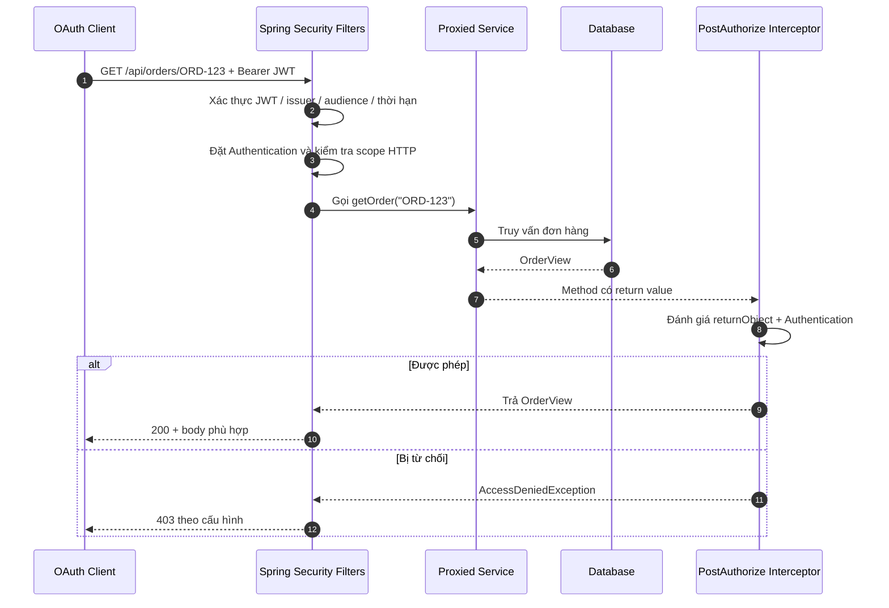
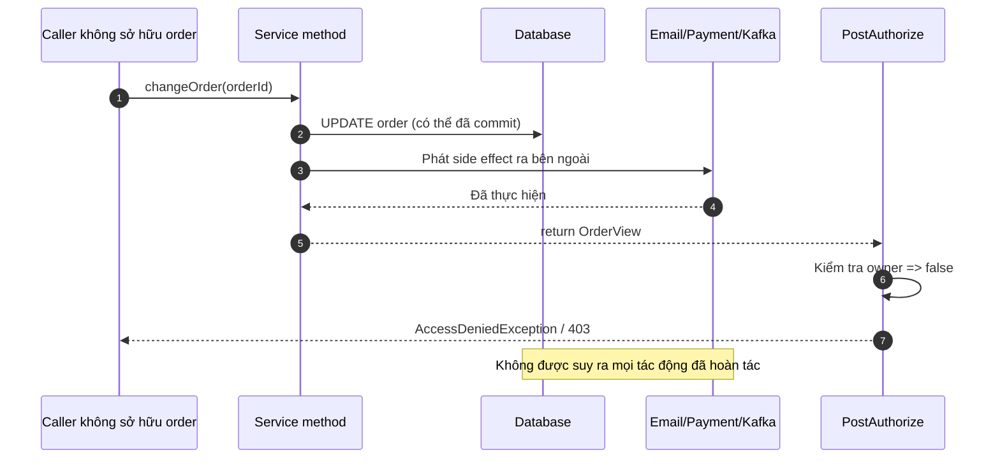
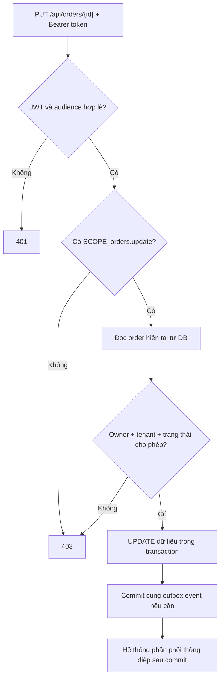
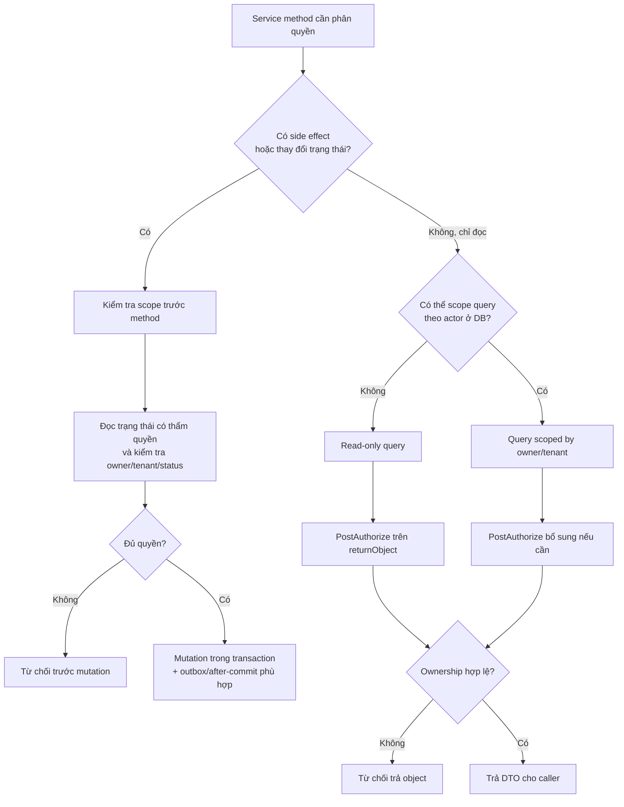

# @PostAuthorize và giới hạn đối với tác dụng phụ đã xảy ra

Trong **Spring Security OAuth 2.0/OIDC Resource Server**, khi một request mang access token hợp lệ, Spring Security tạo `Authentication` từ token và có thể dùng thông tin đó để quyết định phương thức nghiệp vụ nào được gọi. Ở tầng service, hai annotation thường được nhắc tới là **`@PreAuthorize`** và **`@PostAuthorize`**.

Điểm khác nhau quan trọng nhất nằm ở **thời điểm**:

- **`@PreAuthorize`** kiểm tra điều kiện **trước khi cho phép lời gọi method tiếp tục**. Nó phù hợp với việc chặn thao tác ghi, xóa, gửi lệnh thanh toán, phát thông điệp hoặc tác vụ gây thay đổi trạng thái.
- **`@PostAuthorize`** kiểm tra điều kiện **sau khi method đã chạy và đã tạo giá trị trả về**. Nó hữu ích khi quyền truy cập chỉ có thể được đánh giá chính xác sau khi đã đọc đối tượng, chẳng hạn kiểm tra chủ sở hữu của bản ghi vừa truy vấn. Nhưng nó **không quay ngược thời gian**: nếu method đã gửi email, tạo giao dịch, ghi dữ liệu hoặc phát sự kiện trước khi điều kiện thất bại, từ chối trả kết quả không có nghĩa những tác dụng phụ ấy đã biến mất.

Đây là khác biệt dễ bỏ sót nếu chỉ nhìn vào HTTP response: một endpoint có thể trả **403 Forbidden** vì `@PostAuthorize` từ chối, trong khi tác vụ nghiệp vụ đã được thực thi một phần hoặc toàn bộ. Điều đó đặc biệt nguy hiểm đối với các thao tác thanh toán, hoàn tiền, xóa dữ liệu, cập nhật tồn kho hoặc gọi dịch vụ bên ngoài.

Bài này đi từ ngữ nghĩa chính xác của `@PostAuthorize`, cách đọc `returnObject`, cấu hình Spring Security Servlet, rủi ro transaction và tác dụng phụ, đến những mẫu thiết kế phù hợp hơn để bảo vệ các hành động làm thay đổi trạng thái.

## 1. `@PostAuthorize` là gì?

`@PostAuthorize` là annotation của **Spring Security Method Security**. Nó cho phép viết một biểu thức authorization (thường là SpEL) dựa trên **giá trị mà method vừa trả về** và thông tin bảo mật hiện tại.

Ví dụ nhỏ:

```java
import org.springframework.security.access.prepost.PostAuthorize;
import org.springframework.stereotype.Service;

@Service
public class AccountQueryService {

    @PostAuthorize("returnObject.owner == authentication.name")
    public AccountView getAccount(String accountId) {
        return repository.findAccountView(accountId);
    }
}
```

Giả sử `AccountView` có getter `getOwner()`, `repository` được cấu hình và request đã được xác thực. Khi gọi `getAccount` qua Spring proxy:

1. Method truy vấn account và tạo `AccountView`.
2. Sau khi method trả kết quả, Spring Security đánh giá `returnObject.owner == authentication.name`.
3. Nếu biểu thức đúng, caller nhận `AccountView`.
4. Nếu sai, Spring Security mặc định từ chối bằng `AccessDeniedException` thay vì đưa kết quả cho caller.

Trong một HTTP request được cấu hình phù hợp, một authenticated principal thường nhận **403** khi method security từ chối. Nếu method được gọi từ job hoặc code ngoài HTTP, không mặc định có `ExceptionTranslationFilter` tạo status code; caller cần xử lý exception trong ngữ cảnh đó.

**Đọc kỹ thứ tự:** account **đã được truy vấn** trước khi check. Annotation bảo vệ **việc trả kết quả qua lời gọi method**, không phải phép bảo vệ ngăn method thực thi ngay từ đầu.

### 1.1. `returnObject` là gì?

Trong biểu thức `@PostAuthorize`, tên biến đặc biệt `returnObject` đề cập đến **giá trị trả về của lời gọi method được bảo vệ**. Ví dụ:

```java
@PostAuthorize("returnObject.owner == authentication.name")
public AccountView readAccount(String accountId) {
    return accountRepository.getViewById(accountId);
}
```

Ở đây:

- `returnObject` là `AccountView` mà method vừa tạo.
- `returnObject.owner` đọc thuộc tính `owner` (ví dụ qua getter).
- `authentication` là `Authentication` hiện tại của Spring Security.
- `authentication.name` lấy tên principal; với JWT Resource Server thường là `sub` theo cấu hình mặc định, nhưng có thể được tùy biến.

Biểu thức có thể sử dụng kết quả trả về để quyết định quyền, nên `@PostAuthorize` rất tự nhiên với phương thức **đọc một đối tượng**. Với method trả `void`, giá trị `returnObject` không mang bản ghi mới để kiểm tra; sử dụng nó làm điều kiện bảo mật cho tác vụ ghi thường không hợp lý.

### 1.2. `@PostAuthorize` cần được kích hoạt

Trong Spring Security 6+:

```java
import org.springframework.context.annotation.Configuration;
import org.springframework.security.config.annotation.method.configuration.EnableMethodSecurity;

@Configuration
@EnableMethodSecurity
public class MethodSecurityConfiguration {
}
```

`@EnableMethodSecurity` bật hạ tầng method security, bao gồm `@PreAuthorize` và `@PostAuthorize` theo cấu hình mặc định phù hợp. Nếu ứng dụng đã tắt `prePostEnabled` hoặc tùy chỉnh advisors, phải xác nhận interceptor tương ứng đã được đăng ký.

**Chỉ thêm annotation vào class không có method-security infrastructure thì không bảo đảm annotation được thực thi.** Ngoài ra, mặc định method security hoạt động thông qua Spring AOP proxy; lời gọi không đi qua proxy có thể không được chặn.

## 2. Vị trí của `@PostAuthorize` trong luồng Servlet Resource Server

Một request đến Orders API có thể đi qua:



Ở đây có ba lớp quyết định riêng:

| Lớp | Kiểm tra | Ví dụ |
|---|---|---|
| **Authentication** | Access token có hợp lệ và dành cho Orders API? | Chữ ký, `iss`, `aud`, `exp`/`nbf` |
| **Authorization trước method** | Caller được dùng chức năng đọc đơn hàng? | `SCOPE_orders.read` |
| **Authorization sau method** | Bản ghi trả về có thuộc caller hoặc tenant được phép? | `@PostAuthorize` so quyền với `returnObject` |

Không nên dùng `@PostAuthorize` để bù cho việc thiếu xác thực bearer token hoặc kiểm tra audience. Một access token sai issuer không được đi sâu vào service chỉ để cuối cùng mới bị từ chối do chủ sở hữu không khớp.

### 2.1. `@PreAuthorize` và `@PostAuthorize` có thể cùng tồn tại

Ví dụ:

```java
@PreAuthorize("hasAuthority('SCOPE_orders.read')")
@PostAuthorize("returnObject.ownerSubject == authentication.name")
public OrderView readOrder(String id) {
    return orderRepository.getViewById(id);
}
```

Khi method security được bật và lời gọi đi qua proxy:

1. `@PreAuthorize` kiểm tra scope trước lời gọi method.
2. Nếu thiếu `SCOPE_orders.read`, method **không được gọi**.
3. Nếu đủ scope, method truy vấn dữ liệu.
4. `@PostAuthorize` kiểm tra ownership trên `returnObject` trước khi trả kết quả.

Hai điều kiện bổ sung cho nhau theo nghĩa **đều phải được đáp ứng**. Với cùng một method, không lặp hai annotation `@PreAuthorize` riêng biệt để mong chúng tự nối; hãy diễn đạt điều kiện bằng SpEL hoặc chính sách/bean thích hợp.

### 2.2. Annotation không tự thực hiện rollback

`@PostAuthorize` là một **quyết định quyền truy cập** sau lời gọi method. Bản thân annotation không phải transaction manager, không tự hủy email đã gửi, không xóa message đã publish và không bồi hoàn một giao dịch thanh toán đã được dịch vụ bên ngoài xác nhận.

Nếu code phụ thuộc vào transaction rollback khi `@PostAuthorize` thất bại, cần xét **ranh giới transaction thực tế và thứ tự các Spring advisors**. Không được khái quát rằng 403 luôn đồng nghĩa rollback thành công.

## 3. Vì sao `@PostAuthorize` hữu ích cho thao tác đọc?

Một endpoint truy vấn theo ID do client cung cấp:

```http
GET /api/orders/ORD-123 HTTP/1.1
Host: orders.example.com
Authorization: Bearer ACCESS_TOKEN
```

Trước khi đọc dữ liệu, service có thể chưa biết ai là chủ sở hữu của `ORD-123`. Nếu cần quyết định dựa trên chính đối tượng vừa đọc, `@PostAuthorize` có thể diễn đạt:

```text
Đọc đơn hàng theo ID
     |
     v
Lấy owner/tenant từ dữ liệu tin cậy
     |
     v
So với principal đã xác thực
     |
     +-- khớp --> cho caller nhận kết quả
     |
     +-- lệch -> từ chối
```

Điều này giúp hạn chế **IDOR/BOLA** (*Insecure Direct Object Reference* / *Broken Object Level Authorization*): attacker biết hoặc đoán ID của người khác không được nhận object chỉ vì endpoint yêu cầu đúng scope đọc.

Tuy nhiên, cách tiếp cận sau-khi-đọc có hạn chế: dữ liệu đã đi qua repository, có thể đã được materialize vào bộ nhớ và logic method có thể đã tạo thêm side effects. Vì vậy nó phù hợp nhất với **query thuần đọc, không có tác dụng phụ nhạy cảm**; nếu có thể filter ngay trong truy vấn theo actor thì còn tốt hơn.

### 3.1. Ví dụ đơn giản với thuộc tính owner

Giả sử `OrderView` có `getOwnerSubject()`:

```java
import org.springframework.security.access.prepost.PostAuthorize;
import org.springframework.security.access.prepost.PreAuthorize;
import org.springframework.stereotype.Service;

@Service
public class OrderQueryService {

    private final OrderRepository orders;

    public OrderQueryService(OrderRepository orders) {
        this.orders = orders;
    }

    @PreAuthorize("hasAuthority('SCOPE_orders.read')")
    @PostAuthorize(
        "returnObject != null && returnObject.ownerSubject == authentication.name")
    public OrderView findOne(String id) {
        return orders.findViewById(id)
            .orElseThrow(OrderNotFoundException::new);
    }
}
```

`OrderRepository`, `OrderView` và `OrderNotFoundException` là thành phần nghiệp vụ do ứng dụng định nghĩa. Method trả về một projection chứa `ownerSubject`. Trong ví dụ này, biểu thức áp dụng với username/name của `Authentication`.

**Giới hạn của việc chỉ so tên:** trong JWT Resource Server, `authentication.getName()` thường lấy từ `sub`, nhưng có thể đổi bằng `JwtAuthenticationConverter`. Nếu có nhiều issuer, `sub` không nhất thiết duy nhất toàn hệ thống. Với hệ thống đa tenant, chỉ so `ownerSubject` cũng có thể thiếu điều kiện `iss` và `tenant_id`.

### 3.2. Kiểm tra nhiều điều kiện bằng bean thay vì SpEL dài

Trong sản phẩm có nhiều issuer/tenant, dùng một bean Java làm chính sách kiểm tra sẽ dễ bảo trì hơn:

```java
import org.springframework.security.access.prepost.PostAuthorize;
import org.springframework.security.access.prepost.PreAuthorize;
import org.springframework.stereotype.Service;

@Service
public class OrderQueryService {

    private final OrderRepository repository;

    public OrderQueryService(OrderRepository repository) {
        this.repository = repository;
    }

    @PreAuthorize("hasAuthority('SCOPE_orders.read')")
    @PostAuthorize("@orderAccess.canRead(authentication, returnObject)")
    public OrderView getOrder(String orderId) {
        return repository.findViewById(orderId)
            .orElseThrow(OrderNotFoundException::new);
    }
}
```

Policy bean:

```java
import java.net.URI;
import java.util.Objects;
import org.springframework.security.core.Authentication;
import org.springframework.security.oauth2.jwt.Jwt;
import org.springframework.security.oauth2.server.resource.authentication.JwtAuthenticationToken;
import org.springframework.stereotype.Component;

@Component("orderAccess")
public class OrderAccessPolicy {

    public boolean canRead(Authentication auth, OrderView order) {
        if (!(auth instanceof JwtAuthenticationToken jwtAuth)
                || order == null) {
            return false;
        }

        Jwt jwt = jwtAuth.getToken();
        URI issuer = jwt.getIssuer();
        String subject = jwt.getSubject();
        String tenant = jwt.getClaimAsString("tenant_id");

        return issuer != null
            && subject != null
            && tenant != null
            && Objects.equals(issuer.toString(), order.getOwnerIssuer())
            && Objects.equals(subject, order.getOwnerSubject())
            && Objects.equals(tenant, order.getTenantId());
    }
}
```

`OrderView` được giả định cung cấp các getter `getOwnerIssuer()`, `getOwnerSubject()` và `getTenantId()`. Logic chỉ minh họa chính sách “chỉ chủ đơn hàng trong đúng tenant”; với admin hoặc delegated access cần chính sách riêng được phê duyệt.

Ưu điểm:

- Tách điều kiện bảo mật phức tạp khỏi SpEL một dòng.
- Có thể unit test `OrderAccessPolicy` như code Java bình thường.
- Đánh giá danh tính theo **issuer + subject + tenant**, thay vì chỉ name có thể bị tùy biến.
- Trả về `false` nếu principal không đúng loại JWT mong đợi hoặc thiếu claim.

Ví dụ này giả định route dùng JWT; nếu ứng dụng dùng opaque token, Authentication có thể là `BearerTokenAuthentication` với `OAuth2AuthenticatedPrincipal`. Khi đó policy cần hỗ trợ đúng kiểu principal theo hợp đồng, thay vì ép về `JwtAuthenticationToken`.

### 3.3. Kết quả trả về không được gửi cho client khi check thất bại

Trong đường xử lý đồng bộ thông thường, method trả về `OrderView` cho Spring AOP, **post-authorization được đánh giá trước khi kết quả đi qua boundary method đến caller**. Nếu bị từ chối, controller không nhận kết quả thành công để serialize thành JSON.

Nhưng “không gửi kết quả về client” **không đồng nghĩa** “mọi dấu vết của việc đọc đã biến mất”:

- Repository có thể đã truy vấn dữ liệu nhạy cảm.
- Method có thể đã gọi service khác trước khi trả kết quả.
- Cache có thể đã được làm nóng, thêm entry hoặc cập nhật trạng thái.
- Audit/log/metrics có thể đã ghi thông tin.
- Nếu code phát stream, gửi response trực tiếp hoặc chạy async, tác động đã có thể diễn ra ngoài phạm vi post check.

Đó là lý do cần thiết kế method được bảo vệ bằng `@PostAuthorize` càng gần với **query không gây side effects** càng tốt.

## 4. Vấn đề cốt lõi: từ chối sau method không hủy tác dụng phụ

Xét một method như sau:

```java
import org.springframework.security.access.prepost.PostAuthorize;
import org.springframework.stereotype.Service;

@Service
public class UnsafeOrderCommandService {

    @PostAuthorize("returnObject.ownerSubject == authentication.name")
    public OrderView changeShippingAddress(
            String orderId, String newAddress) {

        Order order = repository.findById(orderId)
            .orElseThrow(OrderNotFoundException::new);

        order.setShippingAddress(newAddress);
        repository.save(order);

        emailGateway.sendAddressChangedEmail(order);

        return mapper.toView(order);
    }
}
```

Đây là **anti-pattern cố ý**. Khi một attacker có token hợp lệ nhưng không sở hữu `orderId`:

1. Caller yêu cầu sửa địa chỉ của order người khác.
2. Method được gọi **trước** khi `@PostAuthorize` kiểm tra owner của kết quả.
3. Code sửa order và có thể ghi dữ liệu xuống database.
4. Code gửi email.
5. Method trả `OrderView`.
6. Biểu thức post-authorization phát hiện owner không khớp.
7. Caller nhận 403 (trong HTTP flow phù hợp).

Không thể suy ra database/email đã quay lại trạng thái cũ chỉ vì bước 7 trả 403. Nếu transaction chưa commit và exception xảy ra trong phạm vi transaction thích hợp, một phần database work có thể rollback; email đã gửi thì không thể tự động thu hồi. Nếu transaction đã commit trước khi post check, thay đổi DB cũng đã hoàn tất.

### 4.1. Timeline cho thấy vấn đề



**Từ chối phản hồi không phải undo/compensation.** Đây là ranh giới thiết kế quan trọng nhất khi chọn `@PostAuthorize` cho business methods.

### 4.2. Những tác dụng phụ cần đặc biệt cảnh giác

| Tác dụng phụ xảy ra trong method | Tại sao post-authorization quá muộn? | Phương án bảo vệ |
|---|---|---|
| `INSERT/UPDATE/DELETE` vào DB | Dữ liệu có thể đã được commit hoặc flush, tùy transaction | Kiểm tra actor và dữ liệu trước mutation; transaction có ranh giới rõ |
| Gửi email/SMS/push | Thông điệp đã rời hệ thống | Chỉ gửi sau khi kiểm tra quyền; dùng outbox khi cần bảo đảm sau commit |
| Gọi API thanh toán/hoàn tiền | Payment provider có thể đã xử lý tiền | Authorization trước external call, idempotency và quy trình bồi hoàn |
| Gửi message Kafka/RabbitMQ | Consumer có thể xử lý ngay | Không publish trước khi được phép; dùng transactional outbox khi phù hợp |
| Ghi file/xóa object storage | File/object có thể đã bị đổi hoặc xóa | Kiểm tra quyền trước thao tác và kiểm soát version/rollback riêng |
| Thay đổi cache | Cache có thể có dữ liệu hoặc trạng thái mới | Cache chỉ sau bước authorization phù hợp; tránh cache hóa dữ liệu chưa có quyền |
| Ghi audit event mang ý nghĩa “thao tác thành công” | Audit có thể nói sai về kết quả cuối | Phân biệt attempt/deny/success; ghi success sau chính sách và commit phù hợp |
| Cấp quyền hay tạo API key | Credential/quyền mới có thể đã sử dụng | Authorization trước cấp quyền; cơ chế thu hồi riêng |
| Gửi thông tin vào log/trace | Dữ liệu nhạy cảm đã bị ghi ở nơi khác | Không log payload/claims nhạy cảm; hạn chế trước khi xử lý |

Kể cả hành động “đọc” đôi khi cũng có side effects: đánh dấu đã xem, tăng bộ đếm, tạo audit nghiệp vụ hoặc truy cập một dịch vụ tính phí. Vì thế **tên method `get...` không đủ để kết luận nó thật sự an toàn cho `@PostAuthorize`**; phải xét những gì method thực hiện.

## 5. Cần phân biệt database transaction và tác dụng phụ bên ngoài

Với Spring, `@Transactional` quản lý một transaction cho những resource tham gia thích hợp (thường là database). `@PostAuthorize` là một method-security advice kiểm tra sau khi method chạy. Cả hai có thể được áp dụng qua Spring AOP; **thứ tự các advisors quyết định liệu exception từ post-authorization có còn nằm trong transaction hay transaction đã hoàn tất trước đó**.

Đoạn code dễ gây hiểu nhầm:

```java
@Transactional
@PostAuthorize("returnObject.ownerSubject == authentication.name")
public OrderView updateOrder(String orderId, UpdateOrderCommand command) {
    Order order = repository.findById(orderId)
        .orElseThrow(OrderNotFoundException::new);

    order.setShippingAddress(command.shippingAddress());
    repository.save(order);

    return mapper.toView(order);
}
```

Người viết có thể kỳ vọng “nếu `@PostAuthorize` ném `AccessDeniedException` thì transaction luôn rollback”. **Kỳ vọng đó không an toàn nếu chưa kiểm tra thứ tự advisor và ranh giới transaction thật.**

### 5.1. Hai thứ tự có thể dẫn đến kết quả khác nhau

Trường hợp A: post-authorization chạy **sau khi transaction interceptor đã hoàn tất**:

```text
PostAuthorize advisor (bên ngoài)
    |
    v
Transaction advisor
    |
    v
Method cập nhật DB
    |
    v
Transaction commit
    |
    v
PostAuthorize đánh giá -> deny

Kết quả: 403 có thể xuất hiện SAU khi DB đã commit.
```

Trường hợp B: post-authorization chạy **trong phạm vi transaction advisor**:

```text
Transaction advisor (bên ngoài)
    |
    v
PostAuthorize advisor
    |
    v
Method cập nhật DB
    |
    v
PostAuthorize đánh giá -> deny
    |
    v
Exception truyền lên transaction advisor -> rollback theo policy
```

Trong trường hợp B, nếu exception được truyền lên như runtime exception và transaction thực sự bao quanh method/security advice, database work tham gia cùng transaction **có thể** rollback. Nhưng điều này vẫn không đảm bảo undo các tác vụ ngoài DB, các transaction tách riêng hoặc call đã commit ở nơi khác.

Spring Security Reference lưu ý `@PostAuthorize` không nên dùng để bảo vệ class/method ghi database vì thay đổi thường đã diễn ra trước lúc kiểm tra invariants. Tài liệu cũng đề cập việc chủ động điều chỉnh thứ tự kích hoạt transaction management và method security nếu buộc phải kết hợp kiểu này; đây là biện pháp cấu hình có phạm vi, **không phải lời bảo đảm tự động**.

### 5.2. Những trường hợp rollback không bảo vệ được

Ngay cả khi một transaction DB ngoài bao phủ hậu kiểm:

- `REQUIRES_NEW` có thể đã commit một transaction khác độc lập.
- Lệnh ghi qua một datasource không tham gia transaction có thể không rollback cùng transaction chính.
- Lệnh gọi HTTP đến payment provider thường không thuộc transaction database.
- Kafka/email/SMS/file system không tự tham gia DB transaction.
- Exception bị bắt và nuốt bên trong một interceptor/caller có thể thay đổi rollback semantics.
- Dùng transaction manager khác, resource khác hoặc propagation phức tạp làm thay đổi kết quả.

Vì vậy, không xây quy tắc phân quyền nghiệp vụ dựa vào hy vọng “hậu kiểm fail thì mọi việc sẽ đảo ngược”. **Đặt kiểm tra trước tác dụng phụ** mới là biện pháp chính.

### 5.3. `readOnly = true` không phải rào bảo mật chống ghi

```java
@Transactional(readOnly = true)
@PostAuthorize("@orderAccess.canRead(authentication, returnObject)")
public OrderView getOrder(String id) {
    return repository.findViewById(id)
        .orElseThrow(OrderNotFoundException::new);
}
```

Với query thuần đọc, `readOnly = true` có thể giúp hệ thống tối ưu hóa theo transaction manager/provider. Nhưng nó **không phải quyền truy cập DB cấp hệ thống**, không bảo đảm mọi repository không ghi được và không ngăn email/network call. Đừng coi `readOnly = true` là biện pháp hợp thức hóa một method có side effects trước `@PostAuthorize`.

## 6. Hướng an toàn cho command: xác thực trước khi thay đổi trạng thái

Với phương thức cập nhật/xóa, ưu tiên:

1. Chặn thiếu scope ở tầng HTTP hoặc method **trước khi vào logic nghiệp vụ**.
2. Tải trạng thái có thẩm quyền từ DB, gồm owner/tenant/status và các cờ khóa nghiệp vụ.
3. Kiểm tra **quyền trên object đó** trước khi sửa.
4. Thực hiện mutation trong transaction thích hợp.
5. Chỉ tạo side effects bên ngoài sau khi các điều kiện cần thiết đã được kiểm tra; dùng cơ chế phân phối hậu commit khi cần.

Ví dụ cấu trúc:



Thứ tự trên đặt **điểm quyết định bảo mật** trước bước gây side effects.

### 6.1. Xác định principal từ access token đã xác minh

Với một JWT Resource Server, principal có thể dùng `JwtAuthenticationToken`. Để tránh nhầm user ở nhiều issuer, hãy dùng issuer + subject + tenant theo hợp đồng:

```java
public record CurrentActor(
    String issuer,
    String subject,
    String tenantId
) {}
```

Một adapter chuyển `Authentication` sang actor tin cậy:

```java
import org.springframework.security.access.AccessDeniedException;
import org.springframework.security.core.Authentication;
import org.springframework.security.oauth2.jwt.Jwt;
import org.springframework.security.oauth2.server.resource.authentication.JwtAuthenticationToken;
import org.springframework.stereotype.Component;

@Component
public class CurrentActorResolver {

    public CurrentActor from(Authentication authentication) {
        if (!(authentication instanceof JwtAuthenticationToken token)) {
            throw new AccessDeniedException("JWT principal required");
        }

        Jwt jwt = token.getToken();
        if (jwt.getIssuer() == null
                || jwt.getSubject() == null
                || jwt.getClaimAsString("tenant_id") == null) {
            throw new AccessDeniedException("Required actor claims missing");
        }

        return new CurrentActor(
            jwt.getIssuer().toString(),
            jwt.getSubject(),
            jwt.getClaimAsString("tenant_id")
        );
    }
}
```

Ví dụ giả định `JwtDecoder` đã kiểm tra chữ ký, issuer, audience, thời hạn và các yêu cầu hợp đồng trước khi `Authentication` được tạo. `CurrentActorResolver` **không** thay thế các validator trong `JwtDecoder`. Nếu API dùng opaque token, cần adapter tương ứng với `OAuth2AuthenticatedPrincipal`/`BearerTokenAuthentication`.

### 6.2. Ví dụ service kiểm tra trước khi thay đổi

```java
import org.springframework.security.access.AccessDeniedException;
import org.springframework.security.access.prepost.PreAuthorize;
import org.springframework.security.core.Authentication;
import org.springframework.stereotype.Service;
import org.springframework.transaction.annotation.Transactional;

@Service
public class OrderCommandService {

    private final OrderRepository repository;
    private final CurrentActorResolver actors;
    private final OrderOutboxRepository outbox;

    public OrderCommandService(
            OrderRepository repository,
            CurrentActorResolver actors,
            OrderOutboxRepository outbox) {
        this.repository = repository;
        this.actors = actors;
        this.outbox = outbox;
    }

    @Transactional
    @PreAuthorize("hasAuthority('SCOPE_orders.update')")
    public OrderView changeShippingAddress(
            String orderId,
            String newAddress,
            Authentication authentication) {

        CurrentActor actor = actors.from(authentication);

        Order order = repository.findById(orderId)
            .orElseThrow(OrderNotFoundException::new);

        boolean sameOwner =
            order.getOwnerIssuer().equals(actor.issuer())
            && order.getOwnerSubject().equals(actor.subject());

        boolean sameTenant =
            order.getTenantId().equals(actor.tenantId());

        if (!sameOwner || !sameTenant) {
            throw new AccessDeniedException("Order access denied");
        }
        if (!order.canChangeShippingAddress()) {
            throw new OrderStateConflictException(orderId);
        }

        // Chỉ mutate sau khi qua các điều kiện bảo mật và nghiệp vụ.
        order.setShippingAddress(newAddress);
        repository.save(order);

        // Cùng DB transaction, ghi event vào outbox nội bộ
        // để worker gửi ra bên ngoài sau khi commit.
        outbox.addAddressChanged(orderId);

        return OrderView.from(order);
    }
}
```

Các class `Order`, `OrderView`, `OrderRepository`, `OrderOutboxRepository`, `OrderNotFoundException` và `OrderStateConflictException` là ví dụ domain do dự án tự định nghĩa. Method `outbox.addAddressChanged` được giả định ghi vào **outbox cùng database transaction**; nếu thực tế nó gọi Kafka hoặc email trực tiếp thì không có bảo đảm outbox như mô tả.

Ví dụ cho thấy:

- `@PreAuthorize` chặn token thiếu `SCOPE_orders.update` **trước khi method thực thi**.
- Service tải order từ nguồn có thẩm quyền, rồi kiểm tra owner/tenant từ dữ liệu DB.
- Nếu không được phép, method ném `AccessDeniedException` **trước khi gọi setter/save/outbox**.
- Transaction giúp xử lý mutation và outbox atomically nếu cả hai cùng tham gia một transaction thật sự.
- Không dùng `@PostAuthorize` làm hàng rào đầu tiên cho một thao tác ghi.

### 6.3. Không tin owner/tenant do request body tự khai báo

Anti-pattern:

```java
// Client có thể gửi ownerSubject bất kỳ trong payload.
if (command.ownerSubject().equals(authentication.getName())) {
    repository.update(orderId, command);
}
```

Client kiểm soát `command.ownerSubject()`, nên so với principal không chứng minh **order trong DB** thuộc caller. Bản ghi thật có thể thuộc người khác. Quyền phải kiểm tra trên **trạng thái có thẩm quyền**, ví dụ row của order sau khi tải từ repository, không chỉ các field do caller cung cấp.

Một phương án khác là query trực tiếp theo actor:

```java
Order order = repository
    .findByIdAndOwnerIssuerAndOwnerSubjectAndTenantId(
        orderId,
        actor.issuer(),
        actor.subject(),
        actor.tenantId())
    .orElseThrow(OrderNotFoundException::new);
```

Nếu query đã lọc đúng owner/tenant, method không nhận được row trái quyền để mutation. Đây là một lớp phòng vệ hữu ích, nhưng vẫn phải xét policy trạng thái và quyền ghi theo chức năng.

## 7. Rủi ro TOCTOU: kiểm tra trước nhưng dữ liệu thay đổi sau

**Time-of-check to time-of-use (TOCTOU)** là tình huống dữ liệu dùng để quyết định quyền đã thay đổi trước khi thao tác thực sự thực hiện.

Ví dụ:

```text
T1: API kiểm tra order thuộc user-A, trạng thái DRAFT.
T2: Một transaction khác chuyển order sang SHIPPED.
T3: API thứ nhất vẫn cập nhật địa chỉ trên order.
```

Chuyển từ `@PostAuthorize` sang kiểm tra trước là cần thiết, nhưng với thao tác ghi nhạy cảm còn phải giữ **tính nhất quán của dữ liệu và điều kiện nghiệp vụ**. Những lựa chọn tùy ứng dụng:

- Thực hiện đọc/kiểm tra/cập nhật trong một transaction phù hợp.
- Dùng optimistic locking với `@Version` để phát hiện dữ liệu thay đổi giữa chừng.
- Dùng row locking/pessimistic locking khi thực sự cần và hiểu chi phí tranh chấp.
- Dùng conditional update ở DB với các điều kiện owner, tenant, status, version; kiểm tra số dòng cập nhật.
- Cập nhật từ một domain service có state machine rõ ràng.

Ví dụ conditional update ở mức ý tưởng:

```sql
UPDATE orders
SET shipping_address = :new_address,
    version = version + 1
WHERE id = :order_id
  AND owner_issuer = :issuer
  AND owner_subject = :subject
  AND tenant_id = :tenant_id
  AND status = 'DRAFT'
  AND version = :expected_version;
```

Nếu `rowsUpdated == 0`, service phải xác định cách trả lỗi phù hợp (không tìm thấy, không được phép hoặc trạng thái đã đổi), không coi đây là thành công. Query dạng này giúp đảm bảo chính điều kiện đã kiểm tra cũng ràng buộc lệnh ghi. Cột, kiểu dữ liệu và SQL là minh họa phụ thuộc schema thực.

**`@PostAuthorize` không giải quyết TOCTOU**. Nó quan sát kết quả sau method; còn TOCTOU yêu cầu bảo đảm tính nguyên tử/nhất quán tại thời điểm mutation.

## 8. Một giải pháp đọc tốt hơn: giới hạn query bằng quyền ngay từ database

Với `@PostAuthorize`, repository có thể tải một object không thuộc caller rồi policy từ chối trả về. Nếu một API có lượng dữ liệu lớn hoặc tenant quan trọng, có thể dùng **query scoped by actor**:

```java
import org.springframework.security.access.prepost.PreAuthorize;
import org.springframework.stereotype.Service;

@Service
public class OrderQueryService {

    private final OrderRepository repository;
    private final CurrentActorResolver actors;

    public OrderQueryService(
            OrderRepository repository,
            CurrentActorResolver actors) {
        this.repository = repository;
        this.actors = actors;
    }

    @PreAuthorize("hasAuthority('SCOPE_orders.read')")
    public OrderView readVisibleTo(
            String orderId, Authentication authentication) {

        CurrentActor actor = actors.from(authentication);

        return repository
            .findViewByIdAndOwnerIssuerAndOwnerSubjectAndTenantId(
                orderId,
                actor.issuer(),
                actor.subject(),
                actor.tenantId())
            .orElseThrow(OrderNotFoundException::new);
    }
}
```

Ưu điểm:

- Query không trả về row không thuộc principal.
- Dữ liệu nhạy cảm ít bị materialize vào các tầng ứng dụng không cần thiết.
- Có thể tối ưu bằng index phù hợp với `id`, `tenant_id` và owner columns.
- Kiểm soát multi-tenant ở gần nguồn dữ liệu.
- Không cần đọc hàng rồi mới quyết định có trả hay không.

Một lựa chọn là **giữ `@PostAuthorize` như lớp bảo vệ bổ sung** trên query đã lọc:

```java
@PreAuthorize("hasAuthority('SCOPE_orders.read')")
@PostAuthorize("@orderAccess.canRead(authentication, returnObject)")
public OrderView readVisibleTo(
        String orderId, Authentication authentication) {

    CurrentActor actor = actors.from(authentication);

    return repository
        .findViewByIdAndOwnerIssuerAndOwnerSubjectAndTenantId(
            orderId, actor.issuer(), actor.subject(), actor.tenantId())
        .orElseThrow(OrderNotFoundException::new);
}
```

Lớp post check khi đó có thể phát hiện lỗi mapping/query hoặc vi phạm invariant, nhưng không phải phương tiện duy nhất chống BOLA. Cách dùng này phù hợp khi method **thuần đọc và không tạo side effects nhạy cảm**.

### 8.1. “Không thấy” và “không được phép” là hai quyết định API

Khi query chỉ lấy tài nguyên người gọi được xem, một order tồn tại nhưng thuộc người khác có thể được biểu diễn là **404 Not Found** thay vì 403, nếu đó là chính sách tránh tiết lộ ID/tài nguyên. Cần nhất quán ở toàn bộ API và đảm bảo không đưa ra kênh phụ rò rỉ về sự tồn tại dữ liệu.

Khi `@PostAuthorize` phát hiện object đã lấy không thuộc user, Spring Security mặc định từ chối quyền, thường trở thành 403. Hai cách có thể dẫn tới HTTP status khác nhau, vì vậy chọn cách xử lý phản hồi theo hợp đồng bảo mật của API chứ không chỉ do annotation tiện hơn.

### 8.2. Đọc nhiều bản ghi: `@PostFilter` không thay query scoping

`@PostAuthorize` kiểm tra **toàn bộ kết quả method** bằng một biểu thức. Với một danh sách, Spring Security còn hỗ trợ `@PostFilter` để lọc từng phần tử:

```java
@PreAuthorize("hasAuthority('SCOPE_orders.read')")
@PostFilter("filterObject.ownerSubject == authentication.name")
public List<OrderView> listOrders() {
    return repository.findAllViews();
}
```

Trong ví dụ, `@PostFilter` hoạt động trên collection sau khi `findAllViews()` đã chạy. Nhược điểm: database có thể đã tải **toàn bộ order của mọi user**, gây tốn bộ nhớ, tốn I/O, khó phân trang đúng và tăng nguy cơ side effect/dữ liệu đi qua tầng không cần thiết.

Nếu có thể, query nên lọc trước:

```java
List<OrderView> findByOwnerIssuerAndOwnerSubjectAndTenantId(
    String issuer,
    String subject,
    String tenantId);
```

Đối với danh sách lớn, filter ở database còn giúp pagination/count chính xác theo **tập tài nguyên được phép xem**. `@PostFilter` có thể phù hợp trong một số tình huống dữ liệu nhỏ hoặc phòng vệ bổ sung, nhưng không mặc định thay thế query-level authorization.

## 9. Với HTTP Resource Server, nên phân quyền ở tầng nào?

Với một Orders API có các endpoint:

| Endpoint | Scope cần có | Quyền dữ liệu | `@PostAuthorize` có thích hợp làm chốt chính? |
|---|---|---|---|
| `GET /api/orders/{id}` | `orders.read` | Chủ đơn/tenant được xem | **Có thể dùng**, nếu query thuần đọc; tốt hơn là filter từ repository |
| `GET /api/orders` | `orders.read` | Chỉ trả các đơn được xem | Không phải lựa chọn chính cho list lớn; lọc tại DB |
| `POST /api/orders` | `orders.create` | Client/tenant được tạo, payload hợp lệ | **Không**, kiểm tra trước INSERT |
| `PUT /api/orders/{id}` | `orders.update` | Owner/tenant/status cho phép sửa | **Không**, kiểm tra trước UPDATE |
| `PATCH /api/orders/{id}` | `orders.update` hoặc scope chuyên biệt | Quyền trên từng field | **Không**, kiểm tra trước PATCH |
| `DELETE /api/orders/{id}` | `orders.delete` | Owner/tenant/retention policy | **Không**, kiểm tra trước DELETE |
| `POST /api/payments/{id}/refund` | `payments.refund` | Quyền hoàn tiền, trạng thái giao dịch | **Tuyệt đối không làm hậu kiểm chính** |
| `POST /api/reports/export` | `reports.export` | Tập dữ liệu người gọi được xuất | Chặn trước tạo file/job, không đợi hậu kiểm |

Spring Security có thể kiểm tra scope HTTP:

```java
import org.springframework.context.annotation.Bean;
import org.springframework.context.annotation.Configuration;
import org.springframework.http.HttpMethod;
import org.springframework.security.config.Customizer;
import org.springframework.security.config.annotation.method.configuration.EnableMethodSecurity;
import org.springframework.security.config.annotation.web.builders.HttpSecurity;
import org.springframework.security.config.annotation.web.configurers.AbstractHttpConfigurer;
import org.springframework.security.config.http.SessionCreationPolicy;
import org.springframework.security.web.SecurityFilterChain;

@Configuration
@EnableMethodSecurity
public class ApiSecurityConfiguration {

    @Bean
    SecurityFilterChain apiSecurity(HttpSecurity http) throws Exception {
        return http
            // Chỉ cho API nhận Bearer header và không dùng
            // cookie/session làm credential cho thao tác ghi.
            .csrf(AbstractHttpConfigurer::disable)
            .sessionManagement(session ->
                session.sessionCreationPolicy(SessionCreationPolicy.STATELESS))
            .authorizeHttpRequests(auth -> auth
                .requestMatchers(HttpMethod.GET, "/api/orders/**")
                    .hasAuthority("SCOPE_orders.read")
                .requestMatchers(HttpMethod.POST, "/api/orders")
                    .hasAuthority("SCOPE_orders.create")
                .requestMatchers(HttpMethod.PUT, "/api/orders/**")
                    .hasAuthority("SCOPE_orders.update")
                .requestMatchers(HttpMethod.DELETE, "/api/orders/**")
                    .hasAuthority("SCOPE_orders.delete")
                .requestMatchers(HttpMethod.POST, "/api/payments/*/refund")
                    .hasAuthority("SCOPE_payments.refund")
                .anyRequest().denyAll())
            .oauth2ResourceServer(oauth2 ->
                oauth2.jwt(Customizer.withDefaults()))
            .build();
    }
}
```

Các HTTP rules là **lớp bảo vệ trước controller**. Nếu path đặc thù có quyền riêng, đặt matcher cụ thể trước matcher rộng để tránh “rule đầu khớp trước” vô tình áp phạm vi yếu hơn. Quyền trên từng order/payment vẫn phải được kiểm tra tại business service.

`csrf().disable()` trong ví dụ giả định REST API chỉ xác thực bằng bearer token gửi tường minh trong `Authorization` header. Nếu ứng dụng dùng cookie/session hoặc một browser credential tự động gửi cho thao tác ghi, cần thiết kế CSRF riêng. Không tắt CSRF chỉ vì “ứng dụng có JWT”.

### 9.1. Trước khi dùng scope, phải xác minh access token

Ví dụ:

```yaml
spring:
  security:
    oauth2:
      resourceserver:
        jwt:
          issuer-uri: https://idp.example.com/realms/shop
          audiences:
            - orders-api
```

Resource Server cần kiểm tra chữ ký, issuer, audience, thời gian và token profile theo hợp đồng. `@PostAuthorize` dựa vào `Authentication` đã được thiết lập, nên không tự thay thế những kiểm tra JWT đó. Nếu token bị từ chối ở authentication, controller/service không được phép dựa vào claim `sub` chưa xác minh để quyết định quyền.

### 9.2. Scope không thay thế ownership

Token có `SCOPE_orders.update` chỉ cho biết access token được cấp quyền **sử dụng loại thao tác cập nhật**. Nó không tự cho quyền sửa mọi đơn hàng. Có ba tầng:

```text
1) JwtDecoder/introspection:
   Token được tin, đúng issuer/audience, còn hạn?

2) HTTP/@PreAuthorize:
   Có SCOPE_orders.update?

3) Business policy:
   Order có thuộc actor/tenant?
   State hiện tại cho phép update?
   Actor được sửa những field nào?
```

Thiếu bất kỳ tầng nào cũng có thể khiến API lộ dữ liệu hoặc cho phép mutation ngoài ý định.

## 10. `@PostAuthorize` với `Optional`, collection, void và async

Thời điểm hậu kiểm đã là một giới hạn. Kiểu return value cũng ảnh hưởng cách dùng annotation.

### 10.1. Đối tượng đơn (DTO/Entity)

Đây là trường hợp dễ hiểu nhất:

```java
@PostAuthorize("returnObject != null && returnObject.owner == authentication.name")
public AccountView findAccount(String id) {
    return repository.getAccount(id);
}
```

Biểu thức xem trực tiếp thuộc tính owner của đối tượng trả về. Nên dùng projection/DTO có các trường đủ để đánh giá quyền và tránh việc method làm phát sinh side effects.

### 10.2. Giá trị null

Nếu method có thể trả `null`, biểu thức như:

```java
@PostAuthorize("returnObject.owner == authentication.name")
```

có thể gặp lỗi khi truy cập `owner` của null, thay vì cho kết quả từ chối rõ ràng. Có thể viết:

```java
@PostAuthorize(
    "returnObject != null && returnObject.owner == authentication.name")
```

Nhưng **bản ghi không tồn tại** thường nên được xử lý thành lỗi domain (ví dụ 404) **trong method** thay vì trả null rồi để policy biến thành access-denied. Cần tách “không tìm thấy” khỏi “không có quyền” theo hợp đồng API.

### 10.3. `Optional<OrderView>`

Nếu method trả:

```java
Optional<OrderView> read(String id)
```

thì cần hiểu **giá trị trả về thực tế** được SpEL nhìn thấy và cơ chế hỗ trợ của Spring Security cho wrapper đó ở phiên bản dùng. Không mặc nhiên viết `returnObject.owner` khi return type là `Optional` rồi cho rằng expression sẽ luôn được unwrap theo cách mong đợi.

Trong API thông thường, có thể để query method trả DTO hoặc ném not-found, rồi áp `@PostAuthorize` trên DTO, hoặc chuyển sang **bean authorization** có hợp đồng rõ về đối tượng được kiểm tra.

### 10.4. `ResponseEntity<OrderView>`

Nếu đặt hậu kiểm trên controller trả `ResponseEntity<OrderView>`, `returnObject` có thể là **ResponseEntity wrapper**, không phải đối tượng `OrderView` mà bạn muốn kiểm tra. Cũng phải xem response body có thể đã được serialize/stream hay chưa.

Thực hành đơn giản hơn: đặt method security ở **service boundary** trả về domain DTO thông thường; controller chỉ chuyển kết quả thành HTTP response sau khi lời gọi service thành công.

### 10.5. Method `void`

Ví dụ:

```java
@PostAuthorize("returnObject.owner == authentication.name")
public void deleteOrder(String id) {
    repository.deleteById(id);
}
```

Đây là thiết kế sai mục tiêu: method đã xóa dữ liệu trước khi hậu kiểm, và không có object trả về chứa ownership cần kiểm tra. Dù biểu thức fail closed hoặc phát sinh lỗi, nó **không khôi phục bản ghi đã xóa**. Dùng `@PreAuthorize` cho scope và kiểm tra owner/tenant trước lệnh DELETE.

### 10.6. `CompletableFuture`, `@Async` và streaming

Một method:

```java
public CompletableFuture<OrderView> exportReport(...)
```

có thể trả về một handle cho tác vụ đang chạy, không phải kết quả nghiệp vụ đã hoàn tất. Không giả định `@PostAuthorize` trên wrapper sẽ **đợi tác vụ kết thúc rồi tự kiểm tra ownership của dữ liệu cuối** theo cùng cách một DTO đồng bộ được kiểm tra. Tác vụ có thể chạy trên thread khác và có side effects sau khi method ban đầu trả về.

Tương tự, `StreamingResponseBody`, `ResponseBodyEmitter`, file stream hoặc code tự ghi vào `HttpServletResponse` có thể đã truyền bytes/làm side effects trước hoặc ngoài thời điểm method-security advice đánh giá.

Với export/report async, hãy:

1. Kiểm tra scope, actor và quyền dữ liệu **trước khi enqueue hoặc bắt đầu streaming**.
2. Chỉ chạy job với phạm vi dữ liệu đã được ủy quyền.
3. Khi job chạy muộn, đánh giá lại quyền/trạng thái nếu cần theo chính sách.
4. Dùng credential/actor propagation có kiểm soát, không tin `SecurityContextHolder` sẽ tự theo executor.

## 11. Proxy, self-invocation và phạm vi bảo vệ thực tế

Spring Security Method Security dựa trên AOP interception trong cấu hình thông thường. Điều này có nghĩa **annotation bảo vệ lời gọi đi qua Spring proxy**, không phải mọi lời gọi Java tới một method cùng tên.

Ví dụ:

```java
@Service
public class OrderFacade {

    public OrderView readOrderFromFacade(String id) {
        // Gọi qua this: có thể bypass method-security proxy.
        return this.readOrderProtected(id);
    }

    @PostAuthorize("@orderAccess.canRead(authentication, returnObject)")
    public OrderView readOrderProtected(String id) {
        return repository.findViewById(id)
            .orElseThrow(OrderNotFoundException::new);
    }
}
```

Trong proxy mode, `this.readOrderProtected(id)` là **self-invocation**, có thể không đi qua `@PostAuthorize` interceptor. Nếu quyền truy cập chỉ được bảo vệ bằng annotation này, kết quả có nguy cơ được trả trong một nhánh gọi nội bộ mà không có post check.

Giải pháp thiết kế:

- Đặt method được bảo vệ vào một Spring bean riêng và gọi qua bean proxy.
- Kiểm tra quyền trực tiếp trong domain service ở boundary đáng tin, nếu nhiều đường gọi có thể bypass proxy.
- Nếu sử dụng AspectJ weaving hoặc cấu hình khác, hiểu rõ cơ chế interception thực tế; không mặc định mọi proxy limitation áp dụng y hệt.
- Không để security annotation chỉ xuất hiện ở một method private/final không thể được proxy intercept theo cấu hình đang dùng.

### 11.1. `@PostAuthorize` không bảo vệ code ngoài interceptor

Một số đoạn code có thể được gọi:

- Từ constructor hoặc `@PostConstruct` trước khi proxy sẵn sàng.
- Từ self-invocation trong cùng bean.
- Từ một instance được tạo thủ công bằng `new` thay vì Spring quản lý.
- Từ job nền không có `SecurityContext` phù hợp.

Không được suy ra “method có annotation” là đủ cho mọi đường thực thi. Với thao tác nhạy cảm, cần **điểm kiểm tra quyền nhất quán** tại application/domain boundary dù các phương thức được gọi qua HTTP hay qua batch nội bộ.

### 11.2. Method security không phải HTTP security

`@PostAuthorize` có thể được gọi ngoài HTTP request (batch, message listener, test), nhưng khi đó:

- Có thể không có Bearer `Authentication` của người dùng.
- `SecurityContextHolder` có thể rỗng hoặc chứa service identity khác.
- Lỗi `AccessDeniedException` không tự thành 403 vì không có Servlet response.

Nên thiết kế actor/authorization context rõ cho các job nền và không sử dụng danh tính “người dùng request gần nhất” ở thread pool.

## 12. Logging, audit và sự khác nhau giữa “không trả dữ liệu” với “không thực hiện”

Một lợi ích của `@PostAuthorize` cho query là ngăn caller nhận đối tượng không được phép trong luồng đồng bộ bình thường. Nhưng kiểm soát này không phải **cơ chế xóa vết truy cập**:

```text
Repository truy vấn dữ liệu -> object được tạo
    |
    +--> debug log có thể đã ghi thuộc tính
    +--> cache có thể đã giữ object
    +--> APM/tracing có thể đã thu thập metadata
    +--> một external service có thể đã được gọi
    |
    v
PostAuthorize từ chối trả object
```

Nếu code log toàn bộ `OrderView` trước khi trả, post check không tự loại dữ liệu nhạy cảm khỏi log. Nếu cache lưu DTO theo một key không có tenant/authorization boundary, object của user khác có thể được dùng lại sai. Vì vậy:

- Không log toàn bộ bearer token, JWT claims nhạy cảm hoặc object chỉ để debug.
- Thiết kế cache key và quyền truy cập theo tenant/principal khi cache chứa dữ liệu riêng tư.
- Không phát audit event “đã cập nhật thành công” trước khi kiểm tra quyền và transaction commit.
- Audit **attempt** và audit **denied** có thể được ghi riêng với audit **success**, theo quy tắc bảo mật và tuân thủ.

### 12.1. Quan sát 403 không chứng minh tác vụ bị chặn từ đầu

Khi production có sự cố, chỉ nhìn access log:

```text
POST /api/refunds/123 -> HTTP 403
```

không đủ kết luận “không có refund được thực hiện”. Nếu `@PostAuthorize` là chốt duy nhất, refund có thể đã được gọi trước khi trả 403. Cần quan sát transaction, payment-provider records, outbox/messages và audit business theo correlation ID để xác định hành động nào đã diễn ra.

Sự khác nhau giữa **response outcome** và **business effect** phải hiện diện trong incident playbook.

## 13. Phân biệt `@PostAuthorize`, `@PreAuthorize`, `@PostFilter` và kiểm tra domain

| Cơ chế | Chạy lúc nào? | Dữ liệu kiểm tra được | Điểm mạnh | Giới hạn |
|---|---|---|---|---|
| `@PreAuthorize` | Trước method | Authentication, method parameters, bean policy | Chặn method không cần chạy khi điều kiện sai | Có thể chưa biết trạng thái DB hiện tại nếu chưa tải |
| `@PostAuthorize` | Sau method đã trả kết quả | Authentication, `returnObject` và context biểu thức | Kiểm tra quyền dựa trên object vừa đọc | Không hủy tác dụng phụ đã xảy ra |
| `@PostFilter` | Sau method, lọc collection/map/array/stream theo hỗ trợ | Từng `filterObject` | Lọc phần tử trả về theo policy | Có thể đã tải quá nhiều dữ liệu, sai pagination/chi phí |
| Query scoped by actor | Khi truy vấn DB | Owner, tenant, status, ACL trong query | Tránh tải row không thuộc quyền; hiệu quả với dữ liệu lớn | Phải xây điều kiện DB chính xác |
| Domain authorization trong transaction | Trước hoặc tại lúc mutation | Principal + trạng thái bản ghi hiện tại | Bảo vệ hành động thực sự, phù hợp write | Cần thiết kế concurrency/transaction |
| HTTP `authorizeHttpRequests` | Trước controller | Method, URL, Authentication authorities | Chặn sớm theo endpoint/scope | Không tự kiểm tra ownership của từng record |

Tùy chức năng, một service có thể dùng kết hợp:

```text
Read:
  HTTP scope check
    -> query scoped by actor
    -> optional PostAuthorize defense-in-depth

Write:
  HTTP scope check / PreAuthorize
    -> load persisted object + validate business authorization
    -> transactionally mutate
    -> commit + outbox / external work after authorization
```

### 13.1. Khi nào dùng `@PostAuthorize` là hợp lý?

Những điều kiện phù hợp:

- Method là query đồng bộ, **không có tác dụng phụ nhạy cảm**.
- Kết quả trả về chứa đủ thông tin để đánh giá ownership/tenant/ACL.
- Nếu từ chối, caller không nhận được kết quả và không có hành động nghiệp vụ nào cần undo.
- Việc truy vấn đối tượng trái quyền trong tầng service là chấp nhận được theo threat model, hoặc đã có filtering trước để hạn chế tối đa.
- Annotation thật sự chạy qua AOP proxy và policy expression đã được kiểm tra với principal type thực tế.

Ví dụ: `readAccount(accountId)` trả DTO chỉ đọc và kiểm tra account owner.

### 13.2. Khi nào nên tránh làm chốt chính?

Nên tránh với method:

- Thay đổi tiền, tồn kho, quyền, tài khoản hoặc trạng thái đơn hàng.
- Gửi email/SMS/webhook, tạo job hoặc publish message.
- Ghi/xóa file, tạo/xóa API key hoặc gọi API bên ngoài.
- Trả stream hoặc CompletableFuture mà thao tác thực diễn ra sau đó.
- Có transaction/proxy ordering phức tạp mà nhóm không thể chứng minh rollback semantics.
- Có nhiều đường gọi nội bộ có thể bypass method security proxy.

Ở những nơi đó, **authorization phải diễn ra trước khi tạo side effect**.

## 14. Kiểm thử: phải quan sát cả kết quả HTTP và tác dụng phụ

Một bộ test chỉ assert `403` có thể bỏ sót bug nguy hiểm: method đã ghi database hoặc gọi payment API rồi mới bị `@PostAuthorize` từ chối.

Nên có hai nhóm kiểm thử:

1. **Authorization behavior:** caller hợp lệ/không hợp lệ nhận kết quả hay exception đúng.
2. **Side-effect safety:** caller không có quyền **không làm phát sinh write, message hoặc external call**.

### 14.1. Kiểm thử cho query `@PostAuthorize`

Ví dụ test ý tưởng với Spring Security Test:

```java
import static org.assertj.core.api.Assertions.assertThatExceptionOfType;
import static org.mockito.Mockito.when;

import org.junit.jupiter.api.Test;
import org.springframework.beans.factory.annotation.Autowired;
import org.springframework.boot.test.context.SpringBootTest;
import org.springframework.security.access.AccessDeniedException;
import org.springframework.security.test.context.support.WithMockUser;

@SpringBootTest
class OrderQueryAuthorizationTest {

    @Autowired
    OrderQueryService service;

    @Test
    @WithMockUser(
        username = "user-842",
        authorities = "SCOPE_orders.read")
    void cannotReturnOrderOwnedBySomeoneElse() {
        // Test fixture phải cho repository trả OrderView
        // có ownerSubject = "user-901" khi tìm ORD-999.

        assertThatExceptionOfType(AccessDeniedException.class)
            .isThrownBy(() -> service.findOne("ORD-999"));
    }
}
```

Ví dụ giả định test context đã tạo fixture/repository phù hợp và method proxy được intercept. `@WithMockUser` tạo Authentication giả lập với `getName() == "user-842"`; nó thuận tiện cho biểu thức so `authentication.name`.

**Chú ý:** policy bean ví dụ ở phần 3.2 yêu cầu `JwtAuthenticationToken`, nên `@WithMockUser` không phải fixture hợp lệ cho nhánh đó. Khi kiểm thử policy có Jwt principal, phải tạo Authentication/JWT phù hợp với policy hoặc dùng Spring Security Test `jwt()` trong HTTP layer. Test bảo mật cần phản ánh **loại principal thực tế**.

### 14.2. Kiểm thử command: từ chối trước mọi side effect

Với `OrderCommandService`, test cho caller không sở hữu order nên xác nhận:

- Ném `AccessDeniedException`.
- Repository **không gọi save/mutation** sau khi policy từ chối.
- Outbox **không thêm event**.
- Không gửi email hoặc gọi payment gateway.
- Database không có trạng thái bị thay đổi.

Ví dụ khái niệm với Mockito:

```java
import static org.assertj.core.api.Assertions.assertThatExceptionOfType;
import static org.mockito.Mockito.never;
import static org.mockito.Mockito.verify;
import static org.mockito.Mockito.when;

@Test
void unauthorizedUpdateCannotWriteOrPublish() {
    // Arrange: actor user-A, nhưng order thuộc user-B.
    when(repository.findById("ORD-999"))
        .thenReturn(Optional.of(orderOwnedByUserB));

    assertThatExceptionOfType(AccessDeniedException.class)
        .isThrownBy(() -> service.changeShippingAddress(
            "ORD-999", "New address", userAAuthentication));

    verify(repository, never()).save(any());
    verify(outbox, never()).addAddressChanged(anyString());
}
```

Đây là đoạn test minh họa, cần imports `Optional`, `any`, `anyString`, các doubles, fixtures và test wiring tương ứng. Nếu method dùng JPA dirty checking, “không gọi repository.save()” chưa chứng minh không có SQL UPDATE: cần kiểm tra state của managed entity và dữ liệu thực tế sau transaction. Nên dùng integration test database để xác nhận **không có thay đổi đã commit**.

### 14.3. Test rollback không đủ: phải kiểm tra side effect ngoài DB

Một integration test có thể xác nhận DB rollback khi exception bị ném trong transaction. Nhưng email đã gửi hoặc Kafka message đã được tiêu thụ **không tự rollback** theo DB.

Vì vậy với phương thức có side effects:

```text
Unauthorized caller
  |
  +--> DB không đổi?
  +--> Payment provider không bị gọi?
  +--> Không có outgoing message/job?
  +--> Không có email/SMS?
  +--> Không có file bị ghi/xóa?
```

Thử nghiệm phải quan sát cả hệ thống hoặc mô phỏng các cổng external có thể xác nhận không được gọi. Với outbox, xác nhận không có bản ghi outbox được commit khi kiểm tra quyền thất bại.

### 14.4. Phải test qua Spring proxy

Nếu unit test chỉ tạo:

```java
OrderQueryService service = new OrderQueryService(repository);
```

thì annotation AOP không tự chạy chỉ vì method được gắn `@PostAuthorize`. Để test interceptor, gọi qua bean trong Spring context với `@EnableMethodSecurity` hoặc cấu hình proxy tương đương. Unit test thuần Java phù hợp để kiểm tra **policy bean**, nhưng không chứng minh advice hoạt động.

Tương tự, `MockMvc` với `jwt().authorities(...)` có thể giả lập JWT principal để kiểm tra authorization nhưng **không chứng minh JWT decoder thực sự kiểm chứng chữ ký/issuer/audience**. Phân biệt security method tests với JWT authentication integration tests.

## 15. Gỡ lỗi khi `@PostAuthorize` không hoạt động như mong muốn

### 15.1. Trả dữ liệu dù annotation dường như phải từ chối

Những nguyên nhân cần điều tra:

- Chưa bật `@EnableMethodSecurity` hoặc tắt pre/post interceptors.
- Method được gọi qua `this.method()` (self-invocation) và bypass proxy.
- Bean được tạo bằng `new` thay vì do Spring quản lý.
- Annotation đặt trên method không được proxy intercept theo cấu hình.
- Biểu thức dùng sai field, ví dụ `owner` không phải owner thật ở database.
- Principal name không phải `sub` hoặc application có nhiều issuer nhưng chỉ so tên.
- Method security configuration bị tùy biến làm thay đổi chính sách.

### 15.2. Bị 403 dù đã có scope

Cần phân biệt:

- HTTP matcher/method security `@PreAuthorize` từ chối do thiếu `SCOPE_...`.
- `@PostAuthorize` từ chối vì object thuộc user/tenant khác.
- Policy bean không hỗ trợ principal type thực tế (ví dụ nhận opaque token nhưng chỉ hỗ trợ `JwtAuthenticationToken`).
- Claim `tenant_id` thiếu hoặc issuer/subject mapping không đúng.
- Return object không đúng shape (wrapper `Optional`/`ResponseEntity`) hoặc null.

Quan sát nguyên nhân từ log/exception có kiểm soát, không in raw JWT, bearer token hoặc dữ liệu riêng tư.

### 15.3. HTTP 403 nhưng database vẫn thay đổi

Đây là tín hiệu cần xem:

- Method có `@PostAuthorize` sau lệnh ghi hay không?
- Lệnh ghi có nằm trong transaction do interceptor bao phủ không?
- Thứ tự transaction vs post-authorization advice thực tế là gì?
- Có `REQUIRES_NEW`, nhiều datasource hoặc event publish ngoài transaction không?
- Có scheduler/listener/consumer đã xử lý message trước khi request kết thúc không?
- Có gateway/service phía sau tạo tác dụng phụ độc lập không?

Kết quả 403 chỉ nói **authorization đã từ chối ở một thời điểm**, không tự chứng minh hành động trước đó chưa diễn ra.

## 16. Những hiểu nhầm thường gặp

| Nhận định sai | Điều cần hiểu đúng |
|---|---|
| “`@PostAuthorize` kiểm tra quyền trước khi method chạy.” | Nó kiểm tra sau khi method thực thi và trả về kết quả |
| “Trả 403 nghĩa không có bản ghi nào bị thay đổi.” | Tác dụng phụ có thể xảy ra trước khi post check |
| “Có `@Transactional` thì `@PostAuthorize` fail luôn rollback.” | Phải xét thứ tự advisor/transaction boundary và rollback semantics thực tế |
| “Rollback database sẽ thu hồi email đã gửi.” | Email/API call/message ngoài transaction không tự được hoàn tác |
| “`@PostAuthorize` phù hợp bảo vệ DELETE vì kết quả trả về không được phép.” | DELETE đã có thể chạy; phải kiểm tra trước khi xóa |
| “Method `get...` chắc chắn không có side effects.” | Getter/service có thể log nhạy cảm, ghi trạng thái, gửi message hoặc gọi API |
| “`returnObject` luôn là domain entity dù return type là Optional/ResponseEntity.” | Phải hiểu kiểu return value thực tế mà expression nhìn thấy |
| “Annotation trên private/internal method luôn chạy.” | Spring AOP proxy có giới hạn interception, đặc biệt self-invocation |
| “Dùng `@PostFilter` nên không cần lọc query SQL.” | DB có thể đã tải toàn bộ dữ liệu không thuộc quyền; phân trang/hiệu năng có vấn đề |
| “Có scope read nghĩa được xem mọi order ID.” | Cần kiểm tra ownership, tenant, ACL của từng bản ghi |
| “Cứ có `@PreAuthorize` thì đã an toàn dù kiểm tra owner bằng payload.” | Quyền dữ liệu phải dựa trên trạng thái có thẩm quyền, tránh TOCTOU |
| “Token có `sub=user-A` là đủ nếu nhiều issuer.” | Cần xét issuer và hợp đồng identity linking |
| “Method security tự giữ SecurityContext cho mọi @Async task.” | Thread khác cần context/actor propagation có chủ đích |
| “`@WithMockUser` test 403 là chứng minh JWT validation đúng.” | Mock principal không kiểm tra chữ ký JWT, issuer hoặc audience |

## 17. Quy trình chọn cơ chế bảo vệ một service method

Hãy hỏi theo thứ tự:

1. **Method có gây tác dụng phụ không?** Nếu có, mặc định chọn authorization **trước tác dụng phụ**, không dùng `@PostAuthorize` làm chốt chính.
2. **Quyền kiểm tra được từ Authentication và tham số trước method không?** Nếu có, `@PreAuthorize` phù hợp để chặn sớm.
3. **Quyền phụ thuộc trạng thái DB hiện tại?** Tải row có thẩm quyền rồi kiểm tra trước mutation, hoặc dùng query/conditional update gắn với actor.
4. **Method chỉ đọc một object và quyền dựa vào kết quả đó?** `@PostAuthorize` có thể là lựa chọn hợp lý.
5. **Method đọc danh sách lớn?** Lọc tại repository theo principal/tenant; cân nhắc `@PostFilter` chỉ trong trường hợp phù hợp.
6. **Method trả wrapper/async/stream?** Không giả định có thể hậu kiểm đúng đối tượng hoặc ngăn side effects. Kiểm tra trước khi bắt đầu tác vụ/stream.
7. **Có @Transactional?** Chứng minh transaction boundary/advisor order và cơ chế rollback thật; không mặc định post-denial sẽ undo DB.
8. **Có external I/O?** Tách authorize → transaction → outbox/delivery hoặc cơ chế orchestration/compensation phù hợp.
9. **Có nhiều đường gọi?** Bảo đảm authorization hoạt động qua proxy, nội bộ, batch và HTTP; không có bypass path.
10. **Test gì?** Kiểm thử không chỉ exception/status mà cả DB state, event, file, payment và network side effects.

### 17.1. Sơ đồ lựa chọn



Điểm khác biệt rõ nhất: nhánh **có side effect** phải đi qua quyền và trạng thái trước khi thực hiện. Nhánh **thuần đọc** có thể cho phép hậu kiểm kết quả để ngăn tiết lộ dữ liệu cho caller.

## 18. Các tình huống thực tế

### Tình huống A — Đọc account và kiểm tra chủ sở hữu

```java
@PreAuthorize("hasAuthority('SCOPE_accounts.read')")
@PostAuthorize("returnObject.owner == authentication.name")
public AccountView readAccount(String id) {
    return accountRepository.getView(id);
}
```

Đây là trường hợp `@PostAuthorize` phát huy tác dụng: cần xem owner của kết quả sau khi đọc. Nếu method chỉ truy vấn và trả DTO, không gây mutation nhạy cảm, hậu kiểm có thể chặn dữ liệu trái quyền.

### Tình huống B — Cập nhật email liên hệ

```java
@PostAuthorize("returnObject.owner == authentication.name")
public ProfileView updateEmail(String id, String email) {
    profileRepository.updateEmail(id, email);
    emailGateway.sendVerificationEmail(email);
    return profileRepository.getView(id);
}
```

Đây là cách **không nên làm**: cập nhật DB và email được phát trước khi quyền được kiểm tra. Phải xác minh caller có quyền chỉnh profile `id` **trước** cả hai lệnh.

### Tình huống C — Refund payment

```java
@PostAuthorize("returnObject.requestedBy == authentication.name")
public RefundResult refund(String paymentId) {
    return paymentProvider.refund(paymentId);
}
```

Hậu kiểm sau khi provider trả refund result là **quá muộn** để ngăn tiền đã được hoàn. Thay bằng pre-authorization cho scope refund, kiểm tra quyền user/service đối với payment và trạng thái/refund limits trước khi gọi provider, thêm idempotency/compensation khi phù hợp.

### Tình huống D — Xuất báo cáo lớn

```java
@PostAuthorize("returnObject.tenantId == authentication.details.tenant")
public ReportFile exportReport(String tenantId) {
    return reportGenerator.generateAndUpload(tenantId);
}
```

Ngoài việc SpEL ở đây phụ thuộc `authentication.details` có thật hay không, báo cáo có thể đã được tạo/upload trước khi từ chối. Nếu file chứa dữ liệu nhạy cảm, cơ chế lưu trữ có thể đã cấp quyền truy cập hoặc URL bị log ra nơi khác. Hãy kiểm tra actor/tenant/phạm vi dữ liệu trước khi tạo file, và quản lý quyền object storage, TTL, upload/delivery sau xác thực.

### Tình huống E — Đọc một tập dữ liệu lớn

```java
@PostFilter("filterObject.tenantId == authentication.name")
public List<OrderView> listEveryOrder() {
    return repository.findAllViews();
}
```

Nếu database có hàng triệu order, đây là cách không hiệu quả và có nguy cơ tải cả dữ liệu của tenant khác vào bộ nhớ. Đặt tenant/owner filter ngay trong repository, gắn phân trang với query được phép, rồi chỉ dùng post-filter bổ sung khi hợp đồng thực sự cần.

## 19. Kết luận

```text
@PreAuthorize:
  [Authorize] -> [Method executes] -> [Return]

@PostAuthorize:
  [Method executes] -> [Authorize returned object] -> [Return or deny]

Điều @PostAuthorize KHÔNG làm:
  [Database write] -------X---> tự undo mọi thay đổi
  [Email sent] -----------X---> tự thu hồi email
  [Payment completed] ----X---> tự hủy giao dịch
  [Message published] ----X---> tự thu hồi từ consumer
```

**`@PostAuthorize` bảo vệ việc trả về kết quả từ một method được intercept, không đảm bảo method chưa làm gì.** Nó hữu ích với một **query đồng bộ thuần đọc** khi cần đánh giá owner/tenant từ `returnObject`. Với **command** có ghi database, phát event, gửi email hoặc gọi payment service, phải kiểm tra scope, principal và quyền trên đối tượng **trước khi phát sinh tác dụng phụ**.

`@Transactional`, rollback, outbox, idempotency và compensation là các công cụ riêng cho tính nhất quán giao dịch; chúng không thay thế authorization trước mutation. Thiết kế vững chắc thường kết hợp: **JWT/introspection validation → HTTP/method scope check → business authorization trên trạng thái có thẩm quyền → mutation có transaction/concurrency control → external delivery theo chính sách**.

## Tài liệu tham khảo

- [Spring Security Reference — Method Security (Servlet)](https://docs.spring.io/spring-security/reference/servlet/authorization/method-security.html): `@PreAuthorize`, `@PostAuthorize`, `returnObject`, quyền sau method và cảnh báo về database writes/transaction.
- [Spring Security Reference — Authorize HTTP Requests](https://docs.spring.io/spring-security/reference/servlet/authorization/authorize-http-requests.html): HTTP authorization theo matcher, authority và rule order.
- [Spring Security Reference — OAuth 2.0 Resource Server JWT](https://docs.spring.io/spring-security/reference/servlet/oauth2/resource-server/jwt.html): xác thực JWT, validator và chuyển scope thành `GrantedAuthority`.
- [Spring Security Reference — OAuth 2.0 Resource Server Opaque Token](https://docs.spring.io/spring-security/reference/servlet/oauth2/resource-server/opaque-token.html): introspection và principal/authorities.
- [Spring Framework Reference — Transaction Management](https://docs.spring.io/spring-framework/reference/data-access/transaction.html): proxy transaction boundaries, propagation và rollback rules.
- [Spring Framework Reference — Declarative Transaction Management](https://docs.spring.io/spring-framework/reference/data-access/transaction/declarative.html): `@Transactional` và advice/transaction semantics.
- [Spring Framework Reference — Understanding AOP Proxies](https://docs.spring.io/spring-framework/reference/core/aop/proxying.html): Spring AOP proxy và self-invocation.
- [OWASP API Security Top 10 — API1 Broken Object Level Authorization](https://owasp.org/API-Security/editions/2023/en/0xa1-broken-object-level-authorization/): quyền trên từng object/API resource.
- [RFC 6750 — OAuth 2.0 Bearer Token Usage](https://www.rfc-editor.org/rfc/rfc6750): bearer authentication, 401/403 và `insufficient_scope`.
- [RFC 9068 — JWT Profile for OAuth 2.0 Access Tokens](https://www.rfc-editor.org/rfc/rfc9068): issuer, audience và access-token profile.
