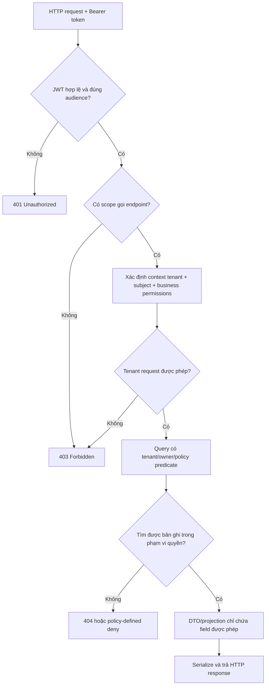
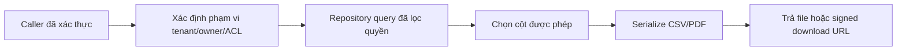

# Lọc dữ liệu theo quyền và tránh trả dư tài nguyên trước khi kiểm tra

## 1. Vì sao API đã xác thực JWT vẫn có thể rò rỉ dữ liệu?

Một **Spring Security OAuth 2.0 Resource Server** nhận access token, xác minh chữ ký, issuer, audience, thời hạn rồi kiểm tra scope để quyết định người gọi có được truy cập endpoint hay không. Những bước đó rất quan trọng nhưng **không tự động quyết định người gọi được xem bản ghi nào**.

Hãy xét một ứng dụng quản lý hóa đơn đa khách hàng (*multi-tenant*):

- Tenant `tenant-alpha` sở hữu hóa đơn A1, A2.
- Tenant `tenant-beta` sở hữu hóa đơn B1, B2.
- Người dùng `user-417` có scope `invoices.read` và chỉ thuộc Alpha.
- API cung cấp `GET /api/tenants/{tenantId}/invoices/{invoiceId}` và `GET /api/tenants/{tenantId}/invoices`.

Client gửi:

```http
GET /api/tenants/tenant-beta/invoices/11111111-1111-4111-8111-111111111111 HTTP/1.1
Host: invoices.example.com
Authorization: Bearer <access-token-of-tenant-alpha>
```

Access token có thể hoàn toàn hợp lệ:

```json
{
  "iss": "https://id.example.com/realms/shop",
  "sub": "user-417",
  "aud": ["invoices-api"],
  "scope": "invoices.read",
  "tenant_id": "tenant-alpha"
}
```

Nếu Controller chỉ dùng `hasAuthority("SCOPE_invoices.read")`, sau đó Repository gọi `findById(invoiceId)` mà **không kiểm tra tenant/chủ sở hữu**, API có nguy cơ trả hóa đơn của Beta cho người dùng Alpha.

Đây là một dạng **Broken Object Level Authorization (BOLA)**, thường được gọi là IDOR khi ứng dụng tin vào ID tài nguyên do Client cung cấp. Tương tự, việc trả quá nhiều thuộc tính nhạy cảm của một bản ghi là vấn đề **phân quyền ở mức thuộc tính đối tượng** (*Broken Object Property Level Authorization*).

Mục tiêu của bài này là thiết kế luồng:

> **Xác thực người gọi → xác định phạm vi dữ liệu được phép → truy vấn ngay trong phạm vi đó → chỉ tạo DTO với thuộc tính được phép → trả response.**

Không tải toàn bộ dữ liệu, không lập báo cáo toàn hệ thống, không ghi cache chung rồi mới hy vọng lọc đúng trong Controller.

### Sau bài học, bạn cần làm được

1. Phân biệt xác thực JWT, phân quyền HTTP và phân quyền trên đối tượng dữ liệu.
2. Đưa điều kiện tenant, chủ sở hữu và quyền nghiệp vụ vào **query**, không chỉ vào mã xử lý sau khi query.
3. Xử lý an toàn cả endpoint xem chi tiết, danh sách, tìm kiếm, phân trang, thống kê, xuất file và cập nhật dữ liệu.
4. Tránh để response, log, cache, event hoặc URL tải file lộ dữ liệu **trước** khi quyết định quyền.
5. Dùng Spring Security, Spring Data JPA, Service và DTO theo nguyên tắc **least privilege**.
6. Hiểu khi nào `401`, `403` hoặc `404` phù hợp.
7. Thiết kế những trường hợp kiểm tra trực tiếp nguy cơ truy cập chéo tenant/chủ sở hữu.

## 2. Bốn lớp kiểm soát khi trả tài nguyên

Để hiểu tại sao chỉ dùng `hasAuthority(...)` chưa đủ, hãy chia quyết định thành bốn lớp.

| Lớp | Câu hỏi | Thành phần thường xử lý |
|---|---|---|
| **1. Token authentication** | Token có hợp lệ, đúng issuer, audience và còn hạn không? | `JwtDecoder`, authentication provider |
| **2. Endpoint authorization** | Token có scope/authority gọi thao tác này không? | `SecurityFilterChain`, `@PreAuthorize` |
| **3. Object-level authorization** | Người gọi có quyền xem/sửa **bản ghi cụ thể** không? | Service, authorization service, Repository, DB policy |
| **4. Property-level authorization** | Trong bản ghi được phép, trường nào được trả? | DTO/projection, response mapping, field-level policy |

Ví dụ:

```text
GET /api/tenants/tenant-alpha/invoices/A1

JWT:
  issuer         = trusted
  audience       = invoices-api
  scope          = invoices.read
  tenant_id      = tenant-alpha
  subject        = user-417

Invoice A1:
  tenant_id      = tenant-alpha
  owner_subject  = user-902
  internal_notes = "Sensitive internal workflow"
```

Token đã đạt lớp 1 và 2. Nhưng:

- Nếu chính sách chỉ cho đọc hóa đơn của **chính mình**, user-417 không được xem A1.
- Nếu user-417 là quản lý của Alpha có quyền đọc hóa đơn trong tenant, quyền đó cần được xác minh độc lập.
- Dù được xem hóa đơn, Client vẫn không được tự nhận `internal_notes` nếu trường này chỉ dành cho nhân viên nội bộ.

**Phạm vi dữ liệu và phạm vi thuộc tính là hai quyết định khác nhau.**

### 2.1. Các dấu hiệu của phân quyền thiếu

Một số implementation dễ mắc lỗi:

```java
@GetMapping("/{id}")
@PreAuthorize("hasAuthority('SCOPE_invoices.read')")
public InvoiceEntity detail(@PathVariable UUID id) {
    return repository.findById(id).orElseThrow();
}
```

Code kiểm tra quyền **truy cập chức năng đọc**, không kiểm tra **quyền đối với `id`** và trả toàn bộ Entity. Nếu người dùng đoán một UUID của tenant khác, API có thể rò rỉ dữ liệu.

Một ví dụ khác:

```java
@GetMapping
public List<InvoiceEntity> list() {
    return repository.findAll();
}
```

Ngay cả khi endpoint chỉ dành cho người đã xác thực, `findAll()` có thể lấy bản ghi của mọi tenant. Việc xác thực thành công không biến `findAll()` thành “tìm tất cả hóa đơn được phép”.

## 3. Quy tắc quan trọng: lọc ở nguồn trước khi dựng response

Có hai cách tư duy khác nhau.

### 3.1. Mẫu không an toàn: fetch trước, kiểm tra sau

```java
// KHÔNG NÊN DÙNG cho dữ liệu multi-tenant hoặc dữ liệu nhạy cảm.
List<InvoiceEntity> allInvoices = repository.findAll();

return allInvoices.stream()
    .filter(invoice -> invoice.getTenantId().equals(requestTenant))
    .toList();
```

Những vấn đề của cách này:

- Đã tải dữ liệu không có quyền vào bộ nhớ ứng dụng.
- Dễ quên một điều kiện như owner, role, organization hoặc trạng thái bản ghi.
- Phân trang, sort và count có thể đã thực hiện trên **toàn bộ tập dữ liệu**.
- Mapper/log/metrics/trace/cache có thể chạm vào bản ghi ngoài quyền trước khi filter.
- Khi thêm một đường xử lý mới, developer có thể gọi nhầm danh sách `allInvoices`.
- Hiệu năng kém và nguy cơ quá tải khi số lượng bản ghi lớn.
- Query liên quan/association có thể bị lazy-load ngoài phạm vi mong đợi.

Lọc sau khi lấy dữ liệu chỉ phù hợp trong những trường hợp hẹp và kiểm soát được, chẳng hạn xử lý dữ liệu vốn đã được chứng minh thuộc phạm vi người gọi. Nó không phải lớp kiểm soát truy cập chính cho danh sách lớn hoặc dữ liệu đa tenant.

### 3.2. Mẫu ưu tiên: đưa phạm vi quyền vào truy vấn

```sql
SELECT id, tenant_id, invoice_no, total_amount
FROM invoices
WHERE tenant_id = :verified_tenant_id
  AND owner_issuer = :verified_issuer
  AND owner_subject = :verified_subject
ORDER BY created_at DESC, id DESC
LIMIT :page_size;
```

Trong truy vấn này:

- `verified_tenant_id` xuất phát từ ngữ cảnh đã xác thực và được phân quyền.
- `verified_issuer` và `verified_subject` xác định chủ thể theo hợp đồng token.
- Database chỉ trả bản ghi thuộc phạm vi **đã được giới hạn**.
- `SELECT` chỉ lấy các cột cần thiết cho response.
- `ORDER BY` và `LIMIT` áp dụng **sau khi điều kiện quyền đã được đưa vào query**.

Như vậy, nếu Client thay ID hoặc path tenant bằng giá trị của người khác, query không trả bản ghi.

### 3.3. Một nguyên tắc áp dụng rộng



**Không được** trả một phần dữ liệu, stream một vài bản ghi, tạo signed download URL hoặc commit HTTP response **rồi mới** quyết định tài nguyên đó có thuộc quyền người gọi không.

## 4. Xây dựng ngữ cảnh quyền từ token đã xác thực

Một Resource Server dùng JWT có thể nhận `Jwt` thông qua Spring Security:

```java
@GetMapping("/api/me")
public Map<String, String> me(@AuthenticationPrincipal Jwt jwt) {
    return Map.of("subject", jwt.getSubject());
}
```

Điều kiện tiên quyết: ứng dụng đã cấu hình đúng `oauth2ResourceServer(...jwt(...))`, issuer, khóa ký, thời hạn và audience phù hợp.

Giả sử hợp đồng access token có:

```json
{
  "iss": "https://id.example.com/realms/shop",
  "sub": "user-417",
  "aud": ["invoices-api"],
  "scope": "invoices.read",
  "tenant_id": "tenant-alpha"
}
```

Không lấy tenant hoặc danh tính từ `X-User-Id`, `X-Tenant-Id` hay JSON body do Client tự khai để thay thế cho thông tin xác thực.

### 4.1. Vì sao phải quan tâm cả `iss` và `sub`?

Nếu API chấp nhận nhiều Authorization Server, cùng một `sub` có thể xuất hiện ở hai issuer khác nhau:

```text
Issuer A + sub user-417
Issuer B + sub user-417
```

Hai chủ thể này không tự động là cùng một người. Định danh bên ngoài an toàn hơn thường là cặp **`(issuer, subject)`**, hoặc định danh người dùng nội bộ đã được ánh xạ từ cặp đó.

Để đơn giản, ví dụ dùng cả `ownerIssuer` và `ownerSubject` trong DB. Nếu hệ thống dùng một issuer duy nhất và có mapping user nội bộ độc lập, có thể thay bằng `internalUserId`, miễn nguồn ánh xạ được xác minh và không bị Client kiểm soát.

### 4.2. Tạo CallerContext đáng tin

Trong Service, có thể gom thông tin đã xác thực vào record:

```java
package com.example.invoices;

import org.springframework.security.oauth2.jwt.Jwt;

public record CallerContext(
        String issuer,
        String subject,
        String tenantId) {

    public static CallerContext from(Jwt jwt) {
        String issuer = jwt.getIssuer().toString();
        String subject = jwt.getSubject();
        String tenantId = jwt.getClaimAsString("tenant_id");

        if (subject == null || subject.isBlank()
                || tenantId == null || tenantId.isBlank()) {
            throw new IllegalStateException(
                "Authenticated token does not match the API contract");
        }

        return new CallerContext(issuer, subject, tenantId);
    }
}
```

Ví dụ giả định issuer là claim bắt buộc và đã được kiểm tra bởi decoder. **Trong ứng dụng thật, nên từ chối JWT thiếu/sai kiểu claim bắt buộc ngay tại validator**, thay vì để request vào Service rồi phát sinh `500` vì dữ liệu token không đáp ứng hợp đồng.

Đoạn `CallerContext` không tự tạo độ tin cậy; nó chỉ đóng gói **`Jwt` đã được Spring Security xác thực**. Nếu gọi `from(...)` với JWT tự giải mã từ chuỗi chưa xác thực, toàn bộ cách phân quyền có thể bị phá.

### 4.3. So sánh tenant trên URL với tenant đã xác thực

Ví dụ route:

```text
/api/tenants/{tenantId}/invoices
```

Có thể dùng helper:

```java
public static void requireSameTenant(
        String requestedTenant,
        CallerContext caller) {

    if (!caller.tenantId().equals(requestedTenant)) {
        throw new AccessDeniedException("Tenant access denied");
    }
}
```

Nhưng điều kiện này chỉ đúng nếu hợp đồng access token quy định **mỗi token chỉ đại diện một tenant hiện hành**. Nếu một người dùng được phép hoạt động ở nhiều tenant, cần mô hình membership/entitlement rõ ràng hoặc phát token theo tenant được chọn. Đừng sửa điều kiện thành “tin tenant trong URL” để bỏ qua claim.

Quan trọng hơn, **so sánh tenant URL không thay thế tenant predicate trong SQL**. Nếu hóa đơn `invoiceId` thuộc tenant khác dù URL ghi Alpha, Repository vẫn phải từ chối nó.

## 5. Bảo vệ theo danh sách: phân quyền trước khi phân trang

Danh sách là nơi dễ rò rỉ dữ liệu nhất vì nó có nhiều bề mặt:

- Các item trong response.
- `totalElements`, `totalPages` và số lượng trả về.
- Tiêu đề/nhãn của các bản ghi.
- Dữ liệu tìm kiếm, autocomplete và gợi ý.
- Sort, filter, cursor và số liệu tổng hợp.
- Quan hệ lồng nhau được tải cùng mỗi item.

### 5.1. Sai lầm: phân trang toàn bộ rồi mới filter

Giả sử DB có 100.000 hóa đơn, người dùng chỉ được phép xem 40 hóa đơn. Code:

```java
Page<InvoiceEntity> page =
    invoiceRepository.findAll(PageRequest.of(0, 20));

List<InvoiceDto> visible = page.getContent().stream()
    .filter(invoice -> canRead(caller, invoice))
    .map(InvoiceDto::from)
    .toList();

return new PagedResponse<>(
    visible,
    page.getTotalElements());
```

Có ít nhất hai vấn đề:

1. `totalElements` có thể tiết lộ tổng số hóa đơn **toàn hệ thống**.
2. 20 item được phân trang trước có thể thuộc tenant khác; sau filter còn 0–2 item mặc dù người dùng thực ra có 40 hóa đơn ở các trang sau.

Các vấn đề tương tự xảy ra với `LIMIT/OFFSET`, cursor, search score và aggregation nếu tính trên tập dữ liệu chưa lọc quyền.

### 5.2. Đúng hơn: lọc trước, rồi sort/paginate/count

```sql
SELECT id, invoice_no, total_amount
FROM invoices
WHERE tenant_id = :tenant_id
  AND owner_issuer = :issuer
  AND owner_subject = :subject
ORDER BY created_at DESC, id DESC
LIMIT :limit OFFSET :offset;
```

Đồng thời, query count phải có **cùng phạm vi quyền**:

```sql
SELECT COUNT(*)
FROM invoices
WHERE tenant_id = :tenant_id
  AND owner_issuer = :issuer
  AND owner_subject = :subject;
```

Nếu người dùng có 40 hóa đơn được phép, metadata phản ánh phạm vi 40 hóa đơn đó, không phản ánh 100.000 hóa đơn của toàn hệ thống.

### 5.3. Spring Data JPA: Repository lọc quyền ngay trong query

Ví dụ một Entity rút gọn:

```java
package com.example.invoices;

import java.math.BigDecimal;
import java.time.Instant;
import java.util.UUID;
import jakarta.persistence.Column;
import jakarta.persistence.Entity;
import jakarta.persistence.Id;
import jakarta.persistence.Table;

@Entity
@Table(name = "invoices")
public class InvoiceEntity {
    @Id
    private UUID id;

    @Column(name = "tenant_id", nullable = false)
    private String tenantId;

    @Column(name = "owner_issuer", nullable = false)
    private String ownerIssuer;

    @Column(name = "owner_subject", nullable = false)
    private String ownerSubject;

    @Column(name = "invoice_no", nullable = false)
    private String invoiceNo;

    @Column(name = "total_amount", nullable = false)
    private BigDecimal totalAmount;

    @Column(name = "created_at", nullable = false)
    private Instant createdAt;

    protected InvoiceEntity() {
        // JPA
    }

    public UUID getId() { return id; }
    public String getTenantId() { return tenantId; }
    public String getOwnerIssuer() { return ownerIssuer; }
    public String getOwnerSubject() { return ownerSubject; }
    public String getInvoiceNo() { return invoiceNo; }
    public BigDecimal getTotalAmount() { return totalAmount; }
    public Instant getCreatedAt() { return createdAt; }
}
```

DTO/projection chỉ chứa những trường được phép công bố:

```java
package com.example.invoices;

import java.math.BigDecimal;
import java.util.UUID;

public record InvoiceListItem(
    UUID id,
    String invoiceNo,
    BigDecimal totalAmount
) {
}
```

Repository:

```java
package com.example.invoices;

import java.util.Optional;
import java.util.UUID;
import org.springframework.data.domain.Page;
import org.springframework.data.domain.Pageable;
import org.springframework.data.jpa.repository.JpaRepository;
import org.springframework.data.jpa.repository.Query;
import org.springframework.data.repository.query.Param;

public interface InvoiceRepository
        extends JpaRepository<InvoiceEntity, UUID> {

    Optional<InvoiceEntity>
        findByIdAndTenantIdAndOwnerIssuerAndOwnerSubject(
            UUID id,
            String tenantId,
            String ownerIssuer,
            String ownerSubject);

    @Query(
        value = """
            select new com.example.invoices.InvoiceListItem(
                i.id, i.invoiceNo, i.totalAmount)
            from InvoiceEntity i
            where i.tenantId = :tenant
              and i.ownerIssuer = :issuer
              and i.ownerSubject = :subject
            """,
        countQuery = """
            select count(i)
            from InvoiceEntity i
            where i.tenantId = :tenant
              and i.ownerIssuer = :issuer
              and i.ownerSubject = :subject
            """
    )
    Page<InvoiceListItem> findVisibleList(
        @Param("tenant") String tenant,
        @Param("issuer") String issuer,
        @Param("subject") String subject,
        Pageable pageable);
}
```

Điểm then chốt:

- Cả query nội dung và `countQuery` cùng ràng buộc tenant/issuer/subject.
- Database chỉ chọn ba cột mà list API cần, không truy xuất Entity đầy đủ và serialize ngoài ý muốn.
- `Pageable` áp dụng trên tập đã lọc.
- Người dùng thay `page`, `size` hoặc `sort` không thể bỏ điều kiện `WHERE` do server xây dựng.

Khi cho phép sort động, cần giới hạn các trường sort hợp lệ để tránh truy vấn ngoài dự kiến hoặc lộ các trường không nên hiển thị. Phân trang lớn cũng cần giới hạn `pageSize`; đây vừa là bảo vệ tài nguyên hệ thống vừa giảm rủi ro xuất dữ liệu hàng loạt.

## 6. Xem chi tiết: không fetch bằng ID toàn cục rồi mới quyết định quyền

Với endpoint:

```http
GET /api/tenants/tenant-alpha/invoices/11111111-1111-4111-8111-111111111111 HTTP/1.1
Authorization: Bearer <jwt-of-tenant-alpha>
```

Một cách dễ bị sai:

```java
InvoiceEntity invoice = repository.findById(invoiceId)
    .orElseThrow(() -> new ResponseStatusException(
        HttpStatus.NOT_FOUND));

if (!invoice.getTenantId().equals(caller.tenantId())) {
    throw new AccessDeniedException("Forbidden");
}

return InvoiceDto.from(invoice);
```

Trong luồng trả một DTO đơn giản, việc kiểm tra sau `findById` có thể vẫn chặn response nếu thực hiện đúng và chưa có side effect. Tuy nhiên, đây là một **điểm yếu thiết kế**:

- Entity ngoài quyền đã được tải vào Service.
- Association, mapper, logging, metrics hoặc lazy loading có thể chạm tới dữ liệu ngoài quyền.
- Một refactor có thể đặt mapping/side effect trước câu `if`.
- Dễ bỏ sót owner/issuer/tenant ở một đường code khác.

Ưu tiên query tìm bản ghi **đã có phạm vi quyền**:

```java
Optional<InvoiceEntity> result =
    repository.findByIdAndTenantIdAndOwnerIssuerAndOwnerSubject(
        invoiceId,
        caller.tenantId(),
        caller.issuer(),
        caller.subject());
```

Nếu không tìm thấy, Service có thể trả `404` theo chính sách “không tiết lộ bản ghi ngoài quyền có tồn tại hay không”.

### 6.1. Service mẫu

```java
package com.example.invoices;

import java.util.UUID;
import org.springframework.data.domain.Page;
import org.springframework.data.domain.Pageable;
import org.springframework.http.HttpStatus;
import org.springframework.security.access.AccessDeniedException;
import org.springframework.security.oauth2.jwt.Jwt;
import org.springframework.stereotype.Service;
import org.springframework.transaction.annotation.Transactional;
import org.springframework.web.server.ResponseStatusException;

@Service
public class InvoiceService {

    private final InvoiceRepository repository;

    public InvoiceService(InvoiceRepository repository) {
        this.repository = repository;
    }

    @Transactional(readOnly = true)
    public InvoiceListItem readOne(
            String requestedTenant,
            UUID invoiceId,
            Jwt jwt) {

        CallerContext caller = CallerContext.from(jwt);
        requireSameTenant(requestedTenant, caller);

        InvoiceEntity invoice = repository
            .findByIdAndTenantIdAndOwnerIssuerAndOwnerSubject(
                invoiceId,
                caller.tenantId(),
                caller.issuer(),
                caller.subject())
            .orElseThrow(() ->
                new ResponseStatusException(HttpStatus.NOT_FOUND));

        return new InvoiceListItem(
            invoice.getId(),
            invoice.getInvoiceNo(),
            invoice.getTotalAmount());
    }

    @Transactional(readOnly = true)
    public Page<InvoiceListItem> list(
            String requestedTenant,
            Jwt jwt,
            Pageable pageable) {

        CallerContext caller = CallerContext.from(jwt);
        requireSameTenant(requestedTenant, caller);

        return repository.findVisibleList(
            caller.tenantId(),
            caller.issuer(),
            caller.subject(),
            pageable);
    }

    private void requireSameTenant(
            String requestedTenant,
            CallerContext caller) {

        if (!caller.tenantId().equals(requestedTenant)) {
            throw new AccessDeniedException("Tenant access denied");
        }
    }
}
```

Service thể hiện quy tắc nhất quán: kiểm tra tenant của request **trước** khi truy vấn, dùng Repo method có predicate cho tenant và owner, rồi chỉ tạo DTO từ bản ghi trong phạm vi.

`@Transactional(readOnly = true)` mô tả giao dịch đọc. Nó **không phải cơ chế authorization** và không bảo đảm dữ liệu đúng tenant nếu query không ràng buộc.

### 6.2. Controller mẫu

```java
package com.example.invoices;

import java.util.UUID;
import org.springframework.data.domain.Page;
import org.springframework.data.domain.Pageable;
import org.springframework.security.core.annotation.AuthenticationPrincipal;
import org.springframework.security.oauth2.jwt.Jwt;
import org.springframework.web.bind.annotation.GetMapping;
import org.springframework.web.bind.annotation.PathVariable;
import org.springframework.web.bind.annotation.RequestMapping;
import org.springframework.web.bind.annotation.RestController;

@RestController
@RequestMapping("/api/tenants/{tenantId}/invoices")
public class InvoiceController {

    private final InvoiceService service;

    public InvoiceController(InvoiceService service) {
        this.service = service;
    }

    @GetMapping
    public Page<InvoiceListItem> list(
            @PathVariable String tenantId,
            @AuthenticationPrincipal Jwt jwt,
            Pageable pageable) {

        return service.list(tenantId, jwt, pageable);
    }

    @GetMapping("/{invoiceId}")
    public InvoiceListItem detail(
            @PathVariable String tenantId,
            @PathVariable UUID invoiceId,
            @AuthenticationPrincipal Jwt jwt) {

        return service.readOne(tenantId, invoiceId, jwt);
    }
}
```

Controller không tự gọi `findAll()` hoặc `findById()`. Nó giao việc kiểm tra tenant và tìm trong phạm vi quyền cho Service.

Ví dụ đang áp dụng chính sách **mỗi user chỉ đọc hóa đơn do chính mình sở hữu**. Nếu hệ thống muốn role quản lý xem tất cả hóa đơn trong tenant, cần xây một chính sách và query nhánh riêng có kiểm tra vai trò **theo tenant**, không loại bỏ owner predicate cho mọi người dùng.

## 7. HTTP authorization: scope trước, quyền dữ liệu sau

Ví dụ Resource Server dùng Spring Security:

```groovy
dependencies {
    implementation 'org.springframework.boot:spring-boot-starter-web'
    implementation 'org.springframework.boot:spring-boot-starter-security'
    implementation 'org.springframework.boot:spring-boot-starter-oauth2-resource-server'
    implementation 'org.springframework.boot:spring-boot-starter-data-jpa'
}
```

Trong `application.yml`:

```yaml
spring:
  security:
    oauth2:
      resourceserver:
        jwt:
          issuer-uri: https://id.example.com/realms/shop
```

Issuer là ví dụ, phải được thay bằng Authorization Server thật. Cần xác minh `aud` là `invoices-api` theo hợp đồng bằng audience validator hoặc cơ chế tương ứng; không chỉ dựa vào issuer và scope.

Cấu hình endpoint:

```java
package com.example.invoices;

import org.springframework.context.annotation.Bean;
import org.springframework.context.annotation.Configuration;
import org.springframework.http.HttpMethod;
import org.springframework.security.config.Customizer;
import org.springframework.security.config.annotation.web.builders.HttpSecurity;
import org.springframework.security.config.http.SessionCreationPolicy;
import org.springframework.security.web.SecurityFilterChain;

@Configuration
public class SecurityConfig {

    @Bean
    SecurityFilterChain api(HttpSecurity http) throws Exception {
        return http
            .securityMatcher("/api/**")
            .csrf(csrf -> csrf.disable())
            .sessionManagement(s -> s.sessionCreationPolicy(
                SessionCreationPolicy.STATELESS))
            .authorizeHttpRequests(auth -> auth
                .requestMatchers(HttpMethod.GET, "/api/public/ping")
                    .permitAll()

                .requestMatchers(
                    HttpMethod.GET,
                    "/api/tenants/*/invoices",
                    "/api/tenants/*/invoices/*")
                    .hasAuthority("SCOPE_invoices.read")

                .anyRequest().denyAll()
            )
            .oauth2ResourceServer(oauth2 ->
                oauth2.jwt(Customizer.withDefaults()))
            .build();
    }
}
```

Giải thích:

- `SCOPE_invoices.read` là authority thường được tạo từ access token có `scope=invoices.read`.
- Endpoint rule kiểm tra **quyền đọc chức năng**, không tự lọc `tenant_id` hoặc `owner_subject` ở SQL.
- Service vẫn thực thi tenant, owner và property-level authorization.
- `anyRequest().denyAll()` từ chối thao tác API chưa được khai báo.
- `csrf.disable()` chỉ minh họa REST API dùng Bearer header, không dựa vào cookie/session để xác thực.

Cấu hình chỉ có API chain `securityMatcher("/api/**")`. Nếu ứng dụng còn endpoint khác, cần bảo đảm các route đó có chain/cơ chế bảo vệ riêng hoặc catch-all thích hợp. `anyRequest().denyAll()` bên trong API chain không tự bảo vệ URL ở ngoài `/api/**`.

### 7.1. Tại sao `@PreAuthorize` không thay thế query có phạm vi?

Ví dụ:

```java
@PreAuthorize("hasAuthority('SCOPE_invoices.read')")
public InvoiceListItem readInvoice(UUID invoiceId) {
    return findInvoiceById(invoiceId);
}
```

Annotation đảm bảo người gọi có authority đọc hóa đơn, nhưng không tự kiểm tra **hóa đơn nào**. Ngay cả biểu thức:

```java
@PreAuthorize("@invoicePolicy.canRead(authentication, #invoiceId)")
```

cũng cần `invoicePolicy` kiểm tra đúng tenant, ownership và quyền hiện hành. Nếu policy tải dữ liệu để kiểm tra rồi Service tải lại, có thể phát sinh thừa query hoặc trạng thái quyền thay đổi giữa hai lần đọc. Với điều kiện có thể biểu diễn trong DB, dùng query có predicate để ràng buộc ngay thao tác lấy dữ liệu là lựa chọn thường rõ ràng hơn.

Có thể **kết hợp** method security để bảo vệ thao tác/scope với truy vấn hạn chế quyền ở Repository; hai lớp không loại trừ nhau.

## 8. Phân quyền người quản lý và các vai trò khác

Chính sách “chỉ owner” là một ví dụ. Hệ thống thật có thể có:

- **Owner:** chỉ được xem hóa đơn của mình.
- **Tenant accountant:** được xem mọi hóa đơn của tenant hiện hành.
- **Tenant admin:** có thêm quyền ghi/xóa theo rule nghiệp vụ.
- **Platform auditor:** được xem một phạm vi nhiều tenant qua quyền đặc biệt được kiểm soát.
- **Service account:** chỉ được xử lý những hóa đơn của Client/tenant mà dịch vụ được giao.

Không nên viết một điều kiện chung:

```java
if (authentication.isAuthenticated()) {
    return repository.findAll();
}
```

### 8.1. Ghi rõ policy trước khi viết query

Ví dụ bảng:

| Principal | Scope cần có | Quyền danh sách | Quyền xem chi tiết |
|---|---|---|---|
| User thông thường | `invoices.read` | Chỉ hóa đơn có `tenant_id` và owner phù hợp | Chỉ hóa đơn thuộc mình |
| Kế toán tenant | `invoices.read` và membership role được xác minh | Tất cả hóa đơn **trong tenant được cấp quyền** | Hóa đơn cùng tenant |
| Admin tenant | Scope/role theo hợp đồng | Trong tenant, không tự vượt tenant | Theo role/quy định |
| Auditor nhiều tenant | Quyền chuyên biệt, có audit | Chỉ các tenant trong phạm vi được cấp | Theo phạm vi audit |
| Dịch vụ máy-máy | Scope/Client/entitlement theo hợp đồng | Đúng tenant/công việc được giao | Theo service policy |

Không nên coi `ROLE_ADMIN` từ bất kỳ token nào là quyền truy cập tất cả tenant. Role toàn hệ thống, role của một tenant và role của một nhóm tài nguyên là các khái niệm khác nhau.

### 8.2. Query theo một trong các quyền được phép

Một cách triển khai với tenant accountant:

```java
@Query("""
    select new com.example.invoices.InvoiceListItem(
        i.id, i.invoiceNo, i.totalAmount)
    from InvoiceEntity i
    where i.tenantId = :tenant
    """)
Page<InvoiceListItem> findForTenantAccountant(
    @Param("tenant") String verifiedTenant,
    Pageable pageable);
```

Điều kiện **trước khi gọi method này** phải chứng minh caller thực sự là accountant của tenant đó, qua claim role có ngữ nghĩa tin cậy hoặc tra bảng membership/permission được quản trị. Không cho Client tự đặt `role=accountant` trong request rồi gọi method.

Ở những hệ thống quyền phức tạp hơn, có thể đưa phép kiểm tra membership/ACL vào SQL:

```sql
SELECT i.id, i.invoice_no, i.total_amount
FROM invoices i
WHERE i.tenant_id = :requested_tenant
  AND (
    (i.owner_issuer = :issuer AND i.owner_subject = :subject)
    OR EXISTS (
      SELECT 1
      FROM tenant_memberships tm
      WHERE tm.tenant_id = i.tenant_id
        AND tm.principal_issuer = :issuer
        AND tm.principal_subject = :subject
        AND tm.role = 'ACCOUNTANT'
        AND tm.active = TRUE
    )
  );
```

Query này mô tả ý tưởng policy; schema/role thực tế tùy hệ thống. `EXISTS` kiểm tra membership của tenant **ứng với hóa đơn**. Cần kết hợp scope endpoint, trạng thái bản ghi, ngày hiệu lực membership và những điều kiện nghiệp vụ liên quan.

### 8.3. Tránh lỗi logic AND/OR trong SQL

Câu điều kiện có thể bị sai do thiếu ngoặc:

```sql
-- NGUY HIỂM: quyền accountant có thể vượt tenant do OR.
WHERE tenant_id = :tenant
  AND owner_subject = :subject
  OR :is_accountant = TRUE;
```

Toán tử `AND` có mức ưu tiên cao hơn `OR`, nên `:is_accountant = TRUE` có thể làm query trả bản ghi của **mọi tenant**.

Cần nhóm điều kiện:

```sql
WHERE tenant_id = :tenant
  AND (
    owner_subject = :subject
    OR :verified_accountant_of_this_tenant = TRUE
  );
```

Ngay cả với cách sửa này, `:verified_accountant_of_this_tenant` phải do server xác minh theo **tenant tương ứng**; không lấy boolean từ HTTP body/header.

## 9. Property-level authorization: chỉ trả trường cần thiết

Được phép xem một hóa đơn không có nghĩa được xem mọi field của Entity.

Ví dụ bảng có:

```text
id
tenant_id
owner_issuer
owner_subject
invoice_no
total_amount
customer_email
billing_address
internal_fraud_flag
internal_notes
created_at
updated_at
```

Một API dành cho khách hàng có thể chỉ được trả:

```json
{
  "id": "11111111-1111-4111-8111-111111111111",
  "invoiceNo": "INV-42",
  "totalAmount": 250.00
}
```

Không nên serialize toàn bộ JPA Entity:

```java
@GetMapping("/{id}")
public InvoiceEntity detail(@PathVariable UUID id) {
    return repository.findById(id).orElseThrow();
}
```

Rủi ro:

- Field mới được thêm vào Entity có thể tự xuất hiện trong JSON.
- Quan hệ `@OneToMany`, `@ManyToOne` có thể làm lộ object liên quan.
- Thông tin nội bộ, khóa nghiệp vụ hoặc cờ chống gian lận có thể bị trả ngoài ý muốn.
- Các chu kỳ tham chiếu/lazy loading còn tạo vấn đề hiệu năng hoặc lỗi serialization.

### 9.1. Dedicated DTO hoặc projection

```java
public record InvoiceListItem(
    UUID id,
    String invoiceNo,
    BigDecimal totalAmount
) {
}
```

Service chỉ tạo `InvoiceListItem` từ bản ghi thuộc quyền. Với endpoint dành cho kế toán, có thể có DTO khác cho các trường được cấp quyền tương ứng.

### 9.2. Không xem `@JsonIgnore` là giải pháp duy nhất

`@JsonIgnore` có thể hữu ích để ẩn field, nhưng khi Entity phục vụ nhiều endpoint/nhóm quyền khác nhau, annotation đơn lẻ khó biểu diễn tất cả tình huống. DTO tách biệt giúp xác định rõ **hợp đồng response** và giới hạn data exposure ngay tại query.

Nếu dùng projection để chỉ lấy các cột cần thiết, cả **data retrieval** và **response serialization** đều giảm nguy cơ xuất dư dữ liệu.

### 9.3. Field-level permission theo vai trò

Có thể định nghĩa:

| Trường | Khách hàng sở hữu hóa đơn | Kế toán tenant | Nhân viên nội bộ chuyên trách |
|---|---|---|---|
| Mã hóa đơn, tổng tiền | Có | Có | Có khi đủ quyền |
| Email khách hàng | Theo chính sách riêng | Có nếu nghiệp vụ cần | Có nếu được cấp |
| Ghi chú nội bộ | Không | Không | Chỉ role chuyên trách |
| Cờ fraud nội bộ | Không | Không | Theo quyền chặt |
| Tenant/owner IDs | Không nhất thiết cần lộ | Theo API contract | Theo policy |

Nếu Client không có quyền với trường nhạy cảm, **đừng đọc trường đó không cần thiết từ DB** và đừng trả một cấu trúc chứa field rồi hy vọng frontend không hiển thị.

## 10. Lọc quyền cho tìm kiếm, autocomplete và phân trang nâng cao

### 10.1. Search filter phải nằm trước kết quả trả về

Một endpoint tìm kiếm:

```http
GET /api/tenants/tenant-alpha/invoices/search?q=INV HTTP/1.1
Authorization: Bearer <access-token>
```

Không nên lấy kết quả toàn hệ thống từ Elasticsearch/OpenSearch hoặc DB rồi mới lọc trong API, vì:

- Snippet, highlight hoặc score có thể chứa/tiết lộ dữ liệu không thuộc quyền.
- Tổng hit count có thể tiết lộ số lượng tài liệu bí mật.
- Autocomplete có thể gợi ý mã khách hàng hoặc hóa đơn của tenant khác.
- Phân trang kết quả sẽ thiếu ổn định sau filter.
- Search aggregations có thể tính trên toàn bộ tập dữ liệu.

Query gửi vào công cụ tìm kiếm cần có **security filter** tương ứng với tenant, principal, group/ACL theo hệ thống tìm kiếm. Search index phải lưu đủ thông tin bảo mật để lọc, và việc đồng bộ quyền/index cũng cần được quản trị.

### 10.2. Tổng số và metadata cũng là dữ liệu

Ví dụ response không an toàn:

```json
{
  "items": [
    {"invoiceNo": "INV-42"}
  ],
  "totalSystemInvoices": 103284,
  "visibleInvoices": 1
}
```

Dù `items` đã lọc, `totalSystemInvoices` có thể lộ số liệu nội bộ. Trong nhiều ứng dụng, **số lượng, thời điểm cập nhật, danh mục, tên file và gợi ý tìm kiếm** đều có thể nhạy cảm.

Nếu API định công bố số liệu tổng hợp cho một nhóm người dùng, phải có chính sách cấp quyền riêng cho dữ liệu thống kê đó.

### 10.3. Sort và cursor

Sort trên tập quyền cần được kiểm soát:

```sql
SELECT id, invoice_no, total_amount, created_at
FROM invoices
WHERE tenant_id = :tenant
  AND owner_subject = :subject
ORDER BY created_at DESC, id DESC
LIMIT :limit;
```

Cursor pagination cũng phải giữ ràng buộc tenant/owner cho **mọi trang**. Không dùng một cursor từ tenant Alpha để truy cập dữ liệu tenant Beta. Nếu cursor chứa thông tin nhạy cảm hoặc trạng thái phạm vi truy cập, có thể ký/mã hóa hoặc quản lý state server-side và ràng buộc với caller/tenant theo hợp đồng.

Thứ tự sort ổn định cần tie-breaker (ví dụ `id`) để tránh trùng/bỏ sót bản ghi; điều đó hỗ trợ tính chính xác của phân trang nhưng không thay thế policy về quyền.

### 10.4. Paging count query phải cùng điều kiện quyền

Với Spring Data JPA có `@Query` tùy biến, hãy chú ý `countQuery`. Nếu query trang lọc tenant nhưng count query không lọc tenant, API có thể trả:

```json
{
  "content": [],
  "totalElements": 100000
}
```

dù caller chỉ có vài hóa đơn. Đó là rò rỉ metadata và sai logic phân trang.

## 11. Xuất báo cáo, tải file và response streaming

Các endpoint xuất dữ liệu thường bị bỏ qua vì developer nghĩ “chỉ là một cách trình bày khác của danh sách”.

### 11.1. Export CSV/Excel/PDF phải dùng tập dữ liệu đã phân quyền

Không nên:

```text
findAllInvoices()
    → generateCsv(allInvoices)
    → filterRowsForCaller()
    → returnFile
```

File đã được tạo từ dữ liệu rộng hơn quyền. Một số cột hoặc metadata có thể vẫn tồn tại trong file, hoặc file tạm được lưu ở nơi người gọi có thể truy cập.

Luồng nên là:



Nếu export chạy qua background job, không được giả định quyền ở lúc tạo job luôn còn nguyên khi job chạy hoặc khi file được tải. Cần một chính sách rõ: snapshot quyền tại thời điểm nào, kiểm tra lại lúc download ra sao, file sống bao lâu và có được thu hồi không.

### 11.2. Streaming phải tránh gửi dữ liệu trước khi kiểm tra quyền

Khi dùng `StreamingResponseBody` hoặc reactive stream, việc ghi response có thể diễn ra từng phần. Nếu server đã gửi 100 dòng đầu rồi mới phát hiện dòng 101 thuộc tenant khác, dữ liệu đã bị lộ và response có thể đã **commit**, không thể thu hồi.

Vì vậy:

- Xác định scope/tenant/owner trước khi bắt đầu stream.
- Sử dụng query hoặc cursor DB **đã lọc quyền**.
- Chỉ serialize những field được phép.
- Nếu policy yêu cầu kiểm tra từng dòng, cần đảm bảo dòng **chưa được ghi** trước khi đạt kiểm tra đó.
- Thiết lập cách xử lý thay đổi quyền trong quá trình stream dài.

Một exception được ném sau khi output stream đã gửi dữ liệu không có tác dụng “xóa dữ liệu đã truyền”.

### 11.3. Signed URL và object storage

Với file hóa đơn lưu trong object storage:

1. API xác thực caller.
2. API tìm metadata file trong phạm vi tenant/owner.
3. API xác nhận quyền download.
4. **Sau khi đạt quyền** mới tạo signed URL ngắn hạn dành cho đúng object.
5. Client tải file theo chính sách expiry và storage.

Không tạo signed URL cho mọi file rồi lọc link theo tenant ở frontend. Nếu signed URL được cache hoặc ghi log, có nguy cơ bị sử dụng lại ngoài ý định.

Tên object/key cũng có thể tiết lộ thông tin như tenant, mã khách hàng; tránh biến path/object name thành bằng chứng phân quyền duy nhất.

## 12. Cache: phân quyền đúng ở database nhưng sai ở Redis vẫn rò rỉ

Một cache key quá chung:

```text
invoice:11111111-1111-4111-8111-111111111111
```

có thể chứa DTO được tạo cho người có nhiều quyền, rồi được trả lại cho người có ít quyền hơn nếu ứng dụng bỏ qua authorization ở cache-hit path.

### 12.1. Hai chiến lược cache

**Chiến lược A — Cache dữ liệu thô và luôn kiểm tra quyền trước khi trả**

Ví dụ:

```text
Request
  → authenticate
  → authorize invoice for current tenant/owner
  → load cached domain data (if present)
  → construct allowed DTO
  → respond
```

Việc kiểm tra quyền phải được thực hiện **kể cả cache hit**; không cho rằng cache key chứa ID là đã đủ.

**Chiến lược B — Cache kết quả đã phân quyền theo phạm vi**

Khi cache một danh sách hoặc DTO đã được cá nhân hóa, key có thể cần chứa tenant, issuer/subject hoặc định danh internal user, quyền/role phiên bản hiện tại, điều kiện tìm kiếm và page:

```text
invoices:list:
  tenant=tenant-alpha:
  principal=issuerA:user-417:
  filter=status-open:
  page=0
```

Key trong ví dụ chỉ thể hiện khái niệm; tên thật nên được mã hóa/chuẩn hóa an toàn, giới hạn độ dài và tránh lộ định danh nhạy cảm qua log hoặc hệ thống cache không phù hợp.

Nếu entitlement thay đổi, cached response theo principal/permission cũ có thể không còn được phép. Cần versioning, invalidation hoặc TTL phù hợp với yêu cầu thu hồi quyền.

### 12.2. Không chia sẻ cache tùy tiện qua tenant

Các cache list/search/count chỉ key bằng `page=0` hoặc `query=INV` đặc biệt nguy hiểm vì không phân biệt tenant. Với CDN hoặc HTTP cache, cần kiểm soát `Cache-Control`, `Vary` và việc cache response theo Authorization; dữ liệu cá nhân/tenant thường không nên lưu trong cache công cộng.

## 13. Cập nhật và xóa: quyền phải nằm trong điều kiện ghi

Bảo vệ không chỉ là `GET`. Ví dụ một user ở Alpha gửi:

```http
PATCH /api/tenants/tenant-alpha/invoices/11111111-1111-4111-8111-111111111111 HTTP/1.1
Authorization: Bearer <access-token>
Content-Type: application/json

{"status":"PAID"}
```

Một implementation không an toàn:

```java
InvoiceEntity invoice = repository.findById(invoiceId)
    .orElseThrow();

invoice.setStatus("PAID");
repository.save(invoice);
```

Nếu invoiceId trỏ tới bản ghi của Beta, code có thể sửa dữ liệu Beta.

### 13.1. Update với predicate tenant/owner

Ví dụ SQL:

```sql
UPDATE invoices
SET status = :new_status
WHERE id = :invoice_id
  AND tenant_id = :verified_tenant_id
  AND owner_issuer = :verified_issuer
  AND owner_subject = :verified_subject
  AND status = :expected_old_status;
```

Số dòng bị ảnh hưởng thường cần được kiểm tra:

- `1`: cập nhật được một bản ghi trong phạm vi quyền và trạng thái mong đợi.
- `0`: không tìm thấy trong phạm vi quyền, trạng thái đã đổi, hoặc không thỏa điều kiện; xử lý theo hợp đồng mà không tiết lộ dữ liệu không cần thiết.
- `>1`: bất thường nếu `id` là khóa duy nhất, cần xem lại schema.

Với kiểm tra nhiều điều kiện nghiệp vụ phức tạp, có thể dùng giao dịch và khóa/optimistic locking. Nhưng vẫn phải đảm bảo **bản ghi được lựa chọn theo phạm vi quyền trước khi thay đổi**.

### 13.2. Ví dụ Repository update trong Spring Data JPA

```java
@Modifying
@Query("""
    update InvoiceEntity i
       set i.status = :newStatus
     where i.id = :id
       and i.tenantId = :tenant
       and i.ownerIssuer = :issuer
       and i.ownerSubject = :subject
       and i.status = :expectedStatus
    """)
int updateStatusIfOwned(
    @Param("id") UUID id,
    @Param("tenant") String tenant,
    @Param("issuer") String issuer,
    @Param("subject") String subject,
    @Param("expectedStatus") String expectedStatus,
    @Param("newStatus") String newStatus);
```

Đây là method **bổ sung** vào `InvoiceRepository` sau khi Entity đã có field `status` và mapping tương ứng. Nếu copy snippet vào Entity ở mục 5.3, cần thêm field đó trước.

Code dùng `@Modifying` phải được gọi trong giao dịch thích hợp, ví dụ từ Service có `@Transactional`. Bulk update JPQL có đặc điểm riêng đối với persistence context và entity callbacks; cần chọn kỹ thuật phù hợp với nghiệp vụ. Điểm bảo mật là điều kiện `WHERE` phải bảo vệ tenant/owner và trạng thái được phép.

### 13.3. Tạo mới: đừng tin tenant và owner từ body

Client có thể gửi:

```json
{
  "tenantId": "tenant-beta",
  "ownerSubject": "admin",
  "totalAmount": 250
}
```

API không được ghi các field owner/tenant này như thông tin đã được cấp quyền. Khi tạo invoice:

- Tenant lấy từ context đã được xác minh/phân quyền.
- Owner lấy từ principal hoặc được xác minh qua chính sách “tạo hộ”.
- Các ID liên kết (customer, project, order) cũng phải thuộc tenant/phạm vi được phép.
- DTO request chỉ nhận những field Client được phép thay đổi.

Đây cũng là cách giảm rủi ro **mass assignment**: không bind JSON body trực tiếp vào Entity chứa các field bảo mật như `tenantId`, `ownerSubject`, `approvedBy` hoặc `isAdminOnly`.

## 14. Joins và quan hệ dữ liệu cần giữ cùng ranh giới

Ngay cả khi query chính đã có `tenant_id`, quan hệ liên bảng vẫn có thể lộ dữ liệu nếu ID liên kết không được ràng buộc.

Ví dụ:

```sql
SELECT i.id, i.tenant_id, c.name
FROM invoices i
JOIN customers c ON c.id = i.customer_id
WHERE i.tenant_id = :verified_tenant;
```

Nếu hệ thống có dữ liệu sai, khóa ngoại không ngăn trỏ tới customer của tenant khác, hoặc mã định danh được dùng lại giữa tenant, query có thể trả `c.name` từ phạm vi ngoài ý định.

Một quy tắc chặt hơn:

```sql
SELECT i.id, i.tenant_id, c.name
FROM invoices i
JOIN customers c
  ON c.id = i.customer_id
 AND c.tenant_id = i.tenant_id
WHERE i.tenant_id = :verified_tenant;
```

Ngoài SQL, nên thiết kế ràng buộc toàn vẹn dữ liệu tương ứng, chẳng hạn composite key/foreign key có tenant, tùy schema. Khi API thêm liên kết tới file, customer, project hoặc payment, phải xác minh **tất cả đối tượng liên quan** thuộc phạm vi mà caller được phép thao tác.

### 14.1. Không để N+1 làm mất kiểm soát quyền

Một Mapper có thể gọi lazy association cho mỗi invoice trong danh sách. Điều đó vừa tạo nhiều query vừa có thể làm lộ thông tin nếu association không được kiểm soát.

Ưu tiên projection với các trường thực sự cần; nếu dùng entity graph hoặc join fetch, đảm bảo quan hệ và tập kết quả tuân thủ tenant/ACL. Khi kết hợp collection fetch join với pagination, cần thận trọng vì framework có thể không thể áp dụng pagination ở database như dự kiến.

## 15. Database Row-Level Security như lớp phòng vệ bổ sung

Một số hệ thống sử dụng **Row-Level Security (RLS)** của cơ sở dữ liệu, ví dụ PostgreSQL, để ràng buộc truy cập ở tầng DB.

Ví dụ ý tưởng:

```sql
ALTER TABLE invoices ENABLE ROW LEVEL SECURITY;

CREATE POLICY invoices_tenant_policy
ON invoices
USING (
  tenant_id = current_setting('app.current_tenant_id', true)
)
WITH CHECK (
  tenant_id = current_setting('app.current_tenant_id', true)
);
```

Ý nghĩa:

- `USING` giới hạn hàng được đọc hoặc là đối tượng của thao tác theo chính sách.
- `WITH CHECK` kiểm tra hàng được tạo/cập nhật phù hợp tenant.
- `current_setting('app.current_tenant_id', true)` đọc biến session/transaction mà ứng dụng cần thiết lập đúng.

Một transaction có thể thiết lập context theo cơ chế PostgreSQL, chẳng hạn sử dụng `set_config(..., true)` với chế độ **transaction-local** trên đúng kết nối đã dùng để chạy query:

```sql
SELECT set_config('app.current_tenant_id', :verified_tenant_id, true);
```

### 15.1. Những điều kiện để RLS thật sự có ích

RLS không tự đảm bảo hệ thống an toàn nếu triển khai sai:

- Tenant context phải xuất phát từ principal đã xác thực, **không lấy từ header Client**.
- Context phải được thiết lập trên **đúng connection và transaction** trước khi chạy query.
- Với connection pool, không để tenant context của request trước rò sang request sau.
- Cần chính sách **fail closed** khi context chưa được thiết lập.
- Vai trò kết nối DB không được vô tình bypass RLS; table owner/superuser và các role có `BYPASSRLS` có hành vi đặc biệt. Xem xét `FORCE ROW LEVEL SECURITY` nơi phù hợp.
- Các truy vấn/reporting dùng role đặc quyền phải được bảo vệ theo policy riêng.
- RLS theo tenant không tự thực thi ownership, scope hoặc property-level authorization nếu policy chỉ có tenant predicate.

RLS là **defense in depth**, không phải lý do để bỏ kiểm tra quyền trong Service hoặc cấp cho API một tài khoản DB quá rộng.

### 15.2. Khi nào RLS phù hợp?

RLS hữu ích khi nhiều đường truy cập DB khó đảm bảo mọi query đều có tenant predicate hoặc tổ chức yêu cầu lớp bảo vệ DB tập trung. Tuy nhiên, việc quản trị session/transaction context, performance và privileged operations làm tăng độ phức tạp; không cần áp dụng RLS bằng mọi giá cho mọi ứng dụng.

## 16. 401, 403 và 404: không làm lộ sự tồn tại của tài nguyên

Với protected API, các trạng thái có ý nghĩa khác nhau:

| Trường hợp | Kết quả thường dùng |
|---|---|
| Không gửi token | `401 Unauthorized` |
| JWT sai chữ ký/issuer/audience, hết hạn | `401 Unauthorized` |
| Token hợp lệ nhưng thiếu `invoices.read` | `403 Forbidden` |
| Token hợp lệ của Alpha yêu cầu tenant Beta | `403` hoặc response ẩn chi tiết theo policy |
| Token hợp lệ, đúng tenant, nhưng không có quyền với invoice ID | Thường dùng `404` để không tiết lộ bản ghi |
| Invoice ID không tồn tại | `404 Not Found` |
| Token hợp lệ và đủ mọi điều kiện | `2xx` hoặc kết quả nghiệp vụ |

Không nhất thiết mọi API phải trả 404 khi không được phép. Tuy nhiên, với tài nguyên định danh bằng ID, chính sách **trả cùng kiểu 404 cho “không tồn tại” và “không thuộc phạm vi quyền”** có thể giảm khả năng dò xem bản ghi có tồn tại.

### 16.1. Không tiết lộ thông tin qua message và headers

Ví dụ không phù hợp:

```json
{
  "error": "Forbidden",
  "invoiceOwner": "user-902",
  "tenant": "tenant-beta",
  "reason": "You belong to tenant-alpha"
}
```

Thông báo này có thể tiết lộ tenant/owner của bản ghi mà người gọi không được xem.

Một response phù hợp hơn cho policy ẩn sự tồn tại:

```http
HTTP/1.1 404 Not Found
Content-Type: application/json

{"error":"RESOURCE_NOT_FOUND"}
```

Nếu dùng 403, thông báo vẫn nên không tiết lộ thông tin về bản ghi ngoài quyền.

### 16.2. Timing và hành vi phụ

Ngay cả khi response body giống nhau, thời gian xử lý khác biệt lớn giữa “ID không tồn tại” và “ID tồn tại nhưng thuộc tenant khác” có thể tạo ra tín hiệu suy đoán. Không thể bảo đảm thời gian hằng số cho mọi query nghiệp vụ, nhưng nên tránh những khác biệt có thể dễ dàng bị khai thác, đồng thời áp dụng rate limiting/audit theo nhu cầu.

Không nên ghi nguyên JWT hay dữ liệu bí mật ra log để chẩn đoán các lỗi 404/403.

## 17. Quyền có thể thay đổi giữa hai bước kiểm tra

Giả sử Service kiểm tra `user-417` là accountant của Alpha, rồi chạy một query khác để tải hóa đơn. Trong khoảng giữa hai bước:

- User có thể bị thu hồi membership.
- Hóa đơn có thể chuyển trạng thái/owner.
- Transaction khác có thể thay đổi bản ghi.

Vấn đề này thường gọi là **time-of-check to time-of-use (TOCTOU)** trong ngữ cảnh rộng.

### 17.1. Cách giảm rủi ro

Tùy yêu cầu bảo mật, có thể:

1. Đưa kiểm tra quyền vào **cùng query** dùng lấy/sửa bản ghi.
2. Sử dụng transaction và isolation level phù hợp cho thao tác nhiều bước.
3. Dùng optimistic versioning hoặc locking khi quyết định phụ thuộc trạng thái bản ghi.
4. Áp dụng cơ chế entitlement check/thu hồi token phù hợp khi quyền thay đổi nhanh.
5. Tránh dựa mãi vào claim role/membership trong JWT còn hạn nếu nghiệp vụ yêu cầu quyền hiện hành.

Ví dụ query `UPDATE ... WHERE tenant_id ... AND owner ... AND status = expected` kết hợp điều kiện quyền và trạng thái vào **một thao tác** giảm khoảng trống giữa kiểm tra và sử dụng.

### 17.2. JWT còn hạn không đồng nghĩa quyền vẫn còn

Nếu token có `tenant_id=tenant-alpha` và `role=ACCOUNTANT`, nhưng membership đã bị thu hồi ở DB sau khi token được cấp, Resource Server có thể tiếp tục thấy claim cũ cho đến khi token hết hạn.

Nếu quyền cần thu hồi tức thời, cân nhắc token ngắn hạn, truy vấn entitlement hiện hành, introspection hoặc cơ chế thu hồi được thiết kế phù hợp. Không nên tin rằng chữ ký JWT bảo đảm sự mới nhất của dữ liệu phân quyền.

## 18. Các đường phụ thường bị bỏ quên

Tài nguyên không chỉ rời hệ thống qua JSON REST response. Cần áp dụng cùng chính sách ở các đường khác.

### 18.1. GraphQL và nested resolvers

Một GraphQL query có thể truy cập `invoice.customer.email` dù resolver gốc đã được phân quyền invoice. Resolver của quan hệ/field nhạy cảm cần kiểm tra quyền phù hợp; không cho rằng chỉ kiểm tra query root là đủ.

### 18.2. Batch endpoints

Ví dụ:

```http
POST /api/invoices/batch-get HTTP/1.1

{"ids":["A1","B1","B2"]}
```

Không gọi `findAllById(ids)` rồi trả toàn bộ. Chỉ lấy ID trong phạm vi tenant/owner/ACL, và lựa chọn response không tiết lộ bản ghi ngoài quyền có tồn tại hay không. Nếu trả danh sách item riêng theo ID, các trạng thái per-item cũng cần chính sách tiết lộ phù hợp.

### 18.3. Background jobs và message consumers

Một job export được khởi tạo khi user có quyền, nhưng chạy sau khi membership bị thu hồi. Cần quy tắc rõ: kiểm tra lại quyền tại thời điểm chạy, hoặc dùng snapshot/ủy quyền có thời hạn đã được chấp nhận theo nghiệp vụ.

Message consumer cũng không nên tin `tenant_id` trong message chỉ vì một service khác gửi vào queue. Nếu message có thể đi qua nhiều nguồn, cần xác thực nguồn và áp dụng tenant/ACL theo hợp đồng tin cậy.

### 18.4. Audit, analytics và observability

Sự kiện phân tích có thể chứa mã hóa đơn, email hoặc tenant. Không gửi toàn bộ Entity vào log hoặc event trước khi xử lý data minimization. Trong audit nội bộ, có thể lưu những thông tin cần cho điều tra theo chính sách riêng, nhưng không để người dùng cuối xem được log/event ngoài quyền.

### 18.5. Tải file tĩnh và CDN

Nếu file hóa đơn được phục vụ trực tiếp qua một public bucket hoặc CDN URL vĩnh viễn, security rule của Controller không bảo vệ được đường tải đó. Phải thiết kế storage ACL, signed URL hoặc proxy download đã phân quyền để giữ cùng ranh giới bảo mật.

## 19. Ma trận kiểm tra: dữ liệu nào được trả?

Giả sử database có:

| Invoice ID | Tenant | Owner | Số tiền |
|---|---|---|---|
| A1 | Alpha | user-417 | 100 |
| A2 | Alpha | user-902 | 200 |
| B1 | Beta | user-417 | 300 |
| B2 | Beta | user-902 | 400 |

Token của `user-417`:

```text
issuer  = trusted-issuer
subject = user-417
tenant  = Alpha
scope   = invoices.read
```

Chính sách: **chỉ đọc hóa đơn do mình sở hữu trong tenant được cấp**.

| Thử nghiệm | Kết quả mong đợi |
|---|---|
| GET danh sách Alpha | Chỉ trả **A1** |
| GET danh sách Beta | Bị từ chối vì token tenant Alpha |
| GET chi tiết A1 | Cho phép |
| GET chi tiết A2 | Không trả A2; thường 404 |
| GET chi tiết B1 | Không trả B1 dù owner string là user-417, vì sai tenant |
| GET chi tiết B2 | Không trả B2 |
| Search mã hóa đơn trong Alpha | Chỉ kết quả được phép như A1 |
| Count danh sách Alpha | 1, không phải 2 hay 4 |
| Export Alpha | File chỉ chứa A1 và các cột được phép |
| Truy cập cache với key của B1 | Không trả dữ liệu B1 |
| UPDATE trạng thái B1 | Không có bản ghi Beta bị thay đổi |
| Gọi endpoint không có token | 401 |
| Token hợp lệ thiếu `invoices.read` | 403 |

Đây là các trường hợp có thể dùng để thiết kế integration tests, API tests và kiểm thử quyền trên dữ liệu. Không cần dùng token production hoặc dữ liệu khách hàng thật.

## 20. Kiểm thử Spring Security và Repository

### 20.1. MockMvc chỉ chứng minh một phần

Với Spring Security Test, có thể dùng `with(jwt())` để giả lập principal:

```java
mvc.perform(get("/api/tenants/tenant-alpha/invoices")
        .with(jwt()
            .jwt(j -> j
                .subject("user-417")
                .claim("tenant_id", "tenant-alpha"))
            .authorities(
                new SimpleGrantedAuthority("SCOPE_invoices.read"))))
    .andExpect(status().isOk());
```

Đây là ví dụ về **authorization test** khi `SecurityFilterChain` và Controller đã được cấu hình. `with(jwt())` không xác minh một token được ký thật bằng `JwtDecoder`/JWKS. Cần kiểm thử riêng chữ ký/issuer/audience/claim validators bằng token fixture hoặc môi trường Authorization Server phù hợp.

### 20.2. Repository test với dữ liệu chéo tenant

Khi dùng Spring Data JPA, có thể tạo bốn bản ghi A1, A2, B1, B2 như bảng trên, rồi kiểm tra:

```java
Page<InvoiceListItem> page = repository.findVisibleList(
    "tenant-alpha",
    "https://id.example.com/realms/shop",
    "user-417",
    PageRequest.of(0, 20));

assertThat(page.getContent())
    .extracting(InvoiceListItem::invoiceNo)
    .containsExactly("A1");

assertThat(page.getTotalElements()).isEqualTo(1);
```

Đoạn này minh họa một test dùng AssertJ; database fixture cần khai báo các Entity tương ứng với `invoiceNo` và issuer đã nêu. Nếu query không có `ORDER BY` rõ hoặc `Pageable` sort chưa được thiết lập, hãy kiểm tra tập kết quả thay vì yêu cầu một thứ tự bất kỳ.

### 20.3. Kiểm thử detail bằng ID của tenant khác

Các tình huống quan trọng:

```text
Token Alpha user-417:
  GET A1 -> 200 (nếu DTO mapping và policy đáp ứng)
  GET A2 -> 404/deny
  GET B1 -> 404/deny
  GET B2 -> 404/deny
```

**B1 đặc biệt quan trọng**: nó có cùng `owner_subject=user-417` nhưng thuộc Beta. Nếu Repository chỉ lọc owner mà quên tenant, test B1 sẽ phát hiện lỗi.

### 20.4. Kiểm thử negative side effects

Đối với write và export, kiểm tra không chỉ HTTP status:

- Sau request PATCH trái quyền, row trong DB không bị sửa.
- Sau export trái quyền, không có file chứa bản ghi ngoài quyền được tạo.
- Sau request download trái quyền, không có signed URL được phát.
- Sau list/search, count/hits chỉ phản ánh phạm vi được phép.
- Cache-hit không bypass quyền.
- Log/error không chứa dữ liệu của bản ghi ngoài quyền.

Chỉ kiểm tra API trả `403` chưa đủ nếu trước khi trả 403, hệ thống đã tạo file hoặc phát event chứa dữ liệu nhạy cảm.

## 21. Checklist triển khai theo luồng request

Khi xây một API có dữ liệu nhiều người dùng hoặc tenant, hãy lần lượt tự hỏi:

1. Token có được xác thực với issuer, audience, thời hạn và profile phù hợp không?
2. Scope/authority có cho phép **loại thao tác** này không?
3. Tenant/client/user context lấy từ nguồn đáng tin nào?
4. Quyền nghiệp vụ được diễn đạt bằng tenant, owner, membership, ACL hay một tập kết hợp?
5. Repository có đưa quyền vào query trước sort/paginate/count không?
6. Nếu query có join, quan hệ có giữ cùng ranh giới tenant/ACL không?
7. Nếu không thấy bản ghi trong phạm vi quyền, response có tiết lộ sự tồn tại của bản ghi không?
8. DTO/projection có loại những trường không được phép không?
9. Cache, search, export, file download và streaming có áp dụng cùng chính sách không?
10. Thao tác ghi có predicate tenant/owner và kiểm tra số dòng bị ảnh hưởng không?
11. Khi quyền thay đổi, cache và long-running tasks có hết hiệu lực theo policy không?
12. Các trường hợp chéo tenant, chéo owner, thiếu scope và token lỗi đã có tests tương ứng chưa?

Danh sách này là hướng dẫn để thiết kế kiểm soát truy cập nghiệp vụ; nó không thay thế kiểm thử thực tế hoặc các tiêu chuẩn an toàn ứng dụng của dự án.

## 22. Những sai lầm thường gặp và cách tránh

| Sai lầm | Vì sao nguy hiểm | Cách tiếp cận phù hợp |
|---|---|---|
| Chỉ dùng `hasAuthority("SCOPE_invoices.read")` rồi `findById` | BOLA/IDOR | Thêm tenant/owner/ACL trong query |
| `findAll` rồi filter stream | Tải dữ liệu ngoài quyền, sai paging/count | Filter tại DB/search |
| Chỉ kiểm tra `tenantId` trong URL | Client tự sửa path | Đối chiếu token/entitlement và dữ liệu |
| Chỉ kiểm tra owner, không kiểm tra tenant | Subject có thể trùng hoặc sở hữu ở tenant khác | Ràng buộc cả tenant và issuer/owner |
| Trả Entity trực tiếp | Lộ field/association mới | DTO/projection có kiểm soát |
| Count global dù list đã lọc | Lộ metadata | Count cùng predicate quyền |
| Search trước rồi filter response | Lộ hit count, snippet, pagination | Filter trước khi search/result |
| Cache theo ID rồi trả thẳng | Cache bypass authorization | Re-authorize trên cache hit hoặc cache theo phạm vi |
| Generate signed URL trước auth | Lộ file đã được ký | Authorize trước khi ký |
| Stream dữ liệu rồi mới check | Response đã commit, không thể thu hồi | Query quyền trước stream và check từng item trước write |
| UPDATE chỉ theo ID | Ghi vào bản ghi ngoài quyền | `UPDATE ... WHERE id AND tenant AND owner ...` |
| Tin tenant/owner trong request body | Mass assignment, leo thang quyền | Server gán tenant/owner đáng tin |
| Ghép join không xét tenant | Lộ liên kết chéo tenant | Join/constraints có tenant |
| Coi JWT còn hạn là membership hiện hành | Quyền có thể bị thu hồi | Entitlement/TTL/revocation strategy |
| Chỉ kiểm tra HTTP status | Side effect đã xảy ra trước deny | Kiểm tra DB, file, event, cache và response |
| Dùng 403 thông báo owner của bản ghi | Rò rỉ danh tính/tài nguyên | Error message tối giản, cân nhắc 404 |

## 23. Câu hỏi tự kiểm tra

**Câu 1.** Token có `SCOPE_invoices.read` đã đủ để đọc mọi hóa đơn trong database chưa?

**Trả lời:** Chưa. Scope cho phép loại thao tác đọc, còn dữ liệu cụ thể phải được ràng buộc tenant, owner, membership và chính sách nghiệp vụ.

**Câu 2.** Vì sao không nên gọi `findAll()` rồi lọc bằng Java stream?

**Trả lời:** Dữ liệu ngoài quyền đã được tải vào ứng dụng, pagination/count có thể sai và các đường mapper/cache/log/export dễ chạm dữ liệu nhạy cảm trước khi filter. Nên dùng query có security predicates.

**Câu 3.** Nếu token Alpha có `sub=user-417` và hóa đơn B1 của Beta cũng có `owner_subject=user-417`, có cho phép đọc B1 không?

**Trả lời:** Không khi token chỉ có quyền Alpha. Query phải ràng buộc tenant, không chỉ owner subject.

**Câu 4.** Danh sách chỉ chứa 1 bản ghi được phép nhưng `totalElements=100000`. Có vấn đề gì?

**Trả lời:** Có thể lộ tổng số bản ghi toàn hệ thống và làm sai pagination. Count query phải dùng cùng predicate phân quyền.

**Câu 5.** Vì sao DTO giúp giảm nguy cơ lộ dữ liệu?

**Trả lời:** DTO xác định tường minh những field API được phép trả, tránh serialize tự động các field và quan hệ nhạy cảm từ Entity.

**Câu 6.** Có thể trả signed download URL rồi mới kiểm tra quyền đọc file không?

**Trả lời:** Không. Signed URL có thể trao quyền truy cập trực tiếp đến object. Cần xác thực/quyền trước khi tạo URL và áp dụng expiry/scoping phù hợp.

**Câu 7.** `@PreAuthorize("hasAuthority('SCOPE_invoices.read')")` đã thay được owner predicate trong SQL chưa?

**Trả lời:** Không. Annotation chỉ kiểm tra authority nêu ra. Quyền với hóa đơn cụ thể vẫn phải được kiểm tra trong Service/Repository.

**Câu 8.** Một query update chỉ có `WHERE id=:id` nguy hiểm ra sao?

**Trả lời:** Có thể sửa bản ghi người dùng/tenant khác. Cần đưa tenant, owner/ACL và trạng thái nghiệp vụ vào điều kiện ghi, đồng thời kiểm tra số dòng bị ảnh hưởng.

**Câu 9.** Dùng RLS theo tenant có thể bỏ kiểm tra scope và ownership không?

**Trả lời:** Không. RLS chỉ thực hiện những policy đã khai báo ở DB. Nếu policy chỉ giới hạn tenant, API vẫn phải kiểm tra scope, owner và field-level quyền.

**Câu 10.** Một API trả 403 nhưng đã tạo file export chứa dữ liệu ngoài quyền trước đó. Có an toàn không?

**Trả lời:** Không. Tác dụng phụ đã xảy ra. Quyền phải được xác minh trước khi truy xuất/xuất dữ liệu, và kiểm thử cần bao gồm side effects.

## 24. Kết luận

Trong Spring Security OAuth 2.0/OIDC Resource Server, **token hợp lệ và scope đúng mới là cửa đầu tiên**. Để bảo vệ nghiệp vụ, API phải quyết định **người gọi được nhận bản ghi nào, thuộc tenant nào, với những thuộc tính nào**.

Thiết kế nên ưu tiên:

- Xác minh JWT và phạm vi authority trước khi truy cập dữ liệu.
- Xây context tenant/issuer/subject từ nguồn đã xác thực.
- Đưa tenant, owner và điều kiện ACL vào **truy vấn dữ liệu trước khi paginate, count, sort hoặc serialize**.
- Dùng DTO/projection để không trả dư trường hoặc association.
- Áp dụng cùng chính sách cho list/detail/search/export/stream/download/cache và cả thao tác ghi.
- Kiểm tra các request chéo tenant/chủ sở hữu và những tác dụng phụ trước khi gửi response.

**Không “trả dữ liệu rồi mới kiểm tra quyền”.** Hãy tổ chức luồng xử lý sao cho dữ liệu ngoài quyền không được đưa vào response hoặc bất kỳ đường xuất nào, ngay cả khi Client biết chính xác ID tài nguyên cần đoán.
