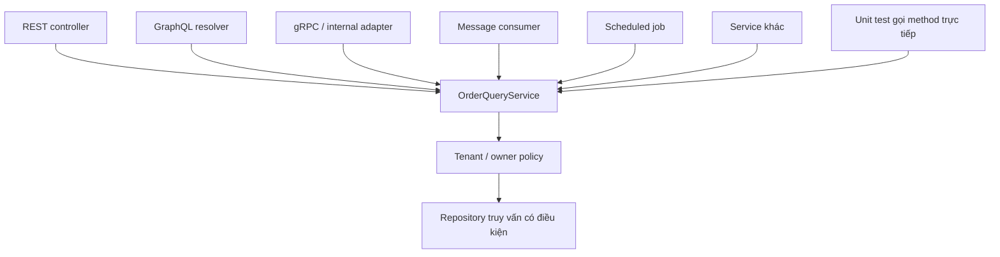
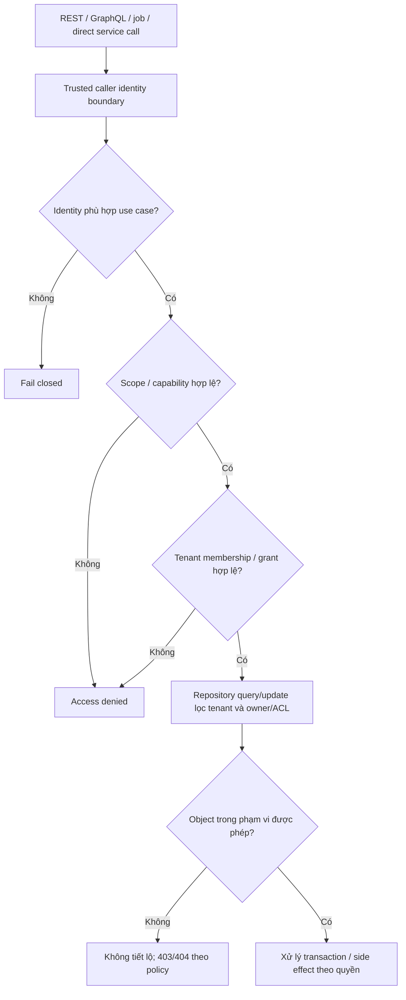

# Kiểm thử ranh giới tenant, chủ sở hữu và đường gọi trực tiếp vào dịch vụ

Trong **Spring Security OAuth 2.0 Resource Server**, việc một access token JWT có chữ ký hợp lệ và chứa `SCOPE_orders.read` **không chứng minh người gọi được đọc mọi đơn hàng**. Người gọi còn phải có quyền trong **tenant** đang được yêu cầu và có quyền trên **chính bản ghi** đó. Đây là ranh giới mà một API có authentication đúng vẫn có thể mắc lỗi **Broken Object Level Authorization (BOLA)** hoặc **Insecure Direct Object Reference (IDOR)**.

Một tình huống nguy hiểm: controller ban đầu đã kiểm tra tenant, nhưng cùng một service được gọi trực tiếp từ controller mới, GraphQL resolver, message handler hoặc một service khác. Nếu authorization chỉ nằm ở web layer, đường gọi mới có thể lấy bản ghi thuộc người/tenant khác. Vì vậy cần kiểm thử **hai vấn đề khác nhau**: request HTTP có bị chặn đúng không, và **lời gọi use case/service trực tiếp có còn giữ bất biến phân quyền không**.

Bài học sử dụng ví dụ Java theo **Spring Boot 3 / Spring Security 6** (Servlet Resource Server), các kỹ thuật JUnit, Mockito, Spring MVC Test và JPA. Các entity, DTO và repository minh họa cần được hiện thực theo schema thật. Những test dùng JWT principal giả lập nhằm kiểm tra authorization, không thay thế kiểm thử giải mã JWT có chữ ký thực.

## 1. Xác định mối đe dọa bằng dữ liệu cụ thể

Giả sử `orders-api` có:

| Tenant | User | Order | Owner |
| --- | --- | --- | --- |
| `tenant-a` | Alice | 101 | Alice |
| `tenant-a` | Bob | 103 | Bob |
| `tenant-b` | Charlie | 201 | Charlie |
| `tenant-b` | Alice | 202 | Alice, chỉ nếu Alice có membership tenant-b |

Alice có Bearer JWT được issuer tin cậy phát hành:

```json
{
  "iss": "https://identity.example.com/realms/shop",
  "sub": "alice",
  "aud": ["orders-api"],
  "scope": "orders.read orders.write",
  "exp": 1900000000
}
```

JSON chỉ minh họa payload; không phải JWT có chữ ký hợp lệ. Sau khi JWT được xác minh, Alice vẫn **không được xem đơn 103 của Bob**, và không được xem đơn 201 của Charlie trong tenant-b, dù JWT chứa `orders.read`.

Ví dụ tấn công IDOR:

```http
GET /api/tenants/tenant-a/orders/103
Authorization: Bearer <alice-token>
```

Hoặc đổi tenant:

```http
GET /api/tenants/tenant-b/orders/201
Authorization: Bearer <alice-token>
```

Một implementation chỉ làm:

```java
return repository.findById(orderId)
    .map(OrderDto::from)
    .orElseThrow(OrderNotFoundException::new);
```

có thể trả đơn hàng không thuộc Alice. Đây là **lỗi authorization dữ liệu**, không phải lỗi xác minh chữ ký JWT.

## 2. Ba ranh giới bảo mật khác nhau

| Ranh giới | Câu hỏi | Cơ chế thường dùng |
| --- | --- | --- |
| **Token và danh tính** | Token có đáng tin và dành cho `orders-api` không? | `JwtDecoder`, chữ ký, `iss`, `aud`, `exp`, `nbf`, token profile. |
| **Tenant** | Caller có được thao tác trong tenant được chọn không? | Membership, tenant role, active grant, policy riêng. |
| **Object/owner** | Caller có được thao tác với đúng bản ghi này không? | Owner, ACL, sharing, dữ liệu quan hệ, query có điều kiện. |

Spring Security có thể cung cấp `JwtAuthenticationToken` và authorities như `SCOPE_orders.read`. Nó **không tự thêm điều kiện `tenantId` hoặc `ownerId` vào mọi câu truy vấn**.

Một điều kiện owner-only:

```text
allowRead(caller, tenant, order)
  = JWT hợp lệ cho API
    AND caller có SCOPE_orders.read
    AND caller đang có quyền trong tenant
    AND order.tenantId == tenant
    AND order.ownerIssuer == caller.issuer
    AND order.ownerSubject == caller.subject
```

Nếu nghiệp vụ có chia sẻ, hỗ trợ hoặc quản trị, vế owner có thể thay bằng **domain authorization policy cụ thể**. Không được bỏ object-level check chỉ vì một user mang role hoặc scope rộng.

## 3. Thế nào là lời gọi trực tiếp vào dịch vụ?

Một đường HTTP thông thường:

```text
HTTP Bearer JWT
  -> Spring SecurityFilterChain
  -> Controller
  -> OrderQueryService
  -> Repository
```

Nhưng service có thể được gọi qua:



Không phải entry point nào cũng chạy qua **cùng HTTP matcher**, hay thậm chí có một `SecurityContext` với JWT. Nếu tenant check chỉ tồn tại ở REST controller, adapter khác có thể bypass.

Gọi một method Java trực tiếp không tự là lỗ hổng Internet; nguy cơ là một **entry point có thể bị tác động từ ngoài** truyền dữ liệu chưa được kiểm tra vào method đó. Test direct service call chứng minh **bất biến authorization nằm ở tầng use case**, không chỉ là hiệu ứng của một web filter.

## 4. Token claim, tenant selector và dữ liệu owner phải có nguồn tin cậy rõ

Client có thể chọn tenant bằng URL:

```http
GET /api/tenants/tenant-b/orders/201
```

hoặc header:

```http
X-Tenant-Id: tenant-b
```

Đây là **dữ liệu yêu cầu**, không tự chứng minh Alice có membership tenant-b. Cũng không được tin body:

```json
{
  "tenantId": "tenant-b",
  "ownerSubject": "charlie",
  "note": "new note"
}
```

để quyết định identity hoặc owner của bản ghi.

| Thuộc tính | Nguồn phù hợp | Điều phải kiểm tra |
| --- | --- | --- |
| `iss`, `sub` | JWT đã xác minh hoặc identity adapter đáng tin. | Namespace issuer, token profile, loại caller. |
| `SCOPE_orders.read` | Authentication authorities đã ánh xạ. | Quyền thao tác chức năng, không phải mọi object. |
| `tenantId` từ path/header | Input do caller chọn. | Membership/grant ở tenant cụ thể. |
| `ownerSubject` từ body | Input client. | Không tự dùng làm owner; server phải có policy gán owner. |
| `order.tenantId`, owner | Database có quản lý tính toàn vẹn. | So khớp với tenant/caller đã được phép. |
| Membership | Database/policy service có thẩm quyền. | Trạng thái hiện hành và role trong tenant. |

Nếu issuer phát `tenant_id` trong JWT, phải xác định issuer có thực sự là **nguồn thẩm quyền membership** của ứng dụng hay không. Claim có chữ ký hợp lệ vẫn có thể **cũ** sau khi quyền bị thu hồi.

## 5. Định nghĩa một identity nhỏ cho domain service

Đừng đưa raw `Authorization` header vào tầng nghiệp vụ, hoặc cho controller tự Base64-decode JWT. Với JWT Resource Server, `JwtDecoder` phải xác minh chữ ký, issuer, thời gian và audience trước khi ứng dụng dùng claims.

Sau xác thực, có thể ánh xạ thành một kiểu do ứng dụng định nghĩa:

```java
import java.util.Set;

public record CallerIdentity(
        String issuer,
        String subject,
        Set<String> authorities) {

    public CallerIdentity {
        if (issuer == null || issuer.isBlank()) {
            throw new IllegalArgumentException("issuer required");
        }
        if (subject == null || subject.isBlank()) {
            throw new IllegalArgumentException("subject required");
        }
        authorities = Set.copyOf(authorities);
    }

    public boolean hasAuthority(String authority) {
        return authorities.contains(authority);
    }
}
```

Nên phân biệt cặp `issuer + subject` vì hai issuer có thể cùng phát `sub = "alice"` nhưng đại diện **hai chủ thể khác nhau**. Nếu domain lưu internal user ID, cần ánh xạ từ cặp issuer/subject sang ID đó qua dữ liệu tin cậy.

Interface cho nguồn caller hiện tại:

```java
public interface CurrentCaller {
    CallerIdentity requireAuthenticated();
}
```

Đây là abstraction do ứng dụng tự định nghĩa, không phải API mặc định của Spring Security.

## 6. Adapter đọc `JwtAuthenticationToken` đã được xác minh

Trong đường đi Servlet Resource Server chỉ dùng JWT, adapter có thể đọc `SecurityContext`:

```java
import java.util.Set;
import java.util.stream.Collectors;

import org.springframework.security.authentication.AuthenticationCredentialsNotFoundException;
import org.springframework.security.core.Authentication;
import org.springframework.security.core.GrantedAuthority;
import org.springframework.security.core.context.SecurityContextHolder;
import org.springframework.security.oauth2.jwt.Jwt;
import org.springframework.security.oauth2.server.resource.authentication.JwtAuthenticationToken;
import org.springframework.stereotype.Component;

@Component
public class SecurityContextCurrentCaller implements CurrentCaller {

    @Override
    public CallerIdentity requireAuthenticated() {
        Authentication authentication =
            SecurityContextHolder.getContext().getAuthentication();

        if (!(authentication instanceof JwtAuthenticationToken jwtAuth)
                || !jwtAuth.isAuthenticated()) {
            throw new AuthenticationCredentialsNotFoundException(
                "Verified JWT authentication required");
        }

        Jwt jwt = jwtAuth.getToken();
        if (jwt.getIssuer() == null || jwt.getSubject() == null) {
            throw new AuthenticationCredentialsNotFoundException(
                "Issuer and subject required");
        }

        Set<String> authorities = jwtAuth.getAuthorities().stream()
            .map(GrantedAuthority::getAuthority)
            .collect(Collectors.toUnmodifiableSet());

        return new CallerIdentity(
            jwt.getIssuer().toString(),
            jwt.getSubject(),
            authorities
        );
    }
}
```

Adapter **không xác minh lại chữ ký**. Nó dựa vào điều kiện ứng dụng thật đã đặt trusted `Authentication` vào `SecurityContext` thông qua Spring Security Resource Server. Không tự tạo `JwtAuthenticationToken` từ một header HTTP chưa xác minh rồi coi nó là user tin cậy.

Trong unit test, `CurrentCaller` có thể được mock để kiểm tra các điều kiện domain. Trong scheduler, message consumer hoặc `@Async`, nếu không có security context, adapter này phải từ chối thay vì tự gán `sub = system` hoặc `tenant = default`. Các loại service identity cần một cơ chế được định nghĩa riêng.

## 7. Tenant membership phải là một chính sách độc lập

Một interface tối thiểu:

```java
public interface TenantMemberships {
    boolean isActiveMember(
        String issuer,
        String subject,
        String tenantId
    );
}
```

Đây là abstraction hướng đến membership có thẩm quyền, không phải phép so sánh chuỗi header. Một policy kiểm tra scope và tenant:

```java
import org.springframework.security.access.AccessDeniedException;
import org.springframework.stereotype.Component;

@Component
public class OrderReadPolicy {

    private final TenantMemberships memberships;

    public OrderReadPolicy(TenantMemberships memberships) {
        this.memberships = memberships;
    }

    public void requireCanRead(
            CallerIdentity caller,
            String tenantId) {

        if (!caller.hasAuthority("SCOPE_orders.read")) {
            throw new AccessDeniedException(
                "Missing orders.read permission");
        }

        if (tenantId == null || tenantId.isBlank()) {
            throw new AccessDeniedException(
                "Tenant must be selected");
        }

        if (!memberships.isActiveMember(
                caller.issuer(), caller.subject(), tenantId)) {
            throw new AccessDeniedException(
                "Tenant access denied");
        }
    }
}
```

**Điều kiện này là Java code thực sự được gọi trong service**, không chỉ annotation trên controller. Khi test tự tạo service không có AOP proxy, check vẫn chạy.

Ứng dụng có nhiều vai trò tenant nên dùng phương thức theo capability như `canReadOrders(...)` thay cho `isActiveMember(...)` đơn giản; một member không mặc nhiên được đọc mọi nhóm dữ liệu trong tenant.

## 8. Owner/tenant phải ràng buộc tại truy vấn repository

Đối với owner-only order, không nên truy vấn `findById(orderId)` rồi mặc định người có scope sẽ được xem. Một JPA repository minh họa:

```java
import java.util.Optional;

import org.springframework.data.jpa.repository.JpaRepository;
import org.springframework.data.jpa.repository.Query;
import org.springframework.data.repository.query.Param;

public interface OrderRepository extends JpaRepository<Order, Long> {

    @Query("""
        select o
          from Order o
         where o.id = :orderId
           and o.tenantId = :tenantId
           and o.ownerIssuer = :issuer
           and o.ownerSubject = :subject
        """)
    Optional<Order> findVisibleToOwner(
        @Param("orderId") Long orderId,
        @Param("tenantId") String tenantId,
        @Param("issuer") String issuer,
        @Param("subject") String subject
    );
}
```

Giả định entity `Order` có `id`, `tenantId`, `ownerIssuer`, `ownerSubject`. DTO và schema cần triển khai tương ứng.

Điều kiện `id + tenant + owner` giúp tránh tải nhầm bản ghi khác rồi vô tình đưa ra response; một kết quả rỗng cũng hỗ trợ **không tiết lộ sự tồn tại của object** cho caller không được phép.

Với hệ thống dùng internal owner ID, repository có thể so sánh `ownerUserId` sau khi một identity resolver đáng tin chuyển `iss + sub` thành ID. Không dùng email hoặc username dễ thay đổi như khóa owner nếu chính sách cần định danh ổn định.

## 9. Service bảo vệ use case ngay cả khi không qua controller

Một service có các dependency rõ ràng:

```java
import org.springframework.stereotype.Service;

@Service
public class OrderQueryService {

    private final CurrentCaller currentCaller;
    private final OrderReadPolicy readPolicy;
    private final OrderRepository orders;

    public OrderQueryService(
            CurrentCaller currentCaller,
            OrderReadPolicy readPolicy,
            OrderRepository orders) {
        this.currentCaller = currentCaller;
        this.readPolicy = readPolicy;
        this.orders = orders;
    }

    public OrderDto getOrder(String tenantId, Long orderId) {
        CallerIdentity caller = currentCaller.requireAuthenticated();
        readPolicy.requireCanRead(caller, tenantId);

        return orders.findVisibleToOwner(
                orderId,
                tenantId,
                caller.issuer(),
                caller.subject())
            .map(OrderDto::from)
            .orElseThrow(OrderNotFoundException::new);
    }
}
```

`OrderDto` và `OrderNotFoundException` là các kiểu nghiệp vụ minh họa, cần định nghĩa thêm; adapter REST có thể map exception sang `404`.

Khi được gọi từ một controller khác hoặc test trực tiếp, service vẫn gọi `CurrentCaller` và `OrderReadPolicy`, rồi dùng repository có điều kiện. Điều này tránh phụ thuộc hoàn toàn vào check tại một URL cụ thể. Policy cũng không “nới quyền” nếu repository trả empty: object có thể không tồn tại hoặc không nhìn thấy.

## 10. Controller mỏng: tenant và ID chỉ là selector

```java
import org.springframework.web.bind.annotation.GetMapping;
import org.springframework.web.bind.annotation.PathVariable;
import org.springframework.web.bind.annotation.RequestMapping;
import org.springframework.web.bind.annotation.RestController;

@RestController
@RequestMapping("/api/tenants/{tenantId}/orders")
public class OrdersController {

    private final OrderQueryService service;

    public OrdersController(OrderQueryService service) {
        this.service = service;
    }

    @GetMapping("/{orderId}")
    public OrderDto getOrder(
            @PathVariable String tenantId,
            @PathVariable Long orderId) {
        return service.getOrder(tenantId, orderId);
    }
}
```

Controller không dùng `X-Owner-Id` để chỉ định người gọi và cũng không so khớp tenant bằng một chuỗi do client tự khai. Chính sách tồn tại ở service/policy/repository.

Một HTTP security chain bảo vệ chức năng:

```java
import org.springframework.context.annotation.Bean;
import org.springframework.context.annotation.Configuration;
import org.springframework.http.HttpMethod;
import org.springframework.security.config.Customizer;
import org.springframework.security.config.annotation.web.builders.HttpSecurity;
import org.springframework.security.web.SecurityFilterChain;

@Configuration
public class ApiSecurityConfig {

    @Bean
    SecurityFilterChain apiChain(HttpSecurity http) throws Exception {
        return http
            .securityMatcher("/api/**")
            .authorizeHttpRequests(auth -> auth
                .requestMatchers(
                    HttpMethod.GET,
                    "/api/tenants/{tenantId}/orders/{orderId}"
                ).hasAuthority("SCOPE_orders.read")
                .anyRequest().denyAll())
            .oauth2ResourceServer(oauth2 -> oauth2
                .jwt(Customizer.withDefaults()))
            .build();
    }
}
```

Ví dụ chỉ định một endpoint đọc; trong ứng dụng thực cần thêm chính sách cho các method và route khác, CSRF/session theo kiến trúc, và **fallback chain** nếu có URL nằm ngoài `/api/**`. Spring Security xác thực Bearer JWT nhưng không tự áp tenant scoping trong repository.

## 11. `@PreAuthorize` bổ sung bảo vệ, nhưng có giới hạn proxy

Với method security:

```java
import org.springframework.context.annotation.Configuration;
import org.springframework.security.config.annotation.method.configuration.EnableMethodSecurity;

@Configuration
@EnableMethodSecurity
public class MethodSecurityConfig {}
```

```java
import org.springframework.security.access.prepost.PreAuthorize;

@PreAuthorize("hasAuthority('SCOPE_orders.read')")
public OrderDto getOrder(String tenantId, Long orderId) {
    // Tenant membership và owner vẫn cần được kiểm tra.
    // ...
}
```

`@PreAuthorize` áp dụng thông qua cơ chế method security của Spring đối với lời gọi được intercept trên **Spring-managed bean/proxy**. Cần đặc biệt hiểu:

1. Gọi service thông qua bean proxy có thể được kiểm tra.
2. Test dùng `new OrderQueryService(...)` hoặc `@InjectMocks` **không tự kích hoạt AOP interceptor**.
3. Lời gọi `this.protectedRead()` bên trong cùng instance thường không đi qua proxy (**self-invocation**).
4. Private method hoặc đường gọi không đi qua Spring-managed proxy không nên là nơi duy nhất chứa authorization.
5. Scheduler/message consumer có thể không có `SecurityContext`; method security không tự tạo trusted user.

Vì vậy có thể dùng `@PreAuthorize` để thêm **defense in depth**, nhưng tenant/owner invariant quan trọng cần nằm trong policy Java và truy vấn/ghi dữ liệu có điều kiện. Test method-security proxy và test service gọi trực tiếp giải quyết **hai mục tiêu khác nhau**.

## 12. Phản ví dụ self-invocation làm mất method security

```java
@Service
public class OrderFacade {

    @PreAuthorize("hasAuthority('SCOPE_orders.read')")
    public OrderDto protectedRead(Long orderId) {
        return readInternal(orderId);
    }

    public OrderDto anotherEntry(Long orderId) {
        return this.protectedRead(orderId);
    }

    private OrderDto readInternal(Long orderId) {
        // Giả sử code trả order bằng findById mà không kiểm tra owner.
        return null;
    }
}
```

Trong cấu hình proxy-based method security thông thường, lời gọi `anotherEntry` đến `this.protectedRead(...)` có thể **bỏ qua interceptor** của `protectedRead`. Do đó nếu `readInternal` thiếu policy, đường gọi thứ hai có nguy cơ sai.

Một thiết kế tốt hơn là mọi đường đến use case vẫn thực thi policy (hoặc được tổ chức qua facade được kiểm soát) và scoped repository query. Kiểm thử không chỉ nhìn endpoint trả `403`, mà phải gọi thẳng method nghiệp vụ để xem guard có thực sự nằm ở đó không.

## 13. Unit test trực tiếp: thiếu tenant membership thì không được query

Dùng JUnit 5 và Mockito, không khởi tạo Spring context:

```java
import static org.junit.jupiter.api.Assertions.assertThrows;
import static org.mockito.Mockito.verifyNoInteractions;
import static org.mockito.Mockito.when;

import java.util.Set;

import org.junit.jupiter.api.BeforeEach;
import org.junit.jupiter.api.Test;
import org.junit.jupiter.api.extension.ExtendWith;
import org.mockito.Mock;
import org.mockito.junit.jupiter.MockitoExtension;
import org.springframework.security.access.AccessDeniedException;

@ExtendWith(MockitoExtension.class)
class OrderQueryServiceTest {

    @Mock CurrentCaller callers;
    @Mock TenantMemberships memberships;
    @Mock OrderRepository orders;

    OrderQueryService service;

    @BeforeEach
    void setup() {
        OrderReadPolicy policy = new OrderReadPolicy(memberships);
        service = new OrderQueryService(callers, policy, orders);
    }

    @Test
    void directCallCannotReadAnotherTenant() {
        CallerIdentity alice = new CallerIdentity(
            "https://identity.example.com/realms/shop",
            "alice",
            Set.of("SCOPE_orders.read")
        );

        when(callers.requireAuthenticated()).thenReturn(alice);
        when(memberships.isActiveMember(
            alice.issuer(), alice.subject(), "tenant-b"))
            .thenReturn(false);

        assertThrows(AccessDeniedException.class,
            () -> service.getOrder("tenant-b", 201L));

        verifyNoInteractions(orders);
    }
}
```

Ở đây **scope là đúng**, vì mục tiêu test là tenant boundary. Test chứng minh: ngay cả khi gọi service qua Java mà **không có controller và không có AOP proxy**, policy từ chối tenant-b và **không đọc repository**.

Nên có ca thiếu scope tương tự, trong đó Alice thuộc tenant-a nhưng authorities rỗng; service phải từ chối trước khi query. Không tạo test chỉ có token sai để chứng minh tenant authorization.

## 14. Unit test: cùng tenant nhưng khác chủ sở hữu

Đặt method này **trong test class ở phần 13**, sử dụng cùng field/mock và `@BeforeEach`:

```java
import static org.junit.jupiter.api.Assertions.assertThrows;
import static org.mockito.Mockito.verify;
import static org.mockito.Mockito.when;

import java.util.Optional;
import java.util.Set;

@Test
void directCallCannotReadBobsOrder() {
    CallerIdentity alice = new CallerIdentity(
        "https://identity.example.com/realms/shop",
        "alice",
        Set.of("SCOPE_orders.read")
    );

    when(callers.requireAuthenticated()).thenReturn(alice);
    when(memberships.isActiveMember(
        alice.issuer(), "alice", "tenant-a")).thenReturn(true);

    when(orders.findVisibleToOwner(
        103L, "tenant-a", alice.issuer(), "alice"))
        .thenReturn(Optional.empty());

    assertThrows(OrderNotFoundException.class,
        () -> service.getOrder("tenant-a", 103L));

    verify(orders).findVisibleToOwner(
        103L, "tenant-a", alice.issuer(), "alice");
}
```

Đây là **test service**, không phải test câu JPQL thật. Nó chứng minh use case dùng **tenant + issuer + subject** khi gọi repository và không trả order của Bob khi query không tìm thấy bản ghi thuộc Alice.

Để chứng minh query thực không leak, cần integration test với database fixture; nếu mock `findVisibleToOwner` trả dữ liệu của Bob không đúng contract, test service không tự kiểm chứng giá trị owner trong entity. Vì thế có thể thêm kiểm tra phòng thủ theo domain model hoặc bảo đảm repository/data-layer thực hiện chính xác invariant.

## 15. Integration test repository với fixture nhiều tenant

Tạo fixture:

```text
Order 101 -> tenant-a, issuer-shop, alice
Order 103 -> tenant-a, issuer-shop, bob
Order 201 -> tenant-b, issuer-shop, charlie
Order 301 -> tenant-a, issuer-other, alice
```

Một `@DataJpaTest` có thể khẳng định:

```java
import static org.assertj.core.api.Assertions.assertThat;

import org.junit.jupiter.api.Test;
import org.springframework.beans.factory.annotation.Autowired;
import org.springframework.boot.test.autoconfigure.orm.jpa.DataJpaTest;

@DataJpaTest
class OrderRepositoryBoundaryTest {

    @Autowired OrderRepository orders;

    @Test
    void queryFiltersTenantOwnerAndIssuer() {
        String issuer =
            "https://identity.example.com/realms/shop";

        assertThat(orders.findVisibleToOwner(
            101L, "tenant-a", issuer, "alice")).isPresent();

        assertThat(orders.findVisibleToOwner(
            103L, "tenant-a", issuer, "alice")).isEmpty();

        assertThat(orders.findVisibleToOwner(
            201L, "tenant-a", issuer, "alice")).isEmpty();

        assertThat(orders.findVisibleToOwner(
            301L, "tenant-a", issuer, "alice")).isEmpty();
    }
}
```

Đoạn này cần dữ liệu thử tương ứng (`@Sql`, `TestEntityManager` hoặc migration) và entity/schema thật. Các alias `issuer-shop`, `issuer-other` trong fixture phải được thay bằng URI tương ứng.

Nếu production dùng PostgreSQL RLS, native query, materialized view, tenant schema/database tách biệt hoặc các chính sách DB đặc thù, nên kiểm thử trên engine phù hợp. H2 hoặc mocked repository có thể không thể hiện đầy đủ hành vi đó.

Những lỗi truy vấn cần tìm: quên tenant trong join; ưu tiên toán tử `AND`/`OR` sai; filter owner chỉ áp cho list mà không áp detail; dùng `findById` ở export; điều kiện tenant không áp cho child entity.

## 16. HTTP test với JWT giả lập: phân quyền tenant khi request đi qua web

Spring Security Test có thể dựng JWT principal bằng `jwt()`:

```java
import static org.springframework.security.test.web.servlet.request.SecurityMockMvcRequestPostProcessors.jwt;
import static org.springframework.test.web.servlet.request.MockMvcRequestBuilders.get;
import static org.springframework.test.web.servlet.result.MockMvcResultMatchers.status;

import org.junit.jupiter.api.Test;
import org.springframework.beans.factory.annotation.Autowired;
import org.springframework.boot.test.autoconfigure.web.servlet.AutoConfigureMockMvc;
import org.springframework.boot.test.context.SpringBootTest;
import org.springframework.security.core.authority.SimpleGrantedAuthority;
import org.springframework.test.web.servlet.MockMvc;

@SpringBootTest
@AutoConfigureMockMvc
class OrderHttpBoundaryTest {

    @Autowired MockMvc mvc;

    @Test
    void aliceCannotReadTenantB() throws Exception {
        mvc.perform(get(
                "/api/tenants/{tenantId}/orders/{orderId}",
                "tenant-b", 201L)
            .with(jwt()
                .jwt(token -> token
                    .issuer("https://identity.example.com/realms/shop")
                    .subject("alice")
                    .claim("aud", java.util.List.of("orders-api")))
                .authorities(new SimpleGrantedAuthority(
                    "SCOPE_orders.read"))))
            .andExpect(status().isForbidden());
    }
}
```

Test giả định Spring MVC, security chain và service thật được nạp; fixture membership xác nhận Alice **không thuộc tenant-b**, `AccessDeniedException` được chuyển thành `403` theo chính sách.

**Quan trọng:** `.with(jwt())` tạo JWT authentication giả lập, **không chứng minh chữ ký JWT đã được `JwtDecoder` production kiểm tra**. Khi `.authorities(...)` được gán trực tiếp, nó cũng **không kiểm chứng `JwtGrantedAuthoritiesConverter` production**. Test HTTP này dành cho kiểm tra route/policy, không phải test mật mã.

Để kiểm chứng issuer, JWKS, `aud`, `exp`, `nbf` và converter, cần integration test riêng với JWT thực được ký bởi test key và test issuer/JWK Set đáng tin.

## 17. Vì sao HTTP test có thể xanh dù service không an toàn?

Giả sử controller làm:

```java
if (!requestedTenant.equals(currentTenant)) {
    throw new AccessDeniedException("wrong tenant");
}
return orderService.findById(orderId);
```

Test HTTP gọi tenant-b trả `403`, nhưng `orderService.findById(...)` có thể **không kiểm tra tenant hoặc owner**. Một GraphQL resolver hay service khác gọi trực tiếp `findById` vẫn có thể trả dữ liệu sai.

Vì vậy hãy phối hợp:

| Kiểm thử | Điều phải xác nhận |
| --- | --- |
| HTTP với JWT giả lập | Matcher/authority và controller đi đến đúng policy. |
| **Service method gọi trực tiếp** | Thiếu scope/sai tenant bị chặn mà không cần controller/proxy. |
| Repository thật | Truy vấn chỉ trả bản ghi thuộc tenant và owner hợp lệ. |
| Entry point thứ hai | GraphQL/message/admin endpoint không bypass. |
| JWT integration | Token thực phải được decode/validate trước khi tạo identity. |

Không nên coi một status `403` là bằng chứng đầy đủ cho tất cả tầng. Cần biết **tầng nào từ chối** và tầng nào vẫn có thể bị gọi riêng.

## 18. Thử thiếu `SecurityContext`, anonymous và service caller

Một service có thể được gọi từ:

```text
@Scheduled / @Async / message listener / batch worker
```

Ở đó `SecurityContextHolder` có thể không có principal JWT. `CurrentCaller.requireAuthenticated()` trong use case dành cho user **phải từ chối**, thay vì tự gán `subject = system` hoặc `tenant = default`.

Các ca âm cần thiết:

- Không có `Authentication`.
- Anonymous authentication.
- Authentication không phải `JwtAuthenticationToken` trong adapter chỉ dành cho JWT.
- JWT thiếu `iss`/`sub` bắt buộc theo hợp đồng identity.
- Token Client Credentials có `sub` đại diện service account, không phải End-User.
- Event body gửi một `ownerSubject` giả; không được dùng như trusted caller.

Một batch service hợp lệ có thể cần **trusted service identity** và capability riêng (`reports.export`, danh sách tenant được phép). Không nên giả một `JwtAuthenticationToken` của Alice để cho scheduler đi qua policy dành cho người dùng.

## 19. Kiểm thử trường hợp cùng `sub` ở hai issuer

Giả sử Resource Server tin hai issuer:

```text
Issuer A: https://identity-a.example.com
Issuer B: https://identity-b.example.com
```

Hai token cùng `sub = "42"` **không tự cùng là một chủ thể**. Test:

```text
GIVEN:
  order 101.ownerIssuer = issuer A
  order 101.ownerSubject = "42"
  caller đến từ issuer B, sub = "42"
  caller có orders.read và membership trong tenant-a

WHEN:
  caller B yêu cầu order 101

THEN:
  từ chối/không trả bản ghi
```

Nếu repository chỉ lọc `ownerSubject` thì test có thể phát hiện lỗi nhập nhằng identity. Với internal user ID, kiểm thử logic ánh xạ cặp `(issuer, sub) -> internalUserId`; không tự gộp email, tên hiển thị hoặc `sub` giống nhau.

## 20. Ghi dữ liệu: update/delete phải ràng buộc tenant và owner

Một request:

```http
PATCH /api/tenants/tenant-a/orders/103
Authorization: Bearer <alice-token>
Content-Type: application/json

{ "note": "changed" }
```

không được thay đơn của Bob chỉ vì Alice có `orders.write` và membership tenant-a.

Một cách dùng atomic conditional update:

```java
import org.springframework.data.jpa.repository.Modifying;
import org.springframework.data.jpa.repository.Query;
import org.springframework.data.repository.query.Param;

@Modifying
@Query("""
    update Order o
       set o.note = :note
     where o.id = :orderId
       and o.tenantId = :tenantId
       and o.ownerIssuer = :issuer
       and o.ownerSubject = :subject
    """)
int updateOwnedNote(
    @Param("orderId") Long orderId,
    @Param("tenantId") String tenantId,
    @Param("issuer") String issuer,
    @Param("subject") String subject,
    @Param("note") String note
);
```

Đoạn method nằm trong `OrderRepository` và cần transaction phù hợp từ service đã kiểm tra `SCOPE_orders.write` cùng membership. Kết quả trả về là số dòng được cập nhật; `0` cần được xử lý theo chính sách không tồn tại/không được phép, **không tự fallback sang update thiếu điều kiện**.

Điều kiện ngay trong câu lệnh cập nhật cũng giúp tránh một phần rủi ro **time-of-check/time-of-use** khi owner/tenant thay đổi giữa lúc đọc và lúc ghi. Với quy trình phức tạp, cần transaction, locking/versioning và test concurrency theo database thực.

## 21. Test ghi dữ liệu phải xác nhận không có side effect

Một handler có thể trả `403` nhưng đã gây side effect trước khi kiểm tra:

```text
1. Update order
2. Gửi event OrderUpdated
3. Kiểm tra owner
4. Trả 403
```

Nếu không rollback, dữ liệu của người khác đã thay đổi. Với write/delete, test phải xác nhận:

1. Dữ liệu order không đổi sau request sai owner/tenant.
2. Không tạo shipment/payment/attachment ngoài quyền.
3. Không phát message hoặc outbox event thành công.
4. Transaction rollback đúng; kiểm tra commit thật khi cần.
5. Audit ghi từ chối thay vì giả thành công.
6. Retry/idempotency không dùng một trạng thái cũ để bypass policy.

Ví dụ scenario:

```text
GIVEN order 103 thuộc Bob, tenant-a
      Alice có orders.write và là member tenant-a
WHEN Alice gọi updateOrder(tenant-a, 103, "new note")
THEN thao tác bị từ chối
     order 103 giữ nguyên note/version
     không có event OrderUpdated
```

**Kiểm tra kết quả HTTP đơn lẻ không đủ** khi có database update, queue hoặc external API call. Cần kiểm tra trạng thái nghiệp vụ sau operation.

## 22. List, search, count và export cũng phải tenant-scoped

Một hệ thống có thể bảo vệ `GET /orders/{id}` nhưng rò rỉ qua:

```text
GET /api/tenants/tenant-a/orders
GET /api/tenants/tenant-a/orders/search
GET /api/tenants/tenant-a/orders/count
GET /api/tenants/tenant-a/orders/export
GET /api/tenants/tenant-a/orders/103/items
```

Đối với owner-only:

```java
Page<Order> findByTenantIdAndOwnerIssuerAndOwnerSubject(
    String tenantId,
    String issuer,
    String subject,
    Pageable pageable
);
```

Nên **lọc tenant và owner trong truy vấn trước khi phân trang**, không tải toàn bộ dữ liệu rồi lọc list ở Java. Nếu lọc sau pagination, `totalElements`, thứ tự trang hoặc aggregate count có thể tiết lộ dữ liệu ngoài phạm vi hoặc hiển thị kết quả sai.

Các test cần có: dữ liệu list, `totalElements`, filter/search, sort, CSV export, nested resources, bulk ID list, parent-child join và quyền cross-tenant. Nếu dùng DB Row-Level Security (RLS), vẫn phải bảo đảm tenant context được đặt từ trusted source, được reset đúng khi pooling và được kiểm chứng trên DB engine thật.

## 23. Cache có thể bypass kiểm tra owner

Giả sử kết quả service được cache:

```java
@Cacheable(cacheNames = "visibleOrders", key = "#orderId")
public OrderDto getOrder(String tenantId, Long orderId) {
    // Guard tenant/owner ở trong method.
}
```

Đây là **phản ví dụ** khi kết quả phụ thuộc caller: một cache interceptor có thể trả dữ liệu của Alice cho Bob từ **cache hit trước khi body method chạy**, theo cách tổ chức AOP/cache thực tế.

Một key `orderId` đơn thuần hoặc chỉ `tenantId + orderId` có thể thiếu **owner, issuer, ACL và biến thể permission**.

Hai hướng thiết kế:

- Cache **dữ liệu thô** theo bản ghi, nhưng luôn thực thi authorization đáng tin trước khi trả.
- Cache kết quả đã được phép theo **scope của caller/tenant/policy** đủ cụ thể, có TTL/invalidation theo thay đổi membership/ACL.

Test nên làm nóng cache bằng Alice rồi gọi cùng order ID bằng Bob. Tiếp tục thay membership/ACL và gọi lại bằng Alice để kiểm tra chính sách thu hồi. Chỉ test với cache rỗng sẽ không phát hiện nhiều lỗi này.

## 24. Thu hồi membership khi JWT còn hạn

Ví dụ:

```text
T0: Alice là member tenant-a
T1: Issuer phát JWT còn hạn 15 phút
T2: Admin thu hồi membership Alice
T3: Alice dùng lại JWT cũ gọi order 101
```

Nếu yêu cầu thu hồi membership có hiệu lực nhanh, chỉ kiểm tra claim `tenant_id` trong JWT có thể không đáp ứng. Có thể cần membership database, cache quyền có TTL/invalidation hoặc online authorization policy.

| Cơ chế | Hành vi có thể sau T2 | Test cần có |
| --- | --- | --- |
| DB membership hiện hành mỗi request | Từ chối sau khi transaction thu hồi hoàn tất. | Dùng cùng JWT trước/sau thay membership. |
| Cache membership | Có cửa sổ stale theo policy. | Kiểm tra TTL/invalidation và giới hạn chấp nhận. |
| Chỉ tin claim trong JWT | Quyền có thể tồn tại đến khi token hết hạn. | Xác nhận đây là trade-off được chấp nhận. |
| Token introspection hoặc online policy | Có thể phản ánh trạng thái mới theo contract. | Test timeout/outage và fail-closed. |

`JwtDecoder` xác minh JWT còn hạn, nhưng **không tự hỏi database membership có thay đổi không**. Kiểm thử authorization phải mô phỏng thay đổi dữ liệu sau lúc token được phát hành.

## 25. Admin, support và service account cần nhánh policy riêng

Một ngoại lệ hợp lệ có thể là tenant admin xem toàn bộ đơn trong tenant, hoặc support được xem một order theo ticket được phê duyệt. Nhưng không nên viết:

```java
if (caller.hasAuthority("ROLE_ADMIN")) {
    return orders.findById(orderId);
}
```

nếu role không được giới hạn theo tenant. `ROLE_ADMIN` không tự chứng minh admin của **mọi tenant**. Một domain policy rõ hơn:

```text
allowRead =
  (tenantMember AND ownerMatch AND orders.read)
  OR (tenantAdminOfRequestedTenant AND orders.read.all)
  OR (supportGrantForThisOrder AND support.read)
```

Các nhánh cần test cả positive lẫn negative:

- Admin tenant-a không xem tenant-b.
- Support grant cho order 101 không tự mở order 103.
- Service Client Credentials chỉ có capability/tenant được cấp.
- Admin mất role thì không tiếp tục dùng cache quyền cũ ngoài chính sách.
- Mọi ngoại lệ được audit phù hợp, không mở truy vấn global vô tình.

Khi sản phẩm có sharing/ACL, `owner != caller` không tự là lỗi; **policy cho phép chia sẻ phải được xác định và kiểm thử**, thay vì bỏ qua kiểm tra owner.

## 26. Trả 401, 403 hay 404?

| Tình huống | Tầng | Kết quả thường gặp |
| --- | --- | --- |
| Thiếu Bearer token trên endpoint yêu cầu xác thực. | Authentication | `401`. |
| JWT sai chữ ký, issuer, audience, thời gian. | Authentication | `401`. |
| JWT hợp lệ nhưng thiếu scope. | Authorization | `403`. |
| Có scope nhưng không thuộc tenant. | Tenant policy | `403` hoặc `404` che giấu theo hợp đồng. |
| Cùng tenant nhưng không phải owner. | Object policy | `403` hoặc `404`. |
| Scoped query không tìm thấy object. | Data access/business | Thường `404`. |
| Được phép và xử lý thành công. | Business | `2xx`. |

Một `403` có thể xuất hiện **trước khi service được gọi** do HTTP matcher. Vì vậy status không chứng minh code domain đã kiểm tra tenant/owner. Khi dùng `404` để che giấu tồn tại, tránh response `"order 103 exists but belongs to Bob"` và tránh các API count/export tiếp tục tiết lộ object.

Với đường ghi, cần kiểm tra thêm **database state và event/outbox**, vì trả 403 sau side effect vẫn là lỗi bảo mật.

## 27. Ma trận test tenant, owner và direct call

Giả định policy owner-only, tenant-a có Alice/Bob, tenant-b có Charlie:

| # | Caller | Resource | Entry point | Kỳ vọng |
| --- | --- | --- | --- | --- |
| 1 | Alice, `orders.read` | Order 101 của Alice, tenant-a | HTTP | Được phép. |
| 2 | Alice, thiếu scope | Order 101 | HTTP | Từ chối scope. |
| 3 | Alice, `orders.read` | Order 103 của Bob, tenant-a | HTTP | Không trả dữ liệu Bob. |
| 4 | Alice, `orders.read` | Order 201 của Charlie, tenant-b | HTTP | Từ chối tenant. |
| 5 | Alice, scope đúng | Order 201, tenant-b | **Direct service** | Từ chối trước query nếu không có membership. |
| 6 | Alice, scope đúng | Order 103, tenant-a | **Direct service** | Owner-scoped query không trả order của Bob. |
| 7 | Alice, thiếu scope | Order 101 | **Direct service** | Từ chối dù không qua HTTP matcher. |
| 8 | Không có principal | Order 101 | **Direct service** | Fail closed, không dùng identity mặc định. |
| 9 | Bob, `orders.read` | Order 103 của Bob | HTTP + service | Được phép. |
| 10 | Issuer B, cùng `sub` Alice | Object thuộc issuer A | Repository | Không nhầm identity. |
| 11 | Alice bị thu hồi membership | Order 101, JWT còn hạn | HTTP + service | Theo chính sách revoke, không tự cho phép. |
| 12 | Alice, `orders.write` | Update order 103 của Bob | HTTP + service | Không đổi data, không event. |
| 13 | Alice, `orders.read` | List/search/count tenant-a | HTTP + repository | Không tính/hiển thị data ngoài quyền. |
| 14 | Alice warm cache, sau đó Bob | Cùng order ID | Cache + service | Không có cross-user cache leak. |
| 15 | Admin tenant-a | Order thuộc tenant-b | Service | Bị từ chối nếu không có grant tenant-b. |
| 16 | Service account với grant hẹp | Resource ngoài capability | Event/HTTP | Từ chối. |

Nên dùng **test âm và test dương**. Một test toàn bị 403 có thể chỉ chứng minh policy cấu hình sai và đã khóa hết chức năng hợp lệ.

## 28. Bốn tầng kiểm thử có trách nhiệm riêng

| Tầng | Công cụ | Khẳng định | Không tự chứng minh |
| --- | --- | --- | --- |
| **Unit test service/domain** | JUnit + Mockito, policy thật. | Service gọi trực tiếp chặn thiếu scope/tenant và gọi đúng scoped repo. | JPQL/SQL hoặc chữ ký JWT production. |
| **Repository/database integration** | `@DataJpaTest`, DB fixture multi-tenant. | Query, join, update lọc đúng tenant/owner/issuer. | SecurityFilterChain. |
| **HTTP/method security integration** | `@SpringBootTest`, MockMvc, security chain. | Matcher, policy, exception mapping và controller đi qua use case đúng. | Khi dùng `jwt()` thì chưa test JWT cryptography. |
| **JWT end-to-end integration** | JWT ký thật bằng test key/JWKS và decoder thật. | Issuer, audience, signature, validator, converter được cấu hình đúng. | Không thay dữ liệu cross-tenant fixture và service tests. |

Với `@PreAuthorize`, cần test bằng **bean Spring proxy** để chứng minh interceptor có chạy, đồng thời test service dựng trực tiếp để chứng minh domain guard không phụ thuộc AOP. Với cache và transaction, cần thêm integration tests khi interceptor/commit/rollback là yếu tố bảo mật.

**`@WithMockUser` và `jwt()` rất hữu ích cho authorization test**, nhưng không tự chứng minh token thật được verify và có subject/issuer đúng contract. Không gán trực tiếp authorities trong test rồi kết luận production `JwtGrantedAuthoritiesConverter` chắc chắn hoạt động.

## 29. Những phản ví dụ khiến test xanh nhưng vẫn rò rỉ

### Chỉ test “không có token thì 401”

BOLA xảy ra với **token hợp lệ**. Phải có hai caller cùng scope và dữ liệu thuộc nhiều owner.

### Chỉ dùng `@WebMvcTest` với service được mock

Mock trả `403` không chứng minh domain policy thật. Cần unit test service và DB integration.

### Chỉ dựa vào `@PreAuthorize`

Self-invocation hoặc lời gọi không qua Spring proxy có thể bỏ qua interceptor. Domain guard và repository scope phải độc lập.

### So sánh owner chỉ bằng `sub`

Cùng `sub` giữa các issuer không bảo đảm cùng tài khoản. Test cả issuer khác nhau.

### List lọc tenant nhưng detail/export dùng `findById`

Một endpoint khác vẫn có thể leak. Test tất cả read paths, bulk, count và nested resources.

### Cache theo `orderId`

Cached result có thể được trả trước khi method kiểm tra owner. Test hai caller liên tiếp và membership bị revoke.

### Kiểm tra quyền sau khi update/publish event

HTTP 403 không làm side effect tự rollback. Test database/event sau lệnh bị từ chối.

### Header `X-Tenant-Id` được coi là membership

Client tự chọn tenant; phải xác minh từ nguồn có thẩm quyền.

### Scheduler giả một user để đi qua policy

Service job cần một service capability đáng tin, không giả identity của End-User.

### Kết luận an toàn từ status 404

404 vẫn có thể kèm message, count, timing hoặc side effects tiết lộ thông tin. Test response và trạng thái thật.

## 30. Quy trình rà soát khi thêm đường gọi nghiệp vụ mới

1. **Xác định identity source:** JWT/opaque token đã xác minh, hay trusted service principal cho job? Không lấy chủ thể từ header/body do caller tự gửi.
2. **Xác định scope/capability:** `orders.read` khác `orders.write`; admin/support có quyền nào theo tenant?
3. **Xác định tenant selector:** path/header/claim có ý nghĩa gì? Membership được kiểm tra từ đâu?
4. **Xác định object policy:** owner, ACL, delegation hay quyền toàn tenant? Có điều kiện issuer không?
5. **Ràng buộc truy vấn:** detail/list/count/export/nested resources và update/delete đã lọc đúng tenant/owner chưa?
6. **Kiểm tra entry points:** controller khác, GraphQL, service call, event handler, scheduler có dùng cùng use case/policy không?
7. **Kiểm tra proxy và cache:** `@PreAuthorize`, `@Cacheable` có bị bypass hoặc trả kết quả trước guard không?
8. **Kiểm tra side effects:** transaction, queue, audit, outbox và idempotency có đảm bảo không ghi nếu từ chối không?
9. **Chuẩn bị fixture đủ mạnh:** cùng tenant khác owner; khác tenant cùng subject; cùng subject khác issuer; thiếu scope; membership bị revoke.
10. **Chạy test ở đúng tầng:** direct service, database, HTTP/security, JWT integration để biết chính xác lớp nào bảo vệ điều gì.

Sơ đồ tổng hợp:



**Điểm cốt lõi:** Resource Server có thể xác minh JWT chính xác mà vẫn mắc BOLA/IDOR nếu service hoặc repository không kiểm tra tenant và owner. Muốn bảo vệ nghiệp vụ thật sự, cần đặt **bất biến phân quyền tại use case/domain policy và truy vấn/ghi dữ liệu có điều kiện**, rồi kiểm thử **cả HTTP request lẫn lời gọi service trực tiếp**, kể cả khác tenant, cùng tenant khác owner, cùng `sub` khác issuer, membership bị thu hồi, cache và side effect. `SecurityFilterChain`, method security, database controls và nhiều tầng test bổ trợ nhau; không lớp đơn lẻ nào thay thế trách nhiệm bảo vệ dữ liệu.
