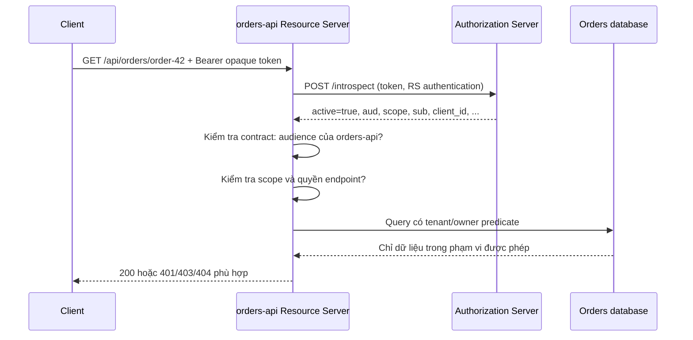

# active=true không thay thế ràng buộc audience và phân quyền của API

## 1. Tình huống: introspection trả `active: true` nhưng API vẫn phải từ chối

Một ứng dụng Spring Boot đóng vai trò **OAuth 2.0 Resource Server** có endpoint:

```http
GET /api/orders/order-42 HTTP/1.1
Host: orders.example.com
Authorization: Bearer <opaque-access-token>
Accept: application/json
```

Khác với JWT access token, **opaque access token** không có định dạng mà Resource Server có thể tự giải mã và xác minh chữ ký theo một profile JWT. Nó thường là chuỗi tham chiếu hoặc chuỗi không có cấu trúc mang ý nghĩa đối với Client. Resource Server có thể kiểm tra token bằng cách gọi **token introspection endpoint** của Authorization Server theo RFC 7662.

Một kết quả introspection minh họa:

```json
{
  "active": true,
  "scope": "orders.read profile.read",
  "client_id": "shop-web",
  "sub": "user-417",
  "aud": ["billing-api"],
  "iss": "https://id.example.com/realms/shop",
  "exp": 1893456000
}
```

Giả sử ứng dụng hiện tại là **`orders-api`**, không phải `billing-api`. Dù `active` là `true` và token có scope tên `orders.read`, liệu `orders-api` có được chấp nhận request không?

**Không thể kết luận chỉ từ `active: true`.** Nếu hợp đồng yêu cầu audience `orders-api`, response trên **không đáp ứng**. API còn phải kiểm tra scope, quyền endpoint, người dùng/Client và dữ liệu đơn hàng cụ thể. `active=true` không đồng nghĩa “được truy cập mọi API và mọi bản ghi”.

Một Authorization Server có thể tự áp dụng chính sách audience khi trả introspection, ví dụ trả `active=false` cho Resource Server không được phép thấy token. Tuy nhiên, đó là **đảm bảo phải được định nghĩa và xác minh trong hợp đồng tích hợp**; không được suy ra chỉ vì có boolean `active`.

### Mục tiêu học tập

Sau bài học, bạn có thể:

1. Diễn giải đúng `active` trong OAuth 2.0 Token Introspection.
2. Phân biệt **token còn hoạt động**, **token dành cho API nào**, **scope/authority** và **quyền trên tài nguyên**.
3. Hiểu vì sao `aud` có thể là thuộc tính tùy chọn trong introspection response và cách xử lý khi thiếu.
4. Cấu hình Spring Security Resource Server sử dụng opaque token.
5. Bổ sung audience validation bằng một `OpaqueTokenIntrospector` wrapper khi hợp đồng yêu cầu.
6. Viết rule `SCOPE_...` và kiểm tra tenant/owner ở Service/Repository.
7. Phân biệt `401`, `403` và `404` trong các tình huống thực tế.
8. Thiết kế kiểm thử không chỉ xem `active=true` mà còn xác nhận token của API khác không sử dụng được.

## 2. OAuth 2.0 Token Introspection hoạt động như thế nào?

### 2.1. Những thành phần tham gia

Trong mô hình phổ biến có:

- **Client:** ứng dụng sở hữu access token và gửi token đến API.
- **Authorization Server (AS):** cấp token, quản lý trạng thái và cung cấp introspection endpoint.
- **Resource Server (RS):** API bảo vệ tài nguyên; trong ví dụ là `orders-api`.
- **Introspection endpoint:** điểm cuối AS cung cấp để RS hỏi thông tin/token status theo cơ chế đã được cấp quyền.

Sơ đồ:



Resource Server **không nên tin** những thông tin được Client gửi riêng như `X-Scope`, `X-Audience` hoặc `X-Tenant-ID` để thay thế dữ liệu xác thực từ AS hoặc từ hệ thống quyền đáng tin.

### 2.2. Opaque token không giống JWT access token

Với JWT, Resource Server có thể lấy public key của issuer tin cậy và kiểm tra chữ ký cục bộ. Với opaque token, Resource Server thường không thể xác minh chữ ký token theo cách đó; AS hoặc một dịch vụ introspection tin cậy cung cấp trạng thái token và những thuộc tính cần thiết.

```text
JWT access token:
  Client → Resource Server
  Resource Server → JwtDecoder → signature + claims validators

Opaque access token:
  Client → Resource Server
  Resource Server → trusted introspection endpoint
  Authorization Server → token status + attributes
```

Một opaque token **không bắt buộc** có `iss`, `aud` hoặc `scope` có thể decode từ chuỗi token. Nếu cần những thuộc tính đó, Resource Server phải nhận chúng qua introspection response hoặc nguồn quản trị tin cậy khác theo hợp đồng.

### 2.3. Introspection endpoint phải là endpoint được tin cậy

Ví dụ request đến AS:

```http
POST /oauth2/introspect HTTP/1.1
Host: id.example.com
Authorization: Basic <resource-server-credentials>
Content-Type: application/x-www-form-urlencoded

token=<opaque-token>
```

Đây là request minh họa. Thực tế cần kết nối **HTTPS**, xác thực Resource Server với AS bằng cơ chế được cấu hình và truyền dữ liệu form-encoded đúng chuẩn. Cơ chế xác thực introspection không bắt buộc luôn là HTTP Basic, nhưng phải theo hợp đồng của AS.

Vì token là Bearer credential, **không gửi nó tới một introspection URL do Client tự đề xuất**. Nếu gửi token sang server ngoài phạm vi tin cậy, token có thể bị lộ dù API sau cùng trả 401.

## 3. `active` có ý nghĩa gì theo RFC 7662?

### 3.1. `active` là thuộc tính bắt buộc của introspection response

Một phản hồi cho token được chấp nhận ở mức trạng thái có thể là:

```json
{
  "active": true,
  "scope": "orders.read",
  "client_id": "shop-web",
  "sub": "user-417"
}
```

Khi token không hoạt động hoặc AS không cho phép bộc lộ thông tin, phản hồi thường chỉ cần:

```json
{
  "active": false
}
```

Trong RFC 7662, `active` biểu diễn trạng thái hoạt động của token theo đánh giá của AS. AS thường cân nhắc các yếu tố như token đã được cấp, chưa bị thu hồi và còn trong khoảng thời gian hiệu lực. **Chi tiết chính sách xác định token “active” là trách nhiệm của AS**, và có thể bao gồm ràng buộc về Resource Server hỏi introspection.

Vì vậy, đừng diễn giải `active=true` là:

- “Token dành cho mọi Resource Server.”
- “Token có tất cả scope mà API cần.”
- “Client hiện tại có quyền vào mọi endpoint.”
- “Người dùng còn là thành viên tenant đang yêu cầu.”
- “Token đại diện cho người dùng thay vì dịch vụ.”
- “Mọi trường trong response đủ tin cậy để trả ra cho Client.”
- “Đơn hàng `order-42` thuộc quyền người gọi.”

`active=true` chỉ là **một tín hiệu cần thiết trong quá trình xác thực**, không phải quyết định phân quyền cuối cùng.

### 3.2. AS có thể áp dụng quyền của introspecting Resource Server

Có những AS cấu hình mỗi Resource Server với thông tin định danh riêng và chỉ trả `active=true` khi token được phép dùng với Resource Server đó. Cũng có AS trả `active=true` cho mọi token còn hiệu lực mà Client introspection được phép kiểm tra, kèm `aud` để RS tự đối chiếu.

Hai cách thiết kế dẫn đến những hợp đồng khác nhau:

| Hợp đồng AS–RS | `active=true` có thể đảm bảo gì? | RS còn phải làm gì? |
|---|---|---|
| AS chỉ kiểm tra token còn hiệu lực | Token đang hoạt động | Kiểm tra audience và mọi policy cần thiết |
| AS ràng buộc active theo danh tính Resource Server gọi introspection | Token đang hoạt động **và phù hợp với RS theo hợp đồng AS** | Xác minh tích hợp đúng client/resource identity; vẫn kiểm tra scope, tenant, owner |
| AS công bố `aud` trong response | Token hoạt động và có audience metadata | Đối chiếu `aud` với API |
| AS không công bố `aud`, không có đảm bảo ràng buộc RS | Không thể suy ra token dành cho API nào | Không chấp nhận token mơ hồ; cần sửa hợp đồng hoặc cơ chế xác minh |

**Quan trọng:** Việc AS *có thể* dùng danh tính Resource Server khi xác định `active` không có nghĩa mọi implementation đều thực hiện như vậy.

### 3.3. `active=false` không đồng nghĩa “token giả” trong mọi trường hợp

Một AS có thể trả `active=false` khi:

- Token không tồn tại, hết hạn hoặc đã bị thu hồi.
- Token chưa có hiệu lực.
- Resource Server đang hỏi không được phép introspect token đó.
- AS không muốn tiết lộ thêm thông tin về token.

Resource Server thường nên coi kết quả này là **token không được chấp nhận**, thay vì cố suy đoán nguyên nhân chính xác hoặc thử gửi token sang nhiều AS khác.

Với Client gọi protected endpoint, hậu quả thường là **401 Unauthorized**. Chi tiết lỗi có thể bị giới hạn để tránh tiết lộ trạng thái token.

## 4. Audience: token này dành cho Resource Server nào?

### 4.1. Phân biệt audience và scope

`aud` (*audience*) thể hiện người nhận/tài nguyên mà token được cấp cho, theo hợp đồng AS. Scope thể hiện một phần quyền được cấp.

Ví dụ:

```json
{
  "active": true,
  "aud": ["billing-api"],
  "scope": "orders.read"
}
```

Token có scope `orders.read` nhưng audience là `billing-api`. Nếu `orders-api` cần `aud=orders-api`, token không hợp lệ **đối với API này**, dù tên scope có vẻ phù hợp.

Một token khác:

```json
{
  "active": true,
  "aud": ["orders-api"],
  "scope": "profile.read"
}
```

Token dành cho đúng API nhưng lại thiếu scope `orders.read`. Khi xác thực token được chấp nhận và đến bước authorization, request đọc đơn hàng thường bị từ chối bằng **403**.

| `active` | Audience | Scope | Ý nghĩa với `GET /api/orders/**` |
|---|---|---|---|
| `false` | Bất kỳ | Bất kỳ | Không chấp nhận token |
| `true` | `billing-api` | `orders.read` | Sai Resource Server nếu API yêu cầu `orders-api` |
| `true` | `orders-api` | `profile.read` | Đúng RS nhưng thiếu quyền đọc orders |
| `true` | `orders-api` | `orders.read` | Đủ điều kiện đầu vào; vẫn cần quyền object/tenant |
| `true` | Không có `aud` | `orders.read` | Phụ thuộc hợp đồng AS–RS; không tự mặc định wildcard |

**Audience và scope giải quyết hai câu hỏi khác nhau**. Không nên dùng một trường thay thế trường còn lại.

### 4.2. Vì sao cần ràng buộc audience trong hệ thống nhiều API?

Giả sử một tổ chức có:

```text
Authorization Server:
  https://id.example.com

Resource Servers:
  orders-api
  billing-api
  customer-api
```

Client có thể có quyền `read` ở nhiều API. Nếu các API cùng chấp nhận **mọi token có `active=true`** mà không có cơ chế binding với Resource Server, một token cấp cho `customer-api` có thể bị dùng nhầm tại `orders-api`. Đây là dạng **cross-resource token replay/token confusion**.

Ràng buộc đúng giúp ngăn việc chuyển một credential vốn được cấp cho tài nguyên A sang tài nguyên B ngoài dự kiến.

### 4.3. `aud` trong introspection response là thuộc tính tùy chọn

RFC 7662 định nghĩa `active` là trường cốt lõi; các trường như `scope`, `client_id`, `sub`, `aud`, `iss`, `exp` có thể xuất hiện tùy implementation và hợp đồng.

Nếu response là:

```json
{
  "active": true,
  "scope": "orders.read",
  "sub": "user-417"
}
```

thì Resource Server **không thể đọc một audience chưa được trả về**. Không nên tự suy ra `aud=orders-api` chỉ vì token đang hoạt động hoặc endpoint introspection trả HTTP 200.

Có hai giải pháp thiết kế:

1. **Yêu cầu AS trả `aud` và kiểm tra tại RS.** Nếu hợp đồng quy định audience là bắt buộc, thiếu `aud` phải bị từ chối (*fail closed*).
2. **AS bảo đảm audience thông qua resource-specific introspection.** AS xác thực danh tính introspecting Resource Server và chỉ trả `active=true` cho token có thể dùng với RS đó. Phải có tài liệu hợp đồng và test tích hợp xác nhận token cấp cho API khác nhận `active=false` hoặc bị từ chối.

Nếu không có cả hai bảo đảm, đừng “chữa” lỗi bằng cách bỏ ràng buộc audience. Cần sửa hợp đồng giữa AS và RS trước khi coi token đủ điều kiện.

### 4.4. Audience có thể là chuỗi hoặc mảng

Trong các định dạng khác nhau, audience có thể được biểu diễn:

```json
{"aud":"orders-api"}
```

hoặc:

```json
{"aud":["orders-api","reports-api"]}
```

Khi kiểm tra, chỉ so khớp **định danh API được cấp quyền** theo hợp đồng; không khớp một phần hay tự chấp nhận mọi chuỗi.

Ví dụ một response:

```json
{
  "active": true,
  "aud": ["orders-api-admin", "billing-api"]
}
```

không đáp ứng yêu cầu exact audience `orders-api`. Kiểm tra kiểu `startsWith("orders-api")` có thể tạo lỗ hổng nếu audience có các định danh gần giống nhau.

### 4.5. Resource indicators và audience

Một số Authorization Server hỗ trợ OAuth 2.0 **Resource Indicators** (RFC 8707) để Client xác định tài nguyên mong muốn khi xin access token. Tùy profile, giá trị resource này có thể ảnh hưởng đến audience hoặc phạm vi token.

Tuy nhiên, Resource Server không nên nhìn một tham số `resource` mà Client từng gửi và coi đó là bằng chứng token dành cho API. Nó cần xác minh **kết quả AS cấp và công bố** qua introspection hoặc cơ chế tin cậy tương đương.

## 5. Scope/authority: token dành cho API vẫn cần đúng quyền thao tác

### 5.1. Scope trong introspection response

Một phản hồi phổ biến:

```json
{
  "active": true,
  "aud": ["orders-api"],
  "scope": "orders.read orders.write",
  "client_id": "shop-web"
}
```

Chuỗi `scope` thường gồm các scope cách nhau bằng dấu cách. Spring Security Resource Server với opaque-token authentication thông dụng có thể ánh xạ:

```text
scope:
  orders.read
  orders.write

GrantedAuthority:
  SCOPE_orders.read
  SCOPE_orders.write
```

Điều đó cho phép viết:

```java
.hasAuthority("SCOPE_orders.read")
```

hoặc:

```java
@PreAuthorize("hasAuthority('SCOPE_orders.write')")
```

**Không phải mọi AS đều dùng cùng định dạng scope/claim.** Nếu introspection response không theo profile mà Spring Security hỗ trợ, cần adapter/converter rõ ràng, không tự coi mọi claim chuỗi là authority.

### 5.2. `active=true` không cấp mọi scope

Ví dụ:

```json
{
  "active": true,
  "aud": ["orders-api"],
  "scope": "profile.read"
}
```

Khi gọi `GET /api/orders/42`, token không có `orders.read`. Dù xác thực đã thành công, endpoint phải từ chối.

Trong chính sách REST Bearer API, việc thiếu authority sau khi đã xác thực thường tạo **403 Forbidden**, có thể có Bearer challenge với `error="insufficient_scope"`.

### 5.3. `hasAuthority` khác `hasRole`

Spring Security dùng `GrantedAuthority`, và các helper thường có quy ước:

| Rule | Authority cần có |
|---|---|
| `hasAuthority("SCOPE_orders.read")` | `SCOPE_orders.read` |
| `hasAuthority("ROLE_ADMIN")` | `ROLE_ADMIN` |
| `hasRole("ADMIN")` | Thường là `ROLE_ADMIN` |
| `hasAuthority("orders.read")` | `orders.read`, không tự thêm tiền tố |

Vì scope được ánh xạ thành `SCOPE_orders.read`, code `hasAuthority("orders.read")` hoặc `hasRole("orders.read")` không tương đương.

### 5.4. Scope không phải quyền truy cập mọi bản ghi

Một access token có `scope=orders.read` không tự cho phép truy cập đơn hàng của người khác hoặc tenant khác. Nó thể hiện quyền thao tác ở cấp API theo hợp đồng, chưa giải quyết **object-level authorization**.

Nếu Service chỉ đọc `findById(orderId)` mà không xét tenant/owner, ứng dụng vẫn có nguy cơ BOLA/IDOR dù introspection và scope đều đúng.

## 6. Client ID, chủ thể và loại token không thay audience

### 6.1. `client_id` là định danh OAuth Client

Một introspection response có thể chứa:

```json
{
  "active": true,
  "client_id": "shop-web",
  "sub": "user-417",
  "aud": ["orders-api"],
  "scope": "orders.read"
}
```

`client_id` cho biết ứng dụng Client được AS gắn với token theo hợp đồng, **không phải audience**. Token cấp cho `shop-web` có thể được dùng với một số API khác nhau nếu AS phát hành phạm vi phù hợp.

Không sử dụng:

```text
client_id == orders-api
```

để thay thế xác minh audience `orders-api`, trừ một hợp đồng đặc thù đã xác định rõ hai định danh và cơ chế đó. Thông thường Client ID và Resource Server ID là hai khái niệm riêng.

### 6.2. `sub` không tự chứng minh quyền đọc mọi đơn hàng

`sub` có thể định danh user, Client hoặc service principal theo profile AS. Không nên suy ra:

```text
active=true + sub có giá trị
    ⇒ chủ thể có quyền đọc đơn hàng bất kỳ
```

Phải ràng buộc subject với owner, membership, tenant và policy nghiệp vụ.

### 6.3. Token type và opaque token

Trong một introspection response, `token_type` có thể mô tả cách sử dụng token, ví dụ `Bearer`. Nó không phải bằng chứng rằng token dành cho API cụ thể. Cũng không thể yêu cầu opaque token có JOSE `typ=at+jwt` như một JWT access token đã ký: **opaque token có thể không có JOSE header**.

Nếu API có yêu cầu loại access token hoặc loại principal đặc biệt, hợp đồng introspection cần cung cấp thông tin đáng tin cậy tương ứng. Không tự suy đoán từ hình thức chuỗi opaque.

### 6.4. Sender-constrained token

Kiểm tra `client_id` hoặc `active` không chứng minh người đang gửi HTTP request là đúng Client ban đầu. Với **Bearer token**, bất cứ bên nào nắm token còn hạn có thể thử sử dụng nó.

Nếu hệ thống cần ràng buộc người trình token với một khóa hoặc chứng thư, cần triển khai cơ chế sender-constraining phù hợp, như mTLS-bound token hoặc DPoP khi AS/RS hỗ trợ. Khi đó Resource Server phải kiểm tra **binding proof** tương ứng, không chỉ `active`.

## 7. Spring Security Resource Server với opaque token

### 7.1. Dependency

Ví dụ ứng dụng Spring Boot sử dụng Gradle:

```groovy
dependencies {
    implementation 'org.springframework.boot:spring-boot-starter-web'
    implementation 'org.springframework.boot:spring-boot-starter-security'
    implementation 'org.springframework.boot:spring-boot-starter-oauth2-resource-server'
}
```

Phần còn lại giả định Spring Security Servlet phiên bản hiện đại có hỗ trợ `SecurityFilterChain` và cấu hình OAuth 2.0 Resource Server opaque token.

### 7.2. Cấu hình introspection endpoint

Ví dụ `application.yml`:

```yaml
server:
  port: 8080

spring:
  security:
    oauth2:
      resourceserver:
        opaquetoken:
          introspection-uri: https://id.example.com/oauth2/introspect
          client-id: INTROSPECTION_CLIENT_ID
          client-secret: INTROSPECTION_CLIENT_SECRET
```

Đây là **placeholder**, không phải credential thật. Trong triển khai thực tế, nhận `client-id` và `client-secret` từ hệ thống cấu hình bí mật/biến môi trường phù hợp; không commit Client secret vào repository.

Cấu hình này cho Spring Boot biết:

- Resource Server dùng **opaque-token introspection**.
- Introspection endpoint tin cậy nằm ở địa chỉ được khai báo.
- Resource Server sử dụng thông tin Client tương ứng để xác thực với AS.

Resource Server **không** được tự khám phá introspection endpoint theo một URL do request đầu vào cung cấp.

### 7.3. SecurityFilterChain với scope

```java
package com.example.orders;

import org.springframework.context.annotation.Bean;
import org.springframework.context.annotation.Configuration;
import org.springframework.http.HttpMethod;
import org.springframework.security.config.Customizer;
import org.springframework.security.config.annotation.web.builders.HttpSecurity;
import org.springframework.security.config.http.SessionCreationPolicy;
import org.springframework.security.web.SecurityFilterChain;

@Configuration
public class SecurityConfig {

    @Bean
    SecurityFilterChain apiSecurity(HttpSecurity http) throws Exception {
        return http
            .csrf(csrf -> csrf.disable())
            .sessionManagement(s -> s
                .sessionCreationPolicy(SessionCreationPolicy.STATELESS))
            .authorizeHttpRequests(auth -> auth
                .requestMatchers("/api/public/**").permitAll()
                .requestMatchers(HttpMethod.GET, "/api/orders/**")
                    .hasAuthority("SCOPE_orders.read")
                .requestMatchers(HttpMethod.POST, "/api/orders")
                    .hasAuthority("SCOPE_orders.write")
                .anyRequest().denyAll()
            )
            .oauth2ResourceServer(oauth2 -> oauth2
                .opaqueToken(Customizer.withDefaults()))
            .build();
    }
}
```

Chú ý:

- `opaqueToken(...)` cho phép xác thực Bearer opaque token.
- `hasAuthority("SCOPE_orders.read")` yêu cầu authority từ introspection scope.
- `STATELESS` tránh dùng session để duy trì Authentication Bearer.
- `anyRequest().denyAll()` chặn các route không được cho phép.
- Ví dụ tắt CSRF **chỉ** với API thuần Bearer header, không dùng cookie để tự động xác thực. Nếu ứng dụng có session/cookie, cần đánh giá CSRF theo kiến trúc.
- **Cấu hình này chưa tự đảm bảo audience validation theo hợp đồng riêng của `orders-api`.** Cần bước bổ sung ở mục 8 hoặc đảm bảo audience đã được AS giới hạn khi introspection cho RS cụ thể.

### 7.4. Ai thực hiện introspection và tạo Authentication?

Trong luồng Spring Security Servlet, các thành phần có thể gồm:

- `BearerTokenAuthenticationFilter`: lấy Bearer token từ request.
- `OpaqueTokenAuthenticationProvider`: xác thực opaque token bằng `OpaqueTokenIntrospector`.
- `OpaqueTokenIntrospector`: gọi endpoint introspection hoặc cơ chế tương đương và tạo principal đã được xác thực.
- `BearerTokenAuthentication`: đại diện cho Authentication được tạo ra, kèm principal và authorities.
- `AuthorizationFilter`: kiểm tra rule `authorizeHttpRequests`.

`OpaqueTokenIntrospector` là điểm thích hợp để thực thi **điều kiện token-level bắt buộc**, ví dụ token phải có audience `orders-api` nếu hợp đồng yêu cầu. `AuthorizationFilter` phù hợp với điều kiện quyền endpoint.

### 7.5. Phạm vi của `active=true` trong cấu hình mặc định

Một implementation introspector chuẩn thường chấp nhận token khi AS trả response hoạt động hợp lệ và tạo principal/authorities từ metadata. Tuy nhiên, **đừng mặc nhiên kết luận rằng việc thêm `opaquetoken` vào YAML đã tự áp dụng mọi validator audience, tenant, Client và nghiệp vụ đặc thù của API**.

Những ràng buộc ngoài hành vi chuẩn phải được thực thi bởi AS theo hợp đồng hoặc được thêm vào Resource Server một cách tường minh.

## 8. Thêm audience validation bằng OpaqueTokenIntrospector

### 8.1. Khi nào nên dùng decorator?

Nếu hợp đồng của AS quy định introspection trả `aud`, và API phải chỉ nhận token cho `orders-api`, có thể **bọc một introspector chuẩn**:

1. Delegate gọi AS và xử lý `active`.
2. Nhận `OAuth2AuthenticatedPrincipal` từ token đã được chấp nhận.
3. Kiểm tra audience trên principal.
4. Từ chối token nếu thiếu/sai audience.
5. Chỉ trả principal cho authentication provider khi mọi điều kiện đạt.

Cách này bảo vệ token-level contract **trước** khi request đến Controller hoặc Service.

### 8.2. Ví dụ Java cho audience bắt buộc

Đoạn dưới đây minh họa trên các phiên bản Spring Security hỗ trợ `SpringOpaqueTokenIntrospector` với constructor nhận introspection URI, Client ID và Client secret.

```java
package com.example.orders;

import java.util.Collection;
import org.springframework.beans.factory.annotation.Value;
import org.springframework.context.annotation.Bean;
import org.springframework.context.annotation.Configuration;
import org.springframework.security.oauth2.core.OAuth2AuthenticatedPrincipal;
import org.springframework.security.oauth2.server.resource.introspection.BadOpaqueTokenException;
import org.springframework.security.oauth2.server.resource.introspection.OpaqueTokenIntrospector;
import org.springframework.security.oauth2.server.resource.introspection.SpringOpaqueTokenIntrospector;

@Configuration
public class IntrospectionPolicyConfig {

    @Bean
    OpaqueTokenIntrospector opaqueTokenIntrospector(
            @Value("${spring.security.oauth2.resourceserver.opaquetoken.introspection-uri}")
            String uri,

            @Value("${spring.security.oauth2.resourceserver.opaquetoken.client-id}")
            String clientId,

            @Value("${spring.security.oauth2.resourceserver.opaquetoken.client-secret}")
            String clientSecret) {

        OpaqueTokenIntrospector delegate =
            new SpringOpaqueTokenIntrospector(
                uri, clientId, clientSecret);

        String expectedAudience = "orders-api";

        return token -> {
            OAuth2AuthenticatedPrincipal principal =
                delegate.introspect(token);

            Object aud = principal.getAttribute("aud");

            boolean accepted =
                expectedAudience.equals(aud)
                || (aud instanceof Collection<?> audiences
                    && audiences.contains(expectedAudience));

            if (!accepted) {
                throw new BadOpaqueTokenException(
                    "Token is not intended for orders-api");
            }

            return principal;
        };
    }
}
```

**Lưu ý phiên bản:** API khởi tạo `SpringOpaqueTokenIntrospector` có thể khác giữa các phiên bản Spring Security. Nếu bản đang dùng cung cấp builder/factory hoặc introspector khác, hãy xây delegate bằng API tương ứng; giữ nguyên nguyên tắc kiểm tra audience **sau introspection thành công, trước khi trả principal**.

Trong ví dụ, tất cả token không có `aud` hoặc có `aud` không chứa `orders-api` đều bị từ chối. Đây là hành vi đúng **nếu hợp đồng yêu cầu audience bắt buộc**.

Nếu AS không trả `aud` và đã đảm bảo audience qua resource-specific introspection, không nên đơn giản copy validator này rồi gây từ chối mọi token; hãy xác minh hợp đồng và thiết kế cơ chế binding phù hợp trước.

### 8.3. Vì sao phải kiểm tra cả chuỗi và collection?

Introspection metadata do nhiều implementation tạo ra; `aud` có thể được chuẩn hóa thành:

```json
{"aud": "orders-api"}
```

hoặc:

```json
{"aud": ["orders-api", "reports-api"]}
```

Logic ví dụ chấp nhận một trong hai dạng **đúng theo hợp đồng**, nhưng không nhận chuỗi gần giống như `orders-api-admin`.

Nếu AS sử dụng kiểu dữ liệu khác, phải định nghĩa parser/validator tương ứng. Không tự gọi `toString()` cho một object rồi tìm `contains("orders-api")`; cách đó dễ cho phép giá trị không chính xác.

### 8.4. Vì sao dùng `BadOpaqueTokenException`?

Mục đích là báo cho cơ chế Resource Server rằng introspection đã thành công về mặt transport nhưng token **không đáp ứng điều kiện xác thực được yêu cầu cho API**. Spring Security có thể chuyển lỗi này thành phản hồi Bearer authentication failure, thường là **401**.

Đừng dùng `AccessDeniedException` tùy tiện trong một token-level introspector nếu hợp đồng nói audience là điều kiện để chấp nhận token: nó có thể làm thay đổi ý nghĩa HTTP status hoặc đường exception handling.

### 8.5. Một bean introspector và cấu hình DSL

Nếu ứng dụng khai báo một `@Bean OpaqueTokenIntrospector` và dùng `oauth2ResourceServer(...opaqueToken...)`, Spring Security/Boot thường có thể sử dụng bean đó theo cơ chế cấu hình phù hợp. Trong trường hợp có nhiều bean hoặc wiring tùy chỉnh, hãy chỉ định rõ introspector:

```java
.oauth2ResourceServer(oauth2 -> oauth2
    .opaqueToken(opaque -> opaque
        .introspector(opaqueTokenIntrospector)))
```

Đoạn trên là **phần của `HttpSecurity` DSL**, với biến `opaqueTokenIntrospector` được inject vào lớp cấu hình. Không tạo đồng thời nhiều `SecurityFilterChain` cạnh tranh cùng một matcher chỉ để thêm introspector.

Khi dùng decorator, **không bỏ qua kiểm tra `active`**: delegate phải là introspector đáng tin có xử lý trạng thái token, không phải một hàm tự tạo `OAuth2AuthenticatedPrincipal` từ JSON bất kỳ.

### 8.6. Chỉ thêm audience ở API cần thiết

Nếu một ứng dụng có nhiều Resource Server surface hoặc nhiều nhóm audience, cần thiết kế rõ:

- Audience bắt buộc cho **mọi token trong chain/API** → có thể đặt ở introspector.
- Một số endpoint yêu cầu audience chuyên biệt → có thể dùng chain/manager/authorization policy phù hợp.
- Những API ở những deployment khác nhau → mỗi deployment nên có expected audience riêng trong configuration.

Không hard-code một audience rồi tái sử dụng cùng bean cho những API có audience khác; cũng không dùng path do Client gửi để tự nâng mức audience được phép.

## 9. Nếu AS không cung cấp aud: thỏa thuận lại hợp đồng

### 9.1. Trường hợp nguy hiểm

AS trả:

```json
{
  "active": true,
  "client_id": "shop-web",
  "sub": "user-417",
  "scope": "orders.read"
}
```

Trong khi có hai API `orders-api` và `billing-api` cùng sử dụng introspection endpoint.

Nếu AS trả `active=true` cho token của cả hai API và không công bố audience, `orders-api` không có thông tin đáng tin để nhận biết token này **được cấp cho API nào**.

Không nên giải quyết bằng:

```java
// KHÔNG PHÙ HỢP: thiếu audience thì cho qua.
if (aud == null) {
    return principal;
}
```

hoặc:

```text
active=true + scope trùng tên
    ⇒ coi như token dành cho mọi Resource Server
```

### 9.2. Các phương án hợp đồng phù hợp

**Phương án A — Công bố audience trong introspection.** AS trả `aud` chính xác, Resource Server kiểm tra expected audience.

**Phương án B — Introspection được ràng buộc với danh tính RS.** AS xác thực một credential riêng cho `orders-api`, biết nó là Resource Server nào và từ chối/không tiết lộ token dành cho `billing-api`. Cần thử nghiệm trực tiếp token cross-resource.

**Phương án C — Token policy riêng được AS/RS thống nhất.** AS có thể cung cấp định danh resource hoặc thuộc tính quyền tương đương, miễn hợp đồng bảo đảm nó không bị Client tự khai và Resource Server xác minh được.

**Phương án D — Điều chỉnh cách cấp token.** Dùng resource indicators/audience rõ hoặc chia token theo từng API khi thiết kế hệ thống cho phép.

Không nên lặng lẽ bỏ audience chỉ vì default introspector không tự buộc kiểm tra trường đó.

## 10. SecurityFilterChain: authority kiểm tra sau audience

Giả sử decorator audience của mục 8 đã chấp nhận token. `Authentication` hiện có authorities dựa trên introspection.

Một cấu hình endpoint:

```java
@Bean
SecurityFilterChain apiSecurity(HttpSecurity http) throws Exception {
    return http
        .authorizeHttpRequests(auth -> auth
            .requestMatchers("/api/public/**").permitAll()
            .requestMatchers(HttpMethod.GET, "/api/orders/**")
                .hasAuthority("SCOPE_orders.read")
            .requestMatchers(HttpMethod.POST, "/api/orders")
                .hasAuthority("SCOPE_orders.write")
            .anyRequest().denyAll()
        )
        .oauth2ResourceServer(oauth2 ->
            oauth2.opaqueToken(Customizer.withDefaults()))
        .build();
}
```

Rule không thực hiện introspection: nó chỉ yêu cầu `Authentication` đã được tạo có authority phù hợp. Nếu delegate introspector ánh xạ scope thành các `SCOPE_...` authority, rule làm việc như mong đợi.

### 10.1. Nếu scope bị thiếu?

Nếu AS trả:

```json
{
  "active": true,
  "aud": ["orders-api"],
  "sub": "user-417"
}
```

trong khi endpoint yêu cầu `SCOPE_orders.read`, token có thể được xác thực về mặt token-level nhưng **không có authority đó**. Request thường nhận **403**.

Nếu hợp đồng nói **mọi token** phải có trường `scope` đúng kiểu, có thể đặt một validator token-level để từ chối thiếu trường từ trước. Nhưng cần xác định có thật sự bắt buộc với toàn bộ API hay không. Một token chỉ dùng ở endpoint công khai hoặc endpoint xác thực nhưng không yêu cầu scope có thể có thiết kế khác.

### 10.2. Đừng tự ánh xạ Client thành scope

Nếu introspection trả `client_id=shop-web` nhưng không có `scope=orders.read`, không được cấp `SCOPE_orders.read` chỉ vì tên Client nằm trong allowlist. **Client identity** và **authorization grant/scope** có ý nghĩa độc lập.

Nếu endpoint đặc biệt chỉ cho `billing-worker`, hãy kiểm tra **cả Client và scope** theo hợp đồng, không dùng Client thay scope.

## 11. Phân quyền theo tenant và owner: active, audience và scope vẫn chưa đủ

Xét một response introspection:

```json
{
  "active": true,
  "aud": ["orders-api"],
  "scope": "orders.read",
  "sub": "user-417",
  "client_id": "shop-web",
  "tenant_id": "tenant-alpha"
}
```

Người dùng `user-417` gọi:

```http
GET /api/tenants/tenant-beta/orders/order-42 HTTP/1.1
Authorization: Bearer <token-of-tenant-alpha>
```

Audience đúng và scope đúng, nhưng tenant trong request không nằm trong phạm vi token. Resource Server phải từ chối trước khi trả dữ liệu.

### 11.1. Dùng principal sau introspection

Với opaque token, Controller có thể nhận `OAuth2AuthenticatedPrincipal`, không phải `Jwt`:

```java
package com.example.orders;

import java.util.Map;
import org.springframework.security.core.annotation.AuthenticationPrincipal;
import org.springframework.security.oauth2.core.OAuth2AuthenticatedPrincipal;
import org.springframework.web.bind.annotation.GetMapping;
import org.springframework.web.bind.annotation.RestController;

@RestController
public class IdentityController {

    @GetMapping("/api/me")
    public Map<String, Object> me(
            @AuthenticationPrincipal OAuth2AuthenticatedPrincipal principal) {

        String subject = principal.getAttribute("sub");
        String clientId = principal.getAttribute("client_id");

        return Map.of(
            "subject", subject == null ? "" : subject,
            "clientId", clientId == null ? "" : clientId
        );
    }
}
```

Đây là minh họa cách đọc principal đã được introspect. Với `SecurityFilterChain` ở mục 7.3, cần thêm matcher bảo vệ `/api/me` hoặc thay đổi rule phù hợp, vì `anyRequest().denyAll()` sẽ từ chối endpoint chưa khai báo.

Trong production, không nhất thiết nên trả `clientId` cho Client hoặc log mọi claim. API chỉ công bố thông tin được phép theo hợp đồng response.

### 11.2. Tạo ngữ cảnh quyền

Có thể xây một record từ principal:

```java
package com.example.orders;

import org.springframework.security.oauth2.core.OAuth2AuthenticatedPrincipal;

public record CallerContext(
        String subject,
        String tenantId,
        String clientId) {

    public static CallerContext from(
            OAuth2AuthenticatedPrincipal principal) {

        Object sub = principal.getAttribute("sub");
        Object tenant = principal.getAttribute("tenant_id");
        Object client = principal.getAttribute("client_id");

        if (!(sub instanceof String subject) || subject.isBlank()) {
            throw new IllegalStateException(
                "Authenticated token missing expected subject");
        }

        if (!(tenant instanceof String tenantId)
                || tenantId.isBlank()) {
            throw new IllegalStateException(
                "Authenticated token missing expected tenant");
        }

        if (!(client instanceof String clientId) || clientId.isBlank()) {
            throw new IllegalStateException(
                "Authenticated token missing expected client");
        }

        return new CallerContext(subject, tenantId, clientId);
    }
}
```

Đoạn này thể hiện hợp đồng, nhưng trong ứng dụng thực tế nếu `sub`, `tenant_id` hoặc `client_id` là claim **bắt buộc của mọi token**, nên kiểm tra kiểu và sự hiện diện ở lớp introspector/token policy để trả phản hồi xác thực phù hợp, thay vì để Service phát sinh 500.

Một số opaque token dùng claims khác. Chỉ truy xuất những thuộc tính mà AS đảm bảo cung cấp, với kiểu dữ liệu đã được thống nhất.

### 11.3. Đưa tenant và owner vào truy vấn

Với DB có:

```text
orders:
  id
  tenant_id
  owner_subject
  amount
  status
```

Không nên:

```sql
SELECT *
FROM orders
WHERE id = :order_id;
```

Nên dùng:

```sql
SELECT id, amount, status
FROM orders
WHERE id = :order_id
  AND tenant_id = :verified_tenant_id
  AND owner_subject = :verified_subject;
```

Khi query không trả bản ghi, API có thể dùng `404 Not Found` để tránh lộ bản ghi ngoài quyền có tồn tại hay không. Với policy của từng tenant/role có thể thay đổi điều kiện owner, nhưng phải có một quyết định quyền rõ ràng.

### 11.4. Spring Data JPA ví dụ

Repository:

```java
package com.example.orders;

import java.util.Optional;
import org.springframework.data.jpa.repository.JpaRepository;

public interface OrderRepository
        extends JpaRepository<OrderEntity, String> {

    Optional<OrderEntity> findByIdAndTenantIdAndOwnerSubject(
        String id,
        String tenantId,
        String ownerSubject);
}
```

Service:

```java
package com.example.orders;

import org.springframework.http.HttpStatus;
import org.springframework.security.access.AccessDeniedException;
import org.springframework.security.oauth2.core.OAuth2AuthenticatedPrincipal;
import org.springframework.stereotype.Service;
import org.springframework.transaction.annotation.Transactional;
import org.springframework.web.server.ResponseStatusException;

@Service
public class OrderService {

    private final OrderRepository repository;

    public OrderService(OrderRepository repository) {
        this.repository = repository;
    }

    @Transactional(readOnly = true)
    public OrderDto findVisible(
            String requestedTenant,
            String orderId,
            OAuth2AuthenticatedPrincipal principal) {

        CallerContext caller = CallerContext.from(principal);

        if (!caller.tenantId().equals(requestedTenant)) {
            throw new AccessDeniedException("Tenant access denied");
        }

        OrderEntity order = repository
            .findByIdAndTenantIdAndOwnerSubject(
                orderId, caller.tenantId(), caller.subject())
            .orElseThrow(() ->
                new ResponseStatusException(HttpStatus.NOT_FOUND));

        return new OrderDto(
            order.getId(), order.getAmount(), order.getStatus());
    }
}
```

`OrderEntity` và `OrderDto` là domain classes minh họa cần được định nghĩa trong project. Điểm cốt lõi là **chỉ truy vấn đối tượng nằm trong phạm vi tenant/owner đã được xác minh** và trả DTO chứa những trường được phép.

Nếu Client Credentials token đại diện dịch vụ chứ không phải user, `sub` có thể là Client ID; khi đó cần policy và query phù hợp cho service principal, không gán nhầm nó là chủ sở hữu cá nhân.

### 11.5. Không tin tenant từ URL hoặc header

Một request có thể tự ghi:

```http
GET /api/tenants/tenant-beta/orders/order-42 HTTP/1.1
Authorization: Bearer <token-of-tenant-alpha>
X-Tenant-ID: tenant-beta
```

URL và `X-Tenant-ID` là đầu vào Client kiểm soát. Chúng có thể xác định tenant **được yêu cầu**, nhưng phải đối chiếu với tenant/entitlement đã xác thực. Không bao giờ cho header override `tenant_id` từ nguồn tin cậy chỉ để request thành công.

## 12. Ví dụ Controller nối Resource Server với Service

Giả sử `SecurityFilterChain` bảo vệ `GET /api/tenants/*/orders/**` bằng `SCOPE_orders.read`. Controller:

```java
package com.example.orders;

import org.springframework.security.core.annotation.AuthenticationPrincipal;
import org.springframework.security.oauth2.core.OAuth2AuthenticatedPrincipal;
import org.springframework.web.bind.annotation.GetMapping;
import org.springframework.web.bind.annotation.PathVariable;
import org.springframework.web.bind.annotation.RequestMapping;
import org.springframework.web.bind.annotation.RestController;

@RestController
@RequestMapping("/api/tenants/{tenantId}/orders")
public class OrderController {

    private final OrderService service;

    public OrderController(OrderService service) {
        this.service = service;
    }

    @GetMapping("/{orderId}")
    public OrderDto detail(
            @PathVariable String tenantId,
            @PathVariable String orderId,
            @AuthenticationPrincipal OAuth2AuthenticatedPrincipal principal) {

        return service.findVisible(
            tenantId, orderId, principal);
    }
}
```

Cần đặt rule phù hợp vào `SecurityFilterChain`:

```java
.requestMatchers(
    HttpMethod.GET,
    "/api/tenants/*/orders/**")
.hasAuthority("SCOPE_orders.read")
```

Nếu dùng một rule cụ thể, nên đặt nó trước `anyRequest().denyAll()`. Ví dụ Controller và Repository được xây để thể hiện ba lớp độc lập:

1. Opaque token được introspect và chấp nhận.
2. Endpoint yêu cầu scope đọc.
3. Service truy vấn đúng tenant và owner.

Một request thiếu bất kỳ lớp bảo vệ nào đều không được trả dữ liệu ngoài quyền.

## 13. Quan sát kết quả HTTP 401, 403 và 404

Không phải mọi lỗi bảo mật đều trả chung `401`. Phân biệt tầng quyết định rất quan trọng.

### 13.1. Khi nào thường là 401?

- Không có Bearer token khi gọi endpoint cần xác thực.
- Token opaque không được AS nhận diện hoặc introspection trả `active=false`.
- Resource Server từ chối token vì không đáp ứng audience bắt buộc ở token-level policy.
- Token không đạt contract bắt buộc khác tại introspector.

Ví dụ:

```http
HTTP/1.1 401 Unauthorized
WWW-Authenticate: Bearer
```

Phản hồi thực tế có thể kèm `error="invalid_token"` hoặc mô tả khác tùy exception handler. Không nên rò rỉ token, secret hay policy nội bộ chi tiết trong response.

### 13.2. Khi nào thường là 403?

- Token được chấp nhận ở bước authentication nhưng thiếu `SCOPE_orders.read`.
- Principal đã xác thực không có quyền gọi endpoint quản trị.
- Client ID hoặc role không đạt **endpoint authorization policy**.
- Caller được xác thực nhưng không có quyền tenant, nếu ứng dụng chọn 403.

Ví dụ:

```http
HTTP/1.1 403 Forbidden
WWW-Authenticate: Bearer error="insufficient_scope"
```

`insufficient_scope` là mã lỗi phổ biến theo Bearer scheme khi thiếu scope, nhưng header thực tế phụ thuộc handler và trạng thái Authentication. Không phải mọi `403` đều chứa đúng chuỗi này.

### 13.3. Khi nào có thể là 404?

Nếu order ID không tồn tại **trong phạm vi quyền của caller**, API có thể trả:

```http
HTTP/1.1 404 Not Found
Content-Type: application/json

{"error":"ORDER_NOT_FOUND"}
```

Điều này giúp hạn chế khả năng dò xem một bản ghi của tenant khác có tồn tại hay không. Không nên trả body chứa `ownerSubject` hoặc tenant thực của bản ghi ngoài quyền.

### 13.4. Ma trận tổng hợp

| `active` | Audience | Scope/authority | Tenant/owner | Kết quả điển hình |
|---|---|---|---|---|
| `false` | Bất kỳ | Bất kỳ | Chưa xét | 401 |
| `true` | Sai `orders-api` | Có `orders.read` | Chưa xét | 401 nếu audience là token-level validator |
| `true` | Thiếu `aud` nhưng contract bắt buộc | Có `orders.read` | Chưa xét | 401 |
| `true` | Đúng `orders-api` | Thiếu `orders.read` | Chưa xét | 403 |
| `true` | Đúng `orders-api` | Có `orders.read` | Sai tenant | 403 hoặc 404 theo policy |
| `true` | Đúng `orders-api` | Có `orders.read` | Đúng tenant, sai owner | 404 hoặc 403 theo policy |
| `true` | Đúng `orders-api` | Có `orders.read` | Đủ quyền | 200 hoặc status nghiệp vụ |
| `true` | Audience do AS ràng buộc riêng cho RS nhưng không trả `aud` | Có `orders.read` | Tùy policy | Chỉ chấp nhận khi hợp đồng bảo đảm và đã được kiểm chứng |

Mã status có thể tùy implementation. Tính chất không thể bỏ qua là **token không dành cho API hoặc không đủ quyền không được lấy dữ liệu**.

## 14. Vì sao không nên dựa vào `client_id` thay cho audience?

Giả sử introspection trả:

```json
{
  "active": true,
  "client_id": "reporting-tool",
  "scope": "orders.read"
}
```

Một Resource Server có thể cho rằng `reporting-tool` là Client quen thuộc nên cho phép. Nhưng nếu token được cấp cho `reporting-api`, token đó có thể không dành cho `orders-api`.

Tính chất độc lập:

| Thuộc tính | Câu hỏi nó trả lời |
|---|---|
| `active` | AS có coi token đang hoạt động theo hợp đồng introspection không? |
| `client_id` | Token được cấp cho Client nào? |
| `aud` | Token dành cho Resource Server/tài nguyên nào? |
| `scope` | Token được cấp phạm vi thao tác nào? |
| `sub` | Token nói về principal nào theo profile? |
| `tenant_id` | Token gắn với tenant nào, nếu AS định nghĩa claim đó? |
| DB owner/ACL | Bản ghi cụ thể có thuộc quyền caller không? |

**Client ID không phải scope; scope không phải audience; audience không phải tenant.** Trộn các khái niệm này tạo ra những lỗ hổng khó phát hiện qua test happy path.

## 15. Các lỗi cấu hình introspection thường gặp

### 15.1. Introspection trả active=true, API chấp nhận mọi token

**Nguyên nhân:** Chỉ dùng introspector mặc định mà không ràng buộc audience, trong khi AS không tự đảm bảo resource-specific introspection.

**Hệ quả:** Token cấp cho API khác có thể được trình tại API hiện tại.

**Cách xử lý:** Yêu cầu AS trả `aud` và kiểm tra, hoặc dùng hợp đồng introspection gắn với Resource Server và test rõ ràng.

### 15.2. Dùng chung credential introspection cho mọi Resource Server

Nếu nhiều API dùng cùng introspection credential và AS không biết API nào đang hỏi, AS có thể không thể tự ràng buộc `active` theo từng API.

**Cách xử lý:** Cấu hình credential/introspection client riêng theo Resource Server khi kiến trúc AS yêu cầu, hoặc bắt buộc trả metadata audience và kiểm tra tại từng API.

### 15.3. `aud` không được trả nhưng code mặc định cho phép

**Nguyên nhân:** Validator viết:

```text
if aud absent:
    allow
```

**Cách xử lý:** Nếu audience bắt buộc thì thiếu `aud` là validation failure. Nếu AS bảo đảm binding bằng cơ chế khác, phải tài liệu hóa và kiểm thử hợp đồng đó thay vì suy đoán.

### 15.4. Có audience nhưng dùng `contains` chuỗi không an toàn

Ví dụ:

```java
// KHÔNG NÊN: "orders-api-admin" cũng chứa "orders-api".
String.valueOf(aud).contains("orders-api")
```

**Cách xử lý:** So khớp định danh audience **chính xác** theo kiểu dữ liệu hợp đồng, không so khớp substring.

### 15.5. Không kiểm tra scope

**Nguyên nhân:** `anyRequest().authenticated()` được dùng cho mọi protected route.

**Hệ quả:** Token `active=true` và đúng audience có thể gọi các thao tác không được cấp quyền cụ thể.

**Cách xử lý:** Gắn scope/authority rule theo HTTP method/endpoint, ví dụ `SCOPE_orders.read` và `SCOPE_orders.write`.

### 15.6. Lấy mọi scope từ header Client tự gửi

Ví dụ:

```http
X-Scopes: orders.read orders.write
```

**Hệ quả:** Client có thể tự khai quyền.

**Cách xử lý:** Chỉ sử dụng authorities được xây từ introspection response đáng tin và mapping theo hợp đồng.

### 15.7. Chỉ kiểm tra scope, không kiểm tra tenant/owner

**Hệ quả:** Người dùng Alpha đoán ID đơn hàng Beta và đọc được qua `findById`.

**Cách xử lý:** So sánh tenant được yêu cầu với entitlement đã xác thực và dùng Repository query có predicate tenant/owner.

### 15.8. Coi opaque token là JWT

**Nguyên nhân:** Cố Base64URL-decode chuỗi opaque hoặc đưa vào `JwtDecoder`.

**Cách xử lý:** Dùng opaque-token introspection theo hợp đồng. Nếu AS có access token dạng JWT khác, cấu hình đúng cơ chế validation phù hợp.

### 15.9. Ghi access token vào log

**Hệ quả:** Bearer token có thể bị đánh cắp qua hệ thống log, monitoring hoặc ticket.

**Cách xử lý:** Ghi request ID, kết quả introspection, mã lỗi và Client/issuer đã được phép quan sát; không ghi nguyên token hoặc Client secret.

### 15.10. Tự tăng thời gian cache introspection không kiểm soát

Nếu cache kết quả `active=true` quá lâu, token đã bị thu hồi có thể vẫn được API chấp nhận từ cache. Điều này làm thay đổi ngữ nghĩa “trạng thái hiện tại” so với việc hỏi AS mỗi request.

**Cách xử lý:** Định nghĩa cache TTL/risk theo yêu cầu thu hồi quyền, thời hạn token và khả năng chịu tải; cân nhắc chính sách refresh/invalidation. Không coi `active=true` ở lần introspection cũ là trạng thái chắc chắn tại mọi thời điểm sau.

## 16. Caching và revocation: active là trạng thái theo thời điểm

Giả sử:

```text
10:00:00  AS trả active=true
10:01:00  Người dùng bị thu hồi quyền truy cập
10:05:00  RS vẫn dùng cached principal cũ
```

Nếu cache còn hiệu lực quá lâu, RS có thể tiếp tục cho phép dựa trên dữ liệu cũ. Ngay cả khi response ban đầu có audience và scope đúng, quyền thực tế có thể đã thay đổi.

Một thiết kế cần cân nhắc:

- **TTL:** Thời gian tối đa coi kết quả introspection còn mới.
- **Expiration:** Không cache vượt quá thời điểm token hết hạn nếu biết `exp`.
- **Revocation:** Hợp đồng AS/RS cần quy định mức độ cập nhật thu hồi được yêu cầu.
- **Entitlement changes:** Tenant membership/role có thể thay đổi mà token vẫn active.
- **Availability:** Nếu introspection endpoint mất kết nối, hệ thống xử lý ra sao theo risk policy?
- **Load:** Hỏi AS mỗi request tăng chi phí mạng; cache có thể hữu ích nhưng phải có giới hạn.

**Không nên tự “fail open”** bằng cách cho token đi qua khi AS không truy cập được hoặc introspection lỗi không xác định. Nếu triển khai degrade/fallback trong một hệ thống đặc biệt, nó phải có phân tích rủi ro và hợp đồng vận hành rõ ràng; mặc định cho phép khi không xác minh được là nguy hiểm.

## 17. Introspection và HTTP status của endpoint

Cần phân biệt hai HTTP request trong toàn bộ quá trình.

### 17.1. HTTP request từ RS tới introspection endpoint

AS có thể trả:

```http
HTTP/1.1 200 OK
Content-Type: application/json

{"active":false}
```

**HTTP 200 của introspection endpoint không có nghĩa token đang hoạt động.** Nó cho biết AS đã xử lý request introspection và trả một tài liệu JSON. Giá trị `active` mới là thông tin trạng thái cần diễn giải.

Ngược lại, một response `401` từ **introspection endpoint** có thể do Resource Server dùng sai Client credential khi gọi AS. Điều này khác với `401` mà Resource Server trả cho Client gọi API.

### 17.2. HTTP request từ Client tới API

Nếu API nhận Bearer token mà AS trả `active=false`, API thường trả:

```http
HTTP/1.1 401 Unauthorized
WWW-Authenticate: Bearer
```

Nếu token active, audience đúng nhưng thiếu scope, API thường trả `403`.

Do đó có thể có:

```text
AS introspection:
    200 OK
    {"active": true, "aud": ["orders-api"], "scope": "profile.read"}

API client request:
    403 Forbidden
    (thiếu SCOPE_orders.read)
```

**Đừng dùng status 200 của introspection thay cho authorization decision của API.**

## 18. Thực hành curl: kiểm tra tất cả các lớp

Giả sử API chạy trên `http://localhost:8080`, introspection endpoint/credentials đã được cấu hình đúng và có các token thử nghiệm thật do AS phát hành.

### 18.1. Public endpoint không cần token

```bash
curl -i http://localhost:8080/api/public/ping
```

Nếu đã có Controller công khai:

```http
HTTP/1.1 200 OK
Content-Type: application/json

{"status":"ok"}
```

Nếu Controller chưa được khai báo, có thể nhận 404 dù `permitAll` đúng; SecurityFilterChain không tự tạo endpoint.

### 18.2. Protected endpoint không có token

```bash
curl -i http://localhost:8080/api/orders/order-42
```

Kết quả thường:

```http
HTTP/1.1 401 Unauthorized
WWW-Authenticate: Bearer
```

### 18.3. Token đã bị thu hồi/inactive

```bash
curl -i \
  -H "Authorization: Bearer $INACTIVE_TOKEN" \
  http://localhost:8080/api/orders/order-42
```

Nếu introspection trả `active=false`, API phải từ chối token, thường `401`.

### 18.4. Token active nhưng audience dành cho API khác

```bash
curl -i \
  -H "Authorization: Bearer $TOKEN_FOR_BILLING_API" \
  http://localhost:8080/api/orders/order-42
```

Nếu AS trả `active=true` và `aud=["billing-api"]`, decorator yêu cầu `orders-api` phải từ chối, thường `401`.

Trường hợp này **rất quan trọng**: dùng token được AS phát hành hợp lệ cho billing API, không tự sửa một JWT/token đang có. Với opaque token, bạn cũng không thể giả định tự thay đổi một phần chuỗi sẽ tạo ra audience khác.

### 18.5. Token đúng audience nhưng thiếu scope

```bash
curl -i \
  -H "Authorization: Bearer $TOKEN_WITHOUT_ORDERS_READ" \
  http://localhost:8080/api/orders/order-42
```

Khi token được chấp nhận nhưng thiếu `SCOPE_orders.read`, thường nhận `403 Forbidden`.

### 18.6. Token đúng audience và đủ scope

```bash
curl -i \
  -H "Authorization: Bearer $TOKEN_WITH_ORDERS_READ" \
  http://localhost:8080/api/orders/order-42
```

Nếu các điều kiện tenant/owner cũng đạt, Controller/Service có thể trả `200 OK`.

### 18.7. Token đúng audience/scope nhưng sai tenant

```bash
curl -i \
  -H "Authorization: Bearer $TOKEN_TENANT_ALPHA" \
  http://localhost:8080/api/tenants/tenant-beta/orders/order-42
```

Resource Server phải từ chối truy cập dữ liệu Beta. Response có thể là `403` hoặc `404` theo chính sách. Không trả một phần thông tin của order Beta trước khi kiểm tra.

### 18.8. Tự lập bảng đối chiếu

| Thử nghiệm | Introspection | Lớp tiếp theo | Kết quả API thường gặp |
|---|---|---|---|
| Không token | Không cần introspect | Authentication | 401 |
| Token inactive | `active=false` | Dừng authentication | 401 |
| Token active sai audience | `active=true`, `aud=billing-api` | Audience validator từ chối | 401 |
| Token active thiếu audience bắt buộc | `active=true`, không có `aud` | Audience validator từ chối | 401 |
| Token active đúng audience, thiếu scope | `active=true`, `aud=orders-api` | AuthorizationFilter từ chối | 403 |
| Token active đúng audience và scope, sai tenant | `active=true`, metadata hợp lệ | Business authorization từ chối | 403/404 |
| Token active đúng audience và scope, đúng owner | Metadata đáp ứng | Controller/Service xử lý | 2xx |

Kết quả cụ thể còn phụ thuộc exception handler và domain code của ứng dụng, nhưng không được chấp nhận token sai audience hoặc trả tài nguyên ngoài quyền.

## 19. Kiểm thử tích hợp với mock introspection server

### 19.1. Vì sao cần giả lập AS?

Trong môi trường phát triển/test, có thể dựng HTTP stub cho introspection endpoint, trả JSON khác nhau theo token đầu vào.

Điều cần kiểm tra không chỉ là status của API mà còn là:

- API gửi request introspection tới **đúng endpoint tin cậy**.
- Resource Server xác thực với AS đúng cơ chế.
- `active=false` bị từ chối.
- `active=true` không bỏ qua audience validation.
- `scope` được ánh xạ thành authority đúng.
- Sai tenant/owner không trả dữ liệu.
- Token không bị gửi tới host khác hoặc ghi vào log.

Không cần dùng access token/Client credential production cho các test này.

### 19.2. Bốn response introspection mẫu

**Response A — inactive:**

```json
{
  "active": false
}
```

**Response B — active nhưng sai audience:**

```json
{
  "active": true,
  "aud": ["billing-api"],
  "scope": "orders.read",
  "sub": "user-417"
}
```

**Response C — active đúng audience, thiếu scope:**

```json
{
  "active": true,
  "aud": ["orders-api"],
  "scope": "profile.read",
  "sub": "user-417"
}
```

**Response D — active đúng audience và scope:**

```json
{
  "active": true,
  "aud": ["orders-api"],
  "scope": "orders.read",
  "sub": "user-417",
  "tenant_id": "tenant-alpha"
}
```

Sau đó test route `GET /api/orders/order-42` và endpoint tenant-bound. Cần có Controller/DB fixture tương ứng; response D chưa chứng minh object-level authorization nếu không chạy quy tắc tenant/owner.

### 19.3. Ví dụ unit test chính sách audience ở mức principal

Có thể tách logic audience thành một hàm nhỏ để test độc lập:

```java
package com.example.orders;

import java.util.Collection;

public final class AudiencePolicy {

    private AudiencePolicy() {
    }

    public static boolean containsExpectedAudience(
            Object audienceClaim,
            String expectedAudience) {

        return expectedAudience.equals(audienceClaim)
            || (audienceClaim instanceof Collection<?> values
                && values.contains(expectedAudience));
    }
}
```

Ví dụ JUnit:

```java
import java.util.List;
import org.junit.jupiter.api.Test;
import static org.junit.jupiter.api.Assertions.*;

class AudiencePolicyTest {

    @Test
    void acceptsExactAudienceString() {
        assertTrue(AudiencePolicy.containsExpectedAudience(
            "orders-api", "orders-api"));
    }

    @Test
    void acceptsAudienceInCollection() {
        assertTrue(AudiencePolicy.containsExpectedAudience(
            List.of("orders-api", "reports-api"), "orders-api"));
    }

    @Test
    void rejectsOtherResourceServer() {
        assertFalse(AudiencePolicy.containsExpectedAudience(
            List.of("billing-api"), "orders-api"));
    }

    @Test
    void rejectsMissingAudience() {
        assertFalse(AudiencePolicy.containsExpectedAudience(
            null, "orders-api"));
    }

    @Test
    void doesNotAcceptPrefixMatches() {
        assertFalse(AudiencePolicy.containsExpectedAudience(
            "orders-api-admin", "orders-api"));
    }
}
```

Test này chỉ kiểm tra hàm so khớp audience. Nó **không tự chứng minh** delegate đã gọi AS, xác thực HTTP response, xử lý `active=false` hoặc tạo principal đúng.

### 19.4. MockMvc với `opaqueToken()` có giới hạn gì?

Spring Security Test có thể hỗ trợ request post processor `opaqueToken()` để giả lập Authentication/authorities:

```java
import static org.springframework.security.test.web.servlet.request
    .SecurityMockMvcRequestPostProcessors.opaqueToken;

mvc.perform(get("/api/orders/order-42")
        .with(opaqueToken()
            .authorities(
                new SimpleGrantedAuthority("SCOPE_orders.read"))))
    .andExpect(status().isOk());
```

Ví dụ chỉ minh họa **kiểm thử phân quyền sau khi Authentication đã tồn tại**. `opaqueToken()` trong Spring Security Test có thể bypass việc HTTP introspection thật, tương tự `with(jwt())` không xác minh JWT chữ ký thật. Muốn chứng minh audience decorator và `active` handling hoạt động, cần test trực tiếp introspector hoặc integration test với AS stub.

### 19.5. Các ca cần bắt buộc có ở môi trường đa API

Một ma trận hiệu quả gồm:

1. Token cấp cho `orders-api`, gọi `orders-api` → qua lớp audience.
2. Token cấp cho `billing-api`, gọi `orders-api` → bị từ chối.
3. Token cấp cho `orders-api` nhưng thiếu scope đọc → 403.
4. Token đủ scope đọc nhưng thuộc tenant khác → từ chối/không rò rỉ.
5. Introspection trả `active=false` → 401.
6. AS trả `active=true` nhưng `aud` thiếu khi contract yêu cầu → 401.
7. AS trả `aud` dạng string và collection đúng hợp đồng → hoạt động tương ứng.
8. AS trả HTTP 401 do credential introspection sai → Resource Server xử lý lỗi an toàn, không fail open.
9. AS không sẵn sàng → không tự cho request qua.
10. Token đã thu hồi sau khi cache còn giá trị → hành vi phù hợp TTL/revocation contract.

## 20. Bảo vệ introspection endpoint và bí mật Client

### 20.1. Không công khai token trong logs

Request introspection mang **access token gốc**. Bất kỳ log, APM trace, proxy dump hoặc exception message nào ghi raw token đều có thể biến thành kênh rò rỉ credential.

Không nên log:

```text
Authorization: Bearer <real-token>
token=<real-token>
client_secret=<real-secret>
```

Thay vào đó, chỉ lưu request ID, mã lỗi, tên endpoint introspection tin cậy, thời gian phản hồi, kết quả policy và các thuộc tính không nhạy cảm được cho phép theo quy định.

### 20.2. HTTPS và Client authentication

Introspection endpoint cần TLS và chính sách xác minh certificate/hostname. Resource Server phải sử dụng phương thức xác thực với AS được cho phép (Basic Client auth, private-key JWT, mTLS hoặc phương án tương đương tùy AS).

Không lưu Client secret trong file demo rồi đưa vào source control. Với Spring Boot, có thể gắn property tới biến môi trường qua cơ chế cấu hình của deployment.

### 20.3. Timeout và circuit breaking

Vì introspection có thể phát sinh network call trong mỗi request được bảo vệ, cần thiết kế:

- Connect/read timeout.
- Chính sách retry có giới hạn, tránh bùng tải.
- Giới hạn đồng thời.
- Cache hợp lý nếu được phép.
- Observability tách lỗi AS và lỗi authorization của API.
- Hành vi lỗi an toàn khi không xác minh được token.

Không biến việc AS timeout thành “tạm thời coi mọi token active”. Điều đó khiến một sự cố mạng trở thành bỏ qua authentication.

### 20.4. Không dùng introspection như một dịch vụ khám phá tùy ý

Opaque token có thể không có issuer được đọc trực tiếp. Một hệ thống multi-AS không nên gửi cùng một Bearer token thử đến mọi introspection endpoint để tìm nơi phát hành: thao tác này có thể **tiết lộ token cho những server không phải nhà phát hành**.

Cần registry/cơ chế định tuyến tin cậy được thống nhất trước. Nếu có metadata route được dùng để chọn AS, nó không được phép tự thêm AS lạ hoặc dùng URL không được phê duyệt.

## 21. Resource Server có nhiều audience hoặc nhiều API chain

Một ứng dụng có thể phục vụ cả:

```text
/api/orders/**
/api/reports/**
```

và có yêu cầu audience khác nhau:

```text
orders-api
reports-api
```

Có ít nhất hai hướng triển khai:

- Tách deployment/Resource Server rõ ràng, mỗi API có introspection credentials và expected audience riêng.
- Dùng nhiều `SecurityFilterChain` hoặc một authorization policy phù hợp, đồng thời ràng buộc token vào audience tương ứng với vùng tài nguyên.

### 21.1. Không nhầm token-level và endpoint-level audience

Nếu một decoder/introspector toàn ứng dụng yêu cầu đúng một audience `orders-api`, request hợp lệ dành cho `reports-api` sẽ bị từ chối ngay cả khi nó gọi endpoint reports trong cùng deployment.

Cần xác định audience là:

1. Điều kiện bắt buộc của **toàn bộ Resource Server**?
2. Điều kiện theo **từng API surface**?
3. Hay một thuộc tính được AS đã ràng buộc sẵn theo introspection credential?

Thiết kế có thể chọn introspector/authorization manager phù hợp theo từng `SecurityFilterChain`, nhưng phải bảo đảm **chain đầu tiên khớp được chọn** và chính sách của chain đó đầy đủ. Không dựa vào các chain phía sau để cộng thêm quy tắc.

### 21.2. Không cho request tự chọn audience được phép

Ví dụ không an toàn:

```java
String expectedAudience = request.getHeader("X-Expected-Audience");
```

Nếu Client được tự cung cấp giá trị mong đợi, nó có thể đặt bằng audience của token và làm kiểm tra mất ý nghĩa. Expected audience phải đến từ **cấu hình server, route policy đáng tin hoặc danh tính Resource Server**, không từ một header tùy ý của Client.

## 22. Câu hỏi tự kiểm tra

**Câu 1.** Introspection trả `active=true`. Điều đó có đồng nghĩa token được dùng ở mọi API không?

**Trả lời:** Không. `active` thể hiện trạng thái token theo đánh giá AS; API còn cần audience binding và authorization, trừ những điều kiện đã được AS bảo đảm tường minh trong hợp đồng introspection.

**Câu 2.** Token có `active=true`, `aud=billing-api` và `scope=orders.read`. `orders-api` có nên chấp nhận không?

**Trả lời:** Không nếu `orders-api` yêu cầu audience riêng. Tên scope trùng không biến token cấp cho billing API thành token của orders API.

**Câu 3.** Nếu introspection không trả `aud`, có được coi audience là mọi API không?

**Trả lời:** Không. Nếu `aud` bắt buộc, thiếu claim phải bị từ chối. Nếu AS đảm bảo token được ràng buộc theo danh tính introspecting Resource Server, hợp đồng và integration tests phải chứng minh việc đó.

**Câu 4.** Một token đúng audience nhưng thiếu `orders.read` nên xử lý thế nào?

**Trả lời:** Sau khi xác thực token thành công, rule `hasAuthority("SCOPE_orders.read")` từ chối, thường bằng `403`.

**Câu 5.** Vì sao HTTP 200 từ introspection endpoint không chứng minh token hợp lệ?

**Trả lời:** HTTP 200 có thể mang body `{"active":false}`. Resource Server phải đọc và tuân theo trạng thái token, không chỉ xem HTTP status của AS.

**Câu 6.** `client_id=shop-web` có thay `aud=orders-api` được không?

**Trả lời:** Không. Client ID xác định ứng dụng nhận token; audience xác định Resource Server/tài nguyên mà token dành cho.

**Câu 7.** Một token active, audience và scope đều đúng. Vì sao API vẫn có thể trả 404?

**Trả lời:** Đơn hàng có thể không tồn tại trong phạm vi tenant/owner của người gọi. Query chỉ lấy dữ liệu được phép và có thể trả 404 để không tiết lộ bản ghi của người khác.

**Câu 8.** Có thể yêu cầu opaque token có JOSE header `typ=at+jwt` không?

**Trả lời:** Không mặc định. Opaque token không nhất thiết có cấu trúc JWT; nếu cần phân biệt loại token, phải có hợp đồng introspection/AS phù hợp.

**Câu 9.** Spring Security Test `opaqueToken()` đã chứng minh audience validation qua AS chưa?

**Trả lời:** Chưa. Nó thường giả lập Authentication cho authorization test, không tự chứng minh outbound introspection và audience decorator. Cần test trực tiếp hoặc integration test.

**Câu 10.** AS bị lỗi mạng. Resource Server có nên bỏ qua introspection để trả 200 không?

**Trả lời:** Không. Không xác minh được token không phải lý do cấp quyền mặc định. Cần fail safely, có timeout và chính sách vận hành rõ ràng.

## 23. Ghi nhớ

Với OAuth 2.0 opaque token, **`active=true` là kết quả trạng thái token từ Authorization Server, không phải “giấy phép truy cập mọi nơi”**. Nó không tự thay thế ba quyết định độc lập: token có dành cho đúng Resource Server không (**audience**), có được phép gọi thao tác này không (**scope/authority**) và có được phép truy cập bản ghi/tenant cụ thể không (**object-level authorization**).

Trong Spring Security Resource Server, `OpaqueTokenIntrospector` phù hợp để đảm bảo điều kiện token-level bắt buộc như audience theo hợp đồng; `SecurityFilterChain` hoặc method security kiểm tra `SCOPE_...`; Service/Repository kiểm tra tenant, owner và quyền tài nguyên thực tế.

Hãy bắt đầu bằng introspection endpoint tin cậy, bảo vệ Bearer token/Client secret, kiểm tra `active`, ràng buộc đúng API và phạm vi được cấp, rồi mới truy xuất dữ liệu. **Một token còn hoạt động nhưng dành cho API khác, thiếu scope hoặc không có quyền với tài nguyên vẫn phải bị từ chối.**
