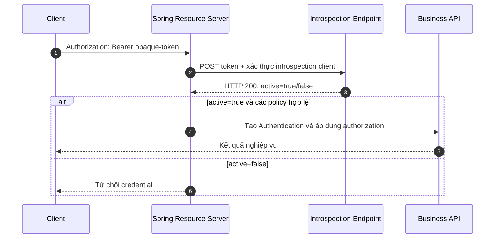
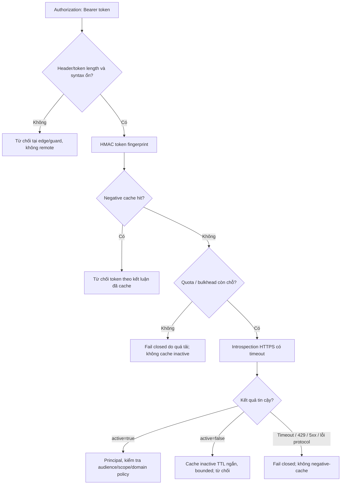

# Cache kết quả không hợp lệ và giới hạn tài nguyên trước đầu vào tùy ý

Khi một **Spring Security OAuth 2.0 Resource Server** dùng **opaque access token**, ứng dụng thường phải gọi **OAuth 2.0 Token Introspection Endpoint** của Authorization Server để biết token còn `active` hay không và đọc các thông tin đã được bên phát hành chấp nhận. Khác với kiểm tra chữ ký JWT tại chỗ, mỗi lần introspection có thể phát sinh một HTTP request, sử dụng connection, thread, CPU, bộ nhớ và hạn mức của Authorization Server.

Vì Bearer token là **đầu vào do client đưa tới**, người gọi có thể gửi một chuỗi không hợp lệ, một token cực dài hoặc hàng nghìn chuỗi ngẫu nhiên khác nhau. Nếu Resource Server gửi tất cả các chuỗi này đến introspection endpoint mà không có giới hạn, attacker có thể biến API thành nguồn phát sinh lưu lượng và gây cạn tài nguyên cho cả API lẫn Identity Provider (IdP). Một cách tối ưu thường được đề xuất là **negative cache**: ghi nhớ tạm thời những token đã được IdP xác định là không hoạt động để tránh introspection lặp lại.

Tuy nhiên, negative cache không phải là giải pháp mặc định an toàn cho mọi lỗi. Cần phân biệt rõ:

- **`active: false` được trả về từ một introspection response đã xác thực và đúng protocol**: có thể xem xét cache trạng thái không hoạt động trong thời gian ngắn, có giới hạn.
- **Timeout, 429, 5xx, lỗi TLS, lỗi xác thực client introspection, response bị hỏng**: **không phải bằng chứng token không hợp lệ**; không cache các lỗi đó như một kết luận `active: false`.
- **Chuỗi quá dài hoặc sai cú pháp ở ingress**: nên bị chặn sớm trước khi tạo request mạng; không nhất thiết lưu mỗi chuỗi này vào negative cache.

Bài học thuộc chương **Tùy chỉnh introspection** trong Spring Security Resource Server. Các ví dụ sử dụng Servlet stack, Spring Boot 3 và Spring Security 6, với Caffeine cho bộ nhớ đệm có giới hạn. Khi dùng phiên bản cụ thể, cần đối chiếu API của `OpaqueTokenIntrospector` và cách triển khai delegate; các con số TTL, kích thước cache và concurrency trong bài đều là **giả định minh họa**, không phải cấu hình tối ưu cho mọi hệ thống.

## 1. Introspection là gì và vì sao liên quan đến availability?

OAuth 2.0 Token Introspection (RFC 7662) định nghĩa một cách để Resource Server hỏi Authorization Server về trạng thái của token. Cấu hình Spring Boot thường gặp:

```yaml
spring:
  security:
    oauth2:
      resourceserver:
        opaquetoken:
          introspection-uri: https://identity.example.com/oauth2/introspect
          client-id: ${INTROSPECTION_CLIENT_ID}
          client-secret: ${INTROSPECTION_CLIENT_SECRET}
```

Đường đi yêu cầu:



Ví dụ response thành công cho token đang hoạt động:

```json
{
  "active": true,
  "sub": "user-123",
  "scope": "orders.read",
  "client_id": "web-app",
  "aud": ["orders-api"],
  "iss": "https://identity.example.com",
  "exp": 1900000000
}
```

Response cho token **không hoạt động**:

```json
{
  "active": false
}
```

Trong RFC 7662, một response inactive nên tránh trả thêm chi tiết không cần thiết để không tiết lộ trạng thái nội bộ của token. `active: false` có thể bao hàm token không tồn tại, đã hết hạn, bị revoke hoặc Resource Server không được phép biết thông tin về token. **Không nên trả cho caller lý do chi tiết phân loại token thuộc người khác**.

Một Resource Server đúng phải xử lý cả tính hợp lệ của introspection **và** chính sách nghiệp vụ: token `active: true` chưa tự cho phép đọc mọi đơn hàng. Phải tiếp tục kiểm tra audience/token profile, scope và tenant/owner theo contract được triển khai.

## 2. `OpaqueTokenIntrospector` trong Spring Security

Spring Security cung cấp interface:

```java
package org.springframework.security.oauth2.server.resource.introspection;

public interface OpaqueTokenIntrospector {
    OAuth2AuthenticatedPrincipal introspect(String token);
}
```

Đây là chữ ký rút gọn để giải thích. Khi method trả một `OAuth2AuthenticatedPrincipal` thành công, token được delegate chấp nhận. Khi token không hợp lệ hoặc introspection thất bại, method có thể ném exception thuộc hệ introspection của Spring Security.

Trong một Resource Server opaque-token điển hình:

```text
BearerTokenAuthenticationFilter
    -> OpaqueTokenAuthenticationProvider
    -> OpaqueTokenIntrospector.introspect(rawToken)
    -> OAuth2AuthenticatedPrincipal
    -> BearerTokenAuthentication trong SecurityContext
```

Sau khi xác thực, Spring Security thường ánh xạ các scope thành authorities `SCOPE_*` để authorization layer kiểm tra. Resource Server dùng **opaque introspection** không mặc định tạo `JwtAuthenticationToken`: đó là kiểu của JWT Resource Server.

Một `OpaqueTokenIntrospector` tùy chỉnh có thể:

- Chặn token quá dài hoặc không hợp lệ về định dạng.
- Giới hạn số request introspection đồng thời.
- Kiểm soát timeout, caching, giới hạn phản hồi từ upstream.
- Thực hiện negative caching có điều kiện.
- Kiểm tra thêm token profile hoặc chuyển đổi principal nếu cần.

Khi ứng dụng khai báo bean introspector riêng, Spring Boot thường nhường chỗ cho bean đó. Vì vậy wrapper tùy chỉnh phải **gọi delegate đáng tin thực sự xác minh trạng thái token**, không tự tạo principal cho bất kỳ chuỗi đầu vào nào.

## 3. Ba loại kết quả không được nhập làm một

| Nhóm kết quả | Tín hiệu từ upstream | Ý nghĩa bảo mật | Có nên negative cache? |
| --- | --- | --- | --- |
| **Active** | HTTP 200, `active: true`, response hợp lệ | Token hiện được introspection chấp nhận. | **Không** đưa vào negative cache; có thể cân nhắc positive cache riêng. |
| **Confirmed inactive** | HTTP 200, `active: false`, response hợp lệ | Token hiện không được chấp nhận theo góc nhìn của introspection client. | **Có thể**, TTL ngắn và bounded. |
| **Upstream unavailable** | Timeout, connection refused, TLS error, 5xx | Không xác định được trạng thái token. | **Không.** |
| **Throttled** | HTTP 429 hoặc giới hạn dịch vụ | IdP từ chối phục vụ thêm request lúc này. | **Không** coi token inactive. |
| **Client authentication failed** | HTTP 401/403 từ introspection endpoint | Credential của Resource Server sai/hết hạn hoặc không được phép introspect. | **Không** coi token inactive. |
| **Malformed introspection response** | JSON lỗi, thiếu dữ liệu bắt buộc, Content-Type không mong đợi | Không có kết luận tin cậy về token. | **Không.** |
| **Input rejected locally** | Token rỗng, quá dài, chứa ký tự bị cấm | Không thực hiện introspection; chưa có kết luận từ issuer. | Thường **không cần** negative cache. |

Với `active: false`, quyết định từ chối token phù hợp. Với timeout/5xx, **không được cho request qua** chỉ vì IdP đang lỗi: đó là nguyên tắc *fail closed*. Nhưng *fail closed* không đồng nghĩa “ghi vào cache rằng token này inactive”. Phân biệt này giúp ngăn một lỗi tạm thời của IdP bị biến thành hàng nghìn lần từ chối kéo dài do cache.

Một câu dễ nhớ:

> **Không kiểm tra được token** khác với **đã kiểm tra và biết token không hoạt động**.

## 4. Vì sao negative caching hấp dẫn?

Giả sử một client lỗi gửi lại **chính xác một Bearer token đã hết hạn** 200 lần trong một khoảng ngắn. Không cache:

```text
200 request đến API
  -> 200 introspection request
  -> 200 response active=false
```

Nếu có negative cache TTL ngắn:

```text
Request đầu tiên  -> introspection -> active=false -> lưu cache
199 request sau  -> cache hit -> từ chối tại Resource Server
```

Điều này có thể giảm tải đáng kể khi **cùng token invalid bị lặp lại**.

Nhưng lợi ích khác hẳn khi attacker gửi **200 token ngẫu nhiên khác nhau**:

```text
invalid-A
invalid-B
invalid-C
...
invalid-200
```

Mỗi giá trị là một **cache miss**. Nếu cache không giới hạn, attacker có thể lấp đầy bộ nhớ; nếu cache có giới hạn, họ có thể làm churn và đẩy những entry hữu ích ra ngoài. **Negative caching không phải rate limiting và không tự chặn một cuộc tấn công dựa trên token ngẫu nhiên.**

## 5. Negative cache vẫn là một dạng cache dữ liệu bảo mật

RFC 7662 cho phép Resource Server cân nhắc cache introspection response nhưng yêu cầu đánh giá trade-off giữa độ mới của kết luận và chi phí mạng. Với positive cache, rủi ro thường là **token vừa bị revoke vẫn được chấp nhận trong thời gian TTL**. Với negative cache, rủi ro thường là **token vừa trở nên hợp lệ nhưng vẫn bị từ chối vì kết luận cũ**.

Trường hợp inactive → active có thể hiếm khi token identifier không được tái sử dụng, nhưng vẫn cần xét:

- **Eventual consistency**: token vừa được phát hành ở một vùng IdP, vùng introspection khác chưa đồng bộ, tạm trả inactive.
- **Quyền introspection theo client/audience**: cùng token có thể bị coi inactive với một client không có thẩm quyền kiểm tra, không nhất thiết token vô giá trị ở mọi nơi.
- **Cấu hình nhầm hoặc rollout**: một upstream tạm trả sai dữ liệu mà negative cache giữ lại.
- **Token identifier reuse**: issuer không nên tái sử dụng identifier theo cách thiếu an toàn, nhưng Resource Server không được tự giả định mọi hệ thống đều có chính sách không bao giờ reuse.

Nếu TTL quá dài, một kết luận inactive có thể gây **sự cố availability** sau khi upstream khôi phục. Nếu positive cache quá dài, rủi ro security về revocation có thể lớn hơn. Hai loại cache phải được thiết kế và đo lường riêng.

## 6. Phân biệt negative cache và rate limiter

| Thành phần | Khóa thường dùng | Mục tiêu | Không giải quyết được |
| --- | --- | --- | --- |
| **Negative cache** | Fingerprint của token + security context của introspection | Bỏ qua lệnh introspection lặp lại cho token đã được xác nhận inactive. | Token random mới, DDoS phân tán. |
| **Rate limiter** | IP/source, client identity, tenant, route, global bucket | Hạn chế tốc độ request theo nguồn/ngữ cảnh. | Không khẳng định token active/inactive. |
| **Concurrency bulkhead** | Per instance hoặc per introspection upstream | Giới hạn số introspection đang thực hiện cùng lúc. | Không loại request invalid theo thời gian. |
| **Timeout** | Một lệnh HTTP introspection | Không để thread/connection chờ vô hạn. | Không giảm tổng số request tự thân. |
| **Max token length** | Mỗi request trước introspection | Không xử lý chuỗi quá lớn trên mạng/cache/HMAC. | Nhiều token nhỏ, khác nhau. |
| **Max cache entries** | Toàn bộ cache hoặc theo namespace | Chặn tăng bộ nhớ vô hạn. | Cache churn hoặc network load. |
| **Circuit breaker** | Trạng thái dependency IdP | Ngắt nhanh khi upstream lỗi theo policy. | Không xác thực token khi circuit mở. |

Những lớp này **bổ sung lẫn nhau**. Khi một token đã được cache inactive, hệ thống vẫn nên áp dụng giới hạn traffic ở ingress theo chính sách; không dùng cache hit làm đường tắt để bỏ qua mọi kiểm soát.

## 7. Chặn kích thước token trước khi tính fingerprint hoặc gọi mạng

Đầu vào `String token` đi vào introspector có thể được gửi đến từ một adapter không dùng BearerTokenResolver mặc định, vì thế wrapper vẫn cần bảo vệ chính nó.

Thứ tự hợp lý:

```text
1. Nhận token
2. Kiểm tra null/rỗng/giới hạn chiều dài
3. Kiểm tra character policy nếu có contract
4. Tạo fingerprint có kích thước cố định
5. Kiểm tra negative cache
6. Kiểm tra quota/concurrency
7. Chỉ sau đó gọi introspection endpoint
```

Một guard minh họa:

```java
import org.springframework.security.oauth2.server.resource.introspection.BadOpaqueTokenException;

public final class TokenInputGuard {

    private static final int MAX_TOKEN_CHARS = 4096;

    public static void requireReasonableToken(String token) {
        if (token == null || token.isEmpty()
                || token.length() > MAX_TOKEN_CHARS) {
            throw new BadOpaqueTokenException(
                "Bearer token is malformed or too large");
        }

        for (int i = 0; i < token.length(); i++) {
            char ch = token.charAt(i);
            if (ch <= 0x20 || ch >= 0x7F) {
                throw new BadOpaqueTokenException(
                    "Bearer token contains unsupported characters");
            }
        }
    }

    private TokenInputGuard() {}
}
```

**Giới hạn 4096 ký tự là minh họa**, phải đo token thực tế do issuer cấp, bao gồm opaque token dài, token có định dạng đặc biệt hoặc token dạng JWT nếu cùng boundary. Chặn quá thấp có thể từ chối credential hợp lệ; chặn quá cao làm giảm hiệu quả chống abuse.

Đây là một **guard ứng dụng**, không thay các giới hạn của HTTP server/ingress. `token.length()` đo số UTF-16 code units; nếu cần giới hạn bytes chính xác theo HTTP, cấu hình tại ingress/server và cân nhắc encoding của protocol. Với Bearer token dạng ASCII theo quy tắc thông dụng, số ký tự thường gần với bytes.

Không log nguyên giá trị token khi guard từ chối; cũng không đưa token vào message của exception.

## 8. Giới hạn từ ngoài vào trong: ingress trước, introspector sau

Một chuỗi quá lớn có thể tiêu tốn tài nguyên **trước khi `OpaqueTokenIntrospector` được gọi**: reverse proxy parse headers, servlet container cấp buffer, Spring Security đọc `Authorization`, logger tạo message. Vì vậy:

1. Đặt **giới hạn kích thước HTTP request header** ở ingress/reverse proxy và server.
2. Giới hạn số lượng kết nối đồng thời, rate và request body phù hợp ở edge.
3. Dùng `BearerTokenResolver` mặc định hoặc tùy biến thận trọng; tránh chấp nhận token ở query string nếu không có lý do và biện pháp bảo vệ log/URL.
4. Đặt kiểm tra độ dài token **trước HMAC, cache lookup và remote call** trong introspector.
5. Giới hạn cả **response size** và thời gian xử lý JSON từ introspection endpoint, để upstream bị lỗi không làm API tiêu thụ RAM/CPU không kiểm soát.

Spring Boot có các thuộc tính giới hạn header và cấu hình server/connector tùy phiên bản, nhưng không nên sao chép một property rồi giả định nó kiểm soát được mọi proxy phía trước. Cần xác minh giới hạn thật ở từng hop.

## 9. Khóa cache không được chứa raw Bearer token

Một anti-pattern:

```java
cache.put(rawToken, Boolean.FALSE);
```

Ngay cả khi cache chỉ nằm trong JVM, raw token có thể bị lộ qua heap dump, debugger, snapshot, log hoặc metric. Bearer token là **credential có thể được dùng lại** cho đến khi hết hiệu lực.

Một hướng tốt hơn là dùng **fingerprint một chiều có kích thước cố định**:

```text
cacheKey = HMAC-SHA256(secret, rawToken)
```

HMAC với key riêng của ứng dụng hạn chế việc suy đoán giá trị token từ một cache dump so với lưu plaintext; nó không thay thế kiểm soát quyền đọc bộ nhớ và bảo vệ key HMAC. Key này **khác với** `client-secret` dùng để xác thực tại introspection endpoint và không nên hardcode vào source.

Trong nhiều trường hợp, token vốn có entropy cao và SHA-256 digest đủ để tránh giữ raw token làm khóa; HMAC bổ sung bảo vệ cho các token có entropy không chắc chắn. Chọn cách nào cũng phải:

- **Không** log raw token, HMAC key hoặc token fingerprint đầy đủ ở metric label.
- Giới hạn đầu vào **trước** khi hash/HMAC.
- Không sử dụng hash có thể đoán như `String.hashCode()` làm định danh bảo mật; nguy cơ collision và độ dài không phù hợp.
- Đặt namespace theo **introspection endpoint/issuer/client identity/token profile** nếu dùng chung một cache cho nhiều delegate.
- Xử lý rotate key HMAC (thường làm cache entries cũ tự miss) và phân phối secret qua secret manager.

## 10. Tại sao cache key phải có ngữ cảnh?

Giả sử API A và API B dùng cùng một token string nhưng có:

```text
API A introspection client -> được phép kiểm tra token A
API B introspection client -> không được phép biết token A
```

RFC 7662 cho phép kết quả `active: false` trong những trường hợp Resource Server không được phép biết về token. Nếu hai API chia sẻ một negative cache chỉ theo `tokenFingerprint`, kết luận của API B có thể **làm API A từ chối token hợp lệ**.

Thiết kế:

```text
namespace = configured introspection endpoint + client identity + token policy
key       = namespace + ":" + HMAC(rawToken)
```

Trong một ứng dụng chỉ có một `OpaqueTokenIntrospector` và cache riêng cho bean đó, namespace đã phần nào được **cô lập theo instance**. Nhưng nếu chuyển cache sang Redis hoặc chia sẻ giữa nhiều issuers/tenants, bắt buộc phân biệt context. Không lấy issuer từ token chưa được xác minh rồi dùng nó làm bằng chứng hoặc URL truy vấn tùy ý.

Nếu Authorization Server thay đổi audience policy, introspection client scope hoặc credential giữa các deployment, có thể cần **invalidate cache liên quan** hoặc dùng namespace version mới. Một entry inactive không phải sự thật toàn cục với mọi introspection client.

## 11. Chọn TTL negative cache: ngắn và có chủ đích

Một cấu hình minh họa:

```text
negative TTL:        2 giây
max entries:         5.000
max in-flight calls: 32 / API instance
```

Đây là **ví dụ khởi điểm để thảo luận**, không phải chuẩn Spring hoặc RFC bắt buộc. Nên chọn dựa trên:

| Yếu tố | Ảnh hưởng lên TTL |
| --- | --- |
| Độ trễ đồng bộ phát hành token giữa các vùng | TTL dài có thể làm token vừa phát hành bị từ chối lâu hơn. |
| Lưu lượng invalid token bị lặp lại | TTL ngắn có thể vẫn giảm đáng kể request. |
| Mức độ yêu cầu gần realtime | TTL càng ngắn càng dễ phản ánh trạng thái mới. |
| Giới hạn introspection endpoint | TTL/ngưỡng caching giúp giảm tải, nhưng phải kết hợp rate limit. |
| Khả năng token bị reused hoặc hồi phục trạng thái | Không nên cache negative lâu nếu semantics upstream có thể thay đổi. |
| Nhiều Resource Server instances | Mỗi instance có thể có cache riêng, thời điểm hết hạn khác nhau. |

Nếu IdP dùng distributed datastore với khả năng trả inactive tạm thời ngay sau issuance, negative cache có thể làm lỗi **kéo dài thêm**. Khi yêu cầu chính xác cao, có thể **không negative-cache** hoặc đặt TTL cực ngắn; tăng rate limit/capacity theo hướng khác.

Đặc biệt: **không dùng `exp` từ một JWT do client tự parse để quyết định TTL cho opaque token**. Ngữ nghĩa và dữ liệu token phải đến từ introspection response đáng tin, không từ dữ liệu chưa được xác minh.

## 12. Giới hạn số entry và chống cache pollution

Một cache không giới hạn có thể trở thành mục tiêu tấn công:

```text
for mỗi token giả ngẫu nhiên:
    response active=false
    cache thêm một entry mới
```

Chỉ cần attacker tạo đủ chuỗi khác nhau, cache tăng liên tục. Dùng cache bounded, ví dụ Caffeine:

```gradle
dependencies {
    implementation 'org.springframework.boot:spring-boot-starter-security'
    implementation 'org.springframework.boot:spring-boot-starter-oauth2-resource-server'
    implementation 'com.github.ben-manes.caffeine:caffeine'
}
```

```java
import java.time.Duration;

import com.github.benmanes.caffeine.cache.Cache;
import com.github.benmanes.caffeine.cache.Caffeine;

Cache<String, Boolean> inactiveTokens = Caffeine.newBuilder()
    .maximumSize(5_000)
    .expireAfterWrite(Duration.ofSeconds(2))
    .build();
```

`maximumSize` hạn chế số entry cache theo chính sách thư viện; không có nghĩa JVM không bao giờ tốn thêm byte nào cho metadata/overhead. Vì token fingerprint có kích thước cố định, một entry không tỷ lệ với chiều dài token gốc.

Khi attacker gửi vô số token ngẫu nhiên, cache bounded sẽ **evict/churn** thay vì tăng mãi. Nhưng introspection network requests vẫn có thể lớn, vì phần lớn token mới đều là cache miss. Do đó luôn bổ sung **rate limit và concurrency cap**.

## 13. Vì sao không được cache mọi exception?

Một lỗi triển khai điển hình:

```java
try {
    return delegate.introspect(token);
} catch (Exception ex) {
    negative.put(fingerprint(token), true);
    throw new BadOpaqueTokenException("Inactive token");
}
```

Đây là **phản ví dụ không an toàn về tính chính xác và availability**. Một outage 30 giây của IdP có thể khiến vô số token còn hiệu lực bị ghi thành inactive, rồi tiếp tục bị từ chối sau khi IdP đã hồi phục.

Phải phân biệt exception:

| Exception/tình huống | Ý nghĩa | Cách cache |
| --- | --- | --- |
| `BadOpaqueTokenException` do delegate đáng tin ném khi nhận **response `active:false` hợp lệ** | Token được xác nhận không hoạt động theo contract của delegate. | Có thể cache ngắn. |
| `OAuth2IntrospectionException` từ kết nối, parse, HTTP error | Không nhận được kết luận token đáng tin. | Không negative-cache. |
| Timeout hoặc HTTP 429 | Dependency quá tải/không sẵn sàng. | Không negative-cache. |
| Lỗi credentials của introspection client | Cấu hình/hạ tầng bảo mật lỗi. | Không negative-cache. |
| Local `BadOpaqueTokenException` vì token quá dài/sai cú pháp | Đã từ chối sớm; không hỏi issuer. | Thường không cache. |

Trong Spring Security, `BadOpaqueTokenException` **kế thừa** `OAuth2IntrospectionException`. Vì vậy nếu cần phân loại trong code, thứ tự catch phải cụ thể trước và rộng sau. Nhưng **không phải chỉ nhìn tên class là chứng minh hoàn toàn nguồn gốc `active:false`**: một custom introspector có thể ném `BadOpaqueTokenException` cho nhiều tình huống “invalid in some way”.

**Chỉ bật negative cache trên exception khi bạn kiểm soát và hiểu contract của delegate rằng nhánh đó phản ánh kết quả inactive đã được xác minh.** Nếu không chắc, dùng một adapter/gateway có kiểu kết quả tường minh `Active`, `ConfirmedInactive`, `Unavailable`, hoặc **không negative-cache**.

## 14. Một lớp wrapper: guard, cache bounded và concurrency cap

Ví dụ dưới đây minh họa cách gói một delegate `OpaqueTokenIntrospector` có kiểm soát. **Điều kiện áp dụng quan trọng:** delegate phải cam kết rằng `BadOpaqueTokenException` của nó (đi qua remote-call branch) biểu thị một token được xác nhận inactive trong response hợp lệ. Nếu sử dụng một delegate khác có semantics rộng hơn, **không áp dụng catch để negative-cache** mà hãy dùng thiết kế typed result ở phần sau.

```java
import java.nio.charset.StandardCharsets;
import java.security.InvalidKeyException;
import java.security.NoSuchAlgorithmException;
import java.time.Duration;
import java.util.Arrays;
import java.util.Base64;
import java.util.concurrent.Semaphore;

import javax.crypto.Mac;
import javax.crypto.spec.SecretKeySpec;

import com.github.benmanes.caffeine.cache.Cache;
import com.github.benmanes.caffeine.cache.Caffeine;
import org.springframework.security.oauth2.core.OAuth2AuthenticatedPrincipal;
import org.springframework.security.oauth2.server.resource.introspection.BadOpaqueTokenException;
import org.springframework.security.oauth2.server.resource.introspection.OAuth2IntrospectionException;
import org.springframework.security.oauth2.server.resource.introspection.OpaqueTokenIntrospector;

public final class GuardedCachingIntrospector
        implements OpaqueTokenIntrospector {

    private static final int MAX_TOKEN_CHARS = 4096;

    private final OpaqueTokenIntrospector delegate;
    private final Cache<String, Boolean> negative;
    private final Semaphore concurrentCalls;
    private final byte[] hmacSecret;

    public GuardedCachingIntrospector(
            OpaqueTokenIntrospector delegate,
            byte[] hmacSecret,
            int maxInFlight) {

        if (hmacSecret == null || hmacSecret.length < 32) {
            throw new IllegalArgumentException(
                "HMAC secret must be at least 32 bytes");
        }
        if (maxInFlight <= 0) {
            throw new IllegalArgumentException(
                "maxInFlight must be positive");
        }

        this.delegate = java.util.Objects.requireNonNull(delegate);
        this.hmacSecret = hmacSecret.clone();
        this.concurrentCalls = new Semaphore(maxInFlight);
        this.negative = Caffeine.newBuilder()
            .maximumSize(5_000)
            .expireAfterWrite(Duration.ofSeconds(2))
            .build();
    }

    @Override
    public OAuth2AuthenticatedPrincipal introspect(String token) {
        // Guard phải chạy TRƯỚC HMAC, cache hoặc remote call.
        TokenInputGuard.requireReasonableToken(token);

        String fingerprint = fingerprint(token);
        if (negative.getIfPresent(fingerprint) != null) {
            throw new BadOpaqueTokenException(
                "Bearer token is inactive");
        }

        // Không tạo hàng đợi vô hạn khi IdP chậm.
        if (!concurrentCalls.tryAcquire()) {
            throw new OAuth2IntrospectionException(
                "Introspection capacity temporarily exhausted");
        }

        try {
            // Recheck để tránh một số request bị đẩy đi
            // khi cache vừa được cập nhật lúc chờ permit.
            if (negative.getIfPresent(fingerprint) != null) {
                throw new BadOpaqueTokenException(
                    "Bearer token is inactive");
            }

            return delegate.introspect(token);
        } catch (BadOpaqueTokenException confirmedInactive) {
            // Chỉ đúng nếu delegate cam kết loại exception này
            // từ remote branch biểu thị response active=false hợp lệ.
            negative.put(fingerprint, Boolean.TRUE);
            throw confirmedInactive;
        } finally {
            concurrentCalls.release();
        }
    }

    private String fingerprint(String token) {
        try {
            Mac mac = Mac.getInstance("HmacSHA256");
            mac.init(new SecretKeySpec(hmacSecret, "HmacSHA256"));
            byte[] digest = mac.doFinal(
                token.getBytes(StandardCharsets.US_ASCII));
            return Base64.getUrlEncoder()
                .withoutPadding()
                .encodeToString(digest);
        } catch (NoSuchAlgorithmException | InvalidKeyException ex) {
            throw new IllegalStateException(
                "HMAC fingerprint configuration error", ex);
        }
    }
}
```

Các điểm bảo vệ:

1. **Input length/syntax guard** chạy trước thuật toán HMAC và trước cache.
2. Cache chỉ giữ **HMAC fingerprint**, không lưu raw token trong key.
3. `maximumSize` và TTL giới hạn số entry và thời gian negative cache.
4. `Semaphore.tryAcquire()` giới hạn số request introspection đồng thời; overload bị từ chối nhanh chứ không tạo queue vô hạn.
5. **Chỉ** catch `BadOpaqueTokenException` cho negative cache theo contract đã xác định; timeout, 5xx và lỗi kết nối từ delegate không bị đưa vào cache.
6. `finally` giải phóng permit ngay cả khi delegate ném exception.

**Chú ý về đoạn mã:** Lệnh recheck nằm trong `try`, và `BadOpaqueTokenException` từ recheck cũng đi qua catch để ghi lại một entry đã tồn tại. Đây là thao tác lặp lại không làm thay đổi kết luận inactive, nhưng trong bản triển khai cần thiết kế rõ ranh giới “confirmed by upstream” để không trộn local rejection vào thống kê confirmed inactive. Một cách sạch hơn là tách recheck ra khỏi nhánh catch của delegate hoặc dùng typed result như phần tiếp theo.

`Semaphore` bảo vệ **mỗi instance**. Nếu có 100 pod, mỗi pod cho phép 32 remote calls, tối đa lý thuyết có thể là hàng nghìn request upstream; global rate limiter/IdP quota vẫn cần thiết. Chưa có timeout trong wrapper này: **timeout, connection pooling và response body cap phải được cấu hình trên HTTP client của delegate**.

## 15. Thiết kế typed result để không cache sai loại lỗi

Với hệ thống quan trọng, có thể tách lớp gọi HTTP introspection thành một gateway trả trạng thái rõ ràng:

```java
sealed interface VerifiedDecision
        permits ActiveDecision, InactiveDecision {}

record ActiveDecision(OAuth2AuthenticatedPrincipal principal)
        implements VerifiedDecision {}

record InactiveDecision()
        implements VerifiedDecision {}

interface VerifiedIntrospectionGateway {
    VerifiedDecision inspect(String token);
}
```

Các loại trên là **application types minh họa**, không phải interface của Spring Security. Trong implementation thực:

- Chỉ trả `ActiveDecision` khi HTTP response từ endpoint **được cấu hình tin cậy** hợp lệ và `active: true`.
- Chỉ trả `InactiveDecision` khi HTTP response hợp lệ và `active: false`.
- Với timeout/5xx/429/JSON lỗi/TLS lỗi, ném **unavailable/protocol exception khác**, không trả `InactiveDecision`.
- Credential dùng để gọi introspection endpoint phải được quản lý an toàn; client authentication failure cũng là một lỗi hạ tầng/cấu hình.

Wrapper `OpaqueTokenIntrospector` khi đó dùng:

```java
VerifiedDecision decision = gateway.inspect(token);

if (decision instanceof InactiveDecision) {
    negative.put(fingerprint, Boolean.TRUE);
    throw new BadOpaqueTokenException("Bearer token is inactive");
}

if (decision instanceof ActiveDecision active) {
    return active.principal();
}

throw new OAuth2IntrospectionException(
    "No valid introspection decision");
```

Điều này thể hiện **nguồn gốc của kết luận inactive** bằng kiểu dữ liệu, thay vì dựa vào tên exception hoặc text message. Với gateway tin cậy theo RFC 7662, đó là cách rõ ràng hơn để bảo đảm timeout không bị âm thầm biến thành cache hit invalid trong tương lai.

Đoạn mã là phần logic bên trong wrapper/gateway đã có `negative`, `fingerprint`; để sử dụng trong dự án phải hoàn thiện HTTP client, TLS, parsing/validation, timeout và test.

## 16. Một chi tiết thực tế: `BadOpaqueTokenException` không nói hết nguyên nhân

Trong Spring Security 6.5, `OpaqueTokenIntrospector` trả `OAuth2AuthenticatedPrincipal` nếu token được chấp nhận. `BadOpaqueTokenException` là exception cho token **không hợp lệ theo một nghĩa nào đó**, không phải một kiểu Java mang bằng chứng có trường `active:false` bên trong.

Thư viện thực thi introspection có thể phát sinh `BadOpaqueTokenException` cho response inactive. Nhưng nếu ứng dụng dùng một custom delegate khác, nó có thể dùng cùng exception để báo malformed token, token sai audience hoặc một chính sách khác.

Vì vậy cần tách **ba mối quan tâm**:

1. **Không hợp lệ theo HTTP input guard**: chặn sớm, không cần cache.
2. **Không hoạt động được xác nhận qua introspection**: có thể cache ngắn.
3. **Không thể hoàn tất introspection**: fail closed nhưng không negative-cache.

Không nên viết `catch (OAuth2AuthenticationException ex) { negativeCache.put(...); }` hoặc `catch (RuntimeException ex) { ... }` rồi coi đó là tối ưu. Với `BadOpaqueTokenException`, chỉ cache khi **đúng contract của delegate**; nếu implementation/version thay đổi, cần điều chỉnh phân loại.

## 17. Cấu hình bean custom introspector trong Spring Boot

Với Spring Security 6.5+, tài liệu sử dụng `SpringOpaqueTokenIntrospector` qua builder. Một ví dụ tạo delegate:

```java
import java.util.Base64;

import org.springframework.beans.factory.annotation.Value;
import org.springframework.context.annotation.Bean;
import org.springframework.context.annotation.Configuration;
import org.springframework.security.oauth2.server.resource.introspection.OpaqueTokenIntrospector;
import org.springframework.security.oauth2.server.resource.introspection.SpringOpaqueTokenIntrospector;

@Configuration
public class IntrospectionConfig {

    @Bean
    OpaqueTokenIntrospector opaqueTokenIntrospector(
            @Value("${app.security.introspection-uri}") String uri,
            @Value("${app.security.introspection-client-id}") String clientId,
            @Value("${app.security.introspection-client-secret}") String secret,
            @Value("${app.security.cache-hmac-key-base64}") String hmacKey) {

        OpaqueTokenIntrospector delegate =
            SpringOpaqueTokenIntrospector
                .withIntrospectionUri(uri)
                .clientId(clientId)
                .clientSecret(secret)
                .build();

        return new GuardedCachingIntrospector(
            delegate,
            Base64.getDecoder().decode(hmacKey),
            32
        );
    }
}
```

Các property tùy chỉnh:

```yaml
app:
  security:
    introspection-uri: https://identity.example.com/oauth2/introspect
    introspection-client-id: ${INTROSPECTION_CLIENT_ID}
    introspection-client-secret: ${INTROSPECTION_CLIENT_SECRET}
    cache-hmac-key-base64: ${INTROSPECTION_CACHE_HMAC_KEY_B64}
```

**Không commit client secret hoặc HMAC secret vào repository.** Cần cấu hình secret manager, TLS và hạn chế quyền đọc credential. Ví dụ bean dùng wrapper bắt `BadOpaqueTokenException`; như đã nêu, điều này **chỉ thích hợp khi semantics của delegate đã được xác minh**. Khi muốn cache chính xác chỉ những response `active:false`, nên thay bằng `VerifiedIntrospectionGateway` với typed result.

Khi tự cung cấp bean `OpaqueTokenIntrospector`, Boot có thể **không tạo introspector mặc định** nữa. Security chain vẫn cần bật opaque token:

```java
@Bean
SecurityFilterChain apiSecurity(HttpSecurity http) throws Exception {
    return http
        .securityMatcher("/api/**")
        .authorizeHttpRequests(auth -> auth
            .requestMatchers(HttpMethod.GET, "/api/orders/**")
                .hasAuthority("SCOPE_orders.read")
            .anyRequest().denyAll())
        .oauth2ResourceServer(oauth2 -> oauth2
            .opaqueToken(Customizer.withDefaults()))
        .build();
}
```

Ví dụ này giả định các import Spring Security và `HttpMethod` phù hợp. `securityMatcher("/api/**")` chỉ áp dụng chain cho đường dẫn đó; ứng dụng phải có policy/fallback riêng cho URL khác. Đây là demo API, cần đánh giá CSRF/session nếu có cookie/browser credential.

## 18. Giới hạn concurrency để ngăn IdP và thread pool bị bão hòa

Một Resource Server Servlet thường sử dụng request thread chờ phản hồi introspection đồng bộ. Nếu upstream chậm, số request đang chờ có thể tăng:

```text
1000 inbound requests đồng thời
  -> 1000 request thread
  -> mỗi thread chờ introspection
  -> cạn thread pool, connection pool hoặc quota IdP
```

Một **bulkhead** theo `Semaphore` có thể chặn số introspection in-flight:

```java
Semaphore permits = new Semaphore(32);

if (!permits.tryAcquire()) {
    throw new OAuth2IntrospectionException(
        "Introspection temporarily overloaded");
}
try {
    return delegate.introspect(token);
} finally {
    permits.release();
}
```

Không dùng `acquire()` chờ vô hạn cho mọi request rồi tạo hàng đợi lớn trong JVM. `tryAcquire()` từ chối nhanh, nhưng **HTTP status cuối cùng** phụ thuộc error handling của Spring Security/ứng dụng; không nên hứa mọi overload đều tự động trả `503`.

Rate limit cũng cần ở ingress:

- Giới hạn request/s theo IP/source và các identity hoặc quota đáng tin khi có.
- Có **global ceiling** cho các anonymous/Bearer token chưa xác thực, vì không thể tin `client_id` lấy từ token chưa introspect.
- Có chính sách riêng cho trusted internal service calls; không để một consumer chiếm hết quota cho các consumer khác.
- Kết hợp retry hạn chế với timeout; tránh retry storm làm IdP chậm thêm.

Nếu nhiều pod cùng hoạt động, bulkhead mỗi pod **không thay thế** hạn mức tổng trên load balancer, service mesh hoặc IdP.

## 19. Timeout, connection pool và response size thuộc về HTTP client

Negative cache không giúp gì nếu một introspection request **đã gửi đi** rồi chờ hàng chục giây. Cần cấu hình:

| Tài nguyên | Biện pháp |
| --- | --- |
| TCP connect | Connect timeout hợp lý. |
| Chờ response | Read/response timeout theo SLO của API và IdP. |
| Số connections | Pool có giới hạn per host và tổng. |
| Queue lấy connection | Bounded wait/timeout, không vô hạn. |
| Response body | Giới hạn kích thước JSON/HTTP, tránh response khổng lồ. |
| Retry | Chỉ retry transient failures khi an toàn, số lần/độ trễ/jitter có giới hạn. |
| TLS | Chỉ gọi introspection endpoint HTTPS tin cậy; kiểm tra hostname và certificate. |
| DNS/proxy | Hạn chế endpoint được cấu hình, tránh URL từ input chưa xác minh. |

`OpaqueTokenIntrospector` là interface, còn **cách cấu hình HTTP client** phụ thuộc implementation: `SpringOpaqueTokenIntrospector`, một phiên bản Nimbus cũ, hoặc delegate tự viết có API khác nhau. Khi chọn custom introspector, phải đảm bảo timeouts/pool được áp dụng **trên đúng client mà delegate sử dụng**.

Không dùng việc timeout bị ném exception làm lý do tắt JWT/opaque authentication hoặc trả principal tạm thời. Thiếu kết luận từ IdP thì **không được chấp nhận credential**.

## 20. Circuit breaker không được biến thành cache `active:false`

Circuit breaker có thể giúp API không liên tục gửi request đến IdP đang gặp sự cố:

```text
IdP khỏe   -> breaker closed -> introspect bình thường
IdP lỗi    -> đủ ngưỡng lỗi  -> breaker open
Breaker open -> từ chối nhanh, không gọi IdP
Sau thời gian -> half-open, thử lại có kiểm soát
```

Trong lúc breaker open, Resource Server **không biết trạng thái của token mới**. Phải xử lý là lỗi dependency/overload, không lưu `token=inactive` vào cache.

Đối với token đã được positive-cache trước đó, chính sách dùng dữ liệu stale phải dựa trên yêu cầu thu hồi và threat model; không tự động cho phép tất cả token chỉ vì IdP down. Với negative-cache hit đã được xác nhận gần đây, có thể tiếp tục từ chối trong TTL đã thiết kế.

Tách telemetry:

```text
introspection_confirmed_inactive_total
introspection_upstream_timeout_total
introspection_upstream_5xx_total
introspection_bulkhead_rejected_total
introspection_negative_cache_hit_total
```

Nếu gộp tất cả thành `invalid_token_total`, đội vận hành sẽ khó phân biệt abuse token giả với outage của IdP.

## 21. Tối ưu thứ tự xử lý để giảm tác dụng của input độc hại

Một thứ tự hợp lý:



Điểm quan trọng là **negative cache lookup sau input guard**, không tạo fingerprint và cache entry từ chuỗi vô hạn. Giới hạn tỷ lệ ở ingress có thể được áp dụng **trước cả sơ đồ**, để token random mới không vượt quota vào ứng dụng.

Khi cache hit, không cần gửi token đến upstream nhưng vẫn phải từ chối và áp dụng các giới hạn abuse chung. Khi cache miss, concurrent request cùng token có thể cùng introspect; nếu đây là tải đáng kể, cân nhắc **single-flight/coalescing** theo fingerprint với in-flight map bounded và cancellation/timeout, tránh tạo một future không giới hạn cho từng token random.

## 22. Request coalescing: một token có thể đến đồng thời nhiều lần

Giả sử 100 request cùng một invalid token đến trước khi request đầu tiên đi introspect xong. Negative cache vẫn rỗng; 100 thread có thể cùng gọi upstream:

```text
cache miss + cache miss + cache miss ...
    -> 100 remote introspection
```

**Single-flight** nhằm cho một fingerprint đang introspect chỉ có **một remote call**, các request khác dùng chung kết quả. Nhưng nếu triển khai thiếu giới hạn, attacker gửi vô số token ngẫu nhiên sẽ khiến `inFlight` map/queue tăng vô hạn.

Những điều kiện cần có khi coalescing:

- Tối đa số in-flight keys, không phải một future mới cho mọi chuỗi.
- Đặt timeout và cleanup cả khi request lỗi/hủy.
- Không giữ raw token hoặc credential nhạy cảm trong cache key/map lâu hơn cần thiết.
- Không để một token lỗi treo và chặn vô thời hạn những request cùng fingerprint.
- Phân loại lỗi: **confirmed inactive** có thể negative-cache; timeout/unavailable chỉ được chia sẻ như lỗi tạm, không thành inactive.
- Tránh giữ future đã hoàn tất quá lâu, làm một outage bị đóng băng.

Với hệ thống tải vừa, **cache bounded + bulkhead + rate limiting** có thể đủ; single-flight là tối ưu thêm khi quan sát thực tế cho thấy repeated misses cùng token.

## 23. Positive cache khác negative cache

Resource Server cũng có thể muốn cache `active: true` để giảm introspection:

| Cache | Thông tin | Lợi ích | Rủi ro chính |
| --- | --- | --- | --- |
| **Positive** | Token đang active + principal/claims. | Giảm introspection lặp của token hợp lệ. | Token vừa revoke vẫn được chấp nhận đến khi TTL/invalidation. |
| **Negative** | Token được xác nhận inactive. | Tránh gọi lại IdP cho cùng invalid token. | False negative/stale denial, cache pollution khi attacker đổi token. |

Nếu bật positive cache, TTL không nên vượt giới hạn do **token expiry** và **revocation freshness requirement**. Cần bảo đảm scope/permission/tenant claims không bị lạc hậu quá policy cho phép; không mặc định cache lâu vì `exp` xa.

Trong bài này, ví dụ wrapper **không cache positive result**. Điều đó có chủ đích để tập trung vào negative caching. Nếu muốn thêm positive caching, hãy thiết kế riêng tính bảo mật, expiry, eviction và điều kiện invalidation của principal/authority.

Không được dùng positive cache “trả token gần đây valid” khi introspection endpoint hiện trả inactive, trừ khi hệ thống có một policy stale-accept rõ ràng và chấp nhận hậu quả revocation. Với môi trường nhạy cảm, thường **không nên stale-accept**.

## 24. Test invalid token lặp lại: chỉ remote một lần trong TTL

Một unit test có thể dùng Mockito để mô phỏng delegate được biết chắc trả inactive:

```java
import static org.junit.jupiter.api.Assertions.assertThrows;
import static org.mockito.Mockito.times;
import static org.mockito.Mockito.verify;
import static org.mockito.Mockito.when;

import java.nio.charset.StandardCharsets;

import org.junit.jupiter.api.Test;
import org.springframework.security.oauth2.server.resource.introspection.BadOpaqueTokenException;
import org.springframework.security.oauth2.server.resource.introspection.OpaqueTokenIntrospector;

class GuardedCachingIntrospectorTest {

    @Test
    void repeatedInactiveTokenUsesShortNegativeCache() {
        OpaqueTokenIntrospector delegate =
            org.mockito.Mockito.mock(OpaqueTokenIntrospector.class);

        when(delegate.introspect("bad-token"))
            .thenThrow(new BadOpaqueTokenException("inactive"));

        byte[] hmacKey =
            "01234567890123456789012345678901"
                .getBytes(StandardCharsets.US_ASCII);

        GuardedCachingIntrospector tested =
            new GuardedCachingIntrospector(delegate, hmacKey, 4);

        assertThrows(BadOpaqueTokenException.class,
            () -> tested.introspect("bad-token"));
        assertThrows(BadOpaqueTokenException.class,
            () -> tested.introspect("bad-token"));

        verify(delegate, times(1)).introspect("bad-token");
    }
}
```

Test giả định **delegate contract** của trường hợp này: `BadOpaqueTokenException` đại diện response confirmed inactive. Nó chứng minh **cơ chế cache** của wrapper; không chứng minh HTTP client thật đã phân loại đúng `active:false` và timeout. Test ở tầng protocol phải dùng server giả lập để trả những response tương ứng.

Để kiểm tra TTL, nên inject clock/ticker kiểm soát được hoặc dùng Caffeine test ticker thay vì `Thread.sleep` trong test chạy CI; nếu không, test dễ chập chờn theo máy.

## 25. Test timeout và 5xx: không được negative-cache

Ca quan trọng hơn nhiều so với cache-hit đơn thuần:

```text
Lần 1:
  delegate introspect(token-X) -> timeout / OAuth2IntrospectionException
  wrapper -> từ chối request nhưng KHÔNG cache inactive

Lần 2:
  delegate introspect(token-X) -> active=true
  wrapper -> chấp nhận kết quả hợp lệ
```

Nếu lần 2 không gọi delegate vì negative-cache hit, code đã **cache nhầm lỗi hạ tầng thành invalid token**.

Minh họa ý tưởng Mockito:

```java
when(delegate.introspect("token-X"))
    .thenThrow(new OAuth2IntrospectionException("upstream timeout"))
    .thenReturn(validPrincipal);

assertThrows(OAuth2IntrospectionException.class,
    () -> tested.introspect("token-X"));

OAuth2AuthenticatedPrincipal actual =
    tested.introspect("token-X");

assertThat(actual).isSameAs(validPrincipal);
verify(delegate, times(2)).introspect("token-X");
```

Đoạn này được đặt trong cùng test fixture có `tested`, `delegate`, `validPrincipal` và imports AssertJ/Mockito tương ứng. Không tự map `OAuth2IntrospectionException` thành `BadOpaqueTokenException` trong wrapper.

Các biến thể bắt buộc: HTTP 429, 500, 503, TLS lỗi, parse JSON lỗi, introspection client bị HTTP 401 và response malformed. Trong mọi trường hợp, **không tạo negative-cache entry** từ một kết luận không đáng tin.

## 26. Test giới hạn token length và concurrency

**Token quá dài:**

```text
GIVEN token dài hơn MAX_TOKEN_CHARS
WHEN introspect(token)
THEN bị từ chối tại local guard
     delegate không được gọi
     không tạo cache entry
```

Kiểm tra bằng `verifyNoInteractions(delegate)` sau khi ném `BadOpaqueTokenException`.

**Concurrency cap:**

```text
GIVEN delegate bị chặn ở remote I/O
      32 permit đang được sử dụng
WHEN request mới với token cache miss
THEN từ chối nhanh theo policy overload
     không tăng in-flight remote calls
     không negative-cache token đó
```

Để test concurrency không bị race, dùng latch/barrier hoặc fake executor kiểm soát được, không chỉ dựa trên sleep ngẫu nhiên. Kiểm tra rằng permit được giải phóng sau exception, để các request hợp lệ sau khi upstream phục hồi không bị kẹt.

**Cache capacity/churn:**

```text
GIVEN hàng nghìn token invalid ngẫu nhiên
WHEN wrapper nhận những token khác nhau
THEN cache không vượt chính sách capacity
     ứng dụng vẫn có rate/bulkhead bảo vệ upstream
```

Test này đánh giá giới hạn cache, nhưng không đồng nghĩa hệ thống đã chống được DDoS phân tán; cần thêm load test/ingress tests nếu threat model yêu cầu.

## 27. Kiểm thử tích hợp giao thức introspection

Unit test với Mockito chưa đủ chứng minh đúng loại lỗi trả từ HTTP client. Với một HTTP stub server, có thể mô phỏng:

| Response của introspection endpoint | Kỳ vọng |
| --- | --- |
| HTTP 200, `{"active": false}` | Token bị từ chối, có thể negative-cache theo policy. |
| HTTP 200, `{"active": true, ...}` | Tạo principal rồi tiếp tục kiểm tra scope/audience. |
| HTTP 200, JSON không có `active` | Không tin token; phân loại lỗi protocol theo implementation. |
| HTTP 200, `active` sai kiểu | Không chấp nhận; không tự coi là confirmed inactive nếu contract không cho phép. |
| HTTP 500 | Fail closed, không negative-cache. |
| HTTP 429 | Bảo vệ retry/rate; không negative-cache. |
| HTTP 401 do introspection client sai credentials | Lỗi cấu hình/client authentication, không cache inactive. |
| Connection timeout | Fail closed, không negative-cache, permit được giải phóng. |
| Response JSON cực lớn | Client response-size cap chặn trước khi cạn RAM. |
| Hai token cùng fingerprint context khác nhau | Không chia sẻ cache entry giữa issuer/client khác thẩm quyền. |

Trong test này, cần chắc chắn stub kiểm tra **method POST**, form content, TLS hoặc transport cấu hình tương đương, authentication của introspection client và response parsing. Không lấy status của **API đối với caller** làm chứng cứ duy nhất cho việc upstream đã trả trạng thái nào.

## 28. Quan sát abuse mà không lộ token

Những tín hiệu vận hành có thể hữu ích:

| Metric/Log | Ý nghĩa |
| --- | --- |
| `introspection_attempt_total{result="active|inactive|error"}` | Phân loại trạng thái thực sau upstream call. |
| `introspection_negative_cache_hit_total` | Lợi ích từ token inactive lặp lại. |
| `introspection_local_reject_total{reason="too_long|malformed"}` | Input được chặn trước remote. |
| `introspection_bulkhead_reject_total` | API cạn quota in-flight introspection. |
| `introspection_http_client_error_total{type="timeout|http429|http5xx|tls"}` | Phân biệt outage với invalid token. |
| `introspection_inflight` | Số request đang chờ upstream. |
| `introspection_latency_seconds` | Độ trễ upstream và xu hướng quá tải. |
| `introspection_negative_cache_size` | Theo dõi bounded cache và churn. |
| `http_authentication_failure_total` | Tỷ lệ caller bị từ chối; phân loại nguyên nhân hợp lý. |

Không dùng raw token, token fingerprint, `sub` hoặc `kid` chưa tin cậy làm metric label có cardinality không giới hạn. Ghi log theo **request ID**, alias introspection endpoint đã cấu hình, loại lỗi, latency và mức cache hit/miss; không ghi `Authorization`, client secret hoặc response claims nhạy cảm.

Nếu đột nhiên `negative_cache_hit` giảm nhưng upstream QPS tăng vọt, có thể attacker đang gửi **token ngẫu nhiên khác nhau**. Nếu upstream timeout tăng mà negative-cache miss cũng tăng, cần xem rate limiter, bulkhead và IdP capacity thay vì kéo dài TTL negative như một biện pháp phản xạ.

## 29. Nhiều pod: cache local và giới hạn tổng

Với Kubernetes:

```text
Load balancer
  -> API pod A: negative cache A, bulkhead 32
  -> API pod B: negative cache B, bulkhead 32
  -> API pod C: negative cache C, bulkhead 32
```

Một token bị xác nhận inactive ở pod A **không tự xuất hiện trong cache B/C**. Với cùng một token được route qua các pod, lần introspection đầu có thể lặp tại mỗi pod. Trong nhiều hệ thống, đó là chi phí chấp nhận được để đơn giản hóa và cô lập cache.

Nếu dùng shared Redis/cache:

- Key phải namespace theo introspection authority/client context, không chỉ fingerprint.
- TTL phải ngắn và bản ghi phải có giới hạn tổng số entry/bytes theo policy.
- Redis mất kết nối không được khiến token chưa introspect trở thành hợp lệ.
- Không lưu raw Bearer token hoặc principal response nhạy cảm nếu không có nhu cầu và cơ chế bảo vệ.
- Phải có kiểm soát cache poisoning, quyền ghi/đọc, eviction và cấu hình key rotation.

**Shared negative cache không chống token random**, vì mỗi token mới vẫn cache miss và có thể gây write load lên Redis. Cần global rate limit và network policy độc lập.

## 30. Lỗi 401 và 503 không nên bị đồng nhất

Trong Resource Server:

- Token được xác nhận `active:false` thường dẫn đến **authentication failure**, thường phản ánh bằng `401` với `WWW-Authenticate: Bearer`.
- Token active nhưng thiếu scope thường dẫn đến **authorization failure**, thường `403`.
- IdP timeout/429/5xx là **không thể hoàn tất xác thực**, không phải bằng chứng token invalid.

HTTP status cuối cùng của lỗi upstream phụ thuộc Spring Security version, exception conversion và `AuthenticationEntryPoint`/error handling. Một số đường lỗi introspection có thể bị ánh xạ thành một lỗi authentication; việc phân biệt **nội bộ** vẫn cần để metrics, retry, rate limit và không cache nhầm.

Nếu muốn diễn đạt **dependency temporarily unavailable** thành `503` theo contract API, phải xây exception handling phù hợp và kiểm tra không làm lộ token/secrets/stack trace. Không mặc định rằng `throw new OAuth2IntrospectionException(...)` sẽ luôn tự trả `503` trong mọi cấu hình Spring Security.

Trong mọi trường hợp, **không “tạm cho qua” token chưa được xác minh** để giữ API online. Tăng availability bằng capacity/rate/circuit/timeouts và thiết kế IdP, không bằng bỏ qua authentication.

## 31. Tấn công dựa trên random token và rate-limit key

Trước khi introspection, Resource Server **chưa biết chắc** token đại diện user/client nào. Vì vậy các trường `client_id`, `tenant_id` hoặc `sub` được tự decode từ token không được dùng như nguồn thẩm quyền cho rate limiter.

Một tầng edge có thể rate-limit theo:

```text
IP/source network
authenticated mTLS client (nếu có)
API key đã xác thực bằng cơ chế riêng (nếu có)
route /api/**
global anonymous/Bearer bucket
```

Đối với NAT hoặc công ty có nhiều người dùng chung IP, rate limit theo IP đơn lẻ có thể tạo false positives. Có thể dùng cấu trúc **nhiều tầng**: giới hạn toàn cục, per-IP, per-trusted-client và áp chính sách khác cho caller đã introspect thành công.

Không nên tạo một cache entry cho mỗi random token mà mong điều đó chống abuse. Một attacker có thể xoay token giá trị mới với chi phí thấp; chỉ cache bounded sẽ phải eviction liên tục.

## 32. Khi nào nên tắt negative cache?

Không phải deployment nào cũng nên dùng negative caching. Có thể cân nhắc **không bật** khi:

- IdP phản ánh trạng thái vừa phát hành token chậm theo eventual consistency.
- Token có thể được khôi phục/tái kích hoạt trong workflow hợp lệ.
- Introspection client có policy audience khác nhau nhưng hiện chưa namespace cache đúng.
- Không thể phân biệt chắc chắn `active:false` với lỗi response/protocol.
- Lượng invalid token lặp lại thấp, cache gần như không giảm upstream QPS.
- Tổ chức ưu tiên kết luận trạng thái mới nhất và chấp nhận chi phí gọi upstream.

Khi đó có thể giữ **input size guard, rate limit, bulkhead, timeout và bảo vệ response size** mà không negative-cache. Đây vẫn là một thiết kế Resource Server an toàn và có khả năng chống lạm dụng tốt hơn kiểu “gửi mọi chuỗi tùy ý lên IdP”.

## 33. Hướng dẫn lựa chọn theo mục tiêu vận hành

| Mục tiêu | Giải pháp chính | Đánh đổi |
| --- | --- | --- |
| Giảm request lặp cùng invalid token | Negative cache TTL ngắn và bounded. | Stale denial trong TTL, cần phân loại inactive chính xác. |
| Chặn token cực dài | Header limit ở ingress + input guard. | Phải đặt giới hạn theo token format thực. |
| Chặn số request đồng thời đến IdP | Bulkhead + HTTP pool/timeout. | Overload request bị từ chối nhanh, cần error policy. |
| Chặn random-token spray | Global/source rate limiting và WAF/edge controls phù hợp. | Cần tránh làm ảnh hưởng user hợp lệ sau NAT. |
| Giảm tải khi IdP đang down | Circuit breaker + timeout + no retry storm. | Không thể xác minh token mới khi circuit mở. |
| Giảm gọi introspection cho active token | Positive cache có TTL theo expiry/revocation policy. | Có cửa sổ chấp nhận token vừa bị revoke. |
| Chia cache nhiều API/issuer | Cache namespace theo trusted introspection context. | Tăng phức tạp quản trị cache và invalidation. |
| Debug nhưng không lộ credentials | Metrics theo loại lỗi/cache, trace ID; không log token. | Cần instrumentation có kiểm soát. |

## 34. Runbook khi introspection bị quá tải

Khi CPU API, thread pool hoặc IdP QPS tăng bất thường:

1. **Xác định tỷ lệ token lặp và token khác nhau.** Negative cache chỉ có lợi đáng kể với token lặp.
2. **Kiểm tra HTTP 429/5xx/timeout** từ introspection endpoint. Không quy mọi failure thành invalid credential.
3. **Kiểm tra giới hạn header và token length.** Nếu chuỗi cực dài vẫn đến delegate, cần chặn sớm hơn.
4. **Đọc số request introspection in-flight** và thời gian chiếm thread/connection; kiểm tra permit có được giải phóng sau lỗi không.
5. **Xem cache capacity/churn** và tỷ lệ hit/miss; không tăng không giới hạn cache chỉ vì miss cao.
6. **Kiểm tra rate limiter** trước authentication; phân biệt abuse traffic với outage hay một client lỗi retry cùng credential.
7. **Quan sát vùng/tenant/client introspection** bằng alias đáng tin, không dùng claim chưa xác thực làm metric label.
8. **Xem chính sách retries/circuit breaker** và tránh nhiều tầng retry nhân tải upstream.
9. **Phân tích tác động TTL** lên token mới có thể chưa đồng bộ và token vừa bị revoke.
10. **Khôi phục theo chính sách fail closed**; không tạo bypass authentication tạm thời.

Trong post-incident review, cần tách rõ tỷ lệ **confirmed inactive**, **input rejected locally**, **upstream unavailable** và **capacity rejected**. Khi những con số này bị gộp, đội vận hành khó quyết định mở rộng IdP hay điều chỉnh rate limiting.

## 35. Các nguyên tắc kết luận

1. **Opaque token là đầu vào không đáng tin.** Spring Security chỉ tạo principal đáng tin sau introspection và validation đúng.
2. **Cache `active:false` không giống cache lỗi.** Chỉ kết luận inactive được xác nhận qua response tin cậy mới là ứng viên cho negative cache.
3. **Negative cache phải bounded và TTL ngắn.** Random-token spray vẫn tạo cache miss, cần rate limiting riêng.
4. **Chặn input trước khi hash/cache/remote.** Header size, token length, control characters và response bounds cần được bảo vệ đúng tầng.
5. **Khóa cache không chứa Bearer token gốc.** Dùng fingerprint một chiều; namespace theo issuer/introspection client/policy nếu chia sẻ.
6. **Giới hạn network resource.** Timeout, connection pool, concurrent calls, circuit breaker và retry policy phải có chặn trên.
7. **Fail closed khi IdP không sẵn sàng nhưng không ghi sai sự thật.** Unavailable khác inactive; HTTP status/error telemetry cần phân loại.
8. **Không nhầm authentication với authorization.** `active:true` vẫn cần kiểm tra audience, scope, tenant và chủ sở hữu theo hợp đồng API.
9. **Kiểm thử cả các ca âm.** Lặp token invalid, token random, token quá dài, 429/5xx/timeout, HMAC namespace, concurrency, cache eviction và revocation.
10. **Nếu không thể phân loại inactive chắc chắn, tắt negative caching.** Giữ những biện pháp giới hạn tài nguyên khác còn hơn cache nhầm một outage thành invalid token.

### Tài liệu tham khảo

- [RFC 7662 — OAuth 2.0 Token Introspection](https://www.rfc-editor.org/rfc/rfc7662.html): trạng thái `active`, response inactive và các lưu ý bảo mật/hiệu năng khi cache introspection.
- [Spring Security 6.5 — OAuth 2.0 Resource Server Opaque Token](https://docs.spring.io/spring-security/reference/6.5/servlet/oauth2/resource-server/opaque-token.html): cấu hình opaque token, `OpaqueTokenIntrospector` và principal sau authentication.
- [Spring Security 6.5 API — `OpaqueTokenIntrospector`](https://docs.spring.io/spring-security/reference/6.5/api/java/org/springframework/security/oauth2/server/resource/introspection/OpaqueTokenIntrospector.html): contract introspection thành công và principal.
- [Spring Security 6.5 API — `BadOpaqueTokenException`](https://docs.spring.io/spring-security/site/docs/6.5.x/api/org/springframework/security/oauth2/server/resource/introspection/BadOpaqueTokenException.html): loại exception mô tả opaque token invalid, cần phân biệt với lỗi upstream.

**Điểm cốt lõi:** Negative cache giúp giảm introspection lặp đối với **cùng token được xác nhận inactive**, nhưng không bảo vệ được API trước **đầu vào tùy ý có cardinality cao** và không được phép ghi timeout, 429 hay 5xx thành “token không hợp lệ”. Một Resource Server vững chắc cần thiết kế **phân loại kết quả rõ ràng, cache bounded và ngắn hạn, fingerprint an toàn, giới hạn token ở edge và ứng dụng, rate limit, bulkhead, timeout và kiểm thử các trường hợp lỗi** — luôn từ chối credential chưa được xác minh mà không làm sai lệch kết luận của Authorization Server.
