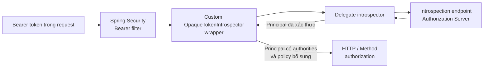
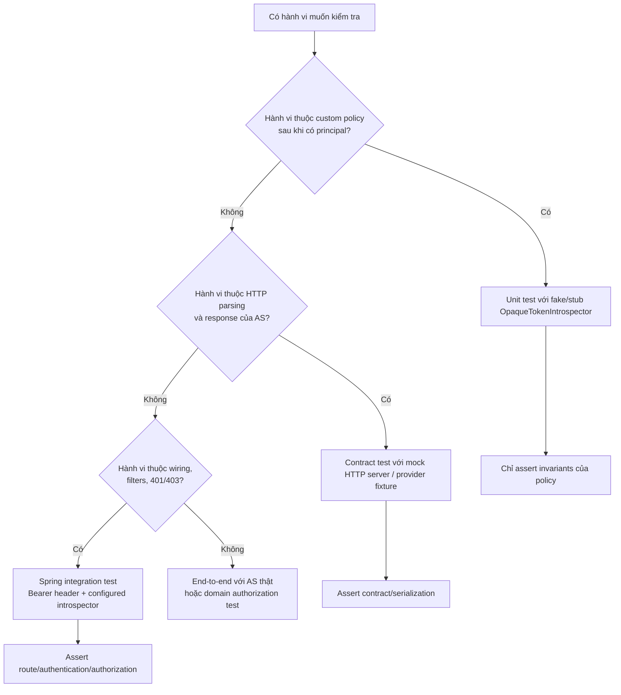

# Kiểm thử phần tùy chỉnh độc lập với phản hồi của nhà cung cấp

Trong **Spring Security OAuth 2.0/OIDC Resource Server**, khi API chấp nhận **opaque access token**, ứng dụng thường dùng `OpaqueTokenIntrospector` để hỏi Authorization Server (AS) token còn hoạt động hay không và lấy các thuộc tính phục vụ xác thực, phân quyền. Từ các thuộc tính introspection, Spring Security tạo `OAuth2AuthenticatedPrincipal` với các `GrantedAuthority`, chẳng hạn `SCOPE_orders.read`.

Ứng dụng đôi khi cần tùy chỉnh sau bước introspection: kiểm tra audience theo hợp đồng riêng, chuẩn hóa claim tenant, ánh xạ một quyền mở rộng được nhà phát hành xác nhận hoặc giới hạn tập authorities. Một lỗi phổ biến khi kiểm thử là **mọi unit test đều gọi tới môi trường IdP thật**, hoặc đều chứa nguyên JSON response đặc thù của một nhà cung cấp. Các test như vậy dễ thất bại do mạng, cấu hình tenant/client, dữ liệu đang thay đổi hoặc chi tiết JSON không liên quan đến logic cần kiểm thử.

Phương pháp đáng tin cậy hơn là **tách ranh giới introspection từ xa và phần xử lý tùy chỉnh của ứng dụng**:

1. Để một `OpaqueTokenIntrospector` được tin cậy chịu trách nhiệm gửi token đến AS và trả về `OAuth2AuthenticatedPrincipal` đã được xác thực.
2. Đặt logic của ứng dụng trong một **decorator/wrapper**, nhận principal đã xác thực và trả một principal có chính sách bổ sung.
3. **Unit test wrapper** bằng fake/stub/mock `OpaqueTokenIntrospector`, tự tạo những principal tối thiểu phù hợp với hợp đồng. Các test này không có HTTP, không client secret, không phụ thuộc IdP.
4. **Contract test** riêng kiểm tra giả định về cấu trúc/phạm vi metadata của nhà cung cấp; **integration test** riêng kiểm tra wiring, HTTP introspection, Bearer filter và authorization.

Mục tiêu không phải “không bao giờ kiểm tra IdP thật”. Mục tiêu là **mỗi lớp kiểm thử có phạm vi rõ**, để lỗi trong chính sách tùy chỉnh không bị trộn với lỗi mạng hoặc sự thay đổi của bên cung cấp.

## 1. Ranh giới trách nhiệm: không kiểm thử cả thế giới trong một unit test

Xét Orders API có một opaque token và yêu cầu:

- Token phải được AS xác nhận còn hoạt động.
- Issuer phải là `https://idp.example.com/realms/shop`.
- Audience phải chứa `orders-api`.
- Scope `orders.read` của AS vẫn được chuyển thành `SCOPE_orders.read`.
- Nếu AS trả permission đặc thù `order:approve`, API có thể bổ sung `PERMISSION_order:approve`; các permission không được phê duyệt phải bị bỏ qua.



Ở đây **unit under test** là wrapper. Wrapper **không nên tự giả lập** quá trình xác thực token từ AS. Nó chỉ:

- Gọi delegate đúng một lần với đúng credential.
- Nhận `OAuth2AuthenticatedPrincipal` hoặc để lỗi của delegate truyền lên.
- Kiểm tra các thuộc tính được hợp đồng yêu cầu.
- Ánh xạ thêm/giới hạn quyền một cách có chủ đích.
- Giữ các thuộc tính và authorities đáng tin đã được delegate trả về.
- Không tự tạo principal “mặc định có quyền” khi delegate thất bại.

### 1.1. Ba loại kiểm thử trả lời ba câu hỏi khác nhau

| Loại kiểm thử | Câu hỏi chính | Cần gọi IdP thật? |
|---|---|---|
| **Unit test phần tùy chỉnh** | Wrapper có kiểm tra issuer/audience, giữ scope, ánh xạ permission, xử lý lỗi đúng không? | **Không** |
| **Contract/adapter test** | Delegate/parser có hiểu response `active`, `scope`, `aud`, `iss` như nhà cung cấp đã cam kết không? | Có thể dùng mock HTTP response/fixture có kiểm soát; xác minh định kỳ với môi trường provider |
| **Integration/end-to-end test** | Spring Security filter chain thực sự dùng wrapper, gọi AS, xác thực token và áp rule authorization đúng không? | Có thể dùng mock server để ổn định; bổ sung test trên môi trường tích hợp IdP thực |

**Unit test không chứng minh token được AS xác thực thật**. Ngược lại, một end-to-end test với IdP thật không tự chứng minh mọi nhánh lỗi trong custom mapper, vì việc tạo token thiếu audience hoặc có metadata sai có thể rất khó và không ổn định.

## 2. Hiểu đầu vào của `OpaqueTokenIntrospector`

Spring Security định nghĩa interface cốt lõi:

```java
import org.springframework.security.oauth2.core.OAuth2AuthenticatedPrincipal;
import org.springframework.security.oauth2.server.resource.introspection.OpaqueTokenIntrospector;

public interface OpaqueTokenIntrospector {
    OAuth2AuthenticatedPrincipal introspect(String token);
}
```

Đây là **biên lập trình** mà ứng dụng có thể cài đặt, bọc hoặc giả lập. `String token` là bearer credential; **không được log hoặc đưa nó vào exception**. Khi token được xác thực hợp lệ, delegate trả principal chứa:

```java
principal.getName();
principal.getAttributes();
principal.getAttribute("sub");
principal.getAuthorities();
```

Với response introspection tiêu biểu:

```json
{
  "active": true,
  "scope": "orders.read orders.update",
  "iss": "https://idp.example.com/realms/shop",
  "sub": "user-842",
  "aud": ["orders-api"],
  "client_id": "shop-web",
  "tenant_id": "tenant-a"
}
```

delegate thường đưa `orders.read` và `orders.update` thành authorities `SCOPE_orders.read` và `SCOPE_orders.update`. Nhưng **mức độ chuẩn hóa thuộc tính, loại Java của từng claim và phạm vi metadata phụ thuộc implementation/version/hợp đồng**. Ví dụ `aud` có thể được thư viện biểu diễn thành `String` hoặc collection; extension `permissions` có thể không được mapping tự động.

### 2.1. Vì sao giả lập principal thay vì JSON response?

Nếu logic tùy chỉnh **chỉ nhìn thấy `OAuth2AuthenticatedPrincipal`**, test nên cấp đúng loại dữ liệu tại **biên trực tiếp** đó:

```text
Test data:
  name = user-842
  attributes:
    iss = https://idp.example.com/realms/shop
    aud = ["orders-api"]
    permissions = ["order:approve"]
  authorities:
    SCOPE_orders.read
```

Lợi ích:

- Không phải biết endpoint provider có path `/oauth/introspect` hay `/oauth2/introspect`.
- Không phải gửi client ID/secret test.
- Không phụ thuộc token trong test đã hết hạn hoặc bị thu hồi.
- Không cần biết JSON serializer hay HTTP library của delegate.
- Test kiểm tra đúng logic của wrapper thay vì kiểm tra giả định về mạng.

Ngược lại, khi muốn kiểm tra **chuyển JSON introspection thành principal**, đó là contract/adapter test, và JSON response trở thành đối tượng phù hợp.

### 2.2. Không nhầm fake principal với xác thực thực

Trong unit test, `DefaultOAuth2AuthenticatedPrincipal` được tạo trực tiếp, không chứng minh `active:true` hay token hợp lệ. Đây là **giả định có chủ đích**: “delegate đã hoàn thành nhiệm vụ xác thực và trả principal”. Nếu implementation production cho phép caller không tin cậy tự tạo principal bỏ qua delegate, thiết kế không an toàn dù unit tests đều xanh.

Phải có ít nhất một lớp integration test hoặc kiểm chứng cấu hình đảm bảo ứng dụng **thật sự gọi delegate** khi nhận Bearer token.

## 3. Chọn kiến trúc tùy chỉnh dễ kiểm thử

### 3.1. Không trộn HTTP call và policy trong một method dài

Một implementation khó kiểm thử thường có các bước:

```text
introspect(token):
  tự dựng URL và HTTP request
  tự gắn client secret
  tự parse JSON provider
  tự suy đoán scope
  tự gắn role
  tự kiểm tra audience
  tự cache
  tự tạo Authentication
```

Một bài unit test của method này có thể phải mô phỏng HTTP, JSON, timeout, cache và business policy cùng lúc. Nó cũng dễ sinh lỗi *fail-open*: khi request tới AS lỗi, code chuyển sang tạo principal dự phòng có quyền.

Kiến trúc được đề xuất:

```text
HTTP/TLS + client auth + active/token state
              |
              v
   Delegate OpaqueTokenIntrospector
              |
              v
      OAuth2AuthenticatedPrincipal
              |
              v
     Custom Policy / Decorator
       - issuer/audience validation
       - optional tenant requirement
       - permission allowlist mapping
       - preserve SCOPE_ authorities
              |
              v
       Principal đã được ràng buộc policy
              |
              v
     Spring Security Authorization
```

Một wrapper như vậy phụ thuộc **interface**, không phụ thuộc class triển khai hoặc JSON cụ thể của IdP:

```java
public final class ShopPolicyIntrospector
        implements OpaqueTokenIntrospector {

    private final OpaqueTokenIntrospector delegate;

    public ShopPolicyIntrospector(OpaqueTokenIntrospector delegate) {
        this.delegate = delegate;
    }

    @Override
    public OAuth2AuthenticatedPrincipal introspect(String token) {
        OAuth2AuthenticatedPrincipal principal =
            delegate.introspect(token);

        // Kiểm tra hợp đồng và mapping quyền ở đây.
        return principal;
    }
}
```

Đây mới là **khung**; phần sau triển khai một chính sách hoàn chỉnh và các test. Điểm quan trọng ngay từ đầu: delegate là **dependency được tiêm vào**, nên unit test có thể thay nó bằng stub/mock mà không gọi tới IdP.

### 3.2. Quy định ranh giới dữ liệu của decorator

Ta giả định hợp đồng của Orders API:

1. `iss` bắt buộc đúng issuer tin cậy.
2. `aud` bắt buộc chứa `orders-api` (hỗ trợ chuỗi đơn hoặc collection).
3. Delegate có trách nhiệm xác thực token và cung cấp các `SCOPE_...` authorities cơ bản.
4. `permissions` là claim mở rộng **do AS đã được tin cậy phát hành**; chỉ `order:approve` được chuyển thành `PERMISSION_order:approve`.
5. Nếu `permissions` thiếu, chỉ giữ scopes; nếu có nhưng sai định dạng, từ chối token theo chính sách hợp đồng.
6. Không biến một permission lạ thành authority mới; không tự thêm `SCOPE_orders.read` nếu delegate không có.
7. Ngoài mapping, quyền owner/tenant trên từng order vẫn được kiểm tra ở business service.

Đây là **một lựa chọn minh họa**, không phải chuẩn chung cho mọi AS. Nếu nhà cung cấp không trả `iss` hoặc `aud`, cần thương lượng hợp đồng hoặc thiết kế cơ chế ràng buộc token-resource tương đương; không hạ tiêu chuẩn kiểm chứng bằng cách đơn giản bỏ điều kiện.

## 4. Implementation ví dụ: wrapper policy không phụ thuộc HTTP

Ví dụ dưới đây dùng Spring Security Servlet và Java 17+ (phù hợp Spring Boot 3.x). Wrapper không tự thực hiện network call, chỉ kiểm tra principal đã được delegate trả về:

```java
import java.util.Collection;
import java.util.LinkedHashSet;
import java.util.Map;
import java.util.Objects;
import java.util.Set;

import org.springframework.security.core.GrantedAuthority;
import org.springframework.security.core.authority.SimpleGrantedAuthority;
import org.springframework.security.oauth2.core.DefaultOAuth2AuthenticatedPrincipal;
import org.springframework.security.oauth2.core.OAuth2AuthenticatedPrincipal;
import org.springframework.security.oauth2.server.resource.introspection.BadOpaqueTokenException;
import org.springframework.security.oauth2.server.resource.introspection.OpaqueTokenIntrospector;

public final class ShopPolicyIntrospector
        implements OpaqueTokenIntrospector {

    private final OpaqueTokenIntrospector delegate;
    private final String expectedIssuer;
    private final String expectedAudience;

    public ShopPolicyIntrospector(
            OpaqueTokenIntrospector delegate,
            String expectedIssuer,
            String expectedAudience) {
        this.delegate = Objects.requireNonNull(delegate);
        this.expectedIssuer = Objects.requireNonNull(expectedIssuer);
        this.expectedAudience = Objects.requireNonNull(expectedAudience);
    }

    @Override
    public OAuth2AuthenticatedPrincipal introspect(String token) {
        // Lời gọi này phải xác thực token bằng nguồn tin cậy.
        // Nếu delegate ném lỗi, tuyệt đối không cấp quyền dự phòng.
        OAuth2AuthenticatedPrincipal source = delegate.introspect(token);

        if (!expectedIssuer.equals(source.getAttribute("iss"))) {
            throw new BadOpaqueTokenException(
                "Token issuer is not accepted");
        }

        Object rawAudience = source.getAttribute("aud");
        boolean audienceMatches =
            (rawAudience instanceof String aud
                && expectedAudience.equals(aud))
            || (rawAudience instanceof Collection<?> audiences
                && audiences.contains(expectedAudience));

        if (!audienceMatches) {
            throw new BadOpaqueTokenException(
                "Token audience is not accepted");
        }

        // Giữ nguyên các quyền SCOPE_... mà delegate đã trả.
        Set<GrantedAuthority> authorities =
            new LinkedHashSet<>(source.getAuthorities());

        Object rawPermissions = source.getAttribute("permissions");
        if (rawPermissions != null) {
            if (!(rawPermissions instanceof Collection<?> permissions)) {
                throw new BadOpaqueTokenException(
                    "Malformed permissions claim");
            }

            for (Object permission : permissions) {
                if (!(permission instanceof String value)) {
                    throw new BadOpaqueTokenException(
                        "Malformed permission entry");
                }

                // Không đưa giá trị không được duyệt vào authorities.
                if ("order:approve".equals(value)) {
                    authorities.add(new SimpleGrantedAuthority(
                        "PERMISSION_order:approve"));
                }
            }
        }

        Map<String, Object> attributes = source.getAttributes();

        return new DefaultOAuth2AuthenticatedPrincipal(
            source.getName(),
            attributes,
            authorities
        );
    }
}
```

**Vì sao mẫu này dễ kiểm thử?** Constructor nhận một `OpaqueTokenIntrospector`, nên test có thể thay nó bằng bất kỳ implementation nhỏ nào của interface, kể cả lambda. Không có `RestClient`, `WebClient`, hostname, client secret hoặc tenant nhà cung cấp nào trong logic kiểm tra quyền.

### 4.1. Điều wrapper này bảo đảm

| Điều kiện | Cách xử lý |
|---|---|
| Delegate xác thực thành công | Nhận principal và tiếp tục policy |
| Delegate báo token không hợp lệ | Exception truyền lên, không tạo principal dự phòng |
| `iss` sai hoặc thiếu | Ném `BadOpaqueTokenException` |
| `aud` sai hoặc thiếu | Ném `BadOpaqueTokenException` |
| `scope` đã được delegate ánh xạ thành `SCOPE_orders.read` | Giữ nguyên authority |
| Permission `order:approve` xuất hiện đúng định dạng | Thêm `PERMISSION_order:approve` |
| Permission `super-admin` hoặc bất kỳ giá trị lạ | Không tự cấp role/permission tương ứng |
| `permissions` thiếu | Giữ quyền mặc định, không tạo permission |
| `permissions` có type không hợp đồng | Từ chối token theo policy minh họa |

`LinkedHashSet` loại bỏ authority trùng, không thay đổi quyền theo ý nghĩa. Nếu ứng dụng cần **giới hạn hoặc loại bỏ** một số authorities được delegate tạo, phải có chính sách minh bạch; đừng mặc định bỏ hoặc đổi scopes nếu không hiểu ý nghĩa của chúng.

### 4.2. Giới hạn quan trọng của ví dụ

**Wrapper tin tưởng delegate** đã xác thực token thật. Nó **không xác minh lại** chữ ký JWT hoặc trạng thái `active`; đó là trách nhiệm của delegate/AS. Việc kiểm tra `iss` và `aud` ở đây chỉ có ý nghĩa khi chúng đến từ metadata tin cậy.

Ví dụ cũng **không**:

- Xác định scope `orders.read` từ chuỗi bearer raw.
- Tra JSON/HTTP trực tiếp.
- Đảm bảo mọi IdP trả `permissions` dưới dạng collection.
- Thay thế kiểm tra business ownership/tenant.
- Tự cache introspection result.
- Phân quyền cho mọi hệ thống đa issuer hay đa API.

Nếu dùng một AS trả response khác, thay đổi phần **adapter/hợp đồng ở ranh giới**, không sửa mọi unit test policy để chạy theo chi tiết vendor.

## 5. Unit test đầu tiên: dùng fake delegate tối giản

Với interface chỉ có `introspect(String)`, một fake delegate có thể được viết ngay trong test:

```java
OpaqueTokenIntrospector fakeDelegate = token ->
    new DefaultOAuth2AuthenticatedPrincipal(
        "user-842",
        Map.of(
            "iss", "https://idp.example.com/realms/shop",
            "aud", List.of("orders-api"),
            "sub", "user-842"
        ),
        List.of(
            new SimpleGrantedAuthority("SCOPE_orders.read")
        )
    );
```

Fake này không biết hoặc không quan tâm token string là JWT, opaque hay UUID. Nó đại diện cho **kết quả đã xác thực ở boundary**. Ta có thể gọi:

```java
ShopPolicyIntrospector custom = new ShopPolicyIntrospector(
    fakeDelegate,
    "https://idp.example.com/realms/shop",
    "orders-api"
);

OAuth2AuthenticatedPrincipal result =
    custom.introspect("not-a-real-access-token");
```

Đây là test thuần Java, không cần Spring context, database, HTTP endpoint hay Authorization Server. Nếu muốn test **delegate có được gọi đúng credential** hay không, Mockito hoặc một fake có biến ghi nhận input phù hợp hơn lambda cố định.

### 5.1. Tạo test fixture theo hợp đồng ứng dụng

Thay vì sao chép nguyên response JSON của IdP vào hàng chục test, tạo một **fixture builder cho principal**. Mỗi test chỉ ghi những thuộc tính quan trọng với trường hợp đang xét:

```java
import java.util.ArrayList;
import java.util.Collection;
import java.util.HashMap;
import java.util.List;
import java.util.Map;

import org.springframework.security.core.GrantedAuthority;
import org.springframework.security.core.authority.SimpleGrantedAuthority;
import org.springframework.security.oauth2.core.DefaultOAuth2AuthenticatedPrincipal;
import org.springframework.security.oauth2.core.OAuth2AuthenticatedPrincipal;

final class PrincipalFixtures {

    static final String ISSUER =
        "https://idp.example.com/realms/shop";

    static final String AUDIENCE = "orders-api";

    static OAuth2AuthenticatedPrincipal principal(
            Map<String, Object> overrides,
            String... authorities) {

        Map<String, Object> attributes = new HashMap<>();
        attributes.put("iss", ISSUER);
        attributes.put("aud", List.of(AUDIENCE));
        attributes.put("sub", "user-842");
        attributes.putAll(overrides);

        Collection<GrantedAuthority> grants = new ArrayList<>();
        for (String authority : authorities) {
            grants.add(new SimpleGrantedAuthority(authority));
        }

        return new DefaultOAuth2AuthenticatedPrincipal(
            "user-842", attributes, grants);
    }
}
```

Một test có thể sử dụng:

```java
PrincipalFixtures.principal(
    Map.of("permissions", List.of("order:approve")),
    "SCOPE_orders.read"
);
```

Lợi ích:

- Test mô tả **ý nghĩa nghiệp vụ** thay vì 30 trường JSON không liên quan.
- Khi đổi HTTP response adapter, test policy có thể giữ nguyên.
- Có thể tạo negative case bằng cách thay một thuộc tính.
- Không cần bearer token thật hoặc client secret.

Với claim bắt buộc **bị thiếu**, `Map.of(...)` không biểu diễn “xóa field”. Có thể tạo một map fixture riêng hoặc mở rộng builder với thao tác remove. Tránh dùng `Map.of("iss", null)` vì `Map.of` không chấp nhận null.

## 6. Unit test đầy đủ bằng JUnit 5, Mockito và AssertJ

Ví dụ test trực tiếp `ShopPolicyIntrospector`:

```java
import java.util.List;
import java.util.Map;

import org.junit.jupiter.api.BeforeEach;
import org.junit.jupiter.api.Test;
import org.springframework.security.core.GrantedAuthority;
import org.springframework.security.oauth2.core.OAuth2AuthenticatedPrincipal;
import org.springframework.security.oauth2.server.resource.introspection.BadOpaqueTokenException;
import org.springframework.security.oauth2.server.resource.introspection.OpaqueTokenIntrospector;

import static org.assertj.core.api.Assertions.assertThat;
import static org.assertj.core.api.Assertions.assertThatThrownBy;
import static org.mockito.Mockito.mock;
import static org.mockito.Mockito.times;
import static org.mockito.Mockito.verify;
import static org.mockito.Mockito.when;

class ShopPolicyIntrospectorTest {

    private static final String TOKEN = "opaque-unit-test-credential";

    private OpaqueTokenIntrospector delegate;
    private ShopPolicyIntrospector subject;

    @BeforeEach
    void setUp() {
        delegate = mock(OpaqueTokenIntrospector.class);
        subject = new ShopPolicyIntrospector(
            delegate,
            PrincipalFixtures.ISSUER,
            PrincipalFixtures.AUDIENCE);
    }

    @Test
    void keepsExistingScopesAndAddsOnlyApprovedPermission() {
        OAuth2AuthenticatedPrincipal source =
            PrincipalFixtures.principal(
                Map.of("permissions",
                    List.of("order:approve", "unrecognized-permission")),
                "SCOPE_orders.read",
                "SCOPE_orders.update");

        when(delegate.introspect(TOKEN)).thenReturn(source);

        OAuth2AuthenticatedPrincipal result =
            subject.introspect(TOKEN);

        assertThat(result.getAuthorities())
            .extracting(GrantedAuthority::getAuthority)
            .containsExactlyInAnyOrder(
                "SCOPE_orders.read",
                "SCOPE_orders.update",
                "PERMISSION_order:approve");

        assertThat(result.getName()).isEqualTo("user-842");
        assertThat(result.getAttribute("sub"))
            .isEqualTo("user-842");
        verify(delegate, times(1)).introspect(TOKEN);
    }

    @Test
    void missingPermissionsDoesNotInventExtraAuthorities() {
        OAuth2AuthenticatedPrincipal source =
            PrincipalFixtures.principal(
                Map.of(),
                "SCOPE_orders.read");

        when(delegate.introspect(TOKEN)).thenReturn(source);

        OAuth2AuthenticatedPrincipal result =
            subject.introspect(TOKEN);

        assertThat(result.getAuthorities())
            .extracting(GrantedAuthority::getAuthority)
            .containsExactly("SCOPE_orders.read");
    }

    @Test
    void rejectsWrongIssuer() {
        OAuth2AuthenticatedPrincipal source =
            PrincipalFixtures.principal(
                Map.of("iss", "https://untrusted.example.com"),
                "SCOPE_orders.read");

        when(delegate.introspect(TOKEN)).thenReturn(source);

        assertThatThrownBy(() -> subject.introspect(TOKEN))
            .isInstanceOf(BadOpaqueTokenException.class);
    }

    @Test
    void rejectsWrongAudience() {
        OAuth2AuthenticatedPrincipal source =
            PrincipalFixtures.principal(
                Map.of("aud", List.of("payments-api")),
                "SCOPE_orders.read");

        when(delegate.introspect(TOKEN)).thenReturn(source);

        assertThatThrownBy(() -> subject.introspect(TOKEN))
            .isInstanceOf(BadOpaqueTokenException.class);
    }

    @Test
    void acceptsAudienceAsSingleStringWhenContractAllowsIt() {
        OAuth2AuthenticatedPrincipal source =
            PrincipalFixtures.principal(
                Map.of("aud", "orders-api"),
                "SCOPE_orders.read");

        when(delegate.introspect(TOKEN)).thenReturn(source);

        assertThat(subject.introspect(TOKEN).getAuthorities())
            .extracting(GrantedAuthority::getAuthority)
            .contains("SCOPE_orders.read");
    }

    @Test
    void rejectsMalformedPermissionsClaim() {
        OAuth2AuthenticatedPrincipal source =
            PrincipalFixtures.principal(
                Map.of("permissions", "order:approve"),
                "SCOPE_orders.read");

        when(delegate.introspect(TOKEN)).thenReturn(source);

        assertThatThrownBy(() -> subject.introspect(TOKEN))
            .isInstanceOf(BadOpaqueTokenException.class);
    }
}
```

Các test này không cần network. Chúng cố ý kiểm tra **kết quả của lớp tùy chỉnh**:

- Scope mặc định từ delegate có được giữ hay không.
- Permission được duyệt có được bổ sung đúng tên authority hay không.
- Permission không được duyệt có bị bỏ qua hay không.
- Principal name/attributes có bị làm mất hay không.
- Issuer và audience có được áp đúng policy hay không.
- Claim extension sai type có bị từ chối hay không.
- Delegate có được gọi với đúng token hay không.

Đây là ví dụ theo các APIs Spring Security 6.x/JUnit 5/Mockito/AssertJ phổ biến; imports của fixture và test được để riêng cho từng class. Không coi một test unit thành công là bằng chứng response của IdP hiện tại vẫn theo contract.

### 6.1. Vì sao không so sánh cả principal bằng equals?

`DefaultOAuth2AuthenticatedPrincipal` chứa nhiều attributes, và behavior equality của implementation không nên là tiêu chí duy nhất nếu hợp đồng của wrapper chỉ yêu cầu:

- `getName()` không đổi.
- Attributes cần thiết được giữ.
- Authorities đúng tập.
- Không nâng quyền từ input lạ.

Assert trên **các thuộc tính có ý nghĩa bảo mật** làm test rõ mục tiêu và ít phụ thuộc chi tiết class. Nếu bất biến “giữ nguyên tất cả attributes” là yêu cầu của ứng dụng, có thể assert:

```java
assertThat(result.getAttributes())
    .containsAllEntriesOf(source.getAttributes());
```

Việc assert collection authorities bằng `containsExactlyInAnyOrder` cũng tránh biến thứ tự danh sách thành hợp đồng không cần thiết. Nếu ứng dụng thực sự yêu cầu thứ tự để audit/serialization, hãy document rõ trước khi assert order.

## 7. Kiểm thử tình huống lỗi của delegate: tuyệt đối không fail-open

Trong thực tế, introspection có thể thất bại vì:

- Token không active hoặc bị thu hồi.
- Token không tồn tại.
- Introspection endpoint từ chối client credentials.
- Endpoint timeout, DNS/TLS lỗi hoặc trả 5xx.
- Response không hợp lệ hoặc thiếu `active`.

Đối với wrapper, có một bất biến quan trọng:

> **Nếu delegate không xác thực được token, custom code không được tự tạo Authentication có quyền để tiếp tục request.**

Mẫu code nguy hiểm:

```java
// KHÔNG LÀM: minh họa fail-open.
try {
    return delegate.introspect(token);
} catch (RuntimeException ex) {
    return new DefaultOAuth2AuthenticatedPrincipal(
        "backup-user",
        Map.of("iss", "https://idp.example.com/realms/shop"),
        List.of(new SimpleGrantedAuthority("SCOPE_orders.read")));
}
```

Khi Authorization Server không truy cập được, API không có bằng chứng token còn active. Cấp quyền dự phòng biến lỗi mạng thành lỗ hổng authorization.

### 7.1. Test truyền nguyên lỗi token invalid

```java
@Test
void invalidTokenFailureMustNotBeConvertedToPrincipal() {
    when(delegate.introspect(TOKEN))
        .thenThrow(new BadOpaqueTokenException("Inactive token"));

    assertThatThrownBy(() -> subject.introspect(TOKEN))
        .isInstanceOf(BadOpaqueTokenException.class);

    verify(delegate, times(1)).introspect(TOKEN);
}
```

Test chỉ cần biết delegate từ chối token. Nó không cần tạo một response JSON `{"active":false}`, bởi việc chuyển response đó thành exception là **trách nhiệm của adapter/delegate** chứ không phải wrapper.

### 7.2. Test lỗi mạng/không khả dụng theo hành vi, không phụ thuộc HTTP library

Ví dụ để unit test wrapper không “nuốt” lỗi:

```java
@Test
void delegateInfrastructureFailureDoesNotGrantAuthority() {
    RuntimeException upstreamFailure =
        new IllegalStateException("Introspection unavailable");

    when(delegate.introspect(TOKEN))
        .thenThrow(upstreamFailure);

    assertThatThrownBy(() -> subject.introspect(TOKEN))
        .isSameAs(upstreamFailure);
}
```

Trong production, delegate có thể dùng exception chuyên biệt thay vì `IllegalStateException`. Unit test wrapper nên tập trung vào **không cấp quyền khi delegate thất bại**, không đóng cứng tên HTTP client exception nếu wrapper không xử lý HTTP.

Ở HTTP layer, lỗi mạng có thể dẫn tới một status khác 401/403 tùy handler/chiến lược vận hành. Điều không được thay đổi là **request không được tự động coi là authenticated và authorized** khi AS chưa xác nhận token.

### 7.3. Phân biệt kiểm thử lỗi business và lỗi upstream

| Đường lỗi | Ví dụ | Lớp chịu trách nhiệm |
|---|---|---|
| Token không active | `active=false` | Delegate/introspection adapter |
| Audience sai | `aud=["payments-api"]` | Custom policy wrapper hoặc hợp đồng AS |
| Permission malformed | `permissions="order:approve"` thay vì collection đã thống nhất | Custom policy wrapper |
| Connection timeout | AS không phản hồi | HTTP client/delegate + vận hành |
| Lỗi 401 khi gọi AS | Client secret/resource-server identity sai | HTTP client/delegate/config |
| Token hợp lệ nhưng scope thiếu | Không có `SCOPE_orders.read` | HTTP/method authorization |
| Token hợp lệ nhưng đọc order khác owner | Dữ liệu DB không thuộc principal | Domain/business authorization |

**Đừng buộc unit test wrapper phải dựng một HTTP 503 chỉ để kiểm tra quy tắc audience.** Đặt mỗi trường hợp đúng lớp giảm coupling và giúp phát hiện lỗi nhanh hơn.

## 8. Kiểm thử thiếu/khác type của claims mà không cần JSON của provider

Nhà cung cấp có thể thay đổi cấu trúc metadata hoặc giới hạn claims trả về theo client/realm. Tuy nhiên, **hợp đồng mà wrapper tiêu thụ** phải định nghĩa rõ behavior khi thiếu hoặc sai type. Có thể biểu diễn trực tiếp trong fixture.

### 8.1. Thiếu issuer

Fixture không có `iss`:

```java
Map<String, Object> attributes = new HashMap<>();
attributes.put("aud", List.of("orders-api"));
attributes.put("sub", "user-842");

OAuth2AuthenticatedPrincipal principal =
    new DefaultOAuth2AuthenticatedPrincipal(
        "user-842",
        attributes,
        List.of(new SimpleGrantedAuthority("SCOPE_orders.read")));
```

Wrapper ví dụ từ chối vì `expectedIssuer.equals(null)` trả false. Không cần gán một issuer giả để test.

### 8.2. Thiếu audience

Fixture có issuer đúng nhưng **không có `aud`**. Theo policy minh họa, wrapper phải từ chối. Điều này khác với “audience là null nhưng cho qua để hỗ trợ nhà cung cấp”: nếu audience là điều kiện bảo mật bắt buộc, thiếu metadata phải **fail closed**.

Nếu một AS chỉ trả metadata audience cho đúng một Resource Server và đã ràng buộc quyền introspection ở AS, đây là một **hợp đồng khác**. Khi đó cần ghi rõ đâu là bằng chứng token được cấp cho API, thay vì bỏ điều kiện âm thầm.

### 8.3. Audience kiểu chuỗi/mảng/kiểu sai

| Giá trị `aud` của principal | Ví dụ | Policy minh họa |
|---|---|---|
| Chuỗi đúng | `"orders-api"` | Chấp nhận |
| Collection có API | `["orders-api","reporting-api"]` | Chấp nhận nếu multi-audience được phép |
| Collection không có API | `["payments-api"]` | Từ chối |
| String sai | `"another-api"` | Từ chối |
| Number | `123` | Từ chối |
| Null/vắng mặt | Không có field | Từ chối |

Chỉ dùng so sánh **chính xác** giá trị audience. Không dùng `String.contains("orders")` trên chuỗi thô vì `orders-api-other` hoặc một JSON string chứa tên API ở chỗ khác không phải bằng chứng audience phù hợp.

### 8.4. Permission extension sai type hoặc giá trị lạ

Unit tests nên có các trường hợp:

```text
permissions absent
permissions = []
permissions = ["order:approve"]
permissions = ["order:approve", "unknown"]
permissions = ["order:approve", "order:approve"]
permissions = "order:approve"             (wrong type)
permissions = [100]                       (wrong member type)
permissions = ["ROLE_ADMIN"]              (unapproved value)
```

Wrapper ví dụ:

- Không thêm quyền khi claim thiếu hoặc rỗng.
- Chỉ thêm một authority khi `order:approve` được cho phép.
- Không tạo quyền từ `ROLE_ADMIN` nếu đó không phải giá trị được hợp đồng duyệt.
- Từ chối claim sai type thay vì cố đoán hoặc parse mơ hồ.

### 8.5. Bảo toàn scope mặc định là bất biến bảo mật quan trọng

Nếu delegate trả:

```text
SCOPE_orders.read
SCOPE_reports.read
```

wrapper thêm quyền mới không được vô tình xóa `SCOPE_orders.read` chỉ vì dựng lại `DefaultOAuth2AuthenticatedPrincipal` với list authorities rỗng.

Test nên **so tập authorities trước và sau**. Tuy nhiên, “bảo toàn toàn bộ authorities” chỉ là chính sách phù hợp khi **delegate đã được tin cậy** và các scopes đó được phép dùng ở API tương ứng. Nếu ứng dụng cần giới hạn scope theo resource, phải có policy rõ **trước hoặc cùng lúc** với mapping, không đơn giản giữ mọi authority không điều kiện.

## 9. Tách mapper thuần Java nếu logic quyền ngày càng phức tạp

Một wrapper tương đối nhỏ có thể được test trực tiếp. Nhưng nếu có nhiều rules về tenant, client credentials, permission alias hoặc type normalization, nên tách thành thành phần thuần Java:

```text
OpaqueTokenIntrospector delegate
          |
          v
OAuth2AuthenticatedPrincipal
          |
          v
PrincipalPolicy / AuthorityMapper
          |
          v
Validated principal/authorities
```

Ví dụ một class mapper không biết token hoặc HTTP:

```java
import java.util.Collection;
import java.util.LinkedHashSet;
import java.util.Set;

import org.springframework.security.core.GrantedAuthority;
import org.springframework.security.core.authority.SimpleGrantedAuthority;
import org.springframework.security.oauth2.core.OAuth2AuthenticatedPrincipal;

public final class ShopAuthorityMapper {

    public Collection<GrantedAuthority> map(
            OAuth2AuthenticatedPrincipal principal) {

        Set<GrantedAuthority> result =
            new LinkedHashSet<>(principal.getAuthorities());

        Object raw = principal.getAttribute("permissions");
        if (raw instanceof Collection<?> values) {
            if (values.contains("order:approve")) {
                result.add(new SimpleGrantedAuthority(
                    "PERMISSION_order:approve"));
            }
        }
        return result;
    }
}
```

Đoạn ví dụ chỉ tập trung vào **mapping quyền** và có chính sách khoan dung với claim sai type; nó không thay hoàn toàn `ShopPolicyIntrospector` ở phần 4, nơi malformed permission được từ chối. Khi tách production code, phải **chọn và giữ nhất quán một chính sách** (strict rejection hoặc bỏ qua optional extension) và test rõ; không để hai mapper có hành vi khác nhau chỉ vì refactor.

Với mapper tách riêng:

- Unit test `ShopAuthorityMapper` chỉ quan tâm quyền.
- Unit test `ShopPolicyIntrospector` kiểm tra gọi delegate, issuer/audience, lỗi và việc áp mapper.
- Contract test kiểm tra cách metadata của AS trở thành `OAuth2AuthenticatedPrincipal`.

Cách chia này đặc biệt hữu ích nếu ứng dụng tích hợp nhiều IdP nhưng muốn tái sử dụng một policy quyền chung.

### 9.1. Tránh DTO mang tên/field của riêng vendor trong domain

Một implementation dễ bị khóa chặt:

```java
record VendorXIntrospectionResponse(
    String realm_access,
    String resource_access,
    String scp,
    String custom_permissions_v3
) {}
```

Nếu mọi unit test policy đều tạo DTO này, thay nhà cung cấp kéo theo sửa cả loạt test dù chính sách “orders.read → SCOPE_orders.read” không đổi.

Nên có một adapter ở mép hệ thống:

```text
Provider-specific response/claims
           |
           v
    Provider adapter
           |
           v
Trusted principal hoặc normalized metadata
           |
           v
Domain/security policy độc lập vendor
```

Nhưng **không được biến một attribute tùy ý thành “trusted” chỉ vì đã đổi tên field**. Adapter phải dựa trên nguồn response đã xác thực và hợp đồng với AS. Test adapter khác test domain policy.

## 10. Contract tests: kiểm chứng giả định về provider ở nơi riêng

Unit test wrapper nói rằng: “Nếu delegate trả principal có `iss` và `aud` đúng thì wrapper chấp nhận; nếu sai thì từ chối”. Nó **chưa chứng minh** delegate/AS thực tế:

- Có trả `iss` và `aud` không.
- `aud` dùng String, array hay kiểu Java đã được convert.
- `scope` dạng chuỗi được tách như thế nào.
- Một `scp` array có được framework map hay không.
- `active=false` có bị từ chối hay không.
- Các metadata `permissions` có thật sự được AS quản trị không.

Đó là phạm vi của **contract tests**.

### 10.1. Mức 1: fixture HTTP tối thiểu, theo RFC 7662

Một contract test cho adapter HTTP có thể dùng mock server trả JSON:

```http
HTTP/1.1 200 OK
Content-Type: application/json
Cache-Control: no-store

{
  "active": true,
  "scope": "orders.read orders.update",
  "sub": "user-842",
  "aud": ["orders-api"],
  "iss": "https://idp.example.com/realms/shop"
}
```

Khi gọi delegate thật trỏ đến mock HTTP endpoint, kiểm tra:

```text
principal.getName()
principal.getAttribute("iss")
principal.getAttribute("aud")
principal.getAuthorities()
```

Kỳ vọng được cấu hình theo **version của Spring Security đang sử dụng**. Một số implementation có thể chuyển timestamp/string/collection khác nhau; test nhằm bắt sự khác biệt đó ở **adapter boundary**, không để nó lan vào unit tests policy.

### 10.2. Mức 2: test extension của nhà cung cấp

Nếu IdP tài liệu hóa:

```json
{
  "active": true,
  "scope": "orders.read",
  "aud": ["orders-api"],
  "permissions": ["order:approve"]
}
```

hãy test chính biến thể đó ở adapter. Không sao chép cả response chứa email, tên, địa chỉ, session identifiers, tenant IDs thật hoặc bearer token lấy từ production. Tạo **synthetic fixture** chỉ chứa những field mà hợp đồng yêu cầu.

Nếu provider trả `permissions` dưới dạng chuỗi phân cách bằng dấu phẩy thay vì array, adapter cần quyết định **chuẩn hóa hay từ chối** theo hợp đồng. Đừng tự cho phép converter đoán nhiều định dạng trong một unit test không có tài liệu.

### 10.3. Mức 3: test định kỳ với môi trường IdP thật

Một số giả định không thể chứng minh chỉ bằng mock server:

- Client authentication của Resource Server thật sự được AS chấp nhận.
- AS có trả metadata audience/scope cho client này hay chỉ cho một role khác.
- Token cấp theo client credentials/authorization code được AS diễn giải thế nào.
- Token revoked/expired có dẫn đến `active=false` đúng theo chính sách vận hành không.
- Các scopes/permissions được cấp có nhất quán với consent, realm và resource policy không.

Những test đó nên chạy trên môi trường tích hợp có AS được quản lý, **không bắt buộc** chạy mỗi lần unit test. Dùng client credentials test giới hạn quyền, token ngắn hạn, và quy trình dọn dữ liệu. Không đưa secret môi trường thật vào fixtures.

### 10.4. Dấu hiệu của test bị phụ thuộc quá mức vào nhà cung cấp

Một test policy có các chi tiết sau có thể đang kiểm thử sai boundary:

- Hard-code URL tenant, realm ID, client secret.
- Gọi `https://idp.example.com/introspect` trong `@Test` thuần mapper.
- Parse JSON bằng tay dù component thật chỉ nhận `OAuth2AuthenticatedPrincipal`.
- Assert thứ tự tất cả fields trong response.
- Dựa vào một token thật có thể hết hạn sau vài phút.
- Fail vì provider đổi trường không liên quan đến quyền API.

Chuyển các phần này sang contract/integration suite; giữ unit tests dựa trên principal/authority semantics.

## 11. Integration test Spring Security filter chain

Sau khi unit tests của wrapper chạy độc lập, cần đảm bảo **Spring Security thật sự sử dụng wrapper đã viết**.

### 11.1. Wiring trong Spring Boot

Một cấu hình minh họa:

```java
import org.springframework.beans.factory.annotation.Value;
import org.springframework.context.annotation.Bean;
import org.springframework.context.annotation.Configuration;
import org.springframework.security.oauth2.server.resource.introspection.NimbusOpaqueTokenIntrospector;
import org.springframework.security.oauth2.server.resource.introspection.OpaqueTokenIntrospector;

@Configuration
public class IntrospectionConfiguration {

    @Bean
    OpaqueTokenIntrospector opaqueTokenIntrospector(
            @Value("${app.security.introspection-uri}") String uri,
            @Value("${app.security.client-id}") String clientId,
            @Value("${app.security.client-secret}") String clientSecret,
            @Value("${app.security.issuer}") String issuer,
            @Value("${app.security.audience}") String audience) {

        OpaqueTokenIntrospector remote =
            new NimbusOpaqueTokenIntrospector(uri, clientId, clientSecret);

        return new ShopPolicyIntrospector(remote, issuer, audience);
    }
}
```

```yaml
app:
  security:
    introspection-uri: https://idp.example.com/oauth2/introspect
    client-id: orders-resource-server
    client-secret: "${INTROSPECTION_CLIENT_SECRET}"
    issuer: https://idp.example.com/realms/shop
    audience: orders-api
```

`NimbusOpaqueTokenIntrospector` có constructor dạng trên trong nhiều phiên bản Spring Security 6.x; một số phiên bản mới có builder/`SpringOpaqueTokenIntrospector` khác. Cần dùng API được **phiên bản dự án** hỗ trợ. Kiến trúc cần giữ là: **remote introspector được cấu hình từ nguồn tin cậy → wrapper kiểm tra policy**.

Khi application tự cung cấp bean `OpaqueTokenIntrospector`, cơ chế auto-configuration có thể nhường chỗ cho bean đó. Không giả định mọi property opaque của Boot vẫn tự động gắn vào một implementation do ứng dụng tự tạo.

Ví dụ security chain:

```java
import org.springframework.context.annotation.Bean;
import org.springframework.http.HttpMethod;
import org.springframework.security.config.annotation.web.builders.HttpSecurity;
import org.springframework.security.oauth2.server.resource.introspection.OpaqueTokenIntrospector;
import org.springframework.security.web.SecurityFilterChain;

@Bean
SecurityFilterChain securityFilterChain(
        HttpSecurity http,
        OpaqueTokenIntrospector introspector) throws Exception {
    return http
        .authorizeHttpRequests(auth -> auth
            .requestMatchers(HttpMethod.GET, "/api/orders/**")
                .hasAuthority("SCOPE_orders.read")
            .requestMatchers(HttpMethod.POST, "/api/orders/**")
                .hasAuthority("SCOPE_orders.create")
            .anyRequest().denyAll())
        .oauth2ResourceServer(oauth2 -> oauth2
            .opaqueToken(opaque ->
                opaque.introspector(introspector)))
        .build();
}
```

Đoạn trên chủ động nối bean tùy chỉnh vào `opaqueToken()` để rõ chain dùng component nào. Trong ứng dụng thực tế cần bảo vệ CORS preflight, các HTTP method khác và CSRF theo mô hình credential đang dùng; ví dụ chỉ tập trung vào **đường đi của introspector và scope authorization**.

### 11.2. MockMvc với request post processor khác pipeline thật

Spring Security Test có:

```java
mockMvc.perform(get("/api/orders/123")
    .with(opaqueToken().authorities(
        new SimpleGrantedAuthority("SCOPE_orders.read"))))
    .andExpect(status().isOk());
```

Đây là cách tốt để kiểm tra **HTTP authorization** với principal đã giả lập. Tuy nhiên, `opaqueToken()` request post processor có thể trực tiếp đặt một `Authentication` vào test context, **bỏ qua lời gọi `OpaqueTokenIntrospector` và HTTP introspection**.

Vì vậy test trên **không chứng minh**:

- Wrapper đã được gắn vào chain.
- Token thật được gửi tới AS.
- `active=false` bị từ chối.
- Response `scope` được mapping thành `SCOPE_...`.
- Audience/issuer checks của wrapper được chạy.

Nếu cần chứng minh wiring, hãy gửi **Bearer token thật ở header trong MockMvc request** và dùng một fake `OpaqueTokenIntrospector` được inject vào filter chain, hoặc mock HTTP server cho delegate thật.

### 11.3. Integration test với fake introspector ở ranh giới chain

Giả sử test context cung cấp bean introspector giả lập có kiểm soát:

```java
import java.util.List;
import java.util.Map;
import org.springframework.boot.test.context.TestConfiguration;
import org.springframework.context.annotation.Bean;
import org.springframework.context.annotation.Primary;
import org.springframework.security.core.authority.SimpleGrantedAuthority;
import org.springframework.security.oauth2.core.DefaultOAuth2AuthenticatedPrincipal;
import org.springframework.security.oauth2.server.resource.introspection.OpaqueTokenIntrospector;

@TestConfiguration
class FakeIntrospectionTestConfig {

    @Bean
    @Primary
    OpaqueTokenIntrospector testIntrospector() {
        OpaqueTokenIntrospector fakeRemote = token -> {
            if (!"active-read-token".equals(token)) {
                throw new BadOpaqueTokenException("Inactive token");
            }
            return new DefaultOAuth2AuthenticatedPrincipal(
                "user-842",
                Map.of(
                    "iss", PrincipalFixtures.ISSUER,
                    "aud", List.of("orders-api"),
                    "sub", "user-842"
                ),
                List.of(new SimpleGrantedAuthority(
                    "SCOPE_orders.read"))
            );
        };

        return new ShopPolicyIntrospector(
            fakeRemote,
            PrincipalFixtures.ISSUER,
            "orders-api");
    }
}
```

Sau khi chắc chắn test chain **thực sự dùng bean này**, có thể gửi request:

```java
mockMvc.perform(get("/api/orders/ORD-123")
        .header("Authorization", "Bearer active-read-token"))
    .andExpect(status().isOk());

mockMvc.perform(get("/api/orders/ORD-123")
        .header("Authorization", "Bearer inactive-token"))
    .andExpect(status().isUnauthorized());
```

Đây là **mẫu cấu hình và test concept**, không phải project test độc lập có thể chạy ngay: cần app context, controller, dữ liệu fixture, imports, dependency test, và cấu hình tránh tạo nhiều bean `OpaqueTokenIntrospector` gây ambiguity. Nếu production chain chỉ định một bean introspector trực tiếp qua `opaque.introspector(instance)`, việc thêm một `@Primary` test bean **không tự thay instance đã chốt trong DSL**. Trong trường hợp đó phải tạo cấu hình test chain hoặc override đúng bean mà production chain nhận.

Sự khác biệt:

- Unit test wrapper: không cần Spring context.
- HTTP integration với fake introspector: test Spring filters/wiring, không cần IdP thật.
- HTTP contract với mock server: test HTTP delegate + response mapping.
- End-to-end với IdP thật: test tích hợp môi trường ngoài.

## 12. Kiểm thử scope mapping ở đúng ranh giới

Trong opaque Resource Server, ánh xạ `scope` thành `SCOPE_...` thường do **delegate chuẩn** thực hiện. Nếu wrapper chỉ giữ `source.getAuthorities()`, unit test wrapper nên giả lập authorities đã được mapping; nó **không nên tự kiểm tra cách delegate parse chuỗi `scope`**.

### 12.1. Trường hợp scope được map đúng

Provider introspection response:

```json
{
  "active": true,
  "scope": "orders.read orders.update"
}
```

Adapter/delegate chuẩn hóa thành:

```text
SCOPE_orders.read
SCOPE_orders.update
```

Unit test wrapper:

```java
PrincipalFixtures.principal(
    Map.of(),
    "SCOPE_orders.read",
    "SCOPE_orders.update");
```

Kiểm tra kết quả wrapper vẫn giữ hai authorities.

### 12.2. Trường hợp provider dùng `scp` thay `scope`

Một số IdP có thể trả:

```json
{
  "active": true,
  "scp": ["orders.read", "orders.update"]
}
```

Đây là **extension riêng** so với `scope` dạng chuỗi của RFC 7662. Nếu adapter chuẩn không map `scp`, cần một provider adapter hoặc wrapper có chính sách rõ để xử lý, và **test adapter đó riêng**.

Không mặc định gộp cả `scope` và `scp` thành tổng quyền:

```json
{
  "active": true,
  "scope": "orders.read",
  "scp": ["orders.delete"]
}
```

Nếu `scp` chỉ là metadata cho một consumer khác, tự cộng nó thành `SCOPE_orders.delete` có thể nâng quyền. Test phải chứng minh **nguồn nào authoritative** và cách từ chối response mâu thuẫn.

### 12.3. Không biến scope raw chưa xác thực thành authority

Anti-pattern:

```java
String userSuppliedScope = request.getHeader("X-Scope");
GrantedAuthority authority =
    new SimpleGrantedAuthority("SCOPE_" + userSuppliedScope);
```

Header do caller cung cấp không phải scope được Authorization Server cấp. Một test wrapper không gọi delegate mà trực tiếp lấy header rồi thêm authority có thể xanh về mapping nhưng sai hoàn toàn về trust boundary. Quyền chỉ nên xuất phát từ **principal/token metadata đã xác thực hoặc nguồn authorization tin cậy khác**.

## 13. Test ma trận âm và nguyên tắc fail-closed

Không chỉ kiểm tra token đầy đủ scope/permission. Các trường hợp âm quan trọng hơn với custom introspector:

| Đầu vào tại wrapper boundary | Kết quả dự kiến |
|---|---|
| Delegate ném invalid-token exception | Truyền lỗi/từ chối, không cấp principal dự phòng |
| Delegate ném infrastructure exception | Không cấp quyền; lỗi được xử lý ở tầng phù hợp |
| Issuer đúng, audience đúng | Có thể tiếp tục mapping |
| Issuer sai | Từ chối |
| Issuer thiếu | Từ chối |
| Audience sai | Từ chối |
| Audience thiếu | Từ chối |
| Audience ở dạng String hợp đồng cho phép | Chấp nhận nếu bằng giá trị yêu cầu |
| Audience là collection có API hợp lệ | Chấp nhận nếu multi-audience được cho phép |
| Audience là số hoặc object lạ | Từ chối |
| Không có `permissions` | Giữ scope, không bổ sung permission |
| `permissions=[]` | Giữ scope, không bổ sung permission |
| `permissions=["order:approve"]` | Thêm authority được duyệt |
| `permissions=["super-admin"]` | Không tự thêm quyền cao |
| `permissions="order:approve"` sai type | Từ chối theo policy minh họa |
| `permissions=[123]` sai phần tử | Từ chối theo policy minh họa |
| Delegate không có scope | Không tạo scope để “chữa” thiếu quyền |
| Delegate có nhiều scope | Giữ theo policy, không tự xóa scope hợp lệ |
| Permission lặp | Không tạo quyền lặp không cần thiết |
| Metadata thay đổi nhưng không liên quan policy | Test không nên thất bại vô lý |

### 13.1. Test phải bao phủ cả “không cấp quyền”

Đối với một mapper quyền, **kiểm tra không tồn tại authority nguy hiểm** là một assertion quan trọng:

```java
assertThat(result.getAuthorities())
    .extracting(GrantedAuthority::getAuthority)
    .doesNotContain("ROLE_ADMIN", "SCOPE_orders.delete");
```

Nếu custom code cho phép bất kỳ giá trị nào từ `permissions` biến thành `ROLE_...`, một provider-side change hoặc field bị hiểu sai có thể gây privilege escalation.

### 13.2. Dùng property-based test khi có nhiều giá trị đầu vào

Khi mapping permissions có nhiều biến thể, có thể tạo property-based test (ví dụ với một thư viện test phù hợp) để xác nhận các bất biến:

```text
Với mọi permission string không nằm trong allowlist:
  không được sinh thêm privileged authority.

Với mọi principal thiếu aud hoặc có aud ngoài allowlist:
  wrapper phải từ chối.

Với mọi tập scope authorities hợp lệ của delegate:
  wrapper giữ nguyên theo policy.
```

Không cần property-based testing cho mọi dự án nhỏ; nhưng những bất biến về **không nâng quyền từ input lạ** đặc biệt phù hợp khi adapter nhận nhiều giá trị từ nhiều IdP.

## 14. Những lỗi phổ biến khi cố “độc lập với provider”

“Không phụ thuộc vào phản hồi provider” có thể bị hiểu sai thành bỏ hết kiểm tra contract. Phải phân biệt **test không cần gọi provider** và **production không cần tin vào một hợp đồng cụ thể**.

### 14.1. Đưa `active:true` vào mock rồi coi token đã được xác thực

`DefaultOAuth2AuthenticatedPrincipal` được tạo trong test không có gì ngăn chứa:

```java
Map.of("active", true, "scope", "orders.read")
```

Tuy nhiên, chỉ có map `active:true` không bảo đảm token hợp lệ. Production **phải** gọi delegate đáng tin để xác thực bằng AS. Fake principal chỉ là mô phỏng kết quả sau boundary đó.

### 14.2. Bỏ qua issuer/audience vì “provider A không trả”

Nếu hợp đồng API yêu cầu audience nhưng response thiếu `aud`, đó là vấn đề thiết kế/protocol phải giải quyết. Tự bỏ validation để test xanh có thể cho phép access token dùng ở API khác. Giải pháp:

- Điều chỉnh AS để cung cấp metadata.
- Ràng buộc introspection client với resource đúng nếu AS hỗ trợ.
- Áp một chính sách thay thế **có bằng chứng tương đương** và được mô tả rõ.

Đừng biến việc thiếu field thành lý do để chấp nhận mọi token active.

### 14.3. Mockito trả principal có sẵn mọi authorities

Nếu HTTP test dùng:

```java
.with(opaqueToken().authorities(
    new SimpleGrantedAuthority("SCOPE_orders.read"),
    new SimpleGrantedAuthority("ROLE_ADMIN")))
```

thì test **đã tự cấp những quyền này**. Nó không chứng minh mapper đã lấy quyền đúng từ response. Một test authority mapping phải gọi **mapper hoặc introspector thật ở mức cần kiểm tra**, không chỉ đặt outcome mong đợi vào Authentication.

### 14.4. Test gọi AS thật trong mỗi lần chạy

Hậu quả:

- CI chậm/flaky khi mạng lỗi hoặc AS bảo trì.
- Token fixture có thể hết hạn/thu hồi.
- Cần lưu secret trong pipeline unit test.
- IdP thay configuration làm test policy đỏ dù code không đổi.
- Dữ liệu cá nhân từ response có nguy cơ xuất hiện trong log.

Giữ unit tests trong memory; chuyển xác minh AS thật sang môi trường tích hợp có quản lý credential và dữ liệu test.

### 14.5. So sánh nguyên văn JSON cho mọi test

Một field không liên quan như `username`, `preferred_username` hoặc timestamp có thể đổi mà **không làm thay đổi quyền của API**. Nếu unit test policy assert toàn bộ JSON, nó thất bại vì chi tiết ngoài phạm vi.

Hãy assert **security invariants**: issuer, audience, scope authorities, permission allowlist, principal identity và fail-closed behavior.

### 14.6. Thay đổi mặc định quyền khi timeout

Không dùng:

```text
IdP timeout
   -> assume active=true
   -> add SCOPE_orders.read
   -> continue
```

Khả năng sử dụng của hệ thống và bảo mật có thể xung đột, nhưng **được phép gọi API khi không xác thực token** là fail-open. Nếu có cache introspection, cần chính sách TTL/revocation/expiry rõ và test riêng cache. Không biến “unit test không cần IdP” thành “production không cần xác minh IdP”.

## 15. Khi có cache introspection, hãy tách thêm một biên kiểm thử

Nhiều Resource Server muốn giảm độ trễ và tải cho AS bằng cách cache kết quả introspection trong thời gian ngắn. Khi đó cấu trúc có thể là:

```text
Custom Policy Introspector
         |
         v
Caching Introspector
         |
         v
Remote Introspector / AS
```

Hoặc cache được đặt ở lớp khác; **thứ tự bọc rất quan trọng**:

- Nếu cache **trước policy**, có thể cache principal đã được policy bổ sung; cần invalidation khi policy thay đổi.
- Nếu cache **delegate result**, policy có thể chạy lại mỗi request và áp rule hiện hành lên metadata được cache.
- Nếu cache HTTP response, cần quản trị token/raw response và TTL, đặc biệt `exp`, revocation và dữ liệu nhạy cảm.

Unit test `ShopPolicyIntrospector` **không cần biết cache tồn tại**. Test cache riêng:

1. Cùng token gọi nhiều lần có thực sự giảm remote introspection calls không?
2. Token khác không bị trả nhầm principal hoặc scope?
3. TTL có giới hạn bởi `exp` và policy revocation không?
4. Lỗi `active:false` có bị cache theo chính sách phù hợp không?
5. Khi policy đổi, cache cũ có vô tình giữ authority không còn được phép không?
6. Trong sự cố AS, cache có fail-closed hoặc stale mode đúng SLA an toàn không?

### 15.1. Fake Clock giúp test TTL không phụ thuộc thời gian thực

Nếu code cache dùng `Clock` do constructor nhận vào, test có thể sử dụng `Clock.fixed(...)` hoặc một mutable test clock để kiểm soát thời gian. Tránh `Thread.sleep(...)` trong unit test vì chậm và không ổn định dưới tải CI.

### 15.2. Đừng cache dựa vào subject thay vì token

Hai access token của cùng `sub` có thể có scopes khác nhau:

```text
Token A: sub=user-842, scope=orders.read
Token B: sub=user-842, scope=orders.read orders.delete
```

Nếu cache principal **chỉ theo subject**, request dùng token A có thể nhận authorities của token B. Cache authentication cần ràng buộc với credential phù hợp, issuer/resource/policy namespace và thời hạn; không trộn hai token chỉ vì cùng user.

Không log raw token làm cache key trong metrics. Nếu dùng hash/token fingerprint, phải xét sức mạnh token, khả năng đối chiếu, thông tin nhạy cảm và chính sách lưu trữ.

## 16. Mức độ độc lập khi hỗ trợ nhiều nhà cung cấp

Một Resource Server có thể cần hỗ trợ nhiều issuer/tenant, mỗi bên trả response khác nhau:

```text
Provider A:
  scope = "orders.read orders.write"
  aud = ["orders-api"]

Provider B:
  scp = ["orders.read", "orders.write"]
  audience = "orders-api"
  permissions = ["order:approve"]
```

Để tránh phân tán logic:

1. Xác định **các issuer đã được tin cậy** và endpoint introspection tương ứng từ cấu hình/allowlist.
2. Viết adapter từng provider chuyển metadata đã xác thực thành **contract nội bộ chung** hoặc `OAuth2AuthenticatedPrincipal` có shape được thống nhất.
3. Áp một `ShopPolicyIntrospector`/policy chung lên principal đã chuẩn hóa.
4. Test provider adapters bằng **contract fixtures riêng**.
5. Test policy chung bằng **một bộ principal fixtures độc lập vendor**.
6. Test routing issuer và endpoint đúng bằng integration tests.

Không chọn introspection URL trực tiếp từ chuỗi token chưa xác thực hoặc một HTTP header do caller cung cấp. Nếu hỗ trợ multi-issuer, việc chọn delegate phải dựa vào **cấu hình đáng tin và cơ chế định tuyến an toàn**, không coi một `iss` đọc từ bearer credential chưa xác minh là authority.

### 16.1. Nếu hai provider có semantics khác nhau?

Không nên ép cùng một permission name vào một nghĩa nếu nhà cung cấp diễn giải khác:

```text
Provider A: role ADMIN = quản trị realm
Provider B: role ADMIN = quản lý cửa hàng
```

Một mapper chung vô điều kiện chuyển cả hai thành `ROLE_ADMIN` có thể cấp quyền sai. Cần có **policy theo issuer/resource/tenant** hoặc tạo các authorities nội bộ đủ rõ ngữ nghĩa. Test cần bao phủ “cùng tên claim nhưng không cùng quyền”.

### 16.2. Test strategy khi thay provider

Khi chuyển từ provider A sang provider B:

- **Unit tests policy** giữ nguyên nếu contract nội bộ không đổi.
- **Adapter contract tests** được cập nhật cho response mới của B.
- **Integration tests** xác nhận client auth, active/scope/audience và wiring với B.
- **Security regression tests** đảm bảo không có role/permission nào được cấp thêm ngoài thiết kế.

Đây là lợi ích thực tế của tính độc lập với phản hồi nhà cung cấp: logic quyền không bị chi phối bởi trường JSON đặc thù, trong khi **hợp đồng an toàn với provider vẫn được kiểm chứng ở đúng chỗ**.

## 17. Vận hành và chẩn đoán lỗi mà không làm lộ credential

Khi test chạy xanh nhưng API trả 401/403 ở môi trường tích hợp, cần biết đang lỗi ở lớp nào:

| Triệu chứng | Lớp nghi ngờ | Cách quan sát an toàn |
|---|---|---|
| Mọi token trả 401 | Client authentication hoặc AS URL sai | Kiểm tra cấu hình endpoint, TLS, upstream status, không log secret |
| Token active nhưng API 401 | Issuer/audience policy của wrapper từ chối | Log code lỗi/issuer mapping không chứa PII nhạy cảm |
| Token active nhưng API 403 | Scope-to-authority mapping hoặc HTTP policy | Kiểm tra authority names đã lọc và route matcher |
| Chỉ một tenant bị lỗi | Metadata tenant/audience khác hợp đồng | Kiểm tra contract fixtures và AS config |
| Sau nâng cấp thư viện có 403 | Shape thuộc tính hoặc behavior converter thay đổi | Chạy adapter contract tests trên version mới |
| Thời gian phản hồi tăng mạnh | Remote introspection latency/cache | Theo dõi p95/p99, timeout, cache hit rate |
| Token bị thu hồi nhưng vẫn dùng được | Cache stale hoặc AS chưa cập nhật | Kiểm tra TTL và revocation semantics |
| Scope admin xuất hiện ngoài ý muốn | Mapper/role claim source sai | Kiểm tra allowlist, issuer scoping, negative tests |

### 17.1. Không log token raw/response introspection

Những dữ liệu sau **không nên** xuất hiện nguyên văn trong log hoặc test artifacts:

```text
Authorization: Bearer opaque-...
token=opaque-...
client_secret=...
toàn bộ introspection response chứa PII/claims nhạy cảm
```

Thay thế bằng correlation ID, tên rule không nhạy cảm, loại lỗi, thời gian gọi upstream, trạng thái HTTP và principal type. Với unit tests, dùng một string giả `opaque-unit-test-credential`, không dùng token thật được cấp cho người dùng.

### 17.2. Không suy luận 401 hay 403 chỉ từ exception wrapper

`BadOpaqueTokenException` trong đường xác thực thường dẫn đến thất bại authentication/401. Token active nhưng thiếu `SCOPE_orders.read` lại thường bị từ chối ở authorization/403. Tuy nhiên, các exception handlers, API gateway và SecurityFilterChain có thể tùy biến HTTP response, nên test cần xác định **tầng đang kiểm tra**.

Ở unit test wrapper, assertion “ném `BadOpaqueTokenException`” là đủ cho policy failure. Một assertion HTTP 401 thuộc integration test qua Spring Security filter chain, không cần nhét MockMvc vào mỗi test policy.

## 18. Quy trình thực hành cho một thay đổi tùy chỉnh

Giả sử yêu cầu mới: “Authorization Server trả `permissions` có `order:approve` thì Orders API được dùng endpoint duyệt đơn, nhưng vẫn phải giữ scope `orders.read`”.

Quy trình:

1. **Xác định nguồn tin cậy:** `permissions` có thật sự được AS phát hành cho Orders API và giới hạn đúng client/issuer?
2. **Viết quy tắc nội bộ:** `order:approve` → `PERMISSION_order:approve`; các giá trị khác không được nâng quyền.
3. **Chọn boundary:** delegate thực hiện introspection; wrapper nhận `OAuth2AuthenticatedPrincipal`.
4. **Viết unit tests trước:** valid permission, unknown permission, missing claim, malformed type, preserve scopes, wrong audience/issuer, delegate failure.
5. **Triển khai wrapper** theo behavior của các tests; không cần HTTP trong code policy.
6. **Viết contract test** cho response extension `permissions` thực tế hoặc synthetic response đúng tài liệu provider.
7. **Nối wrapper vào SecurityFilterChain**; đảm bảo HTTP request thực sự đi qua nó.
8. **Viết HTTP integration tests** cho route yêu cầu `PERMISSION_order:approve` và `SCOPE_orders.read` theo policy.
9. **Kiểm tra domain authorization:** chỉ đúng actor/tenant/trạng thái mới được duyệt đơn.
10. **Kiểm tra vận hành:** secret, TLS, timeout, cache, token revocation, logging và cơ chế xử lý 401/403.

### 18.1. Sơ đồ quyết định “test ở đâu?”



### 18.2. Bảng trách nhiệm của từng test

| Điều cần chứng minh | Unit test wrapper | Adapter contract test | HTTP integration | IdP E2E |
|---|---|---|---|---|
| Giữ `SCOPE_orders.read` từ delegate | **Có** | Không bắt buộc | Có thể | Có thể |
| `order:approve` chỉ map theo allowlist | **Có** | Có nếu phụ thuộc format | Có thể | Có thể |
| Issuer/audience policy từ chối sai claim | **Có** | Có nếu phụ thuộc conversion | **Có** | Có |
| `active:false` được biến thành authentication failure | Delegate được stub ném lỗi | **Có** | **Có** | Có |
| AS client authentication qua TLS chạy đúng | Không | Mock kiểm tra cấu hình HTTP mức adapter | Có thể mock | **Có** |
| Filter chain dùng wrapper đã cấu hình | Không | Không | **Có** | Có |
| Token thật do IdP cấp scope đúng client | Không | Không hoàn toàn | Không hoàn toàn | **Có** |
| Business owner/tenant policy đúng | Không thuộc wrapper | Không | Có thể | Có thể |
| Không cấp quyền khi delegate timeout | **Có** | Có thể | Có thể | Có thể |

## 19. Tóm tắt

```text
                  OPAQUE TOKEN RESOURCE SERVER

Bearer token từ client
           |
           v
Remote introspection (thật, qua AS tin cậy)
           |
           v
OAuth2AuthenticatedPrincipal đã xác thực
           |
           v
Custom policy/authority mapping
  - issuer/audience contract
  - preserve SCOPE_...
  - allowlist permissions
  - fail closed nếu lỗi
           |
           v
GrantedAuthority + Authentication
           |
           v
HTTP/method/domain authorization

TEST CHO MỖI BIÊN:
  wrapper logic         -> fake delegate, không gọi IdP
  provider response     -> mock HTTP/contract fixtures
  Spring Security chain -> Bearer request integration
  môi trường thực       -> IdP E2E riêng có kiểm soát
```

**Kiểm thử phần tùy chỉnh độc lập với phản hồi của nhà cung cấp** nghĩa là đặt **đầu vào test tại ranh giới mà custom code thật sự sử dụng** — thường là `OAuth2AuthenticatedPrincipal` trả về bởi `OpaqueTokenIntrospector`. Unit tests vì thế tập trung vào issuer/audience, quyền, lỗi và những bất biến fail-closed, thay vì hard-code một JSON response rộng của IdP.

Nhưng tính độc lập **không xóa nhu cầu kiểm chứng provider contract**. Spring Security vẫn phải nhận token thật, xác thực nó qua một AS đáng tin và áp authorization đúng. Một thiết kế tốt giữ **unit tests nhanh, ổn định và độc lập**, đồng thời có **contract/integration/E2E tests riêng** để chứng minh các giả định ở biên ngoài và bảo đảm không có đường đi nào cấp quyền khi token chưa được xác thực.

## Tài liệu tham khảo

- [RFC 7662 — OAuth 2.0 Token Introspection](https://www.rfc-editor.org/rfc/rfc7662): `active`, `scope`, metadata, xác thực Resource Server với introspection endpoint.
- [RFC 6749 — OAuth 2.0 Authorization Framework](https://www.rfc-editor.org/rfc/rfc6749): OAuth access token và scope.
- [RFC 6750 — OAuth 2.0 Bearer Token Usage](https://www.rfc-editor.org/rfc/rfc6750): Bearer token, `invalid_token` và `insufficient_scope`.
- [RFC 8707 — Resource Indicators for OAuth 2.0](https://www.rfc-editor.org/rfc/rfc8707): resource/audience của access token.
- [Spring Security Reference — OAuth 2.0 Resource Server Opaque Token](https://docs.spring.io/spring-security/reference/servlet/oauth2/resource-server/opaque-token.html): opaque introspection, mapping `SCOPE_` và tùy chỉnh `OpaqueTokenIntrospector`.
- [Spring Security Reference — OAuth 2.0 Resource Server](https://docs.spring.io/spring-security/reference/servlet/oauth2/resource-server/index.html): Bearer authentication.
- [Spring Security Reference — Testing OAuth 2.0](https://docs.spring.io/spring-security/reference/servlet/test/mockmvc/oauth2.html): `opaqueToken()` và mock HTTP security.
- [Spring Security Reference — Authorize HTTP Requests](https://docs.spring.io/spring-security/reference/servlet/authorization/authorize-http-requests.html): authority-based authorization.
- [Spring Security Reference — Method Security](https://docs.spring.io/spring-security/reference/servlet/authorization/method-security.html): `@PreAuthorize` và bảo vệ service.
- [Spring Security API — OpaqueTokenIntrospector](https://docs.spring.io/spring-security/site/docs/current/api/org/springframework/security/oauth2/server/resource/introspection/OpaqueTokenIntrospector.html): interface custom introspection.
- [Spring Security API — OAuth2AuthenticatedPrincipal](https://docs.spring.io/spring-security/site/docs/current/api/org/springframework/security/oauth2/core/OAuth2AuthenticatedPrincipal.html): principal, attributes và authorities.
- [Spring Security API — DefaultOAuth2AuthenticatedPrincipal](https://docs.spring.io/spring-security/site/docs/current/api/org/springframework/security/oauth2/core/DefaultOAuth2AuthenticatedPrincipal.html): implementation tiện lợi cho unit test fixtures.
- [OWASP API Security Top 10 (2023) — Broken Object Level Authorization](https://owasp.org/API-Security/editions/2023/en/0xa1-broken-object-level-authorization/): kiểm tra ownership/tenant trên từng object, ngoài token scope.
