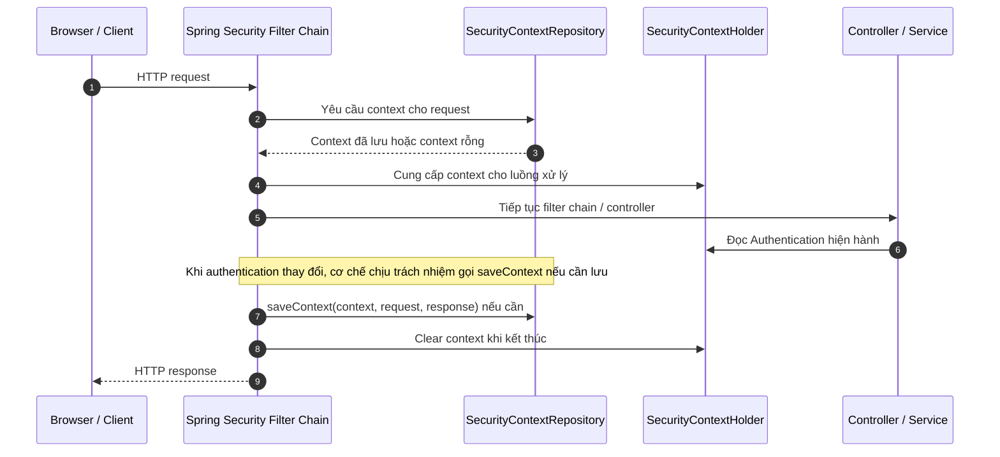
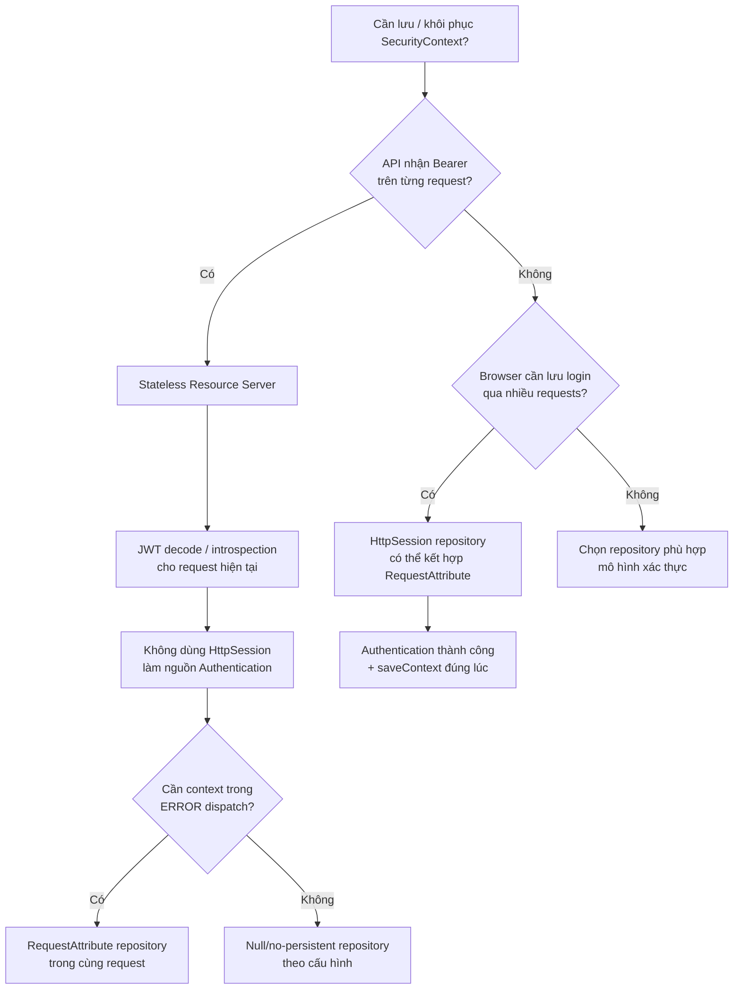

# SecurityContextRepository và trách nhiệm lưu, khôi phục danh tính

Trong **Spring Security OAuth 2.0/OIDC Resource Server**, sau khi một request được xác thực, ứng dụng có thể truy cập `Authentication` để biết ai đang gọi API và người gọi có những `GrantedAuthority` nào. Thông tin đó thường nằm trong một **`SecurityContext`**. Nhưng câu hỏi quan trọng hơn là: **SecurityContext có tồn tại ở request tiếp theo không? Ai lưu nó, ai khôi phục và khi nào nó bị xóa?**

Đó chính là chủ đề của `SecurityContextRepository`. Interface này đóng vai trò lưu/đọc `SecurityContext` giữa các giai đoạn xử lý web, nhưng cách sử dụng rất khác nhau tùy ứng dụng:

- **Web có form login/OIDC login và HTTP session:** sau khi đăng nhập, ứng dụng thường muốn khôi phục trạng thái đã xác thực ở những request tiếp theo mà không phải nhập mật khẩu mỗi lần.
- **OAuth 2.0 JWT Resource Server stateless:** mỗi request gửi Bearer token, được xác thực lại từ token; API thường **không cần lưu Authentication của request trước trong HTTP session**.
- **Opaque token Resource Server:** mỗi request có thể được introspect (hoặc dùng cache có chính sách rõ); cũng không nên vô tình biến một Bearer credential thành session đăng nhập nếu hợp đồng yêu cầu stateless.
- **Servlet error/forward dispatch:** đôi khi cần chia sẻ SecurityContext **trong cùng request** khi luồng dispatch thay đổi, nhưng không muốn lưu sang request khác.

Vì vậy, `SecurityContextRepository` không đồng nghĩa `HttpSession`, và `SecurityContextHolder` không đồng nghĩa cơ chế lưu trữ danh tính. Bài này giải thích các thành phần, vòng đời context, lựa chọn repository, cơ chế explicit save của Spring Security 6, cách phối hợp với Resource Server và những tình huống bảo mật dễ cấu hình sai.

## 1. Phân biệt bốn khái niệm cốt lõi

| Khái niệm | Vai trò | Thời gian/phạm vi thường gặp |
|---|---|---|
| **`Authentication`** | Biểu diễn principal, credentials theo loại và authorities; trạng thái xác thực | Được đặt trong SecurityContext |
| **`SecurityContext`** | Vật chứa `Authentication` hiện hành | Thường gắn với xử lý một request |
| **`SecurityContextHolder`** | Điểm truy cập SecurityContext cho code hiện tại theo `SecurityContextHolderStrategy` | Mặc định dựa trên `ThreadLocal` trong xử lý Servlet đồng bộ |
| **`SecurityContextRepository`** | Hợp đồng **nạp và lưu** SecurityContext tại ranh giới Servlet request/response | Có thể là request attributes, HTTP session, no-op hoặc nhiều repository |

Ví dụ:

```java
import org.springframework.security.core.Authentication;
import org.springframework.security.core.context.SecurityContext;
import org.springframework.security.core.context.SecurityContextHolder;

SecurityContext context = SecurityContextHolder.getContext();
Authentication current = context.getAuthentication();
```

Ở thời điểm code này chạy trong một request đã xác thực, `current` có thể là:

- `UsernamePasswordAuthenticationToken` nếu dùng form login hoặc một cơ chế username/password phù hợp.
- `JwtAuthenticationToken` nếu request đi qua JWT Resource Server.
- `BearerTokenAuthentication` nếu request đi qua opaque-token introspection.
- Một loại Authentication khác do ứng dụng tích hợp.

Chính **SecurityContextHolderStrategy** quyết định cách truy cập context trong luồng hiện hành. Còn **SecurityContextRepository** quyết định khả năng nạp lại/lưu context qua những ranh giới web. Hai thành phần là hai mảnh ghép khác nhau.

### 1.1. Authentication không phải “cả người dùng trong database”

`Authentication` không mặc định là entity người dùng của ứng dụng. Nó có thể chứa một `Jwt`, một `OAuth2AuthenticatedPrincipal`, principal do provider tạo hoặc một đối tượng đặc thù. Claim `sub`, tên principal, tập authorities và thông tin phiên đăng nhập chỉ có ý nghĩa theo nguồn xác thực và hợp đồng tương ứng.

Không lấy `authentication.getName()` làm bằng chứng quyền sở hữu mọi bản ghi. Với nhiều issuer, cùng `sub` có thể chỉ hai danh tính khác nhau; với multi-tenant còn cần phạm vi tenant. Quyền truy cập cụ thể vẫn phải do business authorization kiểm tra.

### 1.2. Holder không tự lưu vào session

Đoạn:

```java
SecurityContext context =
    SecurityContextHolder.createEmptyContext();
context.setAuthentication(authentication);
SecurityContextHolder.setContext(context);
```

chỉ đặt Authentication vào context mà code hiện tại nhìn thấy. Nó **không tự đảm bảo** context được lưu lại cho request sau. Trong Spring Security 6 với chế độ **require explicit save**, nếu một custom authentication mechanism muốn duy trì login giữa các request, phải thực hiện `SecurityContextRepository.saveContext(...)` ở điểm thích hợp, trừ khi một filter/handler được framework cung cấp đã làm việc đó.

Đặt context vào holder và lưu context vào repository là **hai thao tác độc lập**.

## 2. Luồng khôi phục và lưu SecurityContext

Mô hình khái niệm của một request Servlet:



Sơ đồ tóm lược vai trò, **không khẳng định mọi request đều gọi `saveContext`**. Trong Spring Security 6, một filter có thể chỉ nạp context và dọn holder; nếu không có thay đổi cần lưu, không cần save. Với JWT bearer stateless, authentication thường được xây lại từ bearer token ở request kế tiếp.

### 2.1. Hai request trong ứng dụng có session

```text
Request A: POST /login
  User gửi credentials
  -> AuthenticationManager xác thực thành công
  -> SecurityContext được tạo với Authentication
  -> SecurityContextRepository lưu vào HTTP session
  -> Response trả cookie session phù hợp

Request B: GET /account
  Browser gửi session cookie
  -> Repository tìm context đã lưu
  -> SecurityContextHolder nhận Authentication
  -> HTTP/method authorization kiểm tra authorities
  -> Controller xử lý
```

Không phải browser “gửi lại toàn bộ Authentication”. Browser chỉ gửi một session identifier trong cookie; server dùng định danh đó để tìm trạng thái trên server theo cấu hình session store. Nếu session hết hạn, bị invalidated hoặc server không tìm thấy dữ liệu, context không được khôi phục như trước.

### 2.2. Hai request trong JWT Resource Server stateless

```text
Request A: GET /api/orders/123
  Authorization: Bearer JWT-A
  -> JwtDecoder xác minh JWT-A
  -> Tạo JwtAuthenticationToken trong SecurityContext
  -> Kiểm tra scope và quyền
  -> Kết thúc request, clear holder

Request B: GET /api/orders/456
  Authorization: Bearer JWT-B
  -> JwtDecoder xác minh JWT-B
  -> Tạo Authentication từ JWT-B
  -> Không lấy quyền của JWT-A từ session trước
```

Điều này không có nghĩa `SecurityContextHolder` “không tồn tại” trong API stateless. Nó vẫn phục vụ **Authentication của request hiện tại**. Điểm khác là không phụ thuộc một context lâu dài trong HTTP session để xác thực request kế tiếp.

## 3. Hợp đồng `SecurityContextRepository`

Spring Security định nghĩa interface `SecurityContextRepository` cho ngữ cảnh Servlet, với các thao tác chính:

```java
// Minh họa chữ ký API chính, giản lược để tập trung ý nghĩa:

DeferredSecurityContext loadDeferredContext(
    HttpServletRequest request);

void saveContext(
    SecurityContext context,
    HttpServletRequest request,
    HttpServletResponse response);

boolean containsContext(HttpServletRequest request);
```

Một số phiên bản còn có API legacy như `loadContext(HttpRequestResponseHolder)` phục vụ filter cũ. Cần đối chiếu API của phiên bản Spring Security đang dùng; đừng áp dụng một đoạn code dựa vào hàm đã deprecated mà không xem cơ chế `loadDeferredContext` hiện hành.

Ý nghĩa:

- **Nạp:** lấy context liên quan đến request, có thể trả thông qua deferred holder để trì hoãn việc lấy session cho tới khi cần.
- **Lưu:** ghi context đã được cập nhật vào cơ chế lưu trữ theo chính sách của repository.
- **Kiểm tra tồn tại:** hỏi repository liệu có context liên quan đến request hay chưa, không phải kiểm tra “người dùng có đủ quyền truy cập endpoint”.

### 3.1. Deferred context không phải authentication bất đồng bộ

`loadDeferredContext` có thể trì hoãn việc đọc context cho tới khi một thành phần thực sự cần nó. Điều này giúp tránh truy cập HTTP session không cần thiết trong những request hoặc đường xử lý không yêu cầu đọc authentication.

**Deferred ở đây không có nghĩa tự khởi chạy một network request hay token introspection ở thread nền.** Nó là cơ chế trì hoãn truy cập giá trị trong request processing.

### 3.2. Repository không chịu trách nhiệm xác minh mật khẩu hoặc chữ ký JWT

`SecurityContextRepository` không phải:

- `AuthenticationManager`.
- `AuthenticationProvider`.
- `JwtDecoder`.
- `OpaqueTokenIntrospector`.
- `AuthorizationManager`.

Nó không biết một mật khẩu có đúng không, JWT có chữ ký hợp lệ không, opaque token còn active không, hoặc người dùng được xóa một đơn hàng cụ thể không. Nó chỉ nạp/lưu **SecurityContext** theo phạm vi lưu trữ đã chọn.

Một context được khôi phục từ session có thể chứa Authentication đã được xác thực trước đó. Muốn kiểm soát quyền thay đổi theo thời gian, cần chính sách session invalidation, hạn phiên, kiểm tra domain và có thể phải revalidate nguồn quyền; repository tự nó không làm tất cả.

## 4. Các implementation quan trọng

| Implementation | Lưu ở đâu? | Qua request mới? | Trường hợp sử dụng |
|---|---|---|---|
| **`HttpSessionSecurityContextRepository`** | Thuộc tính trong `HttpSession` | **Có**, nếu session được giữ và context đã được lưu | Form login, ứng dụng web stateful |
| **`RequestAttributeSecurityContextRepository`** | Servlet request attributes | **Không**, chỉ cùng request/dispatch | Giữ context qua error/forward dispatch, không cần session |
| **`NullSecurityContextRepository`** | Không lưu context | **Không** | Stateless hoặc khi ứng dụng không muốn persistence |
| **`DelegatingSecurityContextRepository`** | Chuyển thao tác tới nhiều repository | Theo từng delegate | Kết hợp request attribute và session |

Các tên trên là implementation của giao diện tương tự, nhưng **khác nhau về vòng đời**. Chọn sai repository có thể tạo hai loại lỗi đối lập:

1. **Mất đăng nhập:** custom form authentication thành công trong request A, request B lại anonymous vì chưa lưu session.
2. **Giữ trạng thái trái ý định:** API bearer stateless vô tình dùng lại Authentication cũ trong session, khiến danh tính/quyền không còn bám vào token của request hiện tại.

### 4.1. `HttpSessionSecurityContextRepository`

Implementation này sử dụng `HttpSession` để lưu SecurityContext, thường dưới khóa:

```text
SPRING_SECURITY_CONTEXT
```

Nó có những quy tắc tối ưu về tránh lưu context rỗng/anonymous và chỉ tạo session khi cần, tùy cấu hình và trạng thái request. Không nên giả định “cứ tạo `HttpSessionSecurityContextRepository` là mỗi GET tự sinh session”.

`HttpSession` có thể do servlet container quản lý hoặc do Spring Session lưu vào Redis/database, nhưng **SecurityContextRepository vẫn là tầng giao diện trong Spring Security**. Nếu chạy nhiều instance, việc chia sẻ session phải do hệ thống session storage giải quyết; chỉ chọn HttpSession repo không tự làm session đồng bộ giữa các node.

### 4.2. `RequestAttributeSecurityContextRepository`

Implementation này lưu SecurityContext vào attribute của **cùng một Servlet request**. Nó hữu ích khi:

- Container đổi dispatch, ví dụ `ERROR` dispatch.
- `SecurityContextHolder` đã được clear khi qua một ranh giới filter/dispatch.
- Application vẫn muốn có context đã xác thực trong error page/logging an toàn hoặc xử lý tiếp **của chính request đó**.

Nó **không lưu qua một HTTP request mới**. Request B của cùng người dùng không được tự khôi phục context từ request A chỉ vì browser cùng IP, user-agent hoặc trace ID.

### 4.3. `NullSecurityContextRepository`

Repository kiểu null không nạp một context được lưu từ trước và không ghi context khi `saveContext` được gọi. Nó phù hợp khi:

- Xác thực hoàn toàn theo credential của **mỗi request**.
- Không có nhu cầu khôi phục login từ HTTP session.
- Muốn rõ ràng về việc không lưu SecurityContext ở repository đó.

Nó không cấm controller/service tạo session cho các mục đích khác. “SecurityContext không lưu” không đồng nghĩa “ứng dụng chắc chắn không có bất kỳ trạng thái server-side nào”.

### 4.4. `DelegatingSecurityContextRepository`

Implementation này kết hợp nhiều repository. Một cấu hình thường gặp của Spring Security 6 là:

```java
import org.springframework.security.web.context.DelegatingSecurityContextRepository;
import org.springframework.security.web.context.HttpSessionSecurityContextRepository;
import org.springframework.security.web.context.RequestAttributeSecurityContextRepository;
import org.springframework.security.web.context.SecurityContextRepository;

SecurityContextRepository repository =
    new DelegatingSecurityContextRepository(
        new RequestAttributeSecurityContextRepository(),
        new HttpSessionSecurityContextRepository()
    );
```

Ý nghĩa:

- Khi lưu, nó có thể gửi thao tác tới nhiều delegate theo hợp đồng.
- Khi đọc, nó tìm context theo thứ tự/cơ chế của các delegate.
- Request attribute giúp có context trong các dispatch của request.
- HttpSession giúp trạng thái đăng nhập có thể được khôi phục ở request tiếp theo.

**Không phải mọi chain bắt buộc phải dùng Delegating repository.** Cấu hình của Spring Security, chính sách session và loại authentication có thể dẫn đến lựa chọn khác. Nếu cần behavior cụ thể, hãy cấu hình repository tường minh.

## 5. `SecurityContextHolderFilter` và `SecurityContextPersistenceFilter`

Đây là hai filter quan trọng, đặc biệt khi nâng cấp từ Spring Security 5 sang 6.

### 5.1. `SecurityContextPersistenceFilter`: cách tự động lưu truyền thống

Trong các cấu hình/version cũ, `SecurityContextPersistenceFilter` có trách nhiệm tổng quát:

1. Nạp SecurityContext từ repository vào holder trước phần còn lại của filter chain.
2. Cho request được xử lý.
3. Lưu context trở lại repository khi request hoàn tất hoặc khi response commit theo cơ chế wrapper.
4. Dọn SecurityContextHolder.

```text
SecurityContextPersistenceFilter
    |
    +-- loadContext
    |
    +-- filterChain.doFilter(...)
    |
    +-- saveContext (theo cơ chế tự lưu)
    |
    +-- clearContext
```

Cơ chế này tiện khi custom code chỉ thay đổi `SecurityContextHolder` và tin rằng filter sẽ ghi lại cuối request. Tuy nhiên, tự động lưu có những vấn đề:

- Có thể ghi session không cần thiết.
- Việc theo dõi context đã thay đổi hay chưa phức tạp.
- Response redirect/commit có thể xảy ra trước lúc lưu nếu không được xử lý đúng.
- Dễ làm developer không thấy rõ ai chịu trách nhiệm lưu SecurityContext.

### 5.2. `SecurityContextHolderFilter`: chỉ nạp và dọn holder

Trong mô hình **require explicit save** của Spring Security 6, `SecurityContextHolderFilter` thường thay vai trò filter persistence cũ. Nó **nạp/cung cấp context cho holder, sau đó dọn holder**, nhưng **không tự gọi `saveContext` ở cuối request**.

```text
SecurityContextHolderFilter
    |
    +-- loadDeferredContext
    |
    +-- cung cấp context cho request
    |
    +-- filterChain.doFilter(...)
    |
    +-- clearContext

Việc save:
    do authentication component chịu trách nhiệm,
    khi ứng dụng muốn context tồn tại ở repository.
```

Hệ quả:

> **Gọi `SecurityContextHolder.setContext(newContext)` không tự làm `newContext` tồn tại ở request sau.** Trong chế độ explicit save, khi custom authentication muốn lưu trạng thái, phải gọi `SecurityContextRepository.saveContext(newContext, request, response)` đúng lúc.

Điều này **không có nghĩa** mọi ứng dụng form login phải tự sửa filter để gọi save. Nhiều authentication filters/handlers được Spring Security cung cấp đã thực hiện save theo quy tắc của framework khi authentication thành công. Yêu cầu tự gọi save đặc biệt quan trọng khi **tự viết authentication flow** hoặc tự đặt context trong controller/filter.

### 5.3. Không dùng đồng thời hai filter để “chắc chắn hơn”

`SecurityContextHolderFilter` và `SecurityContextPersistenceFilter` là những cơ chế thay thế cho cùng vai trò nạp/đặt/dọn context trong các cấu hình tương ứng. Không nên tự thêm cả hai vào một chain vì nghĩ sẽ tăng bảo mật: chúng có thể gây tác động thứ tự khó hiểu, tự động lưu ngầm hoặc hành vi khác với explicit-save policy.

Khi nâng cấp, hãy xác định **filter thực tế trong chain**, xem `requireExplicitSave`, repository và authentication filter đang dùng; không chỉ suy từ tên class có trên classpath.

### 5.4. Bảng so sánh

| Tiêu chí | PersistenceFilter (mô hình cũ) | HolderFilter (mô hình explicit save) |
|---|---|---|
| Nạp context cho request | Có | Có, thường theo deferred contract |
| Dọn holder cuối xử lý | Có | Có |
| Tự động lưu context vào repository | Thông thường có | **Không** |
| Custom auth thay `SecurityContextHolder` có thể tồn tại request sau mà không save thủ công? | Có thể, theo cơ chế và cấu hình | **Không** nếu không có thành phần khác save |
| Mục tiêu vận hành | Tự động persistence | Phân biệt rõ việc đặt context với việc lưu |

## 6. Explicit save: ai phải gọi `saveContext`?

Giả sử application tự tạo endpoint xác thực:

```http
POST /custom-login HTTP/1.1
Content-Type: application/json

{"username":"alice","password":"***"}
```

Nếu controller gọi `AuthenticationManager.authenticate(...)` và nhận Authentication thành công, nó đã chứng minh credentials đúng theo provider tương ứng, **nhưng điều đó không tự biến nó thành một login session được lưu**.

Đối với cơ chế muốn sử dụng HTTP session, cần đặt Authentication vào SecurityContext và lưu:

```java
import jakarta.servlet.http.HttpServletRequest;
import jakarta.servlet.http.HttpServletResponse;

import org.springframework.security.core.Authentication;
import org.springframework.security.core.context.SecurityContext;
import org.springframework.security.core.context.SecurityContextHolder;
import org.springframework.security.web.context.SecurityContextRepository;

// Sau khi AuthenticationManager đã xác thực thành công:
SecurityContext context =
    SecurityContextHolder.createEmptyContext();
context.setAuthentication(authenticated);
SecurityContextHolder.setContext(context);

securityContextRepository.saveContext(
    context,
    request,
    response
);
```

Các biến `authenticated`, `securityContextRepository`, `request` và `response` là những dependency thực tế của flow, không phải dữ liệu do client tự khai báo. Đặt context mới bằng `createEmptyContext()` giúp tránh vô ý chia sẻ/mutate instance context đang được tái sử dụng ở nơi khác.

### 6.1. Đoạn code trên chưa phải toàn bộ quy trình login an toàn

Khi tự viết login, còn cần xử lý:

- **Session fixation protection:** đổi session ID/chiến lược phiên theo policy khi người dùng chuyển từ chưa xác thực sang xác thực.
- **CSRF protection:** form/cookie session login có nguy cơ CSRF; không tắt CSRF chỉ để POST login hoạt động.
- **Session concurrency:** giới hạn hoặc kiểm soát các session đồng thời nếu ứng dụng yêu cầu.
- **Remember-me:** nếu hỗ trợ, có cơ chế riêng.
- **Authentication failure handling:** không tạo/lưu context thành công khi credentials sai.
- **Redirect/response commit:** gọi `saveContext` **trước khi** gửi redirect hoặc commit response theo đường triển khai.
- **Logout:** vô hiệu hóa/loại bỏ session và context ở repository đúng cách.

Vì vậy, với form login thông thường, **ưu tiên các authentication filters/handlers chuẩn của Spring Security** thay vì tự viết controller login. Phần code trên chỉ làm rõ trách nhiệm lưu context khi ứng dụng thực sự cần flow tùy chỉnh.

### 6.2. Không nên dùng object Authentication do client gửi tới

Anti-pattern:

```java
// Sai về ranh giới tin cậy:
Authentication claimedByClient =
    buildAuthenticationFromRequestBody(body);

SecurityContext context = SecurityContextHolder.createEmptyContext();
context.setAuthentication(claimedByClient);
securityContextRepository.saveContext(context, request, response);
```

Nếu code chỉ đọc `username`/`roles` từ body rồi đánh dấu authenticated, kẻ tấn công có thể tự tạo phiên có quyền admin. Chỉ đặt vào context một `Authentication` đã được kiểm chứng bằng AuthenticationManager/provider đáng tin hoặc cơ chế chứng thực có hợp đồng rõ.

### 6.3. Không nên sửa trực tiếp context cũ rồi trông chờ autosave

Một thói quen cũ:

```java
SecurityContextHolder.getContext()
    .setAuthentication(authenticated);
```

Trong explicit-save mode, thao tác đó **không phải lời gọi lưu repository**. Nó còn có thể làm thay đổi instance context đã được lấy từ nơi lưu ở cùng request, gây khó suy luận nếu instance được chia sẻ.

Hãy tạo context mới, đặt Authentication mới, đặt vào holder và **save tường minh nếu persistence cần thiết**. Với stateless Resource Server, chỉ có context request hiện hành và không nên cố save vào HTTP session.

## 7. Form login và HTTP session: lưu để request sau không cần đăng nhập lại

Ứng dụng web truyền thống dùng session:

```java
import org.springframework.context.annotation.Bean;
import org.springframework.context.annotation.Configuration;
import org.springframework.security.config.Customizer;
import org.springframework.security.config.annotation.web.builders.HttpSecurity;
import org.springframework.security.web.SecurityFilterChain;

@Configuration
public class BrowserSecurityConfiguration {

    @Bean
    SecurityFilterChain browserSecurity(HttpSecurity http) throws Exception {
        return http
            .authorizeHttpRequests(auth -> auth
                .requestMatchers("/", "/login", "/assets/**").permitAll()
                .anyRequest().authenticated())
            .formLogin(Customizer.withDefaults())
            .build();
    }
}
```

Khi form login thành công, framework authentication flow phối hợp với `SecurityContextRepository` để lưu session theo cấu hình. Ở request tiếp theo, context có thể được khôi phục từ session.

### 7.1. Cấu hình repository tường minh cho web session

Trong Spring Security 6, một tổ hợp hợp lý cho web có session:

```java
import org.springframework.context.annotation.Bean;
import org.springframework.security.web.context.DelegatingSecurityContextRepository;
import org.springframework.security.web.context.HttpSessionSecurityContextRepository;
import org.springframework.security.web.context.RequestAttributeSecurityContextRepository;
import org.springframework.security.web.context.SecurityContextRepository;

@Bean
SecurityContextRepository browserSecurityContextRepository() {
    return new DelegatingSecurityContextRepository(
        new RequestAttributeSecurityContextRepository(),
        new HttpSessionSecurityContextRepository()
    );
}
```

Khai báo vào chain:

```java
.securityContext(securityContext -> securityContext
    .requireExplicitSave(true)
    .securityContextRepository(browserSecurityContextRepository()))
```

Đoạn thứ hai phải được đặt bên trong `HttpSecurity` builder của một `SecurityFilterChain`; bean/method phải ở phạm vi Spring configuration phù hợp. Đối với framework hiện đại, bạn có thể **không cần khai báo thủ công** vì cấu hình mặc định đã có cơ chế persistence tương ứng. Chỉ custom khi cần giải thích, kiểm soát hoặc thay đổi chính sách.

### 7.2. Cookie JSESSIONID không chứa authorities

Thông thường browser chỉ gửi session identifier, ví dụ:

```http
GET /account HTTP/1.1
Cookie: JSESSIONID=opaque-session-id
```

Server dùng session ID để tìm session state, trong đó có thể có `SPRING_SECURITY_CONTEXT`. Vì vậy:

- Session ID là credential nhạy cảm; phải bảo vệ bằng TLS, cookie flags, expiry và session fixation defense.
- Nếu session store bị mất hoặc session expired, context không còn để khôi phục.
- Session invalidation sau logout/revocation ảnh hưởng lần request sau.
- `SecurityContextRepository` không tự giải quyết CSRF cho session authentication.

### 7.3. Tên session attribute không nên là API business

Không viết business code:

```java
Object context = request.getSession()
    .getAttribute("SPRING_SECURITY_CONTEXT");
```

để phụ thuộc trực tiếp vào implementation/session key. Nên dùng `SecurityContextHolder`/`Authentication` khi cần danh tính hiện tại và Spring Security APIs khi cần can thiệp persistence. Tên attribute là chi tiết của `HttpSessionSecurityContextRepository`, không phải hợp đồng domain.

## 8. `RequestAttributeSecurityContextRepository` và ERROR dispatch

Servlet có các dispatcher types như `REQUEST`, `ERROR`, `FORWARD` và `ASYNC`. Ở một số container, khi một request chuyển sang ERROR dispatch, SecurityContextHolder có thể đã bị filter clear hoặc thread/dispatch boundary đã thay đổi.

Ví dụ:

```text
REQUEST /api/orders/123
    |
    +-- JWT authentication thành công
    |
    +-- Controller ném lỗi
    |
    v
ERROR dispatch /error
    |
    +-- Một SecurityContextHolder khác có thể đã rỗng
    |
    +-- RequestAttributeSecurityContextRepository
        có thể cung cấp lại context của CÙNG request
```

Mục tiêu không phải lưu đăng nhập lâu dài, mà là giữ thông tin security trong phạm vi **một request có thể có nhiều dispatch**. Đó là lý do tổ hợp mặc định kiểu Delegating repository thường đặt `RequestAttributeSecurityContextRepository` trước `HttpSessionSecurityContextRepository`.

### 8.1. Error dispatch không cho quyền bỏ qua authorization

Việc có context ở `/error` hữu ích cho xử lý lỗi, nhưng security rule với dispatcher type, URL và Authentication vẫn cần thiết kế đúng. Không dùng ERROR dispatch làm con đường để trả dữ liệu người dùng hoặc stacktrace nhạy cảm.

Ví dụ điều kiện cần xét:

- Security filter chain có chạy trong ERROR dispatch không?
- `SecurityContextRepository` được cấu hình ở filter và authentication mechanism có cùng strategy/repository phù hợp không?
- Error endpoint có được phép anonymous hay yêu cầu authentication?
- Nếu error response được tạo sau khi token đã bị từ chối, có nên nạp lại một Authentication cũ không?

Không suy luận từ việc có request attribute rằng mọi error page đều an toàn, hoặc rằng principal luôn tồn tại ở mọi dispatch.

### 8.2. Không nhầm request attributes và session attributes

| Thuộc tính | Request attribute | HTTP session attribute |
|---|---|---|
| Sống qua nhiều HTTP requests | Không | Có, khi cùng session |
| Có thể tồn tại qua ERROR/FORWARD trong request | Có, theo container/dispatcher | Có, nhưng không bắt buộc dùng |
| Cần session cookie | Không | Thường cần nếu browser dùng session |
| Phù hợp JWT API stateless | Có thể hữu ích cho cùng request | Thường không cần lưu Authentication |
| Phù hợp browser login session | Chỉ đủ cùng request | Hữu ích để giữ đăng nhập |

## 9. `NullSecurityContextRepository` và Resource Server stateless

Một OAuth 2.0 Resource Server thuần REST thường mong muốn:

```text
Mỗi request:
  Authorization: Bearer <access-token>
       |
       v
  JwtDecoder hoặc OpaqueTokenIntrospector
       |
       v
  Authentication hiện hành
       |
       v
  Authorization của request
       |
       v
  Clear SecurityContextHolder

Không dùng session trước đó làm căn cứ quyền ở request mới.
```

Với Spring Security Servlet:

```java
import org.springframework.context.annotation.Bean;
import org.springframework.context.annotation.Configuration;
import org.springframework.http.HttpMethod;
import org.springframework.security.config.Customizer;
import org.springframework.security.config.annotation.web.builders.HttpSecurity;
import org.springframework.security.config.annotation.web.configurers.AbstractHttpConfigurer;
import org.springframework.security.config.http.SessionCreationPolicy;
import org.springframework.security.web.SecurityFilterChain;

@Configuration
public class ApiResourceServerSecurity {

    @Bean
    SecurityFilterChain apiChain(HttpSecurity http) throws Exception {
        return http
            .securityMatcher("/api/**")
            .csrf(AbstractHttpConfigurer::disable)
            .sessionManagement(session -> session
                .sessionCreationPolicy(SessionCreationPolicy.STATELESS))
            .authorizeHttpRequests(auth -> auth
                .requestMatchers(HttpMethod.GET, "/api/orders/**")
                    .hasAuthority("SCOPE_orders.read")
                .requestMatchers(HttpMethod.POST, "/api/orders/**")
                    .hasAuthority("SCOPE_orders.write")
                .anyRequest().denyAll())
            .oauth2ResourceServer(oauth2 ->
                oauth2.jwt(Customizer.withDefaults()))
            .build();
    }
}
```

Với `SessionCreationPolicy.STATELESS`, Spring Security **không dùng HTTP session để lấy SecurityContext cho request** và không tạo HTTP session cho việc duy trì SecurityContext. Các filters vẫn có thể tạo/đặt Authentication trong holder **cho request hiện hành**.

Lưu ý: “stateless Resource Server” không có nghĩa:

- Không được dùng `SecurityContextHolder`.
- Không có thể dùng request attributes trong cùng request.
- Không được cache JWKS, token introspection hoặc dữ liệu nghiệp vụ với chính sách rõ.
- Không có bất kỳ session nào ở servlet container vì code khác có thể tự tạo session.
- Không cần xác minh JWT/opaque token trên request kế tiếp.

### 9.1. Tùy chọn NullSecurityContextRepository tường minh

Nếu muốn rõ nghĩa **không lưu SecurityContext bằng repository ở chain**:

```java
import org.springframework.security.web.context.NullSecurityContextRepository;

.securityContext(security -> security
    .securityContextRepository(new NullSecurityContextRepository()))
```

Lưu ý đoạn DSL trên cần đặt đúng bên trong cấu hình `HttpSecurity`. Việc repository ở `SecurityContextHolderFilter` và repository được từng authentication filter sử dụng **có thể phụ thuộc phiên bản và cách nối cấu hình**; không mặc nhiên cho rằng set một repository ở mọi chỗ sẽ thay đổi toàn bộ filters tự viết. Quan trọng nhất là hiểu mục tiêu: không khôi phục Authentication từ session của request trước.

Trong một số đường Bearer authentication, framework sử dụng `RequestAttributeSecurityContextRepository` để giữ context trong cùng request hoặc ERROR dispatch mà **không ghi vào HttpSession**. Vì vậy không nên xóa request-attribute persistence nếu nó đang cần cho cơ chế xử lý lỗi, chỉ để tuyên bố ứng dụng “stateless”.

### 9.2. Lưu JWT Authentication vào session thường là sai hợp đồng API

Anti-pattern trong Resource Server:

```java
// Không khuyến nghị cho API mà mỗi request phải có Bearer token.
securityContextRepository.saveContext(
    SecurityContextHolder.getContext(),
    request,
    response);
```

nếu repository thực tế là HttpSession repo. Request sau **không mang Bearer token** có thể khôi phục Authentication trước từ session nếu chain/filters cho phép. Điều này biến một API bearer stateless thành cơ chế phiên mà client, gateway và nhóm bảo mật có thể không dự kiến.

Ngay cả khi request sau vẫn có token khác, phải tránh để context lưu trong session lấn át hoặc trộn authorities của token hiện tại. Danh tính và quyền trên request API phải gắn với credential được xác thực cho chính request đó.

### 9.3. Opaque introspection cũng thường stateless

Trong một opaque Resource Server, `OpaqueTokenIntrospector` xác minh token bằng AS/introspection endpoint. Authentication của request được dùng bởi `authorizeHttpRequests` và method security. Nó cũng không cần lưu vào HttpSession chỉ vì API phải hỏi AS.

Nếu muốn giảm tải, có thể cache kết quả introspection **theo token, issuer/resource và TTL có kiểm soát**; đó là quyết định khác với việc lưu SecurityContext của user vào session. Cache introspection phải tính tới `active`, `exp`, revocation, dữ liệu nhạy cảm và trạng thái multi-tenant.

## 10. SessionCreationPolicy: ALWAYS, IF_REQUIRED, NEVER và STATELESS

`SessionCreationPolicy` giúp định hướng cách Spring Security dùng HTTP session:

| Chính sách | Ý nghĩa khái quát | Có thể dùng session đã tồn tại để lấy SecurityContext? |
|---|---|---|
| **ALWAYS** | Spring Security chủ động tạo session | Có |
| **IF_REQUIRED** | Chỉ tạo session khi có nhu cầu | Có |
| **NEVER** | Spring Security không chủ động tạo session, nhưng có thể dùng session đã có | **Có** |
| **STATELESS** | Spring Security không tạo và không dùng session để lấy SecurityContext | **Không** theo hợp đồng session policy |

Sự khác nhau giữa `NEVER` và `STATELESS` đặc biệt quan trọng:

```text
NEVER:
  Không tạo session mới cho Spring Security,
  nhưng session do nơi khác tạo có thể được dùng.

STATELESS:
  Không dùng HTTP session làm nguồn SecurityContext
  cho Resource Server request.
```

Nếu muốn API Bearer **không dùng context của session cũ**, `STATELESS` thể hiện ý định đúng hơn `NEVER`.

### 10.1. Session policy không phải CSRF policy

`csrf().disable()` chỉ điều chỉnh CSRF protection; `sessionCreationPolicy(STATELESS)` điều chỉnh hành vi session của Spring Security. Chúng không thay thế nhau.

API chỉ dùng Bearer token được gửi tường minh trong `Authorization` header có thể có mô hình rủi ro CSRF khác với browser form login dùng cookie session. Nhưng nếu application còn endpoints dùng cookie hoặc HTTP Basic do browser tự đính kèm, việc tắt CSRF toàn cục có thể nguy hiểm.

Không kết luận “đã stateless thì chắc chắn không có CSRF” nếu vẫn có credential tự gửi bởi browser qua cơ chế khác.

### 10.2. Session policy không tự vô hiệu session do ứng dụng tạo

Nếu controller gọi:

```java
request.getSession(true);
```

thì code ứng dụng có thể tạo `HttpSession` vì lý do ngoài Spring Security. `SessionCreationPolicy.STATELESS` không có nghĩa servlet container chặn tuyệt đối mọi API gọi `getSession(true)`.

Để bảo đảm một API thực sự không phụ thuộc session, cần xem cả controllers, MVC, libraries, redirects, request cache, CSRF/cookie config và các components khác.

## 11. Một ứng dụng có cả browser session và Bearer API

Nhiều hệ thống có đồng thời:

- `/web/**`: trang nội bộ dùng form login và HTTP session.
- `/api/**`: REST API dùng OAuth 2.0 Bearer access token.

Không nên ép **cả ứng dụng** dùng chung một repository/session policy nếu hai nhóm route có yêu cầu khác nhau.

### 11.1. Hai SecurityFilterChain với chính sách khác nhau

Ví dụ cấu hình ý tưởng:

```java
import org.springframework.context.annotation.Bean;
import org.springframework.context.annotation.Configuration;
import org.springframework.core.annotation.Order;
import org.springframework.security.config.Customizer;
import org.springframework.security.config.annotation.web.builders.HttpSecurity;
import org.springframework.security.config.annotation.web.configurers.AbstractHttpConfigurer;
import org.springframework.security.config.http.SessionCreationPolicy;
import org.springframework.security.web.SecurityFilterChain;

@Configuration
public class MultiSurfaceSecurityConfiguration {

    @Bean
    @Order(1)
    SecurityFilterChain apiChain(HttpSecurity http) throws Exception {
        return http
            .securityMatcher("/api/**")
            .csrf(AbstractHttpConfigurer::disable)
            .sessionManagement(session -> session
                .sessionCreationPolicy(SessionCreationPolicy.STATELESS))
            .authorizeHttpRequests(auth -> auth
                .anyRequest().authenticated())
            .oauth2ResourceServer(oauth2 ->
                oauth2.jwt(Customizer.withDefaults()))
            .build();
    }

    @Bean
    @Order(2)
    SecurityFilterChain webChain(HttpSecurity http) throws Exception {
        return http
            .securityMatcher("/web/**", "/login", "/logout")
            .authorizeHttpRequests(auth -> auth
                .requestMatchers("/login").permitAll()
                .anyRequest().authenticated())
            .formLogin(Customizer.withDefaults())
            .build();
    }
}
```

Trong cấu hình thực tế phải thiết kế thêm fallback chain phù hợp để không bỏ sót URL khác; các URL do form login tự cung cấp cũng phải nằm trong chain đúng. Mẫu trên chỉ nhấn mạnh **chọn session policy theo security surface**, không phải một cấu hình production hoàn chỉnh cho mọi ứng dụng.

### 11.2. Phân biệt securityMatcher và requestMatchers

`securityMatcher("/api/**")` quyết định **request có đi vào chain đó không**. Bên trong chain, `requestMatchers(...)` quyết định **quyền endpoint**. Spring Security thường chọn **SecurityFilterChain phù hợp đầu tiên** theo thứ tự, không gộp tất cả chains.

Nếu một route không thuộc chain nào, nó có thể không được bảo vệ bởi Spring Security web filters. Do đó:

- API chain phải bao phủ đúng các API thật.
- Web chain phải bao phủ login/logout endpoints và web pages.
- Có fallback chain deny-by-default cho phần còn lại nếu kiến trúc cần.
- Không vô tình cho `/api/**` đi vào form login session chain.

### 11.3. Browser session không nên tự xác thực REST Bearer API

Một browser đã login vào `/web/**` có thể mang cookie phiên. Nhưng nếu hợp đồng `/api/**` yêu cầu Bearer token, không nên lấy `Authentication` của session browser để cấp quyền cho API chỉ vì cả hai cùng host.

Điều này tránh ranh giới bị trộn:

```text
/web/**:
  JSESSIONID -> SecurityContext từ HttpSession -> form login

/api/**:
  Authorization: Bearer ... -> JwtDecoder -> Authentication của token hiện tại
```

Hai tập chính sách có thể cùng dùng `Authentication`/`GrantedAuthority`, nhưng **nguồn tin cậy và vòng đời persistence khác nhau**.

## 12. Khi nào phải lưu trước khi response commit?

Trong Servlet, HTTP response có thể được commit khi:

- Gửi redirect.
- Ghi đủ response body/flush stream.
- Gọi một API khiến headers/cookies không thể sửa thêm.
- Container tự commit response tại một mốc xử lý.

Nếu custom login cần tạo session/cookie nhưng chỉ gọi `saveContext` **sau khi response đã commit**, việc cập nhật session identifier hoặc thiết lập cookie mới có thể không diễn ra đúng cách.

Mẫu thứ tự hợp lý:

```text
AuthenticationManager xác thực thành công
        |
        v
SessionAuthenticationStrategy nếu flow có session login
        |
        v
Tạo SecurityContext mới và set Authentication
        |
        v
SecurityContextHolder.setContext(context)
        |
        v
SecurityContextRepository.saveContext(context, request, response)
        |
        v
Gửi redirect/response thành công
```

Không nên viết:

```java
response.sendRedirect("/account");
securityContextRepository.saveContext(context, request, response);
```

và mặc định việc tạo/lưu session sẽ luôn an toàn. Sau redirect, response có thể đã commit; đây là lý do explicit save cần được gọi ở **đúng thời điểm**.

### 12.1. Tại sao filter cũ từng cần response wrapper?

Trong mô hình auto-save, `SecurityContextPersistenceFilter` phải xử lý việc lưu khi request hoàn tất hoặc response đã chuẩn bị commit; các response wrapper giúp tránh việc session cookie không kịp ghi khi response commit sớm.

Mô hình explicit save làm trách nhiệm rõ hơn: **authentication component biết lúc nào đã xác thực thành công** nên có thể save đúng lúc trước response. Không nên tái tạo “auto save” không kiểm soát trong custom filter nếu không hiểu lifecycle Servlet.

## 13. Logout và xóa context đã lưu

Đăng nhập là lưu trạng thái; logout là **kết thúc trạng thái đó theo hợp đồng**. Với form login/session:

```text
POST /logout
  -> Invalidate HttpSession (nếu cấu hình)
  -> Clear SecurityContextHolder
  -> Xóa SecurityContext được lưu theo cơ chế tương ứng
  -> Clear cookies/remember-me khi có cơ chế đó
```

Spring Security cung cấp logout support. Không nên chỉ:

```java
SecurityContextHolder.clearContext();
```

rồi kết luận session đã bị vô hiệu hóa: câu lệnh này chủ yếu xóa context của **luồng hiện tại**, không mặc định xóa `SPRING_SECURITY_CONTEXT` đã lưu hoặc invalidate session.

Nếu dùng custom logout, cần xử lý cả repository/session và cookies/remember-me/session tracking theo policy. Với stateless JWT access token, xóa SecurityContextHolder **không thu hồi JWT đã cấp**; token vẫn có thể được dùng ở request khác cho tới khi hết hạn hoặc bị chặn bởi cơ chế revocation/introspection/denylist/đổi khóa phù hợp.

### 13.1. Logout của browser và thu hồi Bearer token khác nhau

| Tình huống | Cần xử lý |
|---|---|
| Form login session | Invalidating session, clearing persisted context và cookie liên quan |
| OAuth 2.0 JWT Resource Server | Client có thể xóa local token, nhưng API cần AS/denylist/TTL nếu muốn token hết hiệu lực sớm |
| Opaque access token | AS có thể trả `active:false` sau thu hồi; cache introspection có thể làm chậm hiệu lực |
| OIDC client logout | Có thêm quy tắc RP/OP session và front/back-channel theo giao thức nếu ứng dụng dùng |

`SecurityContextRepository` là cơ chế persistence của authentication ở phía web, **không phải API thu hồi access token của AS**.

## 14. Đồng thời, ThreadLocal và bất biến không chia sẻ context

`SecurityContextHolder` thông thường sử dụng strategy dựa trên `ThreadLocal` trong Servlet synchronous processing. Spring Security filter chain đặt context và **clear sau request** để tránh thông tin principal của request trước xuất hiện khi thread được servlet container tái sử dụng.

### 14.1. Tại sao cần clear?

```text
Thread worker-7
  Request A: alice -> SecurityContext alice
  Kết thúc Request A -> clear context

Thread worker-7 được tái sử dụng
  Request B: bob -> context riêng của bob
```

Nếu một custom filter bỏ qua `finally { SecurityContextHolder.clearContext(); }` khi tự quản lý holder, có thể rò rỉ Authentication giữa các request qua thread reuse. Thông thường nên để framework filters chịu trách nhiệm lifecycle thay vì tự tạo một cơ chế ThreadLocal.

### 14.2. Không mutate shared SecurityContext tùy tiện

Khi context được khôi phục từ session, có thể có cùng instance hoặc dữ liệu tham chiếu được sử dụng trong nhiều request đồng thời tùy implementation. Việc làm:

```java
SecurityContextHolder.getContext()
    .setAuthentication(otherAuthentication);
```

trên instance context đang chia sẻ có thể làm thay đổi trạng thái ngoài dự kiến. Khi thay Authentication, ưu tiên:

```java
SecurityContext newContext =
    SecurityContextHolder.createEmptyContext();
newContext.setAuthentication(otherAuthentication);
SecurityContextHolder.setContext(newContext);
```

và save đúng repository nếu thật sự muốn persistence.

### 14.3. Async task không tự kế thừa đúng context

Code:

```java
executor.submit(() -> {
    Authentication auth =
        SecurityContextHolder.getContext().getAuthentication();
    // Không mặc định auth tồn tại hoặc đúng request gốc.
});
```

có thể chạy ở thread khác. Với thread pool, việc sao chép context sai hoặc giữ context quá lâu có thể tạo rò rỉ giữa các task. Spring Security cung cấp các tiện ích như `DelegatingSecurityContextRunnable`, `DelegatingSecurityContextExecutor` hoặc tích hợp async phù hợp để truyền context khi thật sự cần.

Ngay cả khi context được truyền, **token có thể hết hạn và quyền có thể thay đổi trong lúc job chạy**. Đối với background job, thường tốt hơn khi truyền một actor snapshot/authorization intent tối thiểu và kiểm tra lại quyền tại bước nhạy cảm theo policy, thay vì giữ nguyên Authentication một cách vô thời hạn.

### 14.4. ContextHolderStrategy có thể thay đổi

Spring Security cho phép tùy biến `SecurityContextHolderStrategy`. Một số chiến lược sử dụng ThreadLocal, inheritable ThreadLocal hoặc cơ chế khác. Không sử dụng `MODE_GLOBAL` hoặc một holder singleton trên server nhiều user để “giữ đăng nhập”; điều đó có thể khiến danh tính một caller bị chia sẻ cho caller khác.

## 15. Các repository và vấn đề chia sẻ trạng thái trong cluster

Khi dùng HttpSession và triển khai nhiều replica:

```text
Browser
  |
  +-- Request A -> Node A -> Login -> SecurityContext lưu session
  |
  +-- Request B -> Node B -> cần khôi phục cùng session
```

Nếu mỗi node lưu session riêng trong memory và load balancer không đảm bảo sticky session, request B có thể không thấy context của request A. Một số giải pháp:

- Sticky sessions ở load balancer, với giới hạn khi node chết.
- Spring Session sử dụng store chia sẻ (ví dụ Redis) cho HttpSession, theo kiến trúc vận hành.
- Thiết kế stateless bearer authentication cho API nếu phù hợp, tránh phụ thuộc session.

**`HttpSessionSecurityContextRepository` không tự là session replication system.** Nó chỉ biết cách làm việc với Servlet `HttpSession`. Phần phân phối, expiry và đồng bộ thuộc session infrastructure.

### 15.1. Serialization và thay đổi class

Khi session được lưu vào store ngoài process, một số dữ liệu trong `Authentication`/principal/context có thể cần serialize. Nếu ứng dụng đặt entity JPA, object không serializable, secret lớn hoặc graph vòng vào principal, việc lưu/khôi phục có thể gặp lỗi hoặc tạo rủi ro dữ liệu.

Không lưu trực tiếp toàn bộ domain entity hoặc access token secret trong session chỉ để dễ gọi business code. Dùng principal tối thiểu, thích hợp với chính sách session và có cơ chế lấy dữ liệu nghiệp vụ mới khi cần.

### 15.2. Session timeout và quyền bị thu hồi

Session đã lưu Authentication không tự cập nhật mọi quyền khi admin thay đổi role ở database. Nếu yêu cầu quyền có hiệu lực nhanh:

- Tái kiểm tra các business permissions quan trọng tại thời điểm thao tác.
- Vô hiệu hóa session bị ảnh hưởng.
- Thiết kế reauthentication/revalidation policy.
- Đặt session max idle/absolute lifetime phù hợp.
- Kiểm soát concurrent sessions nếu chức năng yêu cầu.

Repository chỉ khôi phục object đã lưu, không tự gọi quyền database mới nhất cho mỗi request.

## 16. Session fixation và ranh giới xác thực

**Session fixation** xảy ra khi attacker khiến victim dùng một session ID đã biết trước, rồi victim đăng nhập và session ID đó vẫn được giữ, giúp attacker có thể dùng lại session. Spring Security có hỗ trợ bảo vệ session fixation trong các authentication flows phù hợp, thường thay đổi session ID hoặc tạo session mới theo cấu hình.

Nếu tự viết custom login và chỉ gọi:

```java
context.setAuthentication(authenticated);
repository.saveContext(context, request, response);
```

nhưng bỏ qua `SessionAuthenticationStrategy`/session fixation protection, có thể làm yếu đi cơ chế bảo vệ mà form login chuẩn đã có.

Một thiết kế login có session cần:

1. Xác thực credentials bằng AuthenticationManager/provider đáng tin.
2. Áp session authentication strategy phù hợp (session fixation, concurrency nếu bật).
3. Đặt Authentication vào context mới.
4. Save context trước khi response commit.
5. Thiết lập cookie và CSRF/logout policy.

Đây là lý do ưu tiên Spring Security formLogin/OIDC login chuẩn khi không có yêu cầu tùy biến thực sự.

### 16.1. JWT Resource Server và session fixation là hai mô hình khác

Bearer JWT stateless không dùng JSESSIONID làm credential để khôi phục Authentication nên rủi ro session fixation ở cùng vị trí thường không áp dụng trực tiếp. Nhưng Bearer token bị lộ vẫn có thể bị replay, và CSRF có thể tồn tại nếu API kết hợp credential tự gửi qua cookie. Không đánh đồng “không có session fixation” với “đã an toàn toàn diện”.

## 17. RequestCache không phải SecurityContextRepository

Khi user chưa đăng nhập vào trang web và truy cập URL cần xác thực, Spring Security có thể **lưu request gốc** để redirect về đó sau login.

Ví dụ:

```text
GET /web/reports
    -> chưa login
    -> lưu SavedRequest
    -> redirect /login
    -> login thành công
    -> redirect /web/reports
```

`RequestCache` lưu **thông tin request cần quay lại**, còn `SecurityContextRepository` lưu **SecurityContext/Authentication**. Cả hai có thể sử dụng HTTP session trong một ứng dụng browser, nhưng **khác chức năng**.

Với stateless API trả 401 khi không có Bearer token, lưu SavedRequest và redirect login HTML thường không phù hợp. Có thể dùng `NullRequestCache` khi muốn tránh request cache trong API. Tuy nhiên thay RequestCache không tự tắt session persistence của SecurityContext; phải cấu hình đúng từng thành phần.

### 17.1. CSRF token repository cũng là thứ khác

`CsrfTokenRepository` lưu/quản lý CSRF token theo chính sách, không thay `SecurityContextRepository`. Có thể có session cookie và CSRF token nhưng không có authenticated session, hoặc ngược lại một API bearer thuần không dùng session nhưng vẫn có Authentication trong request.

Không kết luận mọi repository trong Spring Security đều đang lưu danh tính.

## 18. Kiểm thử cơ chế lưu và khôi phục danh tính

Một bộ test tốt phải phân biệt:

1. **Context hiện diện trong request A.**
2. **Context được save đúng repository hay không.**
3. **Request B có khôi phục đúng Authentication hay không.**
4. **Stateless API có từ chối request B không mang token hay không.**
5. **Logout/error dispatch có hành vi đúng phạm vi không.**

### 18.1. Unit test repository có phải đủ?

Với custom `SecurityContextRepository`, có thể unit test `saveContext` và `loadDeferredContext` trên mock request/response. Nhưng chỉ unit test repository **không chứng minh** Spring Security FilterChain đã sử dụng repository đó.

Ngược lại, `MockMvc` với `@WithMockUser` hoặc `jwt()` request post processor có thể gán Authentication test trực tiếp và **bỏ qua khâu nạp/lưu context thật**. Vì vậy cần test ở đúng boundary.

### 18.2. Integration test session login qua hai requests

Ví dụ dùng Spring Boot Test, Spring Security Test và MockMvc:

```java
import jakarta.servlet.http.HttpSession;
import org.junit.jupiter.api.Test;
import org.springframework.beans.factory.annotation.Autowired;
import org.springframework.boot.test.autoconfigure.web.servlet.AutoConfigureMockMvc;
import org.springframework.boot.test.context.SpringBootTest;
import org.springframework.mock.web.MockHttpSession;
import org.springframework.test.web.servlet.MockMvc;
import org.springframework.test.web.servlet.MvcResult;

import static org.springframework.security.test.web.servlet.request.SecurityMockMvcRequestPostProcessors.csrf;
import static org.springframework.test.web.servlet.request.MockMvcRequestBuilders.get;
import static org.springframework.test.web.servlet.request.MockMvcRequestBuilders.post;
import static org.springframework.test.web.servlet.result.MockMvcResultMatchers.status;

@SpringBootTest
@AutoConfigureMockMvc
class SessionPersistenceTest {

    @Autowired
    MockMvc mockMvc;

    @Test
    void authenticatedSessionIsRestoredOnNextRequest() throws Exception {
        // Test context cần user "alice" với password "test-password"
        // và endpoint /web/account đã được bảo vệ.
        MvcResult login = mockMvc.perform(post("/login")
                .with(csrf())
                .param("username", "alice")
                .param("password", "test-password"))
            .andExpect(status().is3xxRedirection())
            .andReturn();

        MockHttpSession session =
            (MockHttpSession) login.getRequest().getSession(false);

        if (session == null) {
            throw new AssertionError("No HTTP session after login");
        }

        mockMvc.perform(get("/web/account").session(session))
            .andExpect(status().isOk());
    }
}
```

Đây là ví dụ khung, giả định cấu hình form login và tài khoản test phù hợp. Session được lấy từ kết quả login rồi gắn sang request B; nếu session không chứa SecurityContext hoặc filter chain không khôi phục, request B không được coi là authenticated. Không dùng credentials thật trong unit/integration fixture.

### 18.3. Integration test stateless API

Với `/api/**` dùng JWT bearer:

```text
Request A:
  GET /api/orders/123
  Authorization: Bearer JWT-A
  -> authenticated nếu JWT-A hợp lệ

Request B:
  GET /api/orders/123
  không Authorization header
  nhưng gửi JSESSIONID cũ nếu browser có
  -> vẫn phải bị từ chối theo Bearer stateless policy
```

Không thể chỉ dùng `MockMvc.with(jwt())` để chứng minh decoder xác thực token thật; đó là công cụ thuận tiện kiểm tra authorization với Authentication test. Để kiểm chứng bearer filter/decoder và stateless behavior, cần **gửi Bearer header thật** và cấu hình JWT decoder/JWKS test phù hợp.

### 18.4. Test custom login quên saveContext

Một lỗi hồi quy khi nâng cấp:

```text
POST /custom-login:
  AuthenticationManager.authenticate -> success
  SecurityContextHolder.setContext -> authenticated
  KHÔNG saveContext

GET /web/account với cookie session:
  Repository không có context mới
  -> anonymous / redirect login
```

Test hai request sẽ bắt lỗi này rõ hơn một unit test chỉ gọi controller login và assert status 200.

### 18.5. Test request attributes và error dispatch

Với `RequestAttributeSecurityContextRepository`, test có thể:

1. Tạo request A và context xác thực.
2. `saveContext(context, requestA, responseA)`.
3. Nạp lại context từ **cùng requestA** (mô phỏng dispatch phù hợp).
4. Xác nhận request B mới **không có context đã lưu**.

Không cần HTTP session để test tính chất này. Kiểm thử end-to-end ERROR dispatch còn phụ thuộc servlet container và cách SecurityFilterChain áp dụng cho dispatcher types; hãy kiểm chứng tại môi trường phù hợp nếu error handling có yêu cầu bảo mật đặc biệt.

### 18.6. Các tình huống âm cần kiểm tra

| Tình huống | Kết quả mong đợi |
|---|---|
| Custom login chỉ set holder, không save trong explicit-save mode | Request sau không tự khôi phục login |
| Login thành công và save vào session đúng cách | Request sau cùng session nhận Authentication đã lưu |
| Login thất bại | Không lưu authenticated context |
| Logout invalidate session | Request sau không tiếp tục authenticated chỉ từ session cũ |
| Stateless API nhận request không Bearer nhưng có JSESSIONID từ browser | Không được khôi phục quyền API từ session |
| Stateless API nhận Bearer token B sau token A | Authorities phản ánh token B, không token A |
| RequestAttribute repo đã save trong request A | Có thể dùng lại trong dispatch của A, không qua request B |
| Null repo được gọi save | Không có context bền cho request sau |
| HTTP response commit trước save custom login | Test phải phát hiện persistence/cookie thất bại hoặc behavior bất thường |
| Async worker chạy thread khác | Không mặc định có SecurityContext đúng nếu chưa propagation |
| Session hết hạn hoặc bị xóa khỏi shared store | Context không còn để nạp |
| Session persistence dùng nhiều node | Khả năng khôi phục phụ thuộc shared session architecture |

## 19. Chẩn đoán các lỗi thực tế

### 19.1. “Đăng nhập thành công nhưng request sau lại bị redirect login”

Cần kiểm tra:

- `SecurityContextHolderFilter` có đang dùng require explicit save không?
- Authentication component có gọi `saveContext` sau khi authenticate thành công không?
- Repository có phải `HttpSessionSecurityContextRepository`/Delegating repo phù hợp không?
- `SessionCreationPolicy.STATELESS` có bị áp nhầm vào browser chain không?
- Response redirect đã commit trước khi save chưa?
- Session cookie có được gửi, browser có gửi lại không?
- Có nhiều node nhưng session store không chia sẻ không?
- Login/logout path có thuộc chain đúng không?

**Không sửa lỗi bằng cách bật tất cả requests `permitAll()`**. Làm vậy chỉ che việc context không được lưu/khôi phục và mở thêm quyền truy cập.

### 19.2. “Bearer API không gửi token mà vẫn được xác thực”

Cần điều tra:

- API chain có vô tình dùng `HttpSessionSecurityContextRepository` không?
- Browser cookie `JSESSIONID` có được gửi cùng request không?
- SecurityFilterChain nào thực sự xử lý URL?
- Fallback/other authentication mechanism có thể đang hoạt động không?
- Custom filter có tự set Authentication không?
- Có cấu hình `SessionCreationPolicy.NEVER` thay vì `STATELESS` không?

API được thiết kế thuần Bearer phải không mặc nhiên dùng phiên login từ `/web/**` để xác thực `/api/**`.

### 19.3. “Lúc ERROR dispatch thì authentication biến mất”

Đây có thể là hành vi do context đã bị clear khi request chuyển dispatch. Nếu error endpoint cần context của **cùng request**, kiểm tra `RequestAttributeSecurityContextRepository`, filter registration/dispatcher types và thứ tự security filters.

Không giải quyết bằng cách lưu mọi JWT Authentication vào HTTP session chỉ để error page có principal.

### 19.4. “Người dùng A nhận quyền của người dùng B”

Đây là sự cố nghiêm trọng. Kiểm tra:

- ContextHolderStrategy có dùng shared global state không?
- Custom filter có clear context ở `finally` không?
- Có lưu Authentication vào singleton/static field không?
- Thread pool/async có tái sử dụng context không đúng không?
- Session fixation/session ID leakage hoặc session store isolation có lỗi không?
- Cache principal có key chỉ theo `sub` mà không theo token/issuer/tenant không?

Không chỉ nhìn log 200/403; cần xác định nguồn Authentication trong từng request và ranh giới lưu trữ.

## 20. Những hiểu nhầm cần tránh

| Nhận định sai | Hiểu đúng |
|---|---|
| “`SecurityContextHolder` tự lưu danh tính qua request.” | Holder cung cấp context ở luồng hiện tại; persistence do repository/cơ chế save |
| “`SecurityContextRepository` đồng nghĩa HTTP session.” | Có RequestAttribute, Null, HttpSession và Delegating implementations |
| “Đặt `setAuthentication` là đủ cho custom login Spring Security 6.” | Với explicit-save mode, muốn persistence phải save đúng repository |
| “Spring Security 6 không còn lưu session login.” | Built-in authentication flows có thể save tường minh; session login vẫn được hỗ trợ |
| “`SecurityContextHolderFilter` tự save cuối request.” | Filter này nạp/dọn context, không tự save trong mô hình explicit save |
| “`SecurityContextPersistenceFilter` và HolderFilter nên luôn chạy cùng.” | Là hai mô hình lifecycle khác nhau, không nên ghép tùy tiện |
| “`STATELESS` nghĩa là không có Authentication.” | Authentication vẫn tồn tại cho request đang có Bearer token |
| “`NEVER` giống `STATELESS`.” | NEVER có thể dùng session đã tồn tại |
| “JWT Resource Server phải lưu JWT Authentication vào HttpSession.” | Thông thường mỗi request tự xác thực Bearer credential |
| “RequestAttribute repo giữ đăng nhập cho request tiếp theo.” | Chỉ giữ context trong cùng Servlet request/dispatch |
| “Xóa holder lúc logout là đã invalidate session.” | Phải xử lý persisted context/session/cookies/remember-me phù hợp |
| “SecurityContextRepository quản lý token revocation.” | Nó không thu hồi access token do Authorization Server cấp |
| “CSRF token repository và SecurityContextRepository là một.” | Chúng có trách nhiệm khác nhau |
| “RequestCache lưu authentication.” | RequestCache lưu SavedRequest, không phải SecurityContext |
| “@WithMockUser chứng minh session persistence chạy.” | Nó giả lập Authentication; cần test hai requests và repository thật |
| “Async thread tự nhận SecurityContext đúng từ request.” | Cần propagation có kiểm soát và chính sách thời hạn/quyền |
| “Session attribute chứa Authentication luôn cập nhật quyền mới nhất.” | Context đã lưu có thể stale, cần revalidation/session invalidation/domain checks |

## 21. Quy trình lựa chọn repository theo nhu cầu

Một cách chọn thực tế:

1. **Client có gửi Bearer token trên mỗi request không?** Nếu có và API yêu cầu stateless, không dùng HttpSession làm nguồn Authentication cho request kế.
2. **Ứng dụng có form login/OIDC browser login không?** Nếu cần giữ đăng nhập, dùng HTTP session repository theo cấu hình web phù hợp.
3. **Có cần context trong ERROR/FORWARD dispatch của cùng request không?** Cân nhắc `RequestAttributeSecurityContextRepository`.
4. **Có custom authentication mechanism không?** Trong require-explicit-save mode, quyết định rõ lúc nào cần gọi `saveContext`.
5. **Có nhiều SecurityFilterChain không?** Định nghĩa repo/session policy theo từng nhóm URL, tránh trộn stateful và stateless.
6. **Có session store nhiều node không?** Kiểm tra tính nhất quán của HttpSession.
7. **Có concurrent requests cùng session không?** Tránh mutate shared context và kiểm soát session state.
8. **Có logout/revocation/session fixation requirements không?** Tách persistence web với vòng đời token tại AS.
9. **Có async/error dispatch không?** Kiểm tra propagation và request attribute semantics.
10. **Đã test qua hai request liên tiếp chưa?** Một test chỉ assert “Authentication hiện diện trong request A” chưa đủ.

### 21.1. Sơ đồ quyết định



Chọn repository không hoàn thành toàn bộ bài toán bảo mật: phải đi cùng token/session lifecycle, authorities, business authorization, CSRF và kiểm soát hạ tầng.

## 22. Kết luận

```text
SecurityContextHolder
  -> cho code trong request đọc Authentication hiện tại
  -> phải được dọn khi kết thúc processing

SecurityContextRepository
  -> cung cấp SecurityContext đầu request
  -> lưu context nếu cơ chế xác thực cần persistence

HttpSessionSecurityContextRepository
  -> giúp browser duy trì phiên login qua requests

RequestAttributeSecurityContextRepository
  -> giữ context trong cùng request/dispatch

NullSecurityContextRepository
  -> không lưu SecurityContext qua repository

DelegatingSecurityContextRepository
  -> phối hợp nhiều repository theo cấu hình

Spring Security 6 (explicit save):
  -> HolderFilter không tự save cuối request
  -> authentication mechanism phải save đúng lúc nếu cần

OAuth2 Resource Server stateless:
  -> mỗi request có Bearer credential riêng
  -> JwtDecoder/introspection xác thực lại theo hợp đồng
  -> Authentication tồn tại trong request, không cần session cũ
```

**`SecurityContextRepository` quyết định cơ chế lưu và khôi phục context; `SecurityContextHolder` cung cấp context cho code đang xử lý.** Giữ ranh giới hai trách nhiệm này giúp tránh cả lỗi “đăng nhập request A nhưng mất session ở request B” lẫn lỗi nghiêm trọng hơn “API Bearer dùng nhầm Authentication được lưu trong phiên khác”.

Trong Spring Security 6, hãy nhớ **explicit save là trách nhiệm có chủ đích**, không phải một lời gọi tự động xảy ra bất cứ khi nào đặt `Authentication` vào holder. Với browser login, lưu vào session và bảo vệ vòng đời session đúng cách. Với JWT/opaque Resource Server stateless, xác thực credential của từng request và không dùng session persistence trái hợp đồng. Với error dispatch, request-attribute repository có thể giữ context **trong cùng request** mà không biến API thành stateful.

## Tài liệu tham khảo

- [Spring Security Reference — Authentication Persistence and Session Management (Servlet)](https://docs.spring.io/spring-security/reference/servlet/authentication/persistence.html): `SecurityContextRepository`, `SecurityContextHolderFilter`, `SecurityContextPersistenceFilter`, explicit save và repositories.
- [Spring Security Reference — Session Management (Servlet)](https://docs.spring.io/spring-security/reference/servlet/authentication/session-management.html): session policy, session fixation, session lifecycle và kiểm soát sessions.
- [Spring Security Reference — SecurityContextHolder](https://docs.spring.io/spring-security/reference/servlet/authentication/architecture.html): mô hình `Authentication`/`SecurityContext`/`SecurityContextHolder`.
- [Spring Security Reference — OAuth 2.0 Resource Server JWT](https://docs.spring.io/spring-security/reference/servlet/oauth2/resource-server/jwt.html): Bearer JWT authentication và SecurityContext.
- [Spring Security Reference — OAuth 2.0 Resource Server Opaque Token](https://docs.spring.io/spring-security/reference/servlet/oauth2/resource-server/opaque-token.html): introspection và `BearerTokenAuthentication`.
- [Spring Security Reference — Multiple SecurityFilterChain](https://docs.spring.io/spring-security/reference/servlet/configuration/java.html): `securityMatcher` và thứ tự chains.
- [Spring Security Reference — CSRF](https://docs.spring.io/spring-security/reference/servlet/exploits/csrf.html): bảo vệ các request state-changing khi dùng browser credentials.
- [Spring Security Reference — Integrating with Concurrency](https://docs.spring.io/spring-security/reference/features/integrations/concurrency.html): truyền SecurityContext trong background/concurrent execution.
- [Spring Security API — SecurityContextRepository](https://docs.spring.io/spring-security/site/docs/current/api/org/springframework/security/web/context/SecurityContextRepository.html): `loadDeferredContext`, `saveContext` và `containsContext`.
- [Spring Security API — HttpSessionSecurityContextRepository](https://docs.spring.io/spring-security/site/docs/current/api/org/springframework/security/web/context/HttpSessionSecurityContextRepository.html): cơ chế lưu session.
- [Spring Security API — RequestAttributeSecurityContextRepository](https://docs.spring.io/spring-security/site/docs/current/api/org/springframework/security/web/context/RequestAttributeSecurityContextRepository.html): lưu context theo request attributes.
- [Spring Security API — DelegatingSecurityContextRepository](https://docs.spring.io/spring-security/site/docs/current/api/org/springframework/security/web/context/DelegatingSecurityContextRepository.html): kết hợp repositories.
- [Spring Session Reference](https://docs.spring.io/spring-session/reference/): quản lý HTTP sessions trong môi trường phân tán.
