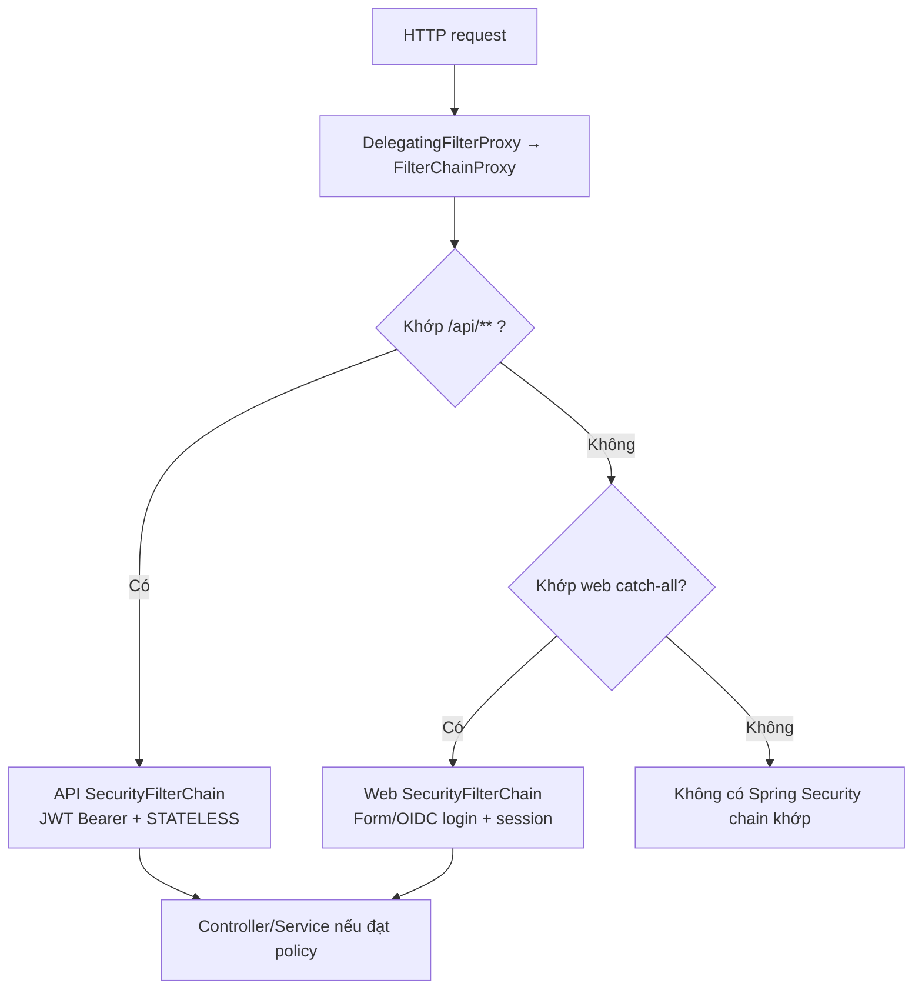
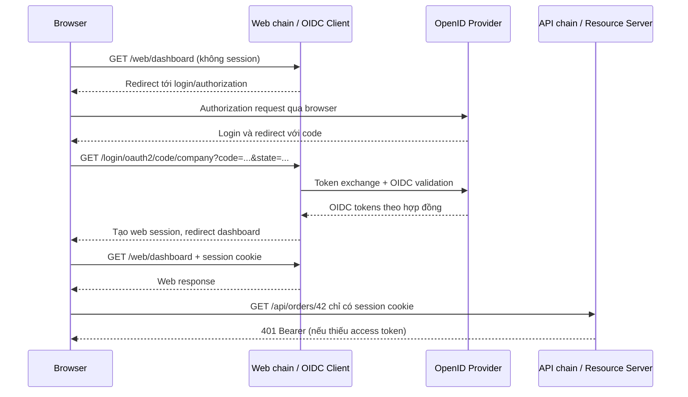

# Phối hợp Resource Server với đăng nhập trình duyệt trong nhiều filter chain

## 1. Một ứng dụng, hai cách đăng nhập: cần tách điều gì?

Một ứng dụng Spring Boot có thể đồng thời phục vụ **REST API** và **website dành cho trình duyệt**. Hai bề mặt này thường có nhu cầu xác thực khác nhau:

- Mobile app, SPA hoặc service khác gọi `/api/**` bằng **OAuth 2.0 access token** trong `Authorization: Bearer ...`.
- Người dùng mở `/web/**` bằng trình duyệt, đăng nhập qua **form login** hoặc **OpenID Connect (OIDC) login**, rồi duy trì phiên bằng **HTTP session cookie**.
- API cần trả `401 Unauthorized` với Bearer challenge khi thiếu token; website chưa đăng nhập thường chuyển hướng `302` tới trang đăng nhập.
- API thuần Bearer header thường không cần session cho authentication; web login thường cần session để lưu trạng thái đăng nhập và chống CSRF.

Nếu cấu hình tất cả một cách thiếu phân tách, một request API có thể bị chuyển tới `/login` thay vì nhận `401`; hoặc một trang web có thể bị yêu cầu Bearer token dù người dùng đã đăng nhập bằng session. Nguy hiểm hơn, việc tắt CSRF cho API bị sao chép sang web chain có thể làm yếu bảo vệ của session-based website.

**Giải pháp quan trọng:** Dùng các bean `SecurityFilterChain` có **`securityMatcher` và `@Order` rõ ràng**, áp dụng cơ chế Resource Server cho API chain và cơ chế browser login cho web chain.

Ví dụ mục tiêu:

| Request | Cách xác thực dự kiến | Khi chưa xác thực | Chính sách |
|---|---|---|---|
| `GET /api/public/ping` | Không bắt buộc token | `200` nếu có Controller | Công khai |
| `GET /api/orders/42` | Bearer JWT access token | `401` + Bearer challenge | `SCOPE_orders.read` |
| `POST /api/orders` | Bearer JWT access token | `401` + Bearer challenge | `SCOPE_orders.write` |
| `GET /web/dashboard` | Session sau browser login | `302` tới login | `authenticated()` |
| `POST /web/profile` | Session + CSRF token | Redirect/login nếu chưa đăng nhập | Có đăng nhập và CSRF hợp lệ |
| `GET /login` | Form login page | Hiển thị trang login | Do web chain xử lý |
| `POST /login` | Username/password + CSRF | Xác thực form | Do web login filter xử lý |

Bài này sử dụng mô hình Servlet Spring Security hiện đại, với `SecurityFilterChain`, lambda DSL và các bean Java config. API, endpoint và hostname chỉ mang tính minh họa; phải thay bằng hợp đồng xác thực thực tế trước khi triển khai production.

### Kết quả mong đợi sau bài học

Bạn sẽ có khả năng:

1. Giải thích vì sao **Resource Server không đồng nghĩa browser login** và browser session không tự trở thành Bearer access token.
2. Biết `FilterChainProxy` chọn **chain đầu tiên khớp** theo `@Order`, không chạy lần lượt mọi chain.
3. Phân biệt `securityMatcher(...)` với `requestMatchers(...)` trong `authorizeHttpRequests`.
4. Cấu hình API JWT **stateless** tách khỏi web **stateful** với form login.
5. Thay form login bằng **`oauth2Login`/OIDC** khi website cần đăng nhập qua Identity Provider.
6. Giữ đúng CSRF, session, CORS, login/logout endpoint, security context và HTTP error behavior.
7. Kiểm thử các request từ browser, API client và những trường hợp route đi nhầm chain.
8. Biết khi nào cần backend-for-frontend (BFF), token relay hoặc gọi API downstream sau khi người dùng đăng nhập website.

## 2. Ba vai trò OAuth 2.0/OIDC không được đánh đồng

Một ứng dụng Spring Security có thể nhận nhiều **vai trò giao thức** khác nhau.

### 2.1. Resource Server

**Resource Server** bảo vệ tài nguyên khi Client gửi access token:

```http
GET /api/orders/42 HTTP/1.1
Host: shop.example.com
Authorization: Bearer <access-token>
```

Resource Server cần xác minh token qua `JwtDecoder` hoặc `OpaqueTokenIntrospector`, rồi kiểm tra scope, audience, tenant và quyền nghiệp vụ.

Cấu hình tương ứng:

```java
.oauth2ResourceServer(oauth2 ->
    oauth2.jwt(Customizer.withDefaults()))
```

Nó **không tự tạo trang login** và không biến một HTTP session thành access token cho API.

### 2.2. Browser login bằng form

**Form login** xác thực người dùng với cơ chế user authentication của ứng dụng:

```text
Browser → GET /login → trang đăng nhập
Browser → POST /login → xác thực username/password
Web application → thiết lập Authentication trong SecurityContext
Browser ↔ web app → mang session cookie cho các request tiếp theo
```

Cấu hình:

```java
.formLogin(Customizer.withDefaults())
```

Sau đăng nhập, ứng dụng thường lưu SecurityContext giữa các request qua session. Điều này khác với việc Resource Server xác minh mỗi Bearer access token.

### 2.3. Browser login bằng OIDC

**OIDC login** là đăng nhập qua một OpenID Provider/Identity Provider:

```text
Browser → web app
Web app → redirect đến Authorization Server
Browser → login tại IdP
IdP → redirect trở lại web app với authorization code
Web app → đổi code lấy các token theo luồng được cấu hình
Web app → xác thực OIDC và tạo Authentication/session
Browser ↔ web app → tiếp tục dùng session cookie
```

Cấu hình:

```java
.oauth2Login(Customizer.withDefaults())
```

Ứng dụng đóng vai trò **OAuth 2.0/OIDC Client** trong luồng đăng nhập, không phải Resource Server ở đoạn giao tiếp đó.

Một ứng dụng có thể dùng **`oauth2ResourceServer` ở chain API** và **`oauth2Login` ở chain web**. Đây là hai cơ chế khác nhau, dù cùng IdP có thể phát hành token phục vụ cả hai.

### 2.4. ID token không được dùng thay access token

Sau OIDC login, Client có thể nhận **ID token** để xác nhận danh tính phiên đăng nhập. **ID token không phải access token dành cho Resource Server**.

Ví dụ:

```text
OIDC ID token:
  aud = web-client-id
  mục đích = xác thực user đối với OIDC Client

OAuth access token cho API:
  aud = orders-api
  scope = orders.read
  mục đích = cho phép Client gọi Resource Server
```

Không đưa ID token vào:

```http
Authorization: Bearer <id-token>
```

để gọi `/api/orders/**`. Resource Server phải yêu cầu **access token đúng audience và scope**, kể cả khi cả hai token đều là JWT và có cùng issuer.

## 3. FilterChainProxy thực sự xử lý nhiều SecurityFilterChain ra sao?

Trong mô hình Servlet, Spring Security sử dụng `DelegatingFilterProxy` để tích hợp vào Servlet filter chain. Đối tượng `FilterChainProxy` quản lý các `SecurityFilterChain` được tạo từ cấu hình.

Mỗi chain có:

- Một `RequestMatcher` quyết định chain có áp dụng cho request không.
- Một danh sách security filters tương ứng với cơ chế xác thực, security context, CSRF, session handling, exception handling và authorization của chain đó.

Giả sử cấu hình:

```text
@Order(1)  /api/**       → Resource Server Bearer JWT, stateless
@Order(2)  any request   → Form login/session web
```

Luồng:



**Chỉ SecurityFilterChain khớp đầu tiên được thực thi**. Request vào API chain sẽ không “rơi tiếp xuống” web chain khi authentication thất bại; nó được xử lý lỗi ngay trong pipeline của API chain.

### 3.1. Ví dụ lựa chọn chain

| Request | `/api/**` có khớp? | Chain chọn |
|---|---|---|
| `GET /api/public/ping` | Có | API |
| `GET /api/orders/42` | Có | API |
| `POST /api/orders` | Có | API |
| `GET /web/dashboard` | Không | Web catch-all |
| `GET /login` | Không | Web catch-all |
| `POST /login` | Không | Web catch-all |
| `GET /assets/app.css` | Không | Web catch-all |
| `GET /oauth2/authorization/company` | Không | Web catch-all |
| `GET /login/oauth2/code/company` | Không | Web catch-all |

Hai URL cuối quan trọng khi dùng OIDC login; chúng sẽ được giải thích ở mục riêng.

### 3.2. `@Order` quyết định ưu tiên

Ví dụ:

```java
@Bean
@Order(1)
SecurityFilterChain api(HttpSecurity http) throws Exception { ... }

@Bean
@Order(2)
SecurityFilterChain web(HttpSecurity http) throws Exception { ... }
```

`@Order(1)` được xem xét trước `@Order(2)`. Nếu hai chain cùng match URL, chain ưu tiên cao hơn (thường là giá trị `@Order` nhỏ hơn) thắng.

Không nên dựa vào thứ tự khai báo method trong cùng file Java để quyết định bảo mật. Hãy khai báo order có chủ đích khi có các vùng matcher chồng nhau.

### 3.3. `securityMatcher` khác `requestMatchers`

Đây là phân biệt cốt lõi của cấu hình nhiều chain.

**`securityMatcher("/api/**")`:** quyết định **toàn bộ chain API** có xử lý request không.

**`requestMatchers("/api/public/**").permitAll()`:** quyết định **quyền cho một request bên trong chain đã chọn**.

Ví dụ:

```java
http
    .securityMatcher("/api/**")
    .authorizeHttpRequests(auth -> auth
        .requestMatchers("/api/public/**").permitAll()
        .requestMatchers("/api/orders/**")
            .hasAuthority("SCOPE_orders.read")
        .anyRequest().denyAll()
    );
```

`anyRequest().denyAll()` chỉ áp dụng cho request **đã vào API chain**, không tự bảo vệ `/web/**` hoặc một endpoint không khớp chain nào.

### 3.4. Mặc định không có `securityMatcher` là rộng

Một bean `SecurityFilterChain` không chỉ định matcher riêng thường có matcher áp dụng cho **mọi request**. Vì vậy, nếu chain này đứng đầu, nó có thể chiếm tất cả URL, khiến chain phía sau không được chọn.

Ví dụ cấu hình không phù hợp:

```java
@Bean
@Order(1)
SecurityFilterChain api(HttpSecurity http) throws Exception {
    return http
        // Thiếu securityMatcher("/api/**")
        .oauth2ResourceServer(oauth2 ->
            oauth2.jwt(Customizer.withDefaults()))
        .authorizeHttpRequests(auth -> auth
            .requestMatchers("/api/**").authenticated()
            .anyRequest().permitAll())
        .build();
}
```

`/web/dashboard` có thể vào chain này, không vào form login chain. Rule `anyRequest().permitAll()` thậm chí có thể mở web route theo cách không mong đợi.

**Nguyên tắc:** Chain chuyên biệt có matcher cụ thể; chain tổng quát/catch-all đứng cuối.

## 4. Thiết kế ranh giới: API stateless, web stateful

Một mô hình đáng dùng:

```text
                     shop.example.com
                            |
                +-----------+------------+
                |                        |
             /api/**                mọi URL khác
                |                        |
          Chain @Order(1)           Chain @Order(2)
                |                        |
         BearerTokenAuth            Form/OIDC login
         JwtDecoder                 SecurityContext
         SCOPE_ authorities         Session cookie
         No session for auth        CSRF enabled
         401/403 Bearer             302/login hoặc 403
                |                        |
             API data              Web page/BFF
```

### 4.1. Stateless ở API nghĩa là gì?

`SessionCreationPolicy.STATELESS` nói Spring Security không tạo hoặc sử dụng `HttpSession` để lấy `SecurityContext` cho authentication theo cơ chế của chain đó.

Nó **không có nghĩa**:

- Client không thể gửi `Cookie: JSESSIONID=...`.
- Toàn bộ ứng dụng không còn sử dụng HTTP session.
- Browser sẽ tự ngừng gửi cookie khi gọi `/api/**` cùng origin.
- Một custom filter hoặc Controller không bao giờ chạm đến session.
- Token JWT trở thành “stateless về mọi mặt” khi hệ thống còn gọi DB/cache/introspection.

Nó chỉ xác định **chính sách session của Spring Security chain**. Với API chain stateless và đúng cấu hình, **cookie web login không được dùng làm authentication thay cho Bearer token**.

### 4.2. Web stateful nghĩa là gì?

Web chain sử dụng form/OIDC login thường lưu Authentication trong `SecurityContext` qua HTTP session. Browser gửi session cookie trên những request sau, và web chain khôi phục trạng thái đăng nhập.

Session cookie là **credential của browser đối với web app**, không phải access token OAuth dành cho API.

Một người đã đăng nhập `/web/dashboard` vẫn có thể nhận `401` khi gọi `/api/orders/42` mà chỉ gửi session cookie. Đó là hành vi **đúng theo hợp đồng** nếu API yêu cầu Bearer access token.

### 4.3. Cấu hình nào áp dụng cho chain nào?

| Thành phần | API Resource Server | Web login |
|---|---|---|
| Authentication | Bearer access token | Username/password hoặc OIDC authorization code |
| Security context | Thường mỗi request từ token | Thường được duy trì qua session |
| Session policy | `STATELESS` | Chính sách hỗ trợ session |
| Entry point | Bearer challenge `401` | Redirect tới trang login |
| CSRF | Có thể tắt khi dùng Bearer header thuần | Giữ CSRF cho session-based requests |
| Scope/authority | `SCOPE_orders.read` | Role/permission của user web |
| Logout | Token revocation theo OAuth contract, không đơn thuần xóa session | Hủy phiên web; có thể thêm OIDC logout |
| Auth endpoints | Thường không có login form | `/login` hoặc OAuth2 login endpoints |

Mỗi chain có thể có filter và security context logic khác nhau, nhưng chúng vẫn chạy trong **cùng ứng dụng JVM**. Khi viết custom filter, nên cẩn thận không dùng biến static hoặc ThreadLocal riêng không được dọn để chuyển Authentication giữa các request.

## 5. Ví dụ hoàn chỉnh: Spring Boot API JWT + form login website

### 5.1. Dependency

Ví dụ `build.gradle` cho Spring Boot Servlet:

```groovy
dependencies {
    implementation 'org.springframework.boot:spring-boot-starter-web'
    implementation 'org.springframework.boot:spring-boot-starter-security'
    implementation 'org.springframework.boot:spring-boot-starter-oauth2-resource-server'

    testImplementation 'org.springframework.boot:spring-boot-starter-test'
    testImplementation 'org.springframework.security:spring-security-test'
}
```

Giả định project đã có Spring Boot plugin, Java toolchain và dependency management tương thích. Code minh họa dùng Java hiện đại và cấu hình lambda DSL của Spring Security 6.x/những phiên bản tương ứng.

### 5.2. Cấu hình issuer Resource Server

Trong `src/main/resources/application.yml`:

```yaml
server:
  port: 8080

spring:
  security:
    oauth2:
      resourceserver:
        jwt:
          issuer-uri: https://id.example.com/realms/shop
```

`issuer-uri` phải được thay bằng issuer tin cậy thật. Resource Server sử dụng issuer/metadata/JWKS phù hợp để xác minh JWT. Nếu API yêu cầu `aud=orders-api`, cần thêm audience validator theo hợp đồng; chỉ có issuer và signature không đảm bảo token dành cho đúng API.

### 5.3. SecurityFilterChain với hai bean

```java
package com.example.shop;

import org.springframework.context.annotation.Bean;
import org.springframework.context.annotation.Configuration;
import org.springframework.core.annotation.Order;
import org.springframework.http.HttpMethod;
import org.springframework.security.config.Customizer;
import org.springframework.security.config.annotation.web.builders.HttpSecurity;
import org.springframework.security.config.http.SessionCreationPolicy;
import org.springframework.security.web.SecurityFilterChain;

@Configuration
public class SecurityConfig {

    // API: chain cụ thể và có độ ưu tiên cao.
    @Bean
    @Order(1)
    SecurityFilterChain apiSecurity(HttpSecurity http) throws Exception {
        return http
            .securityMatcher("/api/**")
            .csrf(csrf -> csrf.disable())
            .sessionManagement(session -> session
                .sessionCreationPolicy(
                    SessionCreationPolicy.STATELESS))
            .authorizeHttpRequests(auth -> auth
                .requestMatchers(
                    HttpMethod.GET, "/api/public/ping")
                    .permitAll()
                .requestMatchers(
                    HttpMethod.GET, "/api/orders/**")
                    .hasAuthority("SCOPE_orders.read")
                .requestMatchers(
                    HttpMethod.POST, "/api/orders")
                    .hasAuthority("SCOPE_orders.write")
                .anyRequest().denyAll()
            )
            .oauth2ResourceServer(oauth2 ->
                oauth2.jwt(Customizer.withDefaults()))
            .build();
    }

    // Web: catch-all, chỉ xét khi API chain không khớp.
    @Bean
    @Order(2)
    SecurityFilterChain webSecurity(HttpSecurity http) throws Exception {
        return http
            .authorizeHttpRequests(auth -> auth
                .requestMatchers(
                    "/assets/**",
                    "/favicon.ico",
                    "/error")
                    .permitAll()
                .requestMatchers("/web/admin/**")
                    .hasRole("ADMIN")
                .anyRequest().authenticated()
            )
            .formLogin(form -> form.permitAll())
            .logout(logout -> logout
                .logoutSuccessUrl("/login?logout")
                .permitAll())
            .build();
    }
}
```

**Đây là cấu hình hai chain thực sự**:

- `apiSecurity` khớp `/api/**` trước; bật Resource Server JWT và `STATELESS`.
- `webSecurity` không đặt `securityMatcher`, trở thành catch-all cho URL khác.
- `formLogin(...permitAll())` cho phép truy cập các endpoint login mà filter quản lý.
- `logout(...)` sử dụng cơ chế web logout; với CSRF bật, logout mặc định thường yêu cầu request POST có CSRF token.
- `/assets/**` được phép ở web chain nhưng vẫn đi qua security filters của chain.
- Web admin cần role đã được mapping thành `ROLE_ADMIN` theo quy ước Spring Security.

**Không đưa `csrf.disable()` ra cấu hình chung cho cả hai chain**; ở đây chỉ tắt cho API thuần Bearer header. Web chain không tắt CSRF, nên tiếp tục dùng các mặc định bảo vệ cho browser session.

Nếu ứng dụng còn nhiều vùng URL khác, catch-all web chain sẽ xử lý chúng và yêu cầu đăng nhập mặc định. Team cần xác định rõ endpoint nào thật sự phải công khai, không dùng `anyRequest().permitAll()` để tránh vấn đề cấu hình.

### 5.4. Vì sao web chain không cần `securityMatcher("/web/**")` trong ví dụ?

Nếu giới hạn web chain vào `/web/**`, các URL xử lý bởi form login mặc định như `/login` hoặc `/logout` có thể **nằm ngoài chain chứa login/logout filters**.

Dùng catch-all chain ở cuối là cách đơn giản để bao phủ `/login`, `/logout`, static assets và các URL web khác. Nếu cần giới hạn web chain hẹp hơn, phải tạo `RequestMatcher` bao phủ **tất cả endpoint do security filters sử dụng**, chứ không chỉ Controller mapping.

### 5.5. Một UserDetailsService cho lab form login

`formLogin` cần một cơ chế xác thực người dùng. Ví dụ lab nội bộ có thể dùng tài khoản in-memory:

```java
package com.example.shop;

import org.springframework.context.annotation.Bean;
import org.springframework.context.annotation.Configuration;
import org.springframework.security.core.userdetails.User;
import org.springframework.security.core.userdetails.UserDetails;
import org.springframework.security.core.userdetails.UserDetailsService;
import org.springframework.security.crypto.factory.PasswordEncoderFactories;
import org.springframework.security.crypto.password.PasswordEncoder;
import org.springframework.security.provisioning.InMemoryUserDetailsManager;

@Configuration
public class DemoUsersConfig {

    @Bean
    PasswordEncoder passwordEncoder() {
        return PasswordEncoderFactories.createDelegatingPasswordEncoder();
    }

    @Bean
    UserDetailsService userDetailsService(
            PasswordEncoder encoder) {

        UserDetails user = User.withUsername("demo-user")
            .password(encoder.encode("demo-only-password"))
            .roles("USER")
            .build();

        return new InMemoryUserDetailsManager(user);
    }
}
```

Đây là **tài khoản giả lập cho lab**, không sử dụng mật khẩu cố định trong production. Ứng dụng thật nên dùng identity store/IdP đáng tin, quản lý password, MFA, account lockout và vận hành theo yêu cầu bảo mật.

Việc khai báo `UserDetailsService` cho web chain không có nghĩa Bearer API sẽ tự nhận username/password làm token. API vẫn cấu hình xác thực bằng access token.

### 5.6. Controller demo cho cả API và web

```java
package com.example.shop;

import java.util.Map;
import org.springframework.security.core.Authentication;
import org.springframework.security.core.annotation.AuthenticationPrincipal;
import org.springframework.security.oauth2.jwt.Jwt;
import org.springframework.web.bind.annotation.GetMapping;
import org.springframework.web.bind.annotation.PathVariable;
import org.springframework.web.bind.annotation.RestController;

@RestController
public class DemoController {

    @GetMapping("/api/public/ping")
    public Map<String, String> ping() {
        return Map.of("surface", "api", "status", "ok");
    }

    @GetMapping("/api/orders/{orderId}")
    public Map<String, String> order(
            @PathVariable String orderId,
            @AuthenticationPrincipal Jwt jwt) {

        return Map.of(
            "orderId", orderId,
            "subject", jwt.getSubject());
    }

    @GetMapping("/web/dashboard")
    public Map<String, String> dashboard(
            Authentication authentication) {

        return Map.of(
            "surface", "web",
            "user", authentication.getName());
    }
}
```

Controller cố ý chỉ minh họa **Authentication** và chain selection. Hệ thống đơn hàng thật phải kiểm tra owner/tenant của `orderId` và chỉ trả những trường người gọi có quyền. Đoạn `POST /api/orders` trong `SecurityConfig` có rule bảo vệ nhưng không có Controller minh họa; thêm handler và Service riêng nếu cần chạy request POST thành công.

## 6. Đường đi request: xác thực API và web khác nhau thế nào?

### 6.1. API không token

```http
GET /api/orders/42 HTTP/1.1
Host: shop.example.com
```

Luồng:

```text
1. FilterChainProxy thấy /api/** khớp @Order(1).
2. Chọn API chain, không thử web chain.
3. BearerTokenAuthenticationFilter không tìm thấy token.
4. Authorization rule yêu cầu SCOPE_orders.read.
5. Chưa có Authentication được chấp nhận.
6. Bearer entry point thường trả 401.
```

Response thường có:

```http
HTTP/1.1 401 Unauthorized
WWW-Authenticate: Bearer
```

Không có redirect `/login`, vì web chain không được chọn.

### 6.2. API token hợp lệ nhưng thiếu scope

JWT có `aud=orders-api`, issuer và chữ ký hợp lệ nhưng chỉ có `profile.read`. API chain xác thực token thành công; authorization thiếu `SCOPE_orders.read`.

Response thường:

```http
HTTP/1.1 403 Forbidden
WWW-Authenticate: Bearer error="insufficient_scope"
```

Header chi tiết còn phụ thuộc AccessDeniedHandler. `403` cho biết token có thể đã được xác thực nhưng không đủ quyền để thực hiện thao tác.

### 6.3. Web chưa login

```http
GET /web/dashboard HTTP/1.1
Host: shop.example.com
```

Luồng:

```text
1. /web/dashboard không khớp API chain.
2. Web catch-all được chọn.
3. Không có Authentication từ web session.
4. Rule authenticated() yêu cầu login.
5. Form login entry point redirect tới /login.
```

Ví dụ response:

```http
HTTP/1.1 302 Found
Location: http://localhost:8080/login
```

Location thực tế phụ thuộc host, forwarded headers, context path và cấu hình ứng dụng.

### 6.4. Web đã login

Browser gửi session cookie:

```http
GET /web/dashboard HTTP/1.1
Host: shop.example.com
Cookie: JSESSIONID=<browser-session-id>
```

Web chain có thể dùng session để khôi phục Authentication đã được lưu, sau đó cho phép `/web/dashboard`. Không cần Bearer header nếu hợp đồng web là session login.

### 6.5. Browser đã login nhưng gọi API bằng cookie

```http
GET /api/orders/42 HTTP/1.1
Host: shop.example.com
Cookie: JSESSIONID=<browser-session-id>
```

Request vẫn **khớp API chain trước**. Với API chain `STATELESS` và chỉ Bearer authentication, session cookie không thay thế access token. Khi không có Bearer token, protected API thường trả **401**.

Đây là điểm quan trọng nhất khi phối hợp hai cơ chế: **một user đang login website không đồng nghĩa mọi REST API tự nhận phiên đó**.

### 6.6. Browser gửi cả session cookie và Bearer JWT tới API

```http
GET /api/orders/42 HTTP/1.1
Cookie: JSESSIONID=<browser-session-id>
Authorization: Bearer <access-token>
```

API chain xử lý Bearer token theo policy JWT của nó. Session cookie có thể cùng xuất hiện do browser tự gửi, nhưng **không được dùng như credential API** theo thiết kế stateless này.

Nếu Bearer JWT không hợp lệ, không được “fallback” âm thầm sang session web để cho request thành công. Việc fallback đó sẽ làm mờ ranh giới xác thực và có thể cho phép bypass audience/scope.

## 7. HTTP status: 401/403 cho API, redirect cho web

Cùng một ứng dụng có thể trả những phản hồi khác nhau cho request tương tự:

| Request | Chain | Tình huống | Kết quả điển hình |
|---|---|---|---|
| `GET /api/public/ping` | API | Không token | `200` nếu có Controller |
| `GET /api/orders/42` | API | Không Bearer token | `401` + `WWW-Authenticate: Bearer` |
| `GET /api/orders/42` | API | JWT sai chữ ký/hết hạn | `401 invalid_token` |
| `GET /api/orders/42` | API | JWT hợp lệ thiếu `orders.read` | `403 insufficient_scope` |
| `GET /api/orders/42` | API | JWT có scope, sai tenant/owner | `403` hoặc `404` theo policy |
| `GET /web/dashboard` | Web | Không session login | `302` tới `/login` |
| `GET /web/dashboard` | Web | Session hợp lệ | `200` ở demo |
| `POST /login` | Web | Sai username/password | Chuyển hướng tới trang báo lỗi theo cấu hình |
| `POST /web/profile` | Web | Login nhưng thiếu CSRF token | Thường `403` |
| `GET /api/orders/42` | API | Chỉ có JSESSIONID | `401` theo thiết kế JWT-only |

Đừng “sửa” API trả `401` bằng cách bật `formLogin` trên API chain, hoặc “sửa” website trả `302` bằng cách đưa `oauth2ResourceServer` vào mọi URL mà không xem xét hợp đồng browser.

### 7.1. Khi API trả 302 thay vì 401

Có thể `SecurityFilterChain` form login ở vị trí ưu tiên cao hơn hoặc có matcher quá rộng. Kiểm tra:

```text
@Order(1) api securityMatcher("/api/**") ?
@Order(2) web catch-all ?
```

Nếu chain web khớp trước, Bearer entry point ở API chain sẽ không được dùng.

### 7.2. Khi web trả `WWW-Authenticate: Bearer`

Nếu `/web/dashboard` nhận `401 Bearer` thay vì chuyển `/login`, có thể API chain đang match mọi request vì thiếu `securityMatcher("/api/**")`.

Đừng chỉ custom HTTP status; cần sửa **chain selection**.

## 8. Session và SecurityContext: trạng thái web không được tự rò sang API

### 8.1. SecurityContext có gì?

Spring Security sử dụng `SecurityContext` chứa `Authentication` của request hiện tại. Với web form/OIDC login, Authentication có thể được lưu trong session giữa các request theo cơ chế `SecurityContextRepository` và các filter tương ứng.

Với API stateless Bearer JWT, Authentication được tạo từ token trong từng request, và không dựa vào HTTP session của website.

Ví dụ:

```text
Request A:
  GET /web/dashboard
  Cookie: JSESSIONID=web-session
  → Web chain
  → Session Authentication = user Alice

Request B:
  GET /api/orders/42
  Cookie: JSESSIONID=web-session
  → API chain
  → Không dùng web session Authentication

Request C:
  GET /api/orders/42
  Authorization: Bearer jwt-for-orders-api
  → API chain
  → Authentication từ JWT
```

### 8.2. Session policy là cấu hình theo chain

`SessionCreationPolicy.STATELESS` chỉ được gọi ở API chain. Nó không khiến web chain mất khả năng dùng session.

Ngược lại, việc web chain tạo `JSESSIONID` không có nghĩa API chain phải đọc session. Có thể có cùng cookie từ browser nhưng hai chain chọn những cách authentication khác nhau.

Nếu một custom filter/Controller cố tự đọc `HttpSession` để lấy web user ở mọi URL, nó có thể phá mục tiêu tách biệt này. Không truy cập session web để thay thế OAuth Bearer authentication tại API.

### 8.3. Session fixation

Trong web form login, Spring Security có các cơ chế chống **session fixation** bằng cách thay đổi session ID hoặc chiến lược tương đương khi Authentication thành công, tùy Servlet container và cấu hình.

Không tự giữ một session ID cố định qua login mà không xem xét session fixation. Trong thực tế cần kiểm tra:

- Cookie có `Secure` khi chạy HTTPS.
- Cookie có `HttpOnly`.
- `SameSite` phù hợp với luồng browser/OIDC redirect và nhu cầu cross-site.
- Session timeout hợp lý.
- Logout invalidates session theo chính sách.
- Không log giá trị session cookie.

Những thuộc tính này không thể thay thế OAuth token audience/scope validation cho API.

### 8.4. SecurityContext không phải kho token dùng chung

Không nên viết logic:

```java
Authentication webAuth =
    SecurityContextHolder.getContext().getAuthentication();

// Sai về ý tưởng nếu coi webAuth là Bearer access token
// dành cho orders-api và tự chuyển nó sang API chain.
```

`Authentication` web chứng minh người dùng đã login với cơ chế web. Nó **không tự chứa một OAuth access token phù hợp audience/orders scope**, và không nên được dùng để bypass Resource Server.

## 9. CSRF: khác biệt quan trọng giữa session web và API thuần Bearer

### 9.1. Vì sao web session cần CSRF?

Browser thường tự gửi cookie tới website theo các điều kiện domain/path/SameSite. Một trang ngoài có thể cố khiến browser gửi request thay đổi trạng thái tới website nơi user đã login.

CSRF protection kiểm tra request có token/chứng cứ chống giả mạo phù hợp, ngoài cookie session. Với form login và web session, nên giữ CSRF protection cho các thao tác state-changing.

Ví dụ:

```http
POST /web/profile HTTP/1.1
Cookie: JSESSIONID=<valid-session>
Content-Type: application/x-www-form-urlencoded

displayName=NewName
```

Nếu CSRF đang bật và request không có CSRF token phù hợp, Spring Security thường từ chối. Việc đã có cookie session **không đủ** để bỏ CSRF.

### 9.2. Vì sao ví dụ API tắt CSRF?

Trong mô hình API **chỉ dùng Bearer access token trong Authorization header** mà browser không tự gửi credential đó, việc ép một trang ngoài tạo request cùng Authorization header hợp lệ không diễn ra như với cookie session. Vì vậy nhiều REST API kiểu này tắt CSRF trong API chain.

Tuy nhiên, nếu API:

- Xác thực bằng session cookie.
- Chấp nhận Bearer token từ cookie được browser tự gửi.
- Có một cơ chế authentication tự động đính kèm credential trong browser.
- Cho phép một số thao tác nhạy cảm bằng cookie/session.

thì không nên tắt CSRF chỉ vì URL bắt đầu `/api/**`. Phải đánh giá theo **credential mà browser tự gửi**, không chỉ theo nhãn “API”.

### 9.3. Hai chain giúp tắt CSRF có phạm vi

```java
// API chain:
.securityMatcher("/api/**")
.csrf(csrf -> csrf.disable())

// Web chain:
.formLogin(Customizer.withDefaults())
// Không tắt CSRF tại đây.
```

Đây là lý do quan trọng để không viết một cấu hình global tắt CSRF cho toàn ứng dụng khi có session-based website.

### 9.4. POST login và logout cũng cần hiểu CSRF

Với Spring Security web form login:

- `GET /login` có thể hiển thị form login mặc định.
- `POST /login` xử lý thông tin đăng nhập theo filter.
- Khi CSRF bật, login form thường cần CSRF token phù hợp.
- `POST /logout` thường là cách logout mặc định khi CSRF bật; `GET /logout` có thể hiển thị trang xác nhận/luồng khác tùy cấu hình.

Không nên tắt CSRF chỉ để `curl -X POST /login` hoạt động khi quên gửi token CSRF. Trong bài kiểm thử, hãy tạo CSRF token hợp lệ hoặc dùng công cụ test tương ứng.

### 9.5. CORS không phải CSRF

**CORS** quyết định browser có thể đọc response/gửi một số cross-origin request theo các điều kiện nhất định; **CSRF** bảo vệ thao tác đã xác thực khỏi bị kích hoạt ngoài ý định.

CORS cấu hình đúng không tự thay thế CSRF. Ngược lại, bật CSRF không tự giải quyết preflight CORS cho API.

## 10. Form login: endpoint do security filter tạo phải nằm trong web chain

### 10.1. Login form mặc định

Khi bật:

```java
.formLogin(form -> form.permitAll())
```

Spring Security có thể cung cấp trang login mặc định và login processing endpoint nếu không cấu hình trang riêng. Những endpoint liên quan thường bao gồm:

```text
GET  /login
POST /login
GET  /login?error
GET  /login?logout
```

Các URL đó không nhất thiết là `@GetMapping` hoặc `@PostMapping` do developer tự viết; filter/page generator của Spring Security có thể xử lý chúng.

Vì vậy, nếu chỉ có:

```java
.securityMatcher("/web/**")
.formLogin(Customizer.withDefaults())
```

thì `/login` không khớp chain chứa form login; login page/process có thể không hoạt động. Cần catch-all web chain hoặc matcher đủ rộng cho `/login`, `/logout` và các endpoint liên quan.

### 10.2. Custom login page

Nếu có trang đăng nhập riêng:

```java
.formLogin(form -> form
    .loginPage("/signin")
    .loginProcessingUrl("/signin")
    .permitAll())
```

thì `GET /signin` thường phải có Controller hoặc view để render page, còn `POST /signin` có thể do authentication filter xử lý. URL đó cũng phải nằm trong **web chain** và được permit theo cấu hình.

Khi dùng custom login, nhớ render CSRF token trong form nếu CSRF bật, xử lý redirect sau login/failed login và bảo đảm không tạo open redirect từ URL do Client tự khai.

### 10.3. SavedRequest và redirect sau login

Một user chưa đăng nhập truy cập `/web/dashboard` có thể được Spring Security lưu request ban đầu trong session để sau khi login thành công, browser được đưa trở lại trang đó.

Cơ chế request cache này phù hợp với web login. API stateless Bearer thường không cần tạo session để lưu request nhằm redirect sau login.

Không cho phép API request thiếu Bearer token tự động chuyển sang form-login flow chỉ vì web chain có request cache.

## 11. Dùng OIDC login thay form login cho browser

Nếu website cần đăng nhập qua một IdP, bạn có thể thay **web form-login chain** bằng **OIDC login**. API chain vẫn là Resource Server JWT/opaque token.

### 11.1. Thêm OAuth2 Client dependency

Ví dụ `build.gradle` khi dùng OIDC login:

```groovy
dependencies {
    implementation 'org.springframework.boot:spring-boot-starter-web'
    implementation 'org.springframework.boot:spring-boot-starter-security'
    implementation 'org.springframework.boot:spring-boot-starter-oauth2-resource-server'
    implementation 'org.springframework.boot:spring-boot-starter-oauth2-client'
}
```

`spring-boot-starter-oauth2-client` phục vụ vai trò OAuth2/OIDC Client của website. Resource Server starter và OAuth2 Client starter không thay thế nhau.

### 11.2. OIDC Client registration

Ví dụ `application.yml`:

```spring.yml
spring:
  security:
    oauth2:
      client:
        registration:
          company:
            provider: company
            client-id: ${OIDC_CLIENT_ID}
            client-secret: ${OIDC_CLIENT_SECRET}
            scope:
              - openid
              - profile
              - email
        provider:
          company:
            issuer-uri: https://id.example.com/realms/shop

      resourceserver:
        jwt:
          issuer-uri: https://id.example.com/realms/shop
```

Hai cấu hình `client.registration.company` và `resourceserver.jwt` có vai trò khác nhau:

- **Client registration:** để web app thực hiện OIDC authorization code login.
- **Resource Server JWT issuer:** để API xác thực Bearer access token.

Dù có cùng issuer, **Client ID/redirect URI và API audience/scope vẫn là hai hợp đồng riêng**. Không nên dùng Client ID của website như audience mặc định của API.

`${OIDC_CLIENT_ID}` và `${OIDC_CLIENT_SECRET}` đại diện giá trị cấu hình từ môi trường; không commit Client secret thật.

### 11.3. Web chain dùng `oauth2Login`

Thay method `webSecurity` trong `SecurityConfig` bằng:

```java
@Bean
@Order(2)
SecurityFilterChain webSecurity(HttpSecurity http) throws Exception {
    return http
        .authorizeHttpRequests(auth -> auth
            .requestMatchers(
                "/assets/**",
                "/favicon.ico",
                "/error")
                .permitAll()
            .anyRequest().authenticated()
        )
        .oauth2Login(Customizer.withDefaults())
        .logout(logout -> logout
            .logoutSuccessUrl("/"))
        .build();
}
```

Đây là **phương án thay thế**, không khai báo đồng thời hai bean `webSecurity` có cùng cấu hình cạnh tranh. Phần API chain `@Order(1)` giữ nguyên `securityMatcher("/api/**")` và `oauth2ResourceServer`.

`oauth2Login` thường sử dụng HTTP session để lưu trạng thái authentication của web và các bước trung gian trong authorization code flow. Nó cũng dựa trên CSRF/correlation state của OAuth2 flow; không nên cố “stateless hóa” toàn bộ web chain mà không có thiết kế session/state chuyên biệt.

### 11.4. Các endpoint OIDC login thường gặp

Với registration ID `company`:

```text
/oauth2/authorization/company
/login/oauth2/code/company
```

Thông thường:

- `/oauth2/authorization/company` bắt đầu authorization request, chuyển hướng browser đến IdP.
- `/login/oauth2/code/company` nhận authorization response/authorization code từ IdP.
- Web login filter chuyển code thành authentication theo cấu hình, xác minh thông tin OIDC, rồi tạo web session.

Các URL này **không bắt đầu bằng `/api/**`**, nên được web catch-all chain xử lý trong kiến trúc hai chain.

Nếu developer cố giới hạn web chain vào `/web/**`, phải bao phủ rõ cả các endpoint OIDC login nói trên; nếu không, login flow có thể lỗi hoặc callback không được xử lý.

### 11.5. Luồng OIDC được phân tách khỏi API Bearer



OIDC login **không tự chuyển session web thành Bearer token trong API chain**.

### 11.6. OIDC login có thể kết hợp form login không?

Có thể bật cả `formLogin` và `oauth2Login` trong web chain nếu sản phẩm chủ ý hỗ trợ nhiều cách đăng nhập. Khi đó cần thiết kế login page, authentication entry point và UX phù hợp. Tuy nhiên, chỉ nên triển khai khi có nhu cầu rõ; bài này dùng **một phương án web login tại một thời điểm** để tránh nhầm lẫn.

Không bật hai cơ chế trong API chain chỉ với kỳ vọng rằng “nếu Bearer không có thì dùng trình duyệt login”. Điều đó làm API thiếu tính nhất quán và có thể mở đường xác thực không như hợp đồng.

## 12. BFF và API downstream: phiên browser có gọi được API không?

Một câu hỏi thực tế: browser đã đăng nhập OIDC vào website, vậy trang web muốn hiển thị đơn hàng từ `orders-api` sẽ làm gì?

Có hai mô hình, cần quyết định rõ.

### 12.1. Browser gọi trực tiếp Resource Server

```text
Browser
  └── Authorization: Bearer <access-token-for-orders-api>
       └── /api/orders/42 (Resource Server)
```

Trong mô hình này, phía Client cần một **access token phù hợp audience/orders scope** và gửi trong Authorization header. Phải đánh giá cách cấp, lưu, gia hạn, bảo vệ token trong browser và các rủi ro XSS/token theft.

Việc login vào website bằng session cookie không tự làm browser có access token dành cho API, cũng không có nghĩa ID token từ OIDC có thể được dùng để thay thế.

### 12.2. Backend-for-Frontend (BFF)

Một mô hình khác:

```text
Browser
  └── Cookie: JSESSIONID=web-session
       └── /web/orders (Web/BFF)
             └── Backend lấy OAuth access token được cấp đúng quyền
                  └── Gọi orders-api bằng Authorization: Bearer ...
```

Ở đây browser không cần giữ access token của downstream Resource Server. Backend quản lý phiên web và token được cấp cho Client theo một luồng OAuth phù hợp.

BFF vẫn phải:

- Bảo vệ browser session và CSRF.
- Kiểm tra quyền của user với trang web và dữ liệu.
- Lấy access token có **audience của downstream API** và scopes phù hợp.
- Bảo vệ access token trong server-side storage.
- Không gửi ID token thay cho access token.
- Có chính sách token refresh/expiry/logout và least privilege.

Không được giả định `oauth2Login` tự cung cấp access token gọi mọi API. Access token từ OIDC login, nếu có, có thể không đúng audience cho `orders-api`; cần hợp đồng AS rõ ràng hoặc luồng token acquisition phù hợp.

### 12.3. Khi dùng OAuth2AuthorizedClient

Spring Security OAuth2 Client có khái niệm `OAuth2AuthorizedClient` để quản lý các token đã được cấp cho một Client/registration và principal. Khi web app gọi downstream API, có thể dùng cơ chế authorized client hoặc client manager phù hợp.

Nhưng **không nên lấy bất kỳ access token nào từ authorized client rồi gửi tới mọi Resource Server**. Phải xác nhận AS đã cấp token cho đúng resource, scope và các chính sách khác.

Nếu ứng dụng phân biệt nhiều tenant, một authorized client gắn với người dùng có thể cần thêm ràng buộc tenant/permission trước khi gọi downstream.

### 12.4. Không “copy” browser Authentication sang API

Ví dụ ý tưởng sai:

```java
// Ý tưởng không an toàn:
// Nếu session browser đang login thì API cho qua
// mà không cần Bearer access token đúng audience.
if (webSessionHasUser()) {
    allowApiRequest();
}
```

Điều đó phá vỡ hợp đồng Resource Server và có thể làm lộ API qua session/cookie, đồng thời ảnh hưởng mô hình CSRF và quyền của OAuth token.

Nếu sản phẩm chủ ý muốn API nhận cả session và Bearer, đó là **một kiến trúc khác**, cần phân tích ranh giới, ưu tiên Authentication, CSRF và error handling — không tự hình thành như side effect của việc bật hai chain.

## 13. CORS và preflight trong mô hình browser + API

### 13.1. Frontend khác origin gọi API

Giả sử:

```text
Web frontend: https://app.example.com
API:          https://api.example.com
```

Browser có thể gửi CORS preflight trước request có Authorization header:

```http
OPTIONS /api/orders/42 HTTP/1.1
Origin: https://app.example.com
Access-Control-Request-Method: GET
Access-Control-Request-Headers: authorization
```

Preflight thường **không mang Bearer token**. Nếu API chain bắt preflight phải xác thực trước khi xử lý CORS, browser có thể báo lỗi CORS.

### 13.2. Bật CORS trên API chain với cấu hình rõ ràng

Ví dụ:

```java
.securityMatcher("/api/**")
.cors(Customizer.withDefaults())
.oauth2ResourceServer(oauth2 ->
    oauth2.jwt(Customizer.withDefaults()))
```

Cần có `CorsConfigurationSource` hoặc cấu hình CORS của MVC phù hợp để xác định origin/method/header hợp lệ.

Một ví dụ rõ ràng:

```java
@Bean
CorsConfigurationSource apiCorsConfigurationSource() {
    CorsConfiguration cors = new CorsConfiguration();
    cors.setAllowedOrigins(
        List.of("https://app.example.com"));
    cors.setAllowedMethods(
        List.of("GET", "POST", "PUT", "DELETE"));
    cors.setAllowedHeaders(
        List.of("Authorization", "Content-Type"));

    UrlBasedCorsConfigurationSource source =
        new UrlBasedCorsConfigurationSource();
    source.registerCorsConfiguration("/api/**", cors);
    return source;
}
```

Đoạn này yêu cầu imports `java.util.List` và những class CORS của Spring Web. Ví dụ không bật credentials cross-origin vì mô hình minh họa là API Bearer header, không cần browser cookie. Nếu có nhu cầu gửi cookies qua CORS, phải có phân tích CSRF/cookie policy và cấu hình origin/credentials tương thích; không dùng wildcard tùy tiện.

CORS chỉ là chính sách của browser; Client không phải browser vẫn có thể gửi HTTP request. **CORS không thay thế JWT validation, authorization hoặc CSRF**.

### 13.3. OPTIONS không nhất thiết phải được coi là API business operation

Một `OPTIONS` preflight không tự chứng minh Client được phép gọi `GET` hay `POST` sau đó. Nó chỉ là bước browser kiểm tra chính sách CORS. Request thực tế vẫn cần Bearer token và scope phù hợp.

Không đặt `permitAll("/api/**")` để “sửa CORS”. Cần cấu hình CORS và rule HTTP chính xác.

## 14. Session cookie, proxy và redirect OIDC trong production

### 14.1. Thuộc tính cookie

Browser session cookie nên được cấu hình và kiểm tra phù hợp deployment:

| Thuộc tính | Vai trò |
|---|---|
| `Secure` | Chỉ gửi cookie qua HTTPS |
| `HttpOnly` | Hạn chế script đọc cookie |
| `SameSite` | Kiểm soát một số ngữ cảnh gửi cookie cross-site |
| `Path` và `Domain` | Giới hạn phạm vi gửi cookie |
| Session lifetime | Giảm thời gian sử dụng credential sau khi không còn cần |
| Session invalidation | Hủy phiên khi logout/timeout |

`SameSite` cần xét luồng redirect OIDC, iframe nếu có, cross-site navigation và reverse proxy. Không có một cấu hình SameSite duy nhất đúng cho mọi ứng dụng.

### 14.2. Reverse proxy và callback URL

Với OIDC login, `redirect_uri` phải khớp registration tại IdP và phản ánh địa chỉ public của ứng dụng. Nếu proxy chấm dứt TLS rồi chuyển nội bộ bằng HTTP, ứng dụng cần xử lý forwarded headers **từ proxy đáng tin** để tạo redirect đúng scheme/host.

Không tin `X-Forwarded-Host` từ mọi Client internet nếu proxy không lọc, vì có nguy cơ host header/redirect manipulation. Cấu hình forwarded-header strategy chỉ khi có trust boundary rõ ràng.

### 14.3. Browser có thể gửi JSESSIONID tới /api/**

Cookie `Path=/` có thể được browser tự gửi cho cả web và API trên cùng hostname. Vì vậy, trong mô hình API thuần Bearer header:

- Có cookie trong request **không phải** bằng chứng API đang dùng session để xác thực.
- API chain stateless nên không phục hồi Authentication web từ cookie.
- Không dùng session cookie như phương án “fallback” khi Bearer header thiếu.
- Có thể cân nhắc giới hạn cookie Path khi kiến trúc hỗ trợ, nhưng **không dựa duy nhất vào cookie Path để thiết lập ranh giới bảo mật**.

## 15. Logout web và trạng thái của access token là hai việc riêng

Giả sử user đăng nhập OIDC vào `/web/**`, web app có session và có thể có access token dùng gọi downstream API.

Khi browser logout:

1. Web app có thể xóa/invalidates HTTP session.
2. Web Authentication không còn hiệu lực với request web tiếp theo.
3. Browser có thể được chuyển tới trang login/logout success.
4. Nếu dùng OIDC logout, hệ thống có thể cần tích hợp RP-Initiated Logout hoặc cơ chế logout của IdP theo hợp đồng.
5. Những access token đã được cấp **không tự động bị thu hồi** chỉ vì web session bị xóa.

Một access token Bearer còn hạn có thể vẫn được Resource Server chấp nhận cho đến khi hết hạn hoặc bị thu hồi qua cơ chế AS/RS đã thiết kế.

### 15.1. Tách ba trạng thái

```text
Web session active?
OIDC session tại IdP active?
OAuth access token active?
```

Ba trạng thái có thể liên quan nhưng **không đồng nhất**. Logout web chỉ tác động trực tiếp đến trạng thái mà web app quản lý; muốn thu hồi access token hoặc kết thúc phiên IdP cần cơ chế riêng theo hợp đồng.

### 15.2. CSRF và logout

Với web session, không mở `GET /logout` như một thao tác thay đổi trạng thái không có CSRF protection chỉ để đơn giản hóa UI. Tuân theo cơ chế logout/filter và CSRF của Spring Security khi xây nút logout.

### 15.3. API logout có ý nghĩa gì?

Một JWT Resource Server kiểm tra chữ ký cục bộ không mặc nhiên có “session logout” tại API. Nếu cần chặn token trước khi hết hạn, phải có revoke/denylist/introspection hoặc cơ chế token lifetime tương ứng. Không kỳ vọng `/logout` của web chain sẽ vô hiệu hóa mọi JWT đã phát hành.

## 16. Endpoint công khai: `permitAll` không vô hiệu hóa Bearer filter

Trong API chain:

```java
.requestMatchers("/api/public/**").permitAll()
.oauth2ResourceServer(oauth2 ->
    oauth2.jwt(Customizer.withDefaults()))
```

Một số trường hợp:

| Request tới `/api/public/ping` | Kết quả có thể xảy ra |
|---|---|
| Không có Authorization header | Đi tiếp tới Controller |
| Bearer token hợp lệ | Token được xác thực rồi permit |
| Bearer token bị từ chối | Có thể `401 invalid_token` trước authorization |
| Bearer header sai cú pháp | Có thể `400 invalid_request` |

`permitAll` là **authorization decision**, không phải lệnh “bỏ hết authentication filters”.

Nếu public endpoint bắt buộc phải hoạt động kể cả khi Client gửi header Bearer hỏng, có thể tạo một public chain đứng trước:

```text
@Order(1)  /api/public/** → public chain không bật oauth2ResourceServer
@Order(2)  /api/**        → JWT Resource Server chain
@Order(3)  catch-all      → web login
```

Nhưng đây là lựa chọn thiết kế có trade-off: public chain không tạo JWT principal cho Controller, và cần giữ những filter như headers/CORS/CSRF phù hợp. Không nên tách chain chỉ để che đi lỗi gửi token của Client mà chưa hiểu hậu quả.

## 17. Ba chain khi có API public, API Bearer và website

Mẫu ba chain có thể dùng khi có yêu cầu rõ ràng rằng API public không kiểm tra Bearer credential:

```java
@Configuration
public class ThreeChainsConfig {

    @Bean
    @Order(1)
    SecurityFilterChain publicApi(HttpSecurity http) throws Exception {
        return http
            .securityMatcher("/api/public/**")
            .authorizeHttpRequests(auth -> auth
                .anyRequest().permitAll())
            .build();
    }

    @Bean
    @Order(2)
    SecurityFilterChain protectedApi(HttpSecurity http) throws Exception {
        return http
            .securityMatcher("/api/**")
            .csrf(csrf -> csrf.disable())
            .sessionManagement(s -> s
                .sessionCreationPolicy(
                    SessionCreationPolicy.STATELESS))
            .authorizeHttpRequests(auth -> auth
                .requestMatchers(
                    HttpMethod.GET, "/api/orders/**")
                    .hasAuthority("SCOPE_orders.read")
                .anyRequest().denyAll())
            .oauth2ResourceServer(oauth2 ->
                oauth2.jwt(Customizer.withDefaults()))
            .build();
    }

    @Bean
    @Order(3)
    SecurityFilterChain web(HttpSecurity http) throws Exception {
        return http
            .authorizeHttpRequests(auth -> auth
                .requestMatchers("/assets/**").permitAll()
                .anyRequest().authenticated())
            .formLogin(form -> form.permitAll())
            .build();
    }
}
```

Đây là **phương án thay thế** cho cấu hình hai chain, không nên copy vào cùng project đồng thời với `SecurityConfig` ở mục 5.3. Các import tương ứng như `@Bean`, `@Order`, `HttpSecurity`, `HttpMethod`, `Customizer` và `SessionCreationPolicy` cần được thêm như ví dụ trước.

### 17.1. Vì sao public chain đứng trước protected API?

`/api/public/ping` khớp cả `/api/public/**` và `/api/**`. Do đó chain public cụ thể phải được xét trước để đạt mục tiêu “không xử lý Bearer token tại public route”.

Nếu protected API đứng trước, public chain không bao giờ chạy cho URL `/api/public/**`.

### 17.2. Đừng tưởng rule ở chain sau được cộng dồn

Nếu public chain chọn `/api/public/admin` và `permitAll`, protected API chain phía sau **không** áp dụng thêm scope rule cho cùng URL.

Vì vậy cần kiểm tra mọi đường nằm trong `/api/public/**` thật sự công khai. Không đặt dữ liệu nhạy cảm ở vùng này rồi nghĩ chain JWT phía sau vẫn bảo vệ.

### 17.3. Có nên dùng ba chain chỉ để phân quyền admin?

Không bắt buộc. Nếu API admin và API thông thường đều dùng cùng Bearer JWT, nhiều lúc một API chain với những `requestMatchers` cụ thể là đơn giản hơn. Dùng nhiều chain khi cần **khác cơ chế filter/entry point/session** hoặc để tách policy có chủ đích.

## 18. Bảo vệ audience, scope và quyền dữ liệu vẫn cần như bình thường

Nhiều filter chain giúp phân tách *cơ chế xác thực*, nhưng không thay thế token validation và business authorization.

### 18.1. Resource Server kiểm tra audience

Giả sử:

```text
API:             orders-api
Trusted issuer:  https://id.example.com/realms/shop
Required scope:  orders.read
```

Một JWT:

```json
{
  "iss": "https://id.example.com/realms/shop",
  "aud": ["billing-api"],
  "scope": "orders.read"
}
```

không được chấp nhận tại `orders-api` nếu audience không đúng, dù chữ ký/issuer hợp lệ. Cần audience validator theo contract.

Ví dụ bean decoder:

```java
package com.example.shop;

import org.springframework.context.annotation.Bean;
import org.springframework.context.annotation.Configuration;
import org.springframework.security.oauth2.core.DelegatingOAuth2TokenValidator;
import org.springframework.security.oauth2.core.OAuth2Error;
import org.springframework.security.oauth2.core.OAuth2TokenValidator;
import org.springframework.security.oauth2.core.OAuth2TokenValidatorResult;
import org.springframework.security.oauth2.jwt.Jwt;
import org.springframework.security.oauth2.jwt.JwtDecoder;
import org.springframework.security.oauth2.jwt.JwtDecoders;
import org.springframework.security.oauth2.jwt.JwtValidators;
import org.springframework.security.oauth2.jwt.NimbusJwtDecoder;

@Configuration
public class JwtValidationConfig {

    @Bean
    JwtDecoder jwtDecoder() {
        String issuer =
            "https://id.example.com/realms/shop";

        NimbusJwtDecoder decoder =
            (NimbusJwtDecoder)
                JwtDecoders.fromIssuerLocation(issuer);

        OAuth2TokenValidator<Jwt> audience = jwt ->
            jwt.getAudience().contains("orders-api")
                ? OAuth2TokenValidatorResult.success()
                : OAuth2TokenValidatorResult.failure(
                    new OAuth2Error(
                        "invalid_token", "Invalid audience", null));

        decoder.setJwtValidator(
            new DelegatingOAuth2TokenValidator<>(
                JwtValidators.createDefaultWithIssuer(issuer),
                audience));

        return decoder;
    }
}
```

Ví dụ nhấn mạnh **giữ validator issuer/time khi thêm audience**. Cơ chế khởi tạo decoder cụ thể có thể khác theo phiên bản Spring Security; không dùng issuer do token chưa xác minh tự khai.

### 18.2. Scope không phải object-level authorization

Có `SCOPE_orders.read` mới chỉ đạt quyền **đọc chức năng API**, chưa chứng minh được xem order `42`.

Ví dụ truy vấn phù hợp hơn cho dữ liệu multi-tenant:

```sql
SELECT id, tenant_id, owner_subject, amount
FROM orders
WHERE id = :order_id
  AND tenant_id = :verified_tenant_id
  AND owner_subject = :verified_subject;
```

`verified_tenant_id` và `verified_subject` phải lấy từ principal/entitlement đã xác thực, không tin URL/header/body tùy ý.

### 18.3. Web role không tự cấp OAuth scope

Một web Authentication có `ROLE_ADMIN` không tự có `SCOPE_orders.write`. Nếu website/BFF cần gọi API thay user, phải sử dụng access token và phạm vi được AS cấp. Không tạo Bearer JWT tùy tiện từ web role nếu hệ thống không phải một Authorization Server được ủy quyền theo kiến trúc.

### 18.4. Cùng principal có thể có hai representation

User Alice đăng nhập website có thể có:

```text
Web authentication:
  type: UsernamePasswordAuthenticationToken
  roles: ROLE_USER

API authentication:
  type: JwtAuthenticationToken
  authorities: SCOPE_orders.read
  subject: user-alice
```

Cùng biểu diễn một người dùng ở tầng nghiệp vụ không có nghĩa hai Authentication có **cùng loại credential, authorities hoặc lifetime**. Quyền phải được xác minh trong đúng ngữ cảnh.

## 19. HTTP thực hành: quan sát đúng chain và status

Giả sử ứng dụng chạy `http://localhost:8080` ở môi trường lab.

### 19.1. API công khai

```bash
curl -i 'http://localhost:8080/api/public/ping'
```

Nếu Controller demo hoạt động, dự kiến `200 OK`.

### 19.2. API protected thiếu token

```bash
curl -i 'http://localhost:8080/api/orders/42'
```

Dự kiến:

```http
HTTP/1.1 401 Unauthorized
WWW-Authenticate: Bearer
```

Nếu nhận `302` tới `/login`, kiểm tra API matcher/order.

### 19.3. API với Bearer JWT sai

```bash
curl -i \
  -H 'Authorization: Bearer invalid.jwt.value' \
  'http://localhost:8080/api/orders/42'
```

Dự kiến `401`, thường có `error="invalid_token"`. Token này không được chấp nhận ở JWT decoder.

### 19.4. API token hợp lệ nhưng thiếu scope

Giả sử token đã được AS cấp đúng issuer/audience nhưng chỉ có `profile.read`:

```bash
curl -i \
  -H "Authorization: Bearer $TOKEN_WITHOUT_ORDERS_READ" \
  'http://localhost:8080/api/orders/42'
```

Thường nhận `403`. Không tự sửa payload JWT để “xóa scope” vì chữ ký sẽ bị phá, khiến test rơi vào nhánh 401.

### 19.5. Web protected thiếu session

```bash
curl -i 'http://localhost:8080/web/dashboard'
```

Thường nhận `302` tới `/login` khi dùng form login.

### 19.6. Web login page

```bash
curl -i 'http://localhost:8080/login'
```

Với form login mặc định và web catch-all, có thể nhận trang login. Nếu project dùng OIDC login, `/login` có thể hiển thị link tới provider hoặc luồng redirect phù hợp; không giả định trang hiển thị giống form login.

### 19.7. API với cookie web nhưng không Bearer

```bash
curl -i \
  -H 'Cookie: JSESSIONID=some-web-session' \
  'http://localhost:8080/api/orders/42'
```

Theo mô hình API chain stateless JWT-only, request vẫn cần Bearer token và thường trả `401`. Dòng cookie ở đây là ví dụ; không dùng session ID thật trong tài liệu, log hoặc ticket.

### 19.8. Vì sao không dùng `curl -L` khi debug?

`curl -L` theo redirect. Nếu web chain trả `302` tới `/login`, bạn có thể chỉ thấy response cuối cùng của trang login và bỏ qua dấu hiệu chain selection. Dùng `curl -i` trước để quan sát status và `Location`/`WWW-Authenticate`.

Trong môi trường thật, luôn dùng HTTPS để truyền token và session cookies.

## 20. Kiểm thử nhiều filter chain bằng MockMvc

### 20.1. Dependency test

```groovy
dependencies {
    testImplementation 'org.springframework.boot:spring-boot-starter-test'
    testImplementation 'org.springframework.security:spring-security-test'
}
```

### 20.2. Tests cho API, web và session boundary

Ví dụ trên Spring Boot Test và MockMvc:

```java
package com.example.shop;

import org.junit.jupiter.api.Test;
import org.springframework.beans.factory.annotation.Autowired;
import org.springframework.boot.test.autoconfigure.web.servlet.AutoConfigureMockMvc;
import org.springframework.boot.test.context.SpringBootTest;
import org.springframework.security.core.authority.SimpleGrantedAuthority;
import org.springframework.test.web.servlet.MockMvc;

import static org.springframework.security.test.web.servlet.request
    .SecurityMockMvcRequestPostProcessors.jwt;
import static org.springframework.security.test.web.servlet.request
    .SecurityMockMvcRequestPostProcessors.user;
import static org.springframework.test.web.servlet.request
    .MockMvcRequestBuilders.get;
import static org.springframework.test.web.servlet.result
    .MockMvcResultMatchers.*;

@SpringBootTest
@AutoConfigureMockMvc
class MultipleChainsTest {

    @Autowired
    MockMvc mvc;

    @Test
    void publicApiIsAccessibleWithoutToken() throws Exception {
        mvc.perform(get("/api/public/ping"))
            .andExpect(status().isOk());
    }

    @Test
    void apiWithoutTokenUsesBearerChallenge() throws Exception {
        mvc.perform(get("/api/orders/42"))
            .andExpect(status().isUnauthorized())
            .andExpect(header().string(
                "WWW-Authenticate",
                org.hamcrest.Matchers.containsString("Bearer")));
    }

    @Test
    void apiTokenWithoutScopeIsForbidden() throws Exception {
        mvc.perform(get("/api/orders/42")
                .with(jwt()
                    .jwt(token -> token.subject("user-417"))
                    .authorities(new SimpleGrantedAuthority(
                        "SCOPE_profile.read"))))
            .andExpect(status().isForbidden());
    }

    @Test
    void apiTokenWithScopePassesRule() throws Exception {
        mvc.perform(get("/api/orders/42")
                .with(jwt()
                    .jwt(token -> token.subject("user-417"))
                    .authorities(new SimpleGrantedAuthority(
                        "SCOPE_orders.read"))))
            .andExpect(status().isOk());
    }

    @Test
    void browserWithoutLoginRedirects() throws Exception {
        mvc.perform(get("/web/dashboard"))
            .andExpect(status().is3xxRedirection())
            .andExpect(redirectedUrlPattern("**/login"));
    }

    @Test
    void browserUserCanAccessWebDashboard() throws Exception {
        mvc.perform(get("/web/dashboard")
                .with(user("demo-user").roles("USER")))
            .andExpect(status().isOk())
            .andExpect(jsonPath("$.surface").value("web"));
    }

    @Test
    void webUserDoesNotBecomeJwtApiAuthentication()
            throws Exception {

        mvc.perform(get("/api/orders/42")
                .with(user("demo-user").roles("USER")))
            .andExpect(status().isForbidden());
    }
}
```

**Lưu ý quan trọng về test cuối:** `with(user(...))` chủ động cài một SecurityContext giả lập cho request trong Spring Security Test. Nó **không phải phép thử tương đương với browser chỉ gửi JSESSIONID thật tới API**, và status cụ thể của test này có thể không phù hợp mô hình stateless tùy cách test request post processor gắn context vào request. Để kiểm tra ranh giới cookie/session thật, cần test tích hợp tạo phiên form login, lấy session cookie và gửi tới API **không kèm Bearer token**, rồi xác nhận API trả 401 theo hợp đồng. Không dùng `with(user(...))` làm bằng chứng API thực sự chấp nhận hoặc từ chối web session.

Các test `with(jwt())` cũng **giả lập JWT Authentication**, không ký JWT thật và không chạy `JwtDecoder`/JWKS validation; chúng phù hợp cho authorization rule và chọn chain, không chứng minh issuer/audience/expiry validation.

### 20.3. Test web POST cần CSRF token

Khi test endpoint state-changing trong web chain, dùng CSRF request post processor:

```java
import static org.springframework.security.test.web.servlet.request
    .SecurityMockMvcRequestPostProcessors.csrf;

mvc.perform(post("/web/profile")
        .with(user("demo-user").roles("USER"))
        .with(csrf())
        .param("displayName", "Alice"))
    .andExpect(status().isOk());
```

Đoạn trên chỉ là ví dụ, cần có handler `POST /web/profile` thực tế để nhận `200`. Nếu thiếu `with(csrf())` và CSRF đang bật, request có thể bị từ chối `403` trước khi vào Controller.

Nó không chứng minh rằng CSRF nên được tắt; ngược lại, cho thấy web chain vẫn thực thi cơ chế CSRF như dự kiến.

### 20.4. OIDC login test

Nếu thay web chain bằng `oauth2Login`, Spring Security Test có thể hỗ trợ `oidcLogin()` để giả lập OIDC principal khi kiểm tra web authorization.

Ví dụ ý tưởng:

```java
import static org.springframework.security.test.web.servlet.request
    .SecurityMockMvcRequestPostProcessors.oidcLogin;

mvc.perform(get("/web/dashboard")
        .with(oidcLogin()))
    .andExpect(status().isOk());
```

`oidcLogin()` kiểm tra những phần sau authentication, **không thực hiện toàn bộ redirect, state, code exchange, ID token signature verification** với IdP thật. Muốn kiểm tra OIDC login flow, cần integration tests với provider/stub phù hợp.

### 20.5. Kiểm tra cookie-only API bằng integration test

Một test mạnh hơn nên:

1. Thực hiện login form trên web chain, với CSRF và credential test phù hợp.
2. Lấy session cookie/`MockHttpSession` tạo ra sau login.
3. Gửi `GET /web/dashboard` bằng phiên đó → được phép.
4. Gửi `GET /api/orders/42` **chỉ bằng phiên đó**, không Bearer → `401`.
5. Gửi cùng API request với Bearer access token hợp lệ, đúng scope/audience → được phép.
6. Xác nhận logout web làm web session không còn Authentication nhưng không tự động kết luận access token đã bị thu hồi.

Phép thử này giúp phân biệt **đường xác thực thực sự** với việc cài sẵn một `Authentication` bằng test post processor.

## 21. Những lỗi cấu hình thường gặp

### 21.1. API chain thiếu `securityMatcher`

**Hiện tượng:** `/web/dashboard` trả Bearer `401` thay vì redirect tới login.

**Nguyên nhân:** API chain `@Order(1)` match mọi URL và chiếm request trước web chain.

**Cách xử lý:** Thêm `securityMatcher("/api/**")` cho API chain.

### 21.2. Catch-all web chain đứng trước API

```text
@Order(1) Web chain: any request
@Order(2) API chain: /api/**
```

**Hậu quả:** API chain có thể không bao giờ được chọn; request API thiếu token được redirect login hoặc áp dụng policy web.

**Cách xử lý:** Đưa API chain chuyên biệt lên trước; catch-all ở cuối.

### 21.3. Web chain chỉ match `/web/**`

**Hiện tượng:** `/web/dashboard` redirect tới `/login` nhưng `/login` không hoạt động.

**Nguyên nhân:** Login page/process URL không nằm trong chain có `formLogin`.

**Cách xử lý:** Dùng web catch-all hoặc bao phủ rõ `/login`, `/logout` và các endpoint liên quan.

### 21.4. OIDC callback bị API chain chiếm

**Hiện tượng:** OIDC callback trả `401 Bearer` hoặc `404` thay vì hoàn tất login.

**Nguyên nhân có thể:** security matcher API quá rộng hoặc callback path đặt trong `/api/**` không có rule phù hợp.

**Cách xử lý:** Giữ OAuth2 authorization endpoint và callback trong web chain/đường xử lý có `oauth2Login`; kiểm tra registration redirect URI và reverse proxy.

### 21.5. Tắt CSRF cho web vì API bị 403

**Hậu quả:** Website dùng session cookie có thể mất bảo vệ CSRF.

**Cách xử lý:** Chỉ tắt CSRF tại API chain khi thực sự thuần Bearer header; sửa CSRF form/web request đúng cách thay vì bỏ bảo vệ.

### 21.6. Browser login xong nhưng API vẫn 401

**Giải thích:** Website đã có session nhưng API stateless JWT-only cần Bearer access token.

**Cách xử lý:** Thiết kế rõ luồng browser gọi API trực tiếp với access token, hoặc BFF dùng session browser rồi gọi API downstream bằng access token do backend quản lý.

### 21.7. Gửi ID token OIDC cho Resource Server

**Hậu quả:** ID token thường có audience là OAuth2 Client ID, không phải API; API đúng phải từ chối.

**Cách xử lý:** Dùng access token có audience, scope và token profile đúng.

### 21.8. Web role được tự động coi là OAuth scope

**Hậu quả:** Một người có `ROLE_ADMIN` trên website được phép gọi `SCOPE_orders.write` mà không có access token/grant hợp lệ.

**Cách xử lý:** Duy trì phân biệt giữa web role và OAuth scope, dùng token đúng khi gọi API.

### 21.9. CORS preflight bị yêu cầu Bearer token

**Hậu quả:** Browser báo CORS error khi request thật chưa được gửi.

**Cách xử lý:** Cấu hình CORS cho API chain, cho phép origins/methods/headers theo hợp đồng và để preflight được xử lý đúng.

### 21.10. Chỉ có hai chain hẹp, bỏ sót endpoint mới

**Hậu quả:** URL mới ngoài cả `/api/**` và `/web/**` có thể không được Spring Security bảo vệ như dự kiến.

**Cách xử lý:** Sử dụng catch-all cuối với default policy chặt, hoặc đảm bảo toàn bộ URL được bao phủ có chủ đích.

### 21.11. Logout web nhưng Bearer JWT vẫn hoạt động

**Giải thích:** Web session và OAuth access token có vòng đời khác nhau.

**Cách xử lý:** Nếu yêu cầu thu hồi token sau logout, phải có revocation/introspection/denylist hoặc token lifetime strategy riêng, không chỉ invalidates web session.

### 21.12. Trộn filter order với chain order

`@Order` quyết định ưu tiên giữa **SecurityFilterChain**. `addFilterBefore` hoặc `addFilterAfter` điều chỉnh vị trí filter **bên trong một chain**.

Đổi `@Order(1)` thành `@Order(2)` không tự làm BearerTokenAuthenticationFilter chạy trước hay sau CSRF filter trong cùng chain. Đây là hai quyết định khác nhau.

## 22. Quan sát chain thực tế và chẩn đoán

Nếu gặp HTTP status khác dự kiến, điều đầu tiên cần xác định là **request được chọn vào chain nào**.

Trong môi trường phát triển, có thể bật log:

```yaml
logging:
  level:
    org.springframework.security.web.FilterChainProxy: TRACE
    org.springframework.security: DEBUG
```

Thông tin hiển thị tùy phiên bản Spring Security. Dùng log level này có kiểm soát; không bật TRACE tràn lan ở production hoặc đưa access token/session secret vào log.

Các câu hỏi để chẩn đoán:

1. Request path thực tế có đúng `/api/**` hay bị proxy rewrite/context path không?
2. Có bao nhiêu bean `SecurityFilterChain` được tạo?
3. Chain nào có `@Order` cao nhất?
4. Matcher của chain đầu tiên có quá rộng không?
5. Web chain có bao phủ `/login`, `/logout`, OIDC callback không?
6. API chain có `oauth2ResourceServer` và `STATELESS` không?
7. Web chain có `formLogin` hoặc `oauth2Login`, session và CSRF phù hợp không?
8. Request API có Bearer token hợp lệ hay chỉ có cookie session?
9. Request web có browser session hợp lệ không?
10. Một custom filter/handler có vô tình chuyển Authentication từ web sang API không?
11. `WWW-Authenticate`, `Location`, `Set-Cookie` và status nói gì?
12. Có authorization ở Service/tenant/owner sau SecurityFilterChain nữa không?

### 22.1. Những header cần xem

| Header | Khi nào hữu ích | Lưu ý |
|---|---|---|
| `Authorization` | API Client có gửi Bearer không? | Không log giá trị token |
| `WWW-Authenticate` | Phân biệt Bearer 401/403 | Không giả định mọi 401 có cùng error |
| `Location` | Web redirect login/OIDC | Kiểm tra redirect đúng origin |
| `Set-Cookie` | Web login tạo/thay session cookie | Che session ID |
| `Cookie` | Browser có gửi phiên không? | Cookie có mặt không đồng nghĩa API dùng session |
| `Origin` | CORS và CSRF context | Origin không tự chứng minh quyền |
| `Access-Control-*` | Preflight/response CORS | Không thay thế authorization |

### 22.2. Gateway và reverse proxy

Nếu gateway chuyển `/api/orders` thành `/orders` trước khi vào Servlet application, matcher `securityMatcher("/api/**")` có thể không khớp. Cần xem **path mà Spring Security thực sự nhận**, không chỉ URL bên ngoài.

Không sửa vấn đề bằng cách cho API chain match tất cả URL rồi vô tình chiếm `/login`. Cần đồng bộ routing giữa gateway và application.

## 23. Ma trận tích hợp nên kiểm tra

Một bộ test tích hợp cho hai chain cần bao gồm:

| Tình huống | Kết quả dự kiến |
|---|---|
| Public API không token | Cho qua security; Controller trả 2xx khi tồn tại |
| Protected API không Bearer | 401 + Bearer challenge |
| Protected API JWT sai chữ ký | 401 |
| Protected API JWT sai audience | 401 khi đã cấu hình validator |
| Protected API JWT đúng, thiếu scope | 403 |
| Protected API JWT đúng, có scope | Được xử lý tiếp; vẫn phải kiểm tra dữ liệu |
| Web dashboard không session | Redirect login |
| Web dashboard với session sau login | Được phép |
| Web admin với user không có role | 403 |
| API chỉ có web session cookie | 401 theo JWT-only architecture |
| Web với Bearer token nhưng không web session | Không tự coi là web login |
| POST web không CSRF token | 403 ở cấu hình CSRF thông dụng |
| POST web có login và CSRF token | Đạt CSRF; còn phụ thuộc handler/quyền |
| Form login URL `/login` | Thuộc web chain |
| Logout web | Hủy/đổi trạng thái web session |
| Access token sau web logout | Theo token lifetime/revocation policy, không tự suy ra bị thu hồi |
| OIDC authorization/callback paths | Thuộc web chain có `oauth2Login` |
| CORS preflight tới API | Được xử lý đúng CORS, không yêu cầu Bearer ở preflight |
| Endpoint không thuộc API | Được web catch-all hoặc chain chuyên biệt xử lý |
| API public gửi Bearer token sai | Có thể 401 nếu ở API chain có Bearer filter |
| Browser/OIDC redirect sau reverse proxy | Đúng host/scheme/redirect URI đã đăng ký |

Các kết quả này cần được chứng minh bằng test và cấu hình thực tế của ứng dụng. Bài học cung cấp cấu trúc và tình huống kiểm thử; không đồng nghĩa Gradle/MockMvc hay một IdP thật đã được chạy.

## 24. Câu hỏi tự kiểm tra

**Câu 1.** Một request `GET /api/orders/42` khớp API chain ở `@Order(1)`, Bearer token thiếu. Spring Security có tiếp tục chạy web chain `@Order(2)` để chuyển tới `/login` không?

**Trả lời:** Không. `FilterChainProxy` chọn chain đầu tiên khớp; request xử lý authentication failure trong API chain, thường nhận 401 Bearer.

**Câu 2.** `securityMatcher("/api/**")` và `requestMatchers("/api/orders/**").hasAuthority(...)` giống nhau không?

**Trả lời:** Không. `securityMatcher` chọn cả chain; `requestMatchers` đặt rule authorization bên trong chain đã chọn.

**Câu 3.** Vì sao web chain trong ví dụ được đặt catch-all?

**Trả lời:** Để những URL như `/login`, `/logout`, static assets và OIDC login callbacks không bị bỏ ra ngoài chain chứa browser login filters, đồng thời cung cấp policy mặc định cho các URL khác.

**Câu 4.** Browser đã đăng nhập website với `JSESSIONID` có tự được gọi JWT Resource Server API không?

**Trả lời:** Không. API chain stateless chỉ dùng Bearer token theo hợp đồng; session cookie web không thay thế access token.

**Câu 5.** Có nên dùng OIDC ID token trong `Authorization: Bearer` để gọi `orders-api`?

**Trả lời:** Không. ID token dành cho OIDC Client; API cần access token đúng audience, scope và token profile.

**Câu 6.** Vì sao không nên tắt CSRF ở web form-login chain?

**Trả lời:** Trình duyệt tự gửi session cookie, nên cần cơ chế chống request thay đổi trạng thái bị kích hoạt ngoài ý định. Tắt CSRF chỉ vì phần API khác dùng Bearer token là sai ranh giới.

**Câu 7.** `STATELESS` trong API chain có làm web chain không thể dùng session không?

**Trả lời:** Không. Chính sách session được cấu hình theo chain; web chain vẫn có thể sử dụng HTTP session để lưu browser login.

**Câu 8.** OIDC login có endpoint `/login/oauth2/code/company` nhưng web chain chỉ match `/web/**`. Có vấn đề gì?

**Trả lời:** Có. Callback có thể không đi vào chain có `oauth2Login`; cần matcher bao phủ các endpoint của OIDC flow hoặc dùng web catch-all.

**Câu 9.** `permitAll` tại `/api/public/ping` có đảm bảo request gửi Bearer token hỏng vẫn trả 200 không?

**Trả lời:** Không. Bearer authentication filter có thể từ chối token trước khi authorization rule `permitAll` chạy.

**Câu 10.** User web có `ROLE_ADMIN` có mặc nhiên nhận `SCOPE_orders.write` ở API không?

**Trả lời:** Không. Role web và OAuth access token scope là hai cơ chế quyền khác nhau; API cần access token đúng hợp đồng.

**Câu 11.** Khi dùng BFF, browser có nhất thiết phải giữ access token của downstream API không?

**Trả lời:** Không. BFF có thể quản lý token ở backend và dùng session để xác thực browser, miễn giữ CSRF/session và chỉ gọi downstream bằng access token được cấp đúng audience/scope.

**Câu 12.** Web logout có tự hủy mọi JWT access token đã cấp không?

**Trả lời:** Không. Web session invalidation và OAuth token revocation là hai trạng thái khác nhau; cần thiết kế thu hồi/lifetime riêng nếu yêu cầu.

## 25. Ghi nhớ

**Phối hợp Spring Security Resource Server với đăng nhập trình duyệt không có nghĩa pha trộn hai cách xác thực vào cùng mọi request.** Hãy xác định rõ hợp đồng của từng URL:

- **API `/api/**`:** `securityMatcher` chuyên biệt, `@Order` cao, Bearer access token, JWT/opaque validation, stateless khi phù hợp, lỗi `401/403` và scope/tenant authorization.
- **Website:** web chain đứng sau/catch-all, form login hoặc OIDC login, session authentication, CSRF cho browser và login/logout/callback URLs đầy đủ.
- **Kết nối giữa web và API:** nếu cần, dùng access token thật có audience/scope đúng hoặc mô hình BFF/token acquisition có chủ đích; không đổi ID token hay session cookie thành Bearer credential một cách tùy tiện.

Hãy nhớ **FilterChainProxy chọn chain đầu tiên khớp**, `securityMatcher` chọn chain còn `requestMatchers` chọn rule trong chain. Kiểm tra `@Order`, session behavior, CSRF, CORS và endpoint login trước khi custom HTTP error hoặc nới rộng security matcher.

Một hệ thống được thiết kế tốt sẽ cho **REST Client thấy Bearer challenge**, cho **browser thấy luồng đăng nhập phù hợp**, đồng thời giữ ranh giới giữa access token, OIDC identity, web session và quyền truy cập dữ liệu nghiệp vụ.
