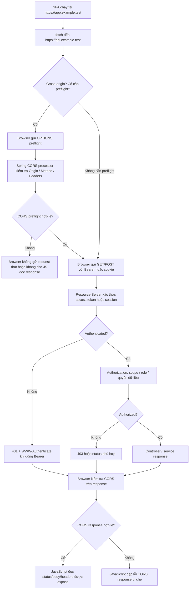

# Allowed origins, headers, methods và credentials theo client thực tế

Trong **Spring Security OAuth 2.0/OIDC Resource Server** chạy trên Servlet stack, việc xác minh JWT hoặc introspection opaque token chỉ trả lời câu hỏi **access token có hợp lệ và được phép dùng tại API này không**. Khi một **trình duyệt** gọi API từ một origin khác, còn có một lớp chính sách riêng: **Cross-Origin Resource Sharing (CORS)**.

Cấu hình CORS không nên được bắt đầu bằng câu hỏi “làm sao bỏ lỗi CORS cho nhanh?”. Cần bắt đầu từ **client thực tế đang gọi API**: ứng dụng SPA ở origin nào, có gửi Bearer token bằng `Authorization` header hay không, có sử dụng cookie/session hay không, cần HTTP methods nào và cần đọc những response headers nào. Từ đó mới xác định:

- **Allowed origins:** origin nào được browser phép đọc phản hồi cross-origin từ API.
- **Allowed methods:** loại phương thức HTTP nào frontend được dùng trong yêu cầu CORS.
- **Allowed headers:** những **request headers** không thuộc safelist mà frontend được phép gửi.
- **Exposed headers:** những **response headers** mà JavaScript frontend được phép đọc.
- **Allow credentials:** browser có thể chia sẻ phản hồi của request có credentials với frontend cross-origin hay không, theo các ràng buộc của CORS và cấu hình fetch/cookie.
- **Max age:** thời gian browser có thể cache kết quả CORS preflight theo giới hạn của browser.

Đây là bài học về **trạng thái và bảo vệ web**, nên cần phân biệt rất rõ CORS với OAuth 2.0 authentication, HTTP authorization, CSRF, cookie session và các request từ mobile/native hoặc backend-to-backend.

> **Nguyên tắc xuyên suốt:** CORS là chính sách browser quyết định một JavaScript origin có được **đọc phản hồi** từ origin khác hay không. CORS **không phải** bằng chứng danh tính, không tạo quyền cho access token, không ngăn mọi cross-origin request gây side effect và không thay thế CSRF hoặc authorization.

## 1. CORS xuất hiện ở đâu trong OAuth 2.0 Resource Server?

Giả sử kiến trúc:

```text
SPA:
  https://app.example.test

Orders Resource Server:
  https://api.example.test

Authorization Server:
  https://login.example.test
```

SPA đăng nhập bằng một OAuth/OIDC flow thích hợp với client browser, ví dụ Authorization Code + PKCE. Sau khi có access token dành cho Orders API, SPA gọi:

```javascript
const response = await fetch(
  "https://api.example.test/api/orders/42",
  {
    headers: {
      Authorization: "Bearer " + accessToken,
      Accept: "application/json"
    }
  }
);
```

Browser nhìn thấy script chạy tại `https://app.example.test` muốn truy cập `https://api.example.test`. Vì **hai origins khác nhau**, browser áp chính sách Same-Origin Policy và CORS.

Ngay cả khi JWT hoàn toàn hợp lệ, browser vẫn có thể chặn JavaScript đọc response nếu API không gửi CORS headers tương ứng. Ngược lại, API gửi CORS headers cho origin không có nghĩa token của caller được chấp nhận.

### 1.1. Sơ đồ request qua các lớp



Lưu ý CORS là một cơ chế **do browser thực thi**. Một request không cần preflight hoặc được gửi bằng phương thức HTML form thông thường **vẫn có thể đến server** dù JavaScript không đọc được response. Vì vậy CORS không thể được dùng làm hàng rào duy nhất chống CSRF, ghi dữ liệu trái phép hoặc truy cập API không có token.

### 1.2. CORS khác Resource Server authentication

| Cơ chế | Câu hỏi | Tầng thực thi |
|---|---|---|
| CORS | Origin JavaScript có được gửi/đọc request cross-origin theo browser policy không? | Browser + CORS headers do server trả |
| JWT/opaque authentication | Bearer token có hợp lệ và dành cho API này không? | Spring Security Resource Server |
| HTTP authorization | Principal có `SCOPE_orders.read` / role phù hợp không? | Spring Security authorization |
| Object authorization | User này có được xem order 42 của tenant tương ứng không? | Service / domain policy |
| CSRF protection | Có ngăn được thao tác trái phép dựa trên credentials tự gửi của browser không? | Web security, CSRF token / SameSite / kiến trúc |
| Cookie policy | Browser có gửi/nhận cookie cross-site không? | Browser cookie rules + Set-Cookie policy |

Không nên “sửa lỗi CORS” bằng cách tắt JWT verification, bỏ audience validation, cho tất cả endpoints `permitAll()` hay trả thêm `SCOPE_admin`.

## 2. Origin gồm scheme, host và port

Một **origin** là bộ ba:

```text
scheme + host + port
```

Ví dụ:

```text
https://app.example.test       -> scheme=https, host=app.example.test, port=443
http://app.example.test        -> scheme=http,  host=app.example.test, port=80
https://app.example.test:8443  -> scheme=https, host=app.example.test, port=8443
https://api.example.test       -> scheme=https, host=api.example.test, port=443
```

Những URLs dưới đây **không cùng origin** với `https://app.example.test`:

| URL | Vì sao khác origin? |
|---|---|
| `http://app.example.test` | Khác scheme |
| `https://api.example.test` | Khác host |
| `https://app.example.test:8443` | Khác port |
| `https://admin.example.test` | Khác subdomain |
| `http://localhost:5173` | Khác host, scheme và port |

Trong khi đó:

```text
https://app.example.test/dashboard
https://app.example.test/orders/42
```

là **cùng origin** dù khác path. Origin không bao gồm path, query, fragment hay username.

### 2.1. Same-origin khác same-site

Trong bảo mật trình duyệt, **same-origin** và **same-site** không phải cùng khái niệm.

Ví dụ:

```text
https://app.example.test
https://api.example.test
```

khác origin, nhưng thường thuộc cùng schemeful site theo cách browser xác định registrable domain. Điều này ảnh hưởng tới **SameSite cookies**, nhưng **không loại bỏ yêu cầu CORS** khi JavaScript của app gọi API trên subdomain khác.

Ngược lại, cookie thuộc same-site vẫn có thể bị giới hạn bởi các tùy chọn `credentials` của Fetch và thuộc tính cookie. Không thể suy luận “cùng công ty/cùng domain gốc” là browser tự cho phép mọi request.

### 2.2. Origin trong request header

Với request cross-origin, browser có thể gửi:

```http
Origin: https://app.example.test
```

Đó là origin của script/request theo browser policy, không phải tên Resource Server, OAuth client ID hay token issuer.

**Không dùng `Origin` để xác thực người dùng.** Non-browser clients như curl có thể tự đặt bất kỳ header `Origin` nào. CORS cho phép browser đọc response theo origin, còn API vẫn phải xác thực bearer token/session.

## 3. Phân loại client thực tế trước khi đặt CORS

Không phải mọi ứng dụng “gọi API” đều cần chính sách giống nhau.

| Client | Browser thực thi CORS? | Credentials thường gặp | Thiết kế CORS thường thích hợp |
|---|---|---|---|
| SPA tại origin khác API | Có | Bearer token trong `Authorization` | Allow chính xác origin; allowed headers có `Authorization`; không nhất thiết bật cookie credentials |
| Web frontend gọi API bằng cookie/session | Có nếu khác origin | Cookie được browser gửi | Allow origin chính xác, `allowCredentials(true)` khi thật sự cần; CSRF và cookie policy riêng |
| BFF cùng origin frontend | Thường không cho lời gọi browser → BFF cùng origin | HttpOnly session cookie | Browser → BFF thường không cần CORS; BFF → backend là server-to-server |
| Web admin tại origin riêng | Có | Bearer/cookie tùy thiết kế | Allow origin admin riêng; authorization admin vẫn bắt buộc |
| Native iOS/Android | Không có browser CORS thông thường cho native HTTP client | Bearer token | CORS không phải hàng rào cho native client |
| Backend microservice → API | Không | Service access token/mTLS | CORS không bảo vệ server-to-server traffic |
| Browser embedding trong WebView | Phụ thuộc WebView/browser context | Bearer/cookie | Phải xác định origin và API thực tế, không mặc định native |
| Third-party dashboard chạy trên website đối tác | Có | Token cho bên thứ ba theo hợp đồng | Allow đúng origin đối tác và kiểm tra audience/scope/tenant |
| CLI/curl/Postman | Không | Bearer token | Có thể gửi Origin giả; server authorization vẫn phải làm đúng |

Nếu client là **backend-to-backend**, bật `Access-Control-Allow-Origin: *` không làm tăng bảo mật hoặc giúp service xác thực. Ngược lại, đòi CORS trên backend-to-backend là nhầm vai trò: HTTP client thường không kiểm tra CORS như browser.

### 3.1. SPA gửi Bearer token bằng header

Luồng:

```text
SPA (browser) -- Authorization: Bearer access_token --> API
```

Điểm cần cấu hình:

- `allowedOrigins` chứa origin thật của SPA.
- `allowedMethods` chứa HTTP methods của API mà SPA gọi.
- `allowedHeaders` có `Authorization`; thêm `Content-Type` nếu frontend gửi JSON và các custom headers thực sự dùng.
- `exposedHeaders` chỉ gồm response headers JavaScript cần đọc, ví dụ `WWW-Authenticate` nếu có yêu cầu đọc challenge.
- `allowCredentials` **không mặc nhiên cần true chỉ vì request có Bearer header do JavaScript chủ động gắn**. Hãy quyết định theo cơ chế credentials/cookies và Fetch thực tế.

Quan trọng: Header `Authorization` thường khiến request **cần preflight** vì nó không thuộc danh sách CORS-safelisted request headers, dù method là GET.

### 3.2. Web app dùng cookie/session

Luồng:

```text
Browser -- Cookie: SESSION=... --> API / BFF
```

Nếu frontend và API khác origin và cần browser gửi cookie, cấu hình phải tương thích với:

- `fetch(..., { credentials: "include" })` cho cross-origin request mà ứng dụng chủ động muốn mang cookie.
- `Access-Control-Allow-Credentials: true` của server.
- `Access-Control-Allow-Origin` có giá trị origin cụ thể, **không phải `*`**.
- Cookie `Domain`, `Path`, `Secure`, `HttpOnly` và `SameSite` phù hợp.
- CSRF protection đối với state-changing actions.
- Chính sách sessions, expiry, logout, origin trust.

**Bật CORS credentials không bật CSRF protection.** Một cookie được browser tự gắn có thể làm request gây side effects trong hoàn cảnh mà JavaScript từ origin ngoài vẫn không đọc được response.

### 3.3. BFF cùng origin để giảm độ phức tạp

Một BFF (*Backend For Frontend*) có thể có kiến trúc:

```text
Browser:
  https://app.example.test
       |
       | HTTPS same-origin, session cookie
       v
BFF:
  https://app.example.test
       |
       | Backend HTTP request + access token
       v
Orders Resource Server:
  https://api.internal.example.test
```

Lời gọi **browser → BFF** không cross-origin, nên thường không cần CORS ở đoạn đó. Lời gọi **BFF → API** là server-side HTTP, không chịu cơ chế browser CORS. Backend API vẫn cần xác thực token hoặc mTLS, kiểm tra audience/scope.

Nếu BFF dùng cookie session, vẫn cần CSRF và session security phù hợp. CORS không được “tắt toàn bộ bảo mật” chỉ vì BFF nằm cùng origin.

## 4. CORS preflight: browser hỏi trước khi gửi request thật

Khi một request cross-origin cần preflight (ví dụ có `Authorization` header hoặc dùng `Content-Type: application/json`), browser thường gửi một request HTTP `OPTIONS`:

```http
OPTIONS /api/orders HTTP/1.1
Host: api.example.test
Origin: https://app.example.test
Access-Control-Request-Method: POST
Access-Control-Request-Headers: authorization,content-type
```

Phần quan trọng:

- Method của **preflight request** là `OPTIONS`.
- `Access-Control-Request-Method: POST` báo method của **request thực** browser muốn gửi.
- `Access-Control-Request-Headers` liệt kê **request header names** browser muốn dùng.
- Preflight thường **không mang Bearer access token** hoặc session credentials như request thật. CORS cần được xử lý trước những security checks đòi credential cho request thực.

Server có thể trả:

```http
HTTP/1.1 200 OK
Access-Control-Allow-Origin: https://app.example.test
Access-Control-Allow-Methods: GET,POST,PATCH,DELETE
Access-Control-Allow-Headers: Authorization,Content-Type
Access-Control-Max-Age: 1800
Vary: Origin
Vary: Access-Control-Request-Method
Vary: Access-Control-Request-Headers
```

Mã status của preflight thành công có thể là `200` hoặc một mã success phù hợp tùy implementation. Browser quyết định có tiếp tục request thật không dựa trên CORS response.

### 4.1. Preflight không xác minh OAuth access token

Browser chưa gửi Bearer token ở preflight, vì thế không có token để kiểm tra issuer/audience/scope. Nếu server cố bắt `OPTIONS` preflight phải có `SCOPE_orders.write`, browser có thể không bao giờ gửi được request POST thật.

Luồng đúng:

```text
OPTIONS preflight:
  check Origin + requested Method + requested Headers
  -> trả CORS response nếu policy cho phép

POST thật:
  check CORS + Bearer token + OAuth scope + quyền business
  -> xử lý/deny và trả response cùng CORS headers phù hợp
```

**Không nên coi việc cho qua preflight là cho phép POST làm bất kỳ điều gì.** POST thật vẫn phải được xác thực và phân quyền.

### 4.2. Khi nào không có preflight?

Một số requests thỏa điều kiện CORS “simple request” có thể được browser gửi trực tiếp mà không có `OPTIONS` preflight, ví dụ GET với những headers thuộc safelist và điều kiện Content-Type tương ứng.

Điều này có nghĩa:

- Không thấy request `OPTIONS` **không chứng minh** đang không có CORS.
- Request thật vẫn cần `Access-Control-Allow-Origin` để JavaScript đọc response.
- Server có thể đã nhận request, thậm chí tạo side effects, trước khi browser chặn frontend đọc response.

### 4.3. Vì sao `allowedMethods` không chỉ là `OPTIONS`?

Trong một preflight:

```http
OPTIONS /api/orders
Access-Control-Request-Method: POST
```

browser hỏi liệu **POST** có được phép hay không. Spring CORS processor kiểm tra method **được yêu cầu**, không phải chỉ thấy `OPTIONS` là đủ. Do đó nếu frontend cần POST, danh sách allowed methods phải có `POST`; chỉ cho `OPTIONS` không giải quyết đúng yêu cầu.

## 5. Allowed origins: chọn đúng nguồn gọi API

Một danh sách origin minh họa:

```text
https://app.example.test
https://admin.example.test
http://localhost:5173
```

Cấu hình cần phân biệt **production** và **development**. Origin `http://localhost:5173` có thể hợp lý cho local development, nhưng không nên tự động xuất hiện trong cấu hình production nếu môi trường production không có lý do cho browser tại localhost đọc response của API.

### 5.1. Không dùng URL kèm path làm origin

Sai về mặt ý tưởng:

```text
https://app.example.test/dashboard
```

vì origin không có path. Đúng:

```text
https://app.example.test
```

Nếu ứng dụng cần quyền khác nhau theo route frontend `/dashboard` và `/admin` **trên cùng origin**, CORS không thể phân biệt hai route JavaScript như hai origins riêng. Cần authorization ở API và tổ chức frontend/tenant riêng nếu muốn ranh giới origin độc lập.

### 5.2. Không dùng regex/substring kiểm tra Origin tùy tiện

Ví dụ rủi ro:

```java
if (origin.endsWith("example.test")) {
    allow(origin);
}
```

Chuỗi như `evil-example.test` cũng có thể vượt một phép so khớp hậu tố thiếu dấu chấm/phạm vi. Tương tự, `contains("example.test")` dễ bị lừa bởi URL khác.

Hãy dùng cơ chế kiểm tra origin của Spring phù hợp với **giá trị exact** hoặc mẫu được quản trị, không tự gắn header phản chiếu input.

### 5.3. `Origin: null`

Browser có thể gửi `Origin: null` từ một số ngữ cảnh như sandboxed documents hoặc file/data origins. **Không tự cho phép `null` chỉ để hỗ trợ file HTML local**, vì nhiều ngữ cảnh không đáng tin cũng có thể sử dụng opaque origins.

Với development frontend, cách phổ biến là chạy dev server ở một origin HTTP rõ ràng như `http://localhost:5173`. Chỉ cho phép `Origin: null` nếu threat model và contract thật sự yêu cầu.

## 6. `allowedOrigins` khác `allowedOriginPatterns`

Spring Web CORS có hai cách cấu hình quan trọng:

- `CorsConfiguration#setAllowedOrigins(...)`: danh sách origins cho phép theo giá trị, hoặc cấu hình wildcard trong trường hợp phù hợp.
- `CorsConfiguration#setAllowedOriginPatterns(...)`: danh sách các pattern origin được Spring hỗ trợ, có thể bao quát nhóm subdomains/ports theo cú pháp của Spring.

Ví dụ exact origins:

```java
config.setAllowedOrigins(List.of(
    "https://app.example.test",
    "https://admin.example.test"
));
```

Ví dụ khi một nhóm subdomains thực sự được quản trị và tin cậy:

```java
config.setAllowedOriginPatterns(List.of(
    "https://*.trusted.example.test"
));
```

**Chỉ dùng pattern nếu bạn thực sự tin mọi origin khớp pattern.** Wildcard cho toàn bộ subdomains có thể tạo rủi ro khi có subdomain takeover, tenant-hosted pages, tài khoản host nội dung tùy ý hoặc môi trường preview không đáng tin.

### 6.1. Vì sao `allowedOrigins("*")` không kết hợp được với credentials?

Browser không chấp nhận phản hồi có:

```http
Access-Control-Allow-Origin: *
Access-Control-Allow-Credentials: true
```

cho credentialed CORS requests. Đây là kết hợp bị browser chặn theo chuẩn CORS, và Spring có validation ngăn cấu hình `allowCredentials(true)` với wildcard `allowedOrigins("*")`.

Với credentialed browser clients, cần trả **origin cụ thể đã được cho phép**:

```http
Access-Control-Allow-Origin: https://app.example.test
Access-Control-Allow-Credentials: true
```

`allowedOriginPatterns` có thể làm Spring trả lại origin cụ thể khớp pattern ngay cả khi credentials được phép. Nhưng **không vì khả năng này mà dùng pattern `*` rộng khắp**. Nếu allowlist origin không đủ chặt, website không đáng tin có thể được browser phép đọc response chứa dữ liệu người dùng.

### 6.2. Wildcard `*` không phải luôn sai

Với **tài nguyên hoàn toàn public, không mang credentials, không có thông tin riêng theo user**, `Access-Control-Allow-Origin: *` có thể là chính sách hợp lý để website bất kỳ đọc dữ liệu public.

Ví dụ public font, public catalog hoặc tài liệu API công khai. Nhưng nếu endpoint trả dữ liệu cá nhân theo cookie/access token, không dùng quyết định public đó làm mặc định cho toàn `/api/**`.

### 6.3. CORS không giới hạn được native/curl clients

Một chương trình cURL có thể tự gửi:

```bash
curl -H "Origin: https://app.example.test" https://api.example.test/api/orders
```

và không bị chính browser Same-Origin Policy cản trở. Vì vậy **Origin không phải access-control identity**. Muốn chặn caller trái phép phải xác thực OAuth bearer token, kiểm tra audience, scopes, tenant/object permissions, và có thể mTLS/DPoP/rate limits theo yêu cầu.

## 7. Allowed methods: quyền dùng HTTP method ở mức CORS

CORS allowed methods mô tả các HTTP methods **browser được phép dùng khi gọi cross-origin**, không tự cấp phép nghiệp vụ.

Ví dụ:

```java
config.setAllowedMethods(List.of(
    "GET",
    "POST",
    "PATCH",
    "DELETE"
));
```

Trong khi authorization policy lại có thể là:

```java
.requestMatchers(HttpMethod.GET, "/api/orders/**")
    .hasAuthority("SCOPE_orders.read")
.requestMatchers(HttpMethod.POST, "/api/orders")
    .hasAuthority("SCOPE_orders.write")
.requestMatchers(HttpMethod.DELETE, "/api/orders/**")
    .hasAuthority("SCOPE_orders.delete")
```

Hai danh sách phục vụ hai mục đích:

| Lớp | POST trong allowed list có nghĩa gì? |
|---|---|
| CORS | Browser từ allowed origin có thể gửi cross-origin POST theo CORS policy |
| Spring Security authorization | Caller có authority cần cho POST endpoint không |
| Business policy | Caller có được tạo/cập nhật đối tượng cụ thể và trạng thái có hợp lệ không |

**Cho CORS POST không có nghĩa `permitAll()` POST.**

### 7.1. Chỉ cho các methods frontend thực sự dùng

Nếu frontend chỉ đọc dữ liệu, CORS có thể chỉ cần:

```java
config.setAllowedMethods(List.of("GET"));
```

Không cần mở `DELETE` chỉ vì API backend có endpoint DELETE phục vụ client server-side. Tuy nhiên, đừng tưởng xóa DELETE khỏi CORS là biện pháp bảo vệ DELETE khỏi Postman/curl. HTTP authorization vẫn phải kiểm tra scope.

### 7.2. HTTP GET có thể vẫn rò thông tin

Ngay cả GET có thể trả dữ liệu cá nhân. Một CORS policy cho phép GET từ origin không đáng tin có thể làm lộ response trong bối cảnh credentials/cookie được browser gửi. Không coi GET là “an toàn để public” chỉ vì nó không nên làm thay đổi trạng thái.

### 7.3. Method `OPTIONS`

Preflight dùng OPTIONS ở lớp browser. Cấu hình `allowedMethods` phải bao gồm **method của request thật** được nêu ở `Access-Control-Request-Method`. Nếu API có endpoint OPTIONS nghiệp vụ hoặc cần trả OPTIONS response thông thường, hãy cân nhắc policy riêng cho nó.

Đừng thêm `requestMatchers(HttpMethod.OPTIONS, "/**").permitAll()` một cách vô điều kiện chỉ vì gặp lỗi CORS; cách đúng thường là cấu hình CORS filter chạy trước authentication và giới hạn origin/method/header đúng.

## 8. Allowed headers: đây là request headers, không phải response headers

Một browser request:

```http
POST /api/orders HTTP/1.1
Origin: https://app.example.test
Authorization: Bearer <ACCESS_TOKEN>
Content-Type: application/json
X-Request-Id: req-123
```

có thể khiến preflight báo:

```http
Access-Control-Request-Headers: authorization,content-type,x-request-id
```

Server cần cho phép các names mà contract frontend sử dụng:

```java
config.setAllowedHeaders(List.of(
    "Authorization",
    "Content-Type",
    "X-Request-Id"
));
```

Tên HTTP headers không phân biệt chữ hoa/chữ thường. Bản thân `Authorization` header vẫn **phải chứa token hợp lệ**; được liệt kê trong `allowedHeaders` chỉ cho browser phép gửi header theo CORS policy.

### 8.1. Những request headers thường gặp

| Header request | Mục đích | Có cần cho vào allowed headers? |
|---|---|---|
| `Authorization` | Gửi Bearer access token | Có với browser SPA gửi header cross-origin |
| `Content-Type` | JSON POST/PATCH | Có khi browser preflight yêu cầu |
| `X-Request-Id` | Correlation ID do frontend gắn | Có nếu frontend gửi và cần |
| `X-CSRF-TOKEN` | CSRF token header cho ứng dụng cookie/session | Có nếu frontend gửi |
| `X-Tenant-Id` | Tenant context do client cung cấp | Chỉ cho gửi khi contract thật dùng; không coi nó là bằng chứng quyền |
| `Accept` | Content negotiation | Thường thuộc CORS-safelisted headers với giá trị phù hợp |
| `Origin` | Browser gửi origin | Không cần cho frontend tự chỉ định trong allowlist request headers |
| `Cookie` | Browser cookie management | Không nên hướng frontend tự gắn header Cookie; cookie thuộc browser/credentials policy |

**Không đặt secret hoặc access token trong `Access-Control-Allow-Headers`.** Đây là danh sách **tên headers**, không phải nơi truyền token hay Authorization Server credentials.

### 8.2. Không nên dùng `allowedHeaders("*")` làm mặc định thiếu cân nhắc

Spring có thể hỗ trợ wildcard trong allowed headers theo cấu hình và CORS rules. Dùng `*` có thể phù hợp với API public/không nhạy cảm, nhưng với Resource Server có contract rõ, nên liệt kê các headers frontend thực sự cần.

Dù mở tất cả request headers, API vẫn không tự cấp quyền. Nhưng cấu hình rộng làm khó quản trị policy, che giấu sự phát triển các custom headers thiếu kiểm soát, và gây nhầm lẫn giữa metadata gửi kèm với identity đáng tin.

### 8.3. Header tùy chỉnh không phải bằng chứng bảo mật

Nếu frontend gửi:

```http
X-Tenant-Id: shop-b
```

điều đó chỉ biểu thị tenant mà caller muốn thao tác. Resource Server phải đối chiếu tenant đó với **identity đã xác thực/membership/ACL**. Header được CORS cho phép không có nghĩa người gọi thuộc shop-b.

## 9. Exposed headers: JavaScript đọc response headers nào?

`Access-Control-Allow-Headers` nói về **request headers browser muốn gửi**, còn `Access-Control-Expose-Headers` nói về **response headers JavaScript muốn đọc**.

Ví dụ Resource Server trả lỗi:

```http
HTTP/1.1 401 Unauthorized
WWW-Authenticate: Bearer error="invalid_token"
X-Request-Id: req-123
```

Một frontend có thể cần đọc:

```javascript
const authChallenge =
  response.headers.get("WWW-Authenticate");

const requestId =
  response.headers.get("X-Request-Id");
```

Với CORS, những headers đó có thể cần được expose:

```java
config.setExposedHeaders(List.of(
    "WWW-Authenticate",
    "X-Request-Id"
));
```

Nếu không expose, browser vẫn có thể nhận header trên mạng, nhưng JavaScript cross-origin không nhất thiết đọc được nó. Một số response headers thuộc CORS-safelisted response headers được đọc mặc định, ví dụ `Content-Type` và `Cache-Control` theo quy tắc browser.

### 9.1. Không expose headers chứa credentials

Không tạo response headers như:

```http
X-Access-Token: <TOKEN>
X-Refresh-Token: <REFRESH_TOKEN>
```

rồi expose cho mọi origin. Tokens và session credentials cần được xử lý theo kiến trúc OAuth/cookie an toàn, không phát tán qua headers tùy ý chỉ để frontend dễ dùng.

### 9.2. `WWW-Authenticate` là thông tin protocol, không phải refresh token

Một response:

```http
WWW-Authenticate: Bearer error="invalid_token"
```

thường chỉ cho biết access token không được chấp nhận. Client có thể cần login, token renewal hay sửa audience/issuer; nó không đảm bảo “đang hết hạn và refresh là xong”. Đừng viết logic frontend refresh vô hạn chỉ dựa vào một error string.

## 10. Credentials: giá trị `true` thực sự cho phép điều gì?

Trong Spring CORS:

```java
config.setAllowCredentials(true);
```

là cấu hình để phản hồi CORS credentialed requests phù hợp, thường trả:

```http
Access-Control-Allow-Credentials: true
```

nhưng cần nhớ:

- Đây **không** phải công tắc bật Spring Security authentication.
- Nó **không** tạo session, cookie, JWT, refresh token hay scope.
- Nó **không** cấp quyền đọc mọi API.
- Nó không tự làm browser gửi cookie nếu `fetch credentials` hoặc cookie attributes không cho phép.
- Nó không cho phép `Access-Control-Allow-Origin: *` khi credentialed browser request.
- Nó chỉ nói browser có thể chấp nhận/chia sẻ response trong điều kiện CORS credentials được thỏa mãn.

CORS credentialed requests thường liên quan cookies, HTTP authentication hoặc các loại credentials mà browser quản lý. Trong Fetch, các modes thông dụng:

| Fetch `credentials` | Ý nghĩa tổng quan |
|---|---|
| `"omit"` | Không chủ động gửi browser-managed credentials trong cơ chế Fetch tương ứng |
| `"same-origin"` | Mặc định cho phép credentials với request cùng origin; cross-origin không tự gửi cookie theo mode này |
| `"include"` | Cho phép gửi credentials tới cross-origin theo cookie/browser policy và xử lý credentialed response |

Chi tiết Fetch về manually supplied `Authorization` header có sắc thái riêng theo browser/spec; **đừng đơn giản suy luận rằng “cứ có Bearer header thì phải bật `allowCredentials(true)`”**. Với SPA chủ động thêm Authorization và không dựa vào cookie/session cross-origin, cấu hình thường không cần `Access-Control-Allow-Credentials: true`; phải thử đúng client và cách truyền credentials thực tế.

### 10.1. Ví dụ SPA chỉ gửi Bearer header

```javascript
const response = await fetch(
  "https://api.example.test/api/orders/42",
  {
    method: "GET",
    headers: {
      Authorization: "Bearer " + accessToken
    },
    credentials: "omit"
  }
);
```

Đây là một mô hình frontend không dựa vào cookie phiên khi gọi API. CORS cần allow origin, GET, Authorization; credentials response header có thể không cần true.

**Nhưng** access token vẫn là một credential bảo mật. Việc `allowCredentials(false)` trong CORS không khiến Bearer token “không phải thông tin đăng nhập”; decoder và authorization vẫn phải bảo vệ API.

### 10.2. Ví dụ cookie/session cross-origin

```javascript
const response = await fetch(
  "https://api.example.test/api/me",
  {
    method: "GET",
    credentials: "include"
  }
);
```

Server cần:

```http
Access-Control-Allow-Origin: https://app.example.test
Access-Control-Allow-Credentials: true
```

và cookie attributes/browser policy phải phù hợp. Nếu cookie bị browser chặn do SameSite, Secure, domain/path hoặc third-party cookie restrictions, chỉ bật CORS credentials không sửa được.

### 10.3. Với cookie, nhớ CSRF

Cookie thường là browser-managed credential được tự gửi cho các requests phù hợp. Nếu API thay đổi dữ liệu dựa trên cookie session, cần đánh giá CSRF risks, thực hiện CSRF token/defense tương ứng, và không nghĩ “CORS chỉ cho đúng origin” là đủ chống CSRF.

Browser có thể gửi **một số cross-site requests** mà attacker không cần đọc response. Do đó chống CSRF bảo vệ **việc thực thi hành động**, trong khi CORS chủ yếu kiểm soát **quyền đọc response** của JavaScript.

## 11. Spring Security Servlet: CORS phải được xử lý trước authentication

Spring Security có tích hợp CORS thông qua:

```java
http.cors(Customizer.withDefaults());
```

CORS cần được xử lý **trước** cơ chế xác thực Bearer hoặc session đối với preflight, bởi request preflight thường thiếu cookies/tokens. Spring Security có thể sử dụng bean `CorsConfigurationSource` hoặc tích hợp với cấu hình Spring MVC phù hợp theo phiên bản và cấu trúc dự án.

Nếu không cấu hình đúng thứ tự, bạn có thể gặp:

```text
Browser sends OPTIONS preflight
→ Resource Server requires bearer token
→ 401 Unauthorized
→ Browser blocks actual request
```

Lúc này sửa bằng `permitAll()` tất cả API endpoints là sai. Hãy cấu hình CORS processor đúng phạm vi và đảm bảo preflight hợp lệ được xử lý trước authentication.

### 11.1. Cấu hình bean cơ bản cho SPA bearer

Ví dụ giả định:

```text
SPA origin:
  https://app.example.test

Local frontend dev:
  http://localhost:5173

Orders API routes:
  /api/**

Client sends:
  Authorization, Content-Type, X-Request-Id

Browser does not rely on cross-origin cookie sessions:
  allowCredentials(false)
```

Java configuration:

```java
@Configuration
public class ApiCorsConfiguration {

    @Bean
    UrlBasedCorsConfigurationSource corsConfigurationSource() {
        CorsConfiguration config = new CorsConfiguration();

        config.setAllowedOrigins(List.of(
            "https://app.example.test",
            "http://localhost:5173"
        ));

        config.setAllowedMethods(List.of(
            "GET", "POST", "PUT", "PATCH", "DELETE"
        ));

        config.setAllowedHeaders(List.of(
            "Authorization",
            "Content-Type",
            "X-Request-Id"
        ));

        config.setExposedHeaders(List.of(
            "WWW-Authenticate",
            "X-Request-Id"
        ));

        config.setAllowCredentials(false);
        config.setMaxAge(1800L);

        UrlBasedCorsConfigurationSource source =
            new UrlBasedCorsConfigurationSource();

        source.registerCorsConfiguration("/api/**", config);

        return source;
    }
}
```

Imports:

```java
import java.util.List;
import org.springframework.context.annotation.Bean;
import org.springframework.context.annotation.Configuration;
import org.springframework.web.cors.CorsConfiguration;
import org.springframework.web.cors.UrlBasedCorsConfigurationSource;
```

**Lưu ý:** Cho `http://localhost:5173` trong ví dụ để phát triển. Production nên lấy allowlist từ cấu hình riêng và chỉ gồm origins thực tế được phép. Không hardcode origin development vào production nếu threat model không cho phép.

### 11.2. Đấu CORS vào JWT Resource Server

```java
@Configuration
public class ApiSecurityConfiguration {

    @Bean
    SecurityFilterChain apiSecurity(HttpSecurity http)
            throws Exception {

        return http
            .cors(Customizer.withDefaults())
            .sessionManagement(session -> session
                .sessionCreationPolicy(
                    SessionCreationPolicy.STATELESS
                ))
            .authorizeHttpRequests(auth -> auth
                .requestMatchers(HttpMethod.GET, "/public/catalog")
                    .permitAll()

                .requestMatchers(HttpMethod.GET, "/api/orders/**")
                    .hasAuthority("SCOPE_orders.read")

                .requestMatchers(HttpMethod.POST, "/api/orders")
                    .hasAuthority("SCOPE_orders.write")

                .requestMatchers(HttpMethod.PATCH, "/api/orders/**")
                    .hasAuthority("SCOPE_orders.write")

                .anyRequest().denyAll()
            )
            .oauth2ResourceServer(oauth2 ->
                oauth2.jwt(Customizer.withDefaults()))
            .build();
    }
}
```

Imports:

```java
import org.springframework.context.annotation.Bean;
import org.springframework.context.annotation.Configuration;
import org.springframework.http.HttpMethod;
import org.springframework.security.config.Customizer;
import org.springframework.security.config.annotation.web.builders.HttpSecurity;
import org.springframework.security.config.http.SessionCreationPolicy;
import org.springframework.security.web.SecurityFilterChain;
```

Ở ví dụ này:

1. CORS kiểm tra origins/methods/headers theo cấu hình.
2. Preflight hợp lệ có thể được xử lý mà không cần access token.
3. Request thật phải có access token JWT hợp lệ cho API.
4. `SCOPE_orders.read/write` vẫn cần cho GET/POST/PATCH.
5. `anyRequest().denyAll()` giữ mặc định chặn các routes chưa được định nghĩa.
6. Quyền trên object cụ thể vẫn thuộc service/domain.

Cấu hình `STATELESS` ở đây dành cho API dùng Bearer header và không dựa vào session cookie. Không áp nó một cách mù quáng cho ứng dụng sử dụng BFF/cookie authentication.

### 11.3. CORS với opaque token

Nếu Resource Server dùng opaque token introspection thay JWT:

```java
.oauth2ResourceServer(oauth2 ->
    oauth2.opaqueToken(Customizer.withDefaults()))
```

CORS policy cho browser **vẫn cùng nguyên tắc**. CORS không phụ thuộc token có dạng JWT hay opaque; nó phụ thuộc origin và các HTTP request/response attributes.

JWT và opaque token khác nhau ở cách Resource Server xác thực credential, không ở việc browser cần preflight cho `Authorization` header.

## 12. Cấu hình cookie credentials cho browser/BFF thật sự cần

Giả sử frontend ở:

```text
https://app.example.test
```

và API/BFF dùng cookie ở:

```text
https://api.example.test
```

Nếu browser được thiết kế để mang cookie cross-origin, config:

```java
@Configuration
public class SessionCorsConfiguration {

    @Bean
    UrlBasedCorsConfigurationSource corsConfigurationSource() {
        CorsConfiguration config = new CorsConfiguration();

        config.setAllowedOrigins(List.of(
            "https://app.example.test"
        ));

        config.setAllowedMethods(List.of(
            "GET", "POST", "PATCH"
        ));

        config.setAllowedHeaders(List.of(
            "Content-Type",
            "X-CSRF-TOKEN",
            "X-Request-Id"
        ));

        config.setExposedHeaders(List.of(
            "X-Request-Id"
        ));

        config.setAllowCredentials(true);
        config.setMaxAge(600L);

        UrlBasedCorsConfigurationSource source =
            new UrlBasedCorsConfigurationSource();

        source.registerCorsConfiguration("/api/**", config);
        return source;
    }
}
```

**Chỉ dùng cấu hình này khi đúng client thực tế cần cookie.** Nếu API vừa cung cấp bearer-only endpoints vừa session endpoints, có thể chia paths/chain/CORS policies một cách tường minh. Không nên bật credentialed CORS cho toàn bộ API vì một endpoint đặc biệt cần cookie.

### 12.1. Cookie attributes còn quan trọng hơn CORS header

Một cookie:

```http
Set-Cookie: SESSION=...; Path=/; Secure; HttpOnly; SameSite=Lax
```

có nhiều điều kiện độc lập:

- `Secure` giới hạn gửi qua kết nối an toàn theo browser policy.
- `HttpOnly` ngăn JavaScript truy cập giá trị cookie trực tiếp, nhưng **không ngăn browser tự gửi cookie** khi phù hợp.
- `SameSite` điều khiển việc gửi cookie trong bối cảnh same-site/cross-site.
- `Domain`/`Path` giới hạn phạm vi cookie.
- Cookie partitioning và third-party cookie restrictions có thể ảnh hưởng thêm.

Với những cookies thực sự cần đi **cross-site**, thường cần `SameSite=None; Secure` theo chính sách browser hiện hành; nhưng việc này **làm tăng nhu cầu đánh giá CSRF** và không vượt các hạn chế third-party cookies của browser.

Đối với hai subdomains cùng schemeful site, `SameSite=Lax` có thể không phải trở ngại về same-site, nhưng **Fetch credentials mode** và CORS vẫn phải đúng vì hai origins khác nhau.

### 12.2. CORS không tự cho JavaScript đọc `Set-Cookie`

`Set-Cookie` là **forbidden response-header name** đối với JavaScript Fetch theo browser platform; không phải chỉ cần thêm:

```java
config.setExposedHeaders(List.of("Set-Cookie"));
```

là JavaScript được đọc giá trị cookie. Browser tự quản lý cookie theo policy riêng. Đừng thiết kế refresh/session flow dựa trên việc JS đọc `Set-Cookie` từ response.

### 12.3. CSRF khi dùng cookie

Ví dụ state-changing request:

```http
POST /api/orders/42/cancel
Cookie: SESSION=...
```

Nếu cookie được browser tự gắn, một trang độc hại có thể thử gửi một số requests trong hoàn cảnh cross-site mà không cần đọc response. Bảo vệ cần xét:

- Spring Security CSRF protection.
- CSRF token transport phù hợp SPA/BFF.
- `SameSite` cookie.
- Origin/Referer validation bổ sung khi phù hợp.
- Không dùng GET cho mutation.
- Authorization và object-level policy.

Chỉ bật `allowCredentials(true)` cho origin tin cậy **không có nghĩa đã giải quyết CSRF**.

## 13. Nên tắt hay giữ CSRF ở Bearer Resource Server?

Không có một câu trả lời đúng cho mọi ứng dụng.

### 13.1. API chỉ nhận Bearer token qua Authorization header

Nếu API thật sự **không dùng cookie/session cho authentication** và token phải được JavaScript/native client chủ động gắn vào `Authorization` header, nguy cơ CSRF cổ điển dựa trên credentials tự động được browser gắn thường khác với cookie session. Một API stateless như vậy có thể có lý do cấu hình CSRF tương ứng.

Tuy nhiên vẫn cần chống:

- XSS và đánh cắp access token.
- Token leakage qua logs/URLs.
- Token substitution sai audience.
- Replay và over-privileged scopes.
- Broken object authorization.

### 13.2. API dùng cookie hoặc hybrid authentication

Nếu cùng host/chain còn chấp nhận cookie login/session, hoặc refresh token cookie dẫn tới state-changing routes, **không nên tắt CSRF toàn cục** chỉ vì API cũng hỗ trợ JWT.

Một cookie-authenticated endpoint bị CSRF và một bearer-only endpoint có threat models khác nhau. Hãy phân tách rõ paths/chains hoặc áp CSRF policy cho từng nhóm.

### 13.3. CORS và CSRF là hai cánh cửa khác nhau

| Câu hỏi | CORS | CSRF |
|---|---|---|
| JS origin khác có đọc được response không? | Trách nhiệm chính | Không |
| Browser có thể gửi một simple request tới API không? | CORS không ngăn hoàn toàn | CSRF controls tác động tới việc chấp nhận mutation |
| Có xác thực access token không? | Không | Không |
| Có kiểm tra caller sở hữu order không? | Không | Không |
| Request cookie-authenticated có thể bị trang khác lợi dụng không? | Không đủ để ngăn | Đúng phạm vi của CSRF defense |
| Có ngăn XSS đọc dữ liệu nếu origin đã trusted không? | Không | Không |

CORS chỉ nên được xem là một **phần** của kiến trúc web security.

## 14. `Access-Control-Max-Age` và cache preflight

Server có thể gửi:

```http
Access-Control-Max-Age: 1800
```

để browser cache kết quả preflight trong một thời gian, theo giới hạn có thể thấp hơn của browser.

Trong Spring:

```java
config.setMaxAge(1800L);
```

Giá trị này giúp giảm OPTIONS requests và latency. Nhưng:

- Đây là **cache chính sách CORS**, không phải thời hạn JWT.
- Không gia hạn session hoặc access token.
- Không cache kết quả HTTP authorization.
- Thay policy origin/method/header có thể cần thời gian để browser hết cache preflight cũ.
- Không nên chọn TTL rất dài nếu cần thu hồi quyền origin nhanh.

Một preflight cache hit **không có nghĩa request thật bỏ JWT validation**. Request thật vẫn phải đi qua Resource Server và các authorization checks.

### 14.1. Cache CORS khác cache API response

Nếu một CDN cache response cho `Origin: https://app.example.test` rồi trả nhầm cho `https://untrusted.example.test` cùng với header CORS đã cached, có thể xảy ra hành vi sai policy. Các headers như `Vary: Origin`, `Vary: Access-Control-Request-Method` và `Vary: Access-Control-Request-Headers` giúp caches phân biệt biến thể khi phù hợp.

Ngoài ra, response chứa dữ liệu cá nhân theo bearer token hoặc cookie cần cache-control và keying **phù hợp identity/tenant**, không chỉ dựa vào CORS headers.

## 15. CORS response headers và `Vary`

Một preflight thành công có thể có:

```http
Access-Control-Allow-Origin: https://app.example.test
Access-Control-Allow-Methods: GET,POST,PATCH
Access-Control-Allow-Headers: Authorization,Content-Type
Access-Control-Max-Age: 1800
Vary: Origin, Access-Control-Request-Method, Access-Control-Request-Headers
```

Một response thật có thể có:

```http
HTTP/1.1 200 OK
Access-Control-Allow-Origin: https://app.example.test
Vary: Origin
Content-Type: application/json

{"id":"order-42","status":"CONFIRMED"}
```

Nếu là credentialed response, server có thể thêm:

```http
Access-Control-Allow-Credentials: true
```

**Không copy headers của preflight một cách ngẫu nhiên vào mọi response**. CORS processor xử lý header phù hợp theo request; developer nên dựa vào cơ chế của Spring và kiểm tra behavior.

### 15.1. Preflight bị từ chối

Nếu Origin không được phép:

```http
Origin: https://untrusted.example.test
```

Spring CORS processor có thể trả một response bị từ chối (chẳng hạn 403) và không cấp `Access-Control-Allow-Origin` cho origin đó. Browser chặn script đọc response theo policy. Developer Console thường hiện một lỗi CORS tổng quát, không nhất thiết hiển thị body/status phía backend một cách trực tiếp.

### 15.2. Error responses cũng cần CORS khi frontend phải đọc chúng

Với token hết hạn, API có thể trả:

```http
HTTP/1.1 401 Unauthorized
WWW-Authenticate: Bearer error="invalid_token"
```

Nếu CORS chỉ được gắn vào success responses ở controller, frontend có thể nhìn thấy “CORS error” thay vì HTTP 401, khiến refresh/login flow xử lý sai.

Khi CORS được tích hợp đúng ở filter layer và origin được phép, response lỗi cũng có thể mang CORS headers cần thiết để JS đọc status, body và exposed headers. Không nên dùng controller-only CORS logic không nhất quán giữa 2xx và 4xx.

## 16. Một cấu hình CORS cho nhiều frontend origins

Giả sử:

```text
SPA khách hàng:
  https://shop.example.test

SPA quản trị:
  https://admin.example.test

Orders API:
  https://api.example.test
```

Nếu cả hai SPA thực sự cần đọc dữ liệu Orders API, allowed origins có thể gồm cả hai:

```java
config.setAllowedOrigins(List.of(
    "https://shop.example.test",
    "https://admin.example.test"
));
```

Nhưng **điều đó không cấp quyền admin cho frontend admin**. Origin `admin.example.test` không phải authentication principal. Người dùng gọi admin endpoints vẫn phải có access token hợp lệ với admin authority và object-level rights.

### 16.1. Nên đặt quyền theo URL API thay vì theo frontend origin

Có thể tách:

```java
source.registerCorsConfiguration("/api/public/**", publicCors);
source.registerCorsConfiguration("/api/**", authenticatedApiCors);
```

với quy tắc resolution phù hợp; nhưng hãy xác định CORS mapping thực tế và độ ưu tiên path patterns theo Spring. Không giả định chỉ vì frontend admin có origin khác là API tự biết role admin.

Nếu admin API nhạy cảm, có thể phân tách hostname/resource server audience và HTTP authorization policy rõ. CORS vẫn chỉ là browser access control.

### 16.2. Preview deployments và wildcard subdomains

Một tổ chức có preview origins:

```text
https://pr-123.preview.example.test
https://pr-124.preview.example.test
```

Không nên tự động tin mọi subdomain wildcard của một zone nếu bất kỳ developer/tenant nào cũng có thể triển khai script vào đó. Nếu cần preview CORS:

- Tách staging API, không dùng production data.
- Dùng allowlist được quản trị theo deployment.
- Giới hạn vòng đời và quyền truy cập.
- Không dùng credentialed CORS với wildcard thiếu kiểm soát.
- Không “reflect Origin” vô điều kiện.

## 17. Configuration theo environment: development, staging, production

Một bảng quản trị chính sách:

| Môi trường | Browser origins cho phép | Credentials | Mục tiêu |
|---|---|---|---|
| Local dev | `http://localhost:5173`, dev port có chủ đích | Theo client dev | Hỗ trợ frontend dev mà không mở production |
| Staging | `https://staging-app.example.test` | Theo session/Bearer contract | Tích hợp và thử frontend staging |
| Production | `https://app.example.test`, `https://admin.example.test` nếu cần | Chỉ bật khi dùng cookie credentialed CORS | Giảm bề mặt origin tin cậy |
| Internal API | Có thể không cần CORS nếu chỉ backend callers | Thường không liên quan browser | Bảo vệ bằng OAuth, mTLS/network/policy |

Không nên copy `allowedOrigins("*")` từ môi trường dev sang production vì “nó chạy được”.

### 17.1. Bind origins từ cấu hình đáng tin

Ví dụ `application.yml`:

```yaml
app:
  cors:
    allowed-origins:
      - https://app.example.test
      - https://admin.example.test
    allowed-methods:
      - GET
      - POST
      - PATCH
    allowed-headers:
      - Authorization
      - Content-Type
      - X-Request-Id
    exposed-headers:
      - WWW-Authenticate
      - X-Request-Id
    allow-credentials: false
```

Một class `@ConfigurationProperties(prefix = "app.cors")` có thể ánh xạ danh sách vào cấu hình Spring. Khi đọc properties, cần validation để không accidentally cấu hình `allow-credentials=true` với wildcard origins hoặc một giá trị bị nhập sai.

### 17.2. Origin thay đổi theo port và scheme

Frontend local:

```text
http://localhost:5173
http://localhost:3000
http://127.0.0.1:5173
```

là **những origins khác nhau**. Không tưởng rằng allow localhost:5173 cũng cho 127.0.0.1:5173 hoặc mọi port. Chỉ thêm những origins thực tế được team dùng.

## 18. Endpoint công khai và endpoint có bearer token nên tách policy

Giả sử API có:

```text
GET /public/catalog
GET /api/orders/42
POST /api/orders
```

Public catalog có thể cho mọi origin đọc vì dữ liệu không nhạy cảm, nhưng Orders API chỉ cho SPA đã định.

Ví dụ chính sách CORS khác:

```java
CorsConfiguration publicCors = new CorsConfiguration();
publicCors.setAllowedOrigins(List.of("*"));
publicCors.setAllowedMethods(List.of("GET"));
publicCors.setAllowedHeaders(List.of("Accept"));
publicCors.setAllowCredentials(false);

CorsConfiguration ordersCors = new CorsConfiguration();
ordersCors.setAllowedOrigins(List.of(
    "https://app.example.test"
));
ordersCors.setAllowedMethods(List.of(
    "GET", "POST"
));
ordersCors.setAllowedHeaders(List.of(
    "Authorization", "Content-Type"
));
ordersCors.setAllowCredentials(false);

UrlBasedCorsConfigurationSource source =
    new UrlBasedCorsConfigurationSource();

source.registerCorsConfiguration("/public/**", publicCors);
source.registerCorsConfiguration("/api/**", ordersCors);
```

Đây là ví dụ tách **browser-origin policy** theo tài nguyên. Phải đảm bảo phần `/public/**` thực sự không chứa dữ liệu riêng. Với cookie auth, các constraints khác cần cấu hình tương ứng.

### 18.1. `permitAll()` không tự giải quyết CORS

Spring Security:

```java
.requestMatchers("/public/**").permitAll()
```

chỉ nói không cần authorization tại rule HTTP đó. Nếu browser từ origin khác và server không cho CORS, JavaScript vẫn không đọc được response.

Ngược lại, `Access-Control-Allow-Origin: *` cho một API không tự biến API thành public; request có thể vẫn bị 401/403 nếu không có access token/quyền.

## 19. Nhiều SecurityFilterChains: chọn đúng CORS source

Một ứng dụng có thể có:

```text
/api/**       Bearer Resource Server
/web/**       Session web UI
/internal/**  Admin/service API
```

CORS policy cần rõ theo chain và client. Ví dụ chain Bearer:

```java
@Bean
@Order(1)
SecurityFilterChain apiChain(HttpSecurity http,
        CorsConfigurationSource apiCorsSource) throws Exception {

    return http
        .securityMatcher("/api/**")
        .cors(cors -> cors.configurationSource(apiCorsSource))
        .authorizeHttpRequests(auth -> auth
            .requestMatchers(HttpMethod.GET, "/api/orders/**")
                .hasAuthority("SCOPE_orders.read")
            .anyRequest().denyAll()
        )
        .oauth2ResourceServer(oauth2 ->
            oauth2.jwt(Customizer.withDefaults()))
        .build();
}
```

Ở đây `apiCorsSource` là một bean được inject tường minh, đã cấu hình origins/headers/methods cho API chain. Khi có nhiều `CorsConfigurationSource` beans, Spring Security có thể không tự quyết định cái nào dùng cho từng chain; vì thế chỉ rõ `configurationSource(...)` giúp tránh nhầm.

Imports liên quan:

```java
import org.springframework.core.annotation.Order;
import org.springframework.web.cors.CorsConfigurationSource;
```

### 19.1. Thứ tự chain ảnh hưởng tới CORS và authentication

Nếu có chain catch-all đứng trước chain `/api/**`, request API có thể không đi qua JWT Resource Server/CORS policy dự kiến. Điều này gây các biểu hiện:

- OPTIONS preflight nhận 401/302/HTML login.
- GET với Bearer header vẫn redirect login.
- Response thiếu `Access-Control-Allow-Origin`.
- Endpoint public khác được phép ngoài ý định.
- Một host/path chạy khác môi trường staging.

Cần phân biệt `securityMatcher(...)` (chọn **filter chain**) với `requestMatchers(...)` (chọn **authorization rule** trong chain).

### 19.2. Cấu hình CORS ở gateway và Spring Security

Một kiến trúc có CDN/API gateway và Resource Server:

```text
Browser -> Gateway -> Spring Security Resource Server
```

CORS có thể được xử lý tại gateway hoặc backend, nhưng phải **nhất quán**:

- Không để gateway thêm `Access-Control-Allow-Origin: *` còn backend thêm origin cụ thể.
- Tránh hai tầng cùng tạo duplicate/conflicting CORS headers.
- Đảm bảo preflight được xử lý đúng mà không bắt Bearer token.
- Error responses ở gateway (429/502/504) cũng cần chính sách CORS nếu frontend phải đọc chúng.
- Không để gateway rewrite `WWW-Authenticate` hoặc token-related error handling sai.
- Cần bảo vệ API bằng authentication/authorization thật, không chỉ “CORS allowlist tại gateway”.

Chọn một tầng chịu trách nhiệm chính và xác định contract giữa gateway/backend, thay vì bật CORS tùy ý ở cả hai.

## 20. Browser error “CORS blocked” có thể che lỗi backend khác

Một frontend có thể báo:

```text
Access to fetch at https://api.example.test/api/orders/42
from origin https://app.example.test has been blocked
by CORS policy...
```

Điều này có nhiều nguyên nhân:

| Triệu chứng | Nguyên nhân khả dĩ |
|---|---|
| Preflight trả 401 | CORS chưa xử lý trước bearer authentication |
| Preflight trả 403 | Origin/method/header không được cho phép |
| No `Access-Control-Allow-Origin` | CORS source không match path, hoặc response từ gateway/exception handler thiếu CORS |
| `Access-Control-Allow-Origin: *` với credentials | Browser từ chối credentialed response |
| Requested header Authorization not allowed | `allowedHeaders` thiếu Authorization |
| Requested method PATCH not allowed | `allowedMethods` thiếu PATCH |
| GET thành công bằng curl, browser bị CORS | curl không áp Same-Origin Policy |
| Fetch đọc được status nhưng không đọc được WWW-Authenticate | Chưa expose response header |
| Cookie không gửi được | Fetch credentials, SameSite/Secure/Domain/third-party cookie policy |
| Có 302 login HTML | Request đi sai SecurityFilterChain hoặc session auth thay Bearer |
| Gateway trả 502 mà browser báo CORS | Gateway error response thiếu CORS headers |
| Request đến sai URL sau proxy rewrite | Path matcher/CORS mapping không match |

**Không sửa mọi lỗi CORS bằng `allowedOrigins("*")`.** Điều cần làm là tìm đúng Origin, method, requested headers, credentials mode và tầng thực sự trả response.

## 21. Thực hành kiểm tra preflight bằng curl

Một preflight mô phỏng:

```bash
curl -i -X OPTIONS \
  "https://api.example.test/api/orders" \
  -H "Origin: https://app.example.test" \
  -H "Access-Control-Request-Method: POST" \
  -H "Access-Control-Request-Headers: authorization,content-type"
```

Với policy cho phép, kết quả có thể chứa:

```http
Access-Control-Allow-Origin: https://app.example.test
Access-Control-Allow-Methods: GET,POST,PATCH
Access-Control-Allow-Headers: Authorization,Content-Type
```

Nếu browser thực sự cần cookie, kiểm tra thêm `Access-Control-Allow-Credentials: true` và origin cụ thể.

### 21.1. Kiểm tra origin không được phép

```bash
curl -i -X OPTIONS \
  "https://api.example.test/api/orders" \
  -H "Origin: https://untrusted.example.test" \
  -H "Access-Control-Request-Method: POST" \
  -H "Access-Control-Request-Headers: authorization,content-type"
```

Kết quả kỳ vọng về chính sách: server **không cấp CORS permission** cho origin không đáng tin. HTTP status/body cụ thể phụ thuộc CORS implementation; không giả định curl sẽ tự báo “blocked by CORS”.

**Curl không áp CORS**. Nó chỉ giúp xem server trả headers/status nào. Sau đó vẫn cần kiểm tra bằng trình duyệt thực cho Fetch credentials/cookie behavior.

### 21.2. Kiểm tra request thật với Origin

```bash
curl -i \
  "https://api.example.test/api/orders/42" \
  -H "Origin: https://app.example.test" \
  -H "Authorization: Bearer <TEST_ACCESS_TOKEN>"
```

Khi bearer token hợp lệ nhưng thiếu quyền, response có thể `403`; nếu hết hạn có thể `401`. Dù vậy, response dành cho origin được phép nên mang CORS headers phù hợp để browser đọc được status hoặc error body.

Không dùng production token trong shell history/log khi không cần.

### 21.3. Vì sao không dùng curl để chứng minh CORS “an toàn”?

Một attacker có thể gửi request bằng curl dù origin bị CORS cấm. CORS chỉ hạn chế browser scripts, không ngăn direct HTTP clients. Các thử nghiệm bảo mật API vẫn cần kiểm tra bearer token validation và quyền nghiệp vụ độc lập.

## 22. MockMvc: kiểm tra CORS preflight trong Spring Security

Một ví dụ kiểm thử cấu hình Servlet CORS:

```java
@SpringBootTest
@AutoConfigureMockMvc
class CorsSecurityTests {

    @Autowired
    MockMvc mockMvc;

    @Test
    void allowsPreflightFromSpaForPostWithBearer() throws Exception {
        mockMvc.perform(options("/api/orders")
                .header(HttpHeaders.ORIGIN,
                    "https://app.example.test")
                .header(HttpHeaders.ACCESS_CONTROL_REQUEST_METHOD,
                    "POST")
                .header(HttpHeaders.ACCESS_CONTROL_REQUEST_HEADERS,
                    "authorization,content-type"))
            .andExpect(status().isOk())
            .andExpect(header().string(
                HttpHeaders.ACCESS_CONTROL_ALLOW_ORIGIN,
                "https://app.example.test"
            ));
    }

    @Test
    void doesNotGrantCorsToUntrustedOrigin() throws Exception {
        mockMvc.perform(options("/api/orders")
                .header(HttpHeaders.ORIGIN,
                    "https://untrusted.example.test")
                .header(HttpHeaders.ACCESS_CONTROL_REQUEST_METHOD,
                    "POST"))
            .andExpect(header().doesNotExist(
                HttpHeaders.ACCESS_CONTROL_ALLOW_ORIGIN
            ));
    }
}
```

Imports:

```java
import static org.springframework.test.web.servlet.request.MockMvcRequestBuilders.options;
import static org.springframework.test.web.servlet.result.MockMvcResultMatchers.header;
import static org.springframework.test.web.servlet.result.MockMvcResultMatchers.status;
import org.junit.jupiter.api.Test;
import org.springframework.beans.factory.annotation.Autowired;
import org.springframework.boot.test.autoconfigure.web.servlet.AutoConfigureMockMvc;
import org.springframework.boot.test.context.SpringBootTest;
import org.springframework.http.HttpHeaders;
import org.springframework.test.web.servlet.MockMvc;
```

**Điều kiện để test trên đúng:** ứng dụng đã nạp SecurityFilterChain và `CorsConfigurationSource` như ví dụ. Nếu filter/cors source khác hoặc backend trả 204 cho preflight, assertion status cụ thể cần theo hợp đồng runtime. Quan trọng nhất là CORS headers/decision.

### 22.1. Test policy theo ma trận client

| Origin | Method thực | Request headers | Credentials | Kỳ vọng CORS |
|---|---|---|---|---|
| `https://app.example.test` | GET | authorization | Không cookie | Cho phép |
| `https://app.example.test` | POST | authorization, content-type | Không cookie | Cho phép nếu API frontend dùng POST |
| `https://app.example.test` | PATCH | authorization, content-type | Không cookie | Chỉ cho nếu PATCH trong allowed methods |
| `https://untrusted.example.test` | GET | authorization | Không cookie | Từ chối CORS permission |
| `http://app.example.test` | GET | authorization | Không cookie | Từ chối nếu chỉ allow HTTPS |
| `https://admin.example.test` | GET | authorization | Không cookie | Chỉ cho nếu đã allow admin origin |
| `https://app.example.test` | POST | x-unexpected-header | Không cookie | Từ chối nếu header không được allowed |
| Cookie frontend exact origin | POST | content-type, x-csrf-token | Có cookie | Cho nếu policy credentialed + CSRF đúng |
| Origin `null` | GET | authorization | Không cookie | Thường từ chối nếu chưa chủ đích hỗ trợ |

### 22.2. Test 401/403 cùng CORS

Không chỉ kiểm tra preflight. Cần kiểm tra cả:

- Actual request không token từ allowed origin → `401` kèm Bearer challenge và CORS headers.
- Token hợp lệ thiếu scope → `403` và CORS headers.
- Token hợp lệ đủ scope nhưng object không visible → `403/404` và CORS headers.
- Error từ gateway/exception handler → không vô tình làm mất CORS response.
- Credentialed request → origin cụ thể + `Access-Control-Allow-Credentials` nếu contract đòi.
- Public GET → không vô tình lộ dữ liệu người dùng.

`SecurityMockMvcRequestPostProcessors.jwt()` có thể giúp mô phỏng Authentication cho test authorization, nhưng thường **không xác minh chữ ký JWT thật**. Nó không thay thử nghiệm decoder/introspection và OAuth token contracts.

## 23. CORS và `WWW-Authenticate` khi chưa xác thực

Trong Spring Security OAuth Resource Server, một request bảo vệ nhưng thiếu token thường tạo:

```http
HTTP/1.1 401 Unauthorized
WWW-Authenticate: Bearer
```

Nếu script browser cross-origin muốn đọc header challenge:

```java
config.setExposedHeaders(List.of("WWW-Authenticate"));
```

Và origin cần được phép theo CORS.

Nhưng lỗi `401` có thể có nhiều nguyên nhân:

- Không có token.
- Token hết hạn.
- Token sai chữ ký.
- Token sai issuer/audience.
- Token bị thu hồi.
- Introspection không chấp nhận token.

Không viết frontend theo kiểu “hễ 401 là refresh token và retry vô hạn”. Cần OAuth client logic an toàn, giới hạn retries và phân biệt trường hợp cần đăng nhập lại với trường hợp thiếu quyền.

### 23.1. `403 insufficient_scope` khác `401 invalid_token`

Nếu JWT hợp lệ nhưng không có `SCOPE_orders.export`, Resource Server thường trả `403 Forbidden`. CORS giúp frontend **đọc được** status đó; nó không biến response thành 200 hay cấp scope cho caller.

Vì vậy một policy tốt có cả:

```text
Browser CORS:
  Origin app.example.test allowed

Authentication:
  Access token valid for orders-api

Authorization:
  Export requires SCOPE_orders.export
```

Tất cả phải đạt, mỗi tầng làm nhiệm vụ riêng.

## 24. CORS và bảo mật theo môi trường browser

### 24.1. Local development

SPA dev có thể chạy ở:

```text
http://localhost:5173
```

API dev có thể chạy:

```text
http://localhost:8080
```

Khác port nghĩa khác origin. CORS allow `http://localhost:5173` ở API dev thường hợp lý. Nhưng **không dùng dev-only HTTP origins để truy cập production data** nếu không có quyết định chặt về threat model.

### 24.2. Staging

Staging có thể dùng domain và OAuth issuer riêng:

```text
https://staging-app.example.test
https://staging-api.example.test
https://staging-login.example.test
```

Không chỉ CORS phải chỉ tới staging frontend; access token vẫn phải đúng issuer/audience của staging Resource Server. Một token production có thể bị từ chối tại staging dù origin hợp lệ, hoặc ngược lại.

### 24.3. Production

Production nên có danh sách origins đã duyệt, HTTPS, credentials phù hợp, CSRF/cookie policy (nếu dùng session), observability và cấu hình gateway đúng.

Có thể cần các subdomains khác nhau cho customer/admin; việc origin được cho phép **không đồng nghĩa user có quyền admin**. Permissions vẫn lấy từ token/role policy.

### 24.4. Browser sandbox và iframe

Một iframe sandbox có thể có opaque origin `null`. Nếu người phát triển chỉ thêm `null` vào allowedOrigins để “chạy được”, có thể cho phép nhiều ngữ cảnh không mong muốn đọc dữ liệu. Cần xác định architecture iframe, postMessage trust, token storage, clickjacking protections và chính sách origin rõ ràng.

CORS không thay thế CSP, frame-ancestors hay chống XSS.

## 25. Threat model của một origin được trusted

Giả sử API có:

```http
Access-Control-Allow-Origin: https://app.example.test
Access-Control-Allow-Credentials: true
```

Browser scripts chạy tại `https://app.example.test` có thể được phép đọc credentialed responses theo policy. Nếu frontend đó bị XSS, attacker-controlled JavaScript **đang chạy trong origin đã trusted**, CORS không bảo vệ API khỏi script đó.

Vì vậy cần:

- XSS prevention và CSP phù hợp.
- Quản lý third-party scripts trên trusted origin.
- CSRF protection cho cookie auth.
- Access token lifetime và sender constraints khi yêu cầu.
- Scope/role/object authorization cho mọi API.
- Không lưu tokens trong nơi dễ bị đọc quá mức nếu có kiến trúc an toàn hơn.
- Không dùng Origin allowlist như một bảo đảm authentication.

### 25.1. Rủi ro subdomain takeover

Nếu CORS allow:

```text
https://*.example.test
```

và một subdomain không được duy trì có thể bị takeover hoặc cho user tự host nội dung, attacker có thể chạy JavaScript tại một origin khớp wildcard. Với credentialed CORS, hậu quả có thể nghiêm trọng.

Ưu tiên exact origins hoặc pattern cực kỳ hạn chế đã được quản trị.

### 25.2. Rủi ro phản chiếu Origin vô điều kiện

Một implementation sai:

```java
response.setHeader(
    "Access-Control-Allow-Origin",
    request.getHeader("Origin")
);
response.setHeader("Access-Control-Allow-Credentials", "true");
```

Nếu thiếu allowlist, bất kỳ website nào cũng có thể được browser cho phép đọc credentialed response nếu cookie/browser conditions phù hợp. **Không phản chiếu Origin chỉ vì request gửi nó.**

Spring `CorsConfiguration` giúp áp policy tập trung, nên ưu tiên dùng thay tự ghép headers thủ công.

## 26. Có cần CORS cho OAuth Authorization Server?

Resource Server và Authorization Server là hai vai trò khác nhau.

Ví dụ:

```text
https://login.example.test:
  authorization endpoint
  token endpoint
  userinfo endpoint
  discovery / JWK set

https://api.example.test:
  Orders API / Resource Server
```

CORS của Orders API **không tự cấu hình** CORS cho AS token endpoint hoặc UserInfo endpoint. Một browser-based OAuth client có thể cần browser access tới những AS endpoints được chuẩn OAuth/OIDC flow và AS policy cho phép.

**Không mở CORS cho mọi endpoint AS** chỉ vì SPA cần token. Authorization endpoint chủ yếu dùng redirect/top-level navigation; các token/discovery/userinfo endpoints có thể có yêu cầu CORS riêng theo hỗ trợ của AS và kiểu client. Cần giữ bảo mật PKCE, redirect URI, client type và issuer của AS.

Ở Resource Server, tập trung vào CORS cho **API endpoints mà browser thực tế gọi**. Không dùng một CORS config rộng của API làm thiết kế bảo mật cho toàn OAuth infrastructure.

## 27. Kịch bản lỗi và cách suy luận

### Tình huống A — SPA có Bearer token đúng nhưng browser báo CORS

```text
Origin: https://app.example.test
API: https://api.example.test
JWT: valid
```

Nếu API không cho origin, browser vẫn che response. Cần cấu hình allowedOrigins chính xác và bảo đảm error/success responses có CORS headers; **không bỏ JWT validation**.

### Tình huống B — GET chạy nhưng POST JSON không chạy

GET với một số headers có thể không preflight; POST JSON có thể preflight với `Access-Control-Request-Headers: content-type`. Nếu allowedHeaders thiếu Content-Type hoặc allowedMethods thiếu POST, browser chặn. Kiểm tra OPTIONS response trước.

### Tình huống C — Preflight 401 vì không có access token

Preflight thường không mang token. CORS phải được xử lý trước authentication bằng Spring CORS integration; đừng buộc preflight phải có JWT.

### Tình huống D — Bật `allowCredentials(true)` với `allowedOrigins("*")`

Browser không chấp nhận credentialed response với wildcard origin; Spring có thể từ chối cấu hình không hợp lệ. Chọn exact origins đã tin cậy, hoặc pattern quản trị chặt nếu thật cần.

### Tình huống E — Browser không gửi cookie

Kiểm tra `credentials: "include"`, cookie attributes, SameSite, Secure, Domain/Path, browser third-party cookie restrictions và origin/site context. Chỉ có CORS headers đúng chưa đủ.

### Tình huống F — Frontend đọc status 401 nhưng không đọc được `WWW-Authenticate`

Thêm `WWW-Authenticate` vào exposed headers nếu client thật sự cần đọc, và chắc chắn response có allowed-origin CORS. Không mở mọi response headers hoặc trả raw token.

### Tình huống G — Postman gọi được nhưng browser không

Postman không bắt buộc áp CORS. Điều này thường chỉ ra CORS config/method/header/credentials mismatch, không chứng minh token backend không hợp lệ.

### Tình huống H — Origin của admin frontend được allow, nhưng API trả 403

CORS allow đúng, nhưng token thiếu quyền admin/scope hoặc object policy từ chối. Không sửa `403` bằng cách mở allowed origins thêm nữa.

### Tình huống I — Gateway trả 502 và browser báo lỗi CORS

Gateway error response có thể không mang CORS headers. Cần phân biệt lỗi hạ tầng với lỗi origin policy; cho phép origin đọc error không sửa được 502.

### Tình huống J — App chạy trên `127.0.0.1`, config chỉ allow `localhost`

Đó là hai hosts khác nhau, nên origins khác nhau. Thêm đúng dev origin nếu cần; không mở `*` để che khác biệt.

### Tình huống K — Cookie-based POST được thực thi dù response bị CORS chặn

Đây là lý do CORS không thay CSRF. Request có thể đến server và gây side effects trong những điều kiện browser cho phép gửi request, dù attacker script không đọc được response.

### Tình huống L — CORS cho phép tất cả subdomains nhưng có preview host công khai

Nếu một host được user/tenant kiểm soát, browser scripts trên đó có thể được xem là trusted origin theo wildcard. Thu hẹp pattern hoặc sử dụng exact allowlist.

### Tình huống M — API có CORS but JWT sai audience

Origin đúng không cứu token sai audience. Resource Server vẫn phải trả authentication failure; frontend cần gửi access token dành cho đúng API.

## 28. Bảng thiết kế chính sách theo client

Trước khi viết code, điền một bảng:

| Câu hỏi | SPA Bearer | BFF/cookie browser | Native app | Server-to-server |
|---|---|---|---|---|
| Origin JavaScript là gì? | Exact SPA origin | Exact web/BFF origin nếu cross-origin | Không có browser origin bắt buộc | Không liên quan CORS |
| Gửi access token qua đâu? | Authorization header | Thường BFF server-side hoặc session cookie | Authorization header | Authorization header/mTLS |
| Có preflight không? | Thường có do Authorization/JSON | Có thể có do JSON/custom CSRF header | Không bị browser CORS | Không bị browser CORS |
| Allowed headers | Authorization, Content-Type... | Content-Type, X-CSRF-TOKEN... | Không liên quan browser CORS | Không liên quan browser CORS |
| Allow credentials | Thường không cần bật nếu không dùng cookie | Có nếu cross-origin cookie-based Fetch | Không liên quan CORS | Không liên quan CORS |
| CSRF protection | Theo việc có browser-auto credentials không | Quan trọng với cookie-based mutations | Không theo browser CSRF model | Không theo browser CSRF model |
| JWT/opaque validation | Bắt buộc | BFF/backend vẫn cần token/session controls | Bắt buộc | Bắt buộc |
| Object authorization | Bắt buộc | Bắt buộc | Bắt buộc | Bắt buộc |

Từ bảng này xây cấu hình thay vì dùng một snippet CORS duy nhất cho mọi client.

## 29. Một quy trình thiết kế CORS theo từng bước

**Bước 1 — Liệt kê frontend origins thực sự.** Ghi scheme, host, port của từng browser app ở dev/staging/prod.

**Bước 2 — Xác định authentication transport.** Browser trực tiếp gắn Bearer token? Cookie session? BFF? Không mặc định tất cả cần `allowCredentials(true)`.

**Bước 3 — Liệt kê HTTP methods.** GET/POST/PATCH/DELETE frontend thật sự gọi. Đừng nhầm CORS method permission với OAuth scope.

**Bước 4 — Liệt kê request headers.** Authorization, Content-Type, CSRF header, correlation ID... Chỉ headers cần cho browser request, không phải response.

**Bước 5 — Liệt kê exposed response headers.** Thí dụ WWW-Authenticate để frontend đọc Bearer challenge, X-Request-Id để hỗ trợ chẩn đoán.

**Bước 6 — Xác định cookie/CSRF policy.** Nếu credentials là cookie, phải có SameSite/Secure/HttpOnly/CSRF và logout/session handling phù hợp.

**Bước 7 — Gắn CORS trước authentication.** Dùng `http.cors(...)` với `CorsConfigurationSource` phù hợp; đảm bảo preflight không bị JWT filter chặn.

**Bước 8 — Giữ token validation và authorization.** Issuer, audience, expiry, scopes/roles, owner/tenant vẫn là những điều kiện riêng.

**Bước 9 — Kiểm tra browser và HTTP.** Dùng DevTools Network xem OPTIONS và request thật; dùng curl để xem headers; dùng MockMvc cho config.

**Bước 10 — Kiểm tra lỗi/edge cases.** Test 401/403, gateway failure, origin lạ, header lạ, method lạ, cookie blocked, wildcard credentials.

**Bước 11 — Quản trị environment và rollout.** Không đem localhost vào production không có lý do; version và review thay đổi allowlist.

**Bước 12 — Quan sát an toàn.** Log loại lỗi CORS/authorization, request ID, route; không log tokens/cookies/secrets.

## 30. Logging và quan sát khi CORS lỗi

Một log kỹ thuật có thể dùng:

```text
request_id=req-123
route=OPTIONS /api/orders
cors_origin=https://app.example.test
cors_requested_method=POST
cors_requested_headers=authorization,content-type
cors_result=DENIED
cors_reason=METHOD_NOT_ALLOWED
```

Dữ liệu `Origin` là input của HTTP request, nên log dưới dạng đã xử lý phù hợp và không coi là danh tính đã xác thực. Không log:

```text
Authorization: Bearer <RAW_TOKEN>
Cookie: SESSION=<SECRET>
X-CSRF-TOKEN: <SECRET>
```

Một dashboard có thể phân biệt:

- Số preflight thành công/thất bại theo route.
- Origin không nằm trong allowlist.
- Methods/headers bị từ chối.
- Authentication 401 của request thật.
- Authorization 403.
- Gateway/network failures.
- Latency/volume của preflight.

**Lưu ý:** Nhiều requests không có preflight nhưng vẫn cross-origin. Metrics `OPTIONS` không phản ánh toàn bộ CORS traffic.

## 31. Các lỗi cấu hình thường gặp

| Sai lầm | Vì sao rủi ro hoặc sai? | Hướng thiết kế |
|---|---|---|
| Dùng `allowedOrigins("*")` cho mọi API cookie/session | Browser không cho wildcard với credentialed response; mở phạm vi đọc quá rộng | Exact trusted origins |
| Dùng `allowCredentials(true)` cho mọi client | Không cần cho native/backend và thường không cần cho bearer-only SPA | Xác định auth transport thực tế |
| Quên `Authorization` trong allowed headers | Preflight cho bearer SPA có thể bị từ chối | Cho phép header cần thiết |
| Quên `Content-Type` cho JSON POST | Preflight có thể bị từ chối | Ghi nhận request headers thực tế |
| Chỉ cho `OPTIONS` trong allowed methods | Browser đang hỏi có được POST/PATCH không | Cho methods của request thật |
| Dùng `permitAll()` thay CORS processor | Chỉ đổi authorization, không hoàn thành CORS policy | Tích hợp `http.cors(...)` |
| Tắt JWT validation để “sửa CORS” | Mở lỗ hổng authentication | Giữ Resource Server validation |
| Tắt CSRF chỉ vì đã có CORS | Cookie-based requests có thể còn CSRF | CSRF policy theo auth transport |
| Reflect Origin bất kỳ | Biến untrusted origin thành trusted | Exact allowlist / guarded patterns |
| Allow mọi preview subdomain | Subdomain takeover/untrusted scripts | Staging riêng, dynamic allowlist có quản trị |
| Cho frontend tự quyết định tenant qua header | CORS chỉ cho gửi header, không chứng minh quyền | Kiểm tra claim/membership/ACL |
| Dùng CORS như firewall cho curl | Non-browser client không áp CORS | OAuth, mTLS, network policy |
| Quên CORS trên 401/403 | Frontend thấy lỗi CORS thay vì auth error | Áp CORS ở filter/gateway phù hợp |
| Expose token headers | Dễ lộ credentials | Không đưa token vào response headers tùy ý |
| Không phân biệt local port | Origin mismatch | Cấu hình đúng scheme/host/port |
| Bật CORS ở nhiều tầng conflict | Duplicate headers, debugging khó | Xác định một policy owner |
| Quên `Vary: Origin` với cache shared | Cache phục vụ headers không phù hợp origin | CORS processor/CDN cache policy đúng |
| Coi `Access-Control-Max-Age` là JWT TTL | Nhầm preflight caching với token expiry | Tách hoàn toàn hai cơ chế |

## 32. Tài liệu tham khảo

- [Spring Security Reference — CORS](https://docs.spring.io/spring-security/reference/servlet/integrations/cors.html): CORS được xử lý trước security và cấu hình `CorsConfigurationSource`.
- [Spring Framework — CORS](https://docs.spring.io/spring-framework/reference/web/webmvc-cors.html): `CorsConfiguration`, allowed origins/patterns, methods, headers, credentials và integration của Spring MVC.
- [Spring Security Reference — OAuth 2.0 Resource Server JWT](https://docs.spring.io/spring-security/reference/servlet/oauth2/resource-server/jwt.html): xác thực Bearer JWT, issuer, scope và authority mapping.
- [Spring Security Reference — OAuth 2.0 Resource Server Opaque Tokens](https://docs.spring.io/spring-security/reference/servlet/oauth2/resource-server/opaque-token.html): introspection và Authentication cho opaque token.
- [Spring Security Reference — CSRF](https://docs.spring.io/spring-security/reference/servlet/exploits/csrf.html): CSRF khi browser tự gửi credentials.
- [MDN — Cross-Origin Resource Sharing](https://developer.mozilla.org/en-US/docs/Web/HTTP/Guides/CORS): origin, preflight, credentials và CORS response headers.
- [MDN — Request.credentials](https://developer.mozilla.org/en-US/docs/Web/API/Request/credentials): behavior của Fetch credentials mode.
- [MDN — Set-Cookie](https://developer.mozilla.org/en-US/docs/Web/HTTP/Headers/Set-Cookie): cookie attributes, HttpOnly, Secure, SameSite và các giới hạn browser.
- [Fetch Standard — CORS protocol](https://fetch.spec.whatwg.org/): mô hình browser CORS, credentials mode và preflight.
- [RFC 6750 — OAuth 2.0 Bearer Token Usage](https://www.rfc-editor.org/rfc/rfc6750): cách gửi Bearer access token và HTTP authentication errors.

**Kết luận:** Cấu hình **allowed origins, headers, methods và credentials** phải phản ánh **browser client thực tế**, không phải dùng một mẫu “cho phép tất cả” để biến lỗi CORS thành thành công. Với SPA Bearer, thường cần exact origin, Authorization/Content-Type và đúng các methods; không tự động cần `allowCredentials(true)` nếu không dựa vào cookie. Với cookie/BFF, phải kết hợp exact origins, credentialed CORS, cookie attributes và CSRF. Với mobile/native hoặc server-to-server, browser CORS không phải hàng rào bảo vệ. Trong mọi trường hợp, **Resource Server vẫn phải xác thực token và kiểm tra scope, tenant, owner cùng quyền nghiệp vụ**, bởi CORS không thay thế authentication hay authorization.
