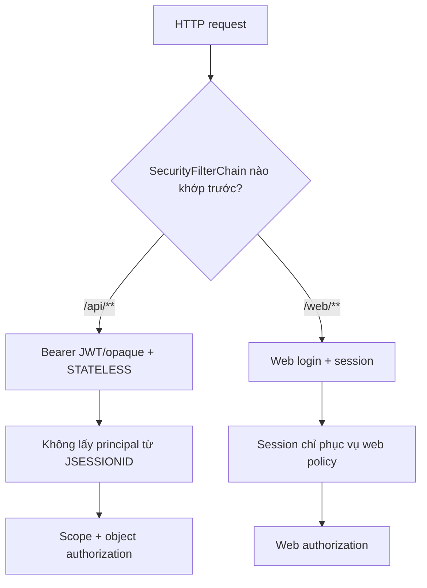

# Kiểm thử API không tạo phiên hoặc tái sử dụng danh tính ngoài chính sách

Trong **Spring Security OAuth 2.0 / OIDC Resource Server**, một API thuần Bearer token thường được thiết kế **stateless**: mỗi HTTP request phải được xác thực dựa trên credential đi cùng request đó, chứ không dựa vào phiên đăng nhập HTTP hay `SecurityContext` được giữ lại từ request trước. Đây không chỉ là lựa chọn hiệu năng. Nó là **ranh giới bảo mật** giữa các user, service, tenant và các lần gọi API.

Một lỗi nguy hiểm có thể diễn ra như sau:

```text
Request 1: Authorization: Bearer <token-của-Alice>
           → 200, principal = alice-123

Request 2: không gửi Authorization
           → vẫn 200, principal = alice-123       (SAI)

Request 3: Authorization: Bearer <token-của-Bob>
           → vẫn đọc dữ liệu Alice                (SAI)
```

Các request này có thể dùng cùng TCP connection, cùng browser, cùng cookie `JSESSIONID` hoặc cùng thread trong server pool. **Không điều nào trong số đó được phép làm Resource Server tái sử dụng danh tính Alice** nếu chính sách endpoint yêu cầu Bearer access token của chính request hiện tại.

Bài học hướng dẫn cách **kiểm thử** điều kiện trên ở nhiều cấp, không dừng ở việc cấu hình `SessionCreationPolicy.STATELESS` rồi giả định ứng dụng đã an toàn. Nội dung nằm trong chương **Trạng thái và bảo vệ web**, thuộc mô-đun **Spring Security OAuth 2.0 OIDC Resource Server**.

**Phạm vi ví dụ:** Java 17+, Spring Boot 3.x, Spring Security 6.x, Servlet/MVC stack, JWT access token; đồng thời nêu cách áp dụng cho opaque-token introspection. Các token và issuer đều là dữ liệu giả phục vụ bài học. Ứng dụng thật cần bảo vệ đúng access-token profile, issuer, audience, scope, owner và tenant.

## 1. Định nghĩa cụ thể điều phải chứng minh

Một API `orders-api` nhận access token qua header:

```http
GET /api/orders/42 HTTP/1.1
Host: orders.example.test
Authorization: Bearer <alice-access-token>
```

Kiến trúc yêu cầu: **token được xác minh trong request hiện tại; authentication context chỉ có hiệu lực trong phạm vi xử lý request đó**, không được lưu vào session cookie để dùng lại sau khi Bearer token đã biến mất.

Có ít nhất **sáu bất biến kiểm thử**:

| Bất biến | Điều kiểm chứng | Ví dụ thất bại cần bắt |
|---|---|---|
| **Không tạo HTTP session** | Request API thông thường không tạo `HttpSession` mới. | `getSession()` ở controller/filter làm phát sinh phiên. |
| **Không phát session authentication cookie** | API không phát `JSESSIONID` như cơ chế xác thực Bearer. | Sau một Bearer request, response có `Set-Cookie: JSESSIONID=...`. |
| **Không đọc session authentication cũ** | Một session hiện hữu không thể thay Bearer token cho route API. | Browser đã login web; gọi `/api/**` không token vẫn thành công. |
| **Không lưu SecurityContext vào session** | JWT authenticated request không ghi login identity để lần sau dùng lại. | Token Alice được lưu dưới `SPRING_SECURITY_CONTEXT`. |
| **Không rò danh tính giữa request** | Request Bob chỉ được nhận Bob, request không token không được nhận Alice/Bob. | Thread-local/authentication cache còn principal của request trước. |
| **Không bỏ qua authorization policy** | Stateless không thay scope, audience, tenant và owner checks. | Token hợp lệ của Alice đọc được đơn Bob vì đã authenticated. |

**“Stateless” phải là một đặc tính quan sát được bằng test.** Chỉ nhìn một dòng cấu hình chưa chứng minh controller, filter khác, thư viện web hoặc custom code không tạo session.

### 1.1. Các tình huống mẫu

Giả sử có:

- **Alice**: `sub=alice-123`, token có scope `orders:read`.
- **Bob**: `sub=bob-456`, token có scope `orders:read`.
- **Worker**: `client_id=orders-importer`, scope `orders:import`.
- **API**: `orders-api`, chỉ chấp nhận access token có issuer/audience phù hợp.
- **Browser session cũ**: có thể tồn tại khi người dùng truy cập một web UI khác trong cùng ứng dụng.

Bộ hành vi mong đợi:

| Request | Authentication được phép | Trạng thái dự kiến |
|---|---|---|
| Bearer token Alice | Alice | Thành công tại endpoint mà Alice đủ quyền. |
| Bearer token Bob | Bob, **không phải Alice** | Thành công tại endpoint mà Bob đủ quyền. |
| Không Bearer token | Không có user authenticated | 401 ở route bảo vệ. |
| Bearer token sai/hết hạn | Không có user authenticated | 401 ở route bảo vệ. |
| Chỉ có cookie `JSESSIONID` | Không dùng phiên đó để xác thực `/api/**` | 401 ở route bảo vệ. |
| Cookie web session + Bearer token Bob | Chỉ Bob từ Bearer token, theo API contract | Không được dùng principal Alice trong cookie. |
| Token Alice không có scope route yêu cầu | Alice được xác thực nhưng thiếu quyền | 403. |
| Token Alice đủ scope, order thuộc Bob | Alice, không có object permission | 403/404 theo chính sách. |

Đây là các kiểm thử **độc lập**: kiểm tra không có session không tự chứng minh quyền trên object; kiểm tra 401 không token không tự chứng minh không có `JSESSIONID` trong response.

## 2. Ba loại trạng thái không nên đánh đồng

Từ “state” thường bị dùng để chỉ các thứ khác nhau.

### 2.1. HTTP session

`HttpSession` là trạng thái do Servlet container quản lý, được liên kết qua session ID như `JSESSIONID`. Một ứng dụng web login bằng session có thể lưu `SecurityContext` hoặc những dữ liệu khác trong session để request tiếp theo tiếp tục sử dụng.

Ví dụ:

```text
Browser ----Cookie: JSESSIONID=abc----> Server
                          |
                          +--> session map
                               SPRING_SECURITY_CONTEXT
                               shoppingCart
                               locale
```

Với API thuần Bearer, **không dùng session này để nhận diện caller**. Nếu controller vô tình đọc `HttpSession` và tin attribute `currentUser`, API có thể vi phạm thiết kế stateless ngay cả khi Spring Security đã cấu hình `STATELESS`.

### 2.2. `SecurityContext` trong request hiện tại

Spring Security dùng `SecurityContextHolder` chứa `SecurityContext`, trong đó có `Authentication` của request hiện tại. Đây **không đồng nghĩa** với HTTP session.

Một Resource Server stateless **vẫn cần `SecurityContext`** trong thời gian xử lý request để authorization filter, controller và service biết caller đã được xác thực. Vấn đề là **không được lưu và tái sử dụng nó ngoài chính sách**.

```text
Request Alice -> parse/validate token -> SecurityContext(Alice)
                                      -> authorize
                                      -> clear context

Request Bob   -> parse/validate token -> SecurityContext(Bob)
                                      -> authorize
                                      -> clear context

Request none  -> no valid Bearer      -> no authenticated user
```

### 2.3. Trạng thái ứng dụng và cache

API có thể lưu state trong database, cache, Redis hoặc service bên ngoài mà vẫn dùng Bearer authentication stateless. Ví dụ:

- Dữ liệu order, cart, workflow.
- JWKS/public key cache để xác minh JWT.
- Introspection response cache có TTL được kiểm soát.
- Rate-limit counters.
- Idempotency keys.
- Authorization entitlements được cache theo policy.

Những trạng thái này **không biến Bearer API thành session-login** nếu chúng không được dùng để nhận diện request tiếp theo mà bỏ qua credential. Nhưng cache authentication theo user/cookie/IP hoặc tenant thiếu ràng buộc token rất dễ gây rò quyền.

> **Phân biệt quan trọng:** “API không tạo phiên” là một yêu cầu nghiêm hơn “Spring Security không dùng session để giữ SecurityContext”. Chỉ có `STATELESS` chưa kiểm soát được mọi đoạn code tự gọi `request.getSession()` hoặc một thư viện khác tạo session.

## 3. `SessionCreationPolicy` và các ý nghĩa dễ nhầm

Spring Security cung cấp `SessionCreationPolicy`:

| Policy | Ý nghĩa khái quát | Có thích hợp cho API Bearer thuần? |
|---|---|---|
| `ALWAYS` | Spring Security luôn tạo session. | Không. |
| `IF_REQUIRED` | Spring Security tạo session khi cần. | Không nên làm mặc định cho Bearer API. |
| `NEVER` | Spring Security không tự tạo session, **nhưng có thể dùng session đã tồn tại**. | **Không tương đương stateless.** |
| `STATELESS` | Spring Security không tạo và không dùng `HttpSession` để lấy `SecurityContext`. | Lựa chọn điển hình cho Bearer Resource Server. |

Điểm dễ nhầm nhất là:

```java
.sessionManagement(session ->
    session.sessionCreationPolicy(SessionCreationPolicy.NEVER))
```

**`NEVER` không đủ** nếu mục tiêu của bạn là “API không nhận identity từ phiên cũ”. Một browser có thể mang theo `JSESSIONID` do web login tạo trước; cấu hình cho phép dùng session hiện hữu có thể khiến API nhận context ngoài hợp đồng nếu các thành phần khác được cấu hình như vậy.

Với Bearer API:

```java
.sessionManagement(session ->
    session.sessionCreationPolicy(SessionCreationPolicy.STATELESS))
```

là điểm khởi đầu hợp lý. Sau đó vẫn cần **test session creation từ các thành phần không thuộc Spring Security**.

### 3.1. SecurityContext repository

Spring Security có abstraction `SecurityContextRepository`. Các implementation liên quan:

- `HttpSessionSecurityContextRepository`: có thể đọc/ghi context từ HTTP session.
- `RequestAttributeSecurityContextRepository`: lưu context ở request attribute, có thể hữu ích trong các dispatch thuộc cùng request.
- `DelegatingSecurityContextRepository`: kết hợp nhiều repository theo cấu hình.
- `NullSecurityContextRepository`: không lưu/đọc context bền qua session để tái sử dụng.

Khi API có yêu cầu rõ “không lấy authenticated identity từ HttpSession”, có thể chỉ định:

```java
.securityContext(context -> context
    .securityContextRepository(new NullSecurityContextRepository()))
```

Điều này **không làm mỗi request mất authentication ngay lập tức**; `BearerTokenAuthenticationFilter` vẫn có thể đặt context trong request processing, nhưng không persist để tái dùng bằng repository này.

Không lạm dụng `NullSecurityContextRepository` ở **browser login flow cần session**; nên giới hạn cho chain API stateless.

### 3.2. Request cache

`RequestCache` thường được dùng trong login redirect để nhớ request ban đầu của user chưa authenticated. Với Bearer API, lưu protected request vào session là không cần thiết và có thể tạo state ngoài ý muốn.

Dùng:

```java
.requestCache(cache ->
    cache.requestCache(new NullRequestCache()))
```

hoặc disable cache nếu phù hợp. Khi dùng `NullRequestCache`, một Bearer request bị 401 không cần lưu `SavedRequest` để sau này replay qua HTTP session.

### 3.3. Form login, HTTP Basic, OAuth2 Login và resource server

Một ứng dụng có thể dùng đồng thời:

- `oauth2Login()` cho browser redirect/SSO, thường sử dụng session/state.
- `formLogin()` cho đăng nhập web có session.
- `httpBasic()` cho HTTP Basic authentication.
- `oauth2ResourceServer().jwt()` hoặc `opaqueToken()` cho Bearer API.

Không phải mọi chế độ này đều sai. Vấn đề là **mỗi đường dẫn phải được bao phủ bởi chính sách đúng của nó**. Nếu `/api/**` vô tình bị web chain dùng form login nhận diện, request không token có thể bị redirect 302 thay vì 401 hoặc tái dùng principal từ cookie. Kiểm thử phải đi qua URL thật và chain thật.

---

## 4. Cấu hình tham chiếu cho API JWT stateless

Ví dụ Spring Boot 3.x / Spring Security 6.x dùng issuer và audience của access token:

```yaml
spring:
  security:
    oauth2:
      resourceserver:
        jwt:
          issuer-uri: https://auth.example.test/realms/orders
          audiences:
            - orders-api
```

Lưu ý cấu hình issuer/audience chỉ là một phần xác minh token. Với JWT access token theo RFC 9068, cần thực thi **token profile** phù hợp (bao gồm `typ` và các claims bắt buộc tùy phiên bản/implementation); không nhận ID Token chỉ vì nó được ký bởi cùng issuer.

### 4.1. Dependencies

Dùng Spring Boot parent/BOM quản lý version:

```xml
<dependencies>
    <dependency>
        <groupId>org.springframework.boot</groupId>
        <artifactId>spring-boot-starter-web</artifactId>
    </dependency>
    <dependency>
        <groupId>org.springframework.boot</groupId>
        <artifactId>spring-boot-starter-security</artifactId>
    </dependency>
    <dependency>
        <groupId>org.springframework.boot</groupId>
        <artifactId>spring-boot-starter-oauth2-resource-server</artifactId>
    </dependency>
    <dependency>
        <groupId>org.springframework.boot</groupId>
        <artifactId>spring-boot-starter-test</artifactId>
        <scope>test</scope>
    </dependency>
    <dependency>
        <groupId>org.springframework.security</groupId>
        <artifactId>spring-security-test</artifactId>
        <scope>test</scope>
    </dependency>
</dependencies>
```

### 4.2. SecurityFilterChain dành riêng cho `/api/**`

```java
package com.example.orders.security;

import org.springframework.context.annotation.Bean;
import org.springframework.context.annotation.Configuration;
import org.springframework.http.HttpMethod;
import org.springframework.security.config.Customizer;
import org.springframework.security.config.annotation.web.builders.HttpSecurity;
import org.springframework.security.config.annotation.web.configurers.AbstractHttpConfigurer;
import org.springframework.security.config.http.SessionCreationPolicy;
import org.springframework.security.web.SecurityFilterChain;
import org.springframework.security.web.context.NullSecurityContextRepository;
import org.springframework.security.web.savedrequest.NullRequestCache;

@Configuration
public class ApiSecurityConfiguration {

    @Bean
    SecurityFilterChain apiSecurityFilterChain(HttpSecurity http)
            throws Exception {
        return http
            .securityMatcher("/api/**")
            .sessionManagement(session -> session
                .sessionCreationPolicy(SessionCreationPolicy.STATELESS))
            .securityContext(context -> context
                .securityContextRepository(
                    new NullSecurityContextRepository()))
            .requestCache(cache ->
                cache.requestCache(new NullRequestCache()))

            // Chỉ dành cho API nhận Bearer qua Authorization header,
            // không dùng session/cookie làm cơ chế auth.
            .csrf(AbstractHttpConfigurer::disable)
            .formLogin(AbstractHttpConfigurer::disable)
            .httpBasic(AbstractHttpConfigurer::disable)
            .logout(AbstractHttpConfigurer::disable)

            .authorizeHttpRequests(auth -> auth
                .requestMatchers(HttpMethod.GET, "/api/public/ping")
                    .permitAll()
                .requestMatchers(HttpMethod.GET, "/api/identity")
                    .authenticated()
                .requestMatchers(HttpMethod.GET, "/api/orders/**")
                    .hasAuthority("SCOPE_orders:read")
                .requestMatchers(HttpMethod.POST, "/api/orders")
                    .hasAuthority("SCOPE_orders:write")
                .anyRequest().denyAll())
            .oauth2ResourceServer(oauth ->
                oauth.jwt(Customizer.withDefaults()))
            .build();
    }
}
```

**Mục đích của từng phần:**

| Cấu hình | Đảm bảo thiết kế hướng tới | Điều chưa tự bảo đảm |
|---|---|---|
| `securityMatcher("/api/**")` | Chain này dành cho API. | Route bị path mismatch có thể thuộc chain khác. |
| `STATELESS` | Spring Security không tạo/dùng session để lấy authentication context. | Controller hoặc thư viện khác không tạo session. |
| `NullSecurityContextRepository` | Không lưu security context vào session qua repository này. | Custom code không tự lưu authentication ở nơi khác. |
| `NullRequestCache` | Không lưu request vào session để phục vụ login flow. | Middleware khác không tạo session. |
| `csrf(disable)` | Tắt CSRF filter cho Bearer API được thiết kế không dùng cookie auth. | Không an toàn nếu API chấp nhận cookie credential hoặc browser session. |
| `formLogin/httpBasic/logout(disable)` | Không vô tình bật các cơ chế login khác trong API chain. | Authentication mechanisms ở chain khác hoặc custom filter. |
| `jwt()` | Bearer authentication qua JwtDecoder. | Chưa chứng minh token thật được ký và validate nếu test dùng mock. |
| `hasAuthority` | Kiểm tra loại thao tác. | Ownership, tenant và business policy. |
| `denyAll()` | Route chưa liệt kê mặc định không được truy cập. | Route nằm ngoài securityMatcher chưa được bảo vệ. |

Không thêm `.anyRequest().authenticated()` như một shortcut cho mọi API chưa xác định, vì một access token hợp lệ với scope không liên quan có thể đi qua.

### 4.3. `STATELESS` khác “không có cookie nào”

Một response API có thể hợp lệ chứa cookies phục vụ telemetry hoặc cơ chế khác tùy kiến trúc; tuy nhiên với yêu cầu **“API không tạo phiên”**, kiểm thử phải nhắm tới **HTTP session cookie (`JSESSIONID`)** và việc không dùng cookie làm authentication.

Không nên viết assertion “response không có bất kỳ Set-Cookie nào” nếu hạ tầng hợp lệ có những cookie không liên quan. Mặt khác, chỉ thấy không có header `Set-Cookie` cũng **chưa đủ**: một request có thể đọc/reuse session cookie đã tồn tại mà không phát cookie mới.

**Hai bài test là khác nhau:**

1. **Không tạo:** request bắt đầu không có session, kết thúc không có session mới và không phát `JSESSIONID`.
2. **Không tái sử dụng:** request có session cũ/cookie cũ vẫn không được xác thực thay cho Bearer token.

---

## 5. Mô hình rủi ro: “danh tính ngoài chính sách” đến từ đâu?

### 5.1. Truy cập bằng cookie cũ thay vì token

Một người dùng login vào `/web/**` và có `JSESSIONID`. Nếu `/api/**` vô tình đọc security context từ phiên, browser có thể gọi API mà không cần Bearer token. Điều này làm sai trust model của API và có thể kích hoạt rủi ro CSRF nếu cookie được gửi tự động.

```text
/web/login  -> cookie JSESSIONID có login Alice
/api/orders -> không Bearer, nhưng vẫn xem Alice từ session     (SAI)
```

### 5.2. Tái sử dụng `SecurityContextHolder` theo thread

Servlet container thường dùng thread pool. Mỗi worker thread có thể xử lý nhiều request **liên tiếp từ các user khác nhau**. Một custom filter tự gọi `SecurityContextHolder.getContext().setAuthentication(...)` nhưng không cleanup đúng cách có thể làm principal của Alice rò sang request Bob.

Với các Spring Security filters chuẩn, việc thiết lập và dọn dẹp context thuộc lifecycle được framework quản lý. **Đừng thay thế đường đi chuẩn bằng một `ThreadLocal<Authentication>` tùy tiện** rồi dựa vào thread identity của container.

### 5.3. Cache identity sai key

Ví dụ anti-pattern:

```java
// KHÔNG DÙNG:
private static Authentication lastAuthenticatedUser;

public Authentication getAuthentication(HttpServletRequest request) {
    if (request.getHeader("Authorization") == null) {
        return lastAuthenticatedUser;
    }
    return parseToken(request);
}
```

Một cache dùng user ID, client ID, IP hoặc tenant thay vì ràng buộc đúng token/context cũng có thể gây reuse ngoài chính sách. Đối với introspection, nếu có cache kết quả `active=true` theo token, TTL và chính sách thu hồi phải rõ, không chia sẻ principal của token khác; **không bao giờ biến cache thành “đăng nhập ngầm” cho request thiếu Bearer credential**.

### 5.4. Request attribute và async dispatch

Một số context được lưu ở **request attributes** phục vụ nhiều dispatch trong **cùng một HTTP request**, không phải session xuyên request. Đừng đánh đồng request-scoped propagation hợp lệ với reuse giữa request.

Tuy nhiên nếu ứng dụng bắt đầu async execution, dùng `@Async`, `CompletableFuture`, scheduler hoặc message consumer, cần xác định **lúc nào Authentication được phép truyền**. Một task phát sinh từ request có thể cần dùng context được ủy quyền rõ ràng; task nền không được ngẫu nhiên nhìn thấy principal của request gần nhất do thread reuse.

### 5.5. Multiple SecurityFilterChain chọn sai chain

Spring Security thường chọn **chain đầu tiên khớp**. Một chain web dùng session có matcher quá rộng có thể vô tình áp vào API:

```text
@Order(1): securityMatcher("/**")      -> web login, session
@Order(2): securityMatcher("/api/**")  -> Bearer stateless

GET /api/orders/42 -> chain 1 được chọn (SAI)
```

Cần test URL thật, method, dispatch type và matcher order để đảm bảo API chain áp dụng.

---

## 6. Kiến trúc test: nên có nhiều tầng độc lập

Không có một loại test nào chứng minh tất cả. Cần ít nhất các tầng sau:

| Tầng kiểm thử | Công cụ thường dùng | Chứng minh được | Không chứng minh được |
|---|---|---|---|
| **Unit test** cho security configuration/mapper | JUnit/Mockito | Một logic đơn lẻ theo kỳ vọng. | Behavior thực của toàn filter chain và Servlet session. |
| **MockMvc + `jwt()`** | `spring-security-test` | HTTP authorization với Authentication giả. | Bearer extraction/JwtDecoder/JWS, session lifecycle đầy đủ. |
| **MockMvc + Bearer header + JwtDecoder stub** | `@SpringBootTest`, `@AutoConfigureMockMvc` | Filter chain thật xử lý Bearer header và session policy, context chuyển request. | Cryptographic JWT validation/JWKS thật, network cookie behavior đầy đủ. |
| **HTTP integration trên embedded server** | `RANDOM_PORT` + HTTP client | Status, cookie, session header, nhiều request qua HTTP stack. | Key rotation/JWKS nếu decoder còn stub. |
| **JWT ký thật / issuer staging** | Keypair/JWKS test hoặc AS staging | Signature, issuer, audience, expiry và token contract. | Business ownership nếu chưa thêm fixtures. |
| **Concurrency/async test** | HTTP client đồng thời, executor test | Không bleed principal qua thread pool/races. | Tất cả đường nền nếu chưa mô phỏng. |
| **Browser E2E cho web+API** | Browser automation | Cookie web session tồn tại nhưng API không tái dùng ngoài chính sách. | Toàn bộ backend race/failure modes. |

Đặc biệt, `jwt()` trong Spring Security Test **không chạy `JwtDecoder`**. Nếu test dùng `jwt()` và kết luận “API không tạo session vì Bearer filter đã xử lý token”, đó là kết luận vượt phạm vi test.

### 6.1. Thế nào là test thật của Bearer flow?

Một request test nên gửi header:

```http
Authorization: Bearer alice-test-token
```

và để `BearerTokenAuthenticationFilter` nhận token, gọi một `JwtDecoder` test, tạo `JwtAuthenticationToken`. Test decoder có thể trả đối tượng `Jwt` giả phục vụ test **filter chain**, nhưng cần nói rõ **không kiểm tra chữ ký**. Một bộ test khác phải gửi signed JWT thật qua decoder kiểm tra khóa/JWKS.

---

## 7. Fixture để kiểm tra danh tính của request

Một endpoint test đơn giản trả về subject đã được Spring Security xác thực. **Chỉ dùng trong test/dev hoặc khi dữ liệu được phép**, không nên đưa endpoint dump claims vào production công khai.

```java
package com.example.orders.api;

import java.util.Map;

import org.springframework.security.core.annotation.AuthenticationPrincipal;
import org.springframework.security.oauth2.jwt.Jwt;
import org.springframework.web.bind.annotation.GetMapping;
import org.springframework.web.bind.annotation.RestController;

@RestController
public class IdentityProbeController {

    @GetMapping("/api/identity")
    public Map<String, String> identity(
            @AuthenticationPrincipal Jwt jwt) {
        return Map.of("sub", jwt.getSubject());
    }

    @GetMapping("/api/public/ping")
    public Map<String, String> ping() {
        return Map.of("status", "ok");
    }
}
```

Với security rule `GET /api/identity → authenticated()` và Bearer filter hoạt động đúng:

- Token Alice → body `{"sub":"alice-123"}`.
- Token Bob → body `{"sub":"bob-456"}`.
- Không token → 401, controller **không được gọi**.
- Token sai → 401, controller **không được gọi**.

Nếu có hai security mechanisms trong cùng ứng dụng, controller trên chỉ phù hợp với JWT principal; khi chạy opaque token, có thể nhận `OAuth2AuthenticatedPrincipal` thay vì `Jwt`. Đừng kết luận “không có authentication” chỉ vì controller cast sai loại principal.

---

## 8. Stub `JwtDecoder` để kiểm thử filter chain, không kiểm thử mật mã

Một cấu hình **chỉ dùng cho test** có thể ánh xạ token cố định thành đối tượng `Jwt`. Nó giúp chứng minh rằng một request thực sự **cần Bearer header riêng**, rằng context không bị lưu vào phiên, và rằng Alice/Bob không bị tráo.

```java
package com.example.orders.test;

import java.time.Instant;
import java.util.List;

import org.springframework.boot.test.context.TestConfiguration;
import org.springframework.context.annotation.Bean;
import org.springframework.context.annotation.Primary;
import org.springframework.security.oauth2.jwt.BadJwtException;
import org.springframework.security.oauth2.jwt.Jwt;
import org.springframework.security.oauth2.jwt.JwtDecoder;

@TestConfiguration
public class StubJwtDecoderConfiguration {

    @Bean
    @Primary
    JwtDecoder testJwtDecoder() {
        return token -> {
            String subject;
            String scope;

            switch (token) {
                case "alice-test-token" -> {
                    subject = "alice-123";
                    scope = "orders:read";
                }
                case "bob-test-token" -> {
                    subject = "bob-456";
                    scope = "orders:read";
                }
                case "worker-test-token" -> {
                    subject = "orders-importer";
                    scope = "orders:import";
                }
                default -> throw new BadJwtException(
                    "Rejected test token");
            }

            Instant now = Instant.now();
            return Jwt.withTokenValue(token)
                .header("alg", "RS256")
                .issuer("https://auth.example.test/realms/orders")
                .subject(subject)
                .audience(List.of("orders-api"))
                .issuedAt(now.minusSeconds(30))
                .expiresAt(now.plusSeconds(600))
                .claim("scope", scope)
                .build();
        };
    }
}
```

**Cảnh báo:** decoder này tin vào các chuỗi tùy ý trong test và **không xác minh chữ ký RSA/JWS**. Nó tuyệt đối không được nạp vào production profile. Khi dùng `@Import(StubJwtDecoderConfiguration.class)` trong test, phải đảm bảo không có configuration production nào tự tạo decoder với mức ưu tiên khiến bean test bị bỏ qua; `@Primary` giúp lựa chọn nếu nhiều bean hợp lệ nhưng không sửa được mọi vấn đề context configuration.

Ví dụ chỉ minh họa **test filter state isolation**. Các test về token bị chỉnh payload, `typ`, audience/issuer validator hoặc JWKS phải chạy với **decoder thật và JWT ký bằng test keys**.

---

## 9. MockMvc: chứng minh không tạo phiên với Bearer request

Với ứng dụng mẫu có `ApiSecurityConfiguration` và `IdentityProbeController`, viết test:

```java
package com.example.orders.security;

import static org.junit.jupiter.api.Assertions.assertNull;
import static org.junit.jupiter.api.Assertions.assertTrue;
import static org.springframework.test.web.servlet.request.MockMvcRequestBuilders.get;
import static org.springframework.test.web.servlet.result.MockMvcResultMatchers.jsonPath;
import static org.springframework.test.web.servlet.result.MockMvcResultMatchers.status;

import com.example.orders.test.StubJwtDecoderConfiguration;
import org.junit.jupiter.api.Test;
import org.springframework.beans.factory.annotation.Autowired;
import org.springframework.boot.test.autoconfigure.web.servlet.AutoConfigureMockMvc;
import org.springframework.boot.test.context.SpringBootTest;
import org.springframework.context.annotation.Import;
import org.springframework.http.HttpHeaders;
import org.springframework.test.web.servlet.MockMvc;
import org.springframework.test.web.servlet.MvcResult;

@SpringBootTest
@AutoConfigureMockMvc
@Import(StubJwtDecoderConfiguration.class)
class StatelessBearerApiTest {

    @Autowired
    MockMvc mvc;

    @Test
    void validBearerRequestDoesNotCreateHttpSession() throws Exception {
        MvcResult result = mvc.perform(
                get("/api/identity")
                    .header(HttpHeaders.AUTHORIZATION,
                        "Bearer alice-test-token"))
            .andExpect(status().isOk())
            .andExpect(jsonPath("$.sub").value("alice-123"))
            .andReturn();

        // getSession(false) chỉ xem session có tồn tại hay không,
        // KHÔNG tạo session mới như getSession() mặc định.
        assertNull(result.getRequest().getSession(false));

        // Tránh assert "không có Set-Cookie nào": ứng dụng/hạ tầng
        // có thể có cookie khác không liên quan HTTP session.
        assertTrue(
            result.getResponse().getHeaders(HttpHeaders.SET_COOKIE)
                .stream()
                .noneMatch(value ->
                    value.toLowerCase(java.util.Locale.ROOT)
                        .contains("jsessionid="))
        );
    }
}
```

**Hai assertions bắt những loại lỗi khác nhau:**

- `getSession(false) == null` phát hiện session được tạo trong request của Servlet test environment.
- Không có `JSESSIONID` trong `Set-Cookie` phát hiện session cookie được phát ra ở HTTP response.

Nếu một request **được truyền session có sẵn** vào test thì `getSession(false)` sẽ không null dù API **không tạo session mới**. Không dùng assertion “session null” cho trường hợp test tái sử dụng phiên hiện hữu; dùng test riêng ở phần sau.

### 9.1. Đừng gọi `getSession()` trong chính assertion

Một test sai có thể tạo session khi đang kiểm tra:

```java
// KHÔNG DÙNG: getSession() mặc định tự tạo session.
assertNotNull(result.getRequest().getSession());
```

Khi muốn xác nhận API không tạo session, chỉ đọc:

```java
result.getRequest().getSession(false)
```

Và kiểm tra response header bằng `getHeaders("Set-Cookie")` hoặc helper phù hợp; không lấy “test tạo session” làm lỗi của ứng dụng.

### 9.2. API public route cũng không nên tạo phiên

Route public như `GET /api/public/ping` có thể không cần token, nhưng vẫn phải giữ yêu cầu stateless nếu nằm trong API chain:

```java
@Test
void publicPingDoesNotCreateSession() throws Exception {
    MvcResult result = mvc.perform(get("/api/public/ping"))
        .andExpect(status().isOk())
        .andReturn();

    assertNull(result.getRequest().getSession(false));
}
```

Một public route có thể lỡ gọi `HttpSession` để đếm lượt xem hoặc lưu locale. Test này giúp tìm lỗi từ **controller/interceptor** mà chỉ test Bearer route chưa chắc phát hiện.

---

## 10. Kiểm thử request liên tiếp không kế thừa danh tính

Đây là phần cốt lõi của đề bài: **không tái sử dụng identity ngoài chính sách**.

### 10.1. Alice → không token

Trình tự cần kiểm tra:

```text
Request A:
  Authorization: Bearer alice-test-token
  /api/identity → 200 Alice

Request B:
  no Authorization
  /api/identity → 401, không phải Alice
```

Ví dụ:

```java
@Test
void authenticationFromPreviousRequestIsNotReused() throws Exception {
    mvc.perform(get("/api/identity")
            .header(HttpHeaders.AUTHORIZATION,
                "Bearer alice-test-token"))
        .andExpect(status().isOk())
        .andExpect(jsonPath("$.sub").value("alice-123"));

    mvc.perform(get("/api/identity"))
        .andExpect(status().isUnauthorized());
}
```

Vì request B không gửi credential, nó không được phép tiếp tục dùng Alice dù cùng đối tượng `MockMvc` hoặc cùng thread chạy test. Test này bắt nhiều lỗi context cleanup hoặc custom global cache; nhưng kết quả của test đơn lẻ vẫn chưa bảo đảm không rò trong mọi trường hợp đồng thời.

### 10.2. Alice → Bob

```java
@Test
void secondBearerTokenDeterminesSecondIdentity() throws Exception {
    mvc.perform(get("/api/identity")
            .header(HttpHeaders.AUTHORIZATION,
                "Bearer alice-test-token"))
        .andExpect(status().isOk())
        .andExpect(jsonPath("$.sub").value("alice-123"));

    mvc.perform(get("/api/identity")
            .header(HttpHeaders.AUTHORIZATION,
                "Bearer bob-test-token"))
        .andExpect(status().isOk())
        .andExpect(jsonPath("$.sub").value("bob-456"));
}
```

Nếu request Bob trả `alice-123`, có thể có lỗi global authentication cache, ThreadLocal chưa cleanup, session reading hoặc code controller đang dùng một principal ngoài `SecurityContext`.

### 10.3. Alice → token sai

```java
@Test
void invalidBearerDoesNotFallBackToPreviousAuthentication()
        throws Exception {
    mvc.perform(get("/api/identity")
            .header(HttpHeaders.AUTHORIZATION,
                "Bearer alice-test-token"))
        .andExpect(status().isOk());

    mvc.perform(get("/api/identity")
            .header(HttpHeaders.AUTHORIZATION,
                "Bearer unknown-test-token"))
        .andExpect(status().isUnauthorized());
}
```

Không được có logic:

```text
if token invalid:
    use previous session principal
```

Token sai phải làm **request hiện tại** bị từ chối; không dùng danh tính của request trước hoặc cookie browser làm phương án fallback.

### 10.4. Không xác thực bằng “lần trước đã gọi đúng”

Một số API Gateway/microservice middleware cache “last successful authentication” theo TCP connection, IP hoặc thread. Nhưng:

- Keep-alive HTTP connection có thể phục vụ nhiều requests.
- Reverse proxy có thể multiplex requests từ các client.
- NAT khiến nhiều user có cùng IP.
- Servlet worker threads được tái sử dụng.
- Một browser có thể đổi tài khoản trong cùng cửa sổ.

Vì thế không dùng **connection ID, IP, browser tab, thread ID hoặc cookie không thuộc credential policy** làm bằng chứng rằng request hiện tại có cùng authentication.

---

## 11. Kiểm thử cố ý gửi session cũ vào API

Test không tạo session chỉ xử lý tình huống **bắt đầu không có session**. Để chứng minh API **không tái sử dụng phiên**, hãy tạo một `MockHttpSession` có `SecurityContext` cũ và truyền vào request API.

### 11.1. Session đã chứa một user authenticated

Ví dụ:

```java
import static org.springframework.test.web.servlet.request.MockMvcRequestBuilders.get;
import static org.springframework.test.web.servlet.result.MockMvcResultMatchers.jsonPath;
import static org.springframework.test.web.servlet.result.MockMvcResultMatchers.status;

import java.util.List;

import org.junit.jupiter.api.Test;
import org.springframework.http.HttpHeaders;
import org.springframework.mock.web.MockHttpSession;
import org.springframework.security.authentication.UsernamePasswordAuthenticationToken;
import org.springframework.security.core.authority.SimpleGrantedAuthority;
import org.springframework.security.core.context.SecurityContextImpl;
import org.springframework.security.web.context.HttpSessionSecurityContextRepository;

@Test
void existingWebSessionCannotAuthenticateBearerApi() throws Exception {
    MockHttpSession webSession = new MockHttpSession();

    var legacyAuthentication =
        new UsernamePasswordAuthenticationToken(
            "legacy-web-user",
            "unused",
            List.of(new SimpleGrantedAuthority("SCOPE_orders:read")));

    var legacyContext = new SecurityContextImpl();
    legacyContext.setAuthentication(legacyAuthentication);

    webSession.setAttribute(
        HttpSessionSecurityContextRepository.SPRING_SECURITY_CONTEXT_KEY,
        legacyContext);

    // API không được lấy identity từ session khi không có Bearer.
    mvc.perform(get("/api/identity").session(webSession))
        .andExpect(status().isUnauthorized());

    // Có Bearer Bob thì principal phải là Bob, không phải web-session user.
    mvc.perform(get("/api/identity")
            .session(webSession)
            .header(HttpHeaders.AUTHORIZATION,
                "Bearer bob-test-token"))
        .andExpect(status().isOk())
        .andExpect(jsonPath("$.sub").value("bob-456"));
}
```

Điều đáng chú ý: test **cố tình cung cấp một session có sẵn**, vì vậy nó **không thể** assert `getSession(false)==null`. Mục tiêu ở đây là **session cũ không được dùng để xác thực API**, không phải session bị xóa khỏi request object.

Nếu response không token vẫn 200, xem:

1. `STATELESS` có thực sự áp dụng trên `/api/identity`?
2. Có web chain nào được chọn trước không?
3. `SecurityContextRepository` của chain có đọc HttpSession không?
4. Custom authentication filter/`OncePerRequestFilter` có tái dùng session không?
5. Controller có tự truy vấn session attributes để xác định user không?

### 11.2. Test session không bị ghi đè bởi Bearer

Với cùng `webSession`, sau request Bearer Bob, có thể assert session attribute lưu identity legacy **không bị ghi đè** bởi API chain:

```java
Object before = webSession.getAttribute(
    HttpSessionSecurityContextRepository.SPRING_SECURITY_CONTEXT_KEY);

mvc.perform(get("/api/identity")
        .session(webSession)
        .header(HttpHeaders.AUTHORIZATION,
            "Bearer bob-test-token"))
    .andExpect(status().isOk());

Object after = webSession.getAttribute(
    HttpSessionSecurityContextRepository.SPRING_SECURITY_CONTEXT_KEY);

org.junit.jupiter.api.Assertions.assertSame(before, after);
```

Đây là một assertion hữu ích cho yêu cầu “API không lưu context từ Bearer token vào session”. Tuy nhiên nó không thay thế test tìm các **session attributes khác** mà custom code có thể ghi. Nếu ứng dụng lưu `CURRENT_USER` hoặc `accessToken` dưới key riêng, cần kiểm tra những key đó theo hợp đồng của mình.

### 11.3. Chỉ gửi cookie qua HTTP khác với truyền `MockHttpSession`

Một test viết:

```java
mvc.perform(get("/api/identity")
    .cookie(new jakarta.servlet.http.Cookie("JSESSIONID", "abc")))
```

không tự chứng minh cookie `abc` được ánh xạ thành **một HttpSession thực trong MockMvc**. Tùy mô phỏng container, cookie có thể chỉ là header mà không resolve thành session tương ứng. Vì vậy cần cả:

- **MockMvc test với `MockHttpSession` đã cài SecurityContext** để kiểm tra logic Spring Security.
- **HTTP integration test với embedded server / browser** để kiểm tra session ID thực được gắn qua `Cookie` và response `Set-Cookie`.

Đừng kết luận session isolation tốt chỉ vì một request MockMvc mang `JSESSIONID` giả trả 401 nhưng chưa tồn tại session nào tương ứng.

---

## 12. Kiểm thử giữa các user và giữa các loại token

Không chỉ thử một user.

### 12.1. User A và User B

Các kịch bản tối thiểu:

```text
1. Bearer Alice → principal Alice.
2. Bearer Bob → principal Bob.
3. Không token sau Alice → 401.
4. Không token sau Bob → 401.
5. Token sai sau Alice → 401.
6. Cookie/session Alice + Bearer Bob → principal Bob.
7. Cookie/session Alice, không Bearer → 401.
```

Nếu scope giống nhau, response identity probe vẫn phải phân biệt đúng subject. Nếu endpoint chỉ trả 200 cho cả Alice và Bob, **không thể biết test có vô tình tái sử dụng principal cũ hay không**. Do đó một endpoint/fixture test trả subject hoặc một mock domain service ghi nhận actor là rất hữu ích.

### 12.2. User token và Client Credentials token

Client Credentials thường không đại diện người dùng đang đăng nhập. API phải biết:

- Actor là user hay workload theo issuer/token profile.
- Scope của worker, ví dụ `orders:import`, không tự được quyền đọc dữ liệu user.
- `sub` có thể là service identity theo grant/profile.
- Không lấy “user đã authenticated ở request trước” để bổ sung subject cho service token thiếu user context.

Ví dụ negative test:

```java
@Test
void workerScopeCannotReadUserOrders() throws Exception {
    mvc.perform(get("/api/orders/42")
            .header(HttpHeaders.AUTHORIZATION,
                "Bearer worker-test-token"))
        .andExpect(status().isForbidden());
}
```

Test này dùng `JwtDecoder` stub có `scope=orders:import` cho worker. Route `GET /api/orders/**` đòi `SCOPE_orders:read`, nên dù token được mock là valid, vẫn phải 403.

### 12.3. Nhiều issuer hoặc tenant

Nếu API chấp nhận nhiều issuer, đừng lưu principal trong static variable keyed chỉ theo `sub`, vì `sub=123` của issuer A có thể khác issuer B. Một cache/identity mapping có thể cần namespace `(issuer, subject)` cùng resource/tenant. Test nên bao gồm hai token có **cùng sub nhưng khác issuer**, và token có scope hợp lệ nhưng audience/tenant sai.

Đối với JWT, từ chối issuer/audience tại `JwtDecoder`/validators trước khi tạo `Authentication`. Đối với opaque token, introspection response phải được đối chiếu với token contract/resource binding. Stateless **không phải** cớ để bỏ issuer/audience validation.

---

## 13. Kiểm thử nhiều SecurityFilterChain: web session không xâm nhập API

Một ứng dụng có thể có **web UI dùng session** và **API dùng Bearer token**. Điều này hợp lệ nếu filter chains được phân vùng chặt.

Ví dụ kiến trúc:

```text
/api/** → JWT Resource Server / STATELESS / no session authentication
/web/** → formLogin hoặc oauth2Login / session được cho phép
```

Sơ đồ:



### 13.1. Cấu hình hai chains minh họa

```java
package com.example.orders.security;

import org.springframework.context.annotation.Bean;
import org.springframework.context.annotation.Configuration;
import org.springframework.core.annotation.Order;
import org.springframework.security.config.Customizer;
import org.springframework.security.config.annotation.web.builders.HttpSecurity;
import org.springframework.security.config.annotation.web.configurers.AbstractHttpConfigurer;
import org.springframework.security.config.http.SessionCreationPolicy;
import org.springframework.security.web.SecurityFilterChain;
import org.springframework.security.web.context.NullSecurityContextRepository;
import org.springframework.security.web.savedrequest.NullRequestCache;

@Configuration
public class MultiChainSecurityConfiguration {

    @Bean
    @Order(1)
    SecurityFilterChain apiChain(HttpSecurity http) throws Exception {
        return http
            .securityMatcher("/api/**")
            .csrf(AbstractHttpConfigurer::disable)
            .sessionManagement(session -> session
                .sessionCreationPolicy(SessionCreationPolicy.STATELESS))
            .securityContext(context -> context
                .securityContextRepository(
                    new NullSecurityContextRepository()))
            .requestCache(cache ->
                cache.requestCache(new NullRequestCache()))
            .authorizeHttpRequests(auth -> auth
                .requestMatchers("/api/public/ping").permitAll()
                .anyRequest().authenticated())
            .oauth2ResourceServer(oauth ->
                oauth.jwt(Customizer.withDefaults()))
            .build();
    }

    @Bean
    @Order(2)
    SecurityFilterChain webChain(HttpSecurity http) throws Exception {
        return http
            .securityMatcher("/web/**")
            .authorizeHttpRequests(auth -> auth
                .anyRequest().authenticated())
            .formLogin(Customizer.withDefaults())
            .build();
    }
}
```

**Đây là ví dụ về phân vùng chain**, không phải bản policy hoàn chỉnh cho đơn hàng: API thực tế cần `hasAuthority("SCOPE_orders:read")`, `hasAuthority("SCOPE_orders:write")` theo HTTP method và object-level checks. `/web/**` cần cấu hình CSRF, session và flow login phù hợp sản phẩm. Không triển khai song song cả `ApiSecurityConfiguration` của phần 4 và `MultiChainSecurityConfiguration` nếu chúng cùng xử lý `/api/**` mà chưa quyết định ưu tiên rõ.

### 13.2. Test cấu hình chain

Một bộ test với web+API nên chứng minh:

1. Sau `/web/login`, browser nhận cookie/session theo web policy.
2. Gửi cùng cookie tới `GET /api/identity` **không Bearer** → **401**.
3. Gửi cùng cookie và Bearer Bob → **Bob**, không phải user web.
4. Bearer Alice vào `/web/**` không được coi là web login nếu web policy không cho phép.
5. `/api/public/ping` chạy công khai mà không tạo session.
6. Route `/api/orders/**` vẫn yêu cầu scope, không chỉ `authenticated()`.
7. URL ngoài `/api/**` và `/web/**` không vô tình bỏ qua bảo mật.

Nếu không có catch-all chain, một endpoint nằm ngoài cả hai `securityMatcher` có thể không nhận bất kỳ security policy dự kiến nào. Hãy thiết kế default policy cho các URL còn lại và test với các đường dẫn mới.

### 13.3. Mismatch path và proxy

Khi reverse proxy rewrite `/api/v1/**` thành `/orders/**`, cần biết path mà Spring Security nhìn thấy ở Servlet layer. Kiểm thử bằng URL public qua gateway, không chỉ controller mapping trực tiếp trong test. Xác minh forwarded headers/proxy configuration không làm matcher sai hoặc khiến endpoint chạy dưới chain web session.

Không dùng `X-Forwarded-*` do caller Internet tùy ý tự đặt làm cơ sở chọn security policy, trừ khi gateway/proxy đã kiểm soát chúng.

---

## 14. Kiểm thử qua HTTP thật và `Set-Cookie`

MockMvc rất hữu ích nhưng không thay thế kiểm thử socket/Servlet container về cookie lifecycle. Một integration test có thể chạy Spring Boot trên random port và gửi request thật qua `java.net.http.HttpClient`.

### 14.1. Ví dụ định hướng

```java
@SpringBootTest(webEnvironment =
    SpringBootTest.WebEnvironment.RANDOM_PORT)
@Import(StubJwtDecoderConfiguration.class)
class StatelessHttpIntegrationTest {

    @LocalServerPort
    int port;

    private final java.net.http.HttpClient client =
        java.net.http.HttpClient.newHttpClient();

    @Test
    void bearerResponseDoesNotIssueJsessionid() throws Exception {
        var request = java.net.http.HttpRequest.newBuilder()
            .uri(java.net.URI.create(
                "http://localhost:" + port + "/api/identity"))
            .header("Authorization", "Bearer alice-test-token")
            .GET()
            .build();

        var response = client.send(
            request,
            java.net.http.HttpResponse.BodyHandlers.ofString());

        assertEquals(200, response.statusCode());
        assertTrue(response.headers()
            .allValues("Set-Cookie").stream()
            .noneMatch(value ->
                value.toLowerCase(java.util.Locale.ROOT)
                    .contains("jsessionid=")));
    }
}
```

Đây là test class **định hướng**, giả định đầy đủ imports JUnit/Spring, app context và test controller đã có. Nếu server dùng TLS, đổi sang HTTPS và trust material dành cho test; không tắt xác minh TLS ở production.

### 14.2. Quan sát cookie ở lớp proxy

Khi chạy qua gateway thật:

```text
Client
  -> CDN / WAF
  -> Ingress / API Gateway
  -> Reverse proxy
  -> Spring Boot container
```

Có thể một lớp ngoài phát cookie cho sticky routing hoặc security challenge dù Spring Boot không tạo HttpSession. Vì vậy khi thấy `Set-Cookie`, phải xác định **lớp nào phát**. Yêu cầu “không tạo phiên” thường muốn ngăn **authentication session** và `JSESSIONID`, nhưng nếu tiêu chí hệ thống là “tuyệt đối không cookie” thì cần áp ở mọi lớp của đường truyền.

Test nên ghi nhận cả:

- Servlet `HttpSession` phía ứng dụng.
- Header `Set-Cookie` từ embedded server.
- Header `Set-Cookie` từ staging qua ingress/gateway.
- Request sau đó khi browser/client gửi lại cookie.
- Khả năng session affinity/rewrite path gây sai route policy.

### 14.3. Một test giao thức quan trọng: cookie-only request

```http
GET /api/identity HTTP/1.1
Host: orders.example.test
Cookie: JSESSIONID=old-web-session
```

**Kỳ vọng:** HTTP 401 tại route được bảo vệ, không nhận principal từ session. Test phải dùng **một cookie gắn với session thật đã được tạo từ web flow** nếu muốn chứng minh tích hợp ở mức browser/container. Một cookie tự tạo không có server-side session sẽ cho kết quả 401 ngay cả trong ứng dụng có lỗi “đọc phiên cũ” nhưng chưa có session để đọc.

---

## 15. SecurityContext lifecycle và bộ nhớ thread

Spring Security dùng `SecurityContextHolder` để lấy `Authentication` của request đang chạy. Trong ứng dụng Servlet đồng bộ, chiến lược phổ biến dùng `ThreadLocal`, và filter/framework phải thiết lập và dọn context trong lifecycle.

### 15.1. Không đặt authentication trong biến static

Ví dụ anti-pattern:

```java
// KHÔNG DÙNG.
public final class CurrentUserHolder {
    public static Authentication currentAuthentication;
}
```

Hai request đồng thời có thể ghi đè lẫn nhau. Trên server có nhiều threads, một request Bob còn có thể đọc object Alice do race, và test tuần tự có thể không bắt được.

### 15.2. Không để ThreadLocal tự viết sống qua request

Ví dụ anti-pattern:

```java
// KHÔNG DÙNG.
private static final ThreadLocal<String> ACTIVE_USER =
    new ThreadLocal<>();

void onRequestStart(String userId) {
    ACTIVE_USER.set(userId);
}

String currentUser() {
    return ACTIVE_USER.get(); // Không có cleanup đáng tin.
}
```

Nếu dùng custom ThreadLocal vì một nhu cầu thật, nó phải được xóa ở `finally` hoặc dùng lifecycle framework. Nhưng **ưu tiên Spring SecurityContext và principal được xác thực** thay vì tạo kênh identity song song. Đặc biệt cần xử lý async dispatch, propagation và pooling đúng cách.

### 15.3. Đừng test `SecurityContextHolder` bừa trong thread JUnit

Trong Spring Security Test, `SecurityContextHolder` có thể được liên kết với test execution context, request builder và mock security environment. Một assertion như:

```java
// Cần thận trọng: không phải bằng chứng duy nhất về server cleanup.
assertNull(SecurityContextHolder.getContext().getAuthentication());
```

sau `MockMvc.perform(...)` có thể phản ánh setup của test framework hơn là lifecycle production. Hãy ưu tiên **hành vi request kế tiếp** (không Bearer → 401, Bob → Bob), plus end-to-end HTTP tests. Nếu đo thread-local cleanup trực tiếp, thiết kế fixture rõ thread/dispatcher boundary.

### 15.4. Async và `DelegatingSecurityContext...`

Khi dùng `@Async` hoặc executor, Spring Security có các wrapper giúp **chủ động** truyền SecurityContext cho task cần thiết. Đó có thể là hành vi hợp lệ nếu job là phần tiếp nối của một request được ủy quyền. Nhưng task đến sau không được tự động dùng context của unrelated request.

Nguyên tắc:

- Chỉ propagate identity khi business flow thực sự cần.
- Ưu tiên truyền một **immutable actor context** với dữ liệu tối thiểu được phép.
- Không dùng global/current-user static cache.
- Không giữ Bearer token trong long-lived task nếu không có lý do/chính sách rõ.
- Với task chạy sau request, xác định quyền có cần kiểm tra lại khi thực thi không.
- Test concurrent tasks để tìm bleed qua thread pool.

---

## 16. Concurrent requests: phát hiện lẫn danh tính dưới tải

Test tuần tự Alice → Bob chỉ là khởi đầu. Một bug ThreadLocal/global cache có thể hiếm khi xuất hiện khi request chạy đồng thời.

### 16.1. Kịch bản đồng thời

```text
Thread 1: Request Alice, token A, expect subject Alice
Thread 2: Request Bob, token B, expect subject Bob
Thread 3: Request Worker, token C, expect subject Worker
Thread 4: Request no-token, expect 401
... lặp lại trên cùng server với connection pool
```

Một test stress có thể:

1. Tạo danh sách 100–1000 request test với các token khác nhau và không-token.
2. Gửi đồng thời qua HTTP client tới một embedded server.
3. Kiểm tra **từng response** khớp đúng credential của chính request đó.
4. Không cho phép bất kỳ response no-token nào trả 200.
5. Không cho phép token B nhận subject A.
6. Quan sát error logs cho `SecurityContext` leakage hoặc lỗi context cleanup.

Số request là gợi ý test, không phải chỉ tiêu hiệu năng. Không thực hiện stress trên Authorization Server production hoặc gây tải không được cấp phép. Với decoder test stub, chỉ chứng minh identity isolation; muốn kiểm tra JWS thực phải dùng signed JWT fixture và decoder thật.

### 16.2. Hỗn hợp trạng thái phiên

Test đồng thời còn nên có:

- Request với web session Alice nhưng Bearer Bob.
- Request không token nhưng mang web session cũ.
- Request với token sai có cùng cookie web.
- Request dùng token Alice và Bob cùng một HTTP keep-alive pool.
- Request dùng token từ hai tenant, kiểm tra object-level authorization.

Tránh giả định “cùng HTTP client instance” có nghĩa cùng authenticated user. HTTP client có thể giữ **cookie jar**; hãy kiểm soát cookie handling trong test để biết chính xác header nào được gửi.

### 16.3. Phân biệt lỗi code với test contamination

Khi chạy nhiều tests trên một application context, một test có thể tự lưu `MockHttpSession` hoặc mock authentication và làm test sau bị ảnh hưởng. Nên:

- Đặt test fixture tường minh trên mỗi request.
- Không dùng static mutable token/user variables.
- Không reuse `MockHttpServletRequest` đã được chỉnh sửa security attributes.
- Không assume test methods chạy theo thứ tự.
- Dùng request builder mới cho mỗi request.
- Đối với các kiểm thử có state cố ý, đặt trình tự ngay trong **một test method**.
- Khi test parallel, tách session/cookie jar và mock server fixtures theo test case.

---

## 17. CSRF và CORS không phải bằng chứng API stateless

Một hiểu lầm phổ biến là “đã tắt CSRF nên API stateless” hoặc “đã bật CORS nên API không nhận cookie”. Không đúng.

### 17.1. CSRF

CSRF quan trọng khi trình duyệt có thể **tự động gửi credential**, ví dụ cookie session. Bearer token do JavaScript/client cố ý thêm vào `Authorization` header không tự gửi chỉ vì browser có cookie, nên nhiều API thuần Bearer có thể chọn vô hiệu hóa CSRF filter ở API chain.

Tuy nhiên nếu API còn chấp nhận:

- Session cookie để xác thực.
- Cookies với authentication tokens được tự gửi.
- HTTP Basic được browser tự gửi trong một số bối cảnh.
- OAuth login browser flow gắn session.

thì không thể đơn giản tắt CSRF cho toàn bộ ứng dụng mà không đánh giá rủi ro. Một API vừa Bearer vừa cookie authentication có thể vẫn bị CSRF dù có dòng `STATELESS` không đồng nhất giữa các chains.

### 17.2. CORS

CORS điều khiển browser JavaScript từ origin khác có được **đọc response** hoặc gửi một số request hay không. Nó **không phải authentication**. Đặt `Access-Control-Allow-Credentials: false` không ngăn non-browser HTTP client gửi cookie hoặc session ID. Chỉ giới hạn CORS không chứng minh API không đọc `JSESSIONID`.

Nếu cấu hình CORS:

- Origin allowlist cụ thể; không dùng wildcard bừa với credentials.
- Cho phép header `Authorization` nếu frontend có quyền gửi Bearer token.
- Xử lý preflight `OPTIONS` đúng cách mà không đòi Bearer token ở nơi preflight cần công khai.
- Không xem CORS là biện pháp thay thế scope/tenant/owner checks.
- Test cookie-only request trực tiếp bằng HTTP client, không chỉ từ browser.

### 17.3. Browser E2E

Một test E2E hợp lệ có thể:

1. Login `/web/**` bằng tài khoản Alice để có session cookie.
2. Gọi `/api/identity` không Bearer từ cùng browser.
3. Kỳ vọng 401, không lấy Alice từ web session.
4. Cấp Bearer token Bob cho API request.
5. Kỳ vọng principal Bob, không Alice.
6. Gỡ Bearer token và gọi lại.
7. Kỳ vọng 401 dù cookie vẫn tồn tại.

**Không cần xóa browser cookie chỉ để test đi qua**. Mục đích chính là đảm bảo cookie có thật nhưng vẫn không vượt được ranh giới authentication của API.

---

## 18. Token và principal không được tái sử dụng giữa những nguồn tin không tương đương

Ngoài HTTP session, danh tính có thể bị tái sử dụng khi ứng dụng dùng nhiều token issuers hoặc token profiles.

### 18.1. JWT access token và ID Token

OIDC ID Token có thể do cùng issuer ký nhưng thường dành cho client ứng dụng, không phải `orders-api`. API cần xác minh audience, loại token và profile phù hợp, không chỉ signature. Không được nhận một ID Token rồi tạo `Authentication` vì user “vừa đăng nhập web”, kể cả khi ID Token có `sub` giống access token.

### 18.2. Access token từ API khác

Một token có `aud=payments-api` không phải token cho `orders-api`. Không thể nói “đã từng xác minh token này ở một service khác nên tái dùng Authentication” nếu token không đáp ứng contract riêng của resource hiện tại.

### 18.3. Opaque token và introspection cache

Với opaque token:

```text
Bearer token -> OpaqueTokenIntrospector -> AS active metadata
             -> OAuth2AuthenticatedPrincipal
```

Nếu có cache introspection, cache có thể giảm round-trip nhưng vẫn phải:

- Khóa theo token và **namespace resource/issuer/client/policy** thích hợp.
- Không dùng cached principal cho request không có Bearer token.
- Không dùng result của token A cho token B.
- Giới hạn TTL theo exp/revocation policy.
- Fail closed khi không thể xác thực token, thay vì tự dùng last successful token.
- Kiểm tra scopes, tenant/owner ở mỗi request.

Một cache không được thiết kế đúng có thể gây **identity reuse** dù không hề tồn tại HttpSession. Vì vậy test stateless nên có cả request sequence với token khác nhau và no-token.

---

## 19. HTTP status và hành vi trả lỗi cần kiểm thử

| Trường hợp | Kết quả mong đợi |
|---|---|
| API route cần credential, không Bearer | Thường **401 Unauthorized** và `WWW-Authenticate: Bearer`. |
| Bearer token sai chữ ký, hết hạn, sai issuer/audience | Thường **401**; có thể `error="invalid_token"`. |
| Bearer token hợp lệ, thiếu scope | Thường **403 Forbidden**, có thể `insufficient_scope`. |
| Bearer token hợp lệ, có scope nhưng không sở hữu resource | **403** hoặc **404** theo policy che giấu tồn tại. |
| API public route | 200/response phù hợp, không tự tạo authenticated session. |
| Preflight CORS `OPTIONS` hợp lệ | Xử lý theo CORS policy, không coi cookie là authentication. |
| JWKS/introspection upstream lỗi | Không xác thực thành công; status phụ thuộc error handling, nhưng **không cho request qua**. |

Chú ý: **401 và 403 không đủ để chứng minh session không được tạo**. Một API có thể trả 401 nhưng vẫn tạo session để lưu saved request hoặc CSRF token. Do đó luôn ghép assertions HTTP status với `getSession(false)` và `Set-Cookie` khi mục tiêu là không có session.

### 19.1. Kiểm tra `WWW-Authenticate`

Ví dụ test:

```java
import static org.hamcrest.Matchers.startsWith;
import static org.springframework.test.web.servlet.result.MockMvcResultMatchers.header;

@Test
void noTokenGetsBearerChallenge() throws Exception {
    mvc.perform(get("/api/identity"))
        .andExpect(status().isUnauthorized())
        .andExpect(header().string(
            "WWW-Authenticate", startsWith("Bearer")));
}
```

Không nhất thiết header sẽ có `error="invalid_token"` khi client **không gửi credential**. Theo RFC 6750, Bearer challenge có thể không có error code trong trường hợp đó.

---

## 20. Ma trận test tổng hợp cho API không phiên

Dưới đây là những case nên được ghi nhận trong test plan.

| # | Tiền điều kiện | Request | Kỳ vọng chính |
|---:|---|---|---|
| 1 | Không có session | Bearer Alice → `GET /api/identity` | 200 Alice; `getSession(false)==null`; không phát `JSESSIONID`. |
| 2 | Không có session | Không Bearer → `GET /api/identity` | 401; không tạo session; Bearer challenge. |
| 3 | Không có session | Bearer invalid | 401; không tạo session; không fallback. |
| 4 | Không có session | Public ping | 200; không tạo session. |
| 5 | Cùng test method sau Alice | Request mới, không Bearer | 401, không tái dùng Alice. |
| 6 | Cùng test method sau Alice | Bearer Bob | 200 Bob, không tái dùng Alice. |
| 7 | Sau Bob | Bearer invalid | 401, không tái dùng Bob. |
| 8 | Web session Alice tồn tại | Cookie/session Alice, không Bearer | 401 ở API. |
| 9 | Web session Alice tồn tại | Cookie/session Alice + Bearer Bob | 200 Bob. |
| 10 | Web session Alice tồn tại | Bearer Bob vào API | Không ghi đè `SPRING_SECURITY_CONTEXT` của web session. |
| 11 | Bearer worker | `GET /api/orders/**` cần `orders:read` | 403 nếu worker chỉ có `orders:import`. |
| 12 | Bearer Alice đủ scope | Đọc order Bob | 403/404 theo ownership policy. |
| 13 | Bearer Alice đúng resource | Token issuer/audience hợp lệ | Authentication thành công trong phạm vi request. |
| 14 | Token audience API khác | Gọi `orders-api` | 401 từ decoder/validator thật. |
| 15 | OIDC ID Token thay access token | Gọi `orders-api` | Bị từ chối theo access-token profile. |
| 16 | Cookie session + token sai | Gọi API | 401, không fallback sang cookie. |
| 17 | Nhiều requests cùng thread | Alice/Bob/none xen kẽ | Mỗi response đúng credential request. |
| 18 | Nhiều requests đồng thời | Token A/B/none | Không có principal bleed/race. |
| 19 | Web chain login được phép tạo session | `/web/**` | Session theo web policy; không lan sang `/api/**`. |
| 20 | Reverse proxy rewrite URL | Public API path thực tế | Đúng Bearer stateless chain, không bị web chain bắt. |
| 21 | API endpoint thêm mới | Không có rule riêng | Deny-by-default, không tự chấp nhận chỉ vì authenticated. |
| 22 | Không Bearer nhưng client gửi `X-User-Id` | Gọi API | 401; không tin header do client tự khai. |
| 23 | Opaque token A rồi token B | Hai lần introspection/cache | Không lấy principal cache của A cho B. |
| 24 | Token đã revoke nhưng cache hết hạn | Gọi API | Introspection/policy từ chối, không kéo dài session. |

Bảng có các test thuộc nhiều tầng. Không cần ép tất cả vào một `MockMvc` class: nên chia nhóm **filter/session**, **real HTTP/cookies**, **JWT signature/validator**, **domain authorization** và **concurrency** để failure dễ định vị.

---

## 21. Những sai lầm khiến test tạo cảm giác an toàn giả

### Sai lầm 1: Chỉ assert `STATELESS` trong code

```java
.sessionManagement(session ->
    session.sessionCreationPolicy(SessionCreationPolicy.STATELESS))
```

Chưa đủ để chứng minh controller/filter khác không gọi `request.getSession()`. Cần request thực qua filters và assert no session + no JSESSIONID.

### Sai lầm 2: Chỉ assert không có `Set-Cookie`

Không phát cookie mới không có nghĩa API **không đọc session cũ**. Cần inject `MockHttpSession` có authentication và thực hiện cookie-only test qua server.

### Sai lầm 3: Chỉ thử một request

Một request Alice thành công không chứng minh request B không kế thừa identity. Cần **Alice → none**, **Alice → Bob**, **Alice → invalid** và concurrency tests.

### Sai lầm 4: Dùng `jwt()` rồi tuyên bố Bearer filter đã chạy

`jwt()` mock `Authentication`, bỏ qua decoder và token extraction. Phải dùng **Authorization header + JwtDecoder stub** để test filter path; thêm **signed JWT** để test mật mã.

### Sai lầm 5: Dùng `SessionCreationPolicy.NEVER` thay `STATELESS`

`NEVER` có thể dùng session có sẵn. Với API yêu cầu không dùng session authentication, cần `STATELESS` và test phiên cũ.

### Sai lầm 6: Dùng cookie `JSESSIONID` giả không gắn server session

MockMvc có thể không ánh xạ cookie giả tới `HttpSession`. Test đó chưa chứng minh không tái sử dụng session **có thật**.

### Sai lầm 7: Kiểm tra `getSession()` làm thay đổi trạng thái

`getSession()` có thể **tạo session**; dùng `getSession(false)`. Đây là khác biệt kỹ thuật quan trọng với test no-session.

### Sai lầm 8: Dựa vào status 401/403 để suy ra stateless

Một lỗi authentication vẫn có thể được trả cùng việc tạo session lưu `SavedRequest`. Phải kiểm tra cả response và session lifecycle.

### Sai lầm 9: Xóa cookie web trước khi test API

Nếu cookie luôn bị xóa, test không chứng minh API không chấp nhận **cookie cũ**. Hãy giữ cookie cố ý trong test boundary.

### Sai lầm 10: Session không tạo nhưng custom cache vẫn giữ user

Một biến static/ThreadLocal/Map từ `IP -> Authentication` có thể reuse principal dù không có `HttpSession`. Thử multi-user và no-token sequences để phát hiện.

### Sai lầm 11: Tắt CSRF toàn bộ ứng dụng khi web vẫn dùng cookie

API Bearer header có thể có lý do tắt CSRF; browser session flow thì khác. Phải tách chains đúng policy, không áp một dòng disable cho mọi URL.

### Sai lầm 12: Coi CORS là authorization

CORS không ngăn curl hoặc service client gửi cookie/headers. Không thay token authentication bằng allowlist origin.

### Sai lầm 13: Tin `X-User`, `X-Tenant` từ client

Reverse proxy có thể đưa thông tin user vào header trong mô hình đã xác thực ở gateway, nhưng đó là **hợp đồng riêng**: gateway phải loại bỏ header do client tự gửi và ký/bảo vệ thông tin forwarding. Bearer API không được tự nhận `X-User-Id` từ Internet như authentication.

### Sai lầm 14: API dùng hai filter chains nhưng test chỉ gọi controller trực tiếp

Gọi controller bằng unit test không chứng minh chain match. Kiểm thử phải đi qua `MockMvc` hoặc HTTP integration và URL/method đúng.

### Sai lầm 15: Nhận ID Token vì nó có `sub` giống người dùng cũ

ID Token không tự là API credential. Cần kiểm tra **audience, token type/profile, issuer và scope** của access token, không dựa vào session đã login OIDC ở frontend.

### Sai lầm 16: Test data chỉ có Alice

Nếu test domain route luôn trả 200 với mọi identity, lỗi hoán đổi Alice/Bob có thể bị bỏ sót. Dùng subject/tenant fixtures khác nhau và truy vấn owner-specific.

### Sai lầm 17: Dùng test decoder trong production

`JwtDecoder` stub cho token "alice-test-token" không xác minh chữ ký. Phải giới hạn bằng `@TestConfiguration`/test classpath và có test decoder thật.

### Sai lầm 18: Cho fallback sang web session khi AS gặp lỗi

Nếu introspection hoặc JWKS timeout, ứng dụng không được nói “trong session có Alice nên cho qua”. Không có kết quả xác minh đáng tin thì **fail closed**; operator xử lý dependency failure riêng.

---

## 22. Thực hành truy vết khi test thất bại

### 22.1. API phát `JSESSIONID` khi Bearer token hợp lệ

Các vị trí cần kiểm tra:

1. Servlet controller/filter/interceptor có gọi `request.getSession()` không?
2. Có dùng `HttpSession` injection trong controller/service không?
3. Có `RequestCache`/`SavedRequest` tạo session vì authentication entry point không?
4. Có CSRF token repository dựa trên HttpSession không?
5. Có Spring MVC flash attributes/redirect flow tạo session không?
6. Có một filter chain web/form login đang xử lý `/api/**` không?
7. Cookie được app, gateway hay ingress phát?
8. Một thư viện tracing/feature flag có tự tạo session không?

**Không vội tắt `Set-Cookie` ở proxy** rồi coi lỗi đã sửa: container vẫn có thể tạo và lưu session; việc che cookie không giải quyết root cause.

### 22.2. API không token nhưng trả 200

Xem:

- Rule `permitAll()` hoặc `authenticated()` có đặt sai path không?
- `SecurityFilterChain` nào khớp trước?
- Có nhận principal từ session cũ không?
- Có custom AuthenticationProvider/filter set user từ header không?
- Có static/context leakage không?
- Test đang dùng `@WithMockUser` hoặc `jwt()` ở class-level mà quên?
- Có cache `Authentication` theo user/IP không?
- Controller có tự bỏ qua security rồi trả dữ liệu không?

Một no-token request **chỉ có thể được phép** nếu endpoint đã được policy đánh dấu public; với `/api/identity` bảo vệ thì phải 401.

### 22.3. Bob được trả principal Alice

Các điểm thường gặp:

- ThreadLocal do custom code không `remove()`.
- `SecurityContext` được lưu vào static singleton hoặc servlet session.
- Cache key quá rộng.
- Token-to-principal mapping không phân biệt token/issuer/tenant.
- Test builder đang reuse `.with(jwt())` hoặc `MockHttpSession` vô ý.
- Một interceptor tự gán principal từ cookie mặc dù route đang yêu cầu Bearer.

Tái tạo với Alice → Bob tuần tự trước; tiếp theo thử concurrency/multiple threads. Trong debug log, dùng request ID và principal pseudonymized; **không in access token thật**.

### 22.4. API no-token trả 302 login

Có khả năng `formLogin()`/`oauth2Login()` hoặc web chain đã áp lên API. Kiểm tra security matcher và authentication entry point; Bearer Resource Server thường dùng `WWW-Authenticate: Bearer` thay vì redirect browser login.

### 22.5. Token hợp lệ nhưng bị 403

Có thể token không có `SCOPE_orders:read` (hoặc converter đọc sai claim `scope`/`scp`). Đây là **authorization failure**, không phải session bug. Tuy nhiên test cần chứng minh không có fallback sang web session mang quyền cao hơn. Không thay `hasAuthority(...)` thành `authenticated()` để qua test.

### 22.6. Session không tạo, nhưng API vẫn bị CSRF

Nếu browser có credential tự gửi ngoài Bearer token, CSRF cần được xem xét. Xác định auth mechanism đúng đường API. “Không tạo HTTP session” không tự loại bỏ CSRF khi cookie bearer hoặc HTTP Basic vẫn được browser gửi.

---

## 23. Tiêu chí chấp nhận và khả năng vận hành

Một nhóm phát triển có thể thống nhất **acceptance criteria** như sau:

1. Tất cả `/api/**` request đi vào đúng Bearer stateless filter chain.
2. Request API không có session ban đầu **không tạo `HttpSession`**, trừ endpoint được phê duyệt và tài liệu hóa ngoại lệ.
3. Response Bearer API không phát `JSESSIONID` làm authentication session.
4. `JSESSIONID` từ web flow không thể xác thực `/api/**` khi thiếu Bearer token.
5. Một Bearer request không persist `SPRING_SECURITY_CONTEXT` vào HTTP session.
6. Alice/Bob/none/invalid token sequences luôn giữ đúng danh tính request.
7. Requests đồng thời không bleed authentication qua ThreadLocal, static state hoặc cache.
8. Access token sai issuer/audience/type/signature/expiry bị từ chối.
9. Token hợp lệ nhưng thiếu scope hoặc không có quyền owner/tenant vẫn bị từ chối.
10. Lỗi JWKS/introspection hoặc identity service **không fallback** sang session identity.
11. Browser/web flow có thể dùng session theo chính sách riêng, nhưng session không lan sang API.
12. CI chạy test filter/session/HTTP integration đủ để phát hiện regressions; QA nội dung và security review của code được thực hiện theo quy trình dự án.

### 23.1. Logging và metrics an toàn

Quan sát các tín hiệu:

| Metric/event gợi ý | Phục vụ điều gì |
|---|---|
| `api_session_created_total` | Phát hiện session creation không mong muốn ở API. |
| `api_jsessionid_set_cookie_total` | Phát hiện response API phát session cookie. |
| `api_bearer_authentication_failure_total{reason=...}` | Theo dõi no-token, invalid token, wrong audience, expired. |
| `api_authorization_denied_total{reason=...}` | Theo dõi thiếu scope, owner, tenant. |
| `api_security_chain_selected_total{chain=...}` | Chứng minh đúng chain được áp dụng nếu hệ thống instrument. |
| `introspection_cache_hit_total` | Nếu dùng opaque token cache, theo dõi TTL/revocation assumptions. |
| `security_context_isolation_violation_total` | Chỉ số nội bộ khi test/canary phát hiện context rò. |

Tên metric là đề xuất, không phải metric Spring Security tạo mặc định. Không dùng raw token, `sub`, `jti` hay order ID chưa chuẩn hóa làm metric labels; cardinality cao và rò dữ liệu đều nguy hiểm. Nếu log lỗi, chỉ ghi correlation ID, loại lỗi và các metadata được phép xử lý.

### 23.2. Gắn test vào CI nhưng không chạy thử trên production bằng token thật

- Dùng test token, test keys hoặc AS staging.
- Không đưa refresh token/client secret production vào source/test reports.
- Không ghi `Authorization` header thô trong logs/traces.
- Với staging có web login và API, dùng tài khoản thử nghiệm để xác minh cookie boundary.
- Không dùng crawler quét session ID của người dùng thật để tìm lỗi.
- Đối với concurrency test, giới hạn tải phù hợp môi trường; không gây gián đoạn AS production.

---

## 24. Một luồng kiểm chứng end-to-end

```mermaid
sequenceDiagram
    participant Browser
    participant API as Spring Resource Server
    participant AS as Authorization Server
    participant Web as Web Session Store

    Note over Browser,Web: Web login có thể tạo session hợp lệ cho /web/**
    Browser->>Web: Cookie JSESSIONID -> session Alice
    Web-->>Browser: Web context Alice

    Note over Browser,API: API chỉ nhận Bearer credential theo từng request
    Browser->>API: GET /api/identity, Bearer token Alice
    API->>AS: Validate JWT via keys / introspect nếu cần
    AS-->>API: Token Alice hợp lệ
    API-->>Browser: 200 subject=alice; không tạo JSESSIONID

    Browser->>API: GET /api/identity, chỉ cookie JSESSIONID
    API-->>Browser: 401; không dùng web session Alice

    Browser->>API: GET /api/identity, Bearer token Bob + cookie cũ
    API->>AS: Validate token Bob
    AS-->>API: Token Bob hợp lệ
    API-->>Browser: 200 subject=bob; không phải alice

    Browser->>API: GET /api/identity, Bearer token sai
    API-->>Browser: 401; không fallback sang session/cache
```

Trong triển khai JWT thực tế, xác minh JWT có thể diễn ra cục bộ bằng `JwtDecoder` và cached JWKS, không phải lúc nào cũng gọi Authorization Server ở từng request. Sơ đồ gộp hai lựa chọn để nhấn mạnh **mỗi request cần được xác thực bằng token của chính nó** theo chính sách.

### 24.1. Sự khác biệt giữa “không có session” và “không tái sử dụng danh tính”

```text
No session created:
  GET /api/identity + Bearer Alice
  -> request.getSession(false) == null
  -> response không có Set-Cookie: JSESSIONID

No session reused:
  /web/login đã tạo session Alice
  GET /api/identity + Cookie JSESSIONID, no Bearer
  -> 401

No identity leaked:
  Request A + Bearer Alice -> Alice
  Request B + Bearer Bob   -> Bob
  Request C + no Bearer    -> 401
  Request D + invalid JWT  -> 401
```

Để tuyên bố API đạt stateless authentication boundary, **cần kiểm chứng cả ba**, không chỉ một điều.

---

## 25. Tài liệu kỹ thuật tham khảo

- [Spring Security — Session Management (Servlet)](https://docs.spring.io/spring-security/reference/servlet/authentication/session-management.html): `SessionCreationPolicy`, stateless authentication và session configuration.
- [Spring Security API — SessionCreationPolicy](https://docs.spring.io/spring-security/site/docs/current/api/org/springframework/security/config/http/SessionCreationPolicy.html): khác biệt `NEVER` và `STATELESS`.
- [Spring Security API — NullSecurityContextRepository](https://docs.spring.io/spring-security/site/docs/current/api/org/springframework/security/web/context/NullSecurityContextRepository.html): repository không persist security context.
- [Spring Security API — NullRequestCache](https://docs.spring.io/spring-security/site/docs/current/api/org/springframework/security/web/savedrequest/NullRequestCache.html): request cache không lưu request.
- [Spring Security — SecurityContextHolder](https://docs.spring.io/spring-security/reference/servlet/authentication/architecture.html): `SecurityContext`/`Authentication` trong lifecycle.
- [Spring Security — OAuth 2.0 Resource Server JWT](https://docs.spring.io/spring-security/reference/servlet/oauth2/resource-server/jwt.html): Bearer authentication và JWT validation.
- [Spring Security — Opaque Token Resource Server](https://docs.spring.io/spring-security/reference/servlet/oauth2/resource-server/opaque-token.html): introspection và authentication principal.
- [Spring Security — Testing](https://docs.spring.io/spring-security/reference/servlet/test/index.html): `MockMvc`, `jwt()`/`opaqueToken()` và tích hợp filter chain.
- [Spring Security — CSRF](https://docs.spring.io/spring-security/reference/servlet/exploits/csrf.html): khi nào CSRF có ý nghĩa với cookie/session.
- [Spring Security — CORS](https://docs.spring.io/spring-security/reference/servlet/integrations/cors.html): browser CORS preflight và security.
- [RFC 6750 — OAuth 2.0 Bearer Token Usage](https://www.rfc-editor.org/rfc/rfc6750.html): Bearer request và `WWW-Authenticate`.
- [RFC 9068 — JWT Profile for OAuth 2.0 Access Tokens](https://www.rfc-editor.org/rfc/rfc9068.html): JWT access token dành cho API.
- [RFC 7662 — OAuth 2.0 Token Introspection](https://www.rfc-editor.org/rfc/rfc7662.html): opaque token validation và active metadata.
- [OWASP — Session Management Cheat Sheet](https://cheatsheetseries.owasp.org/cheatsheets/Session_Management_Cheat_Sheet.html): session IDs, cookies và security lifecycle.
- [OWASP — Cross-Site Request Forgery Prevention Cheat Sheet](https://cheatsheetseries.owasp.org/cheatsheets/Cross-Site_Request_Forgery_Prevention_Cheat_Sheet.html): rủi ro từ browser tự gửi credentials.

**Kết luận:** `SessionCreationPolicy.STATELESS` là cấu hình quan trọng nhưng **không thay thế kiểm thử**. Một Resource Server đúng chính sách phải chứng minh rằng request API không tạo authentication session, không đọc phiên cũ làm credential và không tái sử dụng `Authentication` của request khác. Hãy kiểm thử cả **no-session creation**, **existing-session rejection**, **Alice → Bob → none → invalid** và **concurrency**, đồng thời giữ đầy đủ các lớp token validation, scope và object-level authorization.
