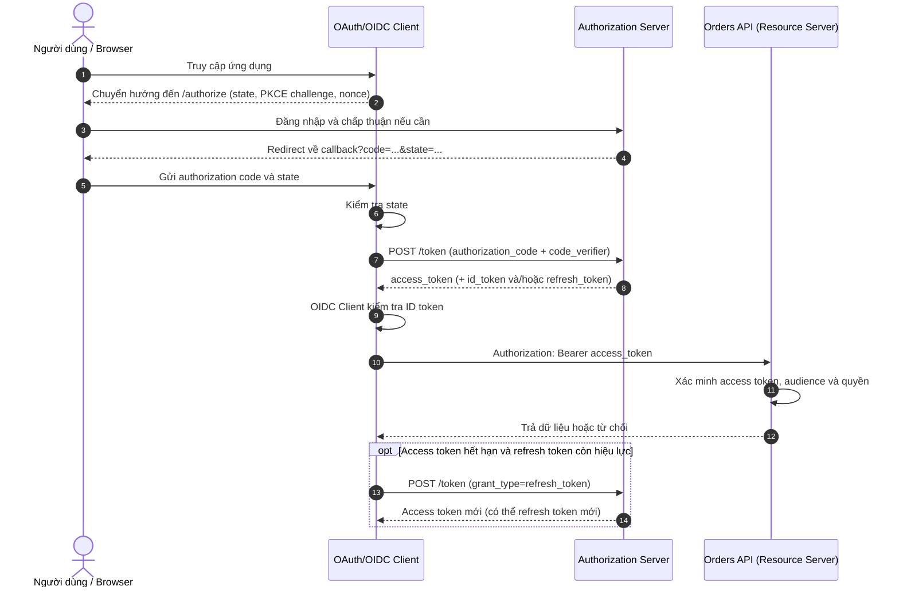

# Access token, refresh token, authorization code và ID token

Trong hệ thống dùng **OAuth 2.0**, **OpenID Connect (OIDC)** và **Spring Security Resource Server**, bốn giá trị `authorization code`, `access token`, `refresh token` và `ID token` thường xuất hiện gần nhau nhưng phục vụ **bốn mục đích khác nhau**. Hiểu đúng chúng giúp thiết kế luồng đăng nhập, cấp quyền gọi API và gia hạn phiên an toàn; đồng thời tránh nhầm ID token với quyền truy cập tài nguyên.

> **Bối cảnh ví dụ:** Ứng dụng `app.example.com` là **OAuth/OIDC Client**; `login.example.com` là **Authorization Server / OpenID Provider**; `api.example.com` là **Resource Server** cung cấp Orders API. Người dùng đăng nhập qua trình duyệt. Ví dụ cấu hình Java dùng Spring Boot 3.x / Spring Security 6.x; tên endpoint và claim có thể khác nhau tùy nhà cung cấp định danh.

## 1. OAuth 2.0 và OIDC giải quyết việc gì?

- **OAuth 2.0** là khung **ủy quyền**: client nhận một quyền truy cập có giới hạn để gọi tài nguyên được bảo vệ. Quyền đó được biểu diễn bằng `access token`, thường đi kèm `scope` và `audience`.
- **OIDC** là lớp **xác thực danh tính** xây trên OAuth 2.0. Khi client yêu cầu scope `openid`, nhà cung cấp OIDC có thể phát hành thêm **ID token** để client xác minh sự kiện đăng nhập và danh tính người dùng.
- **Spring Security Resource Server** là thành phần bảo vệ API: nhận `access token` qua HTTP, kiểm tra token và quyết định yêu cầu có đủ quyền hay không. Nó không cần tự làm màn hình đăng nhập hay tự xử lý `authorization code` hoặc `refresh token`.

Các vai trò chính:

| Vai trò | Trách nhiệm |
|---|---|
| **Resource Owner / End User** | Người dùng sở hữu dữ liệu hoặc chủ thể đăng nhập; một số luồng OAuth không có người dùng trực tiếp. |
| **Client** | Web app, ứng dụng di động hoặc dịch vụ muốn dùng API; khởi tạo luồng ủy quyền và lưu token theo loại client. |
| **Authorization Server / OpenID Provider** | Xác thực người dùng, xử lý chấp thuận, phát hành code và token, cung cấp metadata/JWKS hoặc introspection. |
| **Resource Server** | API bảo vệ tài nguyên; kiểm tra access token trước khi cung cấp dữ liệu. |

**Phân biệt hai câu hỏi cốt lõi:**

- “Client có quyền gọi `GET /api/orders` không?” → **Access token** cùng chính sách của resource server.
- “Người vừa đăng nhập với nhà cung cấp định danh là ai?” → **ID token** được OIDC client kiểm tra.

## 2. Bảng đối chiếu bốn loại

| Giá trị | Cấp khi nào? | Dùng ở đâu? | Đặc tính thường gặp | Không dùng để |
|---|---|---|---|---|
| **Authorization code** | Sau bước người dùng xác thực/chấp thuận trong Authorization Code Flow | **Client → token endpoint** của Authorization Server để đổi token | Rất ngắn hạn, một lần sử dụng, thường là chuỗi opaque; phải gắn với client, redirect URI và PKCE | Gọi API hay chứng minh danh tính trực tiếp |
| **Access token** | Khi cấp quyền thành công; hoặc khi client gia hạn token | **Client → Resource Server**, thường qua `Authorization: Bearer ...` | Thời hạn giới hạn; có thể là JWT hoặc opaque; quyền và đối tượng nhận do Authorization Server quy định | Thay thế ID token để kết luận “người dùng đã đăng nhập” |
| **Refresh token** | Có thể được cấp cùng access token tùy client, scope và chính sách | **Client → token endpoint** để xin access token mới | Thường sống lâu hơn access token; cần lưu trữ bảo mật, có thể bị thu hồi/rotation | Gửi cho Resource Server |
| **ID token** | Trong luồng **OIDC** có scope `openid` | **OpenID Provider → OIDC Client**, để client xác thực kết quả đăng nhập | **JWT**, chứa `iss`, `sub`, `aud`, `exp`, `iat` và các claim OIDC phù hợp | Được chấp nhận như access token của API |

Không suy ra loại token từ việc chuỗi có ba phần ngăn bằng dấu chấm: access token có thể cũng là JWT. **Mục đích, người nhận (`aud`), giao thức và quy tắc xác minh** mới quyết định được dùng token ở đâu.

## 3. Luồng tổng thể: Authorization Code + PKCE + OIDC

**Authorization Code Flow kết hợp PKCE** là cách phổ biến cho ứng dụng web và ứng dụng chạy trên thiết bị khi có tương tác đăng nhập. Giả sử client yêu cầu `openid profile orders.read`; Authorization Server hỗ trợ phát hành refresh token theo chính sách.



Trong luồng này **authorization code chỉ đi tới token endpoint**, **refresh token chỉ dùng với Authorization Server**, **ID token do client xác minh**, còn **access token là credential mà resource server nhận**.

### Bước A — Client khởi tạo yêu cầu ủy quyền

Ví dụ minh họa URL đã xuống dòng để dễ đọc:

```http
GET /oauth2/authorize?
    response_type=code&
    client_id=web-client&
    redirect_uri=https%3A%2F%2Fapp.example.com%2Fcallback&
    scope=openid%20profile%20orders.read&
    state=STATE_RANDOM&
    nonce=NONCE_RANDOM&
    code_challenge=BASE64URL_SHA256_VERIFIER&
    code_challenge_method=S256 HTTP/1.1
Host: login.example.com
```

Các tham số then chốt:

- `response_type=code` yêu cầu Authorization Code Flow.
- `client_id` định danh ứng dụng đã đăng ký, **không phải bí mật**.
- `redirect_uri` phải được đăng ký và đối chiếu chính xác theo chính sách của Authorization Server.
- `scope=openid` biến yêu cầu thành OIDC; `orders.read` là quyền minh họa dành cho Orders API. Việc cấp scope nào vẫn do server quyết định.
- `state` liên kết phản hồi redirect với yêu cầu khởi tạo, chống CSRF và lẫn phiên ở client.
- `nonce` liên kết ID token với yêu cầu xác thực OIDC; client cần xác minh nonce theo luồng áp dụng để chống phát lại/tiêm token.
- `code_challenge` được tính từ bí mật ngẫu nhiên `code_verifier` phía client: `BASE64URL(SHA256(ASCII(code_verifier)))`, bỏ padding. Client giữ verifier; **không gửi verifier trong authorization request**.

### Bước B — Client nhận authorization code

Sau khi đăng nhập/chấp thuận, trình duyệt được chuyển hướng về một callback đã đăng ký:

```text
https://app.example.com/callback?code=CODE_VALUE&state=STATE_RANDOM
```

Client so sánh `state` với giá trị đã lưu cho phiên giao dịch. `code` chỉ là **chứng từ tạm thời để đổi token**. Nó không chứa quyền API để resource server sử dụng. Authorization Server phải giới hạn thời gian tồn tại, chống sử dụng lại và ràng buộc code với client/redirect URI cũng như PKCE nếu đã yêu cầu.

Không ghi code vào log hoặc dùng nó như mật khẩu. Vì code đi qua trình duyệt và redirect, ứng dụng cũng cần hạn chế rò rỉ qua history, referrer, công cụ theo dõi và liên kết của trang callback.

### Bước C — Đổi authorization code lấy token

Client gửi yêu cầu trực tiếp đến token endpoint qua HTTPS:

```http
POST /oauth2/token HTTP/1.1
Host: login.example.com
Content-Type: application/x-www-form-urlencoded

grant_type=authorization_code&
code=CODE_VALUE&
redirect_uri=https%3A%2F%2Fapp.example.com%2Fcallback&
client_id=web-client&
code_verifier=ORIGINAL_HIGH_ENTROPY_VERIFIER
```

Yêu cầu trên minh họa **public client** dùng PKCE. **Confidential client** phải xác thực client bằng phương thức đã đăng ký (ví dụ HTTP Basic, `private_key_jwt` hoặc cách khác do server hỗ trợ); không mặc định rằng chỉ có `client_id` là đủ. Authorization Server đối chiếu `code_verifier` với challenge đã lưu, kiểm tra code, client và redirect URI trước khi cấp token.

Phản hồi ví dụ; những trường tùy chọn phụ thuộc scope, client và chính sách:

```json
{
  "access_token": "ACCESS_TOKEN_VALUE",
  "token_type": "Bearer",
  "expires_in": 300,
  "scope": "openid profile orders.read",
  "id_token": "SIGNED_ID_TOKEN_JWT",
  "refresh_token": "REFRESH_TOKEN_VALUE"
}
```

Có thể **không có** `refresh_token`; không nên viết chương trình mặc định rằng cứ đăng nhập OIDC là được refresh token. Trong OIDC Authorization Code Flow, ID token được phát hành khi yêu cầu OIDC hợp lệ; cách phân phối các claim và token còn tùy triển khai.

## 4. Access token — quyền gọi Resource Server

### 4.1. Access token trả lời câu hỏi gì?

Access token thể hiện **ủy quyền cho một tài nguyên/phạm vi xác định**. Client trình token khi truy cập API:

```http
GET /api/orders/42 HTTP/1.1
Host: api.example.com
Authorization: Bearer ACCESS_TOKEN_VALUE
```

`Bearer` nghĩa là bên nào cầm được token có thể sử dụng trong phạm vi token và chính sách chấp nhận của API, nếu không có cơ chế ràng buộc người gửi bổ sung (như mTLS hay DPoP). Vì vậy cần TLS, token ngắn hạn, hạn chế quyền và ngăn rò rỉ token.

Thông tin cần quan tâm khi resource server ra quyết định:

- **Issuer (`iss`)**: Authorization Server nào phát hành token?
- **Audience (`aud`)**: token có được phát hành **cho API này** không? Một token hợp lệ dành cho API A không tự động được dùng ở API B.
- **Thời gian**: `exp` đã hết hạn chưa, `nbf` đã tới hiệu lực chưa; chỉ chấp nhận thời gian chênh lệch nhỏ đã định rõ.
- **Scope/authority**: ví dụ `orders.read` cho phép đọc đơn hàng, nhưng không tự động cho phép ghi.
- **Ngữ cảnh quyền truy cập**: quyền sở hữu đơn hàng, tenant, vai trò nghiệp vụ, chính sách truy cập ở tầng ứng dụng vẫn phải được kiểm tra. Scope không thay thế kiểm tra quyền theo đối tượng.

Access token không nhất thiết đại diện cho người dùng: trong `client_credentials`, quyền có thể được cấp cho **ứng dụng**. Do đó không suy ra “đây là tài khoản người dùng nào” chỉ từ việc có một access token hợp lệ.

### 4.2. JWT access token và opaque access token

**JWT access token** thường gồm ba phần `header.payload.signature` (khi là signed JWT/JWS). Ví dụ payload *minh họa* sau khi giải mã:

```json
{
  "iss": "https://login.example.com",
  "sub": "user-42",
  "aud": ["orders-api"],
  "iat": 1999996400,
  "exp": 2000000000,
  "scope": "orders.read orders.write",
  "client_id": "web-client"
}
```

- JWT **giải mã được** không đồng nghĩa với **đã xác minh**. Resource Server phải kiểm tra chữ ký, thuật toán cho phép, nguồn khóa tin cậy, issuer, audience và thời hạn trước khi tin các claim.
- Claim, định dạng `scope` hay `scp`, cách thể hiện role và audience khác nhau giữa nhà cung cấp. Không giả định mọi JWT có cùng cấu trúc.
- JWT được xác minh cục bộ thuận tiện nhưng có thể còn hiệu lực tới khi hết hạn, ngay cả khi quyền đã đổi hoặc token bị thu hồi, trừ khi triển khai thêm cơ chế phù hợp.

**Opaque access token** là chuỗi không có định dạng payload công khai. Resource Server thường gọi **introspection endpoint** của Authorization Server (với thông tin xác thực dành cho resource server) để biết token còn `active` không và nhận scope/metadata liên quan. Việc kiểm tra qua mạng tạo phụ thuộc về độ trễ và khả dụng; cách cache hoặc xử lý thu hồi cần được thiết kế theo độ nhạy của API.

> **Nguyên tắc:** Resource Server không đoán tính hợp lệ bằng cách tách chuỗi; nó phải dùng bộ xác minh JWT hoặc introspection tương ứng với loại token mà Authorization Server thực sự phát hành.

### 4.3. Access token được phép vào API nào?

Ví dụ client nhận hai access token khác nhau:

| Token | Audience | Scope | Kết quả dự kiến tại Orders API |
|---|---|---|---|
| A | `orders-api` | `orders.read` | Có thể đọc nếu token hợp lệ và chính sách tài nguyên cho phép |
| B | `billing-api` | `billing.read` | **Phải từ chối**: sai audience |
| C | `orders-api` | `orders.write` | Không đủ `orders.read` cho endpoint yêu cầu đọc |
| D | `orders-api` | `orders.read`, nhưng đã hết hạn | **Phải từ chối**: hết hạn |

Đánh giá **audience trước**, rồi **scope/authority**, sau đó kiểm tra chính sách nghiệp vụ chi tiết. Không cấp quyền chỉ vì token có chữ ký hợp lệ.

## 5. Refresh token — xin token mới khi access token hết hạn

Access token thường được cấp với thời hạn tương đối ngắn. Nếu phải đưa người dùng quay lại đăng nhập mỗi khi token hết hạn, trải nghiệm sẽ kém. **Refresh token** cho phép một client **đủ điều kiện** yêu cầu access token mới mà không cần lặp lại toàn bộ luồng đăng nhập.

```http
POST /oauth2/token HTTP/1.1
Host: login.example.com
Content-Type: application/x-www-form-urlencoded

grant_type=refresh_token&
refresh_token=REFRESH_TOKEN_VALUE&
client_id=web-client
```

Đây là ví dụ cho public client. Confidential client vẫn phải xác thực theo phương thức đã đăng ký. Authorization Server kiểm tra refresh token còn hiệu lực, thuộc client hợp lệ và còn quyền cấp token; sau đó trả access token mới, đôi khi kèm **refresh token mới**.

```json
{
  "access_token": "NEW_ACCESS_TOKEN_VALUE",
  "token_type": "Bearer",
  "expires_in": 300,
  "refresh_token": "ROTATED_REFRESH_TOKEN_VALUE"
}
```

**Refresh token rotation:** server phát hành refresh token mới sau một lần sử dụng và vô hiệu hóa token cũ. Client phải **thay thế** token đã lưu theo phản hồi và xử lý tình huống dùng lại/token bị thu hồi. Với public client, các biện pháp như rotation hoặc sender-constraining giúp phát hiện/giảm tác hại khi token bị đánh cắp; áp dụng theo chính sách bảo mật hiện hành.

Một số nguyên tắc vận hành:

- **Không gửi refresh token đến Orders API.** API cần access token, còn refresh token phải tới token endpoint.
- **Không mặc định refresh token tồn tại vĩnh viễn.** Nó có thể hết hạn, bị thu hồi, mất hiệu lực khi người dùng đăng xuất, đổi thông tin bảo mật hoặc server thay đổi chính sách.
- **Không mặc định scope được mở rộng khi refresh.** Token mới chỉ nằm trong phạm vi server/client cho phép.
- **Bảo vệ vị trí lưu token.** Backend/confidential client nên lưu phía máy chủ với quyền truy cập tối thiểu và mã hóa/phân quyền phù hợp. Với trình duyệt, xem xét kiến trúc **Backend for Frontend (BFF)** dùng session cookie `HttpOnly`, `Secure` và chính sách `SameSite`, kèm bảo vệ CSRF khi dùng cookie. Việc lưu refresh token ở JavaScript-accessible storage dễ làm tăng tác hại của XSS.
- **Xử lý `invalid_grant`:** khi refresh token hết hiệu lực/không hợp lệ, xóa trạng thái tương ứng và cho client bắt đầu lại luồng đăng nhập hoặc ủy quyền; tránh vòng lặp refresh liên tục.

Không dùng refresh token như một “session token” để ứng dụng khác tin rằng người dùng đang online; ý nghĩa của nó chỉ là khả năng xin token mới theo điều kiện Authorization Server.

## 6. ID token — xác minh kết quả đăng nhập OIDC

### 6.1. ID token phục vụ client, không phục vụ API tùy ý

Trong OIDC, **ID token luôn là JWT**. Nó là phát biểu đã ký từ OpenID Provider về sự kiện xác thực một chủ thể cho **một client nhất định**. OIDC client (Relying Party) dùng ID token để xây dựng phiên đăng nhập sau khi xác minh theo giao thức. Ví dụ payload minh họa:

```json
{
  "iss": "https://login.example.com",
  "sub": "user-42",
  "aud": "web-client",
  "iat": 1999996400,
  "exp": 2000000000,
  "auth_time": 1999996300,
  "nonce": "NONCE_RANDOM",
  "name": "Nguyen Van A",
  "email": "user@example.com",
  "email_verified": true
}
```

Giải thích các claim:

| Claim | Vai trò |
|---|---|
| `iss` | Định danh nhà phát hành OIDC đã tin cậy. |
| `sub` | Định danh ổn định của chủ thể **trong phạm vi issuer**; cặp `(iss, sub)` thích hợp hơn email để định danh người dùng. |
| `aud` | Client ID được phép nhận ID token, ví dụ `web-client`; thường **khác** audience API. |
| `exp`, `iat` | Thời điểm hết hạn và phát hành; OIDC client phải kiểm tra theo đặc tả. |
| `nonce` | Giá trị để đối chiếu với yêu cầu đăng nhập khi luồng sử dụng nonce. |
| `auth_time` | Thời điểm xác thực người dùng, có mặt khi được yêu cầu hoặc theo chính sách. |
| `azp` | Authorized party, cần được xét khi các điều kiện về nhiều audience áp dụng. |
| `name`, `email`, `email_verified` | Claim hồ sơ **tùy chọn**; không nên giả định luôn có hoặc email bất biến. |

**OIDC client** cần xác minh chữ ký bằng khóa của provider, thuật toán chấp nhận, `iss`, `aud`, `exp`, nonce khi đã gửi, và các điều kiện OIDC liên quan như `azp`/`auth_time` khi áp dụng. Không tin ID token chỉ vì có thể Base64URL-decode payload.

### 6.2. Tại sao Resource Server không nhận ID token làm access token?

Giả sử ID token có `aud = web-client`. Nó chứng minh provider đã xác thực chủ thể **cho web-client**, không phát biểu quyền `orders.read` đối với `orders-api`. Nếu API chấp nhận token này chỉ vì cùng issuer và có chữ ký đúng, API đã bỏ qua ranh giới giữa **authentication** và **authorization**.

Vì vậy:

- **Client đăng nhập**: dùng luồng OIDC (trong Spring Security client có thể dùng `oauth2Login`) và kiểm tra ID token.
- **Resource Server bảo vệ endpoint**: dùng `oauth2ResourceServer` và xác minh **access token** đúng audience, thời hạn và quyền.
- **API muốn thông tin người dùng**: xem các claim đáng tin trong access token hoặc dùng cơ chế người dùng/ủy quyền phù hợp; OIDC `UserInfo` endpoint cũng dùng access token thích hợp, không phải yêu cầu gửi ID token vào Orders API.

ID token hết hạn không nhất thiết có nghĩa toàn bộ phiên ứng dụng đã kết thúc; phiên của client có vòng đời riêng. Ngược lại, có ID token chưa hết hạn cũng không cho phép bỏ qua kiểm tra access token mỗi lần gọi API.

## 7. Cấu hình Spring Security OAuth 2.0 Resource Server

Phần này giả định Orders API là một ứng dụng Spring MVC cung cấp endpoint `/api/orders/**` và tin Authorization Server tại `https://login.example.com`. Việc chọn JWT hay opaque **phải khớp định dạng access token thực tế**.

### 7.1. Trường hợp access token là JWT

Các dependency Gradle (Groovy DSL) cần thiết trong dự án Spring Boot đã có cấu hình plugin và phiên bản:

```groovy
dependencies {
    implementation 'org.springframework.boot:spring-boot-starter-web'
    implementation 'org.springframework.boot:spring-boot-starter-security'
    implementation 'org.springframework.boot:spring-boot-starter-oauth2-resource-server'
}
```

Cấu hình `application.yml` cho issuer và audience của Orders API (thuộc tính `audiences` được các bản Spring Boot 3.x hiện hành hỗ trợ; ở bản khác có thể cần custom `OAuth2TokenValidator<Jwt>`):

```yaml
spring:
  security:
    oauth2:
      resourceserver:
        jwt:
          issuer-uri: https://login.example.com
          audiences:
            - orders-api
```

Khi nhà cung cấp hỗ trợ metadata theo chuẩn, `issuer-uri` giúp Spring Security tìm cấu hình provider/JWK Set và xác minh JWT. Resource Server phải xác minh chữ ký, kiểm tra `iss`, hạn dùng và **audience của API**. Không dùng `client_id` của OIDC client để thay cho `orders-api` trừ khi đó thực sự là mô hình audience mà Authorization Server phát hành và API đã đăng ký.

Một cấu hình bảo vệ endpoint theo quyền đã được cấp:

```java
package com.example.orders.security;

import org.springframework.context.annotation.Bean;
import org.springframework.context.annotation.Configuration;
import org.springframework.http.HttpMethod;
import org.springframework.security.config.Customizer;
import org.springframework.security.config.annotation.web.builders.HttpSecurity;
import org.springframework.security.config.http.SessionCreationPolicy;
import org.springframework.security.web.SecurityFilterChain;

@Configuration
public class SecurityConfig {

    @Bean
    SecurityFilterChain securityFilterChain(HttpSecurity http) throws Exception {
        return http
            .authorizeHttpRequests(auth -> auth
                .requestMatchers(HttpMethod.GET, "/api/orders/**")
                    .hasAuthority("SCOPE_orders.read")
                .requestMatchers(HttpMethod.POST, "/api/orders/**")
                    .hasAuthority("SCOPE_orders.write")
                .anyRequest().authenticated()
            )
            .oauth2ResourceServer(oauth2 ->
                oauth2.jwt(Customizer.withDefaults())
            )
            .sessionManagement(session ->
                session.sessionCreationPolicy(SessionCreationPolicy.STATELESS)
            )
            .build();
    }
}
```

Trong cấu hình mặc định, Spring Security thường chuyển OAuth scopes trong claim `scope`/`scp` thành authorities có tiền tố `SCOPE_`; do đó `orders.read` tương ứng `SCOPE_orders.read`. Nếu provider dùng claim hoặc cấu trúc quyền riêng, cần cấu hình `JwtAuthenticationConverter` tương ứng và kiểm tra kết quả mapping.

**Giới hạn ví dụ:** Chính sách ở trên chỉ mô tả kiểm tra token và route. Một API thực tế vẫn cần xét quyền xem đơn hàng cụ thể, tenant, thông tin chủ sở hữu, quy tắc xử lý phương thức HTTP khác, CORS và các biện pháp bảo vệ đầu vào. Nếu dùng cookie để xác thực trong cùng ứng dụng, phải xem lại chính sách CSRF thay vì áp dụng máy móc cấu hình API bearer token.

Ví dụ gọi API:

```bash
curl -i \
  -H "Authorization: Bearer ACCESS_TOKEN_VALUE" \
  https://api.example.com/api/orders/42
```

Khi access token hợp lệ và có `orders.read`, request vượt qua lớp kiểm tra route; việc trả đơn hàng số 42 còn phụ thuộc quyền nghiệp vụ.

### 7.2. Trường hợp access token là opaque

Nếu Authorization Server cấp opaque access token, dùng introspection thay cho JWT decoder:

```yaml
spring:
  security:
    oauth2:
      resourceserver:
        opaquetoken:
          introspection-uri: https://login.example.com/oauth2/introspect
          client-id: orders-api-introspection
          client-secret: REPLACE_WITH_SECRET_FROM_SECURE_CONFIG
```

Trong Java, đổi cấu hình Resource Server tương ứng thành:

```java
.oauth2ResourceServer(oauth2 ->
    oauth2.opaqueToken(Customizer.withDefaults())
)
```

Credential introspection thuộc **resource server**, cần lấy từ biến môi trường hoặc secret manager thay vì commit trực tiếp. Tên endpoint và cơ chế xác thực introspection do Authorization Server cung cấp. Quy tắc `hasAuthority("SCOPE_orders.read")` có thể tiếp tục áp dụng nếu kết quả introspection chứa scope được ánh xạ tương thích. Kiểm tra các thuộc tính audience/đích nhận mà provider trả về và bổ sung chính sách xác minh nếu cần; không suy ra opaque token “active” là tự động được dùng ở mọi API.

**Một Resource Server không cần tự triển khai** bước nhận `authorization code`, đổi `code_verifier`, làm mới refresh token hay dùng ID token đăng nhập. Đó là nhiệm vụ OAuth/OIDC **Client** và Authorization Server. Nếu một ứng dụng đồng thời đóng cả vai trò web client và API, hãy cấu hình rõ từng vai trò với security chain/đường dẫn phù hợp.

### 7.3. Mã lỗi cần phân biệt

| Tình huống | Nơi phát hiện | Kết quả điển hình |
|---|---|---|
| Không có `Authorization: Bearer` khi gọi API bảo vệ | Resource Server | `401 Unauthorized`, client cần cung cấp access token |
| Access token sai chữ ký, sai issuer, sai audience hoặc hết hạn | Resource Server | `401 Unauthorized` / `invalid_token` |
| Access token hợp lệ nhưng thiếu `orders.read` | Resource Server | `403 Forbidden` / có thể `insufficient_scope` |
| Authorization code hết hạn, đã dùng hoặc PKCE không khớp | Token endpoint | OAuth lỗi `invalid_grant` |
| Refresh token hết hạn, bị thu hồi hoặc không thuộc client | Token endpoint | OAuth lỗi `invalid_grant` |
| ID token sai issuer, client audience hoặc nonce | OIDC Client | Đăng nhập thất bại; không tạo phiên dựa trên token đó |

Lỗi `401` và `403` từ API không có nghĩa client nên gửi refresh token hoặc ID token để thử lại. Nếu access token hết hạn và có refresh token hợp lệ, **client** chủ động làm mới ở token endpoint rồi gọi lại API bằng **access token mới**.

## 8. Các nhầm lẫn và rủi ro phổ biến

1. **Lấy ID token gọi API:** cả hai có thể là JWT nhưng `aud` và mục đích khác nhau. API chỉ chấp nhận access token được phát hành cho nó.
2. **Chỉ kiểm tra chữ ký:** chữ ký hợp lệ chưa đủ; cần `iss`, `aud`, thời hạn, phạm vi và chính sách tài nguyên.
3. **Coi refresh token là access token dài hạn:** refresh token chỉ gửi đến Authorization Server, nơi áp dụng quy tắc làm mới/thu hồi.
4. **Bỏ qua PKCE vì đã có state:** `state` chống lẫn phiên/CSRF ở redirect; PKCE ràng buộc bên đổi code với bên đã khởi tạo yêu cầu. Hai cơ chế giải quyết rủi ro khác nhau.
5. **Dùng `sub` hoặc email để tự suy ra quyền:** biết chủ thể là ai không thay thế kiểm tra quyền trên tài nguyên và tenant.
6. **Tin rằng scope tự bảo vệ mọi đối tượng:** `orders.read` có thể cho phép thao tác đọc ở mức API; yêu cầu xem đơn hàng của người khác vẫn phải được từ chối nếu không có quyền nghiệp vụ.
7. **Đưa token vào URL/log/tracing:** bearer token, refresh token và code có thể bị lộ qua log, analytics, proxy, lịch sử trình duyệt. Chỉ gửi access token qua header được bảo vệ bằng HTTPS; ẩn giá trị nhạy cảm khỏi telemetry.
8. **Lưu refresh token tùy tiện trong trình duyệt:** XSS có thể đọc storage do JavaScript truy cập. Chọn kiến trúc lưu trữ dựa trên loại client, threat model, PKCE và chính sách của nhà cung cấp.
9. **Giả định token tự đổi sau khi bị thu hồi:** JWT tự xác minh thường vẫn có hiệu lực cho đến hạn `exp` nếu không triển khai revocation/session controls. Dùng thời hạn phù hợp, thu hẹp scope/audience và cơ chế thu hồi bổ sung khi nghiệp vụ yêu cầu.
10. **Nhầm vai trò Spring Security:** `oauth2Login` cho web app làm OIDC Client; `oauth2ResourceServer` cho API bảo vệ bằng access token. Một service có thể dùng cả hai nhưng phải thiết kế đường đi và quy tắc cụ thể.

## 9. Ví dụ tự kiểm tra luồng

Giả sử client nhận được ba giá trị sau sau khi đổi authorization code: access token A có `aud=orders-api`, `scope=orders.read`, `exp` còn hiệu lực; ID token B có `aud=web-client`; refresh token C còn hiệu lực.

| Yêu cầu | Giá trị nên dùng | Vì sao? |
|---|---|---|
| Đọc `GET /api/orders/42` | **A** | Resource Server cần access token đúng audience và scope. |
| Thiết lập phiên đăng nhập ở OIDC Client | **B** | Client xác minh ID token để biết kết quả xác thực. |
| Xin access token mới sau khi A hết hạn | **C** | Refresh token được gửi tới token endpoint. |
| Đổi chứng từ tạm thời ngay sau callback | **Authorization code + code_verifier** | Client thực hiện `authorization_code` grant với Authorization Server. |
| Đăng nhập cho một máy khách khác bằng B | **Không dùng B** | ID token được phát hành cho `web-client`, không phải mọi client. |

Để kiểm thử tích hợp trong môi trường phát triển, có thể lần lượt gọi API **không token**, với **access token hết hạn**, với **access token sai audience**, với **access token thiếu scope**, rồi với **access token hợp lệ đủ scope**. Kết quả kỳ vọng lần lượt cho thấy cơ chế xác thực (`401`), kiểm tra quyền (`403`) và xử lý dữ liệu ứng dụng. Không cần và không nên gửi ID token/refresh token tới API trong các trường hợp này.

## 10. Ghi nhớ theo vòng đời

- **Authorization code:** chứng từ ngắn hạn, một lần sử dụng, dùng cùng PKCE để **đổi token**.
- **Access token:** credential giới hạn **quyền truy cập API**; Resource Server xác minh loại token, issuer, audience, thời hạn và scope/chính sách.
- **Refresh token:** credential nhạy cảm cho **gia hạn access token tại Authorization Server**; có thể bị rotation hoặc thu hồi.
- **ID token:** JWT do OIDC provider phát hành để **client xác minh đăng nhập**; không phải vé gọi API.

Khi xây Spring Security Resource Server, hãy bắt đầu từ câu hỏi **“API này được phép nhận access token có audience nào và authority nào?”**. Authorization code, refresh token và ID token thuộc các bước khác của hệ thống OAuth 2.0/OIDC và không thay thế câu trả lời đó.
